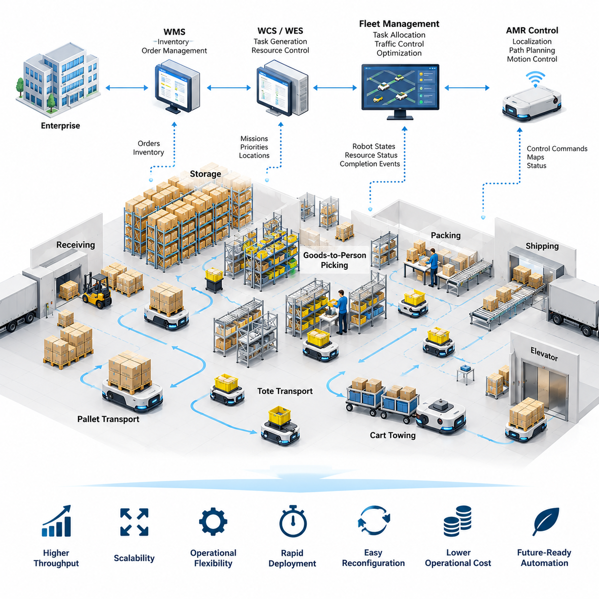
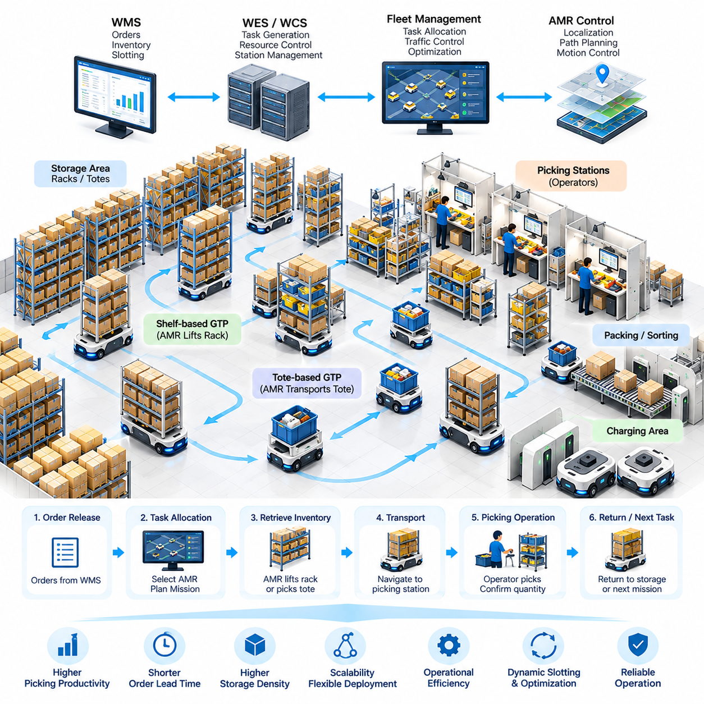
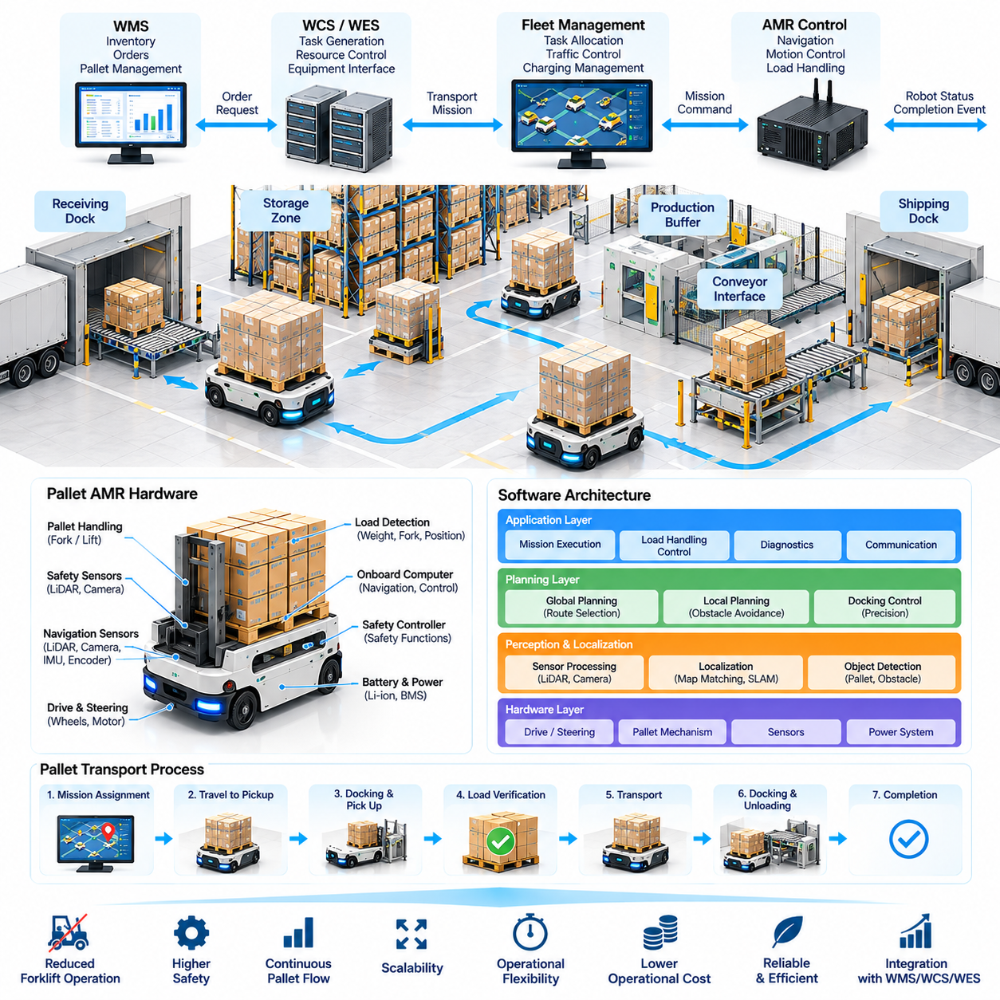
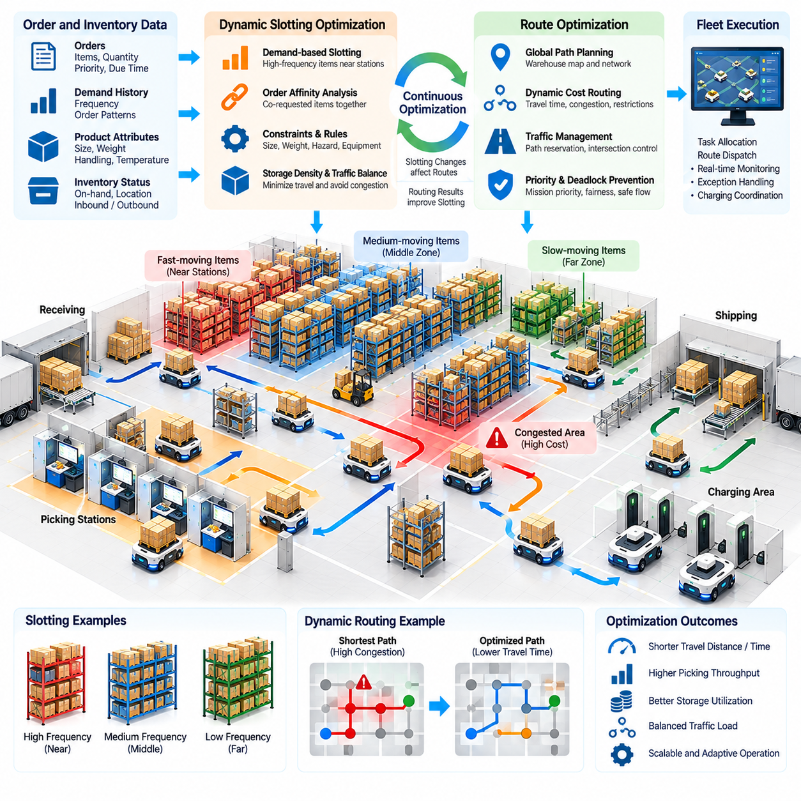
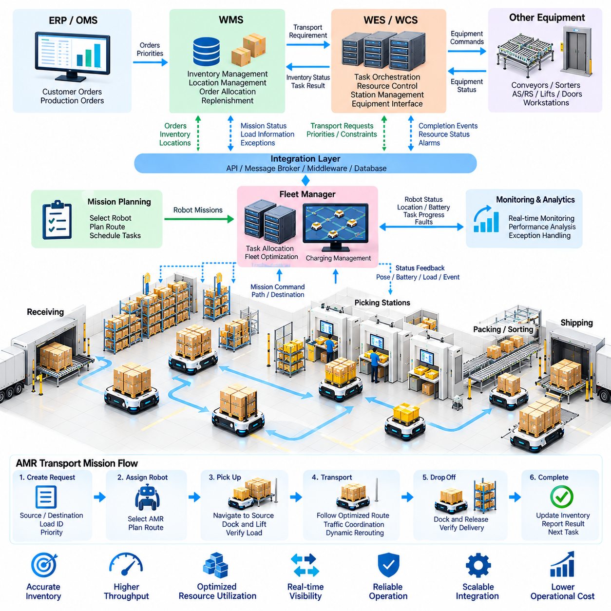
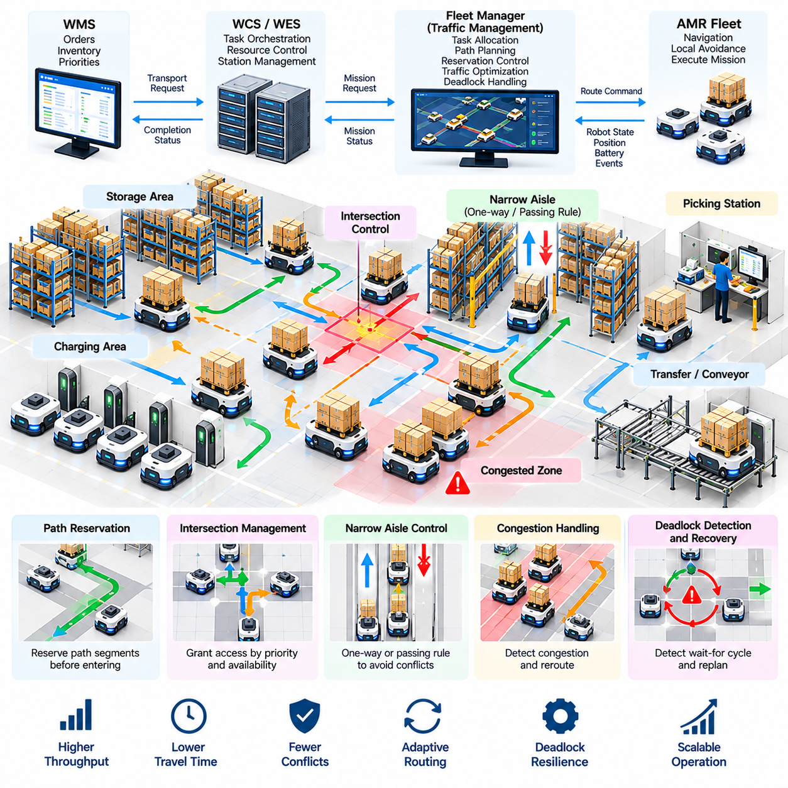
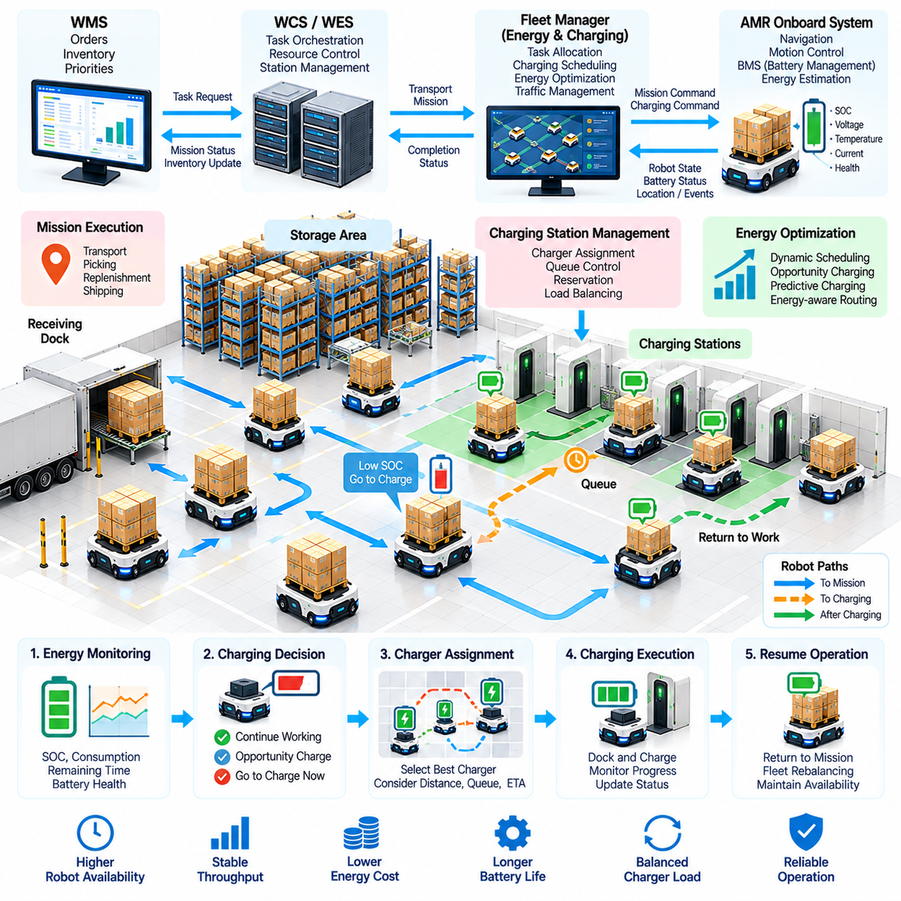
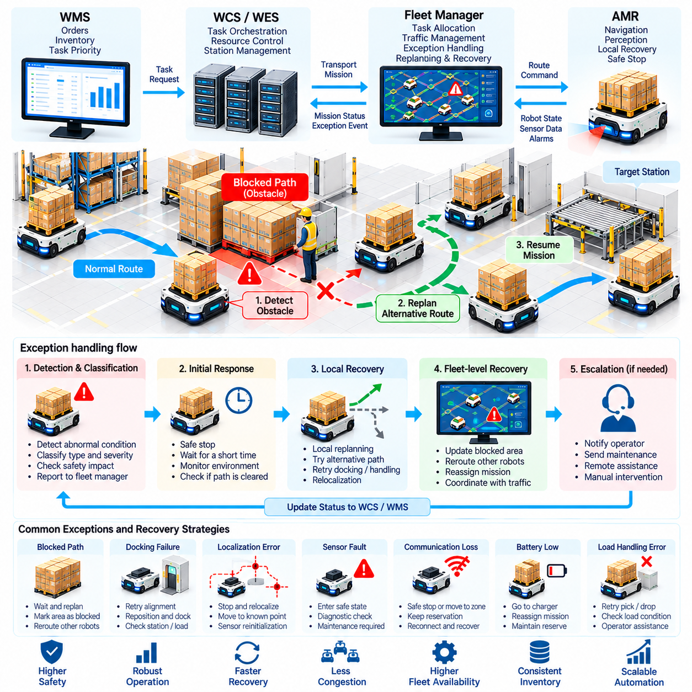
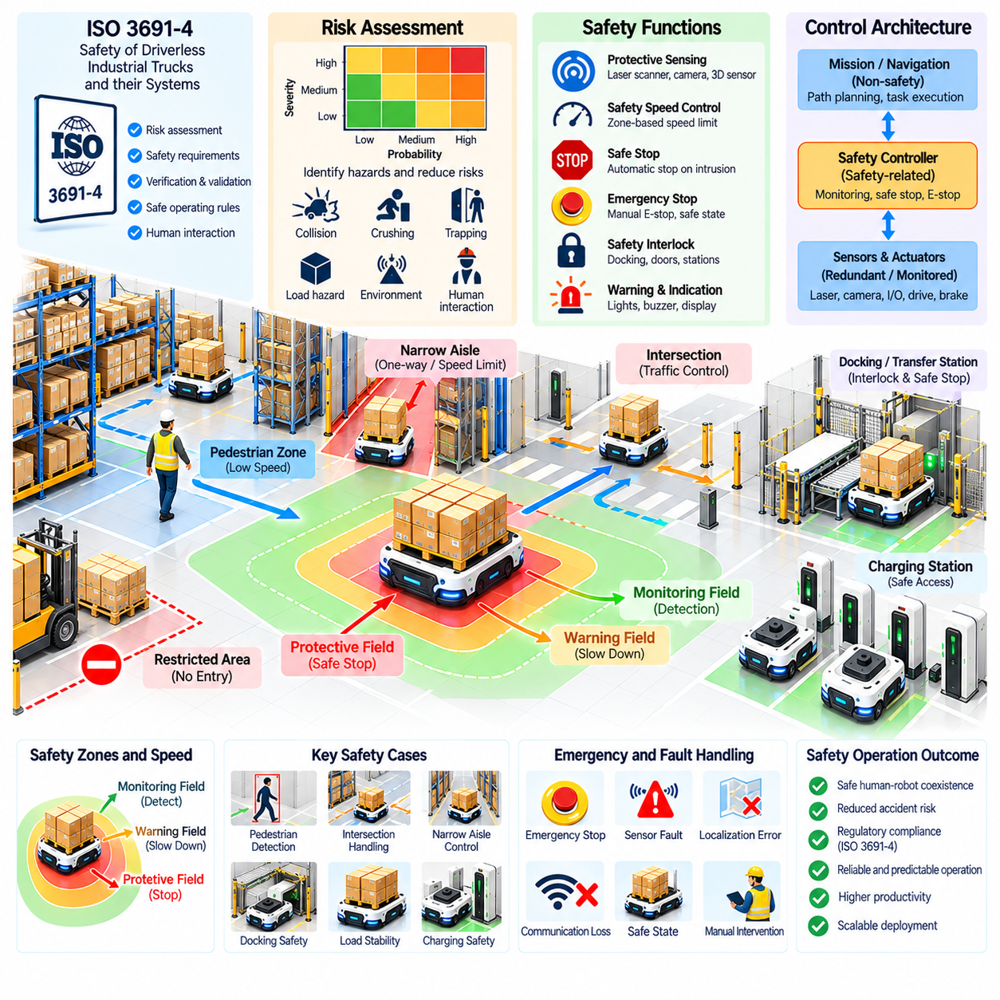
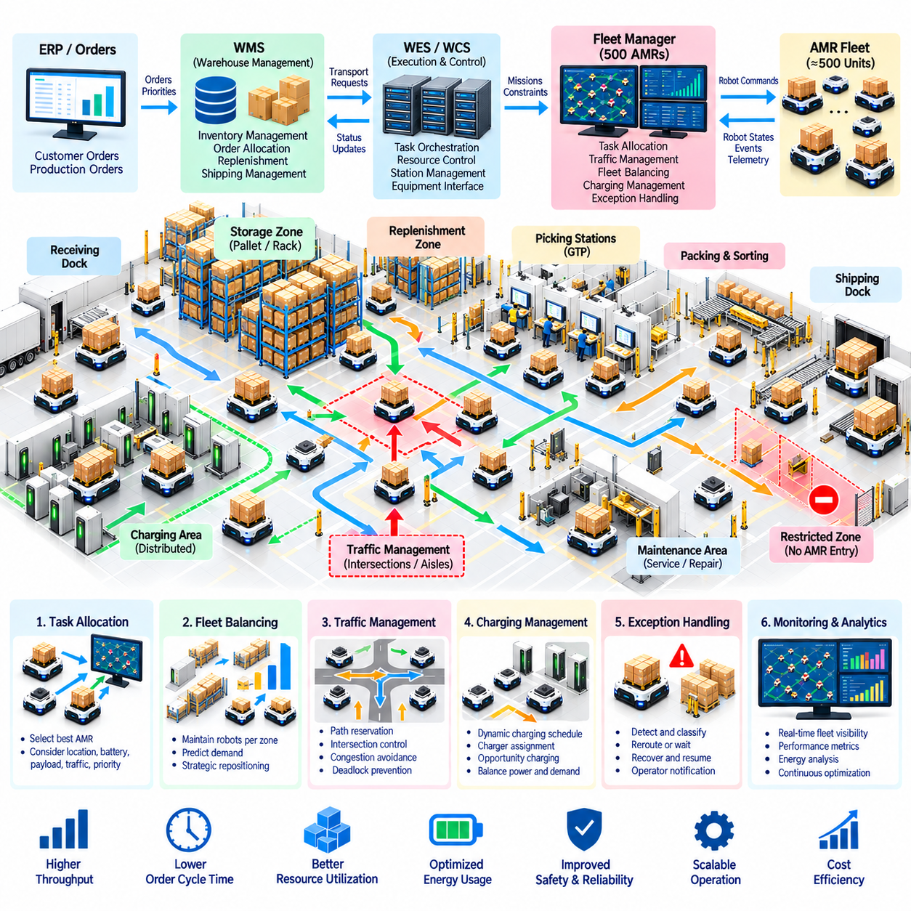

**Volume 26. Industrial Robot Applications**

# Chapter 01. Warehouse AMR Applications

## 01.01. Warehouse Automation Market and AMR Role

{width="7.268055555555556in" height="7.268055555555556in"}

Warehouse automation has evolved from isolated material-handling equipment into an integrated operational architecture that connects inventory, transportation, storage, picking, packing, and shipping. Autonomous Mobile Robots (AMRs) have become an important element of this transformation because they provide flexible transportation without requiring fixed guide paths. Within the chapter structure, AMRs serve as the foundation for later topics such as goods-to-person systems, pallet transport, fleet integration, traffic management, charging, and safety.

The growth of e-commerce, shorter delivery expectations, increasing SKU diversity, and fluctuating order volumes have changed the economics of warehouse operations. Traditional facilities designed around manual carts, forklifts, conveyors, and fixed storage systems can struggle when demand patterns change rapidly. Automation therefore increasingly focuses not only on maximum throughput, but also on scalability, operational flexibility, rapid deployment, and the ability to reconfigure workflows without extensive infrastructure modification.

Warehouse automation can be viewed as a hierarchy of physical equipment, control software, information systems, and optimization services. At the enterprise level, warehouse management systems coordinate inventory and orders, while warehouse control and execution systems translate business requirements into operational tasks. At the physical level, conveyors, automated storage systems, robotic manipulators, forklifts, and AMRs perform material movement. AMRs connect these layers by transforming software-generated transport missions into autonomous physical actions.

An AMR differs fundamentally from conventional fixed-path automation because its movement is determined through localization, mapping, path planning, obstacle detection, and motion control. Instead of following magnetic tape, wires, or permanently defined tracks, an AMR can navigate through a mapped environment and adapt its trajectory when conditions change. This capability makes the robot particularly suitable for warehouses where people, pallets, carts, forklifts, temporary storage areas, and other robots continuously alter the usable transportation space.

The business value of AMRs comes from flexibility rather than mobility alone. A conveyor provides predictable high-volume transport but normally requires substantial physical infrastructure and is difficult to relocate. An AMR fleet can often be expanded incrementally by adding robots, modifying maps, or changing task-allocation policies. This allows warehouse operators to increase capacity during growth phases, redesign material flows, or introduce automation into existing brownfield facilities without rebuilding the entire logistics infrastructure.

AMRs support several warehouse transportation patterns. Goods-to-person operations use robots to bring shelves, racks, totes, or containers toward stationary workers or robotic picking stations. Other systems transport individual totes between work cells, move pallets between receiving, storage, production, and shipping areas, or tow carts through intralogistics routes. The attached volume structure reflects this progression from market context into goods-to-person design and autonomous pallet transportation.

Goods-to-person automation changes the traditional relationship between workers and inventory. In a manual warehouse, workers may spend significant time walking between storage locations, whereas an AMR-based system can move inventory toward designated picking stations. The objective is not simply to replace walking with robot motion. The complete system must synchronize order release, inventory availability, robot assignment, station capacity, replenishment, congestion, and downstream packing so that improvements in one process do not create bottlenecks elsewhere.

Pallet-transport AMRs address another important operational layer. Receiving docks, reserve storage, production buffers, staging areas, and shipping docks often require repeated pallet movements that have traditionally depended on manually operated forklifts. Autonomous pallet vehicles can execute these movements continuously while reporting their position, mission state, load status, and exceptions to supervisory software. Their effectiveness depends on reliable load detection, docking accuracy, navigation, traffic coordination, and safe interaction with human-operated equipment.

Software integration determines whether individual AMRs become useful warehouse assets or merely isolated mobile machines. Warehouse Management Systems (WMS), Warehouse Control Systems (WCS), fleet managers, and robot controllers must exchange orders, priorities, locations, resource states, and completion events. The source structure explicitly treats WMS/WCS integration as a core warehouse AMR topic, together with dynamic slotting and route optimization, emphasizing that robot deployment is part of a larger software-controlled logistics system.

Fleet management becomes increasingly important as the number of robots grows. A single AMR can plan a collision-free local path, but hundreds of independently operating robots can generate congestion, resource conflicts, and deadlocks if global coordination is inadequate. Fleet software therefore performs task allocation, traffic control, route reservation, priority management, congestion avoidance, and recovery. The warehouse must be treated as a shared transportation network whose capacity depends on both physical geometry and scheduling policies.

Dynamic route optimization extends this concept by continuously adapting robot movement to operational conditions. The shortest geometric route is not necessarily the fastest or most productive route when intersections are congested, elevators are occupied, charging stations are busy, or high-priority missions are entering the system. Effective optimization considers travel time, queue length, robot availability, mission priority, battery state, and predicted traffic so that fleet-level throughput is improved rather than optimizing each robot independently.

Energy management is another system-level requirement. Battery-powered AMRs must balance productive operation against charging requirements, and poorly coordinated charging can reduce available fleet capacity during demand peaks. Charging strategies may consider state of charge, expected workload, mission priority, charger availability, battery health, and predicted idle periods. The chapter structure consequently places charging-station management and energy optimization alongside traffic management as an essential part of practical AMR fleet operation.

Real warehouses are inherently uncertain environments, making exception handling as important as nominal navigation. A blocked aisle, misplaced pallet, damaged load, localization failure, unavailable workstation, communication interruption, or inaccessible charging station can prevent a mission from completing normally. Industrial AMR software therefore requires explicit recovery states, timeout policies, replanning mechanisms, operator escalation, event logging, and safe fallback behavior. Operational robustness is measured by how effectively the system recovers from these frequent disruptions.

Safety forms a boundary around every optimization objective. Increasing robot speed or reducing separation distances may improve throughput, but warehouse robots share space with workers, forklifts, carts, machinery, and infrastructure. Safety architecture must therefore coordinate sensing, speed control, protective fields, emergency stopping, fault handling, and operational procedures. The attached chapter plan specifically includes an ISO 3691-4 warehouse AMR safety case, positioning safety compliance as a core deployment concern rather than an optional feature.

The economic evaluation of warehouse AMRs should consider total system performance rather than robot purchase price alone. Relevant factors include labor utilization, throughput, travel distance, order cycle time, error reduction, facility modification costs, maintenance, software integration, charging infrastructure, fleet supervision, and expected utilization. AMRs can be particularly attractive when automation must be introduced progressively because deployment can begin with a limited fleet and expand as operational benefits and demand become clearer.

AMRs also create a digital representation of warehouse movement. Every mission can generate timestamps, trajectories, waiting periods, traffic events, battery states, faults, and completion records. When combined with order and inventory information, this operational data can reveal congestion zones, inefficient layouts, recurring exceptions, and underutilized resources. The robot fleet therefore becomes both a transportation system and a distributed data-generation platform that supports continuous warehouse optimization.

The broader robotics software architecture reinforces this system perspective. The associated software series separately addresses ROS 2 for AMRs, fleet APIs, cloud fleet services, industrial navigation, and multi-robot fleet intelligence, showing that warehouse AMR applications depend on capabilities distributed across middleware, communication, navigation, and fleet coordination layers.

At larger deployment scales, warehouse automation becomes a cyber-physical orchestration problem. Hundreds of robots must interact with storage equipment, workstations, doors, elevators, conveyors, manipulators, and human operators while responding to constantly changing orders. Centralized optimization may provide global coordination, while individual robots retain local autonomy for perception, obstacle avoidance, and safety. Successful architectures therefore divide responsibilities carefully between enterprise software, fleet services, edge computation, and onboard robot control.

The strategic role of AMRs is ultimately to convert warehouse transportation from a relatively rigid physical process into a programmable logistics capability. Missions, priorities, routes, fleet size, and operating policies can increasingly be modified through software as business requirements change. This software-defined flexibility explains why AMRs are important beyond simple labor substitution: they provide a mobile execution layer through which digital warehouse decisions can directly influence physical material flow.

A mature warehouse AMR deployment should therefore be understood as an integrated system rather than a collection of autonomous vehicles. Goods-to-person transport, pallet movement, dynamic routing, WMS/WCS integration, multi-robot traffic control, energy management, exception recovery, and safety must operate as one coordinated architecture. These elements form the progression of the warehouse AMR chapter and culminate in the operation of a large-scale 500-AMR fleet case.

## 01.02. Goods to Person GTP AMR System Design [w/Code]

{width="7.268055555555556in" height="7.268055555555556in"}

Goods-to-Person (GTP) automation changes warehouse picking by moving inventory to operators instead of requiring operators to travel through storage aisles. Autonomous Mobile Robots (AMRs) retrieve shelves, racks, totes, or other load carriers and deliver them to designated picking stations. The system combines mobile robotics, inventory management, task scheduling, workstation control, and material-flow optimization into a coordinated fulfillment architecture.

A GTP AMR system normally consists of storage locations, movable inventory carriers, AMRs, picking stations, charging stations, fleet-management software, and interfaces to warehouse information systems. Each component participates in a continuous order-fulfillment cycle. The Warehouse Management System (WMS) identifies required inventory, while the execution and fleet layers determine which robot should retrieve it and how the transport mission should be performed.

The operational process begins when customer or production orders are converted into picking tasks. Required stock keeping units are mapped to their physical storage locations and associated shelves or totes. The system then creates transport missions that connect storage positions with appropriate picking stations. Instead of treating every robot mission independently, the scheduler should consider order priority, inventory location, station workload, robot availability, and overall warehouse traffic.

Inventory carriers are a fundamental element of GTP design because they define how products interact with mobile robots. A carrier may contain multiple shelves and stock keeping units, or it may represent a tote dedicated to a smaller group of products. Mechanical interfaces between the AMR and carrier must support reliable engagement, transportation, positioning, and release while maintaining stability under expected acceleration, turning, floor irregularities, and payload conditions.

Shelf-based GTP systems commonly use robots capable of driving underneath compatible storage racks. After reaching the assigned rack, a lifting mechanism engages the load and raises it sufficiently for transportation. The AMR then carries the rack to a picking station, positions it for operator access, waits for the required picking operation, and eventually returns the rack to an assigned storage location. Accurate docking and load detection are essential throughout this cycle.

Tote-based GTP architectures use a different material-flow model. Instead of moving an entire shelf, robots or associated automation transport containers containing required products. Tote movement can reduce the amount of inventory transported for individual tasks and can integrate effectively with conveyors, robotic picking cells, automated storage systems, and sorting equipment. The appropriate architecture depends on SKU characteristics, order profiles, storage density, throughput requirements, and facility constraints.

Picking stations are critical system resources rather than simple robot destinations. Their design affects worker productivity, queue formation, robot utilization, and total order throughput. A station may include displays, barcode scanners, pick-to-light devices, weight sensors, confirmation buttons, safety devices, and interfaces to order-management software. Information presented to the operator should clearly identify the item, quantity, source location, and destination order container.

The station-control workflow must synchronize human actions with robot missions. When an AMR arrives, the system verifies the inventory carrier and activates the corresponding picking instruction. After the worker confirms completion, inventory records are updated and the robot receives its next state transition. If an item is missing, damaged, incorrectly identified, or unavailable in the expected quantity, an exception workflow must prevent incorrect inventory updates and determine an appropriate recovery action.

Robot task allocation strongly influences GTP performance. A basic scheduler may assign the nearest available AMR to each request, but this strategy can become inefficient at scale. More advanced allocation considers estimated travel time, robot battery state, current traffic, queue length at picking stations, mission priority, load compatibility, and future task opportunities. The objective is to minimize unnecessary movement while maintaining balanced utilization across robots and workstations.

Storage assignment and dynamic slotting are closely connected to robot scheduling. Frequently requested inventory can be positioned closer to high-throughput picking stations, while slower-moving products may occupy more distant storage zones. However, optimal placement changes as demand changes. A GTP system can therefore use order history and current demand to continuously reorganize storage so that frequently co-requested products and high-demand carriers require less transportation.

Path planning must operate at both individual-robot and fleet levels. Each AMR needs a safe route between storage and picking locations, but independently optimal paths can create congestion when many robots converge on the same intersections or stations. Fleet traffic management may reserve path segments, regulate intersection access, assign directional lanes, adjust robot priorities, and redirect vehicles around congested regions to maintain predictable system throughput.

The layout of the warehouse directly affects these routing decisions. Storage aisles, cross aisles, workstation approaches, charging areas, maintenance zones, and emergency routes must be designed as parts of a shared transportation network. Narrow passages can increase storage density but reduce passing opportunities, while excessive open space lowers storage efficiency. Effective GTP design therefore balances storage capacity, robot accessibility, traffic capacity, human access, and safety requirements.

Queue management is especially important around picking stations. Sending too many AMRs to one station creates robot congestion and consumes valuable floor space, while sending too few can leave operators waiting for inventory. Scheduling software should predict station service time and release robot missions accordingly. Buffer positions can provide controlled waiting locations, but excessive buffering may hide scheduling inefficiencies rather than solving the underlying coordination problem.

Battery management must also be integrated into mission scheduling. A robot with insufficient energy should not receive a mission that risks interruption before completion. At the same time, unnecessary charging reduces fleet availability. Opportunity charging can use naturally occurring idle periods, while predictive charging can estimate future workload and prepare sufficient robots before demand peaks. Charging decisions should therefore be coordinated with task allocation rather than handled as an isolated subsystem.

WMS and WCS integration provides the information bridge between business orders and physical robot activity. The WMS maintains inventory and fulfillment logic, while a Warehouse Control System (WCS), Warehouse Execution System (WES), or fleet manager coordinates equipment-level execution. Interfaces typically exchange mission requests, inventory identifiers, source and destination locations, priorities, equipment states, completion events, and exception information so that physical operations remain synchronized with digital records.

Reliable system design requires explicit state management for every transport mission. A mission may transition through states such as created, assigned, navigating to storage, acquiring load, transporting, queued, docked, picking, returning, completed, or failed. State transitions should be recorded so that supervisory software can determine the exact condition of every order and robot. This becomes particularly important when communication failures or equipment interruptions occur during active missions.

Exception handling must cover conditions beyond normal path obstruction. A robot may fail to acquire a rack, encounter an unexpected obstacle, lose localization confidence, arrive at an occupied station, detect an unstable load, or experience communication loss. Recovery logic should determine whether the mission can be retried, replanned, reassigned, safely paused, or escalated to an operator. Automated recovery reduces the operational burden of managing a large AMR fleet.

Safety requirements influence both mechanical and software architecture. AMRs operate near warehouse personnel and must detect obstacles, control speed, maintain protective zones, and enter safe states when hazardous conditions are detected. Picking stations require additional attention because robots and people interact within a small operational area. Navigation efficiency must never override safety functions, and fleet-level scheduling should avoid intentionally creating traffic patterns that increase human exposure to robot movement.

Performance evaluation should focus on the complete GTP system rather than maximum robot speed. Important measurements include orders processed per hour, picks per station, robot utilization, station utilization, average mission time, queue duration, travel distance, congestion frequency, charging time, exception rate, and order cycle time. Increasing robot speed may produce little benefit if workstation capacity, inventory availability, or traffic congestion is the actual system bottleneck.

Scalability becomes a central design concern as deployment grows. Adding robots initially increases transportation capacity, but beyond a certain point additional vehicles can increase congestion and reduce marginal productivity. Capacity planning should therefore evaluate the relationship among fleet size, storage layout, station count, path capacity, charging infrastructure, and order profile. Simulation and digital-twin analysis can help estimate these interactions before expensive physical modifications are introduced.

A well-designed GTP AMR system ultimately behaves as a coordinated cyber-physical fulfillment platform. WMS decisions generate inventory requirements, scheduling software converts those requirements into missions, fleet services coordinate shared resources, and autonomous robots execute physical movement. Operators remain integrated through picking stations and exception workflows. The resulting architecture replaces unnecessary human travel with orchestrated inventory movement while preserving flexibility for changing warehouse demand.

The effectiveness of GTP automation therefore depends less on any single robot capability than on integration across inventory, scheduling, navigation, traffic management, workstation design, charging, safety, and exception recovery. This system perspective provides the foundation for subsequent warehouse AMR applications, including autonomous pallet transportation, dynamic slotting, WMS/WCS integration, multi-AMR traffic management, and large-scale fleet operation.

## 01.03. Autonomous Pallet Transport AMR Architecture [w/Code]

{width="7.268055555555556in" height="7.268055555555556in"}

Autonomous pallet transport extends AMR technology from lightweight tote and shelf movement to the transportation of heavy unit loads across warehouses and factories. A pallet AMR connects receiving docks, storage zones, production buffers, staging areas, and shipping locations without requiring a human-operated forklift for every movement. Its architecture must combine autonomous navigation with reliable pallet handling, precise docking, load monitoring, fleet coordination, and industrial safety.

A typical pallet AMR architecture contains a mobile base, drive system, steering mechanism, battery and power electronics, pallet-handling mechanism, safety sensors, navigation sensors, onboard computer, safety controller, and communication interfaces. These physical components are integrated through layered software responsible for localization, perception, planning, motion control, load handling, mission execution, diagnostics, and communication with fleet and warehouse systems.

The mechanical architecture depends strongly on the pallet-handling method. Some AMRs drive underneath compatible pallets or carriers and lift them using an integrated lifting platform, while others use fork mechanisms similar to autonomous forklifts. Additional designs interface with roller conveyors, transfer stations, or fixed pallet stands. Each configuration introduces different requirements for vehicle dimensions, turning radius, load center, lifting height, docking tolerance, and payload stability.

Payload capacity affects almost every part of the system. A heavily loaded vehicle has greater inertia, requires longer braking distance, and can experience larger lateral forces during turns. The controller therefore cannot assume that an unloaded and fully loaded AMR have identical dynamic behavior. Acceleration, deceleration, steering rate, maximum velocity, and emergency stopping characteristics should be adapted to the detected or estimated payload condition.

Load detection provides the information required for this adaptive behavior. Presence sensors can determine whether a pallet has been acquired, while weight sensors, lift-position sensors, fork sensors, or motor-current measurements can provide additional information about the load. The system should verify successful acquisition before beginning transport and detect abnormal conditions such as incomplete engagement, overload, unexpected load movement, or failure to release the pallet at the destination.

Precise docking is one of the most demanding functions in autonomous pallet transportation. General warehouse navigation may tolerate position errors that are unacceptable when forks must enter pallet openings or when a vehicle must align with a conveyor interface. Docking therefore commonly introduces a local precision-control phase using LiDAR, cameras, fiducial markers, reflectors, geometric features, or other references to estimate relative position and orientation near the target.

The navigation architecture typically separates global planning from local motion control. A global planner selects a route between source and destination zones using the warehouse map and traffic constraints. A local planner responds to nearby obstacles and generates feasible short-term motion commands. The motion controller converts these commands into steering and wheel actuation while respecting vehicle kinematics, payload-dependent limits, safety constraints, and docking requirements.

Localization must remain reliable across long warehouse routes and during low-speed precision operations. LiDAR-based localization can match environmental geometry against a stored map, while wheel encoders and inertial sensors provide continuous motion estimates. Cameras or landmarks may supplement these measurements in difficult environments. Sensor fusion helps reduce dependence on a single modality and provides more stable pose estimation when shelves, pallets, or temporary objects modify visible surroundings.

Pallet transport creates additional path-planning constraints because the vehicle footprint can change effectively with its load. A pallet may extend beyond the mobile base, reducing available clearance near walls, racks, columns, and other vehicles. Planning software should therefore represent the complete loaded footprint rather than only the robot chassis. Turning maneuvers must also consider pallet overhang and swept volume so that corners remain collision-free.

Mission execution coordinates navigation and material handling as a state-driven workflow. A transport request can progress through assignment, travel to pickup, docking, pallet acquisition, load verification, departure, loaded transport, destination approach, unloading, release verification, and completion. Explicit mission states make failures easier to detect and recover because supervisory software can identify exactly which operation was active when an abnormal event occurred.

Warehouse integration begins when a WMS, WCS, WES, manufacturing system, or operator interface requests a pallet movement. The request normally specifies a source, destination, pallet or load identifier, priority, and relevant handling constraints. Fleet software converts the request into a robot mission, selects an appropriate AMR, monitors execution, and reports completion or failure so that digital inventory records remain synchronized with physical pallet movement.

Fleet allocation must consider more than distance to the pickup location. The selected vehicle must have sufficient payload capacity, compatible handling equipment, adequate battery energy, and access to the required route and destination. Assignment algorithms can additionally consider traffic conditions, mission deadlines, charging schedules, and expected future tasks. These factors become increasingly important when different AMR classes share the same facility.

Traffic management is critical because pallet AMRs are larger and less maneuverable than many tote-carrying robots. Intersections, narrow aisles, staging areas, and dock approaches can become bottlenecks when several loaded vehicles arrive simultaneously. Fleet software may reserve road segments, control intersection entry, enforce one-way traffic, establish waiting zones, and adjust mission priorities to prevent gridlock while maintaining safe separation between vehicles.

Human-operated forklifts introduce another level of uncertainty. Unlike centrally coordinated AMRs, forklifts may enter routes unexpectedly, stop in aisles, reverse, or temporarily block loading areas. Pallet AMRs must detect these vehicles and respond safely through speed reduction, stopping, or replanning. At the fleet level, frequently blocked areas can be identified from operational data and incorporated into routing policies or facility redesign decisions.

Safety architecture should be independent enough to protect people even when normal autonomy software fails. Safety-rated scanners, emergency-stop circuits, protective fields, speed monitoring, braking functions, and safety controllers can enforce safe behavior around workers and equipment. Protective zones may vary with vehicle speed, travel direction, turning state, and load condition because a fully loaded AMR can require substantially more distance to stop safely.

Failure handling should distinguish recoverable operational exceptions from conditions requiring human intervention. Temporary path blockage may be resolved through waiting or replanning, whereas a misaligned pallet, unstable load, failed lifting mechanism, localization loss, or safety-controller fault may require the vehicle to enter a controlled safe state. Clear fault codes and recovery procedures reduce mean time to recovery and prevent operators from improvising unsafe solutions.

Communication reliability is important because pallet missions often interact with several external resources. An AMR may need authorization from an automatic door, conveyor, lift, production cell, or staging controller before entering a transfer area. Interfaces should include acknowledgments, timeouts, retries, state validation, and idempotent commands so that temporary network failures do not cause duplicate pallet movements or inconsistent equipment states.

Battery and charging strategies must reflect the higher energy requirements of heavy-load transportation. Energy consumption varies with payload, travel distance, acceleration profile, floor slope, and waiting time. Fleet software can estimate whether sufficient energy remains to complete a mission and reach a charger afterward. Predictive charging can schedule charging during low-demand periods while preserving enough available vehicles for expected pallet-transfer peaks.

Operational telemetry provides the basis for continuous improvement. The AMR can record mission duration, travel distance, payload condition, docking attempts, waiting time, battery consumption, obstacle events, localization quality, safety stops, and fault histories. When these records are correlated with warehouse orders and traffic information, engineers can identify recurring bottlenecks, inefficient routes, problematic transfer stations, and equipment reliability issues.

Performance should therefore be evaluated at both vehicle and system levels. Vehicle-level measurements include docking accuracy, stopping distance, navigation reliability, load-handling success rate, and energy consumption. System-level measurements include pallet moves per hour, mission cycle time, fleet utilization, queue duration, congestion frequency, exception rate, charging availability, and the percentage of transport requests completed without manual intervention.

Simulation and digital-twin environments can reduce deployment risk before pallet AMRs operate around production equipment and workers. Engineers can evaluate layouts, turning clearances, traffic rules, fleet sizes, station capacity, and mission schedules under different demand scenarios. Hardware-in-the-loop testing can further validate controllers and interfaces, while staged field commissioning confirms localization, docking, load handling, safety behavior, and recovery procedures.

A robust autonomous pallet transport architecture ultimately integrates mechanical load handling, perception, localization, navigation, motion control, safety, fleet management, and warehouse software into one coordinated system. The AMR is not simply an autonomous forklift replacement; it becomes a software-controlled material-flow resource whose missions can be dynamically assigned and monitored as part of the broader warehouse operation.

This architecture also establishes the technical foundation for subsequent warehouse automation functions. Once pallet movements are represented as digitally managed missions, dynamic slotting can optimize where inventory should be stored, route optimization can reduce travel and congestion, WMS and WCS integration can coordinate business and physical processes, and multi-AMR traffic management can scale autonomous transport from individual vehicles to large industrial fleets.

## 01.04. Dynamic Slotting and Route Optimization [w/Code]

{width="7.268055555555556in" height="7.268055555555556in"}

Dynamic slotting and route optimization improve warehouse AMR performance by coordinating where inventory is stored with how robots travel to access it. Traditional slotting often assigns products to relatively static locations, but demand, order composition, inventory levels, and workstation workloads continuously change. A dynamic system uses operational data to reposition inventory and adapt robot routes so that total travel, congestion, and fulfillment time can be reduced.

Slotting determines the physical storage location assigned to each SKU, tote, pallet, shelf, or mobile inventory carrier. The quality of this assignment directly affects transportation effort because frequently requested inventory stored far from picking or shipping areas generates repeated long-distance missions. Dynamic slotting treats storage location as an optimization variable rather than a permanent property, allowing placement decisions to change as operational conditions evolve.

Demand frequency is one of the most important inputs to slotting. Fast-moving products can be positioned near high-throughput picking stations, while slow-moving inventory can occupy more distant storage areas. However, simple frequency-based classification is insufficient when order patterns contain strong relationships between products. Items that are frequently ordered together may benefit from coordinated placement even when their individual demand frequencies differ significantly.

Order affinity analysis identifies these relationships by examining historical and current order data. If several SKUs repeatedly appear in the same orders, storing them in locations that reduce combined robot travel can improve fulfillment efficiency. In shelf-based Goods-to-Person systems, affinity can influence which products share a mobile rack. In tote or pallet systems, it can influence storage zones, replenishment positions, and sequencing of transport missions.

Dynamic slotting must also consider physical product constraints. Weight, dimensions, stackability, handling requirements, temperature conditions, hazardous-material rules, and compatibility with storage equipment can restrict available locations. A mathematically short travel distance is irrelevant if the assigned location cannot safely accommodate the load. Optimization therefore operates within a feasible set defined by both warehouse geometry and material-handling requirements.

Storage density creates another tradeoff. Placing many high-demand items near picking stations minimizes nominal travel distance but can concentrate robot traffic in a small region. The resulting congestion may increase actual mission time and reduce overall throughput. Effective slotting therefore considers traffic capacity as well as distance, distributing high-frequency inventory across accessible zones when necessary to prevent heavily utilized corridors from becoming persistent bottlenecks.

Route optimization begins after source and destination locations are determined. A warehouse map can be represented as a graph containing nodes for intersections, stations, storage positions, chargers, and transfer points, with edges representing traversable paths. Basic routing may minimize geometric distance, while operational routing can assign dynamic costs based on expected travel time, congestion, direction restrictions, safety zones, or temporary blockages.

The shortest path is not always the fastest route in a multi-AMR warehouse. A short corridor occupied by many robots may produce longer delays than a slightly longer alternative with little traffic. Dynamic routing therefore updates edge costs using current or predicted conditions. Fleet software can redirect vehicles before congestion becomes severe, allowing the transportation network to use available capacity more evenly rather than repeatedly selecting identical shortest paths.

Real-time traffic information can be derived from robot positions, velocities, mission queues, reserved path segments, and waiting events. These observations allow the fleet manager to estimate congestion around intersections and narrow aisles. When traffic exceeds predefined or learned thresholds, routing costs can increase for affected regions. New missions are then encouraged toward alternative paths while robots already inside the congested area can be progressively cleared.

Route reservation provides a more deterministic coordination mechanism. Before entering a constrained path segment, an AMR can request permission from the traffic manager. The segment is temporarily reserved, preventing incompatible movements from entering simultaneously. Reservations can extend across intersections, narrow aisles, docking approaches, or other critical resources. The challenge is to reserve enough space for safety without unnecessarily reducing network capacity.

Deadlock prevention must be considered when reservations involve multiple shared resources. Two robots can each occupy a resource while waiting for another resource held by the other, producing circular waiting. The fleet manager can prevent this condition by enforcing reservation ordering, limiting entry into constrained zones, maintaining escape locations, or requiring a robot to secure a complete critical section before entering it.

Mission priority introduces another dimension to routing. An urgent production replenishment task may require faster access than a low-priority inventory relocation mission. Route planners can incorporate priority into intersection access, queue ordering, or path cost calculations. However, continuous preference for high-priority missions can starve lower-priority work. Scheduling policies therefore require fairness mechanisms that prevent tasks from being postponed indefinitely.

Slotting and routing should not be optimized independently because each changes the problem faced by the other. Moving popular inventory closer to a station changes traffic distribution, while congested routes can make an otherwise attractive storage location inefficient. Integrated optimization evaluates storage placement and transportation cost together. This approach seeks configurations that minimize system-level fulfillment cost rather than simply minimizing static distance between inventory and stations.

Re-slotting itself has a cost because inventory must be physically moved. Excessively frequent optimization can generate relocation missions that consume robot capacity without providing sufficient future savings. A practical system therefore evaluates the expected benefit of a location change against relocation distance, labor or robot effort, disruption risk, and the expected duration of the new demand pattern. Only changes with adequate operational benefit should be executed.

Predictive slotting extends this approach by estimating future demand rather than responding only to current orders. Historical order patterns, seasonal behavior, promotions, production schedules, and time-of-day effects can be used to forecast which inventory will soon become important. Robots can then reposition selected loads during low-demand periods, preparing the warehouse before the expected workload arrives and reducing transport pressure during peak operation.

Route prediction can similarly move beyond reactive congestion avoidance. Current robot missions reveal where vehicles are likely to travel several minutes into the future. The fleet manager can estimate upcoming intersection demand and adjust routes before queues form. This predictive traffic management is particularly useful in large fleets, where waiting until congestion becomes directly observable may allow too many robots to enter the same region.

Battery state should also participate in optimization. Two routes with similar travel times may have different energy costs because of distance, acceleration frequency, payload, floor conditions, or traffic-related stopping. A robot with limited remaining energy may require a route that preserves sufficient charge to complete its mission and reach a charger. Conversely, robots with higher energy reserves can accept longer detours that reduce congestion for the overall fleet.

Exception conditions require route costs and storage availability to change immediately. A blocked aisle, unavailable workstation, failed charger, maintenance zone, or safety incident can temporarily remove parts of the warehouse from normal operation. The map and resource model should reflect these changes so that new missions avoid unavailable areas. Active missions may require replanning, while slotting logic should avoid relocating inventory into temporarily inaccessible regions.

Optimization algorithms must operate within practical computational limits. Large warehouses may contain thousands of storage positions and hundreds of robots, creating a combinatorial problem if every inventory placement and route is optimized simultaneously. Hierarchical strategies can separate long-term slotting, medium-term task planning, and real-time routing. Heuristics, graph search, mathematical optimization, simulation, and learning-based methods can then be applied at appropriate decision horizons.

Simulation and digital twins are useful for evaluating optimization policies before applying them to a live warehouse. Historical order streams can be replayed against alternative slotting strategies, routing costs, fleet sizes, and traffic rules. Engineers can compare throughput, travel distance, queue time, congestion, energy consumption, and relocation effort. This reduces the risk that a locally attractive optimization policy produces unexpected system-level behavior after deployment.

Operational metrics should distinguish between apparent and actual optimization benefits. Reduced average route distance does not necessarily improve fulfillment if congestion or waiting increases. Useful measures include mission cycle time, loaded and unloaded travel distance, intersection delay, station waiting time, robot utilization, orders completed per hour, relocation cost, energy consumption, and deadlock frequency. The objective should reflect warehouse business performance rather than a single navigation metric.

Continuous feedback allows the optimization system to improve as warehouse conditions change. Mission logs reveal actual travel times, recurring bottlenecks, docking delays, temporary obstacles, and differences between planned and executed routes. Order data reveals changes in SKU demand and affinity. Combining these data sources enables periodic recalibration of slotting scores, graph costs, traffic policies, and demand forecasts so that optimization remains aligned with real operations.

Dynamic slotting and route optimization ultimately transform warehouse layout and robot movement into jointly managed software resources. Inventory placement determines future transportation demand, while routing determines how efficiently that demand can be served. By connecting demand prediction, storage assignment, task scheduling, traffic awareness, and adaptive path planning, an AMR fleet can respond to changing workloads without requiring continuous physical redesign of the warehouse.

This capability provides an important bridge toward deeper warehouse-system integration. Once inventory locations and robot routes are dynamically controlled, WMS and WCS interfaces can provide real-time business priorities, fleet management can coordinate hundreds of concurrent missions, charging can be incorporated into resource optimization, and exception handling can modify plans automatically. Dynamic optimization therefore becomes a central coordination layer for scalable warehouse AMR operations.

## 01.05. WMS WCS Integration with AMR Fleet [w/Code]

{width="7.268055555555556in" height="7.268055555555556in"}

Warehouse Management System (WMS) and Warehouse Control System (WCS) integration provides the software connection between business-level fulfillment decisions and physical AMR execution. The WMS determines what inventory should move, while the WCS, Warehouse Execution System (WES), or fleet manager determines how and when the movement occurs. A successful architecture converts warehouse orders into robot missions while preserving inventory accuracy, operational priorities, and equipment state.

The WMS normally maintains inventory records, storage locations, order status, allocation rules, replenishment requirements, and shipping priorities. It operates primarily with business objects such as orders, SKUs, pallets, totes, and locations rather than individual motor commands. When material movement is required, the WMS creates a logical transport requirement that lower execution layers translate into physical operations performed by AMRs and other automation equipment.

The WCS provides a coordination layer closer to physical equipment. It can manage conveyors, sorters, automated storage systems, workstations, doors, lifts, and robotic transport resources while monitoring their operational states. In an AMR environment, the WCS may directly create fleet missions or send transport requests to a dedicated fleet manager. This separation allows warehouse logic to remain independent from the navigation and control implementation of individual robots.

A WES can provide an additional orchestration layer between WMS planning and WCS execution. Rather than simply forwarding transport requests, it can continuously balance orders, labor, workstation capacity, inventory availability, and automation resources. In highly automated warehouses, the distinction among WMS, WES, WCS, and fleet-management functions may vary by implementation, making clearly defined ownership of decisions and system states more important than product terminology.

The AMR fleet manager translates transport requirements into executable robot missions. A request may contain a source location, destination, load identifier, mission type, priority, time constraint, and handling requirements. The fleet manager evaluates available robots, battery states, payload compatibility, current traffic, and resource reservations before assigning the task. Individual AMRs then execute navigation and material-handling actions while reporting progress to the fleet layer.

A robust integration architecture requires a consistent location model. The WMS may describe a destination as a business storage location, while the fleet system requires a navigable coordinate, docking pose, or station identifier. A mapping layer therefore associates logical warehouse locations with physical robot destinations. Changes to racks, stations, or facility layouts must be synchronized across systems so that a valid WMS location never produces an invalid robot mission.

Load identity must remain consistent throughout the transport process. Pallets, totes, racks, carts, or containers can be represented using barcodes, RFID identifiers, or system-generated IDs. Before pickup, the system may verify that the expected load is present at the source. After delivery, confirmation can update the authoritative inventory state. This prevents physical material from becoming disconnected from the digital record when missions fail or operators manually intervene.

Mission lifecycle management provides the foundation for reliable state synchronization. A transport request can progress through created, accepted, assigned, executing, arrived, completed, canceled, or failed states. More detailed internal robot states may remain inside the fleet system, while business-relevant transitions are reported upstream. Clearly defined state semantics prevent different systems from interpreting the same mission differently and simplify recovery after communication interruptions.

Interfaces between systems may use REST APIs, message brokers, industrial middleware, database integration, or standardized protocols depending on latency, reliability, and legacy-system requirements. Synchronous requests are useful when an immediate response is required, while asynchronous events are effective for mission progress and equipment-state updates. Modern architectures often combine both patterns so that commands receive explicit acknowledgment while operational events remain loosely coupled.

Message design should support traceability and safe retry behavior. Each request should contain a unique identifier that can be followed across WMS, WCS, fleet manager, and robot logs. Commands should preferably be idempotent so that retransmission after a timeout does not create duplicate transport missions. Timestamps, source-system identifiers, sequence information, and correlation IDs help engineers reconstruct events when investigating delayed, duplicated, or inconsistent warehouse operations.

Timeout and retry policies are essential because network communication cannot be assumed to be continuously available. If the WMS sends a transport request but does not receive a response, blindly creating another mission can result in duplicate movement. The integration layer should determine whether the original request was accepted before retrying. Persistent queues and durable mission records allow processing to continue after temporary communication or service interruptions.

Event-driven integration allows upstream systems to react to physical changes without continuously polling every robot. The fleet manager can publish events when missions are accepted, robots arrive at stations, loads are acquired, deliveries complete, faults occur, or resources become unavailable. WCS or WES logic can subscribe to relevant events and trigger downstream actions, creating a responsive architecture in which material flow progresses according to verified physical states.

Resource coordination becomes necessary when AMRs interact with shared equipment. A robot approaching an automatic door, elevator, conveyor, robotic cell, or pallet transfer station may need to reserve the resource before arrival. The WCS can coordinate these resources and issue permission when the transfer path is ready. Handshake sequences should verify both robot and equipment states so that a conveyor does not release a pallet before the AMR is correctly positioned.

Order priorities from the WMS must be translated carefully into fleet scheduling behavior. Expedited customer orders, production shortages, or urgent replenishment tasks may require preferential treatment, while routine relocation tasks can wait. The fleet manager can incorporate these priorities into assignment and traffic decisions, but priority policies should avoid indefinite postponement of lower-priority work and should remain compatible with safety and resource constraints.

Dynamic slotting further strengthens the relationship between WMS data and AMR execution. Demand patterns and inventory policies can identify desirable storage locations, while the fleet system estimates the transportation cost of performing relocations. A storage decision that appears optimal from an inventory perspective may create excessive robot traffic. Integration therefore enables business-level inventory optimization to incorporate physical transportation capacity and congestion information.

Exception handling requires coordinated responsibility across all software layers. If an AMR cannot reach a destination, fails to acquire a load, or detects an unsafe condition, the fleet manager should report a structured exception rather than silently terminating the mission. The WCS or WES may select an alternative station or route, while the WMS may modify inventory or order status only after the physical state has been confirmed. This prevents digital and physical states from diverging.

Manual intervention must also be represented explicitly. Operators may move a pallet with a forklift, remove a tote from a station, clear a blocked aisle, or recover a failed robot. If these actions occur outside the information system, inventory and mission records can become incorrect. Operator interfaces should therefore support controlled acknowledgment, load reassignment, mission cancellation, and inventory reconciliation so that human recovery actions become visible to the integrated software architecture.

Fleet status can provide valuable feedback to warehouse planning. Robot availability, queue lengths, congestion levels, charging demand, station waiting time, and estimated mission completion times can be exposed to WES or WMS logic. This information allows order release and replenishment decisions to reflect actual transportation capacity. The warehouse can then avoid releasing more work into a region than the AMR fleet and associated stations can process efficiently.

Scalability becomes important when hundreds of AMRs generate frequent status updates and mission events. Sending every low-level telemetry value to the WMS would create unnecessary load and tight coupling. A layered architecture should aggregate robot data and expose only information relevant to each consumer. High-frequency localization and sensor data remain near the fleet layer, while mission state, capacity, exceptions, and business events propagate to warehouse applications.

Security is another essential integration requirement because warehouse APIs can directly influence physical equipment. Authentication, authorization, encrypted communication, network segmentation, credential management, and audit logging should protect mission interfaces. Systems should restrict which services can create, cancel, or modify robot tasks. Security failures in cyber-physical environments can affect not only information confidentiality but also inventory integrity, production continuity, and physical safety.

Monitoring should combine application, integration, and operational information. Engineers need visibility into API latency, message queues, failed transactions, mission states, robot availability, equipment faults, and inventory synchronization. Distributed logging and correlation identifiers allow a single warehouse order to be traced from WMS creation through WCS orchestration and fleet execution to final delivery confirmation, significantly reducing troubleshooting time.

Integration testing should include more than successful transport scenarios. Tests should cover duplicate messages, delayed responses, network loss, robot failure, unavailable destinations, incorrect load identity, canceled orders, manual intervention, and service restarts. Simulation and hardware-in-the-loop environments can reproduce these conditions before deployment. The objective is to verify that system state remains consistent even when individual components fail or recover at different times.

A mature WMS-WCS-AMR architecture therefore establishes clear boundaries among business planning, execution coordination, fleet optimization, and onboard autonomy. The WMS manages inventory and fulfillment intent, the WCS or WES coordinates operational resources, the fleet manager converts transport demand into optimized missions, and each AMR safely executes physical movement. Well-defined interfaces allow these layers to evolve without tightly coupling every warehouse application to a specific robot platform.

This integration transforms an AMR fleet from a collection of autonomous vehicles into a warehouse-wide execution resource. Orders, inventory, stations, shared equipment, traffic, charging, and exceptions become connected through synchronized digital states and event-driven workflows. The resulting architecture provides the foundation for multi-AMR traffic management, automated charging coordination, exception recovery, safety supervision, and ultimately large-scale warehouse fleets operating hundreds of robots as one coordinated system.

## 01.06. Multi AMR Traffic Management and Deadlock [w/Code]

{width="7.268055555555556in" height="7.268055555555556in"}

Multi-AMR traffic management coordinates the movement of many autonomous robots that share warehouse aisles, intersections, stations, charging areas, and transfer zones. Although each AMR can independently avoid nearby obstacles, local collision avoidance alone cannot guarantee efficient fleet operation. Without higher-level coordination, individually reasonable movements can create congestion, long queues, resource conflicts, and deadlocks that reduce total warehouse throughput.

A warehouse transportation network can be represented as a graph in which nodes describe intersections, stations, waiting positions, docking areas, and other significant locations, while edges represent traversable paths. Traffic management operates on this shared graph by controlling when robots may occupy particular nodes or edges. The objective is not merely to prevent physical collisions but to maintain predictable and efficient movement across the entire fleet.

Robot positions, planned routes, velocities, mission priorities, payload states, and destination queues provide the basic information required for coordination. The fleet manager combines these states to estimate future resource demand. Instead of reacting only when two robots physically approach one another, the traffic system can identify route conflicts several segments in advance and modify schedules or paths before the conflict becomes an immediate navigation problem.

Path reservation is a common mechanism for controlling shared resources. Before entering an aisle, intersection, or constrained zone, an AMR requests access to the required path segment. The traffic manager grants the reservation only when conflicting movements have been cleared. Once the robot leaves the resource, the reservation is released. This mechanism converts physical movement into a sequence of controlled resource acquisitions and releases.

Reservation granularity strongly affects system performance. Reserving only a very small region can improve infrastructure utilization but requires frequent coordination and may increase conflict near boundaries. Reserving long routes provides predictable movement but can unnecessarily block other robots. Practical systems therefore divide the warehouse into traffic segments that reflect aisle geometry, stopping distance, passing opportunities, intersections, and operational risk.

Intersections are particularly important because several routes compete for the same physical space. A traffic controller can treat an intersection as an exclusive resource and grant access according to arrival time, mission priority, waiting duration, or predicted downstream availability. Entry should be prevented when the robot cannot clear the intersection, because allowing vehicles into a blocked downstream segment can create gridlock even when no immediate collision occurs.

Narrow aisles create similar problems when robots cannot safely pass one another. Directional control can temporarily assign an aisle to one travel direction until existing vehicles have exited. In facilities with stable material flow, permanent one-way routes may simplify coordination and increase predictability. However, excessive directional restrictions can increase travel distance, so traffic rules should be evaluated against both safety and fleet-level transportation efficiency.

Waiting zones provide controlled locations where AMRs can pause without obstructing major traffic routes. These positions are useful near picking stations, pallet-transfer points, elevators, and heavily used intersections. A fleet manager should avoid allowing robots to wait arbitrarily in shared corridors. Explicit queue and staging locations make traffic behavior more predictable and provide the scheduler with known capacities for managing temporary demand peaks.

Congestion differs from collision because robots can remain physically safe while system performance deteriorates. A region containing too many AMRs may experience repeated stopping, low average velocity, and growing queues. Congestion monitoring can use robot density, segment occupancy, waiting time, average speed, and reservation delays. When thresholds are exceeded, routing costs can be increased so that new missions avoid overloaded regions.

Dynamic routing allows the traffic manager to distribute vehicles across alternative paths. A geometrically shortest route may be inefficient when its intersections are heavily occupied. By incorporating predicted delay into path cost, the planner can send some robots through longer but less congested routes. The objective is to minimize fleet-level travel and waiting time rather than independently minimizing the distance traveled by every robot.

Deadlock is a more severe condition in which a set of robots cannot continue because each is waiting for a resource held or blocked by another. A simple example occurs when two AMRs enter opposite ends of a narrow aisle and neither has enough space to pass or retreat. More complex deadlocks can involve several robots occupying different intersections or segments while forming a circular dependency among their requested resources.

Deadlock analysis can be described using resource-allocation relationships. Each robot holds one or more traffic resources and requests additional resources required to continue its route. If these dependencies form a cycle and no participant can release its current resource, progress stops. Detecting such wait-for cycles allows the fleet manager to distinguish genuine deadlock from temporary congestion in which at least one robot can eventually proceed.

Deadlock prevention attempts to ensure that unsafe resource configurations never occur. A robot may be required to reserve an entire constrained section before entering, resources can be acquired according to a predefined ordering, or capacity rules can preserve at least one escape position. These methods reduce the probability of circular waiting, although conservative reservations can reduce traffic capacity if they block more infrastructure than necessary.

Deadlock avoidance uses the current fleet state to determine whether granting a requested reservation could lead to an unsafe future configuration. The traffic manager can evaluate remaining free resources, robot routes, and available escape paths before approving movement. This approach can achieve better utilization than rigid prevention rules, but it requires more computation and accurate knowledge of planned robot movements.

Deadlock detection and recovery provide another strategy when preventing every possible conflict would be too restrictive. The system periodically analyzes waiting relationships and identifies robots that have remained blocked beyond expected limits. Once a deadlock is confirmed, one robot can be selected to yield, reverse to a safe location, release reservations, or accept a replanned route so that the circular dependency is broken.

Selecting which robot should yield requires consideration of operational cost. A lightly loaded or low-priority robot may be a better recovery candidate than an AMR carrying an urgent production pallet. Distance to the nearest retreat position, battery level, payload, mission priority, waiting time, and downstream impact can contribute to the decision. Recovery should be deterministic enough that multiple robots do not independently attempt incompatible escape maneuvers.

Priority management helps resolve ordinary conflicts but must be carefully controlled. Emergency or time-critical missions may receive preferential access to intersections and shared routes, while routine relocation missions can wait. However, continuous priority preference can cause starvation, where low-priority robots remain blocked for excessive periods. Aging mechanisms can gradually increase the effective priority of waiting missions to maintain fairness.

Traffic coordination must also account for heterogeneous robots. A warehouse may contain small tote AMRs, shelf carriers, pallet robots, autonomous forklifts, and manually driven vehicles. These platforms have different footprints, turning radii, velocities, braking distances, and payload characteristics. Reservation and clearance calculations should therefore represent the actual vehicle class rather than assuming that every robot requires the same amount of space.

Human activity introduces uncertainty that cannot be managed solely through fleet reservations. Workers, forklifts, carts, or temporary obstacles can block a path that was previously reserved for an AMR. The onboard safety system remains responsible for immediate collision prevention, while the fleet layer interprets prolonged blockage as a traffic event. Reservations may then be released or routes recalculated to prevent queues from propagating through the warehouse.

Communication delay and robot failure must be considered because traffic control depends on accurate resource ownership. If a robot loses communication while occupying a reserved segment, the fleet manager should not immediately assume that the resource is free. Safe-state policies, heartbeat monitoring, reservation timeouts, and explicit recovery procedures are required. Physical confirmation may be necessary before a potentially occupied path is returned to normal service.

Traffic management should be integrated with task allocation rather than operating only after missions have been assigned. Assigning several robots to destinations in the same congested area can create avoidable traffic before routing begins. A congestion-aware scheduler incorporates predicted transportation cost into task assignment, distributing missions among robots and stations so that workload is balanced across both operational resources and the transportation network.

Simulation is especially valuable for multi-AMR traffic design because congestion and deadlock often emerge only when many vehicles interact. Digital warehouse models can replay order streams while varying fleet size, intersection rules, reservation policies, route costs, and waiting-zone capacities. Engineers can identify saturation points where adding robots no longer increases throughput and may instead decrease performance because of excessive traffic interference.

Useful performance metrics include average mission time, travel time, waiting time, intersection delay, reservation latency, robot utilization, segment occupancy, congestion frequency, deadlock frequency, recovery duration, and completed missions per hour. These measurements should be analyzed together. A policy that minimizes deadlocks but creates excessive waiting may be operationally worse than one that permits rare recoverable conflicts while achieving substantially higher throughput.

Large fleets require scalable coordination because continuously planning every interaction among hundreds of robots can become computationally expensive. Hierarchical traffic management can divide a warehouse into regions, coordinate local movement within each region, and manage transfers across regional boundaries. High-level routing handles global traffic distribution while lower-level controllers resolve detailed reservations and motion within smaller operational zones.

A mature multi-AMR traffic system therefore combines graph-based routing, resource reservation, congestion monitoring, priority control, deadlock prevention, detection, and recovery. Onboard autonomy handles immediate motion and obstacle safety, while fleet-level intelligence manages shared transportation resources and future conflicts. This separation allows individual robots to remain responsive locally while the warehouse maintains coordinated behavior globally.

Effective traffic management transforms a collection of independently navigating AMRs into a coordinated transportation network. By controlling access to constrained resources, predicting congestion, maintaining escape capacity, and resolving circular waiting, the fleet can scale without allowing robot density to overwhelm warehouse infrastructure. These capabilities form a critical foundation for charging coordination, exception recovery, safety management, and large-scale operation involving hundreds of AMRs.

## 01.07. Charging Station Management and Energy Opt [w/Code]

{width="7.268055555555556in" height="7.268055555555556in"}

Charging station management is a fleet-level function that determines when, where, and how warehouse AMRs replenish energy without unnecessarily reducing transportation capacity. Because robots cannot execute productive missions while charging, poor charging decisions can create periods in which many vehicles become unavailable simultaneously. Energy optimization therefore treats batteries, chargers, missions, and expected workload as coordinated resources rather than independent subsystems.

Each AMR continuously maintains information about battery state of charge, voltage, temperature, current, estimated remaining energy, and battery health. The Battery Management System (BMS) monitors these values and protects the battery against unsafe operating conditions. Fleet software uses higher-level energy information to determine whether a robot can safely complete an assigned mission, continue working, or should be routed to an available charging station.

A simple charging policy sends a robot to charge whenever its state of charge falls below a fixed threshold. Although easy to implement, this approach can produce synchronized charging when many robots experience similar workloads. A large portion of the fleet may then become unavailable at the same time. More advanced policies consider current demand, predicted future missions, charger occupancy, robot location, and remaining energy before deciding when charging should begin.

Charging thresholds can therefore be dynamic rather than fixed. During periods of low warehouse activity, robots can charge at relatively high battery levels to prepare for future demand. During peak operation, the fleet may allow selected robots to continue working to lower energy levels if sufficient reserve remains for mission completion and safe travel to a charger. Dynamic thresholds help maintain operational capacity while preserving required energy safety margins.

Opportunity charging uses short periods of naturally occurring inactivity to replenish energy. An AMR waiting between mission waves or positioned near a charging station can receive a partial charge instead of remaining idle. This strategy reduces the need for long dedicated charging sessions and can increase fleet availability. Its effectiveness depends on battery chemistry, charger capability, mission patterns, and the frequency and duration of available idle periods.

Predictive charging extends this concept by considering expected future workload. Historical order patterns, production schedules, shift changes, inbound deliveries, and planned shipping waves can indicate when transportation demand will increase. The fleet manager can charge additional robots before these peaks occur. Energy management then becomes a scheduling problem in which charging capacity is prepared in advance rather than reacting only after batteries become depleted.

Charging station placement significantly affects energy efficiency and fleet performance. Chargers located far from major operating zones create nonproductive travel and may require robots with low battery levels to reserve additional energy simply to reach them. Distributed charging stations can reduce access distance, but excessive infrastructure increases cost and consumes valuable warehouse space. Placement should therefore reflect traffic patterns, fleet size, mission geography, and expected charging demand.

Charger assignment should consider more than physical distance. The nearest charger may already have a long queue, while a slightly more distant station may provide faster overall service. An assignment algorithm can evaluate travel time, queue length, expected charging duration, charger power, robot compatibility, and downstream traffic. The objective is to minimize total time until the robot becomes operational again rather than simply minimizing distance to the charger.

Charging stations can themselves become traffic bottlenecks. Robots waiting near occupied chargers may block nearby aisles or interfere with vehicles entering and leaving charging positions. Dedicated waiting zones, controlled approach paths, and reservation mechanisms can prevent this behavior. A robot should normally receive a charger reservation or confirmed queue position before traveling into a constrained charging area.

The fleet manager must coordinate charging with mission assignment. A robot with low energy should not receive a transport task whose predicted consumption would leave insufficient reserve for completion and subsequent charger access. Mission feasibility can be estimated from route length, payload, expected waiting, traffic conditions, and historical energy consumption. Energy-aware task allocation reduces emergency charging and prevents robots from becoming stranded during active missions.

Payload has an important influence on consumption, particularly for pallet AMRs and autonomous forklifts. Heavy loads can increase propulsion energy, while repeated acceleration and deceleration in congested areas can further reduce efficiency. Energy prediction should therefore use actual operating conditions rather than relying only on nominal distance. Historical telemetry can provide consumption models for different robot classes, payloads, routes, and traffic conditions.

Route optimization can incorporate energy cost alongside travel time. Two paths of similar length may require different energy because of floor slope, surface resistance, turning frequency, stopping, congestion, or payload conditions. An energy-aware planner can select routes that reduce unnecessary acceleration or prolonged waiting. However, minimizing individual energy consumption should not create congestion that decreases the efficiency of the entire fleet.

Battery health introduces a longer-term optimization objective. Repeated deep discharge, excessive temperature, unsuitable charging rates, and unfavorable operating patterns can accelerate degradation depending on battery technology. Fleet management can monitor capacity loss and internal health indicators to identify batteries that no longer perform as expected. Energy optimization should balance short-term robot availability with battery lifetime and maintenance cost.

Charging infrastructure may contain chargers with different power levels or electrical characteristics. Fast charging can return robots to service quickly but may increase electrical demand and, depending on battery design, affect thermal conditions or battery aging. Slower charging may be appropriate when robots have long idle periods. The scheduler can match charging mode to operational urgency, battery condition, expected workload, and available infrastructure.

Facility-level electrical capacity can become a constraint in large deployments. Hundreds of robots charging simultaneously may create substantial peak power demand even if enough physical chargers are available. A charging management system can limit concurrent charging power, stagger charging sessions, or dynamically allocate power among connected robots. This links AMR energy optimization with broader building and industrial energy-management strategies.

Charging scheduling can be formulated as a resource-allocation problem. Robots request charging resources while the fleet manager determines start time, station, duration, and target state of charge. High-priority robots needed for upcoming missions may receive earlier access, while vehicles with sufficient energy can wait. Scheduling should also include fairness so that repeated preference for urgent robots does not leave other vehicles chronically undercharged.

Partial charging can provide greater flexibility than always charging every robot to full capacity. If a robot needs only enough energy to cover the next expected work period, a shorter session can return it to operation sooner and free the charger for another vehicle. The optimal target state of charge depends on forecast demand, battery condition, charger availability, mission uncertainty, and the number of alternative robots available.

Failures and exceptions require explicit energy-management responses. A charger may become unavailable, a robot may fail to establish electrical contact, battery temperature may exceed acceptable limits, or charging may stop unexpectedly. The system should detect these conditions, release invalid reservations, redirect robots when possible, and generate maintenance events. Energy-related failures should not silently reduce fleet capacity until warehouse performance deteriorates.

Communication between the robot, charger, BMS, and fleet manager must maintain consistent charging state. Docking confirmation, electrical connection, charging start, current power, target level, completion, and undocking should be represented through explicit state transitions. Timeouts and acknowledgments help detect incomplete operations. A robot should not be considered available merely because its scheduled charging period has elapsed if charging completion has not been confirmed.

Energy telemetry supports continuous optimization. Useful data includes state-of-charge trajectories, energy consumed per mission, charging duration, queue time, charger utilization, battery temperature, docking attempts, idle energy use, and degradation indicators. By correlating this information with routes, payloads, traffic, and order demand, operators can identify inefficient robots, overloaded charging locations, abnormal batteries, and opportunities for improved scheduling.

Key performance indicators should reflect both fleet productivity and energy behavior. Relevant measures include robot availability, missions completed per charge, energy consumed per transport, charger utilization, charging queue duration, nonproductive travel to chargers, emergency low-battery events, peak electrical demand, and battery degradation trends. Optimizing only one metric can be misleading because aggressive availability targets may increase energy cost or shorten battery life.

Simulation and digital twins can evaluate charging strategies before fleet deployment or infrastructure expansion. Engineers can vary fleet size, charger count, station placement, charging power, mission demand, battery capacity, and threshold policies. Simulation reveals whether charging queues appear during peak periods and whether additional chargers actually improve throughput. It can also estimate the minimum infrastructure required to support a target fleet availability.

Large AMR fleets require charging decisions to interact with traffic and warehouse execution. Sending many robots toward the same charging area can create congestion, while removing too many vehicles from a busy zone can reduce local transport capacity. The fleet manager should therefore coordinate charging, task allocation, route planning, and traffic management as parts of one resource-control problem rather than optimizing each function independently.

A mature charging and energy optimization architecture transforms battery management from a reactive maintenance function into an operational planning capability. By combining battery state, workload prediction, charger reservations, energy-aware task assignment, route costs, electrical constraints, and health monitoring, the warehouse can maintain sufficient transportation capacity while reducing unnecessary charging travel, queueing, and energy-related interruptions.

Effective energy management is essential as warehouse fleets scale from tens to hundreds of AMRs. Charging stations become shared infrastructure whose availability directly affects system throughput, while battery condition determines how much productive capacity can be sustained over time. Coordinated charging therefore provides the foundation for reliable exception handling, continuous fleet operation, predictable maintenance, and large-scale warehouse automation.

## 01.08. Exception Handling Blocked Path Error Recovery [w/Code]

{width="7.268055555555556in" height="7.268055555555556in"}

Exception handling is essential for warehouse AMR operation because real facilities contain conditions that cannot be completely predicted during planning. Temporary obstacles, misplaced pallets, blocked aisles, failed doors, localization errors, communication loss, sensor faults, and unsuccessful docking can interrupt otherwise valid missions. A robust system must detect these conditions, classify their impact, and recover without unnecessarily stopping the entire fleet.

An exception should be distinguished from a normal operational variation. A robot slowing for a passing worker may require only local obstacle avoidance, while an aisle blocked for several minutes requires fleet-level intervention. The system can classify events according to severity, duration, affected resource, safety impact, and recoverability. This prevents temporary disturbances from generating unnecessary alarms while ensuring persistent problems are escalated.

Blocked paths are among the most frequent warehouse exceptions. Pallets may be placed outside designated storage positions, carts may be left in aisles, workers may occupy a route, or another vehicle may stop unexpectedly. The onboard AMR first detects the obstruction using perception and safety sensors. If local navigation cannot safely bypass it within defined limits, the condition is reported to the fleet manager as a persistent path blockage.

The recovery process should begin with controlled waiting rather than immediate global replanning. Many obstacles are temporary and disappear within seconds. A robot can stop at a safe position while monitoring whether the route becomes available. Waiting thresholds should reflect location and mission urgency. Excessive waiting, however, can create queues behind the blocked robot, so the fleet manager must consider both individual and network-level effects.

When a blockage persists, local replanning can search for an alternative path around the obstacle. The planner updates the local cost map and evaluates nearby traversable space while respecting robot footprint, payload, safety clearance, and kinematic constraints. This method is effective in open areas, but narrow warehouse aisles often provide no local bypass. In such cases the exception must be elevated to the fleet routing layer.

Fleet-level rerouting treats the blocked segment as temporarily unavailable or assigns it a very high traversal cost. Routes for the affected robot and other approaching AMRs can then be recalculated through alternative aisles. Propagating blockage information prevents additional robots from entering the disrupted region. The system should also define when and how the blocked segment is verified as clear before returning it to normal routing.

A blockage can produce secondary congestion even when an alternative path exists. Robots already committed to the affected corridor may need to stop, reverse, or move to designated waiting positions. Traffic reservations associated with the blocked area must be updated carefully so that rerouting does not introduce new conflicts or deadlocks. Exception recovery therefore needs direct coordination with multi-AMR traffic management.

Mission state should remain explicit throughout recovery. A mission may transition from executing to blocked, waiting, replanning, recovering, resumed, failed, or canceled. Maintaining these states allows the fleet manager, WCS, WES, and WMS to understand whether material is still moving toward its destination. A mission should not be reported as failed merely because the robot temporarily stopped if autonomous recovery remains possible.

Recovery policies can use escalating levels of autonomy. The first level may retry the current action, followed by local replanning, fleet rerouting, assignment to another station, mission reassignment, and finally operator intervention. Escalation prevents humans from being called for every minor disturbance while ensuring that repeated autonomous attempts do not continue indefinitely when physical assistance is required.

Docking and load-handling failures require specialized recovery logic. An AMR may reach a station but fail to align accurately, detect the expected pallet, engage a lifting mechanism, or confirm successful load transfer. The robot can retreat to a known pose and retry docking within defined limits. Repeated failure should trigger station inspection, alternative resource selection, or operator assistance rather than unlimited retries.

Localization errors can create more serious exceptions because navigation depends on an accurate estimate of robot pose. Loss of map matching, inconsistent LiDAR features, wheel slip, or sensor degradation can reduce localization confidence. The robot should slow or stop when uncertainty exceeds safe limits. Recovery may involve stationary relocalization, movement to a known landmark, sensor reinitialization, or controlled manual positioning.

Sensor and actuator faults must be separated from environmental blockage. A failed safety scanner, damaged encoder, steering fault, lift error, or motor-controller alarm may prevent safe autonomous operation even when the route is clear. Diagnostic software should identify the affected subsystem and determine whether degraded operation is permitted. Safety-critical faults normally require the robot to enter a defined safe state until recovery is verified.

Communication loss creates uncertainty between the robot and fleet manager. The robot may still know its local environment, but the fleet system can no longer confirm its position or resource usage. Heartbeat monitoring can detect communication failure, while predefined behavior determines whether the robot stops immediately or completes movement to a safe location. Reserved traffic resources should remain protected until the robot\'s state is reliably recovered.

Fleet systems must also handle software and service failures. A routing service, database, message broker, WCS interface, or fleet-management component may restart unexpectedly. Persistent mission records and transactional state updates allow operation to resume without losing knowledge of active tasks. Recovery logic should reconcile robot-reported states with server records before new commands are issued, avoiding duplicate or contradictory missions.

Mission reassignment is useful when a robot cannot continue but its transport request remains valid. If the failed robot has not yet collected the load, another AMR can often take over the task directly. If the load is already onboard, recovery becomes more complex because physical custody must be considered. The system may require robot repair, manual unloading, or transfer to another vehicle before the mission can continue.

Shared equipment failures can affect many robots simultaneously. An unavailable elevator, automatic door, conveyor interface, or pallet-transfer station may invalidate routes and missions across an entire warehouse region. The WCS should publish the equipment state so that the fleet manager stops assigning dependent missions. Alternative resources can then be selected when available, while queued work is preserved until the equipment returns to service.

Human intervention should be treated as a controlled system operation rather than an activity outside automation. Operator interfaces should show robot identity, location, mission, payload, fault code, attempted recovery actions, and recommended procedures. When an operator moves a robot or load manually, the action should be acknowledged digitally so that inventory, traffic reservations, mission state, and robot localization can be reconciled before autonomous operation resumes.

Error codes should be structured to support both automated reasoning and maintenance. A useful event record identifies the subsystem, fault category, severity, timestamp, robot, mission, location, and recovery status. Consistent classification makes it possible to distinguish isolated incidents from recurring equipment or layout problems. It also allows fleet analytics to determine which exceptions consume the most operational time.

Retry policies require explicit limits. Repeating an action can resolve transient communication errors, temporary docking failures, or short-lived obstructions, but uncontrolled retries may trap a robot in an ineffective loop. Systems should define maximum attempts, backoff intervals, and escalation conditions for each error class. The result of every attempt should be recorded so that subsequent recovery decisions use the complete history.

Recovery must preserve safety even when warehouse productivity is under pressure. Operators or automated supervisors should not bypass protective functions simply to restore throughput. Emergency stops, safety scanner violations, unstable loads, or uncertain robot positions require validated safe conditions before motion resumes. Functional recovery and safety recovery are therefore related but distinct processes, with safety authorization taking precedence.

Exception handling should also prevent local failures from cascading through the fleet. A blocked station can create queues, which can occupy intersections, delay charging robots, and eventually produce deadlock in distant areas. Fleet software can limit new task releases, redirect traffic, temporarily reduce regional robot density, or hold missions at upstream staging areas. Containment is often as important as repairing the original fault.

Operational data enables continuous improvement of recovery policies. Exception frequency, blockage duration, retry success rate, mean time to recovery, operator interventions, affected locations, and repeated fault codes can reveal structural problems. Frequent blockage at one intersection may indicate poor layout design, while repeated docking failures at one station may indicate mechanical misalignment rather than a navigation algorithm problem.

Simulation and fault injection can validate exception handling before deployment. Virtual obstacles, lost communication, failed chargers, unavailable stations, localization degradation, and robot faults can be introduced into warehouse simulations. Engineers can verify that missions transition correctly, traffic remains safe, retries terminate properly, and human escalation occurs when expected. These tests are especially important because rare failures can be difficult to reproduce in production.

A mature recovery architecture combines onboard autonomy, fleet coordination, warehouse execution, diagnostics, and operator support. The robot handles immediate safe reactions and local recovery, while the fleet manager manages rerouting, reservations, and mission reassignment. WCS or WES coordinates shared equipment and workflow changes, and WMS maintains the correct business and inventory state after the physical outcome has been confirmed.

Effective exception handling allows warehouse automation to remain productive under imperfect real-world conditions. Blocked paths and equipment failures cannot always be eliminated, but their impact can be contained through detection, classification, autonomous recovery, escalation, and state reconciliation. This capability is fundamental to dependable AMR fleets and provides an operational foundation for safety compliance and large-scale warehouse deployment.

## 01.09. Warehouse AMR Safety ISO 3691 4 Case [w/Code]

{width="7.268055555555556in" height="7.268055555555556in"}

Warehouse AMR safety must be engineered as a complete system property rather than treated as an obstacle-avoidance feature. ISO 3691-4 provides an important safety framework for driverless industrial trucks and their systems, including vehicles used for automated material transport. In warehouse applications, compliance requires coordinated consideration of vehicle behavior, protective devices, operating zones, loads, infrastructure, human interaction, and foreseeable abnormal conditions.

Safety engineering begins with risk assessment of the intended application. Engineers identify hazards associated with vehicle motion, collision, crushing, trapping, load handling, braking, charging, maintenance, and interaction with workers. The severity of possible harm and the probability of exposure are evaluated so that appropriate risk-reduction measures can be selected. The assessment must reflect the actual warehouse rather than only the nominal capabilities of the AMR.

The operating environment strongly influences the safety design. Wide autonomous travel areas, narrow aisles, blind intersections, pedestrian crossings, loading stations, charging zones, and restricted areas present different hazards. Traffic direction, visibility, floor condition, maximum speed, available clearance, and human access should therefore be considered when defining operational zones. A safety configuration suitable for one warehouse region may be inappropriate in another.

Safety laser scanners and other protective sensing devices establish monitored areas around the AMR. Protective fields can detect people or obstacles before they enter a hazardous region near the moving vehicle. Warning fields may cause controlled deceleration, while intrusion into a protective field can initiate a safety-related stop. Field dimensions must account for vehicle speed, braking performance, system response time, payload, direction of motion, and environmental conditions.

Dynamic protective fields are particularly useful for AMRs whose velocity and direction change frequently. At higher speeds, the monitored area can extend farther to provide sufficient stopping distance, while slower operation permits a smaller field in constrained spaces. Turning and reverse motion may require different geometries. Safety-field switching must itself be reliable so that the vehicle never operates at a speed inconsistent with its active protective region.

Stopping performance is a fundamental safety parameter. The required protective distance depends not only on mechanical braking distance but also on sensor detection time, safety-controller response, actuator delay, vehicle velocity, floor friction, and load condition. Verification should include realistic worst-case operating conditions. A heavily loaded AMR on a low-friction surface may require substantially more stopping distance than an unloaded robot during laboratory testing.

Speed management provides another layer of risk reduction. The AMR can operate at higher speeds in separated areas while automatically reducing speed near pedestrian crossings, workstations, intersections, doors, or regions with limited visibility. Safe speed limits should be linked to validated localization or zone-detection mechanisms. If the system cannot reliably determine that the robot is inside a high-speed permitted zone, it should transition to an appropriate safer condition.

Emergency stop functions provide a direct means to stop hazardous motion when abnormal conditions occur. Emergency stop devices should be accessible where required and integrated into the safety-related control architecture. Activation must place the AMR into the defined safe condition rather than merely sending a normal software command. Restart should require appropriate reset conditions and should not automatically create unexpected vehicle movement.

Safety-related control functions should be separated appropriately from ordinary navigation and mission software. The autonomous navigation stack may calculate paths and velocities, but independent safety functions supervise whether motion remains within permitted limits. A failure of a non-safety application process should therefore not disable protective sensing or safe stopping. This architectural separation is essential when complex AI or planning software controls high-level robot behavior.

Functional safety principles influence the design of safety controllers, communication, sensors, and actuators. Safety functions require defined behavior under detected faults, diagnostic coverage, and suitable integrity for the associated risk. Redundant or monitored channels may be used where necessary. The objective is not to assume components never fail, but to ensure that failures are detected and that the system transitions to a condition that limits hazardous motion.

Payload safety is especially important for pallet AMRs and vehicles transporting heavy material. A load can change the center of gravity, braking behavior, footprint, visibility, and stability of the vehicle. The system should verify that the load is properly acquired and within supported operating conditions before normal travel begins. An unstable or incorrectly positioned pallet may require reduced speed, mission interruption, or operator intervention.

Docking and transfer stations create additional crushing and trapping hazards because the AMR may approach fixed structures with small clearances. Safety analysis should consider workers entering the transfer area, unexpected load movement, and interaction with conveyors or lifting mechanisms. Interlocks and controlled handshakes can ensure that the robot, station, and material-handling equipment reach compatible states before automated transfer begins.

Human-AMR interaction requires predictable vehicle behavior. Workers should be able to understand whether a robot is moving, yielding, waiting, faulted, or preparing to restart. Visual indicators, audible signals, displays, and standardized operational procedures can improve situational awareness. However, warning devices should complement rather than replace protective measures. Safety should not depend on workers always noticing or correctly interpreting a warning.

Intersections and blind corners deserve special attention because perception may be limited until a person and robot are close to the same space. Reduced-speed zones, mirrors, warning devices, traffic controls, or physical separation can reduce risk. Fleet-level reservations may prevent robot-to-robot conflicts, but personnel protection must remain effective independently because a human does not participate in the fleet reservation protocol.

Warehouse layout is therefore part of the safety system. Guarding, pedestrian lanes, crossing points, barriers, floor markings, restricted zones, escape space, and sufficient aisle width can reduce dependence on active robot sensing. Separating people and automated traffic wherever practical often provides more predictable risk reduction than attempting to solve every interaction through increasingly complex autonomous behavior.

Fault conditions require explicitly defined safe responses. Loss of localization, safety scanner faults, steering errors, brake faults, communication loss, unexpected obstacle detection, or inconsistent speed feedback can invalidate assumptions used for autonomous motion. Depending on the fault, the AMR may perform controlled deceleration or a safety-related stop. Recovery should occur only after required conditions have been restored and verified.

Communication with a fleet manager is operationally important, but loss of fleet communication must not remove essential onboard safety protection. The AMR should retain the safety functions required to control immediate hazards even when higher-level commands are unavailable. Traffic reservations and missions may need to remain blocked until communication is restored, but protective sensing and stopping behavior should continue independently.

Charging areas require their own hazard assessment. Automatic docking may involve electrical contacts, constrained maneuvering, and multiple robots approaching shared infrastructure. Charging stations should be positioned so that waiting or docking robots do not create unsafe pedestrian or traffic conditions. Electrical protection, battery monitoring, thermal limits, emergency procedures, and maintenance access should be incorporated into the overall safety concept.

Validation must demonstrate that implemented safety measures perform as intended in the real application. Tests can measure protective-field response, stopping distance, speed reduction, emergency stopping, zone transitions, obstacle detection, restart behavior, load handling, and fault responses. Validation should include representative payloads, velocities, floor conditions, approach directions, and foreseeable operating scenarios rather than relying only on ideal test conditions.

Safety verification should also include abnormal and foreseeable misuse scenarios. Workers may step into an aisle unexpectedly, objects may partially obstruct sensors, pallets may protrude beyond expected dimensions, or operators may attempt recovery after a fault. Testing these conditions helps determine whether protective measures remain effective when warehouse operation differs from the ideal process assumed during initial system design.

Changes to software, maps, vehicle parameters, safety fields, warehouse layout, payload types, or operating speeds can alter the validated safety condition. Change management should therefore evaluate whether modifications affect the original risk assessment or safety functions. A seemingly small increase in maximum velocity, for example, can increase stopping distance and invalidate previously configured protective-field dimensions.

Operational safety continues after commissioning. Periodic inspection can verify safety scanners, emergency stops, brakes, warning devices, mechanical components, and charging equipment. Maintenance procedures should define how robots are isolated or prevented from unexpected movement during service. Fault histories and near-miss information can reveal emerging risks that were not obvious during initial validation and should feed back into risk assessment.

Training and procedures remain important because warehouse safety is shared across technology and operations. Personnel should understand pedestrian routes, robot operating zones, emergency actions, fault recovery boundaries, and restrictions on entering automated work areas. Maintenance and supervisory personnel require additional knowledge regarding safe reset, manual movement, diagnostic access, and conditions under which an AMR may be returned to autonomous service.

A practical ISO 3691-4-oriented deployment therefore combines risk assessment, safety-related control functions, protective sensing, validated stopping performance, speed management, safe load handling, infrastructure design, operating procedures, and verification. Compliance is not achieved by installing a safety scanner alone. The vehicle and its operating environment must be evaluated as an integrated industrial transport system throughout its lifecycle.

For a large warehouse AMR fleet, safety must coexist with traffic management, charging, exception recovery, and WMS/WCS integration without becoming dependent on them for immediate personnel protection. Fleet intelligence can improve coordination, but each vehicle must maintain appropriate safety behavior when higher-level systems fail. This layered approach enables warehouse automation to scale while preserving predictable, verifiable, and maintainable safety performance.

## 01.10. 500 AMR Warehouse Fleet Operation Case

{width="7.268055555555556in" height="7.268055555555556in"}

Operating a warehouse fleet of approximately 500 AMRs changes automation from individual robot control into large-scale transportation-system management. At this scale, overall performance depends less on the navigation quality of a single robot and more on coordinated task allocation, traffic control, charging, exception recovery, station balancing, and warehouse-system integration. The fleet must behave as one distributed operational resource.

The warehouse can be divided into functional regions such as storage zones, picking areas, pallet-transfer locations, replenishment zones, packing stations, shipping buffers, and charging areas. Each region generates different transport patterns and capacity constraints. Fleet orchestration must distribute robots across these regions according to current workload while preventing excessive vehicle concentration from creating congestion.

Orders originate in the Warehouse Management System (WMS) and are transformed into executable material-movement requirements through the Warehouse Execution System (WES) or Warehouse Control System (WCS). The fleet manager receives transport requests containing source, destination, load, priority, and timing information. It then selects appropriate AMRs and coordinates their execution while continuously reporting mission status upstream.

Task allocation becomes a continuous optimization process when hundreds of robots are available. Selecting the nearest idle AMR for every mission can produce poor global behavior because robots may accumulate around popular stations or travel repeatedly across long warehouse distances. Assignment should consider robot location, expected completion time, battery level, payload compatibility, traffic conditions, regional demand, and future mission opportunities.

Fleet balancing maintains sufficient robot capacity in each operational region. If many vehicles leave one zone to satisfy short-term demand elsewhere, subsequent tasks in the original region may experience long delays. The scheduler can estimate near-future workload from order queues and historical patterns and proactively reposition idle robots. Strategic repositioning reduces response time but should avoid excessive empty travel that wastes energy and traffic capacity.

Traffic management becomes one of the dominant constraints in a 500-AMR deployment. Hundreds of individually valid routes can compete for the same intersections, narrow aisles, station entrances, and transfer corridors. A central or hierarchical traffic manager coordinates path reservations and intersection access while monitoring congestion. The objective is to maximize warehouse flow rather than independently minimizing each robot\'s route length.

Warehouse regions can be managed as traffic zones to improve scalability. Local controllers coordinate detailed movement within zones, while higher-level routing distributes vehicles across major corridors and manages transitions between regions. This hierarchical structure reduces the computational burden of evaluating every possible robot interaction globally. It also allows congestion policies to be adapted to the geometry and operating characteristics of each area.

Congestion monitoring uses segment occupancy, robot density, queue length, average speed, and reservation delay to identify overloaded areas. When congestion increases, route costs can be modified so that new traffic is redirected through alternative corridors. Task release may also be temporarily reduced for affected stations. Preventing additional robots from entering a saturated region is often more effective than attempting to recover after gridlock has formed.

Deadlock prevention is critical because a small local blockage can propagate across a large fleet. Constrained aisles and intersections can use reservation rules that preserve escape space and prevent circular resource dependencies. If a deadlock nevertheless occurs, the fleet manager identifies the waiting relationships, selects an appropriate robot to yield, releases reservations, and generates a recovery path. The resolution must minimize disruption to surrounding traffic.

Stations represent another major capacity constraint. Picking stations, pallet interfaces, conveyors, elevators, and packing areas can process only a limited number of arriving robots. Sending AMRs faster than a station can accept them simply converts transportation capacity into queues. Station-aware scheduling therefore considers processing rate, queue capacity, predicted service time, and downstream availability before releasing additional missions.

Charging becomes a fleet scheduling problem rather than an individual battery response. If many robots reach a low state of charge simultaneously, transportation capacity can fall sharply. Dynamic charging policies distribute charging sessions over time using battery state, expected workload, charger availability, and future demand. Opportunity charging during naturally idle periods can maintain energy reserves without removing large groups of robots from operation simultaneously.

Charging infrastructure should also be distributed according to operational geography. Robots should not repeatedly cross the warehouse solely to reach chargers because this creates empty travel and additional traffic. Charger assignment can consider travel time, queue length, charging rate, battery condition, and local fleet demand. At large scale, electrical power limits may also require charging power to be scheduled across multiple stations.

Exception handling must prevent isolated failures from becoming fleet-wide disruptions. A blocked aisle, failed robot, unavailable station, or communication problem can affect many missions that depend on the same resource. The fleet manager propagates resource-state changes, reroutes approaching robots, updates reservations, and limits new assignments into the affected region. Autonomous recovery is attempted before operator intervention is requested.

A failed AMR should be isolated from normal traffic as quickly and safely as possible. If it blocks an important corridor, nearby robots may need to be rerouted while recovery personnel are dispatched. Missions not yet carrying material can often be reassigned automatically. When a failed vehicle already holds a pallet or tote, the system must preserve load identity and coordinate physical recovery before inventory records are updated.

Software architecture must support the high event rate generated by hundreds of robots. High-frequency localization, sensor, and motion data should remain near the robot and fleet-control layers, while business systems receive aggregated mission and capacity information. Event-driven messaging, persistent queues, scalable services, and distributed state management help prevent WMS or WCS applications from becoming overloaded by unnecessary low-level telemetry.

Mission identifiers and correlation information provide end-to-end traceability. A transport request can be followed from WMS creation through WES or WCS orchestration, fleet assignment, robot execution, exception handling, and final delivery confirmation. This becomes particularly important when thousands of missions are active or completed within short periods. Operators need to reconstruct individual events without searching unrelated logs from hundreds of vehicles.

Observability is essential for operating a fleet of this scale. Control-room dashboards can present fleet availability, active missions, waiting robots, congestion regions, charger utilization, station queues, communication faults, and unresolved exceptions. Regional views help operators understand where capacity is being lost. Alerts should emphasize conditions requiring intervention rather than overwhelming personnel with every transient robot event.

Safety remains independent of fleet productivity objectives. Fleet coordination can prevent robot-to-robot conflicts and reduce congestion, but each AMR must retain appropriate onboard protective functions for personnel and obstacle safety. Speed zones, protective fields, safe stopping, emergency functions, and validated operational rules remain effective even if higher-level fleet services fail. Large scale must never turn centralized software into the only safety barrier.

Operational performance should be measured at both robot and warehouse levels. Robot utilization and travel efficiency are useful, but completed orders, missions per hour, station throughput, average transport time, waiting time, empty travel, congestion frequency, charging loss, recovery time, and fleet availability provide a broader picture. Maximizing individual robot utilization can actually reduce total throughput if it produces excessive traffic.

Fleet size itself must be optimized rather than maximized. Adding AMRs initially increases transport capacity, but eventually shared aisles, intersections, stations, and chargers become saturated. Beyond this point, additional robots may increase waiting and reduce average velocity without increasing completed work. Capacity planning should therefore identify the fleet size at which infrastructure rather than vehicle availability becomes the dominant constraint.

Simulation and digital twins are valuable for evaluating this saturation behavior before changing a production fleet. Historical order streams can be replayed with different robot counts, traffic policies, station capacities, charging configurations, and failure scenarios. Engineers can compare 300, 400, 500, or larger fleet configurations and determine whether additional vehicles, infrastructure changes, or scheduling improvements provide the greatest operational benefit.

Peak-period operation requires predictive control. Shipping waves, replenishment cycles, shift changes, and production schedules can create temporary transportation demand far above the daily average. The fleet manager can pre-position robots, adjust charging schedules, reserve regional capacity, and delay low-priority relocation tasks before the peak begins. Predictive preparation reduces the need for disruptive reactive decisions after queues have already formed.

Maintenance must also become data driven. With 500 robots, even low individual failure rates can produce several maintenance events during normal operation. Battery health, motor current, wheel condition, sensor diagnostics, docking failures, localization quality, and repeated fault codes can be analyzed to identify degradation. Predictive maintenance allows robots to be serviced during low-demand periods rather than failing during critical missions.

A resilient deployment avoids unnecessary single points of failure. Fleet services, databases, messaging infrastructure, network connectivity, and warehouse interfaces should support controlled restart and recovery. Persistent state allows active missions to be reconstructed after service interruption. When components recover, robot-reported physical state must be reconciled with software records before normal mission dispatch resumes.

Continuous improvement depends on combining operational data across the entire warehouse. Traffic history can reveal poor aisle design, station queues can identify insufficient processing capacity, charging records can expose infrastructure shortages, and exception patterns can reveal recurring physical problems. The 500-AMR fleet therefore becomes a large cyber-physical data source whose behavior can be analyzed to improve layout, scheduling, maintenance, and automation policies.

A mature 500-AMR warehouse operates through coordinated layers rather than one monolithic controller. WMS manages inventory and fulfillment intent, WES or WCS coordinates warehouse execution, fleet intelligence performs task allocation and traffic optimization, and individual AMRs execute safe autonomous motion. Charging, recovery, safety, monitoring, and maintenance interact with these layers through clearly defined states and interfaces.

The central lesson of large-scale fleet operation is that scalability is determined by coordination quality rather than robot count alone. Five hundred capable AMRs cannot deliver high throughput if they compete for constrained infrastructure without effective orchestration. When task allocation, traffic, stations, charging, exceptions, safety, and warehouse systems are managed as one integrated system, hundreds of robots can function as a reliable and continuously optimized material-flow platform.
