**Volume 26. Industrial Robot Applications**

# Chapter 02. Hospital and Service Robot Applications

## 02.01. Hospital Robot Use Cases Delivery Disinfection Guide

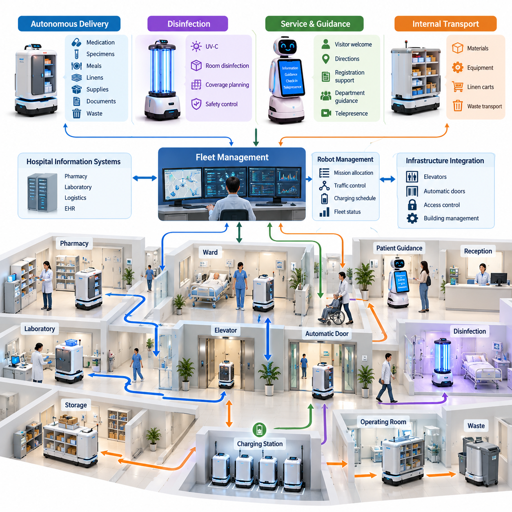{width="7.268055555555556in" height="7.268055555555556in"}

병원 로봇(Hospital Robot)은 점차 개별적인 기술 실증(Technology Demonstration)을 넘어 병원 운영 인프라(Operational Infrastructure)의 일부로 배치되고 있다. 주요 목적은 반복적인 직원 업무를 줄이고, 물류(Logistics) 및 감염 관리(Infection Control) 프로세스의 일관성을 향상시키며, 지속적인 인력 배치가 어려운 영역까지 서비스를 확장하는 것이다. 대표적인 응용 분야에는 자율 배송(Autonomous Delivery), 환경 소독(Environmental Disinfection), 환자 안내(Patient Guidance), 정보 지원(Information Assistance), 원격 현장 지원(Telepresence), 병원 내부 물자 운송(Internal Material Transportation) 등이 포함된다.

자율 배송(Autonomous Delivery)은 가장 성숙한 병원 로봇 응용 분야 중 하나이다. 이동 로봇(Mobile Robot)은 약품, 검사실 검체, 식사, 린넨, 의료용품, 문서 및 폐기물을 약국, 검사실, 병동, 수술실, 창고 및 기타 부서 사이에서 운송할 수 있다. 예측 가능한 운송 업무를 자동화함으로써 병원은 의료진의 불필요한 이동을 줄이고, 간호사와 기술 인력이 환자 진료(Patient Care)와 직접 관련된 업무에 더 많은 시간을 투입할 수 있도록 한다.

병원 배송(Hospital Delivery)은 환자, 방문객, 휠체어, 들것, 카트 및 의료진이 지속적으로 공간을 공유하기 때문에 창고 운송(Warehouse Transportation)과 상당히 다르다. 복도는 예고 없이 혼잡해질 수 있고 임시 의료 장비가 기존 경로를 차단할 수도 있으며 사람들의 행동도 예측하기 어렵다. 따라서 로봇에는 강건한 위치 추정(Robust Localization), 동적 장애물 감지(Dynamic Obstacle Detection), 사회적으로 적절한 모션 계획(Socially Acceptable Motion Planning), 안전 정지(Safe Stopping), 추가적인 혼잡을 유발하지 않으면서 차단된 경로에서 복구하는 기능이 필요하다.

일반적인 배송 임무(Delivery Mission)는 병원 정보 시스템(Hospital Information System), 물류 애플리케이션(Logistics Application) 또는 권한을 가진 직원이 운송 요청을 생성하면서 시작된다. 플릿 관리 서비스(Fleet Management Service)는 위치, 적재 용량(Payload Capacity), 배터리 상태(Battery State), 임무 우선순위(Mission Priority), 가용성(Availability)을 기준으로 적절한 로봇을 할당한다. 로봇은 픽업 지점으로 이동하고 적재를 확인한 후 목적지로 이동하며, 필요한 경우 수령자를 인증하고 배송을 확인한 다음 운영 추적성(Operational Traceability)을 위해 임무 결과를 기록한다.

로봇이 약품, 검체 또는 민감한 물질을 운송할 때는 적재물 보안(Payload Security)이 특히 중요하다. 적재함에는 전자 잠금장치(Electronic Lock), 접근 인증(Access Authentication), 도어 센서(Door Sensor), 온도 모니터링(Temperature Monitoring), 변조 감지(Tamper Detection) 등을 적용할 수 있다. 소프트웨어는 모든 적재물을 임무 식별자(Mission Identifier)와 연결하고 적재부터 하역까지 명확한 관리 연속성(Chain of Custody)을 유지해야 한다. 인증 실패, 예상하지 못한 적재함 개방, 과도한 배송 지연 또는 환경 조건 이상이 발생하면 로봇이 그대로 임무를 수행하는 대신 통제된 예외 처리(Controlled Exception)를 수행해야 한다.

소독 로봇(Disinfection Robot)은 병실과 공용 공간의 미생물 오염(Microbial Contamination)을 줄이는 또 다른 병원 요구사항을 해결한다. 자외선-C(Ultraviolet-C, UV-C) 시스템은 적절한 안전 조건이 확보된 후 선택된 표면에 살균 방사선(Germicidal Radiation)을 조사하도록 설계할 수 있다. 운송 임무와 달리 효과적인 소독은 단순히 목적지에 도착하는 것뿐만 아니라 충분한 공간 커버리지(Spatial Coverage), 노출 시간(Exposure Duration), 방사 강도(Radiation Intensity), 가시선(Line-of-Sight)을 확보하면서 사람의 위험한 자외선 노출을 방지하는 것이 중요하다.

따라서 소독 임무(Disinfection Mission)는 커버리지 경로 계획 문제(Coverage Planning Problem)로 모델링할 수 있다. 로봇은 병실 또는 구역 정보를 수신하고, 접근 가능한 처리 위치를 식별하며, 가림(Occlusion)의 영향을 받는 영역을 추정하고, 일련의 조사 지점(Exposure Point) 또는 이동 경로를 실행한다. 센서는 출입문, 사람 존재 여부, 로봇 위치, 램프 상태 및 운용 조건을 모니터링할 수 있다. 사람이 통제 구역에 들어오거나 안전 조건이 위반되면 상위 수준의 임무 목표와 관계없이 자외선 방출(Ultraviolet Emission)을 중단해야 한다.

서비스 및 안내 로봇(Service and Guidance Robot)은 인간-로봇 상호작용(Human-Robot Interaction, HRI)에 더욱 중점을 둔다. 방문객을 맞이하고, 길을 안내하며, 접수 절차를 설명하고, 사용자를 진료 부서까지 안내하거나 체크인(Check-in) 절차를 지원하고 원격 담당자와 환자를 연결할 수 있다. 사용자는 어린이, 고령자, 장애인, 외국인 방문객 또는 로봇 기술에 익숙하지 않은 환자일 수 있으므로 시스템에는 이해하기 쉬운 인터페이스와 예측 가능한 행동이 필요하다. 이를 위해 음성(Speech), 터치 디스플레이(Touch Display), 시각적 신호(Visual Cue), 물리적 안내(Physical Guidance)를 결합할 수 있다.

물리적 안내(Physical Guidance)를 수행하려면 대화형 인터페이스(Conversational Interface)와 내비게이션(Navigation)이 긴밀하게 연동되어야 한다. 로봇은 단순히 최단 경로를 계산하고 최대 효율로 이동해서는 안 된다. 편안한 이동 속도를 유지하고 사용자가 계속 따라오고 있는지 판단하며, 적절한 위치에서 정지하고, 혼잡한 장소에서 사용자와 분리되지 않도록 하며, 교차로나 엘리베이터에서 이해하기 쉬운 설명을 제공해야 한다. 따라서 인간 인식형 내비게이션(Human-Aware Navigation)은 단순한 최적화 기능이 아니라 서비스의 핵심 구성요소가 된다.

엘리베이터(Elevator)와 자동문(Automatic Door)은 병원이 일반적으로 여러 층과 접근 통제 구역(Controlled Access Zone)으로 구성되기 때문에 매우 중요한 인프라 인터페이스(Infrastructure Interface)이다. 배송 로봇은 엘리베이터를 호출하고 안전하게 대기하며, 배정된 엘리베이터를 식별하고, 사람의 이동을 방해하지 않으면서 탑승하고, 통합 인터페이스(Integration Interface)를 통해 목적 층을 선택한 후 정확하게 하차해야 한다. 마찬가지로 도어 컨트롤러(Door Controller), 접근 제어 시스템(Access Control System), 건물 관리 인프라(Building Management Infrastructure)도 종단 간 로봇 애플리케이션(End-to-End Robotic Application)의 일부가 된다.

병원 로봇은 독립적인 이동 기계가 아니라 조정된 플릿(Coordinated Fleet)의 관점에서도 고려해야 한다. 여러 대의 배송, 소독 및 서비스 로봇이 복도, 엘리베이터, 충전소(Charging Station), 대기 구역(Staging Area)을 동시에 사용할 수 있기 때문이다. 플릿 소프트웨어(Fleet Software)는 임무를 할당하고, 긴급 운송의 우선순위를 조정하며, 작업 부하를 분산하고, 충전 일정을 관리하며, 교통 충돌을 방지하고, 운영 상태를 유지할 수 있다. 병원 정보 시스템과 통합하면 별도의 수동 절차 없이 로봇 임무를 기존 임상 및 물류 워크플로(Clinical and Logistics Workflow)의 일부로 구성할 수 있다.

안전 요구사항(Safety Requirement)은 단순한 충돌 회피(Collision Avoidance)를 넘어선다. 로봇은 취약한 환자와 고가의 의료 장비 가까이에서 운용되므로 속도 및 분리 모니터링(Speed and Separation Monitoring), 비상 정지(Emergency Stop), 장애물 감지(Obstacle Detection), 제어된 가감속(Controlled Acceleration and Deceleration), 안전 도킹(Safe Docking), 고장 모니터링(Fault Monitoring), 성능 저하 운용 모드(Degraded Operating Mode)를 함께 적용해야 한다. 위치 추정 실패, 센서 차단, 통신 두절, 모터 고장, 비정상적인 적재물 상태 또는 경로 차단이 발생하면 시스템은 정의된 안전 상태(Safe State)로 전환하고 적절한 복구 또는 사람의 지원을 요청해야 한다.

서비스 로봇의 안전(Service Robot Safety)은 자율성의 한계(Limits of Autonomy)를 명확하게 이해하는 것에도 의존한다. 로봇은 특정 경로나 작업이 기술적으로 가능해 보인다는 이유만으로 승인된 운용 영역(Operational Domain)을 벗어난 행동을 임의로 수행해서는 안 된다. 출입 제한 임상 구역, 격리 구역(Isolation Area), 무균 환경(Sterile Environment), 비상 통로(Emergency Route), 임시 위험 구역(Temporary Hazard Zone)에는 상황별 제약 조건이 존재할 수 있다. 따라서 임무 계획(Mission Planning)은 기하학적 지도(Geometric Map)와 함께 로봇의 이동 가능 영역, 허용 활동 및 운용 조건을 나타내는 의미 정보(Semantic Information)를 결합해야 한다.

감염 관리(Infection Control)는 기존 산업용 자율이동로봇(Autonomous Mobile Robot, AMR)에서는 일반적이지 않은 추가적인 요구사항을 발생시킨다. 로봇 표면, 터치 인터페이스, 적재함, 바퀴 및 자주 접촉하는 부품은 청소 절차가 적절하게 설계되지 않으면 오염 전달 경로가 될 수 있다. 하드웨어는 실질적인 세척이 가능하도록 설계되어야 하며, 소프트웨어는 위생 처리 절차(Hygiene Procedure)를 예약하고 소독 이력을 기록하며 오염 구역 간 이동을 제한하고, 필요한 오염 제거 절차(Decontamination Workflow)를 완료하지 않은 로봇이 서로 호환되지 않는 구역 사이를 즉시 이동하지 못하도록 할 수 있다.

데이터 보호(Data Protection) 역시 중요한 설계 요소이다. 병원 로봇은 내비게이션 지도, 카메라 영상, 음성 상호작용, 환자 관련 배송 정보, 접근 자격 증명(Access Credential), 운영 로그(Operational Log)를 처리할 수 있다. 시스템은 불필요한 정보 수집을 최소화하고 가능한 경우 운영 텔레메트리(Operational Telemetry)와 민감한 기록을 분리하며, 보호 대상 통신을 암호화하고 역할 기반 접근 제어(Role-Based Access Control)를 적용해야 한다. 또한 감사 추적(Audit Trail)과 데이터 보존 정책(Data Retention Policy)을 유지해야 하며, 개인정보 보호 요구사항은 배포 이후 추가되는 기능이 아니라 초기 아키텍처와 플릿 운영 단계부터 반영되어야 한다.

신뢰성 높은 운용(Reliable Operation)을 위해서는 지속적인 관측 가능성(Observability)도 필요하다. 플릿 대시보드(Fleet Dashboard)는 로봇 위치, 임무 상태, 배터리 수준, 충전 상태, 위치 추정 신뢰도(Localization Confidence), 센서 상태, 적재물 상태, 통신 품질 및 활성 고장 정보를 제공해야 한다. 임무 완료율(Mission Completion Rate), 평균 배송 시간(Average Delivery Time), 개입 빈도(Intervention Frequency), 경로 차단 발생, 충전 활용률(Charging Utilization), 가동 중단 시간(Downtime), 복구 시간(Recovery Time) 등의 운영 지표를 통해 로봇 자동화가 단순한 기술적 자율성 시연을 넘어 실제 병원 운영을 개선하고 있는지 판단할 수 있다.

배포(Deployment)는 로봇을 즉시 설치하는 것보다 상세한 워크플로 분석(Workflow Analysis)에서 시작해야 한다. 엔지니어는 운송 수요, 복도 통행량, 엘리베이터 사용 패턴, 충전 기회, 접근 제한, 감염 관리 경계, 무선 네트워크 커버리지(Wireless Coverage), 직원과 로봇 간 상호작용을 분석해야 한다. 이후 작업 빈도, 인력 부담, 예측 가능성, 안전 위험, 시스템 통합 복잡도(Integration Complexity), 예상 운영 가치(Operational Value)를 기준으로 자동화 후보 업무를 평가할 수 있다. 일반적으로 안정적이고 반복적인 업무가 드물거나 변동성이 높은 업무보다 초기 자동화 대상으로 적합하다.

파일럿 배포(Pilot Deployment)에서는 실제 운용 조건에서 완전한 워크플로를 검증해야 한다. 정상 임무뿐만 아니라 혼잡한 복도, 차단된 통로, 엘리베이터 지연, 목적지 사용 불가, 인증 실패, 배터리 부족, 통신 중단, 센서 성능 저하, 응급 이동 상황 및 수동 개입(Manual Intervention)도 시험해야 한다. 성공적인 운용은 단순히 로봇이 한 지점에서 다른 지점까지 이동할 수 있는지로 평가하는 것이 아니라 전체 서비스가 안전하고, 이해하기 쉬우며, 복구 가능하고, 기존 병원 절차와 호환되는지를 기준으로 평가해야 한다.

궁극적으로 배송(Delivery), 소독(Disinfection), 안내(Guidance)는 서로 보완적인 병원 자동화(Hospital Automation) 형태를 구성한다. 배송 로봇은 물리적 물류(Physical Logistics)를 자동화하고, 소독 로봇은 환경 처리를 자동화하며, 안내 로봇은 선택적인 대면 서비스(Human-Facing Service)를 자동화한다. 이들이 공유하는 내비게이션, 인지(Perception), 플릿 조정(Fleet Coordination), 인프라 통합(Infrastructure Integration), 인간 상호작용(Human Interaction), 안전 감독(Safety Supervision), 사이버보안(Cybersecurity), 데이터 관리(Data Management) 기능은 재사용 가능한 서비스 로봇 플랫폼(Reusable Service Robot Platform)을 형성하며, 운영 경험이 축적됨에 따라 더욱 광범위한 병원 로봇 응용 분야로 확장될 수 있다.

## 02.02. Hospital AMR Autonomous Delivery SW [w/Code]

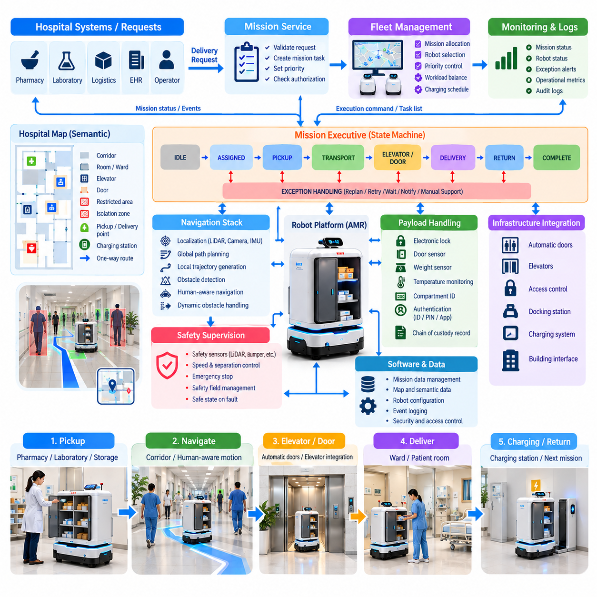{width="7.268055555555556in" height="7.268055555555556in"}

병원 자율이동로봇(Autonomous Mobile Robot, AMR) 소프트웨어는 임상 및 물류 배송 요청을 안전하고 추적 가능한 물리적 운송 임무로 변환한다. 창고 자율이동로봇(Warehouse AMR)과 달리 병원 AMR은 환자, 방문객, 간호사, 카트, 휠체어 및 응급 이동 인력 사이에서 지속적으로 운용된다. 따라서 소프트웨어는 임무 실행(Mission Execution), 내비게이션(Navigation), 인간 인식형 이동(Human-Aware Motion), 적재물 보안(Payload Security), 인프라 통합(Infrastructure Integration), 안전 감독(Safety Supervision), 운영 모니터링(Operational Monitoring)을 하나의 조정된 아키텍처로 결합해야 한다.

배송 워크플로(Delivery Workflow)는 일반적으로 병원 정보 시스템(Hospital Information System), 약국 애플리케이션(Pharmacy Application), 검사실 시스템(Laboratory System), 물류 플랫폼(Logistics Platform) 또는 권한을 가진 운영자가 요청을 생성하면서 시작된다. 요청에는 픽업 위치와 목적지, 적재물 특성, 우선순위, 시간 제약 및 필요한 권한 정보가 포함된다. 임무 서비스(Mission Service)는 이러한 매개변수를 검증하고 비즈니스 수준의 요청을 픽업, 운송, 대기, 인증, 하역 및 복귀와 같은 실행 가능한 로봇 작업으로 변환한다.

임무 할당(Mission Allocation)은 일반적으로 개별 로봇이 아니라 플릿 관리 계층(Fleet Management Layer)에서 수행된다. 디스패처(Dispatcher)는 작업을 할당하기 전에 로봇의 위치, 가용성, 배터리 상태, 적재 용량, 적재함 구성, 현재 작업 부하 및 임무 우선순위를 평가한다. 긴급하거나 시간에 민감한 배송은 일반적인 물자 운송보다 높은 우선순위를 가질 수 있다. 또한 로봇을 사용할 수 없거나 목적지가 차단되거나 운용 조건이 변경되는 경우 동적 재할당(Dynamic Reassignment)이 필요하다.

임무가 할당되면 로봇은 "Pharmacy A" 또는 "Ward 5 Medication Station"과 같은 의미적 목적지(Semantic Destination)를 병원 지도와 연결된 내비게이션 목표(Navigation Goal)로 변환한다. 내비게이션 스택(Navigation Stack)은 위치 추정(Localization), 전역 경로 계획(Global Path Planning), 지역 궤적 생성(Local Trajectory Generation), 장애물 감지(Obstacle Detection), 모션 제어(Motion Control)를 결합한다. 병원 지도에는 기하학적 정보뿐만 아니라 출입 제한 병실, 직원 전용 복도, 격리 구역, 엘리베이터 대기 구역, 도킹 스테이션(Docking Station), 일방통행 구간 등의 의미적 제약(Semantic Constraint)도 포함되어야 한다.

위치 추정(Localization)은 반복적으로 유사한 복도 구조, 이동하는 사람, 유리 표면, 임시 배치 장비 및 빈번한 환경 변화에도 신뢰성을 유지해야 한다. 라이다(LiDAR), 카메라(Camera), 휠 오도메트리(Wheel Odometry), 관성 측정(Inertial Measurement)을 융합하여 로봇의 자세(Pose)를 추정할 수 있다. 소프트웨어는 모든 추정 자세가 유효하다고 가정하지 않고 위치 추정 신뢰도(Localization Confidence)를 지속적으로 모니터링해야 한다. 신뢰도가 허용 임계값 이하로 떨어지면 로봇은 속도를 낮추거나 안전하게 정지하고, 재위치 추정(Relocalization)을 시도하거나 운영자 지원을 요청할 수 있다.

인간 인식형 내비게이션(Human-Aware Navigation)은 기하학적으로 가장 짧은 경로가 항상 가장 안전하거나 사회적으로 적절한 경로는 아니기 때문에 필수적이다. 지역 플래너(Local Planner)는 보행자와 기타 이동 장애물을 감지하고, 사용 가능한 자유 공간(Free Space)을 추정하며, 적절한 분리 거리를 유지하면서 부드러운 궤적을 생성해야 한다. 좁은 복도, 혼잡한 대기 구역, 교차 지점, 병실 및 개방형 홀의 특성에 맞게 이동 매개변수를 조정하여 과도한 정지나 공격적인 회피 동작 없이 예측 가능한 움직임을 제공할 수 있다.

동적 장애물 처리(Dynamic Obstacle Handling)는 단순한 즉각적 충돌 회피 이상의 기능을 요구한다. 일시적인 장애물은 몇 초 이내에 사라질 수 있지만 주차된 카트는 몇 시간 동안 복도를 막을 수도 있다. 소프트웨어는 단기간 대기해야 하는 상황과 경로 재계획(Replanning)이 필요한 상황을 구분해야 한다. 설정된 타임아웃(Timeout)이 지나면 내비게이션 관리자(Navigation Manager)는 대체 경로를 탐색하거나 플릿 관리 시스템에 상황을 알리거나 사람의 개입을 요청할 수 있다. 반복적인 실패는 기록하여 지속적으로 발생하는 운영 병목(Operational Bottleneck)을 식별하고 개선할 수 있도록 해야 한다.

적재물 처리(Payload Handling)는 또 다른 주요 소프트웨어 서브시스템(Software Subsystem)을 구성한다. 배송용 적재함에는 전자 잠금장치(Electronic Lock), 도어 상태 센서(Door-State Sensor), 중량 센서(Weight Sensor), 온도 모니터링(Temperature Monitoring), 식별 장치(Identification Device)를 포함할 수 있다. 로봇은 픽업 전에 올바른 적재함을 사용할 수 있는지 확인하고 출발하기 전에 적재가 완료되었는지를 검증한다. 목적지에서는 직원 ID 배지(ID Badge), 개인 식별 번호(PIN), 모바일 애플리케이션(Mobile Application) 또는 기관의 접근 제어 서비스(Access-Control Service)를 통해 하역 권한을 인증할 수 있다.

약품, 검체 및 기타 통제 물질을 운송할 경우 배송 소프트웨어는 전자적 관리 연속성(Electronic Chain of Custody)을 유지해야 한다. 요청 생성, 로봇 할당, 적재함 개방, 픽업 확인, 출발, 도착, 수령자 인증, 하역 및 임무 완료와 같은 주요 이벤트에는 타임스탬프(Timestamp)가 기록된다. 예상하지 못한 적재함 접근, 온도 허용 범위 이탈, 과도한 지연 또는 인증 실패는 명시적인 예외(Exception)로 처리하여 권한을 가진 병원 시스템과 담당자에게 보고할 수 있어야 한다.

병원 인프라 통합(Hospital Infrastructure Integration)은 실제 활용 가능한 배송 로봇이 하나의 복도를 넘어 다양한 구역에서 운용되어야 하기 때문에 특히 중요하다. 자동문(Automatic Door), 보안 출입 지점(Secure Access Point), 엘리베이터(Elevator), 도킹 스테이션(Docking Station), 충전 시스템(Charging System)은 소프트웨어로 제어되는 자원이 된다. 가능한 경우 물리적인 버튼을 직접 조작하는 대신 로봇 또는 플릿 플랫폼이 건물 인터페이스(Building Interface)와 인증된 요청을 교환하여 기존 접근 정책을 유지하면서 출입문 개방과 엘리베이터 호출을 조정할 수 있다.

엘리베이터 실행(Elevator Execution)은 상태 머신(State Machine)으로 자연스럽게 표현할 수 있다. 로봇은 서비스를 요청하고 지정된 대기 위치로 이동하며, 엘리베이터 도착을 확인하고, 안전하게 진입할 수 있는지 검증한 후 탑승한다. 이후 목적 층을 요청하고 이동 상태를 모니터링하며 도착 후 하차한다. 엘리베이터가 사용 중이거나 출입문이 예상치 못하게 닫히고, 승객이 진입을 방해하거나 건물 인터페이스와의 통신이 실패할 수 있으므로 각 단계에는 타임아웃과 복구 전이(Recovery Transition)가 필요하다.

임무 실행기(Mission Executive)는 명시적인 운영 상태(Operational State)를 통해 이러한 서브시스템을 조정한다. 일반적인 순서는 대기(IDLE), 할당됨(ASSIGNED), 픽업 위치로 이동(NAVIGATING_TO_PICKUP), 적재(LOADING), 목적지로 이동(NAVIGATING_TO_DESTINATION), 수령자 대기(WAITING_FOR_RECIPIENT), 하역(UNLOADING), 완료(COMPLETED) 상태로 진행될 수 있다. 경로 차단(BLOCKED), 배터리 부족(LOW_BATTERY), 인증 실패(AUTHENTICATION_FAILED), 인프라 오류(INFRASTRUCTURE_ERROR), 안전 정지(SAFETY_STOP), 수동 지원(MANUAL_ASSISTANCE)과 같은 추가 상태를 사용하면 비정상적인 상황을 명확하게 표현하고 복잡한 고장이 내비게이션 로직 내부에 숨겨지는 것을 방지할 수 있다.

배터리 관리(Battery Management) 역시 임무 계획에 참여해야 한다. 플릿 시스템은 적절한 안전 여유(Safety Margin)를 유지하면서 배송 임무를 완료할 수 있는 충분한 에너지가 남아 있는지 추정한다. 충전은 임무 사이, 수요가 낮은 시간 또는 예측된 에너지가 운용 임계값 이하로 떨어질 때 수행하도록 계획할 수 있다. 임무 수행 중 배터리 상태가 예상보다 빠르게 악화되면 소프트웨어는 제어되지 않은 시스템 종료를 허용하는 대신 안전한 임무 완료, 작업 이전(Task Transfer), 통제된 충전(Controlled Charging) 가운데 적절한 방법을 결정해야 한다.

안전 감독(Safety Supervision)은 일반적인 임무 최적화(Mission Optimization)와 논리적으로 분리되어야 한다. 비상 정지 입력(Emergency-Stop Input), 보호 센서 이벤트(Protective Sensor Event), 구동부 고장(Drive Fault), 과속, 범퍼 작동(Bumper Activation), 위치 추정 상실(Localization Loss) 및 기타 중요 조건은 임무 실행보다 높은 우선순위로 동작할 수 있다. 안전 정지 후에는 기존 배송 임무가 완료되지 않았다는 이유만으로 시스템이 자동으로 다시 이동해서는 안 된다. 복구하려면 정지를 발생시킨 조건이 제거되었으며 정의된 안전 정책(Safety Policy)에 따라 이동을 계속할 수 있는지 확인해야 한다.

로봇, 플릿 서버(Fleet Server), 병원 시스템 및 인프라 컨트롤러(Infrastructure Controller) 사이의 통신은 일시적인 네트워크 장애를 견딜 수 있어야 한다. 필수적인 내비게이션과 즉각적인 안전 기능은 로봇 내부에서 로컬(Local)로 유지하고, 상위 수준의 디스패치(Dispatch)와 기업 시스템 통합(Enterprise Integration)은 네트워크 서비스에 의존할 수 있다. 명령에는 식별자, 타임스탬프, 인증 정보 및 승인 확인(Acknowledgement) 메커니즘을 포함하여 재연결 과정에서 배송 임무가 중복 생성되거나 오래된 임무 요청이 실행되는 것을 방지해야 한다.

관측 가능성(Observability)은 AMR 플릿을 병원 서비스로 운영하기 위해 필요하다. 텔레메트리(Telemetry)는 로봇 자세, 속도, 임무 상태, 배터리 수준, 적재함 상태, 위치 추정 신뢰도, 네트워크 상태, 안전 이벤트 및 활성 고장 정보를 보고할 수 있다. 중앙 집중식 로그(Centralized Log)는 로봇 이벤트를 플릿의 의사결정 및 외부 시스템 요청과 연계한다. 이를 통해 운영자는 내비게이션 문제와 인프라 장애, 워크플로 오류, 통신 장애 및 사용자 관련 예외를 구분할 수 있다.

소프트웨어 복구(Software Recovery)는 사전에 정의된 단계적 대응 정책(Escalation Policy)을 따라야 한다. 경미한 문제는 재시도(Retry), 지역 경로 재계획(Local Replanning), 재위치 추정(Relocalization), 자원 재요청(Resource Re-request)을 통해 자율적으로 처리할 수 있다. 지속적인 장애는 원격 운영자(Remote Operator)에게 전달할 수 있으며, 적재물 보안 또는 물리적 안전과 관련된 상황에서는 현장 직원의 개입이 필요할 수 있다. 각 복구 동작은 임무 컨텍스트(Mission Context)를 유지하여 로봇이 안전하게 임무를 재개하거나 추적성을 잃지 않고 작업을 종료할 수 있도록 해야 한다.

배포 시험(Deployment Testing)은 내비게이션 성능만이 아니라 전체 배송 워크플로를 검증해야 한다. 시험에서는 혼잡한 복도, 횡단하는 보행자, 차단된 경로, 엘리베이터 혼잡, 자동문 장애, 수령자 부재, 잘못된 인증, 적재함 고장, 네트워크 중단, 위치 추정 성능 저하, 배터리 부족 및 응급 이동 상황을 재현해야 한다. 성공적인 시험은 정상 운용뿐만 아니라 비정상 상황에서의 복구 과정도 결정론적(Deterministic)이고 이해 가능한 시스템 동작을 제공한다는 것을 입증해야 한다.

이러한 소프트웨어 아키텍처(Software Architecture)를 통해 병원 AMR은 단순한 자율주행 차량 이상의 시스템이 된다. 병원 AMR은 로봇, 플릿 지능(Fleet Intelligence), 건물 인프라(Building Infrastructure), 병원 애플리케이션, 의료진 및 물리적 적재물을 연결하는 분산 사이버-물리 배송 서비스(Distributed Cyber-Physical Delivery Service)로 발전한다. 신뢰성 높은 배포를 위해서는 내비게이션, 임무 오케스트레이션(Mission Orchestration), 보안(Security), 안전(Safety), 복구(Recovery), 기업 시스템 통합(Enterprise Integration)을 동일한 운영 시스템의 구성요소로 다루어야 하며, 이는 확장 가능한 병원 로봇 플릿(Scalable Hospital Robot Fleet)의 기반을 제공한다.

## 02.03. UV Disinfection Robot Path Coverage Planning [w/Code]

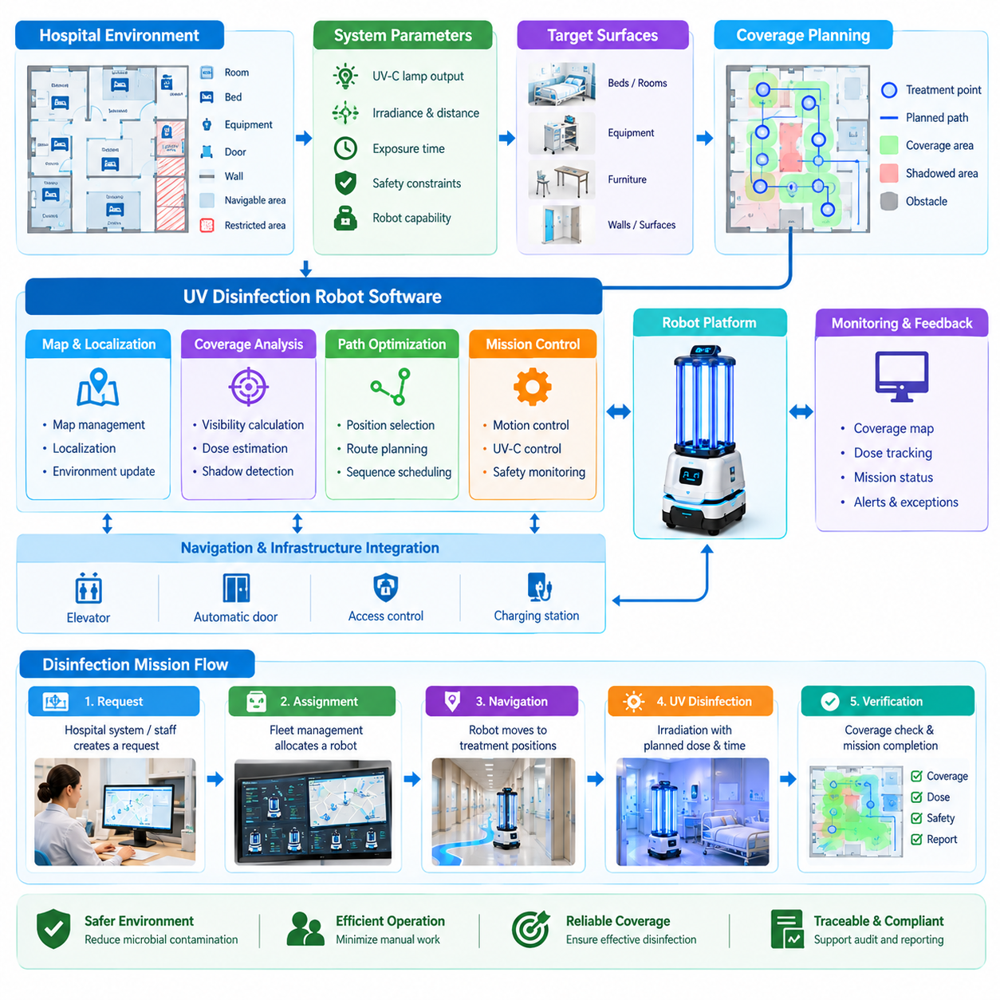{width="7.268055555555556in" height="7.268055555555556in"}

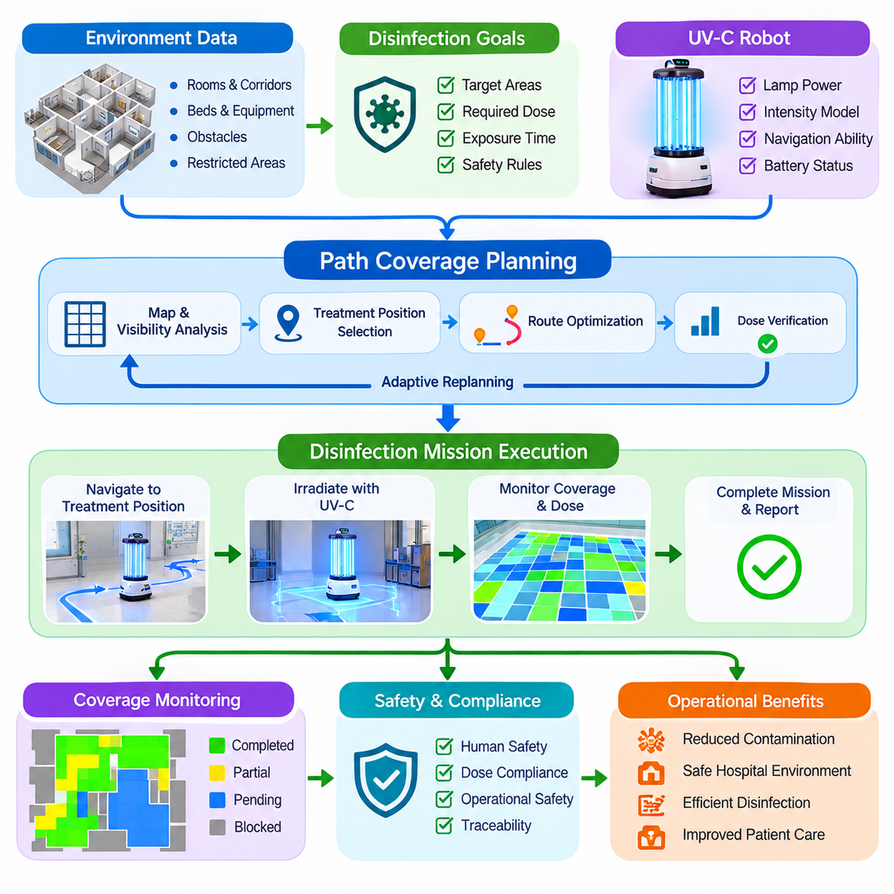{width="7.268055555555556in" height="7.268055555555556in"}

자외선 소독 로봇(Ultraviolet Disinfection Robot)은 자율 이동(Autonomous Mobility)과 제어된 자외선-C 조사(Controlled UV-C Irradiation)를 결합하여 병실과 공용 공간의 미생물 오염(Microbial Contamination)을 줄인다. 소독 효과는 단순히 특정 공간을 이동하는 것만으로 결정되지 않고 관련 표면에 충분한 방사선량(Radiation Dose)을 전달하는지에 따라 결정된다. 따라서 경로 커버리지 계획(Path Coverage Planning)은 소독 임무 전체에서 기하학적 커버리지(Geometric Coverage), 노출 시간(Exposure Time), 램프 특성(Lamp Characteristics), 장애물 형상(Obstacle Geometry), 위치 추정 정확도(Localization Accuracy), 사람의 안전 제약(Human-Safety Constraint)을 함께 조정해야 한다.

계획 문제는 소독 대상 환경(Treatment Environment)을 표현하는 것에서 시작된다. 병원 지도(Hospital Map)는 벽, 출입문, 침대, 캐비닛, 장비 및 이동 가능한 자유 공간(Navigable Free Space)에 대한 정보를 제공하며, 의미 정보(Semantic Information)는 병실, 소독 구역, 제한 구역 및 특별한 관리가 필요한 위치를 식별한다. 플래너(Planner)는 이러한 환경 모델을 자외선-C가 적절한 거리와 입사 기하 조건(Incidence Geometry)으로 대상 표면에 도달할 수 있는 후보 로봇 위치(Candidate Robot Position)와 이동 궤적으로 변환한다.

기존의 커버리지 경로 계획(Coverage Path Planning)은 주로 이동 로봇이 접근 가능한 전체 영역을 물리적으로 통과하도록 하는 데 초점을 맞춘다. 자외선 소독(UV Disinfection)에서는 로봇이 모든 표면 위를 직접 이동할 필요가 없기 때문에 커버리지의 의미가 다르다. 대신 플래너는 각 표면이 충분한 조사(Irradiation)를 받았는지를 판단해야 한다. 어떤 위치가 기하학적으로 보이더라도 램프에서 너무 멀거나 노출 시간이 짧거나 주변 물체에 의해 부분적으로 가려진 경우에는 충분한 선량을 받지 못할 수 있다.

방사선량(Radiation Dose)은 개념적으로 방사 조도(Irradiance)가 노출 시간에 따라 누적되는 것으로 모델링할 수 있다. E가 표면에 도달하는 유효 방사 조도를 나타내고 t가 노출 시간을 나타낸다면, 단순화된 조건에서 전달 선량은 D = E × t로 근사할 수 있다. 실제 계획에서는 E가 램프 출력(Lamp Output), 거리, 방향, 가림(Occlusion), 반사(Reflection), 환경 형상(Environmental Geometry)에 따라 변화하므로 로봇은 공간 구성과 예상 소독 효과 사이의 관계를 지속적으로 고려해야 한다.

거리는 조사 계획(Irradiation Planning)에 큰 영향을 미친다. 로봇과 대상 표면 사이의 거리가 증가하면 일반적으로 사용할 수 있는 자외선 강도(UV Intensity)가 감소하므로 동일한 목표 선량(Target Dose)을 달성하려면 더 긴 노출 시간이 필요하다. 따라서 플래너는 이동 거리와 정지 시간(Dwell Time) 사이의 절충 관계를 고려할 수 있다. 여러 중요 표면에 가까운 위치에서 정지하면 조사 시간을 줄일 수 있지만, 소수의 처리 위치만 사용하면 이동은 단순해지는 대신 더 긴 노출 시간이 필요하고 일부 음영 영역(Shadow Region)이 충분히 처리되지 않을 수 있다.

가림(Occlusion)은 자외선 커버리지 계획(UV Coverage Planning)의 핵심적인 문제 중 하나이다. 침대, 카트, 테이블, 의료 장비, 파티션 및 기타 물체는 직접적인 방사선을 차단하여 음영 영역을 생성할 수 있다. 플래너는 점유 정보(Occupancy Information) 또는 3차원 환경 정보(Three-Dimensional Environmental Information)를 이용하여 램프 위치와 대상 표면 사이의 가시선(Line-of-Sight)을 추정할 수 있다. 이후 한 위치에서 가려지는 표면을 다른 방향에서 조사할 수 있도록 여러 조사 위치(Irradiation Position)를 선택한다.

후보 처리 위치(Candidate Treatment Position)는 이동 가능한 지도에서 생성한 후 여유 거리(Clearance), 접근 가능성(Accessibility), 램프 도달 범위(Lamp Range), 안전 요구사항에 따라 필터링할 수 있다. 각 후보 위치는 가시성이 확보되는 대상 영역의 집합과 예상 조사 기여도(Irradiation Contribution)에 연결된다. 그러면 계획 문제는 여러 후보 위치 중 전체적으로 처리 요구사항을 충족하면서 불필요한 이동, 중복 조사 및 전체 임무 시간을 최소화하는 실용적인 위치 집합을 선택하는 커버리지 최적화 문제(Coverage Optimization Problem)가 된다.

처리 위치를 선택한 후에는 로봇이 이 위치들을 방문할 순서를 결정해야 한다. 이는 외판원 문제(Traveling Salesperson Problem)와 관련된 경로 최적화 문제(Route Optimization Problem)를 생성하지만 추가적인 로봇 제약조건이 포함된다. 이동 거리, 회전 비용(Turning Cost), 좁은 통로, 배터리 소비, 병실 경계 및 필요한 처리 순서가 방문 순서에 영향을 줄 수 있다. 최종 계획은 내비게이션 구간(Navigation Segment)과 정지 또는 저속 이동 조사 단계(Irradiation Phase)를 하나의 실행 가능한 소독 임무로 결합한다.

연속 이동 소독(Continuous-Motion Disinfection)도 가능한 전략이다. 고정된 처리 지점에서 정지하는 대신 로봇은 계획된 궤적을 따라 이동하면서 필요한 노출량에 따라 속도를 제어한다. 더 높은 선량이 필요한 영역은 느리게 통과하고, 기하학적 조건이 유리한 개방 공간에서는 더 빠르게 이동할 수 있다. 이러한 방식에서는 속도(Velocity)가 추가적인 계획 변수가 되며 로봇 자세, 자외선 출력, 궤적 진행 상태 및 누적 선량 추정(Accumulated Dose Estimation)을 정확하게 동기화해야 한다.

커버리지 지도(Coverage Map)는 임무 실행 중 처리 진행 상태를 표현할 수 있다. 환경을 셀(Cell), 표면 요소(Surface Element) 또는 의미 영역(Semantic Region)으로 분할하고 각 요소에 예상 누적 선량 또는 커버리지 상태를 저장한다. 로봇이 이동하면서 램프를 작동시키면 소프트웨어는 로봇 위치와 조사 기하(Irradiation Geometry)에 따라 지도를 갱신한다. 이를 통해 임무 제어기(Mission Controller)는 단순한 이동 거리 대신 미처리(Untreated), 부분 처리(Partially Treated), 충분히 처리됨(Adequately Treated), 접근 불가(Inaccessible) 영역을 구분할 수 있다.

커버리지 모니터링(Coverage Monitoring)을 사용하면 적응형 재계획(Adaptive Replanning)도 가능하다. 병원 환경은 침대, 카트, 의자 및 장비가 임무 사이에 이동할 수 있기 때문에 기존 지도와 항상 동일하지 않다. 센서 관측(Sensor Observation)을 통해 새롭게 차단된 영역이나 기존에 알려지지 않은 장애물을 발견할 수 있다. 플래너는 지역 환경 표현(Local Environmental Representation)을 갱신하고 가시성을 다시 계산하며 추가 조사 위치를 선택하거나 남아 있는 경로를 수정하여 환경 변화로 인해 미처리 영역이 발생하는 것을 방지할 수 있다.

내비게이션(Navigation)과 소독 계획(Disinfection Planning)은 서로 조정되어야 하지만 논리적으로는 분리될 수 있어야 한다. 커버리지 플래너(Coverage Planner)는 어디에서 조사를 수행하고 어느 정도의 처리가 필요한지를 결정하며, 내비게이션 스택(Navigation Stack)은 로봇이 해당 위치까지 안전하게 이동할 방법을 결정한다. 계획된 처리 위치에 접근할 수 없는 경우 내비게이션 시스템은 실패 정보를 임무 계층(Mission Layer)에 전달하고, 임무 계층은 도달할 수 없는 경로를 반복해서 시도하는 대신 대체 위치를 선택할 수 있다.

사람의 안전(Human Safety)은 커버리지 완료(Coverage Completion)보다 높은 우선순위를 가져야 한다. 자외선-C 노출(UV-C Exposure)은 위험할 수 있으므로 시스템은 정의된 안전 조건에서만 조사가 이루어지도록 해야 한다. 도어 센서(Door Sensor), 사람 감지기(Presence Detector), 카메라, 라이다(LiDAR), 안전 스캐너(Safety Scanner), 접근 제어 인터페이스(Access-Control Interface), 외부 병실 신호 등을 재실 감시(Occupancy Monitoring)에 사용할 수 있다. 사람이 감지되거나 통제 구역의 안전 조건이 위반되면 계획된 선량이 완료되지 않았더라도 즉시 자외선 방출을 중단해야 한다.

임무 소프트웨어(Mission Software)는 소독 과정을 준비(Preparation), 병실 확인(Room Verification), 내비게이션(Navigation), 재실 확인(Occupancy Checking), 자외선 활성화(UV Activation), 조사(Irradiation), 커버리지 검증(Coverage Verification), 완료(Completion) 상태를 포함하는 상태 머신(State Machine)으로 표현할 수 있다. 안전 중단, 출입문 개방, 사람 감지, 위치 추정 실패, 램프 고장 및 내비게이션 차단은 명시적인 예외 상태(Exception State)가 된다. 이러한 아키텍처는 조사 제어(Irradiation Control)가 일반적인 자율 내비게이션의 부수적인 기능으로 취급되는 것을 방지한다.

위치 추정 정확도(Localization Accuracy)는 플래너가 방사선이 알려진 로봇 위치에서 방출된다고 가정하기 때문에 선량 추정(Dose Estimation)에 직접적인 영향을 미친다. 큰 자세 오차(Pose Error)가 발생하면 실제로 예상만큼 조사되지 않은 표면을 소프트웨어가 충분히 처리된 것으로 과대평가할 수 있다. 따라서 시스템은 조사 중 위치 추정 신뢰도(Localization Confidence)를 모니터링하고 위치 품질이 신뢰할 수 있는 커버리지 추정에 필요한 수준 이하로 떨어질 경우 불확실한 처리 구간을 중단하거나 무효화해야 한다.

램프 모니터링(Lamp Monitoring) 역시 중요하다. 자외선 작동 명령이 전달되었다는 사실만으로 예상한 방사선이 실제로 출력되었다고 판단할 수는 없다. 로봇은 램프 전류(Lamp Current), 작동 시간(Operating Time), 온도, 자외선 강도 센서(UV Intensity Sensor) 또는 기타 사용 가능한 상태 지표(Health Indicator)를 모니터링할 수 있다. 커버리지 계산은 가능한 경우 단순한 명령 상태가 아니라 검증된 램프 작동(Verified Lamp Operation)을 기반으로 해야 하며, 이를 통해 고장이나 성능 저하가 발생한 방출기가 성공적인 소독 기록을 생성하는 것을 방지할 수 있다.

임무 완료(Mission Completion)는 단순히 최종 웨이포인트(Final Waypoint)에 도착했는지가 아니라 처리 기준(Treatment Criteria)에 따라 결정되어야 한다. 소프트웨어는 필요한 영역이 목표 커버리지 또는 예상 선량에 도달했는지 평가하고 여전히 미처리되었거나 불확실한 영역을 식별한다. 운영 정책에 따라 불완전한 영역은 추가 처리 위치의 생성, 운영자 알림(Operator Notification), 임무 실패(Mission Failure) 또는 완전한 커버리지를 달성하지 못한 이유를 설명하는 보고서 생성으로 이어질 수 있다.

운영 기록(Operational Record)은 병원 감염 관리 워크플로(Hospital Infection-Control Workflow)의 추적성(Traceability)을 제공한다. 완료된 임무에는 병실 식별자, 로봇 식별자, 시작 및 완료 시간, 실행된 궤적, 처리 위치, 램프 작동 시간, 커버리지 추정치, 중단 내역, 안전 이벤트 및 감지된 예외를 저장할 수 있다. 이러한 기록을 통해 운영자는 실제로 성공적으로 완료된 소독과 단순히 지정된 병실을 이동한 임무를 명확하게 구분할 수 있다.

시험(Testing)에는 기하학적 검증(Geometric Validation)과 운영 검증(Operational Validation)이 모두 포함되어야 한다. 엔지니어는 침대, 테이블, 이동식 카트, 파티션, 좁은 공간 및 대표적인 음영 영역을 포함하는 시험 환경을 구성한 다음 계획된 커버리지와 실제 측정되거나 독립적으로 추정된 자외선 노출을 비교할 수 있다. 추가 시험에서는 출입문 개방, 사람 진입, 위치 추정 성능 저하, 처리 위치 차단, 램프 고장 및 통신 중단을 발생시켜 안전하고 결정론적인 복구 동작(Safe and Deterministic Recovery Behavior)을 검증해야 한다.

결과적으로 경로 커버리지 플래너(Path Coverage Planner)는 자외선 로봇을 단순한 이동식 램프(Mobile Lamp)에서 제어 가능한 소독 시스템(Controlled Disinfection System)으로 전환한다. 내비게이션은 플랫폼이 이동할 수 있는 위치를 결정하고, 가시성 분석(Visibility Analysis)은 방사선이 도달할 수 있는 표면을 결정하며, 선량 추정은 필요한 처리 시간을 결정하고, 안전 감독(Safety Supervision)은 조사가 허용되는 시점을 결정한다. 이러한 기능의 통합을 통해 복잡한 병원 환경에서 측정 가능하고(Measurable), 반복 가능하며(Repeatable), 추적 가능하고(Traceable), 적응 가능한(Adaptable) 자율 소독을 구현할 수 있다.

## 02.04. Elevator and Automatic Door Integration [w/Code]

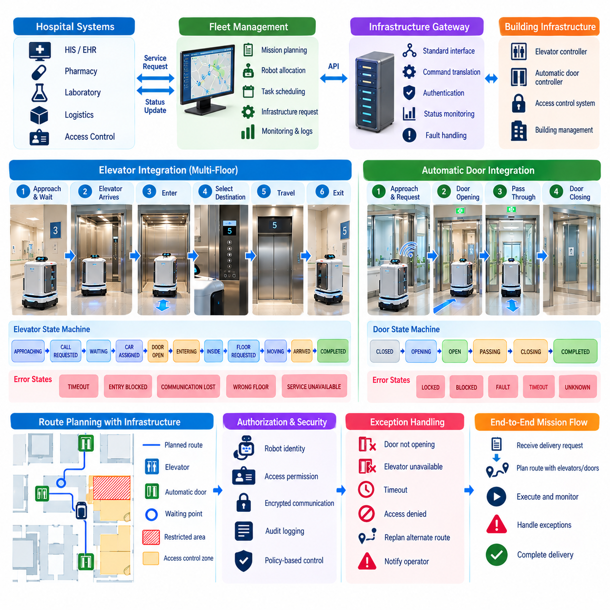{width="7.268055555555556in" height="7.268055555555556in"}

엘리베이터(Elevator) 및 자동문(Automatic Door) 통합은 여러 층과 출입 통제 구역(Controlled Zone)을 이동해야 하는 병원 자율이동로봇(Autonomous Mobile Robot, AMR)에 필수적이다. 물리적 인프라가 구역 사이의 이동을 차단하는 환경에서는 내비게이션(Navigation)만으로 종단 간 자율성(End-to-End Autonomy)을 구현할 수 없다. 따라서 로봇 소프트웨어는 안전, 권한 인증, 임무 연속성(Mission Continuity), 예측 가능한 복구 동작을 유지하면서 이동 기능을 엘리베이터, 자동문, 접근 제어 시스템(Access-Control System), 건물 인터페이스(Building Interface)와 조정해야 한다.

일반적인 통합 아키텍처(Integration Architecture)는 로봇 내비게이션과 인프라 제어(Infrastructure Control)를 분리한다. 로봇 또는 플릿 관리자(Fleet Manager)는 인프라 게이트웨이(Infrastructure Gateway)에 서비스 요청을 전송하고, 게이트웨이는 지원되는 인터페이스를 통해 엘리베이터 컨트롤러(Elevator Controller), 도어 컨트롤러(Door Controller), 건물 관리 시스템(Building Management System)과 통신한다. 이러한 추상화(Abstraction)는 내비게이션 소프트웨어가 특정 제조사의 하드웨어에 직접 종속되는 것을 방지하고 서로 다른 엘리베이터와 도어 기술을 표준화된 명령, 상태, 승인 응답(Acknowledgement), 고장 정보로 표현할 수 있도록 한다.

임무 수행 과정에서 층간 이동이 필요하면 경로 플래너(Route Planner)는 의미적 경로(Semantic Route)의 일부로 엘리베이터 전환(Elevator Transition)을 식별한다. 엘리베이터를 일반적인 자유 공간(Free Space)으로 처리하는 대신 임무 실행기(Mission Executive)는 인프라에 의존하는 일련의 동작을 생성한다. 여기에는 대기 지점으로 이동, 엘리베이터 호출, 배정 정보 수신, 올바른 엘리베이터 탑승, 목적 층 요청, 이동 상태 모니터링, 안전한 하차가 포함되며 이후 일반 내비게이션이 다시 시작된다.

엘리베이터 운용(Elevator Operation)은 명시적인 상태 머신(State Machine)으로 구현할 수 있다. 대표적인 상태에는 접근 중(APPROACHING), 호출 요청(CALL_REQUESTED), 대기(WAITING), 엘리베이터 배정(CAR_ASSIGNED), 문 열림(DOOR_OPEN), 진입(ENTERING), 탑승 완료(INSIDE), 목적 층 요청(FLOOR_REQUESTED), 이동(MOVING), 도착(ARRIVED), 하차(EXITING), 완료(COMPLETED)가 있다. 시간 초과(TIMEOUT), 진입 차단(ENTRY_BLOCKED), 통신 두절(COMMUNICATION_LOST), 잘못된 층(WRONG_FLOOR), 서비스 사용 불가(SERVICE_UNAVAILABLE)와 같은 오류 상태를 통해 비정상 상황을 명확하게 표현하고 임무 제어기가 내비게이션 로직 내부에 실패를 숨기지 않고 통제된 복구를 수행하도록 할 수 있다.

로봇은 엘리베이터 출입문 바로 앞에서 대기하는 대신 사전에 정의된 대기 위치(Staging Position)에서 기다려야 한다. 이를 통해 로봇이 탑승하기 전에 하차해야 하는 승객을 방해하지 않고 인지(Perception)와 기동에 필요한 충분한 공간을 확보할 수 있다. 배정된 엘리베이터가 도착하면 로봇은 출입문 상태와 진입 조건을 확인한다. 사람, 휠체어, 들것 또는 카트가 입구를 점유하고 있으면 설정된 시간 및 안전 정책에 따라 통로가 확보될 때까지 기다리거나 현재 탑승 시도를 중단할 수 있다.

엘리베이터 진입은 내부 환경이 일반적인 복도와 다르기 때문에 위치 추정(Localization)에 새로운 문제를 발생시킨다. 금속 표면, 거울, 좁은 공간 구조, 움직이는 출입문, 제한된 센서 가시성(Sensor Visibility)은 위치 추정 품질을 저하시킬 수 있다. 따라서 내비게이션 시스템은 사전에 정의된 진입 궤적(Entry Trajectory), 저속 이동, 지역 오도메트리(Local Odometry), 근거리 센싱(Short-Range Sensing), 일시적으로 수정된 위치 추정 전략을 사용하는 전용 엘리베이터 동작(Dedicated Elevator Behavior)을 적용할 수 있다. 이 과정의 목표는 일반적인 지도 기반 내비게이션 성능보다 통제된 이동(Controlled Movement)을 보장하는 것이다.

엘리베이터 내부에 진입한 후 로봇은 출입문이 닫히거나 이동을 요청하기 전에 로봇 전체가 엘리베이터 안에 들어왔는지 판단해야 한다. 위치 정보, 거리 센싱(Range Sensing), 휠 오도메트리(Wheel Odometry), 인프라 상태 정보를 이러한 검증에 활용할 수 있다. 이후 로봇은 엘리베이터 통합 서비스(Elevator Integration Service)를 통해 목적 층을 요청한다. 이동 중에는 엘리베이터 움직임으로 발생하는 위치 변화나 겉보기 이동 때문에 로봇이 불필요하게 움직이지 않도록 일반적으로 구동 명령(Drive Command)을 억제한다.

도착은 가능한 경우 인프라 정보와 로봇 측 관측을 함께 사용하여 확인해야 한다. 엘리베이터 컨트롤러는 현재 층과 출입문 상태를 보고하고, 로봇은 하차 경로가 확보되어 있는지 확인한다. 출입문이 열린 후 로봇은 통제된 궤적(Controlled Trajectory)을 따라 엘리베이터를 빠져나와 알려진 위치 추정 구역(Localization Area)에 도달한 다음 목적 층 지도에서 자신의 자세(Pose)를 확인한다. 성공적인 재위치 추정(Relocalization)과 엘리베이터 전환 완료가 확인된 후에만 일반 자율 내비게이션을 다시 시작한다.

자동문 통합(Automatic Door Integration)도 유사한 자원 중심 모델(Resource-Oriented Model)을 따른다. 의미 지도(Semantic Map)는 전자적 활성화, 인증 또는 특별한 처리가 필요한 출입문을 식별한다. 로봇이 설정된 요청 지점(Request Point)에 접근하면 자신의 식별 정보와 필요한 권한 정보를 포함한 개방 요청(Open Request)을 전송한다. 도어 제어 서비스(Door-Control Service)는 권한을 확인하고 출입문을 활성화한 후 상태를 보고한다. 로봇은 안전하게 통과할 수 있을 정도로 출입문이 열렸음을 확인한 후에만 이동한다.

개방 명령이 성공했다고 가정하는 대신 출입문 상태(Door State)를 명시적으로 모델링해야 한다. 유용한 상태에는 닫힘(CLOSED), 열리는 중(OPENING), 열림(OPEN), 닫히는 중(CLOSING), 잠김(LOCKED), 차단됨(BLOCKED), 고장(FAULT), 알 수 없음(UNKNOWN)이 포함된다. 내비게이션 시스템은 이러한 상태를 이용하여 통과 가능 여부를 결정한다. 출입문이 계속 닫혀 있거나 고장을 보고하거나 통신이 두절되면 로봇은 물리적 장애물에 반복적으로 접근하는 대신 안전한 위치에서 정지하고 복구 절차(Recovery)를 실행한다.

자동문이 느리게 이동하는 로봇이 완전히 통과하기 전에 닫힐 수 있으므로 타이밍(Timing)은 특히 중요하다. 통합 소프트웨어는 출입문 개방 시간을 로봇의 접근 및 통과 상태와 조정해야 한다. 사람 감지 센서(Presence Sensor), 로봇 위치 및 도어 컨트롤러 피드백을 사용하여 로봇의 완전한 통과가 확인될 때까지 통로를 개방 상태로 유지할 수 있다. 환자나 의료진이 동시에 출입문을 사용할 수도 있으므로 로봇은 보수적인 속도와 여유 거리(Clearance Margin)를 유지해야 한다.

접근 통제 출입문(Access-Controlled Door)은 단순한 개방 기능을 넘어 권한 인증(Authorization)을 요구한다. 병원에는 약국, 검사실, 직원 전용 구역, 격리 구역, 수술 부서 및 기타 제한 공간이 존재할 수 있다. 따라서 인프라 요청은 로봇 식별 정보, 할당된 임무, 목적지, 시간 및 접근 정책(Access Policy)에 따라 평가되어야 한다. 특정 배송 업무에 대한 접근 권한을 받은 로봇이 네트워크에 연결되어 있다는 이유만으로 모든 통제 구역에 무제한 접근할 수 있어서는 안 된다.

엘리베이터와 출입문 인터페이스는 로봇을 건물 인프라와 연결하므로 보안(Security)이 중요하다. 통신에는 인증된 엔드포인트(Authenticated Endpoint), 필요한 경우 암호화된 채널(Encrypted Channel), 권한 정책(Authorization Policy), 요청 식별자(Request Identifier), 타임스탬프(Timestamp), 감사 로그(Audit Log)를 사용해야 한다. 오래된 요청으로 인해 예기치 않게 출입문이 열리거나 엘리베이터가 호출되지 않도록 명령은 재전송 공격(Replay)과 중복 실행에 대응할 수 있어야 한다. 인프라 자격 증명(Infrastructure Credential) 역시 일반적인 애플리케이션 설정과 분리하여 관리해야 한다.

여러 로봇(Multiple Robots)을 운용하면 추가적인 조정 문제가 발생한다. 여러 AMR이 동일한 엘리베이터를 동시에 요청할 경우 각각 독립적으로 행동하면 혼잡이 발생할 수 있다. 플릿 관리(Fleet Management)는 요청을 순차적으로 처리하고 엘리베이터 자원을 예약하며 대기 위치를 할당하고 운영 요구사항에 따라 임무의 우선순위를 지정할 수 있다. 동일한 개념은 좁은 보안 출입문에도 적용되며, 조정된 접근(Coordinated Access)을 통해 반대 방향으로 이동하는 로봇들이 통로에서 서로를 차단하는 상황을 방지할 수 있다.

자원 예약(Resource Reservation)을 사용하면 인프라 상호작용을 경로 계획(Route Planning)의 일부로 포함할 수 있다. 플래너는 임무 경로를 선택할 때 엘리베이터 대기 시간, 서비스 가용성, 혼잡도 및 대체 경로를 추정할 수 있다. 여러 엘리베이터 그룹이 동일한 층들을 연결한다면 플릿 소프트웨어는 트래픽을 여러 엘리베이터에 분산할 수 있다. 따라서 인프라 인식형 계획(Infrastructure-Aware Planning)은 기하학적 거리뿐만 아니라 예상 임무 시간, 교통 상황 및 공유 건물 자원의 가용성까지 최적화한다.

장애 복구(Failure Recovery)는 인프라 상호작용의 각 단계에 맞게 설계해야 한다. 엘리베이터가 도착하지 않으면 로봇은 재시도하거나 다른 엘리베이터를 요청하거나 대체 엘리베이터를 사용하거나 플릿 관리자에게 상황을 알릴 수 있다. 진입이 차단되면 대기 위치로 돌아가 기다릴 수 있다. 출입문이 열리지 않으면 시스템은 인증을 다시 시도하거나 다른 경로를 선택하거나 원래의 배송 임무와 적재물 상태를 유지하면서 사람의 지원(Human Assistance)을 요청할 수 있다.

통신 두절(Communication Loss)은 특히 신중하게 처리해야 한다. 로봇은 인프라 명령을 전송했다는 이유만으로 해당 명령이 성공했다고 가정해서는 안 된다. 요청과 응답에는 승인 확인(Acknowledgement)과 고유 트랜잭션 식별자(Unique Transaction Identifier)를 사용하여 재연결 후 실제 상태를 판단할 수 있도록 해야 한다. 멱등성 명령 처리(Idempotent Command Handling)를 적용하면 네트워크 메시지가 지연되거나 중복될 때 요청을 반복하더라도 안전하지 않거나 일관되지 않은 인프라 동작이 발생하는 것을 방지할 수 있다.

비상 운용(Emergency Operation)은 일반적인 자율 인프라 사용보다 높은 우선순위를 가져야 한다. 화재 경보(Fire Alarm), 대피 모드(Evacuation Mode), 응급 환자 이송, 엘리베이터 유지보수 또는 건물 안전 시스템(Building Safety System)으로 인해 로봇 접근이 일시적으로 금지될 수 있다. 로봇은 이러한 조건을 인식하고 병원의 비상 절차를 우선해야 한다. 플릿 소프트웨어는 임무를 중단하고 로봇을 지정된 안전 위치로 이동시키며 새로운 엘리베이터 요청을 차단하거나 인프라 기반 운용을 재개하기 전에 수동 승인을 요구할 수 있다.

시험(Testing)은 성공적인 엘리베이터 탑승과 자동문 통과만을 검증해서는 안 된다. 검증 시나리오에는 엘리베이터 지연, 혼잡한 엘리베이터 내부, 차단된 입구, 예상하지 못한 출입문 닫힘, 잘못된 층 표시, 통신 중단, 접근 거부, 컨트롤러 고장, 위치 추정 성능 저하, 여러 로봇의 자원 경쟁 및 비상 우선 제어(Emergency Override)를 포함해야 한다. 각 시나리오는 정의된 상태 전이(State Transition), 안전한 로봇 동작, 유용한 진단 정보 및 결정론적인 단계적 대응 경로(Deterministic Escalation Path)를 제공해야 한다.

운영 모니터링(Operational Monitoring)은 인프라 요청, 승인 응답, 대기 시간, 진입 및 하차 이벤트, 접근 결정, 재시도, 시간 초과 및 고장을 기록해야 한다. 이러한 기록을 통해 배송 지연이 로봇 내비게이션에서 발생했는지 건물 인프라에서 발생했는지를 식별할 수 있다. 장기적인 분석(Long-Term Analysis)을 통해 혼잡한 엘리베이터, 신뢰성이 낮은 출입문, 부적절한 대기 위치 또는 플릿 효율을 저하시키는 스케줄링 패턴을 발견할 수 있으며, 이를 기반으로 소프트웨어와 시설을 함께 개선할 수 있다.

궁극적으로 엘리베이터와 자동문 통합(Elevator and Automatic Door Integration)은 자율 내비게이션을 단일 층의 이동 기능에서 건물 규모의 운송 서비스(Building-Scale Transportation Service)로 확장한다. 로봇은 더 이상 단순한 기하학적 공간만을 대상으로 경로를 계획하는 것이 아니라 접근 권한, 가용성, 시간 및 안전 제약에 의해 관리되는 물리적·디지털 자원(Physical and Digital Resource)을 통과하도록 계획한다. 내비게이션, 플릿 관리, 인프라 API(Infrastructure API), 보안, 상태 머신 및 장애 복구를 통합함으로써 병원 AMR은 복잡한 의료 시설 전체에서 신뢰성 높은 다층 임무(Multi-Floor Mission)를 수행할 수 있다.

## 02.05. Hospital Fleet Management HIS Integration [w/Code]

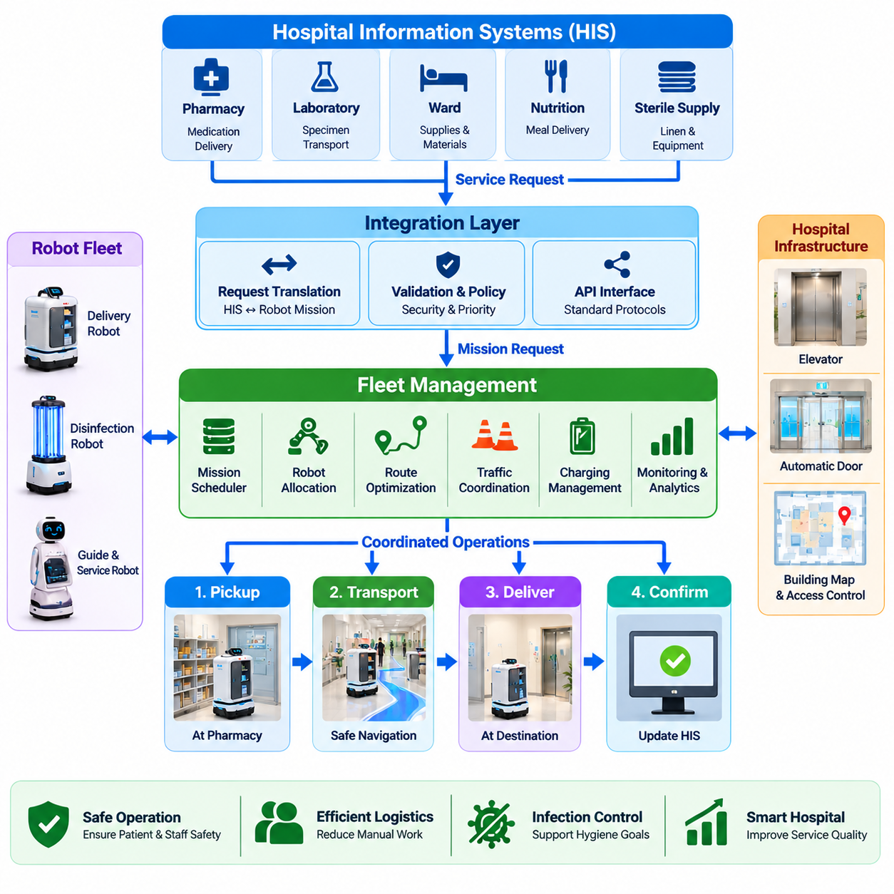{width="7.268055555555556in" height="7.268055555555556in"}

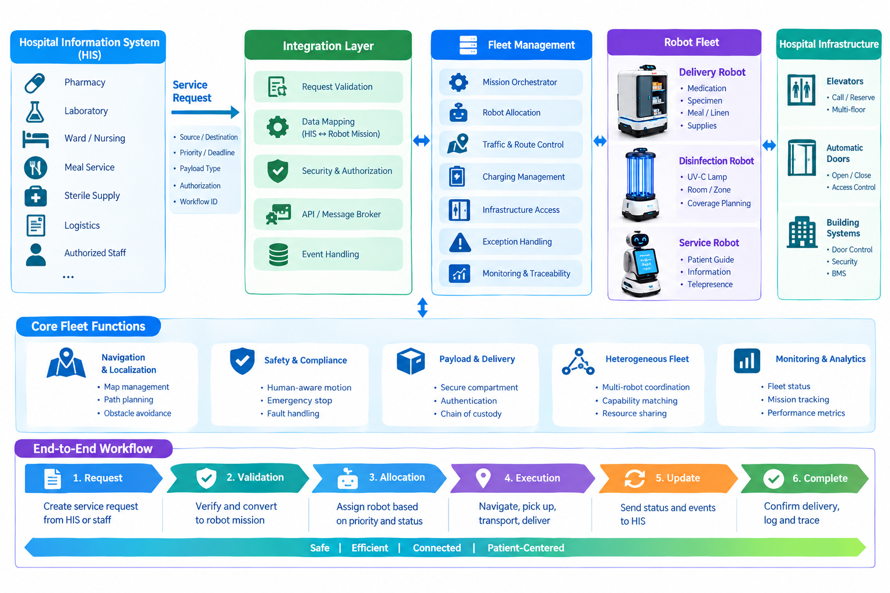{width="7.268055555555556in" height="4.845138888888889in"}

병원 플릿 관리(Hospital Fleet Management)는 여러 자율 로봇(Autonomous Robot)을 임상 및 물류 워크플로(Clinical and Logistical Workflow)와 통합하여 개별 장비가 아닌 조정된 병원 서비스(Coordinated Hospital Service)로 운영되도록 한다. 플릿 계층(Fleet Layer)은 배송 로봇, 소독 로봇 및 기타 서비스 플랫폼을 관리하면서 이들의 임무를 병원 정보 시스템(Hospital Information System, HIS)과 연결한다. 주요 기능에는 작업 접수, 로봇 할당, 교통 조정, 충전, 인프라 접근, 예외 처리, 모니터링 및 운영 추적성(Operational Traceability)이 포함된다.

병원 정보 시스템(Hospital Information System, HIS) 통합은 병원의 업무 워크플로와 로봇의 물리적 동작을 연결한다. 요청은 약국, 검사실, 병동 물류, 식사 배송, 멸균 물품 공급 또는 기타 승인된 애플리케이션에서 생성될 수 있다. 병원 시스템은 로봇을 직접 명령하는 대신 출발지, 목적지, 우선순위, 시간 조건, 적재물 유형, 권한 요구사항 및 워크플로 식별자(Workflow Identifier)를 포함하는 서비스 요청(Service Request)을 통합 계층(Integration Layer)에 제출한다.

통합 계층(Integration Layer)은 병원 수준의 요청을 정규화된 로봇 임무 모델(Normalized Robot Mission Model)로 변환한다. 임상 시스템은 의료 업무 개념을 사용하여 작업을 표현하는 반면 로봇은 이동, 도킹, 대기, 인증, 적재, 운송, 하역, 복귀와 같은 실행 가능한 동작을 요구하므로 이러한 추상화(Abstraction)가 중요하다. 두 영역 사이의 매핑(Mapping)을 통해 병원 애플리케이션은 개별 로봇 제조사와 독립적으로 유지될 수 있으며 서로 다른 유형의 로봇도 공통 워크플로에 참여할 수 있다.

임무 오케스트레이터(Mission Orchestrator)는 실행 전에 각각의 요청을 검증한다. 픽업 위치와 목적지가 존재하는지, 요청된 서비스가 허용되는지, 적절한 로봇 유형을 사용할 수 있는지, 관련 운영 제약조건을 충족할 수 있는지를 확인한다. 유효하지 않거나 불완전한 요청은 부분적으로 실행 가능한 임무로 전환하는 대신 거부하거나 수정을 요청한다. 유효한 요청에는 병원 워크플로 생성부터 물리적 임무 완료까지 종단 간 추적(End-to-End Tracking)을 지원하는 식별자가 할당된다.

로봇 할당(Robot Allocation)은 단순히 가장 가까운 가용 로봇을 선택하는 것 이상을 요구한다. 플릿 스케줄러(Fleet Scheduler)는 현재 위치, 임무 대기열, 적재 용량, 적재함 구성, 배터리 수준, 충전 요구사항, 접근 권한, 로봇 상태, 예상 이동 시간 및 작업 우선순위를 고려한다. 보안 적재함(Secure Compartment)을 갖춘 약품 배송 로봇은 더 가까운 범용 로봇보다 우선 선택될 수 있으며, 긴급 검사실 운송은 정의된 정책에 따라 우선순위가 낮은 물류 작업보다 먼저 처리될 수 있다.

병원 워크플로는 서로 다른 운영 중요도를 가지므로 우선순위 관리(Priority Management)를 명시적으로 수행해야 한다. 일반 린넨 운송, 식사 배송, 약국 재고 보충, 검사 검체 이동 및 긴급 임상 물류가 반드시 동일한 스케줄링 우선순위를 가져야 하는 것은 아니다. 플릿 시스템은 우선순위 등급(Priority Class)과 마감 시간(Deadline)을 할당할 수 있으며, 기아 방지 정책(Starvation-Control Policy)과 작업 부하 균형(Workload Balancing)을 통해 낮은 우선순위의 임무가 무기한 지연되는 것을 방지할 수 있다.

임무 실행(Mission Execution)은 플릿 플랫폼과 병원 시스템 사이에서 공유되는 명확하게 정의된 상태로 표현된다. 일반적인 상태에는 요청됨(REQUESTED), 검증됨(VALIDATED), 대기열 등록(QUEUED), 할당됨(ASSIGNED), 픽업 진행(PICKUP_IN_PROGRESS), 운송 중(IN_TRANSIT), 도착(ARRIVED), 배송 진행(DELIVERY_IN_PROGRESS), 완료(COMPLETED), 실패(FAILED), 취소(CANCELLED)가 포함된다. 이러한 상태를 통해 외부 애플리케이션은 위치 추정, 경로 계획, 모터 제어 또는 기타 로봇 내부 기능을 상세하게 알지 못하더라도 임무 진행 상태를 파악할 수 있다.

이벤트 기반 통합(Event-Driven Integration)은 병원 시스템이 비동기 상태 업데이트(Asynchronous Status Update)를 자주 필요로 하기 때문에 유용하다. 애플리케이션은 모든 로봇의 상태를 반복적으로 폴링(Polling)하는 대신 임무가 승인, 할당, 지연, 픽업, 배송, 취소 또는 실패했을 때 이벤트를 받을 수 있다. 메시지 브로커(Message Broker) 또는 통합 서비스(Integration Service)는 이러한 이벤트를 권한이 있는 소비자에게 배포할 수 있다. 상관 식별자(Correlation Identifier)는 비동기 로봇 이벤트가 올바른 임상 또는 물류 워크플로와 연결되도록 한다.

플릿 규모가 증가할수록 교통 관리(Traffic Management)의 중요성이 높아진다. 여러 로봇이 좁은 복도, 교차로, 엘리베이터, 자동문, 도킹 스테이션 및 충전 구역을 공유할 수 있다. 플릿 시스템은 중요 자원을 예약하고 제한 구역 진입을 제어하며 방향별 우선순위를 할당하고 교착 상태(Deadlock)를 방지할 수 있다. 또한 경로 계획(Route Planning)에 혼잡도 추정(Congestion Estimation)을 반영하여 기하학적으로 더 짧더라도 혼잡한 경로를 피하도록 할 수 있다.

엘리베이터와 자동문은 개별적인 내비게이션 장애물이 아니라 공유 플릿 자원(Shared Fleet Resource)이 된다. 플릿 관리자는 엘리베이터 예약, 대기 위치, 접근 요청 및 로봇 이동 순서를 조정할 수 있다. 여러 로봇이 동일한 엘리베이터를 필요로 하는 경우 임무 우선순위와 예상 도착 시간에 따라 요청을 스케줄링할 수 있다. 인프라 인식형 조정(Infrastructure-Aware Coordination)은 혼잡을 줄이고 여러 로봇이 제한된 건물 자원을 독립적으로 경쟁하는 상황을 방지한다.

배터리 및 충전 관리(Battery and Charging Management)는 모든 로봇을 동일한 임계값에서 충전하도록 보내면 전체 서비스 용량이 감소할 수 있기 때문에 플릿 수준에서 최적화해야 한다. 스케줄러는 임무 대기열, 로봇 상태, 이동 거리 및 예상 수요를 기반으로 에너지 요구량을 예측한다. 이후 사용 가능한 충전 스테이션과 수요가 낮은 시간대에 충전을 분산할 수 있다. 충분한 에너지를 보유한 로봇은 서비스에 계속 투입하고 다른 로봇은 중요 임무에 영향을 주지 않으면서 기회 충전(Opportunistic Charging) 또는 예약 충전(Scheduled Charging)을 수행한다.

이기종 플릿(Heterogeneous Fleet)은 공통 기능 모델(Common Capability Model)을 필요로 한다. 서로 다른 로봇은 보안 적재함, 냉장 기능, 중량물 운반, 자외선 소독, 인간 상호작용 또는 특수 도킹 기능을 지원할 수 있다. 플릿 플랫폼은 이러한 특성을 기능(Capability)으로 표현하고 임무 요구사항과 일치시킨다. 이를 통해 애플리케이션은 특정 로봇 모델이나 제조사를 지정하지 않고도 보안 약품 운송(Secure Medication Transport)과 같은 서비스를 요청할 수 있다.

병원 정보 시스템 통합(HIS Integration)에서는 식별자와 의미적 위치(Semantic Location)도 신중하게 관리해야 한다. 병원 애플리케이션은 병동, 검사실, 약국, 병실 또는 서비스 지점을 기관 식별자(Institutional Identifier)로 표현할 수 있지만 내비게이션 소프트웨어는 지도와 좌표를 사용한다. 위치 서비스(Location Service)는 업무 수준 식별자를 로봇이 접근할 수 있는 목적지, 층, 도킹 자세(Docking Pose), 접근 구역 및 인프라 전환(Infrastructure Transition)에 매핑하여 물리적 경로와 병원 조직 데이터를 동기화한다.

보안(Security)과 권한 인증(Authorization)은 모든 통합 경계에서 적용되어야 한다. 병원 애플리케이션, 플릿 서비스, 로봇, 운영자 및 인프라 컨트롤러는 명령이나 민감한 데이터를 교환하기 전에 인증(Authentication)을 수행해야 한다. 역할 기반 권한(Role-Based Permission)은 어떤 시스템이 임무를 생성, 수정, 취소 또는 조회할 수 있는지를 결정한다. 민감한 적재물 정보는 최소화하고 전송 및 저장 과정에서 보호하며 가능한 경우 일반 로봇 텔레메트리(Robot Telemetry)와 분리해야 한다.

신뢰성 높은 통합(Reliable Integration)을 위해서는 중복되거나 일관되지 않은 요청을 방지해야 한다. 네트워크 재시도(Network Retry)로 인해 동일한 배송 명령이 여러 번 도착하면 하나의 병원 주문에 대해 여러 물리적 임무가 생성될 수 있다. 고유 요청 식별자(Unique Request Identifier)와 멱등 처리(Idempotent Processing)를 사용하면 플릿 서비스가 반복된 요청을 인식할 수 있다. 또한 트랜잭션 상태(Transaction Status)를 조회할 수 있도록 하여 외부 시스템이 통신 중단 이후 임무 생성 여부를 추측하지 않고 안전하게 복구할 수 있도록 해야 한다.

예외 처리(Exception Handling)는 자율 복구(Autonomous Recovery)와 병원 운영을 연결한다. 차단된 복도는 경로 재계획(Replanning)을 통해 해결할 수 있으며 사용할 수 없는 엘리베이터는 자원 재할당(Resource Reassignment)이 필요할 수 있다. 수령자 부재, 인증 실패, 적재함 문제 또는 적재물 손상은 직원에게 단계적으로 전달(Escalation)해야 할 수 있다. 플릿 플랫폼은 예외를 분류하고 자동 재시도, 임무 재할당, 적재물 반환, 지원 요청 또는 요청을 생성한 병원 시스템에 실패 보고 중 적절한 대응을 결정한다.

정상적인 임무가 높은 수준으로 자율화되어 있더라도 사람 운영자(Human Operator)는 플릿 아키텍처의 일부로 남아 있다. 제어 인터페이스(Control Interface)는 로봇 위치, 임무 대기열, 배터리 상태, 인프라 상태, 활성 경보 및 해결되지 않은 예외를 표시한다. 운영자는 문제를 조사하고 정의된 복구 동작을 승인하거나 로봇을 서비스에서 제외할 수 있다. 수동 개입(Manual Intervention)은 자동화된 동작과 사람의 동작 모두 동일하게 추적될 수 있도록 임무 이력(Mission History)에 기록해야 한다.

관측 가능성(Observability)은 텔레메트리, 임무 이벤트, 인프라 이벤트 및 병원 정보 시스템 트랜잭션(HIS Transaction)을 하나의 일관된 운영 관점으로 통합한다. 임무 완료율(Mission Completion Rate), 평균 배송 시간, 대기열 대기 시간, 로봇 활용률, 개입 빈도, 엘리베이터 지연, 충전 활용률 및 실패율과 같은 지표는 시스템 수준의 성능을 보여준다. 이러한 지표를 분석하면 지연의 원인이 로봇, 스케줄링 정책, 건물 인프라 또는 병원 워크플로 가운데 어디에서 발생하는지 파악할 수 있다.

감사 가능성(Auditability)은 로봇이 통제 물질 또는 임상적으로 중요한 물품을 운송할 때 특히 중요하다. 시스템은 요청 생성, 권한 승인, 로봇 할당, 픽업 확인, 적재함 접근, 운송 이벤트, 수령자 인증, 배송 확인, 예외 및 최종 상태를 기록할 수 있다. 이러한 기록은 전자적 관리 연속성(Electronic Chain of Custody)을 형성하며 관리자가 개별 로봇 로그에만 의존하지 않고 물리적 배송이 어떻게 수행되었는지를 재구성할 수 있도록 한다.

확장성(Scalability)을 확보하려면 로봇 수, 임무량, 연결된 부서 및 인프라 인터페이스가 증가하더라도 플릿 플랫폼이 안정적으로 동작해야 한다. 임무 서비스, 스케줄링, 텔레메트리 수집(Telemetry Ingestion), 이벤트 처리(Event Processing), 외부 시스템 통합(External Integration)은 명확하게 정의된 인터페이스를 가진 모듈형 서비스(Modular Service)로 분리할 수 있다. 이를 통해 특정 서브시스템의 확장이 전체 플랫폼의 재설계를 요구하지 않도록 하고 새로운 로봇 애플리케이션이 기존 병원 통합 기반을 재사용할 수 있도록 한다.

검증(Validation)은 개별 API(Application Programming Interface)만이 아니라 완전한 시스템 간 워크플로(Cross-System Workflow)를 시험해야 한다. 시나리오에는 동시 요청, 우선순위 변경, 중복 메시지, 취소된 임무, 로봇 고장, 차단된 경로, 사용 불가능한 엘리베이터, 접근 거부, 배터리 부족, 통신 두절, 수령자 지연 및 병원 정보 시스템 재연결(HIS Reconnection)이 포함되어야 한다. 각 상황에서도 병원 애플리케이션, 플릿 서비스, 인프라 시스템 및 물리적 로봇 사이에서 일관된 임무 상태가 유지되어야 한다.

결과적으로 이러한 아키텍처는 플릿 관리(Fleet Management)를 디지털 병원 프로세스(Digital Hospital Process)와 물리적 로봇 실행(Physical Robotic Execution)을 연결하는 운영적 가교(Operational Bridge)로 만든다. 병원 정보 시스템 통합(HIS Integration)은 어떤 서비스가 필요한지를 정의하고, 플릿 지능(Fleet Intelligence)은 어떤 로봇이 언제 작업을 수행할지를 결정하며, 인프라 조정(Infrastructure Coordination)은 시설 내부의 이동을 가능하게 하고, 로봇은 실제 물리적 작업을 수행한다. 이러한 계층의 통합은 확장 가능하고(Scalable), 추적 가능하며(Traceable), 안전하고(Secure), 지속적으로 가용한(Continuously Available) 다중 로봇 병원 운영(Multi-Robot Hospital Operations)의 기반을 제공한다.

## 02.06. Patient Service Humanoid HRI Design [w/Code]

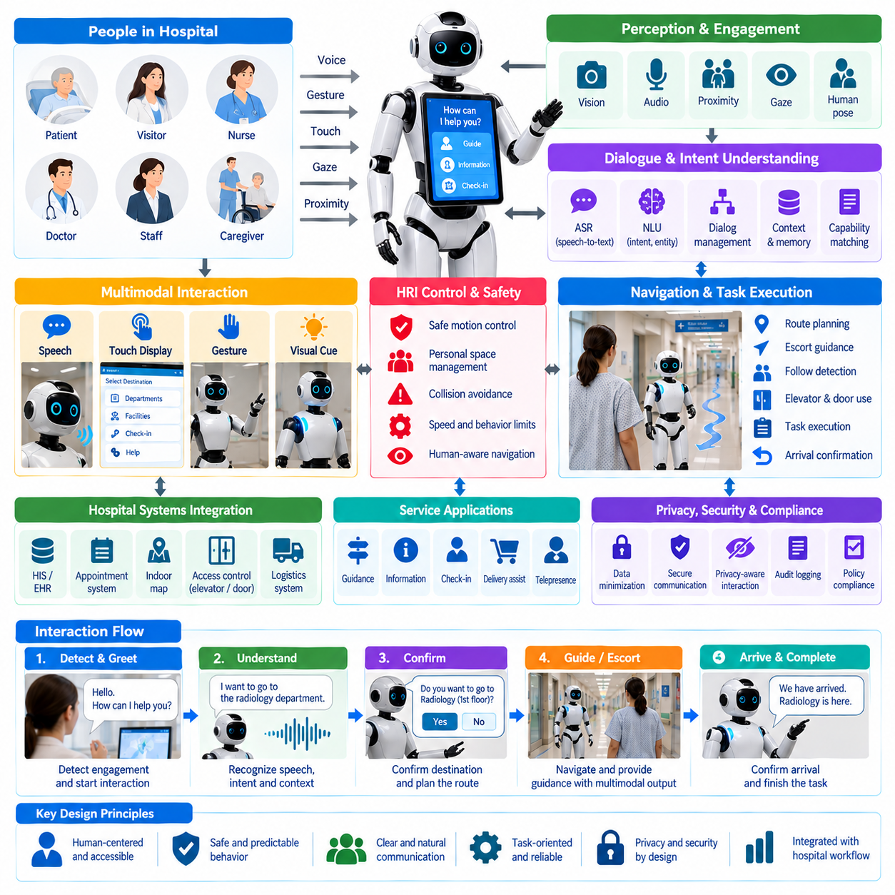{width="7.268055555555556in" height="7.268055555555556in"}

환자 서비스 휴머노이드 로봇(Patient-Service Humanoid Robot)은 안전성(Safety), 명확성(Clarity), 접근성(Accessibility), 예측 가능한 행동(Predictable Behavior)을 중심으로 설계된 인간-로봇 상호작용(Human-Robot Interaction, HRI) 아키텍처를 필요로 한다. 제한된 작업 공간에서 운용되는 산업용 로봇과 달리 병원 휴머노이드는 환자, 방문객, 간호사, 보호자 및 행정 직원과 직접 상호작용할 수 있다. 따라서 HRI 설계는 인지(Perception), 대화(Dialogue), 제스처(Gesture), 내비게이션(Navigation), 작업 실행(Task Execution), 개인정보 보호(Privacy Protection), 지속적인 안전 감독(Safety Supervision)을 통합해야 한다.

상호작용 과정은 사람이 로봇과 의사소통하려는 의도(Intention)를 가지고 있는지를 인식하는 것에서 시작된다. 카메라, 마이크, 근접 센싱(Proximity Sensing), 신체 방향(Body Orientation), 시선 방향(Gaze Direction), 음성 활동(Speech Activity), 명시적 인터페이스 입력 등을 참여 감지(Engagement Detection)에 활용할 수 있다. 로봇은 주변의 모든 사람이 도움을 원하는 것으로 가정해서는 안 된다. 따라서 상호작용 관리자(Interaction Manager)는 참여 신뢰도(Engagement Confidence)를 추정하고 적절한 경우에만 의사소통을 시작하여 민감한 임상 환경에서 불필요한 방해를 줄여야 한다.

음성 상호작용(Speech Interaction)은 안내와 서비스 작업을 위한 자연스러운 인터페이스를 제공하지만 병원 환경에서는 상당한 음향적 문제가 발생한다. 대화, 경보음, 카트, 환기 시스템, 의료 장비 및 안내 방송은 자동 음성 인식(Automatic Speech Recognition)을 방해할 수 있다. 로봇은 마이크 배열 처리(Microphone-Array Processing), 음성 활동 감지(Speech Activity Detection), 잡음 억제(Noise Suppression), 문맥 기반 언어 해석(Contextual Language Interpretation)을 결합해야 하며, 신뢰할 수 있는 음성 통신이 어려운 경우 시각 또는 터치 기반 대체 인터페이스를 제공해야 한다.

대화 관리(Dialogue Management)는 인식된 언어를 구조화된 상호작용 상태(Interaction State)로 변환한다. 특정 진료과의 위치를 묻는 요청은 의도 인식(Intent Recognition), 목적지 해석(Destination Resolution), 확인(Confirmation), 경로 생성(Route Generation), 안내 실행(Guidance Execution)을 필요로 할 수 있다. 더욱 복잡한 요청은 여러 차례의 대화를 요구할 수 있다. 대화 관리자는 단기 문맥(Short-Term Context)을 유지하고 모호한 표현을 감지하며 필요한 경우 추가 설명을 요청하고, 불확실한 해석을 그대로 실행하는 대신 중요한 동작을 명시적으로 확인해야 한다.

자연어 이해(Natural-Language Understanding)는 로봇이 실제로 수행할 수 있는 기능과 연결되어야 한다. 휴머노이드는 하드웨어, 소프트웨어, 권한 수준 또는 병원 워크플로에서 지원하지 않는 작업을 수행할 수 있는 것처럼 표현해서는 안 된다. 기능 서비스(Capability Service)는 허용된 기능을 대화 시스템에 제공하여 현재 운영 상태를 반영한 응답을 생성할 수 있도록 한다. 요청이 사용 가능한 기능 범위를 초과하는 경우 로봇은 제한 사항을 설명하고 적절한 사람 또는 서비스 채널로 사용자를 안내해야 한다.

다중 모달 상호작용(Multimodal Interaction)은 음성만으로 충분한 의사소통이 어려운 경우 효과를 향상시킨다. 로봇은 음성 언어와 디스플레이 콘텐츠, 머리 방향, 팔 제스처, 포인팅(Pointing), 조명 및 간단한 신체 움직임을 결합할 수 있다. 예를 들어 방향 안내에서는 음성 설명과 함께 디스플레이에 지도를 표시하고 올바른 복도를 향해 손으로 가리킬 수 있다. 여러 개의 조정된 의사소통 채널을 사용하면 모호성을 줄이고 서로 다른 의사소통 선호도나 환경적 제약을 가진 사용자의 접근성을 향상시킬 수 있다.

제스처 설계(Gesture Design)는 인간의 행동을 단순히 모방하는 것보다 기능적 명확성(Functional Clarity)을 강조해야 한다. 환자 주변에서 갑작스러운 팔이나 신체 움직임을 피하면서 동작을 충분히 느리게 수행하여 이해 가능하고 예측 가능하게 만들어야 한다. 포인팅, 인사, 확인 및 주의 유도 제스처는 매개변수화된 동작 프리미티브(Parameterized Motion Primitive)로 표현할 수 있다. HRI 제어기(HRI Controller)는 적절한 제스처를 선택하고 안전 계층(Safety Layer)은 주변 상황에 따라 관절 속도, 작업 공간, 근접 거리 및 허용 동작을 제한한다.

환자 대면 로봇(Patient-Facing Robot)은 연령, 이동 능력, 시력, 청력, 언어 능력, 인지 능력 및 로봇 사용 경험의 광범위한 차이를 고려해야 한다. 인터페이스 요소는 읽기 쉬운 텍스트, 이해하기 쉬운 음성, 단순한 선택 항목, 충분한 응답 시간 및 일관된 상호작용 패턴을 사용해야 한다. 모든 환자가 터치스크린을 사용할 수 있거나 음성 안내를 명확하게 들을 수 있거나 복잡한 메뉴와 기술 용어를 이해할 수 있다고 가정하지 않고 여러 상호작용 방식(Modality)을 지원해야 한다.

개인 공간 관리(Personal-Space Management)는 사회적 상호작용(Social Interaction)과 내비게이션을 연결한다. 환자에게 접근하는 휴머노이드는 적절한 거리를 유지하고 침대, 휠체어, 출입문 또는 임상 작업 구역을 차단하지 않아야 한다. 인간 인식형 내비게이션(Human-Aware Navigation)은 사람 주변에 개인 공간 영역(Personal Zone)을 표현하고 접근 방향, 속도 및 정지 위치를 조절할 수 있다. 로봇은 의사소통이 가능한 충분한 거리를 유지하면서 신체적 편안함을 보장하고 의료진의 이동을 방해하지 않아야 한다.

안내 작업(Guidance Task)은 대화와 이동 기능의 조정을 필요로 한다. 목적지를 확인한 후 로봇은 음성으로 방향을 설명하거나 디스플레이에 경로를 표시하거나 사용자를 직접 목적지까지 안내할 수 있다. 동행 안내(Escorting) 중에는 사용자가 계속 따라오고 있는지를 모니터링하고, 거리가 지나치게 벌어지면 보행 속도를 조절하거나 기다리며 필요한 경우 교차로에서 정지해야 한다. 상호작용은 로봇이 이동을 시작하는 순간 종료되는 것이 아니라 전체 내비게이션 과정에서 지속된다.

환자 서비스 휴머노이드(Patient-Service Humanoid)는 접수(Check-In), 대기열 안내(Queue Guidance), 시설 정보 제공, 예약 장소 안내(Appointment Navigation), 배송 지원 또는 원격 직원 연결 등의 기능도 지원할 수 있다. 이러한 워크플로는 제한 없는 자유 대화가 아니라 명시적인 서비스 프로세스(Service Process)로 구현해야 한다. 각 프로세스는 필요한 입력, 허용된 동작, 완료 조건 및 단계적 대응 규칙(Escalation Rule)을 정의한다. 구조화된 워크플로(Structured Workflow)는 행동 검증을 용이하게 하고 대화의 유연성이 병원의 운영 통제를 우회하는 것을 방지한다.

개인정보 보호(Privacy)는 대화에 민감한 개인 또는 임상 정보가 포함될 수 있기 때문에 HRI 설계 초기부터 고려해야 한다. 로봇은 요청된 서비스를 제공하는 데 필요한 정보만 수집하고 큰 음성이나 공개적으로 보이는 디스플레이를 통해 개인 정보를 노출하지 않아야 한다. 보호된 정보에 접근하기 전에는 인증(Authentication)이 필요할 수 있다. 음성, 이미지, 대화 기록(Transcript), 상호작용 로그(Interaction Log)는 정의된 보존, 접근 및 보안 정책을 따라야 한다.

신원 인식(Identity Recognition)은 특히 신중하게 다루어야 한다. 사람이 존재한다는 사실을 인식하는 것과 그 사람이 누구인지를 식별하는 것은 서로 다른 문제이다. 많은 서비스 상호작용은 개인을 식별하지 않고도 수행할 수 있다. 실제로 신원 확인이 필요한 경우 로봇은 생체정보(Biometric Data)를 불필요하게 이용하여 신원을 추론하는 대신 승인된 인증 메커니즘(Authorized Authentication Mechanism)을 사용해야 한다. 존재 감지(Presence Detection), 사용자 참여(User Engagement), 인증(Authentication), 신원 관리(Identity Management)를 분리하면 개인정보 위험을 줄이고 시스템 책임을 단순화할 수 있다.

안전 감독(Safety Supervision)은 대화 의도(Conversational Intent)와 독립적으로 유지되어야 한다. 음성 명령이 충돌 회피(Collision Avoidance), 비상 정지(Emergency Stopping), 관절 제한(Joint Limit), 제한 구역 정책(Restricted-Area Policy) 또는 기타 안전 기능을 무시하도록 허용해서는 안 된다. 사용자가 로봇에게 안전하지 않은 행동을 요청하는 경우 언어 이해의 신뢰도가 높더라도 작업 계층(Task Layer)은 해당 명령을 거부해야 한다. 이러한 분리를 통해 자연어의 유연성이 물리적 안전 제약을 직접 우회하지 못하도록 보장한다.

휴머노이드가 환자에게 물체를 전달하거나 환자로부터 물품을 받을 경우 물리적 상호작용(Physical Interaction)에 추가적인 요구사항이 발생한다. 로봇은 팔 궤적(Arm Trajectory), 파지 상태(Grasp State), 힘 제한(Force Limit), 사용자와의 근접 거리, 전달 확인(Transfer Confirmation)을 조정해야 한다. 물체 전달(Object Handover)은 접근, 제시, 준비 상태 감지(Readiness Detection), 해제, 완료와 같은 명시적인 상태를 통해 진행해야 한다. 예상하지 못한 접촉이나 불확실한 파지 상태가 발생하면 계속 움직이는 대신 통제된 일시 정지 또는 안전한 후퇴(Safe Withdrawal)를 수행해야 한다.

불확실성(Uncertainty)은 명시적인 시스템 상태로 처리해야 한다. 음성 인식 신뢰도(Speech Recognition Confidence), 의도 신뢰도(Intent Confidence), 사람 추적 품질(Person Tracking Quality), 위치 추정 신뢰도(Localization Confidence), 작업 상태(Task Status)는 상호작용 과정에서 모두 불확실해질 수 있다. 로봇은 이러한 불확실성을 숨기는 대신 사용자에게 요청을 반복하도록 요구하거나 더 나은 의사소통 위치로 이동하거나 선택 가능한 옵션을 제공하거나 사람의 지원을 요청할 수 있다. 환자 또는 임상 워크플로에 영향을 주는 행동에서는 특히 보수적인 불확실성 처리(Conservative Uncertainty Handling)가 중요하다.

사람에게 단계적으로 지원을 요청하는 인간 에스컬레이션(Human Escalation)은 시스템 실패의 증거가 아니라 HRI의 기본적인 기능이다. 로봇은 간호사, 접수 직원, 보안 담당자, 통역사, 기술자 또는 원격 운영자(Remote Operator)가 필요한 상황을 인식해야 한다. 반복적인 이해 실패, 정서적 불편(Emotional Distress), 의료 관련 질문, 접근할 수 없는 목적지, 시스템 고장 또는 허용된 기능 범위를 벗어난 요청으로 인해 에스컬레이션이 발생할 수 있다. 로봇은 사용자가 전체 상호작용을 처음부터 다시 시작하지 않도록 관련 작업 문맥(Task Context)을 유지해야 한다.

상호작용 상태(Interaction State)는 계층적 상태 머신(Hierarchical State Machine) 또는 작업 지향 행동 아키텍처(Task-Oriented Behavior Architecture)를 통해 표현할 수 있다. 상태에는 대기(IDLE), 참여 감지(ENGAGEMENT_DETECTED), 인사(GREETING), 청취(LISTENING), 해석(INTERPRETING), 확인(CONFIRMING), 실행(EXECUTING), 사용자 대기(WAITING_FOR_USER), 완료(COMPLETED), 단계적 지원 요청(ESCALATING), 안전 정지(SAFETY_STOP)가 포함될 수 있다. 대화 상태를 내비게이션 및 조작 상태와 분리하면 각 서브시스템을 독립적으로 발전시키면서 HRI 조정기(HRI Coordinator)가 전체적으로 일관된 행동을 유지할 수 있다.

관측 가능성(Observability)은 개발자와 병원 운영자가 상호작용의 성공 또는 실패 원인을 이해하는 데 도움을 준다. 로그에는 익명화된 상호작용 상태(Anonymized Interaction State), 인식 신뢰도, 작업 상태 전이, 사용자 취소, 추가 확인 요청, 에스컬레이션 이벤트, 내비게이션 중단 및 안전 개입을 기록할 수 있다. 성능 지표에는 단순한 음성 인식 정확도뿐만 아니라 작업 완료율(Task Completion Rate), 상호작용 시간, 추가 확인 빈도, 중도 포기율(Abandonment Rate), 사람 지원 요청률, 성공적인 안내 완료율 등이 포함될 수 있다.

시험(Testing)은 이상적인 실험실 대화가 아니라 실제 병원에서 발생할 수 있는 상호작용을 재현해야 한다. 평가 시나리오에는 배경 소음, 다양한 억양, 고령 사용자, 휠체어 사용자, 마스크 착용, 중단된 대화, 모호한 요청, 혼잡한 복도, 천천히 걷는 사용자, 통신 장애 및 안전 중단을 포함해야 한다. 사용성 연구(Usability Study)는 이해도, 작업 성공률, 인지된 명확성(Perceived Clarity), 응답 시간, 편안함 및 운영자 작업 부하를 측정할 수 있으며 기술 시험은 결정론적 안전 및 복구 동작을 검증해야 한다.

결과적으로 이러한 HRI 아키텍처는 환자 서비스 휴머노이드를 단순한 대화형 캐릭터(Conversational Character)가 아니라 조정된 서비스 시스템(Coordinated Service System)으로 다룬다. 인지(Perception)는 누가 상호작용 가능한지를 판단하고, 대화(Dialogue)는 어떤 서비스가 요청되었는지를 결정하며, 다중 모달 의사소통(Multimodal Communication)은 로봇 행동을 이해할 수 있도록 한다. 내비게이션과 조작(Manipulation)은 물리적 작업을 실행하고 안전 및 개인정보 보호 계층은 모든 행동을 제한한다. 이러한 통합을 통해 휴머노이드 로봇은 병원 환경에서 유용하고(Useful), 예측 가능하며(Predictable), 책임 추적이 가능한(Accountable) 지원 서비스를 제공할 수 있다.

## 02.07. Infection Control Robot Hygiene Protocol SW

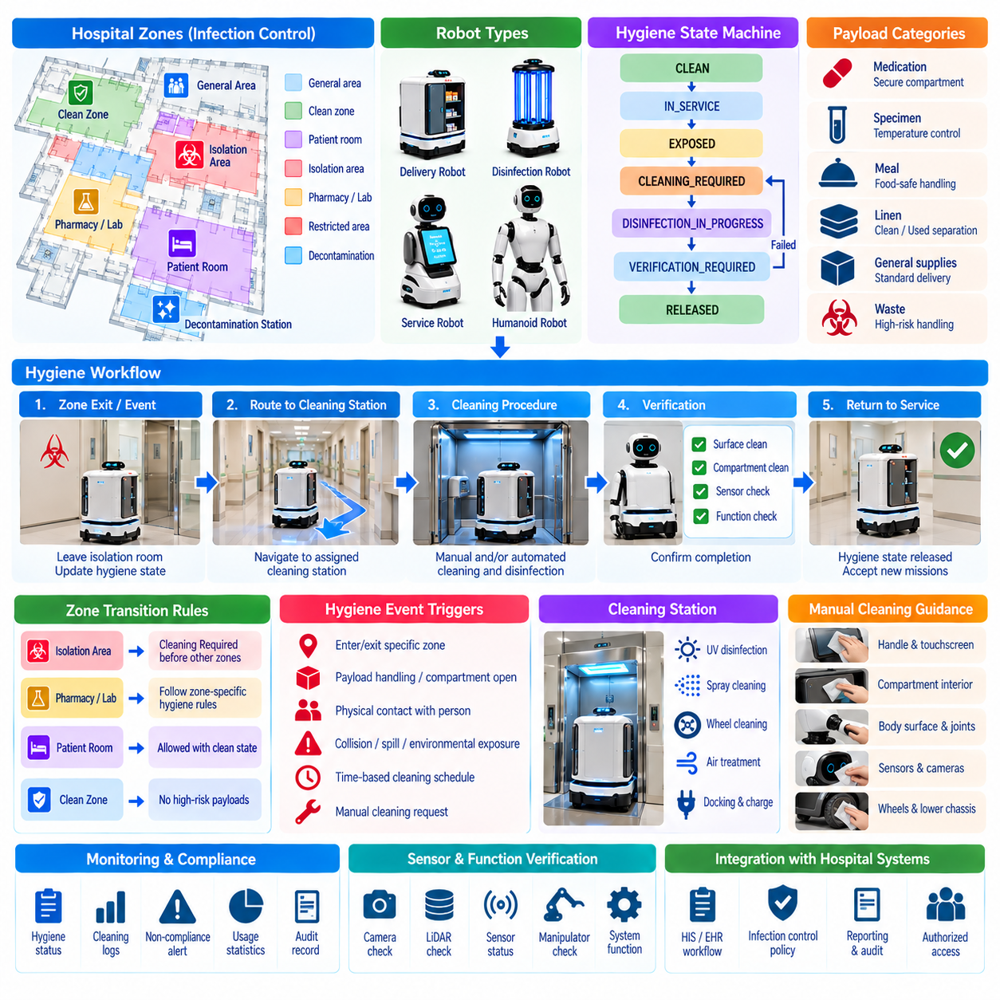{width="7.268055555555556in" height="7.268055555555556in"}

감염 관리 로봇 소프트웨어(Infection-Control Robot Software)는 로봇 위생(Robot Hygiene)을 별도의 유지보수 활동이 아니라 임무 실행(Mission Execution)의 일부로 다루어야 한다. 병원 로봇은 병동, 병실, 검사실, 약국 및 공용 공간 사이를 이동하면서 바퀴, 외장 커버, 손잡이, 적재함, 센서 또는 매니퓰레이터(Manipulator)를 통해 오염을 옮길 가능성이 있다. 따라서 소프트웨어에는 명시적인 위생 상태(Hygiene State), 세척 규칙(Cleaning Rule), 구역 제한(Zone Restriction), 오염 추적(Contamination Tracking), 감사 가능한 프로토콜 실행(Auditable Protocol Execution)이 필요하다.

위생 프로토콜(Hygiene Protocol)은 감염 관리 요구사항에 따라 운영 환경을 분류하는 것에서 시작된다. 병원 지도(Hospital Map)는 일반 구역, 청정 구역(Clean Zone), 격리 구역(Isolation Area), 고위험 임상 공간(High-Risk Clinical Space), 오염 제거 스테이션(Decontamination Station), 제한 전환 구역(Restricted Transition)을 나타내는 의미적 구역(Semantic Zone)을 포함할 수 있다. 이러한 분류를 통해 임무 플래너(Mission Planner)는 로봇이 특정 위치에 직접 진입할 수 있는지, 추가적인 예방 조치가 필요한지 또는 정의된 위생 경계(Hygiene Boundary)를 통과하기 전에 세척이 필요한지를 판단할 수 있다.

로봇은 현재의 위생 상태(Hygiene State)를 소프트웨어적으로 표현하고 유지해야 한다. 플랫폼이 항상 청결하다고 가정하는 대신 시스템은 청결(CLEAN), 서비스 중(IN_SERVICE), 노출됨(EXPOSED), 오염 의심(CONTAMINATION_SUSPECTED), 세척 필요(CLEANING_REQUIRED), 소독 진행 중(DISINFECTION_IN_PROGRESS), 검증 필요(VERIFICATION_REQUIRED), 사용 승인(RELEASED)과 같은 상태를 표현할 수 있다. 상태 전이(State Transition)는 임무 이력, 방문 구역, 적재물 유형, 감지된 이벤트, 경과된 운영 시간 또는 권한을 가진 직원의 명시적인 지시에 따라 발생한다.

구역 전환 규칙(Zone-Transition Rule)은 서로 다른 위생 요구사항을 가진 영역 사이에서 부적절한 이동이 발생하는 것을 방지할 수 있다. 예를 들어 격리 병실(Isolation Room)을 나온 로봇이 즉시 다른 환자 진료 구역에 들어가는 것을 금지할 수 있다. 임무 실행기(Mission Executive)는 로봇을 지정된 세척 스테이션(Cleaning Station)으로 이동시키고 필요한 프로토콜이 완료될 때까지 새로운 임무 할당을 차단할 수 있다. 따라서 위생 제약(Hygiene Constraint)은 운영자가 절차를 기억하는 것에만 의존하지 않고 경로 및 작업 계획(Route and Task Planning)의 일부가 된다.

적재물 처리(Payload Handling) 역시 감염 관리 로직(Infection-Control Logic)에 포함되어야 한다. 배송용 적재함은 의약품, 검체, 식사, 린넨, 폐기물 또는 일반 물품을 운반할 수 있으며 각 범주는 서로 다른 취급 규칙을 요구할 수 있다. 소프트웨어는 적재물 등급(Payload Class)을 허용 적재함, 목적지 구역, 세척 요구사항 및 배송 후 작업과 연결할 수 있다. 이를 통해 상대적으로 높은 위험도의 물질을 운반했던 적재함이 필요한 위생 처리 없이 다시 할당되는 것을 방지할 수 있다.

세척 절차(Cleaning Procedure)는 비공식적인 작업 지침이 아니라 실행 가능한 워크플로(Executable Workflow)로 인코딩할 수 있다. 워크플로에서는 로봇이 세척 스테이션에 진입하고 구동을 정지하며 지정된 접근 패널을 잠금 해제하고 직원에게 알림을 전달한 후 수동 표면 세척을 기다리고 자동 소독 주기(Automated Disinfection Cycle)를 시작한 다음 완료 상태를 검증하도록 요구할 수 있다. 명시적인 워크플로 상태(Workflow State)를 사용하면 단계 누락, 세척 중단 또는 조기 임무 할당을 시스템이 감지할 수 있다.

많은 로봇 표면은 자율 메커니즘만으로 안정적으로 소독하기 어렵기 때문에 수동 세척(Manual Cleaning)은 여전히 중요하다. 소프트웨어는 손잡이, 터치스크린, 적재함, 외장 커버, 매니퓰레이터, 범퍼 및 기타 접촉 영역에 대해 표면별 세척 지침(Surface-Specific Instruction)을 운영자에게 제공할 수 있다. 확인 인터페이스(Confirmation Interface)는 필요한 작업이 수행되었음을 기록할 수 있으며 타이머와 워크플로 제어를 통해 지정된 절차가 완료되기 전에 로봇이 다시 서비스에 투입되는 것을 방지할 수 있다.

자동화된 위생 기능(Automated Hygiene Function)은 수동 절차를 보완할 수 있다. 로봇 설계에 따라 적재함 자외선 처리(Compartment UV Treatment), 제어된 분사(Controlled Spraying), 내부 공기 처리(Internal Air Treatment), 도킹 스테이션 위생 처리(Docking-Station Sanitation), 자동 바퀴 세척 메커니즘(Automated Wheel-Cleaning Mechanism) 등을 사용할 수 있다. 위생 제어기(Hygiene Controller)는 단순히 활성화 명령을 전송했다고 성공적인 소독으로 판단하지 않고 각 기능을 작동 조건, 작동 시간, 완료 기준 및 고장 상태를 가진 모니터링 대상 서브시스템(Monitored Subsystem)으로 관리해야 한다.

소독제는 플라스틱, 실링(Seal), 디스플레이, 광학 센서, 접착제, 코팅 및 전자 부품에 영향을 줄 수 있으므로 세척제 호환성(Cleaning-Agent Compatibility)을 운영 절차에 반영해야 한다. 소프트웨어 지침은 임의의 화학물질 사용을 허용하는 대신 각 로봇 표면에 승인된 절차(Approved Procedure)를 참조해야 한다. 유지보수 설정(Maintenance Configuration)은 로봇 구성요소와 허용된 세척 방법을 연결하여 감염 관리 활동이 의도하지 않게 센서나 안전 장비의 성능을 저하시키는 것을 방지할 수 있다.

카메라, 라이다(LiDAR) 창, 깊이 센서(Depth Sensor), 터치스크린, 마이크 및 근접 센서(Proximity Sensor)는 세척 후에도 정상적으로 작동해야 하므로 센서 위생(Sensor Hygiene)은 특별한 고려가 필요하다. 잔류물, 습기, 덮개 또는 표면 손상은 로봇이 물리적으로 깨끗해 보이더라도 센싱 성능을 저하시킬 수 있다. 따라서 세척 후 검증 루틴(Post-Cleaning Verification Routine)을 통해 센서 가용성, 가시성, 보정 상태(Calibration Status), 보호 스캐너 작동 및 통신 상태를 확인한 후 로봇의 사용을 승인할 수 있다.

바퀴와 하부 섀시(Lower Chassis) 구성요소는 오염된 바닥과 접촉하면서 병원의 여러 구역 사이를 이동할 수 있다. 운영 프로토콜에서 필요한 경우 소프트웨어는 바닥 구역 노출(Floor-Zone Exposure)을 적재물이나 상부 구조의 접촉과 별도로 추적할 수 있다. 경로는 로봇을 바퀴 세척 스테이션(Wheel-Cleaning Station)으로 유도하거나 지정된 구역으로부터의 이동을 제한할 수 있다. 이러한 구분을 통해 로봇 전체를 단순히 청결 또는 오염의 이진 상태(Binary State)로 표현하는 대신 서로 다른 오염 경로(Contamination Pathway)를 반영한 위생 정책을 적용할 수 있다.

로봇이 사람 또는 환경과 물리적으로 상호작용할 경우 접촉 이벤트(Contact Event)가 위생 상태에 영향을 줄 수 있다. 물체를 전달받는 휴머노이드, 적재함이 개방된 배송 로봇 또는 오염된 표면에 접촉한 서비스 로봇에는 추가적인 세척이 필요할 수 있다. 작업 시스템(Task System)은 조작(Manipulation), 적재함 접근, 충돌, 유출 감지(Spill Detection) 또는 운영자 보고로부터 위생 이벤트(Hygiene Event)를 생성하고 이를 이용하여 로봇의 위생 처리 요구사항을 갱신할 수 있다.

시간 기반 위생 정책(Time-Based Hygiene Policy)은 이벤트 기반 규칙(Event-Based Rule)을 보완할 수 있다. 로봇은 정의된 운영 시간이 경과하거나 일정 횟수의 임무를 완료한 후, 교대 시간 경계(Shift Boundary) 또는 예정된 유지보수 전에 정기적인 세척이 필요할 수 있다. 플릿 플랫폼(Fleet Platform)은 예정된 위생 처리 요구사항을 예측하고 의무적인 세척 시점에 가까워진 로봇에 장시간 임무를 할당하지 않을 수 있다. 이를 통해 예기치 않은 서비스 중단을 줄이면서 정기적인 위생 프로토콜이 무기한 연기되는 것을 방지한다.

플릿 관리(Fleet Management)는 임무에 로봇을 선택할 때 위생 상태를 포함해야 한다. 청결(CLEAN) 상태의 로봇은 민감한 배송 임무에 적합할 수 있지만 세척 필요(CLEANING_REQUIRED) 상태의 로봇은 프로토콜이 완료될 때까지 사용할 수 없는 상태로 유지해야 한다. 여러 로봇을 사용할 수 있는 경우 스케줄러(Scheduler)는 위치, 배터리 수준, 적재 기능, 임무 우선순위 및 작업 부하와 함께 위생 적합성(Hygiene Compatibility)을 고려하여 운영 최적화가 감염 관리 제약보다 우선되는 것을 방지할 수 있다.

격리 병실 워크플로(Isolation-Room Workflow)는 특히 엄격하게 통제된 전환을 필요로 한다. 진입하기 전에 시스템은 로봇이 해당 구역에 접근할 권한을 가지고 있는지와 현재 위생 상태가 진입 정책을 충족하는지를 확인할 수 있다. 임무 수행 중에는 접근 및 적재함 이벤트가 기록된다. 병실에서 나온 후 로봇에는 자동으로 세척 필요(CLEANING_REQUIRED) 상태가 부여되고 적절한 오염 제거 위치로 이동할 수 있으며, 플릿 소프트웨어는 사용 승인 조건이 충족될 때까지 호환되지 않는 구역으로의 재할당을 방지한다.

예상하지 못한 오염(Unexpected Contamination)은 일반적인 임무 완료가 아니라 예외(Exception)로 처리해야 한다. 유출(Spill), 손상된 검체 용기, 체액과의 접촉 또는 직원이 보고한 오염은 로봇을 즉시 서비스에서 제외해야 하는 상황을 발생시킬 수 있다. 로봇은 일반적인 배송을 자율적으로 계속하는 대신 정책에 따라 정지하거나 승인된 안전 위치로 이동하고, 자신을 사용 불가 상태로 표시하며, 사고 문맥(Incident Context)을 보존하고 권한을 가진 담당자에게 상황을 알려야 한다.

위생 관련 안전 인터록(Hygiene-Related Safety Interlock)은 서로 충돌하는 동작이 동시에 실행되는 것을 방지한다. 세척 중인 로봇이 갑자기 내비게이션을 시작해서는 안 되며, 자동 자외선 또는 화학적 처리 과정은 사람의 노출 조건이 안전하지 않은 상태에서 활성화되어서는 안 된다. 출입문 상태, 도킹 확인(Docking Confirmation), 사람 감지(Presence Sensing), 유지보수 모드(Maintenance Mode), 운영자 승인(Operator Acknowledgement) 등을 인터록에 사용할 수 있다. 위생 워크플로는 필요한 안전 조건이 충족될 때만 진행되며 조건이 위반되면 안전 상태로 복귀해야 한다.

감염 관리 절차가 실제로 수행되었다는 것을 입증하려면 추적성(Traceability)이 필수적이다. 위생 로그(Hygiene Log)에는 로봇 식별 정보, 임무 이력, 방문 구역, 적재물 등급, 세척 요구사항, 프로토콜 버전(Protocol Version), 시작 및 완료 시간, 운영자 확인, 자동화된 처리 주기 결과, 검증 상태, 고장 및 최종 사용 승인 상태를 기록할 수 있다. 이러한 기록을 통해 감염 관리 담당자는 절차 이탈(Procedural Deviation)이나 오염 문제가 발생했을 때 로봇의 활동을 재구성할 수 있다.

병원의 감염 관리 정책은 시간이 지나면서 변경될 수 있으므로 프로토콜 버전 관리(Protocol Version Management)가 중요하다. 세척 규칙, 승인된 세척제, 필요한 처리 시간, 구역 분류 및 검증 절차는 모든 정책을 내비게이션 코드에 직접 삽입하지 않고 설정 가능하도록 구성해야 한다. 완료된 각 위생 기록은 적용된 프로토콜 버전을 참조할 수 있으며, 이를 통해 특정 시점의 로봇 운용에 어떤 요구사항이 적용되었는지를 확인할 수 있다.

플릿 전체에 대한 모니터링(Monitoring)은 위생과 관련된 운영 패턴을 파악하는 데 도움을 줄 수 있다. 지표에는 세척 빈도, 평균 위생 처리 시간, 오염 제거를 기다리는 로봇 수, 프로토콜 실패, 반복적인 오염 이벤트, 스테이션 활용률 및 위생 요구사항으로 인한 서비스 불가 시간이 포함될 수 있다. 이러한 측정값을 이용하면 병원은 감염 관리와 서비스 가용성(Service Availability)을 동시에 유지하기 위해 세척 자원, 로봇 수량, 스테이션 배치 또는 임무 스케줄링을 조정해야 하는지를 판단할 수 있다.

검증(Validation)은 성공적인 세척 주기만이 아니라 전체 위생 상태 머신(Hygiene State Machine)을 시험해야 한다. 시나리오에는 격리 구역 진입 및 퇴실, 운영자 확인 누락, 위생 처리 중단, 세척 후 센서 고장, 사용할 수 없는 오염 제거 스테이션, 잘못된 적재물 분류, 세척 주기 만료, 오염 보고, 통신 두절 및 자동 처리 중 안전하지 않은 사람의 접근을 포함해야 한다. 각각의 상황은 사전에 정의된 보수적인 복구 경로(Conservative Recovery Path)로 이어져야 한다.

결과적으로 이러한 소프트웨어 아키텍처(Software Architecture)는 감염 관리(Infection Control)를 로봇 운용 전 과정에서 지속적으로 유지해야 하는 특성으로 만든다. 의미적 구역(Semantic Zone)은 환경 위험을 나타내고, 임무 이력(Mission History)은 잠재적 노출을 기록하며, 위생 상태(Hygiene State)는 로봇의 운용 준비 상태를 표현한다. 실행 가능한 프로토콜(Executable Protocol)은 세척을 제어하고, 검증(Verification)은 사용 가능 여부를 결정하며, 플릿 관리(Fleet Management)는 위생적으로 호환되지 않는 임무 할당을 방지한다. 이러한 기능을 통합함으로써 병원 로봇은 전체 운영 수명주기(Operational Lifecycle)에 걸쳐 반복 가능하고(Repeatable), 추적 가능하며(Traceable), 강제 적용 가능한(Enforceable) 위생 관리 절차를 지원할 수 있다.

## 02.08. Hospital Robot Safety ISO 13482 Compliance [w/Code]

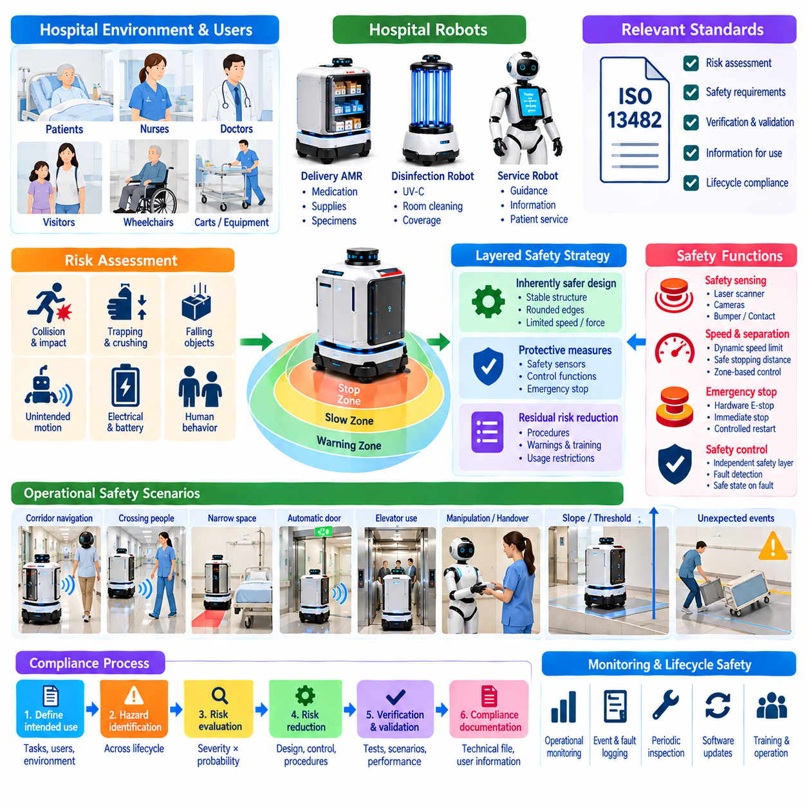{width="7.268055555555556in" height="7.268055555555556in"}

병원 로봇 안전(Hospital Robot Safety)은 위험 평가(Risk Assessment), 기계 설계(Mechanical Design), 센싱(Sensing), 제어 소프트웨어(Control Software), 운영 절차(Operational Procedure), 검증(Verification)을 연결하는 체계적인 엔지니어링 프로세스를 필요로 한다. ISO 13482는 개인지원 로봇(Personal Care Robot)을 위한 안전 프레임워크(Safety Framework)를 제공하며, 기존 산업용 로봇 셀 외부에서 사람과 가까이 운용되는 서비스 로봇에 특히 관련성이 높다. 병원 응용에서는 이러한 안전 원칙을 자율 이동, 인간 상호작용 및 서비스 실행에 대한 구체적인 요구사항으로 변환해야 한다.

안전 엔지니어링(Safety Engineering)은 로봇의 의도된 사용(Intended Use)과 합리적으로 예측 가능한 오사용(Reasonably Foreseeable Misuse)을 정의하는 것에서 시작된다. 사양에는 운영 환경, 지원 작업, 적재물, 사용자, 속도 범위, 상호작용 모드 및 금지 조건을 기술한다. 배송 AMR, 안내 로봇 또는 환자 서비스 플랫폼은 동일한 병원 내부에서도 서로 다른 위험요인(Hazard)을 발생시킬 수 있다. 따라서 위험요인을 식별하고 보호 조치를 평가하기 전에 명확한 운영 경계(Operational Boundary)를 정의해야 한다.

위험 평가(Risk Assessment)는 로봇의 전체 수명주기(Lifecycle)에서 발생할 수 있는 위험 상황(Hazardous Situation)을 식별한다. 관련 위험에는 충돌(Collision), 압착(Crushing), 끼임(Trapping), 충격(Impact), 불안정성(Instability), 의도하지 않은 움직임(Unintended Motion), 과속, 물체 낙하, 전기적 고장, 배터리 고장, 제어 오류, 센서 성능 저하 및 예상하지 못한 사람의 행동 등이 포함될 수 있다. 각 위험요인은 심각도(Severity)와 발생 가능성(Probability) 등의 요소를 기준으로 평가하여 위험 저감 조치(Risk-Reduction Measure)의 우선순위를 정하고 문서화한다.

위험 저감(Risk Reduction)은 하나의 보호 센서에 의존하는 대신 계층적 전략(Layered Strategy)을 따라야 한다. 가능한 경우 본질적으로 더 안전한 설계(Inherently Safer Design)를 통해 위험을 우선 감소시키고, 이후 하드웨어와 제어 기능으로 구현되는 보호 조치(Protective Measure)를 적용해야 한다. 완전히 제거할 수 없는 잔여 위험(Residual Risk)은 운영 절차, 경고, 교육 및 사용 제한을 통해 관리한다. 이러한 계층 구조는 소프트웨어 동작만이 중대한 물리적 위험을 방지하는 유일한 장벽이 되는 것을 방지한다.

자율 이동(Autonomous Mobility)을 위해서는 로봇의 이동 영역(Travel Envelope) 주변에 보호 센싱(Protective Sensing)이 필요하다. 안전 레이저 스캐너(Safety Laser Scanner), 범퍼(Bumper), 접촉 센서(Contact Sensor), 속도 모니터링(Speed Monitoring) 및 기타 보호 장치는 감속이나 정지가 필요한 조건을 감지할 수 있다. 보호 영역(Protective Field)은 속도, 이동 방향 또는 운영 모드에 따라 변경될 수 있다. 안전 아키텍처(Safety Architecture)는 일반 내비게이션 인지 기능에 장애가 발생하더라도 위험한 접촉을 방지하기 위한 독립적인 보호 기능이 자동으로 상실되지 않도록 해야 한다.

속도 및 분리 동작(Speed and Separation Behavior)은 혼잡한 병원 환경에서 특히 중요하다. 로봇은 이동성이 제한된 환자, 어린이, 휠체어, 장비를 밀고 이동하는 직원 또는 예측하기 어려운 행동을 하는 사람을 만날 수 있다. 모션 제어(Motion Control)는 사용 가능한 여유 공간과 센싱 능력에 따라 적절한 속도와 정지 거리(Stopping Distance)를 유지해야 한다. 좁은 복도, 시야가 제한된 교차로, 출입문, 엘리베이터 및 혼잡한 대기 공간에서는 개방된 공간보다 보수적인 이동 제한(Motion Limit)이 필요할 수 있다.

비상 정지(Emergency Stopping)는 위험한 로봇 움직임을 통제된 안전 상태(Controlled Safe Condition)로 전환하는 수단을 제공한다. 비상 정지 장치(Emergency-Stop Device)는 필요한 위치에서 접근 가능해야 하며 일반적인 소프트웨어 명령으로 취급하지 않고 안전 관련 제어 아키텍처(Safety-Related Control Architecture)에 통합해야 한다. 비상 정지 작동은 임무 실행, 내비게이션 및 생산성 목표보다 우선해야 한다. 비상 정지를 해제하는 것만으로 로봇이 예상하지 못하게 자동 이동하지 않도록 재시작 조건(Restart Condition)을 명확하게 정의해야 한다.

안전 관련 제어 기능(Safety-Related Control Function)은 적절한 경우 일반 임무 소프트웨어와 논리적으로 분리되어야 한다. 플릿 명령(Fleet Command), 경로 플래너(Route Planner), 대화 시스템(Dialogue System), 애플리케이션 소프트웨어는 이동을 요청할 수 있지만 안전 감독(Safety Supervision)이 해당 이동의 허용 여부를 결정한다. 안전 기능은 보호 센서, 구동 상태, 속도, 제동, 비상 정지 회로 및 중요 고장을 모니터링할 수 있다. 따라서 상위 수준 애플리케이션의 고장이 필수 보호 기능을 직접 비활성화해서는 안 된다.

기능 안전 설계(Functional Safety Design)는 정상 동작뿐만 아니라 고장(Fault)도 고려해야 한다. 센서가 고장 나거나 통신이 중단되고, 컨트롤러가 재시작되거나 서로 일치하지 않는 신호가 발생할 수 있다. 시스템은 이러한 조건에서 안전 관련 기능이 어떻게 대응할 것인지, 그리고 로봇이 감속 상태(Reduced-Speed State)로 전환할지, 통제된 정지(Controlled Stop)를 수행할지, 구동 전원을 차단할지 또는 수동 복구(Manual Recovery)를 요구할지를 정의해야 한다. 고장 감지는 통제되지 않은 동작 지속이 아니라 예측 가능한 행동으로 이어져야 한다.

병원 로봇은 자동문과 엘리베이터 주변에서 빈번하게 운용되므로 이동 플랫폼 자체를 넘어서는 안전 조건이 발생한다. 로봇은 이러한 자원에 진입하거나 빠져나가기 전에 충분한 여유 공간(Clearance)을 확인해야 하며, 인프라 명령이 성공했다고 해서 안전한 통과가 보장된다고 가정해서는 안 된다. 출입문의 움직임, 엘리베이터 점유 상태, 통신 두절 및 차단된 출구를 임무 및 안전 로직에 포함하여 인프라 통합(Infrastructure Integration)이 새로운 위험을 발생시키지 않도록 해야 한다.

로봇 팔 또는 휴머노이드 메커니즘(Humanoid Mechanism)을 갖춘 로봇에서는 조작(Manipulation)이 또 다른 위험 범주를 추가한다. 관절 움직임, 끼임 지점(Pinch Point), 파지된 물체 및 물체 전달(Object Handover)은 환자와 직원 주변에서 위험을 발생시킬 수 있다. 동작 제한(Motion Limit), 힘 제한(Force Constraint), 충돌 감지(Collision Detection), 작업 공간 제한(Workspace Restriction), 통제된 물체 전달 상태를 통해 이러한 위험을 줄일 수 있다. 안전 요구사항은 의도된 조작뿐만 아니라 사용자가 예상하지 못하게 움직일 때 발생할 수 있는 예측 가능한 접촉도 반영해야 한다.

가속, 제동, 경사면, 문턱, 적재물 변화 또는 외부 접촉은 균형 상실이나 전도(Tipping)를 발생시킬 수 있으므로 이동형 및 휴머노이드 플랫폼에서는 안정성(Stability)을 평가해야 한다. 소프트웨어는 속도, 가속도, 회전, 적재물 구성 및 허용 지형에 대한 제한을 적용할 수 있다. 평탄한 복도에서 허용 가능한 내비게이션 명령도 경사로나 불규칙한 전환 구간에서는 위험할 수 있으므로 기계적 안정성(Mechanical Stability)과 제어 안정성(Control Stability)을 함께 고려해야 한다.

배터리 및 전기 안전(Battery and Electrical Safety) 역시 전체 로봇 안전 준수에 기여한다. 충전 고장, 손상된 배터리, 과열, 전기 절연 고장 및 예상하지 못한 전원 손실은 내비게이션과 독립적인 위험을 발생시킬 수 있다. 배터리 관리 및 충전 시스템은 관련 운용 조건을 모니터링하고 이상이 감지되면 안전 상태(Safe State)로 전환해야 한다. 충전 스테이션(Charging Station) 역시 실제 배치된 로봇 시스템의 일부이므로 운영 위험 평가에 포함해야 한다.

인간-로봇 상호작용(Human-Robot Interaction)은 주변 사람들이 로봇의 행동을 예상할 수 있도록 로봇의 의도(Robot Intent)를 충분히 명확하게 전달해야 한다. 디스플레이, 조명, 소리, 음성 및 움직임 신호(Motion Cue)를 이용하여 양보, 회전, 대기, 고장 상태 또는 지원 요청을 표시할 수 있다. 이러한 인터페이스는 보호 안전 기능을 대체하는 것이 아니라 보완한다. 환자가 디스플레이나 음성 메시지를 잘못 이해하더라도 로봇이 즉시 위험한 물리적 상태로 전환되어서는 안 된다.

운영 모드(Operational Mode)에는 명확한 안전 동작이 정의되어야 한다. 자율 운전(Autonomous Operation), 수동 제어(Manual Control), 유지보수(Maintenance), 도킹(Docking), 세척(Cleaning), 복구(Recovery), 진단(Diagnostic) 모드는 서로 다른 기능과 이동 제한을 허용할 수 있다. 모드 전환(Mode Transition)은 유지보수 작업자가 예상하지 못한 자율 움직임에 노출되지 않도록 통제해야 한다. 시스템은 현재 활성화된 모드를 명확하게 표시하고 해당 모드에서 사용할 수 없거나 안전하지 않은 기능은 유효한 전환 조건이 충족될 때까지 비활성화해야 한다.

안전 준수(Safety Compliance)를 지원하는 소프트웨어는 명확한 요구사항과 추적성(Traceability)을 유지해야 한다. 안전 요구사항(Safety Requirement)은 식별된 위험요인, 위험 저감 조치, 소프트웨어 기능, 시험 사례(Test Case), 검증 증거(Verification Evidence)와 연결할 수 있다. 내비게이션, 속도 제한, 센서 처리 또는 복구 동작의 변경은 이전에 평가된 위험에 영향을 줄 수 있으므로 구성 및 버전 관리(Configuration and Version Control)가 중요하다. 따라서 중요한 소프트웨어 변경에는 안전 영향 분석(Safety Impact Analysis)이 포함되어야 한다.

검증(Verification)은 예상 조건과 고장 조건 모두에서 보호 기능이 올바르게 작동한다는 것을 입증해야 한다. 시험에서는 정지 성능(Stopping Performance), 보호 영역 활성화, 비상 정지, 속도 제한, 센서 차단, 통신 두절, 위치 추정 실패(Localization Failure), 구동부 고장, 차단된 경로 및 복구 동작을 평가할 수 있다. 바닥 표면, 복도 형상, 적재물, 군중 및 인프라 상호작용이 실제 안전 성능에 영향을 줄 수 있으므로 현실적인 병원 환경을 포함하여 시험해야 한다.

유효성 확인(Validation)은 개별 구성요소가 단독 시험을 통과했는지를 확인하는 것을 넘어 완전한 로봇 시스템이 의도된 병원 사용 환경에서 허용 가능한 수준으로 안전한지를 평가한다. 대표적인 시나리오에는 로봇 경로를 횡단하는 환자, 사각지대에서 진입하는 휠체어, 혼잡한 엘리베이터, 카트를 미는 직원, 자동문 통과, 상호작용 중단 및 비상 상황 등이 포함되어야 한다. 목표는 통합된 시스템 동작이 정의된 위험 통제(Risk Control)와 일관성을 유지하는지 확인하는 것이다.

설계와 보호 조치를 통해 위험요인을 완전히 제거할 수 없는 경우 잔여 위험(Residual Risk)을 문서화해야 한다. 운영 지침(Operating Instruction)은 금지된 사용 방법, 필요한 여유 공간, 환경적 제한, 검사 절차, 직원 책임 및 고장 발생 시 대응 방법을 정의할 수 있다. 특정 배치 환경에서는 교육과 표지(Signage)가 필요할 수 있지만, 행정적 통제(Administrative Control)를 구현 가능한 공학적 보호 조치(Engineering Protection)의 대체 수단으로 사용해서는 안 된다.

준수 증거(Compliance Evidence)는 서로 분리된 시험 결과의 집합이 아니라 일관된 안전 사례(Safety Case)로 구성해야 한다. 문서에는 의도된 사용 정의, 위험요인 분석(Hazard Analysis), 위험 평가, 안전 요구사항, 아키텍처 설명, 구성요소 정보, 소프트웨어 추적성, 검증 보고서, 유효성 확인 결과, 잔여 위험 문서 및 변경 기록을 포함할 수 있다. 이러한 증거를 통해 검토자는 식별된 위험이 전체 시스템에서 어떻게 통제되는지를 이해할 수 있다.

배포 후 모니터링(Post-Deployment Monitoring)은 안전 엔지니어링을 실제 병원 운영 단계까지 확장한다. 플릿 로그(Fleet Log)는 안전 정지, 범퍼 이벤트, 보호 영역 활성화, 비상 정지, 위치 추정 실패, 개입 요청 및 인프라 관련 사고를 기록할 수 있다. 반복적으로 발생하는 이벤트는 개발 과정에서 과소평가된 위험이나 운영 조건을 드러낼 수 있다. 실제 운영 증거(Operational Evidence)는 위험 평가, 소프트웨어 개선, 유지보수 및 배포 절차에 다시 반영되어야 한다.

따라서 ISO 13482 지향 준수(ISO 13482-Oriented Compliance)는 개발 마지막 단계에서 구현하는 단일 인증 기능이 아니다. 이는 의도된 사용, 위험요인 식별, 위험 저감, 안전 관련 제어(Safety-Related Control), 검증, 유효성 확인, 문서화 및 운영 모니터링을 연결하는 수명주기 프로세스(Lifecycle Process)이다. 병원 로봇에서는 이러한 접근법을 통해 환자와 직원 주변에서 자율 시스템을 배치하면서 추적 가능하고 지속적으로 관리되는 안전(Traceable and Continuously Managed Safety)을 유지하기 위한 체계적인 기반을 구축할 수 있다.

## 02.09. Hospital Robot Fleet Data Privacy HIPAA

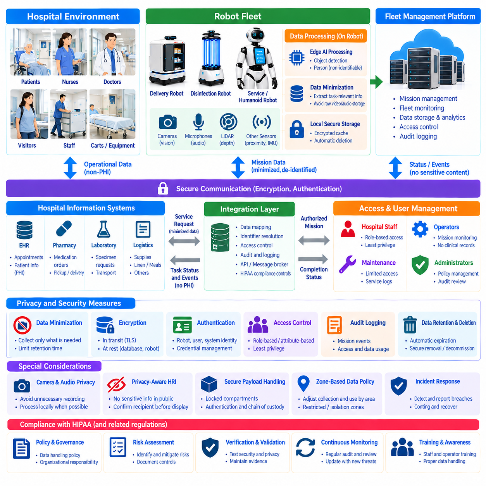{width="7.268055555555556in" height="7.268055555555556in"}

병원 로봇 플릿(Hospital Robot Fleet)은 민감한 의료 정보(Sensitive Healthcare Information)가 존재할 수 있는 환경을 이동하면서 운영 데이터를 생성한다. 카메라, 마이크, 내비게이션 센서, 임무 기록(Mission Record), 접근 이벤트(Access Event), 사용자 상호작용(User Interaction), 병원 시스템 인터페이스(Hospital-System Interface)는 로봇이 임상 정보를 주요 처리 대상으로 설계하지 않았더라도 개인정보 위험(Privacy Risk)을 발생시킬 수 있다. 따라서 개인정보 보호 엔지니어링(Privacy Engineering)은 플릿 아키텍처(Fleet Architecture), 데이터 흐름(Data Flow), 소프트웨어 설계 및 운영 거버넌스(Operational Governance)에 통합되어야 한다.

HIPAA 관련 고려사항(HIPAA-Related Consideration)은 로봇 시스템이 적용 가능한 의료 워크플로에서 보호 건강 정보(Protected Health Information)를 생성, 수신, 유지 또는 전송하는 경우 중요해진다. 로봇 플랫폼은 모든 센서 스트림(Sensor Stream)이 자동으로 보호 건강 정보가 된다고 가정해서는 안 되며, 반대로 운영 텔레메트리(Operational Telemetry)가 자동으로 적용 대상에서 제외된다고 가정해서도 안 된다. 데이터 분류(Data Classification)는 정보의 내용, 문맥, 식별자, 워크플로 연관성 및 해당 정보를 개인과 연결할 수 있는 방법을 고려해야 한다.

데이터 최소화(Data Minimization)는 가장 효과적인 아키텍처 통제(Architectural Control) 가운데 하나이다. 로봇은 승인된 작업을 수행하는 데 필요한 정보만 수집하고 정의된 목적에 필요한 기간 동안만 보관해야 한다. 내비게이션은 사람을 일시적으로 인지해야 할 수 있지만 식별 가능한 영상을 장기간 저장할 필요는 없다. 마찬가지로 배송 임무는 상세한 환자 기록을 로봇에 노출하지 않고도 목적지와 권한 토큰(Authorization Token)만으로 수행할 수 있다.

플릿 아키텍처(Fleet Architecture)는 가능한 경우 운영 로봇 데이터(Operational Robotics Data)와 민감한 의료 데이터(Sensitive Healthcare Data)를 분리해야 한다. 위치 추정(Localization), 배터리 상태, 모터 상태, 경로 진행 상황 및 일반적인 고장 텔레메트리는 환자 신원, 예약 정보, 약품 정보 또는 임상 기록과 독립적으로 처리할 수 있는 경우가 많다. 논리적 분리(Logical Separation)는 민감한 정보에 접근해야 하는 로봇 구성요소, 데이터베이스, 서비스 및 운영자의 범위를 줄인다.

임무 인터페이스(Mission Interface)는 불필요한 임상 문맥(Clinical Context)을 전달하는 대신 간접 식별자(Indirect Identifier)를 사용할 수 있다. 플릿 관리자(Fleet Manager)는 작업 식별자, 픽업 위치, 배송 목적지, 우선순위, 적재물 범주 및 권한 요구사항을 전달받고 병원 정보 시스템(Hospital Information System)은 상세한 환자 정보를 유지할 수 있다. 통합 서비스(Integration Service)는 실행에 필요한 정보만 해석하여 로봇 인프라 전체에서 발생하는 정보 노출을 제한한다.

접근 제어(Access Control)는 최소 권한 원칙(Principle of Least Privilege)을 따라야 한다. 로봇, 플릿 서버, 운영자, 유지보수 담당자, 임상 애플리케이션 및 분석 서비스에는 할당된 역할에 필요한 권한만 제공해야 한다. 역할 기반 또는 속성 기반 권한 부여(Role-Based or Attribute-Based Authorization)를 사용하여 임무를 생성할 수 있는 사용자, 민감한 배송 정보를 조회할 수 있는 사용자, 상호작용 기록에 접근할 수 있는 사용자, 로그를 검색하거나 구성을 변경하거나 관리 작업을 수행할 수 있는 사용자를 제한할 수 있다.

인증(Authentication)은 보호된 작업을 허용하기 전에 시스템과 승인된 사용자의 신원을 확인하기 위해 필요하다. 로봇과 서버 간 연결, 병원 애플리케이션, 운영자 콘솔, 인프라 게이트웨이 및 관리 인터페이스는 관리되는 자격 증명(Managed Credential)과 안전한 인증 메커니즘(Secure Authentication Mechanism)을 사용해야 한다. 자격 증명 수명주기 관리(Credential Lifecycle Management)에는 프로비저닝(Provisioning), 교체(Rotation), 만료(Expiration), 폐기(Revocation), 로봇 또는 계정이 서비스에서 제거될 때의 복구 절차가 포함되어야 한다.

암호화(Encryption)는 데이터가 병원 네트워크를 통해 이동하거나 플릿 인프라 내부에 저장될 때 정보를 보호한다. 로봇, 플릿 서비스, 병원 시스템 및 관리 콘솔 사이의 통신 채널은 기밀성(Confidentiality)과 무결성(Integrity)을 보호해야 한다. 데이터베이스, 백업, 이동식 저장장치 또는 로봇 로컬 캐시(Local Cache)에 저장되는 민감한 기록 역시 보호가 필요할 수 있다. 암호화 키(Encryption Key)는 보호 대상 데이터와 분리하여 관리하고 정의된 보안 프로세스(Security Process)를 통해 통제해야 한다.

로봇 로컬 저장장치(Robot-Local Storage)는 이동형 플랫폼이 물리적으로 접근될 수 있고 유지보수를 위해 반출되거나 중앙 서비스와 일시적으로 연결이 끊어질 수 있기 때문에 특별한 주의가 필요하다. 로컬 캐시는 복원력 있는 운용(Resilient Operation)에 필요한 최소한의 데이터만 포함하고 명시적인 만료 정책(Expiration Policy)을 가져야 한다. 민감한 정보는 임무 완료 이후 무기한 남아 있어서는 안 된다. 장비 폐기(Device Decommissioning) 또는 저장장치 교체 시에는 안전한 데이터 삭제(Secure Data Removal) 절차를 포함해야 한다.

카메라와 마이크는 로봇의 임무와 관계없는 환자, 방문객, 직원 대화, 화면 정보, 병실 정보 또는 임상 활동을 포착할 수 있기 때문에 병원에서 특별한 개인정보 보호 문제를 발생시킨다. 실시간 추론(Real-Time Inference)만으로 충분한 경우 불필요한 기록을 방지하도록 처리를 설계해야 한다. 원시 오디오 또는 영상(Raw Audio or Video)의 저장은 기본적으로 활성화하는 것이 아니라 명확한 목적, 권한, 보존 기간 및 접근 정책이 존재하는 경우에만 수행해야 한다.

개인정보 보호 인식형 인지(Privacy-Aware Perception)는 원시 센서 데이터를 가능한 초기 단계에서 작업에 필요한 정보로 변환하여 정보 노출을 줄일 수 있다. 예를 들어 내비게이션은 식별 가능한 영상보다 장애물의 위치와 움직임이 필요하며, 참여 감지(Engagement Detection)는 지속적인 신원 인식보다 사람의 존재 여부만 필요할 수 있다. 엣지 처리(Edge Processing)는 이러한 파생 특징(Derived Feature)을 로컬에서 생성하여 불필요한 원시 데이터를 중앙 플릿 서비스로 전송하지 않도록 할 수 있다.

인간-로봇 상호작용(Human-Robot Interaction)은 시각적 또는 청각적 인터페이스를 통한 우발적인 정보 노출(Accidental Disclosure)을 방지해야 한다. 서비스 로봇은 공공 복도에서 민감한 환자 정보를 큰 소리로 말하거나 주변 사람들이 읽을 수 있는 화면에 보호 대상 정보를 표시해서는 안 된다. 상호작용 소프트웨어는 위치, 인증 상태 및 정보 민감도에 따라 정보 표시 방식을 조정하고, 의도된 수신자가 적절하게 확인되기 전까지는 일반화된 알림(Generic Notification)을 사용할 수 있다.

의약품, 검체, 문서 또는 기타 민감한 물품을 운송하는 배송 워크플로(Delivery Workflow)는 세심한 관리가 필요하다. 보안 적재함(Secure Compartment), 접근 인증, 전자 잠금장치(Electronic Lock), 배송 확인(Delivery Confirmation)은 물리적 적재물과 관련 정보를 모두 보호할 수 있다. 플릿 기록은 임상 내용을 불필요하게 복제하지 않으면서 관리 연속성 이벤트(Custody Event)를 문서화해야 한다. 로봇 시스템은 기본 의료 기록의 노출을 최소화하면서 승인된 전달을 증명하는 데 필요한 정보만 보유해야 한다.

감사 로깅(Audit Logging)은 민감한 데이터 및 보호된 작업에 대한 접근 책임성(Accountability)을 제공한다. 로그에는 인증 이벤트, 임무 생성, 데이터 접근, 구성 변경, 적재함 개방, 관리 작업, 데이터 내보내기 및 보안 실패를 기록할 수 있다. 감사 기록(Audit Record)은 관련 행위자, 작업, 시간, 자원 및 결과를 식별해야 하지만 로그 자체에 민감한 내용을 불필요하게 복제하는 것은 피해야 한다.

보존 정책(Retention Policy)은 모든 로봇 기록에 동일한 보존 기간을 적용하는 대신 데이터 범주별로 구분해야 한다. 안전 이벤트, 임무 이력, 보안 감사(Security Audit), 진단 텔레메트리(Diagnostic Telemetry), 원시 센서 데이터 및 환자 관련 트랜잭션 기록은 서로 다른 운영 및 규제 목적을 가질 수 있다. 자동화된 수명주기 관리(Automated Lifecycle Management)는 정책에 따라 기록을 보관, 익명화(Anonymization) 또는 삭제하고 임시 디버깅 데이터가 영구적인 정보 저장소로 전환되는 것을 방지할 수 있다.

플릿 관측 가능성(Fleet Observability)은 불필요한 개인정보를 노출하지 않으면서 운영적 유용성을 유지해야 한다. 대시보드는 개인 신원이 필요하지 않은 경우 집계 또는 비식별화된 데이터(Aggregated or De-Identified Data)를 사용하여 임무 완료율, 로봇 활용률, 충전 상태, 교통 혼잡, 고장 및 서비스 지연 시간(Service Latency)을 보고할 수 있다. 엔지니어링 팀은 환자 관련 정보에 대한 무제한 접근 없이도 기술 메타데이터(Technical Metadata)를 통해 많은 플릿 문제를 진단할 수 있다.

클라우드 연결(Cloud Connectivity)은 어떤 정보가 병원 환경 외부로 이동하는지에 대한 명시적인 통제를 필요로 한다. 원격 모니터링(Remote Monitoring), 분석, 소프트웨어 지원 및 플릿 최적화에는 외부 서비스가 포함될 수 있지만 데이터 흐름은 승인된 아키텍처에 따라 문서화되고 제한되어야 한다. 조직은 어떤 시스템이 민감한 정보를 저장하거나 처리하는지, 해당 시스템이 어디에서 운영되는지, 어떤 주체가 정보에 대한 승인된 접근 권한을 가지는지를 파악해야 한다.

제3자 구성요소 및 서비스 제공자(Third-Party Component and Service Provider)는 개인정보 보호와 보안 경계(Privacy and Security Boundary)를 확장한다. 로봇 제조업체, 클라우드 플랫폼, 원격 지원 시스템, 분석 도구 및 통합 공급업체는 병원 데이터 또는 인프라와 상호작용할 수 있다. 이들의 접근 권한은 실제로 관련된 정보와 기능을 기준으로 평가해야 한다. 공급업체 구성요소가 로봇 배포에 참여한다는 이유만으로 인터페이스에 광범위한 접근 권한을 부여해서는 안 된다.

보안 사고(Security Incident)는 감지하고 격리할 수 있어야 한다. 예상하지 못한 로그인 시도, 비정상적인 데이터 내보내기, 손상된 자격 증명(Compromised Credential), 승인되지 않은 구성 변경, 비정상적인 로봇 연결 또는 의심스러운 접근 패턴은 보안 이벤트(Security Event)를 발생시켜야 한다. 시스템은 자격 증명 폐기, 로봇 격리(Robot Isolation), 서비스 비활성화, 증거 보존(Evidence Preservation), 통제된 복구(Controlled Recovery)를 지원하여 의심되는 침해가 전체 플릿으로 자동 확산되지 않도록 해야 한다.

소프트웨어 업데이트 및 구성 변경(Configuration Change)은 내비게이션 기능이 그대로 유지되더라도 개인정보 보호 동작을 변경할 수 있다. 새로운 로깅 기능, 클라우드 인터페이스, 인지 모델(Perception Model) 또는 진단 서비스는 추가적인 데이터 흐름을 생성할 수 있다. 따라서 변경 관리(Change Management)는 기능적 성능만 평가하는 것이 아니라 개인정보 보호 및 보안 영향 분석(Privacy and Security Impact Analysis), 구성 검토, 시험, 승인, 배포 추적 및 롤백(Rollback) 기능을 포함해야 한다.

개인정보 보호 검증(Privacy Validation)은 전체 워크플로와 실패 조건을 시험해야 한다. 시나리오에는 승인되지 않은 임무 조회, 만료된 자격 증명, 통신 가로채기(Intercepted Communication), 연결 손실, 의도하지 않은 영상 보존, 민감한 정보의 공개 표시, 잘못된 사용자 인증, 과도한 로그 접근, 침해된 로봇(Compromised Robot), 지연된 데이터 삭제 등이 포함될 수 있다. 시험에서는 기술적 통제(Technical Control)뿐만 아니라 병원 직원이 사용하는 운영 절차도 함께 검증해야 한다.

결과적으로 이러한 아키텍처는 개인정보 보호(Privacy)를 데이터베이스나 사용자 인터페이스에 추가되는 하나의 기능이 아니라 플릿 전체의 시스템 속성(Fleet-Wide System Property)으로 다룬다. 데이터 분류(Data Classification)는 민감도를 결정하고, 데이터 최소화(Data Minimization)는 수집 범위를 제한하며, 데이터 분리(Separation)는 노출을 줄인다. 인증(Authentication)과 권한 부여(Authorization)는 접근을 통제하고, 암호화(Encryption)는 데이터를 보호하며, 감사(Auditing)는 책임성을 제공하고, 수명주기 정책(Lifecycle Policy)은 데이터 보존을 관리한다. 이러한 메커니즘을 통합함으로써 보호 대상 의료 정보(Protected Healthcare Information)의 불필요한 처리를 줄이면서 병원 로봇 서비스를 지원할 수 있다.

## 02.10. Hospital AMR Fleet Deployment Case

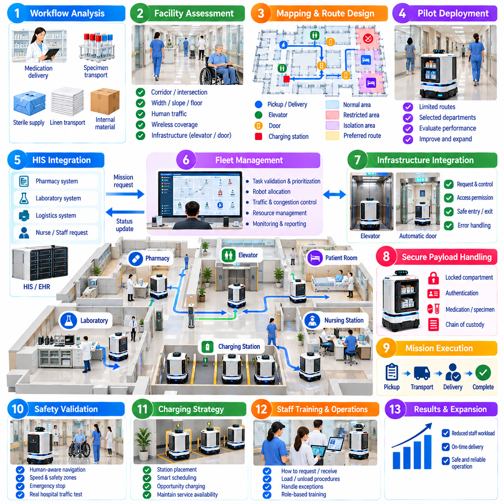{width="7.268055555555556in" height="7.268055555555556in"}

병원 AMR 플릿(Hospital AMR Fleet) 배포는 로봇을 먼저 선택하는 것이 아니라 실제 임상 및 물류 워크플로(Clinical and Logistical Workflow)를 분석하는 것에서 시작된다. 배포 팀은 의약품 배송, 검사실 검체 운송, 멸균 물품 공급, 린넨 운송 및 내부 물자 이송과 같은 반복적인 운송 작업을 식별한다. 임무 빈도, 이동 거리, 배송 마감 시간, 적재물 특성, 인력 운영 패턴 및 현재 프로세스의 지연 시간을 측정하여 자율 운송(Autonomous Transport)이 운영적 가치를 제공할 수 있는 영역을 결정한다.

이후 시설을 로봇 운영 환경(Robotic Operating Environment)의 관점에서 평가한다. 복도, 교차로, 엘리베이터, 자동문, 간호 스테이션, 약국, 검사실, 보관실, 충전 구역 및 제한 구역을 매핑하고 분류한다. 엔지니어는 통로 폭, 바닥 전환 구간, 경사, 혼잡 패턴, 무선 네트워크 커버리지 및 사람의 이동량을 측정한다. 이러한 관찰을 통해 플릿 배포 전에 인프라 변경이나 특수한 내비게이션 동작(Specialized Navigation Behavior)이 필요한지를 결정한다.

초기 배포(Initial Deployment)는 일반적으로 제한된 수의 명확하게 정의된 경로와 임무 유형에 집중한다. 처음부터 병원 전체의 자동화를 시도하는 대신 약국과 특정 병동 사이 또는 검사실과 검체 수집 지점 사이의 운송부터 프로젝트를 시작할 수 있다. 제한된 파일럿(Constrained Pilot)은 통합 복잡성을 줄이고 운영 영역을 확대하기 전에 내비게이션 신뢰성, 배송 시간, 직원과의 상호작용 및 예외 처리(Exception Handling)를 평가할 수 있도록 한다.

병원 지도(Hospital Map)는 단순한 복도의 기하학적 표현 이상의 역할을 수행한다. 의미적 정보(Semantic Information)는 픽업 스테이션, 배송 지점, 대기 구역, 엘리베이터, 출입문, 충전 스테이션, 제한 구역, 격리 구역 및 선호 로봇 경로(Preferred Robot Route)를 식별한다. 병원 애플리케이션에서 사용하는 위치는 로봇 내비게이션 목표(Navigation Goal)에 매핑되어 병동이나 검사실을 지정하는 요청을 물리적으로 도달 가능하고 운영적으로 유효한 목적지로 변환할 수 있다.

임무가 여러 층이나 통제된 경계를 통과하는 경우 인프라 통합(Infrastructure Integration)이 적용된다. 엘리베이터 인터페이스를 통해 로봇은 서비스를 요청하고, 할당된 엘리베이터에 탑승하고, 목적 층을 선택하고, 도착을 확인한 후 안전하게 하차할 수 있다. 자동문 및 접근 제어 시스템(Access-Control System)은 제한 구역을 통과할 수 있도록 조정된다. 엘리베이터나 출입문의 고장은 로봇 내비게이션 자체가 정상적으로 동작하더라도 임무 완료를 방해할 수 있으므로 이러한 자원은 임무 워크플로의 일부로 관리된다.

플릿 관리(Fleet Management)는 여러 AMR을 병원에서 공유하는 자원으로 조정한다. 들어오는 임무는 검증되고 우선순위가 지정되며 대기열에 등록된 후 로봇의 위치, 배터리 상태, 적재 능력, 현재 작업 부하, 접근 권한 및 예상 완료 시간을 기준으로 할당된다. 또한 스케줄러(Scheduler)는 좁은 복도, 엘리베이터, 도킹 위치 및 기타 공유 자원에 로봇이 지나치게 집중되는 것을 방지하여 독립적인 경로 계획으로 발생할 수 있는 혼잡을 줄인다.

병원 정보 시스템 통합(Hospital Information System Integration)은 자율 운송을 기존 운영 프로세스와 연결한다. 약국, 검사실, 물류 애플리케이션 또는 권한을 가진 직원 인터페이스는 로봇의 움직임을 직접 제어하지 않고 서비스 요청(Service Request)을 생성할 수 있다. 통합 계층(Integration Layer)은 요청을 픽업 위치, 목적지, 우선순위, 적재물 요구사항 및 권한 조건을 포함하는 임무로 변환하며 실행이 진행되는 동안 임무 상태를 요청을 생성한 워크플로에 반환한다.

플릿이 의약품, 검체, 문서 또는 통제된 물품을 운송하는 경우 안전한 적재물 처리(Secure Payload Handling)가 중요해진다. 적재함은 운송 중 전자적으로 잠긴 상태를 유지하고 목적지에서 권한이 확인된 인증(Authorized Authentication)이 완료된 이후에만 열리도록 할 수 있다. 픽업 및 배송 이벤트는 임무 식별자와 타임스탬프(Timestamp)와 함께 기록되어 전자적 관리 연속성(Electronic Chain of Custody)을 형성하면서 일반적인 플릿 텔레메트리에 상세한 임상 정보가 불필요하게 노출되는 것을 방지한다.

안전 검증(Safety Validation)은 비어 있는 시험용 복도에서만 수행하는 것이 아니라 실제 병원 교통 환경을 반영하여 수행한다. 엔지니어는 보행자 횡단, 휠체어, 침대, 카트, 사각 교차로, 혼잡한 대기 구역, 엘리베이터 진입, 자동문, 차단된 경로, 비상 정지 및 예상하지 못한 사람의 행동을 평가한다. 위치별로 속도 제한(Speed Limit)과 보호 영역(Protective Field)을 조정하여 혼잡한 임상 구역에서는 보수적으로 운행하면서 다른 영역에서는 실용적인 운송 성능을 유지할 수 있다.

운영 예외(Operational Exception)는 파일럿 배포 과정에서 주요 검증 대상이 된다. 복도가 장비로 차단되거나, 엘리베이터를 사용할 수 없거나, 수령자가 부재하거나, 적재함이 열리지 않거나, 무선 통신이 일시적으로 끊어질 수 있다. 임무 소프트웨어는 이러한 상황을 분류하고 대기, 경로 재계획(Replanning), 재시도, 적재물 반환, 지원 요청 또는 운영자에게 문제를 단계적으로 전달하는 에스컬레이션(Escalation)과 같은 적절한 대응 방법을 선택한다.

서비스 가용성(Service Availability)은 개별 로봇의 배터리 용량만으로 결정되지 않기 때문에 충전 전략(Charging Strategy)은 플릿 수준에서 평가한다. 충전 스테이션은 병원 교통을 방해하지 않으면서 로봇이 접근할 수 있는 위치에 배치하고, 스케줄러는 예상 임무 수요에 따라 충전 시간을 분산한다. 수요가 낮은 시간에는 기회 충전(Opportunity Charging)을 수행할 수 있으며, 수요가 높은 운영 시간에는 중요 운송 요청을 처리할 수 있도록 충분한 수의 로봇을 가용 상태로 유지한다.

사람 중심의 운영 절차(Human Operational Procedure)는 자율 소프트웨어와 함께 개발한다. 간호사, 약국 직원, 검사실 담당자, 물류 운영자, 보안 팀, 유지보수 기술자 및 감염 관리 담당자는 서로 다른 방식으로 플릿과 상호작용할 수 있다. 교육을 통해 임무 요청, 적재물 적재 및 수령, 로봇 알림 대응, 문제 보고, 승인된 복구 절차 수행 방법을 설명하고 안전 장치나 자율 내비게이션을 방해하지 않도록 한다.

감염 관리 요구사항(Infection-Control Requirement)은 배포 워크플로에 포함된다. 지정된 임상 구역이나 격리 구역에 진입한 로봇에는 즉시 다른 임무를 수행할 수 있는지 또는 먼저 세척 장소를 방문해야 하는지를 결정하는 위생 상태(Hygiene State)를 부여할 수 있다. 세척 절차, 적재함 위생 처리, 표면 관리 및 검증 단계를 플릿 가용성과 조정하여 운영 스케줄링이 필수적인 위생 통제(Hygiene Control)를 우회하지 않도록 한다.

개인정보 보호 및 사이버보안 통제(Privacy and Cybersecurity Control) 역시 배포 범위를 확대하기 전에 검증해야 한다. 로봇 계정, 운영자 접근, 병원 인터페이스, 플릿 서버, 인프라 게이트웨이 및 원격 지원 연결에 명확한 인증 및 권한 정책(Authentication and Authorization Policy)을 적용한다. 민감한 데이터는 최소화하고 통신을 보호하며 접근 이벤트를 감사하고 로봇의 로컬 저장장치를 통제한다. 보안 시험에는 인증 실패, 자격 증명 폐기, 통신 두절 및 승인되지 않은 임무 접근이 포함된다.

파일럿 성능(Pilot Performance)은 단순한 로봇 시연이 아니라 운영 지표(Operational Indicator)를 이용하여 측정한다. 유용한 지표에는 임무 완료율(Mission Completion Rate), 평균 운송 시간, 대기열 지연, 개입 빈도, 내비게이션 차단율, 엘리베이터 대기 시간, 충전 활용률, 플릿 가용성, 배송 실패 및 직원 응답 시간이 포함된다. 기존 수동 워크플로에서 측정한 기준선(Baseline)과 비교하여 자동화가 실제로 측정 가능한 서비스 개선을 제공하는지를 판단할 수 있다.

로봇, 플릿 서비스, 인프라 인터페이스 및 병원 애플리케이션에서 생성된 로그를 연계하여 성능 문제를 조사한다. 임무 지연은 로봇의 속도가 아니라 내비게이션 혼잡, 사용할 수 없는 엘리베이터, 늦은 수령자 응답, 충전 정책 또는 스케줄링 로직에서 발생할 수 있다. 종단 간 관측 가능성(End-to-End Observability)을 통해 엔지니어는 실제 병목 현상(Bottleneck)을 식별하고 하나의 서브시스템을 최적화하는 과정에서 전체 병원 워크플로의 성능이 저하되는 것을 방지할 수 있다.

파일럿 승인 기준(Pilot Acceptance Criteria)이 충족되면 배포 범위를 확대한다. 추가 병동, 층, 임무 유형 및 로봇을 단계적으로 도입하여 각각의 변경 사항을 기존 운영 기준선과 비교하여 평가할 수 있다. 플릿 용량 계획(Fleet Capacity Planning)은 임무 증가량, 최대 수요, 충전 가용성, 엘리베이터 용량, 세척 요구사항 및 유지보수 중단 시간을 고려한다. 이러한 단계적 접근(Staged Approach)은 해결되지 않은 문제를 병원 전체로 확산시킬 위험을 줄인다.

소프트웨어와 운영 절차는 배포 이후에도 지속적으로 변경된다. 업데이트된 내비게이션 알고리즘, 새로운 병원 인터페이스, 수정된 위생 절차, 인프라 변경 또는 추가 로봇 유형은 이전에 검증된 동작에 영향을 줄 수 있다. 따라서 변경 관리(Change Management)에는 구성 관리(Configuration Control), 회귀 시험(Regression Testing), 안전 영향 분석(Safety Impact Analysis), 배포 승인 및 롤백(Rollback) 기능이 포함된다. 운영 중인 플릿은 완료된 설치물이 아니라 지속적으로 발전하는 운영 시스템(Evolving Operational System)으로 다루어야 한다.

유지보수 데이터(Maintenance Data)는 플릿 스케줄링과 통합하여 고장이 감지되었거나 정기 검사가 지연된 로봇을 임무 할당 대상에서 제외한다. 반복적인 범퍼 이벤트, 위치 추정 성능 저하, 배터리 이상, 센서 고장 또는 도킹 실패는 예방 유지보수(Preventive Maintenance)를 발생시킬 수 있다. 운영 수요에 따라 유지보수를 스케줄링하면 일부 임무를 수행할 수 있다는 이유만으로 성능이 저하된 로봇이 계속 서비스되는 것을 방지하면서 플릿 가용성을 유지할 수 있다.

성공적인 배포를 위해서는 조직적 책임 체계(Organizational Ownership)도 필요하다. 플릿 운영, 임상 워크플로 통합, IT 인프라, 사이버보안, 안전, 유지보수, 감염 관리 및 공급업체 지원에 대한 책임을 명확하게 할당해야 한다. 에스컬레이션 경로(Escalation Path)는 로봇이 자율적으로 복구할 수 없을 때 누가 대응해야 하는지를 정의한다. 이러한 거버넌스 구조(Governance Structure)가 없으면 기술적으로 뛰어난 로봇도 일상적인 병원 운영의 신뢰할 수 있는 구성요소로 정착하기 어렵다.

완성된 배포 시스템은 개별 AMR을 조정된 병원 물류 서비스(Coordinated Hospital Logistics Service)로 전환한다. 병원 시스템은 승인된 운송 수요를 생성하고, 플릿 소프트웨어는 자원을 할당하고 감독하며, 건물 인터페이스(Building Interface)는 다층 이동을 지원하고, 로봇은 실제 물리적 운송을 수행하며, 모니터링 시스템은 운영 결과를 측정한다. 단계적 검증(Incremental Validation), 안전 통제, 위생 프로토콜, 개인정보 보호 및 지속적인 운영 개선(Continuous Operational Improvement)을 통해 플릿은 제한된 파일럿에서 신뢰할 수 있는 병원 인프라(Dependable Hospital Infrastructure)로 발전할 수 있다.
