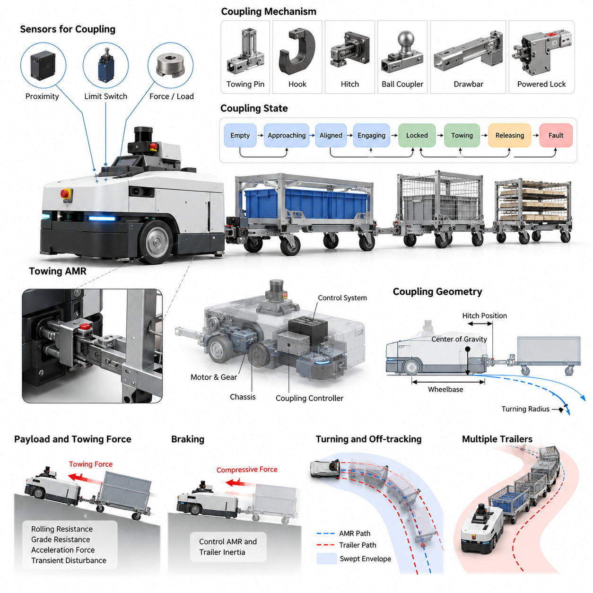
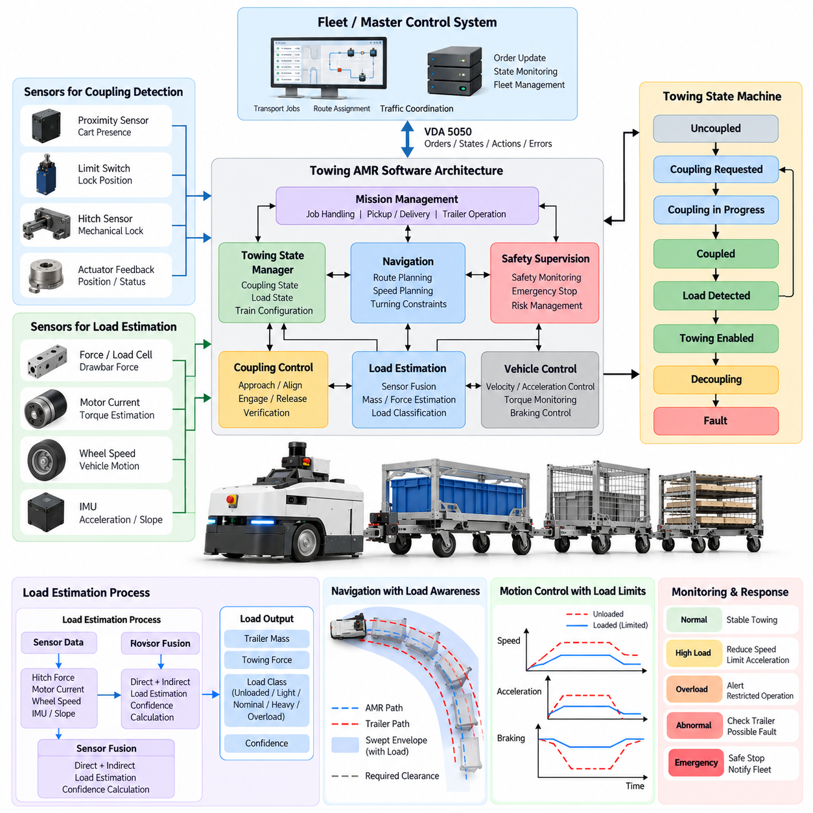
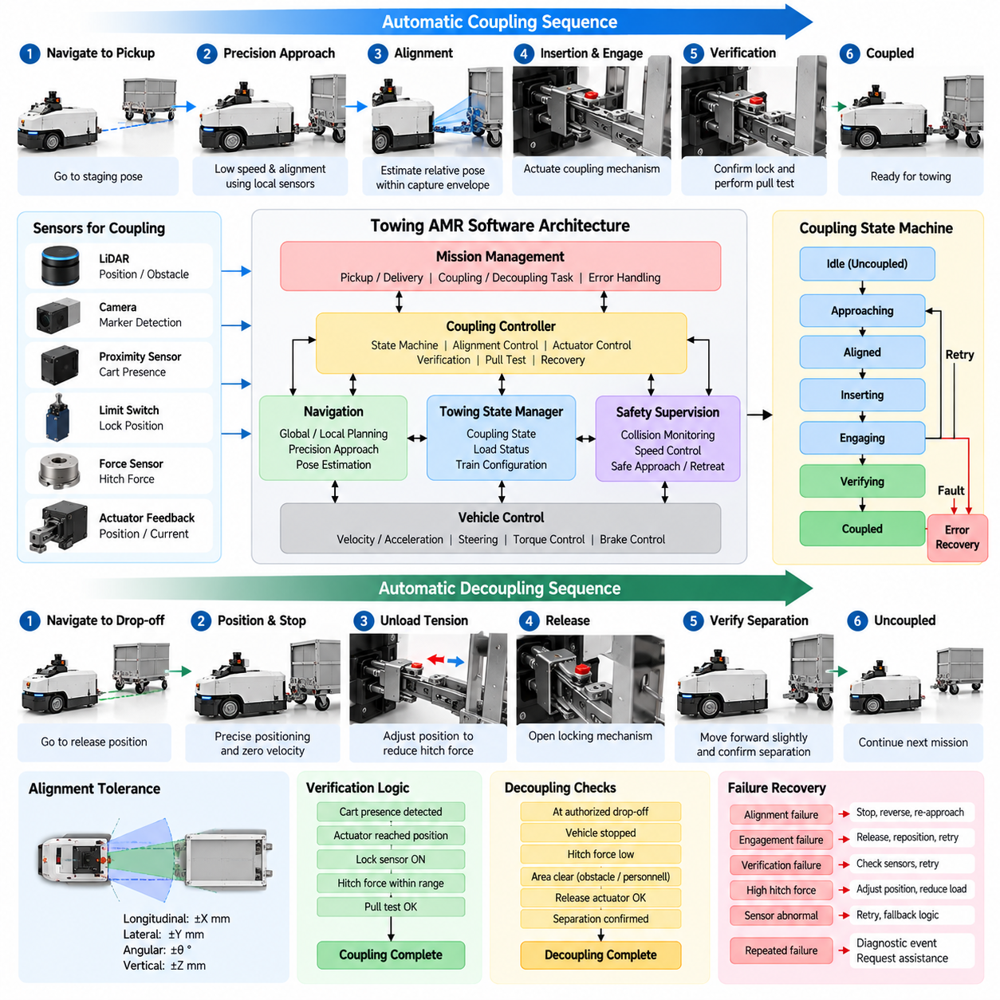
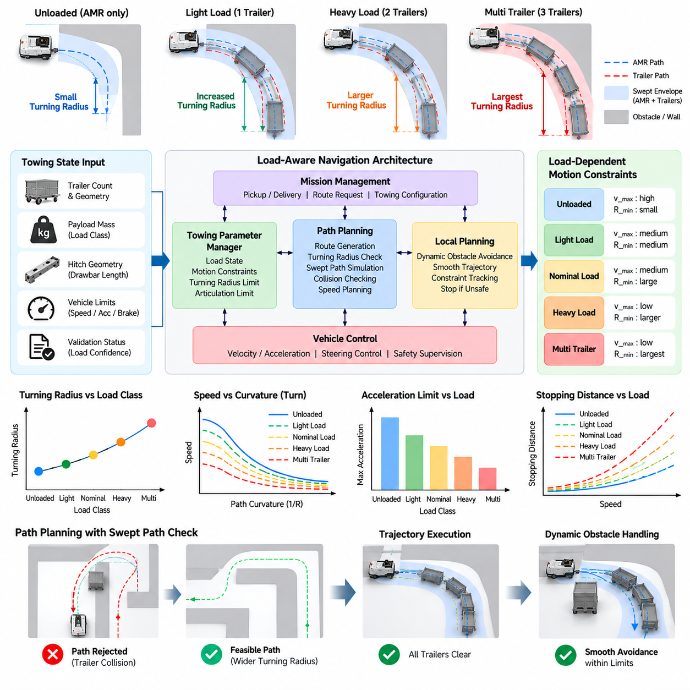
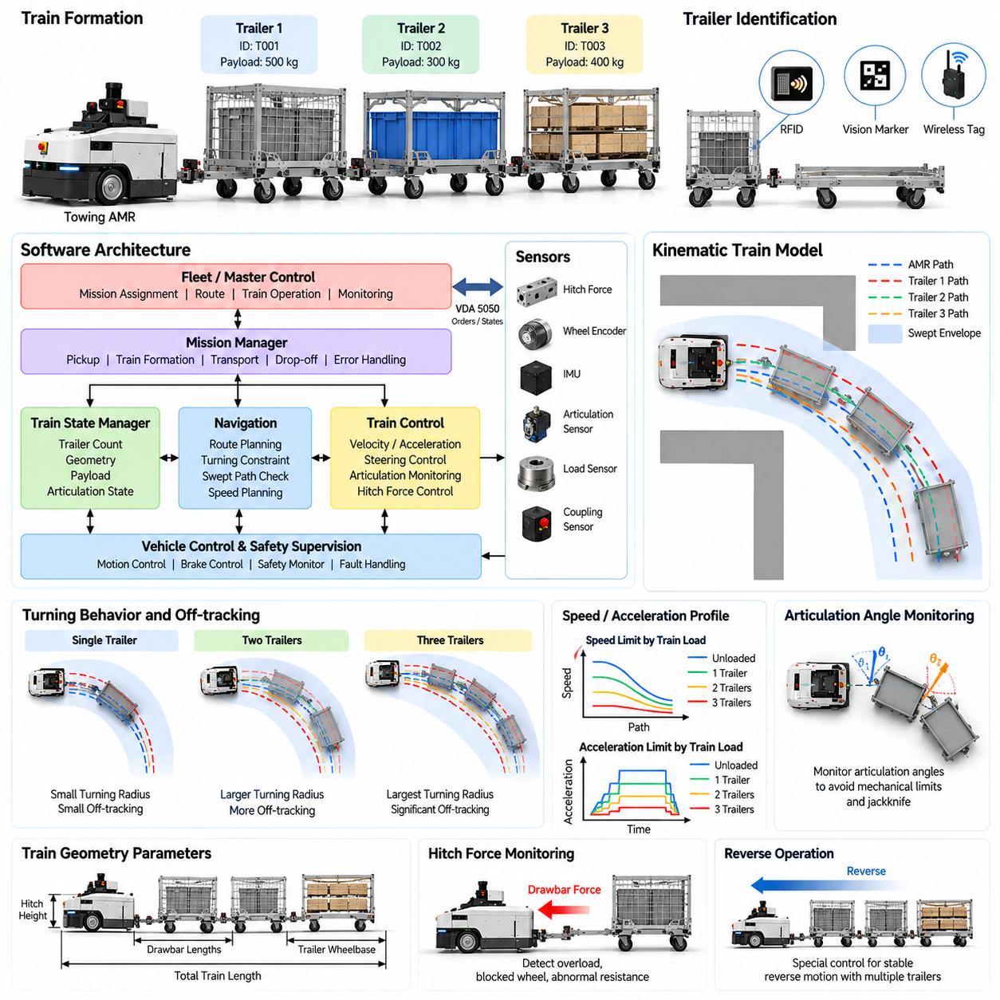
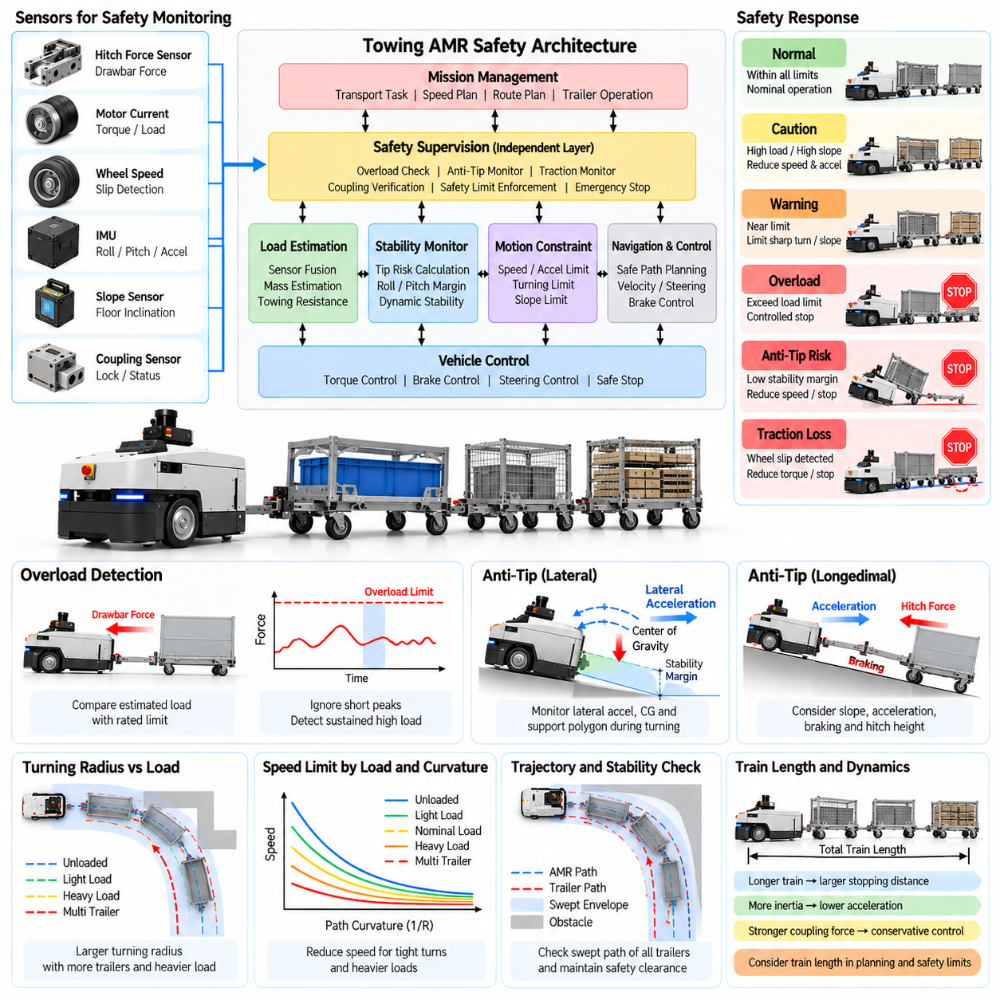
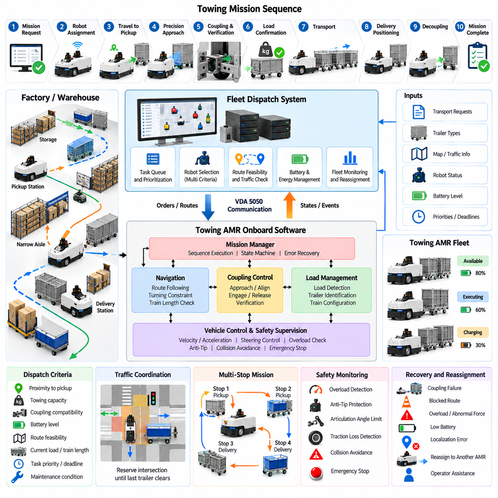
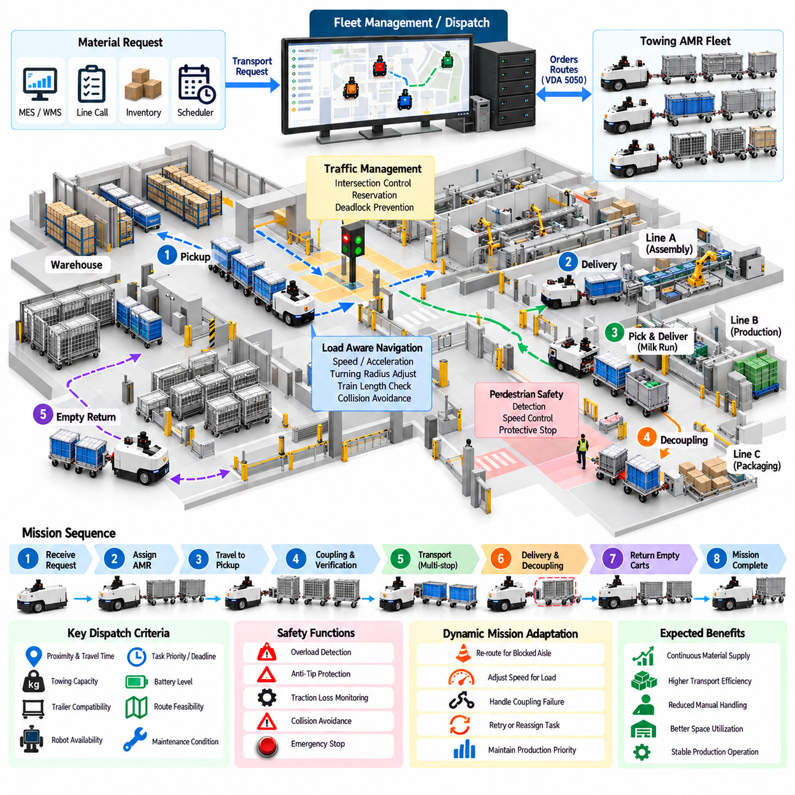
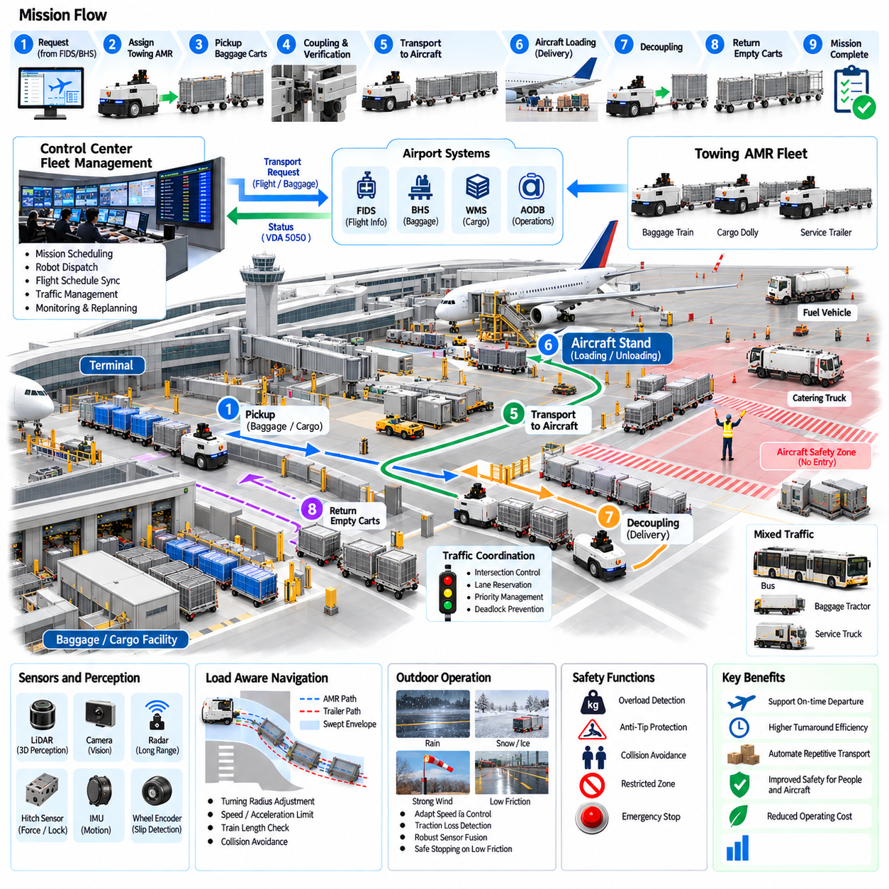
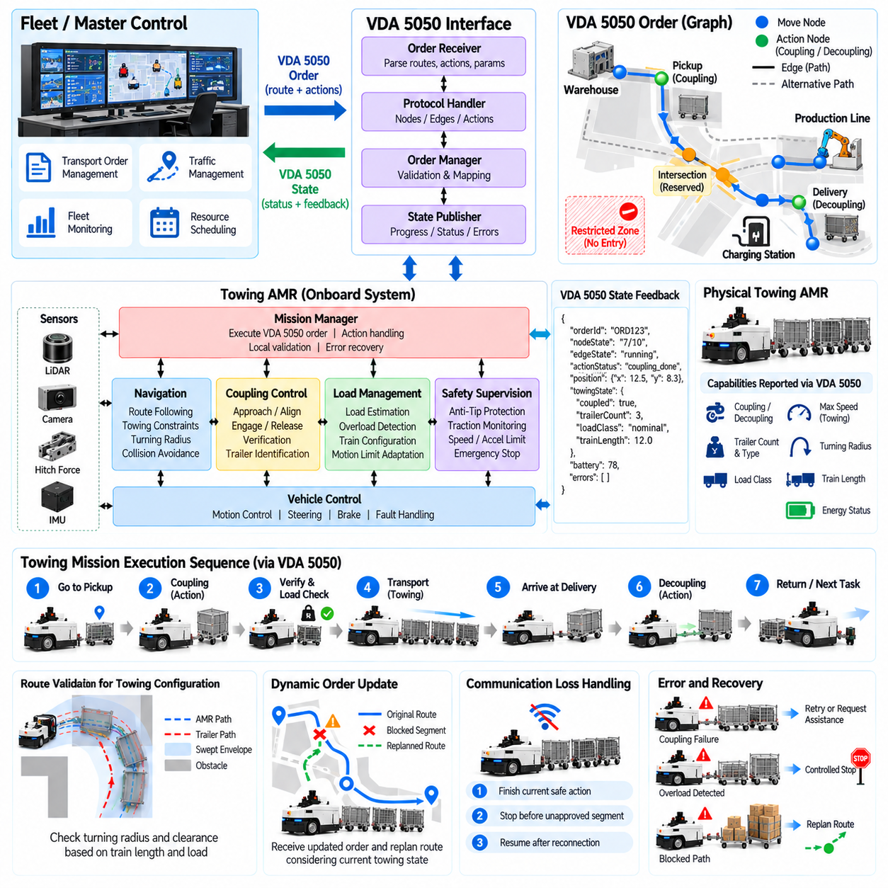

**Volume 26. Industrial Robot Applications**

# Chapter 03. Towing AMR Applications

## 03.01. Towing AMR Design and Coupling Mechanism

{width="7.268055555555556in" height="7.268055555555556in"}

견인형 자율이동로봇(Towing AMR)은 적재물을 자체 차체에 직접 싣는 대신 카트(cart), 돌리(dolly), 랙(rack), 트레일러 열차(trailer train) 등을 견인하도록 설계된 자율이동로봇(Autonomous Mobile Robot)이다. 이러한 구조는 자재가 이미 바퀴가 장착된 운반 장치로 이동하는 공장(factory), 창고(warehouse), 공항(airport), 대규모 물류 시설(logistics facility)에서 특히 효과적이다. 산업용 로봇 응용 구조에서 견인형 AMR은 기계 설계(mechanical design)부터 부하 인식 제어(load-aware control), 플릿 운영(fleet operation), 상호운용성(interoperability)까지 발전하는 독립적인 응용 분야를 구성한다.

기계 설계(mechanical design)는 목표 적재물을 견인하는 데 충분한 견인력(traction)과 견인봉 힘(drawbar force)을 생성할 수 있는 이동 베이스(mobile base)에서 시작한다. 설계자는 로봇 질량(robot mass), 휠 구성(wheel configuration), 모터 토크(motor torque), 기어비(gear ratio), 타이어 마찰력(tire friction), 바닥 상태(floor condition), 최대 견인 속도(maximum towing speed), 예상 경사도(gradient)를 고려해야 한다. 일반적인 적재형 AMR과 달리 견인 차량은 가속, 제동, 회전 과정에서 하나 이상의 트레일러로부터 외력이 결합 지점(coupling point)에 작용하더라도 동적 안정성(dynamic stability)을 유지해야 한다.

결합 장치(coupling mechanism)는 AMR과 운반 카트 사이의 물리적 인터페이스(physical interface)를 제공한다. 일반적인 방식에는 견인 핀(towing pin), 후크(hook), 히치(hitch), 볼형 커플러(ball-type coupler), 견인봉(drawbar), 동력식 잠금 장치(powered locking mechanism) 등이 있다. 선택된 인터페이스는 종방향 인장 및 압축력뿐만 아니라 코너링 중 발생하는 횡방향 하중(lateral load)도 견뎌야 한다. 기계적 유격(mechanical clearance)이 지나치게 크면 진동(oscillation), 충격 하중(impact loading), 부정확한 트레일러 추종(trailer tracking), 마모 가속(accelerated wear)이 발생할 수 있으므로 유격을 적절히 관리해야 한다.

결합 형상(coupling geometry)은 차량의 동작 특성에 큰 영향을 미친다. 구동축(drive axle)을 기준으로 한 히치 위치(hitch position)는 트레일러에서 전달되는 힘이 조향 응답(steering response)과 안정성(stability)에 어떻게 영향을 미치는지를 결정한다. 결합 지점이 유효 회전 중심(effective rotation center)에서 지나치게 멀리 위치하면 회전 과정에서 횡력이 증폭될 수 있으며, 부적절한 히치 높이(hitch height)는 원하지 않는 피칭 모멘트(pitching moment)를 발생시킬 수 있다. 따라서 히치 위치, 휠베이스(wheelbase), 무게중심(center of gravity), 트레일러 견인봉 형상(trailer drawbar geometry), 예상 회전 반경(turning radius)을 하나의 통합 기계 시스템(integrated mechanical system)으로 설계해야 한다.

자동 결합(automatic coupling)을 적용하면 작업자의 개입 없이 AMR이 카트를 연결하고 분리할 수 있다. 일반적인 결합 장치는 작은 위치 오차(positioning error)를 허용하는 정렬 구조(alignment structure)와 전기식 또는 기계식으로 작동하는 잠금 요소(locking element)를 결합한다. 깔때기형 가이드(funnel), 테이퍼 가이드(tapered guide), 롤러(roller), 순응형 부품(compliant component)을 이용하여 카트를 최종 잠금 위치로 유도할 수 있다. 로봇은 저속으로 접근하여 결합 인터페이스를 정렬하고 잠금 장치를 작동시킨 다음, 안정적인 기계적 연결(mechanical connection)이 이루어졌는지 확인한다.

센서(sensor)는 결합 장치를 수동적인 기계 장치에서 제어 가능한 로봇 하위 시스템(robotic subsystem)으로 변화시킨다. 근접 센서(proximity sensor)는 카트의 존재를 감지할 수 있으며, 리미트 스위치(limit switch) 또는 위치 센서(position sensor)는 잠금 핀(locking pin)이나 후크가 명령된 위치에 도달했는지를 확인한다. 힘 센서(force sensor), 변형률 센서(strain sensor), 부하 센서(load sensor)를 사용하면 트레일러가 실제로 연결되었는지 추가로 판단할 수 있다. 액추에이터(actuator)가 정상적으로 움직였다는 사실만으로 카트가 실제로 체결되었다고 보장할 수 없기 때문에 중복 확인(redundant confirmation)이 중요하다.

결합 제어기(coupling controller)는 비어 있음(empty), 접근(approaching), 정렬(aligned), 체결(engaging), 잠금(locked), 견인(towing), 해제(releasing), 고장(fault) 등의 상태를 구분해야 한다. 각 상태 전이(state transition)는 단순한 시간 조건이 아니라 관측 가능한 조건(observable condition)을 기반으로 수행되어야 한다. 예를 들어 체결 명령은 카트 존재 여부, 액추에이터 위치, 결합 확인 조건이 사전에 정의된 기준을 모두 만족한 경우에만 성공으로 판단할 수 있다. 이러한 상태 기반 접근법(state-based approach)은 불완전한 체결 상태에서 주행이 다시 시작되는 것을 방지하고 결합 실패 시 명확한 복구 경로(recovery path)를 제공한다.

기계 설계는 실제 산업 현장에서 발생하는 정렬 오차(misalignment)도 수용해야 한다. 카트가 항상 완벽하게 반복 가능한 위치에 주차되는 것은 아니며, 캐스터 휠(caster wheel)은 예측하기 어려운 방향으로 회전할 수 있고 작업자가 카트를 취급하면서 방향이 달라질 수도 있다. 따라서 AMR에는 종방향(longitudinal), 횡방향(lateral), 각도(angular), 수직(vertical) 정렬 오차를 정의하는 허용 포획 범위(allowable capture envelope)가 필요하다. 기계적 순응성(mechanical compliance)을 적용하면 이 범위를 확대하고 위치추정(localization)과 모션 제어(motion control)에 요구되는 정밀도를 낮출 수 있다.

적재물 사양(payload specification)은 단순히 트레일러 질량만으로 정의할 수 없다. 구름 저항(rolling resistance), 캐스터 상태(caster condition), 휠 직경(wheel diameter), 바닥 연결부(floor joint), 경사로(ramp), 가속도(acceleration), 트레일러 수가 실제 견인력을 결정한다. 필요한 견인봉 힘(drawbar force)은 구름 저항, 경사 저항(grade resistance), 가속력(acceleration force), 과도 외란(transient disturbance)의 조합으로 고려할 수 있다. 이후 적절한 공학적 여유(engineering margin)를 적용하여 정상 운전 중 모터, 구동계(drivetrain), 결합 부품이 지속적으로 한계 영역에서 작동하지 않도록 해야 한다.

제동(braking)은 AMR 자체의 관성뿐만 아니라 전체 트레일러 시스템(trailer system)의 관성을 함께 제어해야 하기 때문에 특히 중요하다. 감속 과정에서 트레일러가 히치를 통해 압축력(compressive force)을 발생시켜 로봇을 앞으로 밀 수 있다. 비상 제동(emergency braking)에서는 정상적인 견인 상태보다 훨씬 큰 과도력(transient force)이 발생할 수 있다. 따라서 차체(chassis), 결합 장치, 구동계, 브레이크(brake), 제어 파라미터(control parameter)는 AMR 자체 질량이 아니라 허용 가능한 최대 열차 질량(maximum permitted train mass)을 기준으로 설계해야 한다.

회전(turning)은 트레일러가 견인 차량과 정확히 동일한 경로를 따라가지 않기 때문에 추가적인 제약을 발생시킨다. 트레일러 휠은 일반적으로 AMR의 주행 궤적보다 안쪽으로 이동하며, 이에 따라 내측 궤적 편차(off-tracking)가 발생한다. 이러한 현상은 견인봉이 길고 휠베이스가 크며 트레일러 수가 많고 회전 반경이 작을수록 증가한다. 따라서 내비게이션 여유 공간(navigation clearance)은 전체 차량 열차(vehicle train)의 이동 점유 영역(swept envelope)을 반영해야 한다. 견인 로봇 자체에는 충돌이 없는 경로라도 트레일러가 랙, 기둥, 설비 또는 보행자와 충돌할 수 있다.

다중 트레일러 운용(multiple-trailer operation)은 시스템 동역학(system dynamics)을 더욱 변화시킨다. 추가되는 각각의 관절 지점(articulation point)은 새로운 자유도(degree of freedom)를 발생시켜 내측 궤적 편차와 진동 또는 잭나이핑(jackknifing)의 가능성을 증가시킨다. 따라서 가능한 경우 트레일러 형상(trailer geometry)을 표준화하고 최대 열차 길이(train length), 트레일러 수, 적재량, 곡률(curvature), 가속도, 속도에 대한 운용 한계를 설정해야 한다. 이러한 제약은 이후 열차 구성(train formation) 및 다중 트레일러 제어(multiple-trailer control) 기능을 구현하기 위한 물리적 기반을 제공한다.

AMR 차체는 히치에서 전달되는 견인력을 과도한 변형 없이 주 프레임(main frame)으로 전달할 수 있는 구조적 하중 경로(structural load path)를 제공해야 한다. 커플러(coupler)를 얇은 외장 커버나 보조 브래킷(secondary bracket)에 설치하면 반복되는 산업 운전 주기에서 피로 파손(fatigue failure)이 발생할 수 있다. 구조 해석(structural analysis)에서는 정상 견인, 비상 정지, 결합 과정의 충격, 코너링 횡하중, 비정상 상황을 고려해야 한다. 교체 가능한 부싱(bushing), 핀(pin), 마모판(wear plate)을 사용하면 반복적인 기계 접촉에 노출되는 부품의 유지보수를 단순화할 수 있다.

전기 및 액추에이터 설계(electrical and actuator design)는 수천 회 또는 수백만 회의 작동 주기에서도 신뢰할 수 있는 결합을 지원해야 한다. 요구되는 힘과 스트로크(stroke)에 따라 전동 리니어 액추에이터(electric linear actuator), 솔레노이드(solenoid), 회전 모터(rotary motor), 전기기계식 래치(electromechanical latch)를 사용할 수 있다. 전원이 차단될 경우에도 결합 장치는 가능한 한 안전 상태(safe state)를 유지해야 하며 물리적 위치 정보를 제어기에 제공해야 한다. 전기 또는 소프트웨어 고장으로 정상적인 분리가 불가능할 경우를 대비하여 수동 해제 기능(manual release)을 제공하는 것도 중요하다.

안전(safety) 측면에서 견인형 AMR은 결합 이후 크기와 동적 특성이 변화하는 하나의 이동 시스템(moving system)으로 취급해야 한다. 보호 감지(protective sensing)는 로봇 본체뿐만 아니라 트레일러 열차가 추가로 발생시키는 위험까지 포함해야 한다. 적재량, 열차 길이, 회전 조건, 보행자와의 거리, 정지 거리(stopping distance)에 따라 속도 제한(speed limit)을 변경해야 할 수 있다. 따라서 전체 견인형 AMR 응용 구조에서는 부하 인식 내비게이션(load-aware navigation)과 트레일러 제어 이후 과부하(overload) 및 전복 방지(anti-tip) 기능을 별도의 안전 주제로 다룬다.

견고한 설계(robust design)는 진단(diagnostics)과 예방 정비(preventive maintenance) 기능도 지원해야 한다. 시스템은 결합 시도 횟수, 체결 실패, 액추에이터 전류(actuator current), 잠금 위치(lock position), 측정 견인력, 과도한 힘 발생 이벤트, 누적 결합 주기 등을 기록할 수 있다. 체결력이 점진적으로 증가하거나 정렬 실패가 반복되면 기계적 마모(mechanical wear), 변형된 카트 인터페이스, 오염(contamination), 액추에이터 열화(degradation)를 의미할 수 있다. 이러한 정보는 자율 자재 흐름(autonomous material flow)이 중단되기 전에 유지보수 담당자가 문제를 해결할 수 있도록 한다.

카트 인터페이스(cart interface)의 표준화(standardization)는 AMR 자체의 설계만큼 중요할 수 있다. 서로 다른 히치 높이, 손상된 견인봉, 상이한 캐스터 구성, 관리되지 않는 트레일러 치수를 가진 카트를 하나의 플릿(fleet)에서 운용하면 결합 및 내비게이션 동작을 예측하기 어려워진다. 따라서 산업 현장에서는 허용 가능한 카트 형상, 결합 높이, 적재 용량(load capacity), 휠 상태, 식별(identification), 검사(inspection)에 대한 기계적 인터페이스 사양(mechanical interface specification)을 정의해야 한다. 표준화된 카트는 불확실한 물리 환경을 반복 가능한 자동화 인터페이스(automation interface)로 변환한다.

최종적인 설계에서는 히치를 기존 AMR에 단순히 추가하는 부속 장치로 취급하는 것이 아니라 기계 구조(mechanics), 센싱(sensing), 구동(actuation), 제어(control), 내비게이션 제약(navigation constraint), 안전을 하나의 견인 시스템(towing system)으로 통합해야 한다. 결합 형상은 차량 동역학을 결정하고, 적재량은 정지 특성을 변화시키며, 트레일러 치수는 내비게이션 여유 공간을 변경하고, 센서는 자율 체결을 신뢰할 수 있는지를 결정한다. 이러한 시스템 관점(system perspective)은 이후 부하 감지(load detection), 자동 결합 제어(automatic coupling control), 부하 인식 내비게이션, 트레일러 열차 제어(trailer-train control), 임무 배차(mission dispatch), 산업 현장 배치(industrial deployment)를 구현하기 위한 기반을 제공한다.

## 03.02. Towing AMR SW Architecture Load Detection [w/Code]

{width="7.268055555555556in" height="7.268055555555556in"}

견인형 자율이동로봇(Towing AMR)의 소프트웨어 아키텍처(software architecture)는 자율 내비게이션(autonomous navigation), 차량 제어(vehicle control), 결합 관리(coupling management), 부하 감지(load detection), 안전 감독(safety supervision), 플릿 통신(fleet communication)을 하나의 통합된 런타임 시스템(runtime system)으로 조정해야 한다. 적재물이 비교적 고정된 차체 영역 내부에 위치하는 일반적인 AMR과 달리, 견인형 AMR은 카트(cart)나 트레일러(trailer)가 연결될 때마다 동적 특성(dynamic characteristics)이 변화한다. 따라서 소프트웨어는 로봇 상태(robot state)와 견인 구성(towing configuration)을 지속적으로 표현해야 한다.

실용적인 아키텍처는 상위 수준의 임무 기능(high-level mission function)과 실시간 모션 및 안전 기능(real-time motion and safety function)을 분리한다. 임무 관리(mission management)는 운송 작업을 수신하고 픽업 및 배송 위치를 식별하며 필요한 카트 또는 트레일러 작업을 결정한다. 내비게이션은 실행 가능한 경로를 생성하고 모션 제어(motion control)는 궤적을 휠 명령으로 변환한다. 결합 제어(coupling control), 부하 추정(load estimation), 진단(diagnostics), 안전 감독 기능은 이러한 계층과 함께 동작하며 명확하게 정의된 인터페이스(interface)를 통해 검증된 상태 정보를 교환한다.

견인 상태 관리자(towing-state manager)는 다른 소프트웨어 모듈(module)에 필요한 운용 상황 정보를 유지한다. 이 관리자는 미결합(uncoupled), 결합 요청(coupling requested), 결합 진행(coupling in progress), 결합 완료(coupled), 부하 감지(load detected), 견인 활성화(towing enabled), 분리(decoupling), 고장(fault) 등의 상태를 표현할 수 있다. 상태 전이(state transition)는 단일 명령 결과가 아니라 검증된 센서 조건에 따라 이루어져야 한다. 내비게이션과 추진 기능은 현재 견인 상태가 이동에 필요한 안전 및 임무 요구사항을 만족할 때만 활성화된다.

부하 감지(load detection)는 카트가 실제로 연결되었는지를 판단하는 것에서 시작한다. 커플러 위치 스위치(coupler position switch), 근접 센서(proximity sensor), 히치 센서(hitch sensor), 액추에이터 피드백(actuator feedback), 기계식 잠금 신호(mechanical lock signal)를 통해 연결 여부에 대한 직접적인 정보를 얻을 수 있다. 개별 센서가 고장 나거나 모호한 측정값을 생성할 수 있으므로 소프트웨어는 여러 관측 정보를 결합해야 한다. 결합 명령 이후 액추에이터가 닫혔더라도 독립적인 정보가 트레일러의 존재와 안전한 잠금을 확인하지 않는다면 성공적인 연결로 판단해서는 안 된다.

연결이 확인되면 시스템은 견인되는 물리적 부하(physical load)를 추정해야 한다. 직접 측정에는 힘 센서(force sensor), 변형률 게이지(strain gauge), 로드셀(load cell), 계측형 결합 장치(instrumented coupling mechanism)를 사용할 수 있다. 이러한 센서는 종방향 견인봉 힘(longitudinal drawbar force)을 제공하며, 보다 발전된 구성에서는 횡방향 또는 수직 방향 힘도 측정할 수 있다. 측정값을 내비게이션 및 차량 제어 알고리즘에서 신뢰성 있게 사용하려면 필터링(filtering), 교정(calibration), 온도 보상(temperature compensation), 타당성 검사(plausibility checking), 영점 오프셋 관리(zero-offset management)가 필요하다.

부하는 구동계 동작(drivetrain behavior)을 이용하여 간접적으로 추정할 수도 있다. 모터 전류(motor current), 명령 토크(commanded torque), 휠 속도(wheel velocity), 가속도(acceleration), 차량 질량(vehicle mass), 도로 경사도(road gradient)를 관측하여 견인 저항(towing resistance)을 추론할 수 있다. 무부하 운전과 비교하여 동일한 가속도를 발생시키는 데 훨씬 큰 토크가 필요하다면 소프트웨어는 트레일러에 의해 추가된 저항을 추정할 수 있다. 이 방식은 전용 하드웨어 요구사항을 줄일 수 있지만 구동계 모델(drivetrain model)과 환경 조건에 크게 의존한다.

직접 측정과 간접 측정을 동시에 사용할 수 있다면 센서 융합(sensor fusion)을 통해 부하 추정 성능을 향상시킬 수 있다. 부하 추정기(load estimator)는 히치 힘(hitch force), 모터 전류, 휠 속도, 관성 측정값(inertial measurement), 가속도를 결합하여 필터링된 추정값과 신뢰도 정보(confidence information)를 생성할 수 있다. 서로 독립적인 측정값 사이에 갑작스러운 불일치가 발생하면 단순한 적재량 변화가 아니라 센서 고장(sensor failure), 휠 슬립(wheel slip), 기계적 걸림(mechanical binding), 비정상적인 트레일러 상태, 잘못된 결합 상태를 의미할 수 있다.

추정된 부하는 하나의 적재량 값(payload value)보다 더 다양한 상태 정보로 표현되어야 한다. 유용한 상태 변수(state variable)에는 결합 상태(coupling status), 추정 트레일러 질량(estimated trailer mass), 종방향 견인력(longitudinal towing force), 부하 신뢰도(load confidence), 연결된 트레일러 수, 열차 길이(train length), 최대 허용 속도(maximum permitted velocity), 가속도 제한(acceleration limit), 제동 제한(braking limit), 필요한 회전 제약(turning constraint) 등이 포함된다. 이러한 정보를 공통 견인 상태 표현(common towing-state representation)으로 관리하면 내비게이션, 제어, 안전, 진단, 플릿 소프트웨어가 일관된 조건을 기반으로 동작할 수 있다.

부하 분류(load classification)는 하위 제어 시스템의 처리를 단순화할 수 있다. 모든 하위 시스템이 연속적으로 변하는 질량 추정값을 직접 해석하도록 하는 대신 소프트웨어는 견인 상태를 무부하(unloaded), 경부하(light), 정상 부하(nominal), 중부하(heavy), 과부하(overload) 등으로 분류할 수 있다. 각 부하 등급은 엔지니어링 시험(engineering test)을 통해 검증된 사전 정의 모션 제약(predefined motion constraint)을 참조할 수 있다. 연속 측정값은 모니터링에 사용하면서 결정론적 운용 프로파일(deterministic operating profile)을 통해 속도 계획, 가속도 제어, 안전 감독에서 예측 가능한 동작을 제공할 수 있다.

내비게이션은 움직임을 계획하기 전에 검증된 견인 상태(validated towing state)를 사용해야 한다. 부하가 있는 로봇은 더 낮은 속도, 감소된 가속도, 더 긴 정지 거리(stopping distance), 더 큰 회전 반경(turning radius), 더 넓은 장애물 여유 공간(obstacle clearance)이 필요할 수 있다. 연결된 트레일러는 이동 시스템의 물리적 점유 영역(physical footprint)도 변화시킨다. 따라서 내비게이션 인터페이스는 AMR이 항상 일정한 점유 영역과 고정된 동적 성능을 가진다고 가정하는 대신 현재 열차 형상(train geometry)과 부하 의존적 제한(load-dependent limit)을 전달받아야 한다.

모션 제어 계층(motion-control layer)은 이러한 제약을 더 빠른 제어 주기(control rate)로 적용한다. 속도 및 가속도 명령은 추정된 부하에 따라 제한되어야 하며 토크 모니터링(torque monitoring)을 통해 예상하지 못한 견인 저항을 감지할 수 있다. 가속 과정에서 과도한 견인봉 힘은 과부하 또는 트레일러 휠의 걸림을 의미할 수 있다. 일정 속도 운전에서 비정상적인 모터 전류는 구름 저항 증가를 나타낼 수 있다. 제동 과정에서는 제어기가 로봇과 트레일러 전체 시스템의 추가 운동량(momentum)을 고려해야 한다.

신뢰성 높은 부하 감지에는 시간적 추론(temporal reasoning)도 필요하다. 바닥 연결부를 통과할 때 발생하는 짧은 힘의 피크(force spike)를 즉시 과부하로 판단해서는 안 되지만 지속적으로 과도한 힘이 발생하면 개입이 필요하다. 필터링, 히스테리시스(hysteresis), 지속 시간 타이머(persistence timer), 상태 의존적 임계값(state-dependent threshold)을 이용하면 정상적인 과도 현상과 실제 고장을 구분할 수 있다. 결합, 가속, 순항(cruising), 회전, 제동 단계마다 예상되는 힘의 특성이 다르므로 각 운전 단계에 서로 다른 임계값을 적용할 수도 있다.

고장 처리(fault handling)는 독립적인 사후 기능으로 추가하는 것이 아니라 아키텍처 내부에 통합해야 한다. 비현실적인 센서 값, 결합 센서 간 불일치, 예상하지 못한 부하 소실, 과도한 견인력, 휠 슬립, 액추에이터 고장, 트레일러 식별 정보 손실 등은 명시적인 고장 상태(fault state)를 생성해야 한다. 고장의 심각도에 따라 AMR은 속도를 감소시키거나 안전하게 정지하고, 결합을 다시 시도하거나 작업자 지원(operator assistance)을 요청하거나, 진단 정보를 보존하면서 임무를 종료할 수 있다.

안전 감독(safety supervision)은 일반적인 임무 실행(mission execution)과 논리적으로 독립된 상태를 유지해야 한다. 내비게이션이 이동을 요청하더라도 감지된 견인 구성이 검증된 제한 조건을 위반하면 안전 계층(safety layer)이 해당 명령을 거부할 수 있어야 한다. 과부하, 과도한 열차 길이, 불안정한 결합(insecure coupling), 비정상적인 히치 힘, 불충분한 제동 성능은 이동을 금지하는 조건이 될 수 있다. 이러한 분리는 임무 완료가 사람, 장비, 적재물, 로봇을 보호하기 위한 안전 제약보다 높은 우선순위를 갖지 못하도록 한다.

아키텍처는 견인 관련 정보를 플릿 관리 소프트웨어(fleet-management software)에도 제공해야 한다. 임무 배차(mission dispatch)는 운송 작업에 적합한 로봇을 선택할 때 적재 용량(load capacity), 결합 장치 유형(coupling type), 트레일러 호환성(trailer compatibility), 배터리 상태(battery state), 현재 견인 구성을 활용할 수 있다. 또한 플릿 소프트웨어는 픽업 성공 여부, 측정된 부하, 견인 시간, 결합 재시도 횟수, 비정상 저항 이벤트, 배송 완료 상태 등을 기록할 수 있다. 이러한 데이터는 운용 최적화(operational optimization)와 장기적인 신뢰성 분석(reliability analysis)을 지원한다.

진단 기능(diagnostics)은 지속적인 부하 정보를 통해 크게 향상될 수 있다. 동일한 경로에서 모터 전류가 점차 증가한다면 구동계 마모(drivetrain wear), 카트 휠 열화, 베어링 문제(bearing problem), 바닥 상태 변화 등을 의미할 수 있다. 특정 위치에서 높은 히치 힘이 반복적으로 발생하면 과도한 경사로, 손상된 바닥 연결부 또는 부적절하게 설계된 회전 구간을 의미할 수 있다. 측정값을 경로 위치(route position), 트레일러 식별 정보(trailer identity), 임무 이력(mission history)과 연계하면 일반적인 견인 텔레메트리(towing telemetry)를 유용한 유지보수 증거(maintenance evidence)로 변환할 수 있다.

모듈 간 실시간 통신(real-time communication)은 명확한 메시지 정의(message definition)와 제한된 업데이트 주기(bounded update rate)를 사용해야 한다. 고주파 모터 및 안전 루프(high-frequency motor and safety loop)는 결정론적인 로컬 처리(deterministic local processing)가 필요하지만 임무 및 플릿 정보는 상대적으로 낮은 주기로 처리할 수 있다. 부하 추정값에는 타임스탬프(timestamp), 유효성 표시(validity indicator), 신뢰도 값(confidence value), 고장 플래그(fault flag)가 포함되어야 하며 이를 통해 각 모듈은 오래되거나 신뢰할 수 없는 데이터를 거부할 수 있다. 이러한 구조는 견인 구성이 변경된 이후에도 오래된 적재량 추정값이 제어에 계속 영향을 미치는 문제를 방지한다.

시작(startup) 및 복구 동작(recovery behavior)도 동일하게 중요하다. 로봇이 재부팅된 이후 소프트웨어 상태가 초기화되었다는 이유만으로 무부하 상태라고 가정해서는 안 된다. 자율 이동을 허용하기 전에 물리적 결합 센서와 부하 관측 정보를 평가하여 실제 구성을 다시 복원해야 한다. 마찬가지로 비상 정지(emergency stop) 또는 통신 장애 이후에는 운전을 재개하기 전에 소프트웨어가 물리적 트레일러 상태, 임무 상태, 내비게이션 상태를 서로 일치시키는 상태 조정(state reconciliation)을 수행해야 한다.

이러한 소프트웨어 아키텍처는 이후 견인형 AMR 응용에서 다루는 자동 결합 및 분리(automatic coupling and decoupling), 부하 인식 내비게이션(load-aware navigation), 다중 트레일러 제어(multiple-trailer control), 과부하 보호(overload protection), 임무 순서 제어(mission sequencing), 플릿 배차(fleet dispatch), 산업 시스템 통합(industrial integration)을 위한 기반을 형성한다. 핵심 설계 원칙은 부하 감지를 단순한 센서 기능으로 취급하지 않는 것이다. 부하 정보는 전체 견인형 AMR이 어떻게 경로를 계획하고, 이동하고, 정지하며, 고장 상황에서 복구할 수 있는지를 지속적으로 변화시키는 공유 운용 지식(shared operational knowledge)으로 취급되어야 한다.

## 03.03. Automatic Coupling and Decoupling Control [w/Code]

{width="7.268055555555556in" height="7.268055555555556in"}

자동 결합 및 분리 제어(Automatic Coupling and Decoupling Control)는 견인형 자율이동로봇(Towing AMR)이 작업자의 수동 개입 없이 카트(cart) 또는 트레일러(trailer)를 연결하고 분리할 수 있도록 한다. 이 기능은 위치추정(localization), 저속 이동(low-speed motion), 결합 액추에이터(coupling actuator), 센서(sensor), 안전 로직(safety logic), 임무 제어(mission control)를 조정하여 기계식 히치(mechanical hitch)를 자율 로봇 하위 시스템(autonomous robotic subsystem)으로 변환한다. 신뢰성 높은 운용을 위해 제어기는 명령된 기계 동작이 성공했다고 가정하지 않고 모든 물리적 상태 전이(physical transition)를 검증해야 한다.

결합 작업(coupling operation)은 일반적으로 임무 관리(mission management)가 목표 카트와 결합 위치(coupling location)를 포함하는 픽업 작업(pickup task)을 할당하면서 시작된다. AMR은 사전에 정의된 대기 자세(staging pose)로 이동한 다음 일반 내비게이션(normal navigation)에서 정밀 접근 모드(precision approach mode)로 전환한다. 일반적인 경로 추종(path following)의 정확도는 운송 작업에는 충분할 수 있지만 상대적으로 작은 기계 인터페이스에 견인 핀(towing pin), 후크(hook), 잠금 장치(locking mechanism)를 삽입하기에는 부족할 수 있기 때문에 이러한 분리가 중요하다.

최종 접근(final approach) 과정에서 로봇은 속도를 낮추고 로컬 센싱(local sensing)을 이용하여 AMR과 카트 사이의 상대 자세(relative pose)를 추정한다. 라이다(LiDAR), 카메라(camera), 기준 마커(fiducial marker), 근접 센서(proximity sensor), 전용 도킹 센서(dedicated docking sensor)를 이용하여 종방향, 횡방향, 각도 정렬(alignment)을 정밀하게 보정할 수 있다. 제어기는 접근 궤적(approach trajectory)을 지속적으로 수정하여 과도한 접촉력을 발생시키거나 카트 구조물과 충돌하지 않으면서 결합 장치가 허용 포획 영역(allowable capture region)에 진입하도록 한다.

결합 제어기(coupling controller)는 접근(approach), 탐색(search), 정렬(alignment), 삽입(insertion), 체결(engagement), 검증(verification), 완료(completion)를 표현하는 상태 기계(state machine)로 구현할 수 있다. 각 상태에는 명확한 진입 조건(entry condition), 허용 동작(permitted action), 성공 기준(success criteria), 시간 초과 조건(timeout condition), 복구 전이(recovery transition)가 정의된다. 이러한 구조는 복잡한 결합 동작이 통제되지 않은 액추에이터 명령의 연속으로 변하는 것을 방지하고 검증(validation) 과정에서 비정상 상황을 보다 쉽게 진단, 시험, 재현할 수 있도록 한다.

기계적 정렬 허용오차(mechanical alignment tolerance)는 제어 로직에 직접 반영해야 한다. 깔때기형 가이드(funnel), 테이퍼형 가이드(tapered guide), 롤러(roller), 순응형 메커니즘(compliant mechanism)이 작은 위치 오차를 흡수할 수 있다면 로봇이 수학적으로 정확한 하나의 자세에 반드시 도달할 필요는 없다. 대신 제어기는 위치와 방향에 대한 허용 가능한 포획 범위(acceptable capture envelope)를 정의할 수 있다. 이를 통해 불필요한 보정 움직임을 줄이면서도 기계적으로 검증된 한계 내에서 체결이 이루어지도록 보장할 수 있다.

정렬이 확인되면 제어기는 결합 액추에이터에 동작 명령을 전달한다. 결합 장치의 구조에 따라 견인 핀을 상승시키거나, 후크를 회전시키거나, 래치(latch)를 닫거나, 잠금 요소(locking element)를 확장하거나, 다른 형태의 동력식 연결 장치(powered connector)를 체결할 수 있다. 액추에이터의 움직임은 위치 피드백(position feedback), 리미트 스위치(limit switch), 모터 전류(motor current) 또는 기타 이용 가능한 신호를 통해 감시해야 한다. 시간 초과(timeout) 기능을 적용하면 장애물로 막히거나 고장 난 장치를 시스템이 무한정 기다리는 것을 방지할 수 있다.

액추에이터가 성공적으로 움직였다는 사실만으로 결합 완료(coupling complete)를 선언해서는 안 된다. 제어기는 카트가 실제로 존재하는지, 잠금 장치가 요구된 위치에 도달했는지, 최종 연결이 기계적으로 안전한지를 검증해야 한다. 독립적인 센서를 사용하면 중복 확인(redundant confirmation)이 가능하다. 필요한 경우 작은 제어 움직임(controlled motion)이나 저하중 견인 시험(low-force pull test)을 수행하여 트레일러가 AMR을 따라 움직이는지, 그리고 부하가 가해졌을 때 결합이 즉시 해제되지 않는지를 추가로 검증할 수 있다.

견인 시험(pull-test) 단계에서는 정상 운송을 시작하기 전에 의도적으로 연결부에 힘을 가하기 때문에 동작 범위를 엄격하게 제한해야 한다. AMR은 히치 힘(hitch force), 휠 움직임(wheel motion), 결합 상태를 감시하면서 매우 작은 변위(displacement) 또는 토크(torque)를 명령할 수 있다. 예상된 저항이 나타나면 카트가 연결된 것으로 판단할 수 있지만 비정상적인 움직임, 불충분한 힘, 과도한 힘 또는 잠금 신호(lock signal)의 손실이 발생하면 검증 절차를 실패로 처리하고 복구 동작을 시작할 수 있다.

산업 현장의 카트는 항상 완벽하게 배치되지 않기 때문에 실패 복구(failure recovery)가 필수적이다. 정렬에 실패하면 AMR은 정지한 후 짧은 거리를 후진하고 상대 자세를 다시 계산하여 재접근할 수 있다. 액추에이터 체결에 실패하면 제어기는 결합 장치를 해제하고 위치를 조정한 후 다시 시도할 수 있다. 반복적인 기계 충격으로 히치나 카트가 손상되지 않도록 재시도 횟수(retry count)는 제한해야 한다. 지속적인 실패가 발생하면 진단 이벤트(diagnostic event)를 생성하고 작업자 지원(operator assistance)을 요청해야 한다.

분리(decoupling)는 물리적으로 결합의 반대 과정이지만 단순히 결합 절차를 역순으로 실행해서는 안 된다. 분리하기 전에 임무 제어기(mission controller)는 로봇이 허가된 하차 위치(authorized drop-off location)에 도착했으며 분리 이후 카트가 안전하게 정지 상태를 유지할 수 있는지 확인해야 한다. 차량 속도는 0이어야 하며 필요한 경우 추진 명령(propulsion command)을 억제해야 한다. 또한 저장된 기계적 힘(stored mechanical force)으로 인해 카트가 예기치 않게 움직이지 않도록 결합 장치에 작용하는 하중을 충분히 제거해야 한다.

히치에 남아 있는 잔류력(residual force)은 분리 작업을 어렵게 만들 수 있다. 바닥 경사(floor slope), 캐스터 방향(caster orientation), 제동력(braking force), 다중 트레일러 열차(multi-trailer train)에 축적된 장력 때문에 트레일러가 결합 장치를 밀거나 당길 수 있다. 제어기는 히치 힘을 감시하면서 래치를 열기 전에 작은 위치 조정(positioning adjustment)을 수행하여 이러한 하중을 감소시킬 수 있다. 큰 하중이 작용하는 결합 장치를 그대로 해제하면 갑작스러운 움직임, 기계적 마모(mechanical wear), 불완전한 액추에이터 동작이 발생할 수 있다.

분리 조건이 충족되면 제어기는 잠금 장치를 열린 위치(open position)로 이동시키고 액추에이터 피드백을 통해 이를 검증한다. 이후 실제 기계적 연결이 해제되었는지 확인해야 한다. AMR은 결합 및 부하 센서를 감시하면서 검증된 짧은 거리만큼 천천히 전진할 수 있다. 트레일러가 계속 연결되어 있다면 즉시 이동을 중지하고 임무를 계속 진행하는 대신 분리 고장(decoupling fault) 또는 재시도 상태(retry state)로 전환해야 한다.

결합 및 분리 작업에서는 로봇이 의도적으로 물리적 장비에 매우 가까이 접근하기 때문에 전용 안전 감독(dedicated safety supervision)이 필요하다. 결합 영역(coupling zone)에서는 일반적인 장애물 회피 동작(obstacle-avoidance behavior)을 제어된 방식으로 조정해야 할 수 있지만 보호 기능(protective function)을 단순히 비활성화해서는 안 된다. 시스템은 검증된 저속 동작(validated low-speed behavior), 제한된 이동 방향(restricted motion direction), 제한된 이동 거리(bounded travel distance), 힘 제한(force limit), 비상 정지 조건(emergency-stop condition)을 적용하면서 위험 영역에 사람이 진입하는 상황에 대한 보호 기능을 유지해야 한다.

응용 시스템에서 추적성(traceability)이 필요한 경우 카트 식별(cart identification)을 결합 작업과 연계해야 한다. 무선주파수식별(RFID), QR 코드(QR code), 시각 식별자(visual identifier), 무선 태그(wireless tag), 플릿 기록(fleet record)을 이용하여 감지된 카트와 임무 요청을 연결할 수 있다. 잘못된 카트를 연결하는 것은 기계적으로는 정상적인 결합일 수 있지만 운용 측면에서는 잘못된 작업이므로 제어기는 성공적인 기계적 결합과 성공적인 식별을 구분해야 한다. 따라서 운송을 허용하기 전에 두 조건을 모두 만족하도록 구성할 수 있다.

다중 트레일러 응용(multiple-trailer application)에서는 추가적인 순서 제어(sequencing)가 필요하다. 제어기는 AMR을 사전에 구성된 트레일러 열차(preassembled trailer train)에 연결하거나 여러 인터페이스에서 여러 차례의 결합 작업을 수행해야 할 수 있다. 추가되는 각각의 관절 지점(articulation point)은 불확실성과 기계적 상호작용을 증가시킨다. 따라서 시스템은 연결된 트레일러의 수와 식별 정보, 예상 열차 형상(expected train geometry), 검증된 부하 한계(validated load limit)를 유지하여 이후 내비게이션과 모션 제어가 정확한 견인 구성(towing configuration)을 사용할 수 있도록 해야 한다.

결합 하위 시스템(coupling subsystem)은 내비게이션 및 임무 관리와 명시적인 상태 정보를 교환해야 한다. 내비게이션은 정밀 접근 제어(precision approach control)가 로봇 이동 제어권을 가지고 있는 시점을 알아야 하며, 임무 관리는 작업 흐름(workflow)을 다음 단계로 진행하기 전에 결합 작업의 완료 또는 실패 여부를 확인해야 한다. 유용한 상태 정보에는 현재 결합 상태, 목표 식별자(target identifier), 재시도 횟수, 액추에이터 위치, 센서 확인 결과, 측정된 히치 힘, 시간 초과 조건, 고장 원인(fault reason) 등이 포함된다.

이벤트 기록(event logging)은 신뢰성 공학(reliability engineering)과 유지보수(maintenance) 모두에서 중요하다. 시스템은 각 결합 및 분리 작업에 대해 접근 오차(approach error), 결합 소요 시간(coupling duration), 재시도 횟수, 액추에이터 전류, 체결력(engagement force), 견인 시험 결과, 분리력(release force), 고장 코드(failure code)를 기록할 수 있다. 결합 시간이 점차 증가하거나 액추에이터에 필요한 힘이 증가한다면 완전한 운용 장애가 발생하기 전에 결합 장치 마모, 카트 손상, 센서 드리프트(sensor drift), 부정확한 주차 위치, 오염(contamination) 등을 발견할 수 있다.

시스템 중단 이후의 복구(recovery)는 실제 물리적 상태를 반영해야 한다. 결합 과정에서 전원이 차단되었다면 로봇이 다시 시작될 때 소프트웨어는 트레일러의 연결 여부를 임의로 가정할 수 없다. 제어기는 상태를 재구성하기 전에 액추에이터 위치, 결합 센서, 카트 존재 여부, 부하 정보를 확인해야 한다. 상태가 불명확하면 연결 상태를 검증하거나 안전하게 분리할 때까지 정상 이동을 금지해야 하며, 이를 통해 소프트웨어 상태와 실제 기계 장치 사이에 위험한 불일치가 발생하는 것을 방지할 수 있다.

따라서 자동 결합 및 분리(automatic coupling and decoupling)는 기계 설계(mechanical design), 부하 감지(load detection), 내비게이션(navigation), 모션 제어(motion control), 안전(safety), 진단(diagnostics), 임무 실행(mission execution)을 하나의 조정된 동작(coordinated behavior)으로 연결한다. 견인형 AMR 응용 구조에서 이 기능은 독립적으로 이동하는 로봇과 동적으로 변화하는 로봇-트레일러 시스템(robot-trailer system) 사이의 전환을 담당하며, 이후의 부하 인식 내비게이션(load-aware navigation), 다중 트레일러 제어(multi-trailer control), 과부하 보호(overload protection), 플릿 배차(fleet dispatch)에 필요한 검증된 견인 구성(verified towing configuration)을 확립한다.

## 03.04. Load Aware Navigation Turning Radius Adjust [w/Code]

{width="7.268055555555556in" height="7.268055555555556in"}

부하 인식 내비게이션(Load-Aware Navigation)은 견인형 자율이동로봇(Towing AMR)이 연결된 카트(cart) 또는 트레일러 열차(trailer train)의 물리적 특성에 따라 경로(route), 속도(velocity), 가속도(acceleration), 회전 동작(turning behavior), 안전 여유(safety margin)를 조정할 수 있도록 한다. 거의 일정한 점유 영역(footprint)을 가지는 무부하 이동 로봇과 달리 견인 시스템(towing system)은 결합 이후 동적으로 변화한다. 따라서 내비게이션은 적재량(payload), 열차 길이(train length), 관절 형상(articulation geometry), 추정 견인 저항(estimated towing resistance)을 능동적인 계획 파라미터(planning parameter)로 취급해야 한다.

내비게이션 과정은 결합 및 부하 감지 하위 시스템(coupling and load-detection subsystem)으로부터 검증된 견인 상태(validated towing state)를 전달받으면서 시작된다. 이 상태에는 추정 적재 질량(estimated payload mass), 트레일러 수, 트레일러 치수, 히치 형상(hitch geometry), 부하 신뢰도(load confidence), 최대 허용 속도(maximum allowable velocity), 제동 제약(braking constraint)이 포함될 수 있다. 오래되었거나 불확실한 견인 정보를 기반으로 경로 계획을 시작해서는 안 된다. 구성의 유효성을 확인할 수 없다면 로봇은 정지 상태를 유지하거나 사전에 정의된 보수적인 운용 프로파일(conservative operating profile)을 사용해야 한다.

일반적인 AMR 내비게이션과 견인 내비게이션(towing navigation)의 근본적인 차이는 로봇 본체가 더 이상 전체 충돌 형상(collision geometry)을 나타내지 않는다는 점이다. 각 트레일러의 차축(axle)과 관절 지점(articulation point)은 견인 차량의 차축 및 관절 위치와 다르기 때문에 특히 회전 과정에서 서로 다른 궤적을 따라간다. 따라서 내비게이션 시스템은 단순히 AMR의 점유 영역을 일정한 여유만큼 확대하는 것이 아니라 전체 로봇-트레일러 구성(robot-trailer configuration)을 모델링해야 한다.

트레일러 내측 궤적 편차(trailer off-tracking)는 회전할 때 트레일러가 견인 차량의 궤적보다 안쪽 경로를 따라가면서 발생한다. 그 크기는 휠베이스(wheelbase), 견인봉 길이(drawbar length), 관절 형상, 트레일러 수, 경로 곡률(path curvature)에 따라 달라진다. 따라서 급격한 회전은 AMR 자체에는 안전하더라도 트레일러가 랙(rack), 기둥(column), 기계 설비(machinery), 벽 또는 보행자와 충돌하게 만들 수 있다. 전체 회전 과정에서 차량이 차지하는 공간을 평가하기 위해 이동 점유 경로 예측(swept-path prediction)이 필요하다.

회전 반경 조정(turning-radius adjustment)은 이러한 동작을 제어하기 위한 실용적인 방법을 제공한다. 로봇이 무부하 상태일 때 내비게이션은 이동 베이스(mobile base)의 기동성을 활용하여 비교적 작은 곡률 반경의 회전을 허용할 수 있다. 트레일러가 결합된 이후에는 트레일러 형상과 적재 조건에 따라 최소 허용 회전 반경(minimum permitted turning radius)을 증가시킬 수 있다. 그러면 경로 계획기(path planner)는 관절 또는 여유 공간 한계를 초과하는 곡선을 거부하고 전체 견인 구성에 적합한 더욱 부드러운 궤적을 생성한다.

적재 질량(payload mass)은 회전 과정에서 횡방향 힘(lateral force)이 증가하기 때문에 허용 가능한 곡률에도 영향을 준다. 무거운 트레일러는 동일한 속도와 회전 반경에서 가벼운 카트보다 히치에 훨씬 큰 힘을 발생시킬 수 있다. 따라서 내비게이션은 곡률 제한(curvature limit)과 속도 제한(velocity limit)을 서로 독립적으로 처리하지 않고 함께 고려할 수 있다. 급격한 회전에서는 낮은 속도가 필요하며 고속 구간에서는 더 큰 회전 반경을 사용하여 횡력, 휠 하중(wheel loading), 안정성이 검증된 한계 내에 유지되도록 해야 한다.

경로 계획기는 구성 의존적 모션 제약(configuration-dependent motion constraint)을 이용하여 이러한 제한을 표현할 수 있다. 견인 프로파일(towing profile)은 최대 선속도(maximum linear velocity), 가속도, 감속도(deceleration), 각속도(angular velocity), 곡률, 히치 각도(hitch angle), 허용 조향 변화율(permitted rate of steering change)을 정의할 수 있다. 무부하(unloaded), 경부하(light), 정상 부하(nominal), 중부하(heavy), 다중 트레일러(multi-trailer) 조건에 따라 서로 다른 프로파일을 선택할 수 있다. 이러한 방식은 예측 가능한 동작을 제공하고 각 운용 영역(operating envelope)을 알려진 기계적 및 안전 한계에 대해 시험할 수 있으므로 검증을 단순화한다.

경로 계획(path planning)은 실행 과정에서 부적절한 경로를 수정하려고 하기보다 처음부터 트레일러 형상을 고려해야 한다. 후보 경로(candidate path)는 견인 차량과 연결된 트레일러의 운동학 모델(kinematic model)을 이용하여 시뮬레이션할 수 있다. 모든 차량 구간(vehicle segment)의 예측 자세(predicted pose)를 장애물과 제한 영역(restricted area)에 대해 검사한다. 코너 진입과 이탈을 포함한 전체 주행 과정에서 이동 점유 영역(swept envelope)이 필요한 여유 공간을 유지할 때만 해당 경로를 허용해야 한다.

로컬 경로 계획(local planning)은 견인 제약을 유지하면서 동적 장애물(dynamic obstacle)에 맞게 궤적을 조정하는 역할을 담당한다. 무부하 AMR에서는 허용될 수 있는 갑작스러운 횡방향 회피 동작이 견인 상태에서는 과도한 관절각이나 불안정한 트레일러 움직임을 발생시킬 수 있다. 따라서 로컬 경로 계획기(local planner)는 점진적인 곡률 변화와 제어된 감속을 우선적으로 선택해야 한다. 견인 운용 영역(towing envelope)을 위반하지 않고 장애물을 회피할 수 없다면 공격적인 회피 기동(evasive maneuver)을 수행하는 것보다 안전하게 정지하는 것이 바람직하다.

속도 계획(speed planning)은 추정 정지 거리(estimated stopping distance)와 연계되어야 한다. 추가 적재물은 운동량(momentum)을 증가시키며 특히 경사면이나 저마찰 표면(low-friction surface)에서는 달성 가능한 감속 성능을 감소시킬 수 있다. 내비게이션 시스템은 감지된 부하가 증가하면 순항 속도(cruising speed)를 낮추고 교차로(intersection), 도킹 위치(docking location), 보행자 구역(pedestrian zone), 급회전 구간에 접근할 때 더 일찍 감속을 시작할 수 있다. 안전 여유는 적재량 추정의 불확실성과 변화하는 바닥 상태를 고려해야 한다.

급격한 가속은 결합 장치를 통해 높은 종방향 힘(longitudinal force)을 발생시키므로 가속도 제한(acceleration limit)도 중요하다. 과도한 견인봉 힘(drawbar force)은 히치에 응력을 발생시키고 휠 슬립(wheel slip)을 유발하며 고정이 불충분한 화물을 흔들거나 트레일러 열차에 진동을 발생시킬 수 있다. 따라서 부하 인식 제어기(load-aware controller)는 추정 질량과 측정된 견인 저항에 따라 가속도를 제한한다. 부드러운 속도 프로파일(smooth velocity profile)은 기계적 응력과 트레일러 동작의 불확실성을 모두 감소시킨다.

관절각(articulation angle)은 또 다른 유용한 내비게이션 제약 조건이다. 견인 차량과 트레일러 사이의 상대 각도(relative angle)는 급격한 기동 과정에서 증가하며 기계적 또는 안정성 한계에 접근할 수 있다. 내비게이션 시스템은 후보 경로를 따라 발생하는 관절각을 예측하고 검증된 임계값(validated threshold)을 초과하는 궤적을 거부할 수 있다. 실제 주행 중에도 측정 또는 추정된 관절각을 이용하여 잭나이프(jackknife) 상태가 발생하기 전에 속도를 감소시키거나 궤적을 보정하거나 정지할 수 있다.

후진(reverse motion)은 특히 신중하게 처리해야 한다. 전진할 때 예측 가능한 동작을 보이는 많은 견인 구성은 후진 시 관절 오차(articulation error)가 빠르게 증가할 수 있기 때문에 제어가 어렵거나 불안정해질 수 있다. 따라서 산업용 시스템에서는 짧고 검증된 기동을 제외하고 자율 후진 견인(autonomous reverse towing)을 금지할 수 있다. 후진이 필요한 경우에는 전체 동작 과정에서 속도, 이동 거리, 관절각, 주변 여유 공간(environmental clearance)을 엄격하게 제한하고 감시해야 한다.

다중 트레일러 열차(multi-trailer train)는 경로 계획을 훨씬 복잡하게 만든다. 추가되는 각 트레일러는 새로운 관절 지점을 만들며 뒤쪽 트레일러일수록 점차 다른 궤적을 경험할 수 있다. 또한 전체 열차 길이 때문에 AMR이 이미 회전을 완료했음에도 후방 트레일러가 교차로나 인접 교통 구역(traffic zone)을 계속 점유할 수 있다. 따라서 내비게이션은 모든 트레일러 구간을 고려하고 전체 열차가 통과하는 데 필요한 충분한 공간적 및 시간적 여유(spatial and temporal clearance)를 확보해야 한다.

경로 선택(route selection)은 이러한 기하학적 제약을 지도 수준(map level)에 포함할 수 있다. 좁은 통로(narrow aisle), 급격한 코너, 작은 교차로, 가파른 경사로(steep ramp), 제한된 도킹 구역은 무부하 AMR에는 적합하지만 특정 견인 구성에서는 통행이 금지될 수 있다. 따라서 지도의 에지(edge) 또는 구역(zone)에 최대 열차 길이, 적재량, 폭(width), 곡률, 속도 등의 속성(attribute)을 정의할 수 있다. 전역 경로 계획기(global planner)는 이러한 속성을 이용하여 현재 견인 구성과 호환되는 경로를 선택한다.

동적 부하 정보(dynamic load information)는 진행 중인 임무에서도 내비게이션을 변경할 수 있다. 손상된 캐스터(caster), 바닥 장애물, 증가하는 경사 등으로 견인 저항이 예상보다 커지면 명목상 적재량이 변하지 않았더라도 제어기는 속도와 가속도를 낮출 수 있다. 비정상적인 저항이 지속되면 로봇을 정지시키고 고장을 보고할 수 있다. 따라서 부하 인식 내비게이션은 초기 적재 분류(initial payload classification)뿐만 아니라 변화하는 물리적 조건에도 대응해야 한다.

위치추정 정확도(localization accuracy)는 제한된 회전 구간에서 특히 중요하다. 견인 차량에서 발생하는 작은 자세 오차(pose error)가 긴 트레일러 열차의 후방에서는 더 큰 여유 공간 오차(clearance error)를 발생시킬 수 있기 때문이다. 경로 계획기는 안전 여유에 위치추정 불확실성(localization uncertainty)을 포함하고 이론적 최소 여유 공간에 지나치게 가까운 경로를 피해야 한다. 좁은 구역에서 속도를 낮추면 제어 가능성을 높이고 장애물 감지 및 궤적 보정을 위한 추가 시간을 확보할 수 있다.

임무 및 플릿 관리(mission and fleet management)는 견인 작업을 할당하기 전에 내비게이션 실행 가능성(navigation feasibility)을 이해해야 한다. 로봇이 충분한 정격 견인 용량(rated towing capacity)을 가지고 있더라도 요청된 트레일러 열차가 해당 경로를 통과할 수 없다면 작업에 적합하지 않다. 플릿 소프트웨어(fleet software)는 로봇 성능, 트레일러 형상, 적재 등급(payload class), 경로 제한을 함께 평가할 수 있다. 이를 통해 좁은 통로, 급격한 코너 또는 제한된 교차로에서 필연적으로 실패하게 될 작업 할당을 방지할 수 있다.

운용 데이터(operational data)는 지속적인 경로 엔지니어링(route engineering) 개선에 활용할 수 있다. 적재량 추정값, 회전 반경, 관절각, 히치 힘, 모터 전류, 위치추정 오차, 장애물 여유 공간을 포함하는 로그(log)를 분석하면 견인 성능이 한계에 접근하는 위치를 식별할 수 있다. 동일한 코너에서 반복적인 감속이나 높은 결합력이 발생한다면 경로를 넓히거나 교통 규칙을 변경하거나 허용 열차 길이를 줄이거나 계획된 곡률을 수정하는 것이 필요할 수 있다.

따라서 부하 인식 내비게이션(load-aware navigation)은 기존 AMR 경로 계획을 동적으로 변화하는 로봇-트레일러 시스템(robot-trailer system)을 위한 구성 인식 모션 계획(configuration-aware motion planning)으로 확장한다. 회전 반경 조정(turning-radius adjustment)은 핵심 메커니즘이지만 이동 점유 경로 예측, 속도 및 가속도 제한, 관절 제약(articulation constraint), 정지 거리 관리(stopping-distance management), 경로 적합성(route eligibility)과 함께 동작해야 한다. 이러한 기능은 안전한 다중 트레일러 제어(multiple-trailer control), 과부하 보호(overload protection), 임무 순서 제어(mission sequencing), 대규모 견인형 AMR 플릿 운영(fleet operation)에 필요한 모션 기반을 제공한다.

## 03.05. Train Formation Multiple Trailer Control [w/Code]

{width="7.268055555555556in" height="7.268055555555556in"}

열차 편성(train formation)은 견인형 자율이동로봇(Towing AMR)을 단일 로봇-카트 조합(single robot-cart combination)에서 여러 대의 트레일러(multiple trailers)를 포함하는 관절형 운송 시스템(articulated transport system)으로 확장한다. 트레일러가 추가될 때마다 적재 용량(payload capacity)은 증가하지만 추가적인 기계 관절(mechanical joint), 구름 저항(rolling resistance), 더 긴 정지 거리(stopping distance), 더 큰 경로 편차(path deviation)가 발생한다. 따라서 제어 시스템은 트레일러를 단순히 AMR을 따라가는 수동 객체(passive object)로 취급하지 않고 전체 열차를 연결된 동적 시스템(connected dynamic system)으로 표현해야 한다.

자율 운송(autonomous transport)을 시작하기 전에 열차 구성(train configuration)을 확정해야 한다. 제어기는 트레일러 수(trailer count), 개별 트레일러 치수, 견인봉 길이(drawbar length), 차축 위치(axle location), 결합 상태(coupling state), 적재량 추정값(payload estimate), 전체 열차 길이(total train length)에 대한 정보를 유지한다. 이러한 파라미터는 내비게이션(navigation)과 모션 제어(motion control)에서 사용하는 기하학적 및 동적 운용 영역(geometric and dynamic envelope)을 정의한다. 구성 정보가 알려지지 않았거나 서로 일치하지 않는 경우 실제 열차 구성이 검증될 때까지 제한 없는 이동을 허용해서는 안 된다.

트레일러 식별(trailer identity)은 무선주파수식별(RFID), 시각 마커(visual marker), 무선 태그(wireless tag), 결합 센서(coupling sensor), 플릿 관리 기록(fleet-management record)을 통해 획득할 수 있다. 식별 정보를 사용하면 각 트레일러를 알려진 형상, 정격 용량(rated capacity), 적재 등급(payload class), 유지보수 상태(maintenance status)와 연결할 수 있다. 이는 서로 다른 크기나 휠 특성을 가진 카트를 사용하는 혼합 플릿(mixed fleet)에서 특히 유용하다. 따라서 올바른 열차 편성은 물리적 결합 검증(physical coupling verification)과 연결된 각 요소의 논리적 식별(logical identification)을 모두 포함한다.

다중 트레일러 시스템(multiple-trailer system)은 연속된 차량 구간 사이에 여러 개의 관절각(articulation angle)을 가진다. 직선 주행에서는 이러한 각도가 작게 유지되지만 AMR이 회전하면 증가한다. 첫 번째 트레일러는 견인 차량(towing vehicle)의 궤적에 반응하고 이후의 각 트레일러는 앞선 트레일러의 움직임에 반응한다. 따라서 작은 궤적 차이도 열차 전체로 전파되어 마지막 트레일러에서 상당한 위치 변위(displacement)를 발생시킬 수 있다.

운동학적 열차 모델(kinematic train model)은 이러한 동작을 예측하기 위한 기반을 제공한다. 이 모델은 견인 차량, 히치 지점(hitch point), 트레일러 휠베이스(wheelbase), 견인봉, 관절 조인트(articulation joint)를 연결된 체인(connected chain)으로 표현한다. AMR의 속도와 조향 궤적(steering trajectory)이 주어지면 제어기는 모든 트레일러의 위치와 방향을 예측할 수 있다. 이러한 예측을 이용하여 내비게이션은 내측 궤적 편차(off-tracking), 이동 점유 영역(swept area), 관절 한계(articulation limit), 코너와 교차로에서 필요한 여유 공간(clearance)을 추정할 수 있다.

내측 궤적 편차(off-tracking)는 일반적으로 열차 길이가 증가할수록 더욱 커진다. 특히 급격한 회전에서는 후방 트레일러가 견인 차량이 지나간 경로보다 상당히 안쪽을 통과할 수 있다. 따라서 AMR의 점유 영역(footprint)만 검사하는 것으로는 충분하지 않다. 경로 계획기(path planner)는 모든 차량 구간의 이동 점유 영역(swept envelope)을 평가하고 트레일러가 랙(rack), 기계 설비(machine), 기둥(column), 벽, 안전 장벽(safety barrier), 보행자 구역(pedestrian area)에 지나치게 가까워지는 궤적을 거부해야 한다.

열차 편성은 실질적인 최소 회전 반경(minimum practical turning radius)도 변화시킨다. 하나의 트레일러에서는 통과 가능한 경로가 추가 트레일러가 연결된 이후에는 적합하지 않을 수 있다. 따라서 내비게이션 시스템은 모든 임무에 하나의 고정값을 적용하지 않고 현재 편성(current formation)에 따라 회전 제약(turning constraint)을 결정해야 한다. 긴 열차일수록 일반적으로 더 부드러운 곡률(smoother curvature), 더 넓은 교차로 공간, 낮은 코너링 속도(cornering speed), 회전 진입 전 더 이른 궤적 준비가 필요하다.

관절각 감시(articulation-angle monitoring)는 중요한 제어 및 안전 메커니즘(control and safety mechanism)을 제공한다. 각 조인트에는 기계적 여유 공간과 안정성 요구사항에 따라 검증된 운용 범위(validated operating range)를 설정할 수 있다. 경로 계획 중에는 예측 관절각(predicted articulation)을 검사하고 실제 주행 중에는 추정 또는 측정된 관절각을 지속적으로 감시한다. 한계에 접근하면 속도 감소 또는 궤적 보정(trajectory correction)을 수행할 수 있으며, 임계값(critical threshold)을 초과하면 잭나이프(jackknifing) 또는 기계적 간섭(mechanical interference)이 발생하기 전에 제어된 정지(controlled stopping)를 수행해야 한다.

속도 제어(velocity control)는 견인 차량만이 아니라 전체 열차를 고려해야 한다. 트레일러 수와 적재량이 증가하면 전체 관성(total inertia)이 증가하고 일반적으로 구름 저항도 커진다. 과도한 견인봉 힘(drawbar force)과 트레일러 사이의 진동을 방지하기 위해 가속도를 제한해야 한다. 전체 열차를 부드럽게 제어할 수 있도록 충분히 이른 시점부터 감속을 시작해야 한다. 급격한 명령은 결합 장치를 따라 전파되어 열차의 종방향 진동(longitudinal train oscillation)과 유사한 반복적인 인장-압축 주기(tension-compression cycle)를 발생시킬 수 있다.

부드러운 궤적 생성(smooth trajectory generation)은 이러한 교란(disturbance)을 억제하는 데 특히 효과적이다. 제어기는 가속도, 저크(jerk), 각속도(angular velocity), 곡률 변화율(curvature rate)을 제한하여 견인력의 변화가 점진적으로 이루어지도록 할 수 있다. 이를 통해 결합 장치에 가해지는 충격 하중(shock loading)을 감소시키고 트레일러 움직임의 예측 가능성을 높일 수 있다. 열차 길이, 적재량, 측정된 견인 저항 또는 구성 불확실성이 증가할수록 모션 프로파일(motion profile)을 더욱 보수적으로 설정할 수 있다.

주 히치(primary hitch)에서 측정되는 힘 정보(force information)는 개별 트레일러에 센서가 설치되지 않은 경우에도 열차 동작을 파악하는 데 유용한 정보를 제공한다. 예상보다 높은 견인봉 힘은 과도한 적재량, 고착된 캐스터(blocked caster), 기계적 걸림(mechanical binding), 바닥 장애물, 비정상적인 트레일러 정렬을 나타낼 수 있다. 반복되는 힘의 진동은 불안정한 열차 움직임을 나타낼 수 있다. 측정된 동작이 검증된 모델(validated model)에서 크게 벗어나면 제어기는 속도를 줄이고 가속도를 제한하거나 임무를 중단할 수 있다.

보다 발전된 시스템에서는 열차 전체에 분산 센싱(distributed sensing)을 적용할 수 있다. 트레일러에 장착된 관성 센서(inertial sensor), 휠 인코더(wheel encoder), 관절 센서(articulation sensor), 부하 센서(load sensor), 무선 노드(wireless node)는 각 차량 구간에 대한 직접적인 정보를 제공할 수 있다. 이는 긴 열차의 상태 추정(state estimation)을 개선하고 고장 위치를 더욱 정확하게 식별할 수 있도록 한다. 그러나 분산 센싱은 전체 산업 시스템 아키텍처에서 고려해야 하는 통신, 동기화(synchronization), 전원, 유지보수, 신뢰성 요구사항을 추가한다.

트레일러가 추가될수록 후진 운전(reverse operation)은 더욱 어려워진다. 전진 견인 과정에서 자연스럽게 감소하는 관절 오차(articulation error)가 후진 시에는 빠르게 증가하여 잭나이프 불안정성(jackknife instability)을 발생시킬 수 있다. 따라서 가능한 경우 산업용 견인 임무는 전진 전용 열차 이동(forward-only train movement)을 중심으로 설계하는 것이 바람직하다. 자율 후진(autonomous reversing)이 필요한 경우 낮은 속도, 짧은 이동 거리, 엄격한 관절각 제한, 정확한 상태 추정, 별도로 검증된 제어 로직(control logic)을 사용해야 한다.

열차 편성은 교차로 및 교통 관리(intersection and traffic management)에도 영향을 준다. 견인 차량이 교차로를 벗어난 이후에도 후방 트레일러가 해당 공간을 계속 점유할 수 있으므로 교통 제어 시스템(traffic-control system)은 AMR의 위치만을 기준으로 예약 영역(reserved zone)을 해제해서는 안 된다. 플릿 시스템(fleet system)은 전체 열차 길이와 예상 통과 시간(predicted clearance time)을 고려해야 한다. 마지막 트레일러가 보호된 교차로 또는 공유 통로(shared aisle)를 완전히 벗어날 때까지 공간 예약(spatial reservation)을 유지해야 할 수 있다.

임무 계획(mission planning)은 출발하기 전에 선택된 편성이 전체 운송 경로와 호환되는지 검증해야 한다. 제약 조건에는 최대 열차 길이, 적재량, 트레일러 수, 회전 반경, 통로 폭(aisle width), 경사(slope), 출입구 여유 공간(doorway clearance), 교차로 형상(intersection geometry)이 포함될 수 있다. 요청된 열차가 경로를 안전하게 통과할 수 없다면 플릿 관리(fleet management)는 트레일러 수를 줄이거나 운송 작업을 분할하거나 다른 차량을 할당하거나 대체 경로(alternative route)를 선택할 수 있다.

편성 변경(formation change)에는 명시적인 상태 전이(explicit state transition)가 필요하다. 트레일러가 추가되거나 제거되면 제어기는 정상 운송을 일시 중지하고 관련된 모든 결합 상태를 검증한 후 열차 모델을 갱신하고 적재량과 형상을 다시 계산하며 내비게이션 제약을 갱신해야 한다. 새로운 구성이 검증된 이후에만 이동을 재개해야 한다. 이를 통해 내비게이션 시스템이 이전 편성에 해당하는 치수나 동적 한계(dynamic limit)를 사용하여 운용되는 것을 방지할 수 있다.

고장 처리(fault handling)는 열차의 어느 위치에서든 발생할 수 있는 고장을 고려해야 한다. 결합 장치의 파손 또는 예상치 못한 분리, 과도한 관절각, 비정상적인 항력(abnormal drag), 트레일러 식별 정보 손실, 일관되지 않은 센서 상태는 열차 수준 고장(train-level fault)을 발생시켜야 한다. 후방 트레일러를 잃은 상태에서 계속 이동하면 심각한 운용 및 안전 위험이 발생할 수 있다. 따라서 AMR은 제어된 정지 상태로 전환하고 어떤 편성 요소에서 문제가 발생했는지 확인할 수 있도록 충분한 진단 정보(diagnostic information)를 보존해야 한다.

플릿 소프트웨어(fleet software)는 편성 원격 측정 정보(formation telemetry)를 운용 최적화(operational optimization)에 활용할 수 있다. 유용한 기록에는 트레일러 수, 적재량, 경로, 이동 시간, 결합 이벤트(coupling event), 최대 관절각, 견인력, 에너지 소비(energy consumption), 비정상 저항 등이 포함된다. 과거 데이터 분석(historical analysis)을 통해 긴 열차가 실제로 처리량(throughput)을 향상시키는지 또는 코너와 교차로에서 오히려 지연을 발생시키는지 파악할 수 있다. 이는 열차 크기, 경로 설계, 배차 전략(dispatch strategy)에 대한 데이터 기반 의사결정(evidence-based decision)을 지원한다.

시뮬레이션(simulation)은 다중 트레일러 운용을 실제 현장에 배치하기 전에 특히 유용하다. 다양한 트레일러 형상, 열차 길이, 적재량, 경로, 모션 프로파일을 실제 장비에 위험을 주지 않고 평가할 수 있다. 이동 점유 경로(swept path), 관절각, 여유 공간, 힘에 대한 가정(force assumption), 교차로 점유(intersection occupancy)를 다양한 시나리오에서 분석할 수 있다. 이러한 결과를 기반으로 검증된 운용 영역(validated operating envelope)을 정의하고 이를 내비게이션, 제어, 플릿 관리 설정에 적용할 수 있다.

따라서 열차 편성 및 다중 트레일러 제어(train formation and multiple-trailer control)는 기계적 구성(mechanical configuration), 상태 추정(state estimation), 운동학 모델링(kinematic modeling), 내비게이션, 모션 제어, 안전, 플릿 조정(fleet coordination)을 통합한다. 핵심 목표는 단순히 여러 트레일러가 AMR을 따라가도록 만드는 것이 아니라 전체 관절형 시스템이 하나의 예측 가능한 운송 단위(predictable transport unit)로 동작하도록 보장하는 것이다. 이러한 기능은 이후의 과부하 보호(overload protection), 임무 순서 제어(mission sequencing), 공장 내부 물류(factory intralogistics), 대규모 견인형 AMR 운용을 위한 기반을 제공한다.

## 03.06. Towing AMR Safety Overload Anti Tip [w/Code]

{width="7.268055555555556in" height="7.268055555555556in"}

견인형 자율이동로봇(Towing AMR)의 안전 관리(safety management)는 이동 베이스(mobile base)만을 평가하는 것이 아니라 로봇, 결합 장치(coupling mechanism), 적재물(payload), 트레일러 열차(trailer train)가 결합되면서 발생하는 위험을 함께 고려해야 한다. 견인은 관성(inertia), 정지 거리(stopping distance), 구동력 요구(traction demand), 히치 힘(hitch force), 가속 및 회전 중 안정성(stability)을 변화시킨다. 따라서 안전한 시스템은 현재의 물리적 구성이 검증된 운용 영역(validated operating envelope) 내부에 유지되는지를 지속적으로 평가해야 한다.

과부하 보호(overload protection)는 견인 시스템에 가해지는 부하를 판단하는 것에서 시작된다. 직접 측정(direct measurement)은 히치에 통합된 로드셀(load cell), 스트레인 게이지(strain gauge), 힘 센서(force sensor)를 통해 수행할 수 있으며, 간접 추정(indirect estimation)은 모터 토크(motor torque), 구동 전류(drive current), 가속도(acceleration), 휠 속도(wheel speed), 차량 모델(vehicle model)을 사용할 수 있다. 여러 신호를 결합하면 단일 측정값만으로는 완벽하게 표현하기 어려운 트레일러 질량, 구름 저항(rolling resistance), 경사(slope), 과도 힘(transient force)을 보완하여 강건성(robustness)을 높일 수 있다.

제어기는 적재물 과부하(payload overload)와 비정상적인 견인 저항(abnormal towing resistance)을 구분해야 한다. 정격 질량(rated mass) 이내의 카트라도 손상된 캐스터(caster), 고착된 베어링(seized bearing), 바닥 장애물(floor obstruction), 정렬 불량(misalignment), 가파른 경사로 인해 과도한 힘을 요구할 수 있다. 반대로 무겁지만 원활하게 구르는 트레일러는 초기에는 비교적 낮은 힘을 발생시킬 수 있다. 따라서 안전 로직(safety logic)은 추정 질량, 지속 견인봉 힘(sustained drawbar force), 최대 힘(peak force), 모터 부하(motor loading), 이동 응답(motion response)을 함께 평가해야 한다.

부하 한계(load limit)는 하나의 비상 임계값(emergency threshold)만 사용하는 대신 단계적인 운용 영역(progressive operating region)으로 구성할 수 있다. 정상 부하(normal loading)에서는 검증된 모션 프로파일(validated motion profile)을 허용하고, 높은 부하 영역(elevated-load region)에서는 가속도와 속도를 낮출 수 있다. 최대 한계에 접근하면 가파른 경로나 급회전을 금지할 수 있다. 과부하가 확인되면 임무의 지속을 금지하고 제어된 정지(controlled stop)를 수행하면서 해당 이벤트의 원인을 분석할 수 있는 충분한 진단 정보(diagnostic information)를 보존해야 한다.

과도 힘(transient force)은 지속적인 과부하(persistent overload)와 구분해야 한다. 이동을 시작하거나 캐스터의 방향이 변경되거나 열차가 바닥 이음부(floor joint)를 통과할 때 짧은 히치 힘 피크(hitch-force peak)가 발생할 수 있다. 모든 순간적인 피크에 대해 즉시 정지하면 가용성(availability)이 감소하고 불필요한 운용 중단이 발생한다. 필터링(filtering), 지속 시간 타이머(persistence timer), 히스테리시스(hysteresis), 상태 의존적 임계값(state-dependent threshold)을 사용하면 실제로 심각한 충격력을 무시하지 않으면서 위험한 지속 부하를 식별할 수 있다.

전복 방지(anti-tip protection)는 가속, 제동, 코너링(cornering), 경사, 부하 분포(load distribution)로 인한 안정성 상실을 다룬다. 견인형 AMR 자체의 무게중심(center of gravity)이 낮더라도 결합된 시스템에서는 히치를 통해 상당한 힘이 발생할 수 있다. 높은 히치 지점(high hitch point), 불균일한 트레일러 적재(uneven trailer loading), 횡방향 견인력(lateral pulling force), 급격한 방향 전환은 피치 모멘트(pitch moment) 또는 롤 모멘트(roll moment)를 발생시켜 견인 차량의 안정성 여유(stability margin)를 감소시킬 수 있다.

안정성 모델(stability model)은 차량 질량(vehicle mass), 무게중심 위치(center-of-gravity location), 윤거(wheel track), 휠베이스(wheelbase), 히치 높이(hitch height), 견인력(towing force), 횡가속도(lateral acceleration), 바닥 경사(floor slope)를 고려해야 한다. 이러한 파라미터는 합력(resultant force)과 휠에 의해 형성되는 지지 다각형(support polygon) 사이의 관계를 정의한다. 운용 조건에 의해 합력이 안정성 경계(stability boundary)에 접근하면 실제 휠 하중 감소(wheel unloading)나 전복이 발생하기 전에 제어기가 속도 또는 가속도를 감소시킬 수 있다.

회전(turning)은 횡가속도가 속도와 경로 곡률(path curvature)에 따라 증가하기 때문에 전복 방지에서 중요한 조건이다. 동일한 코너라도 저속에서는 안전할 수 있지만 무거운 열차가 지나치게 빠른 속도로 진입하면 위험해질 수 있다. 따라서 부하 인식 내비게이션(load-aware navigation)은 속도 제한(velocity limit)을 회전 반경(turning radius) 및 추정 부하(estimated load)와 연계해야 한다. 적재량이 많거나 부하 조건이 불확실한 경우에는 더욱 보수적인 코너링 프로파일(cornering profile)을 적용해야 한다.

종방향 안정성(longitudinal stability) 역시 가속과 제동 과정에서 고려해야 한다. 급격한 가속은 히치에 높은 인장력(tensile force)을 발생시킬 수 있으며 강한 제동에서는 트레일러가 견인 차량을 밀 수 있다. 경사면에서는 이러한 영향이 중력(gravity)과 결합되어 휠 하중을 크게 변화시킬 수 있다. 제어된 가속과 감속(controlled acceleration and deceleration)은 하중 이동(load transfer), 휠 슬립(wheel slip), 결합 충격(coupling shock), 비상 또는 정상 기동 과정에서 발생할 수 있는 불안정성을 감소시킨다.

관성 측정 장치(Inertial Measurement Unit, IMU)는 롤 각도(roll angle), 피치 각도(pitch angle), 각속도(angular rate), 선형 가속도(linear acceleration)를 감시하여 실시간 전복 방지 감독(real-time anti-tip supervision)을 지원할 수 있다. 휠 속도 차이(wheel-speed difference), 모터 토크, 서스펜션 정보(suspension information), 히치 힘 측정값도 추가적인 판단 정보를 제공할 수 있다. 센서 융합(sensor fusion)을 사용하면 일반적인 차량 움직임과 진행 중인 불안정 상태를 구분할 수 있으며 순수한 기하학적 모델만으로 예측하기 어려운 비정상 동작을 감지할 수 있다.

접지력 손실(traction loss)은 견인 안전과 밀접하게 관련된다. 과도한 견인력은 기계적인 견인 한계에 도달하기 전에도 구동 휠 슬립(drive-wheel slip)을 발생시킬 수 있으며, 특히 젖거나 먼지가 많거나 매끄럽게 연마되었거나 경사진 바닥에서 이러한 현상이 쉽게 발생한다. 슬립은 제어 가능성(controllability)을 낮추고 정지 거리 예측의 신뢰성을 떨어뜨린다. 제어기는 명령된 움직임, 휠 속도, 관성 움직임(inertial motion) 사이의 불일치를 감지하고 충분한 접지력을 유지할 수 없을 때 토크를 줄이거나 정지할 수 있다.

안전 감독(safety supervision)은 일반적인 임무 진행(ordinary mission progression)과 독립적으로 유지되어야 한다. 임무 제어기(mission controller)가 운송을 계속하도록 요청하더라도 안전 계층(safety layer)은 과부하, 과도한 히치 힘, 위험한 기울기(dangerous inclination), 불안정한 관절 상태(unstable articulation), 불충분한 접지력, 불완전한 결합(insecure coupling)이 감지되면 이동 명령을 거부할 수 있어야 한다. 안전 필수 한계(safety-critical limit)는 일정 성능을 회복하거나 지연된 운송 작업을 완료하기 위한 목적으로 임의로 무시되어서는 안 된다.

다중 트레일러(multiple trailers)는 교란이 여러 결합 장치를 통해 전파될 수 있기 때문에 보수적인 안전 한계(conservative safety limit)의 중요성을 더욱 증가시킨다. 반복되는 인장과 압축(oscillating tension and compression)은 명목상 적재량(nominal payload)만으로는 파악하기 어려운 힘의 피크를 발생시킬 수 있다. 또한 후방 트레일러는 견인 차량과 서로 다른 경사, 장애물 또는 코너 형상을 경험할 수 있다. 따라서 안전 시스템은 임계값과 허용 모션 프로파일을 선택할 때 열차 길이(train length)와 편성(formation)을 고려해야 한다.

경로 제한(route restriction)은 위험한 움직임이 발생하기 전에 예방적 보호(preventive protection)를 제공한다. 지도 영역(map region)에는 최대 적재량, 열차 길이, 경사, 속도 또는 견인 구성(towing configuration)을 지정할 수 있다. 이를 통해 무거운 열차가 가파른 경사로, 곡률이 큰 좁은 통로, 접지력이 부족한 표면에 진입하는 것을 방지할 수 있다. 일반적으로 안정성이 이미 악화된 이후 비상 개입(emergency intervention)에 의존하는 것보다 위험한 경로 자체에 진입하지 못하도록 하는 것이 바람직하다.

과부하 또는 불안정 경고(instability warning)가 발생하면 위험의 심각도(severity)에 따라 대응 수준을 결정해야 한다. 중간 수준의 위험에서는 속도와 가속도를 감소시킬 수 있으며 더 강한 경고에서는 안전한 위치에서 제어된 정지를 요청할 수 있다. 심각한 불안정성, 결합 실패(coupling failure), 급격하게 증가하는 힘이 발생하면 즉각적인 보호 정지(protective stopping)가 필요할 수 있다. 복구 과정에서는 자동으로 이동을 재개하는 대신 위험 조건이 제거되었는지 검증해야 한다.

고장 처리(fault handling)는 물리적 위험뿐만 아니라 센서 고장(sensor failure)도 고려해야 한다. 연결이 끊어진 부하 센서, 드리프트가 발생한 힘 측정값, 고장 난 IMU, 일관되지 않은 휠 속도 데이터, 비현실적인 적재량 추정값은 안전 계산(safety calculation)을 무효화할 수 있다. 제어기는 타당성 검사(plausibility check)를 수행하고 가능한 경우 중복 정보(redundant information)를 활용해야 한다. 신뢰도가 충분하지 않으면 시스템을 보수적인 모드(conservative mode)로 전환하거나 점검이 완료될 때까지 견인 작업을 금지해야 한다.

안전 이벤트(safety event)는 공학적 분석(engineering analysis)에 충분한 상황 정보(context)와 함께 기록해야 한다. 유용한 정보에는 적재량 추정값, 히치 힘, 속도, 가속도, 곡률, 롤 및 피치, 관절 상태, 모터 전류, 휠 슬립, 경로 위치(route position), 트레일러 수, 활성 안전 임계값(active safety threshold)이 포함된다. 이벤트 발생 전후의 이러한 값을 연계하여 분석하면 과도한 적재량과 경로 문제, 기계적 열화(mechanical degradation), 낮은 접지력, 부적절한 모션 파라미터를 구분하는 데 도움이 된다.

주기적인 검증(periodic validation)을 통해 하드웨어와 소프트웨어가 변화하더라도 과부하 및 전복 방지 기능이 계속 효과적으로 작동하는지 확인해야 한다. 시험 항목에는 정격 및 초과 부하, 서로 다른 트레일러 편성, 비상 제동(emergency braking), 급회전, 경사, 저마찰 표면(reduced-friction surface), 센서 고장, 비정상적인 구름 저항이 포함될 수 있다. 시뮬레이션(simulation)과 통제된 실제 시험(controlled physical testing)을 함께 사용하면 의도적으로 위험 조건을 생성하는 데 따른 위험을 줄이면서 운용 한계(operating limit)를 설정할 수 있다.

따라서 견인형 AMR 안전(Towing AMR safety)은 부하 추정(load estimation), 힘 감시(force monitoring), 차량 안정성(vehicle stability), 접지력(traction), 내비게이션, 독립적인 안전 감독(independent safety supervision)을 지속적으로 연계하는 것에 달려 있다. 과부하 보호는 시스템이 기계적 및 동적 용량(mechanical and dynamic capacity)을 초과하지 않도록 방지하며, 전복 방지 제어(anti-tip control)는 적재량과 이동 조건이 변화할 때 안정성을 유지한다. 이러한 메커니즘은 함께 신뢰성 높은 공장 및 물류 견인 작업을 위한 보호된 운용 영역(protected operating envelope)을 정의한다.

## 03.07. Towing Mission Sequencing and Fleet Dispatch [w/Code]

{width="7.268055555555556in" height="7.268055555555556in"}

견인 임무 순서 제어(towing mission sequencing)는 트레일러 픽업(trailer pickup)부터 운송, 분리(decoupling), 다음 작업을 위한 준비까지 전체 운송 프로세스를 조정한다. 주로 내비게이션 웨이포인트(navigation waypoint)를 연결하는 일반적인 AMR 임무와 달리 견인 임무에는 물리적 구성 변경(physical configuration change)이 포함된다. 따라서 각 상태 전이(transition)에서는 작업 흐름이 다음 단계로 진행되기 전에 결합 상태(coupling state), 트레일러 식별 정보(trailer identity), 부하 상태(load condition), 경로 실행 가능성(route feasibility), 안전 준비 상태(safety readiness)를 검증해야 한다.

일반적인 임무는 픽업 요청(pickup request), 로봇 할당(robot assignment), 대기 위치(staging position)로 이동, 정밀 접근(precision approach), 결합(coupling), 연결 검증(connection verification), 부하 확인(load confirmation), 운송(transport), 목적지 위치 정렬(destination positioning), 분리, 완료 보고(completion reporting)의 순서로 표현할 수 있다. 명시적인 순서 제어(explicit sequencing)는 결합이 안전하게 완료되기 전에 내비게이션이 시작되는 것을 방지하고 트레일러가 물리적으로 연결된 상태에서 임무 완료가 선언되는 것을 방지한다.

임무 실행(mission execution)은 명확한 진입 조건(entry condition), 성공 기준(success criteria), 시간 초과 처리(timeout handling), 복구 전이(recovery transition)를 제공하는 상태 기계(state machine) 또는 행동 지향 작업 흐름(behavior-oriented workflow)을 통해 관리하는 것이 효과적이다. 각 상태는 해당 단계에 적합한 동작만 담당한다. 예를 들어 카트 주변에서는 정밀 결합 제어(precision coupling control)가 일시적으로 차량 이동 제어권을 가지며, 결합 하위 시스템(coupling subsystem)이 검증된 견인 구성(verified towing configuration)을 보고한 이후에만 일반 내비게이션이 재개된다.

플릿 배차(fleet dispatch)는 각 운송 요청을 어떤 견인형 자율이동로봇(Towing AMR)이 수행할 것인지 결정한다. 작업 할당은 단순히 물리적인 거리만을 고려해서는 안 된다. 견인 용량(towing capacity), 결합 호환성(coupling compatibility), 현재 트레일러 구성(current trailer configuration), 배터리 상태(battery state), 적재 등급(payload class), 경로 접근 가능성(route accessibility), 위치추정 품질(localization quality), 유지보수 상태(maintenance condition), 예상 작업 시간(expected task duration) 등을 고려해야 한다. 따라서 가장 가까운 로봇이 특정 견인 임무에 가장 적합한 로봇이라고 할 수는 없다.

산업용 플릿에서는 여러 종류의 카트를 사용할 수 있기 때문에 트레일러 호환성(trailer compatibility)은 핵심적인 배차 제약(dispatch constraint)이다. 서로 다른 트레일러에는 특정 결합 장치(coupling mechanism), 치수, 부하 한계(load limit), 내비게이션 프로파일(navigation profile)이 필요할 수 있다. 플릿 소프트웨어(fleet software)는 각 운송 요청을 필요한 트레일러 특성과 연결하고 선택된 AMR이 검증된 기계적 및 운용 구성(mechanical and operational configuration)을 형성할 수 없는 경우 작업 할당을 거부해야 한다.

가능한 경우 배차 전에 경로 실행 가능성을 평가해야 한다. 플릿 관리자(fleet manager)는 트레일러 수, 열차 길이(train length), 적재량(payload), 회전 반경 요구사항(turning-radius requirement), 통로 폭(aisle width), 경사 제한(slope restriction), 허용 교통 구역(permitted traffic zone)을 지도 정보(map information)와 결합할 수 있다. 요청된 질량을 견인할 수 있는 로봇이라도 생성되는 열차가 필요한 경로의 좁은 코너나 제한된 교차로를 통과할 수 없다면 해당 임무에 적합하지 않을 수 있다.

임무 순서 제어는 다중 정차 물류(multi-stop logistics)도 지원해야 한다. 견인형 AMR은 여러 스테이션에서 카트를 수집하거나 트레일러 열차를 여러 목적지에 배송하거나 생산 경로를 따라 빈 카트와 적재 카트를 교환할 수 있다. 이러한 작업에서는 각각의 결합 또는 분리 이벤트 이후 트레일러 구성과 적재량이 변경될 수 있으므로 정차 지점 사이에 종속성(dependency)이 발생한다. 물리적 편성(physical formation)이 변경될 때마다 남아 있는 경로를 다시 검증해야 한다.

제한된 플릿을 대상으로 많은 운송 요청이 경쟁하는 환경에서는 우선순위 관리(priority management)가 중요해진다. 생산 자재 부족(production shortage), 라인사이드 보충(line-side replenishment), 긴급 자재 요청(urgent material call), 빈 컨테이너 회수(empty-container removal), 일반 운송(routine transfer)은 서로 다른 서비스 우선순위(service priority)를 가질 수 있다. 배차 로직(dispatch logic)은 우선순위를 요청 대기 시간(request age), 이동 거리, 로봇 가용성(robot availability), 혼잡도(congestion), 마감 시간(deadline) 정보와 결합하여 긴급 작업을 처리하면서도 낮은 우선순위의 임무가 무기한 지연되지 않도록 할 수 있다.

교통 조정(traffic coordination)은 견인 차량만이 아니라 전체 트레일러 열차를 고려해야 한다. 교차로(intersection), 좁은 통로(narrow aisle), 출입문(door), 엘리베이터(elevator), 공유 작업 구역(shared work zone)은 진입 전에 예약(reservation)이 필요할 수 있다. 예약은 마지막 트레일러가 제어 영역(controlled area)을 완전히 벗어날 때까지 유지해야 한다. 이를 통해 견인 차량 자체가 충돌 지점(conflict point)을 이미 통과했다는 이유만으로 다른 AMR이 지나치게 일찍 진입하는 것을 방지할 수 있다.

교착 상태 방지(deadlock prevention)는 긴 견인 편성(long towing formation)에서 특히 중요하다. 두 개의 열차가 좁은 양방향 통로(bidirectional aisle)에 접근할 경우 진입 이후 서로 통과하거나 안전하게 후진할 수 없는 상황이 발생할 수 있다. 플릿 관리는 제한 구간(constrained segment)을 사전에 예약하고 진입 방향을 제어하며 대기 구역(waiting zone)을 정의하고 교통 권한(traffic permission)을 부여할 때 열차 길이를 고려함으로써 이러한 상태를 방지할 수 있다. 일반적으로 관절형 차량(articulated vehicle)이 경로에서 막힌 이후 복구하는 것보다 사전에 교착 상태를 방지하는 것이 더 효과적이다.

배터리 관리(battery management)는 독립적인 충전 문제로 처리하기보다 배차와 통합해야 한다. 견인 에너지 소비(towing energy consumption)는 적재량, 트레일러 수, 구름 저항(rolling resistance), 경로 길이, 경사, 교통 지연(traffic delay)에 따라 달라진다. 플릿 관리자는 전체 임무를 완료하고도 예비 용량(reserve capacity)을 확보할 수 있는 충분한 에너지가 남아 있는지 추정할 수 있다. 따라서 적재량이 많거나 긴 임무는 더 많은 가용 에너지(available energy)를 보유한 로봇에 할당할 수 있다.

정상적인 임무 순서가 중단되는 경우에는 임무 복구(mission recovery)가 필요하다. 결합 실패(coupling failure), 경로 차단(blocked route), 과부하 감지(overload detection), 교통 시간 초과(traffic timeout), 위치추정 성능 저하(localization degradation), 배터리 부족(low battery), 기계적 고장(mechanical fault)은 임무 진행을 방해할 수 있다. 복구 로직(recovery logic)은 현장에서 작업을 다시 시도할 수 있는지, 다른 경로를 선택해야 하는지, 안전한 대기 위치로 이동해야 하는지, 작업자 지원(operator assistance)을 요청해야 하는지 또는 연결된 트레일러의 물리적 상태를 유지하면서 임무를 종료해야 하는지를 판단해야 한다.

견인 임무에서는 적재물이 이미 고장 난 로봇에 물리적으로 연결되어 있을 수 있기 때문에 재할당(reassignment)이 더욱 복잡하다. 트레일러를 안전하게 분리하거나 다른 로봇으로 인계하거나 복구할 수 없다면 플릿 소프트웨어는 단순히 다른 AMR을 보내는 방식으로 문제를 해결할 수 없다. 따라서 임무 기록(mission record)은 작업 소유권(task ownership)과 물리적 부하 소유권(physical load ownership)을 구분하고 현재 어떤 로봇이 어떤 트레일러 또는 열차에 연결되어 있는지 정확한 정보를 유지해야 한다.

플릿 상태 동기화(fleet state synchronization)는 로봇과 중앙 관리 시스템 사이의 불일치를 방지한다. 중요한 정보에는 로봇 가용성, 임무 상태(mission state), 결합 상태, 트레일러 식별 정보, 적재량 추정값(payload estimate), 열차 길이, 현재 경로(current route), 배터리 수준(battery level), 안전 상태(safety condition), 고장 상태(fault status)가 포함된다. 통신 중단 이후 오래된 구성 데이터(stale configuration data)를 기반으로 배차 결정이 이루어지지 않도록 상태 업데이트에는 타임스탬프(timestamp)와 유효성 정보(validity information)를 포함해야 한다.

통신 손실(communication loss)에 대해서는 명확하게 정의된 자율 동작(autonomous behavior)이 필요하다. 플릿 연결이 일시적으로 끊어진 견인형 AMR이 물리적으로 안전한 임무를 즉시 포기할 필요는 없지만 중앙 교통 조정(centralized traffic coordination)이 필요한 영역에 허가 없이 진입해서도 안 된다. 시스템 설계에 따라 로봇은 이미 예약된 구간을 완료하거나 안전한 위치에서 정지하거나 통신이 복구될 때까지 로컬에서 검증된 운용 범위(locally validated operating scope) 내에서만 임무를 계속할 수 있다.

배차 최적화(dispatch optimization)는 안전 제약(safety constraint)을 준수하면서 처리량(throughput)을 향상시키는 것을 목표로 할 수 있다. 유용한 최적화 목표에는 빈 차량 이동(empty travel) 감소, 로봇 활용도(robot utilization) 균형화, 트레일러 대기 시간(trailer waiting time) 최소화, 혼잡 회피, 생산 마감 시간 준수, 불필요한 결합 작업 감소가 포함된다. 그러나 최적화는 검증된 견인 제약(validated towing constraint) 내에서만 수행되어야 한다. 더 짧은 경로나 더 빠른 작업 할당을 위해 적재량, 회전, 교통 또는 안전 제한을 무시해서는 안 된다.

운용 원격 측정 데이터(operational telemetry)는 배차 정책(dispatch policy)을 개선하는 데 필요한 데이터를 제공한다. 임무 기록에는 요청 시간(request time), 할당 지연(assignment delay), 픽업 소요 시간(pickup duration), 결합 재시도(coupling retry), 적재 상태 이동 시간(loaded travel time), 대기 시간(waiting time), 경로 변경(route change), 분리 소요 시간(decoupling duration), 에너지 사용량(energy use), 적재량, 트레일러 수, 고장 이벤트(fault event)가 포함될 수 있다. 이러한 데이터를 분석하면 지연의 원인이 부족한 플릿 용량, 부적절한 카트 배치(cart staging), 혼잡, 결합 신뢰성(coupling reliability), 부적합한 경로 설계 중 어디에 있는지 파악할 수 있다.

제조 및 창고 시스템(manufacturing and warehouse system)과의 통합을 통해 견인 임무가 자재 수요(material demand)에 직접 대응하도록 할 수 있다. 제조 실행 시스템(Manufacturing Execution System, MES), 창고 관리 시스템(Warehouse Management System, WMS), 생산 스케줄러(production scheduler)는 출발지(source), 목적지(destination), 자재 식별 정보(material identity), 수량(quantity), 우선순위, 요구 배송 시간(required delivery time)을 포함하는 운송 요청을 생성할 수 있다. 플릿 관리는 이러한 비즈니스 수준 요청(business-level request)을 견인 시스템의 운용 제약을 유지하면서 실행 가능한 로봇 임무(executable robot mission)로 변환한다.

대규모 플릿(large fleet)에서는 비즈니스 스케줄링(business scheduling), 플릿 최적화(fleet optimization), 로봇 로컬 실행(robot-local execution)을 분리하는 것이 효과적이다. 중앙 소프트웨어(central software)는 무엇을 운송해야 하는지와 어떤 자원이 작업을 수행해야 하는지를 결정하고, 각 AMR은 안전한 내비게이션, 결합 제어(coupling control), 부하 감시(load monitoring), 보호 정지(protective stopping)를 담당한다. 이러한 분리를 통해 중앙 소프트웨어가 모든 실시간 액추에이터(real-time actuator) 또는 안전 결정을 직접 제어하지 않으면서도 플릿 수준 최적화를 수행할 수 있다.

따라서 견인 임무 순서 제어 및 플릿 배차(towing mission sequencing and fleet dispatch)는 개별 로봇 기능을 하나의 운용 물류 시스템(operational logistics system)으로 연결한다. 결합, 부하 감지(load detection), 부하 인식 내비게이션(load-aware navigation), 열차 편성(train formation), 안전 기능은 서로 분리된 로봇 기능이 아니라 배차 소프트웨어가 이해해야 하는 선행 조건(prerequisite)이 된다. 이러한 기능을 통합적으로 조정함으로써 견인형 AMR은 신뢰성 높은 자재 흐름 임무(material-flow mission)를 수행하면서 플릿 활용도, 교통 효율성(traffic efficiency), 추적성(traceability), 생산 대응성(production responsiveness)을 향상시킬 수 있다.

## 03.08. Towing AMR Factory Intralogistics Case [w/Code]

{width="7.268055555555556in" height="7.268055555555556in"}

공장 내부 물류(factory intralogistics) 적용 사례는 견인형 자율이동로봇(Towing AMR)이 창고(warehouse), 슈퍼마켓(supermarket), 생산 라인(production line), 조립 셀(assembly cell), 빈 컨테이너 회수 구역(empty-container collection area) 사이에서 반복적으로 이루어지는 자재 이동을 어떻게 자동화할 수 있는지를 보여준다. 견인형 AMR은 한 번에 하나의 팔레트만 운송하는 대신 여러 대의 카트를 하나의 열차(train) 형태로 운송할 수 있으므로, 사전에 정의된 생산 구역을 따라 자재를 반복적으로 순환시켜야 하는 밀크런 물류(milk-run logistics)에 적합하다.

일반적인 구축(deployment)은 기존 수동 물류 프로세스(manual logistics process)를 분석하는 것에서 시작된다. 엔지니어는 픽업 스테이션(pickup station), 배송 지점(delivery point), 자재 소비율(material consumption rate), 카트 유형(cart type), 적재량(payload), 통로 폭(aisle width), 교차로(intersection), 경사(slope), 보행자 구역(pedestrian zone), 교통 제한(traffic restriction)을 식별한다. 이러한 정보를 이용하여 견인 운용(towing operation)의 실행 가능성을 판단하고 적절한 열차 길이(train length), 결합 장치(coupling mechanism), 경로(route), 속도(speed), 운용 일정(operating schedule)을 정의한다.

자재 요청(material request)은 제조 실행 시스템(Manufacturing Execution System, MES), 창고 관리 시스템(Warehouse Management System, WMS), 라인사이드 호출 버튼(line-side call button), 재고 센서(inventory sensor), 생산 스케줄러(production scheduler)에서 발생할 수 있다. 플릿 관리자(fleet manager)는 각 요청을 출발지(source), 목적지(destination), 자재 식별 정보(material identity), 우선순위(priority), 필요한 트레일러 유형(required trailer type), 배송 마감 시간(delivery deadline)을 포함하는 운송 임무(transport mission)로 변환한다. 이를 통해 AMR 운송은 고정된 일정만을 따르는 대신 생산 수요(production demand)에 동적으로 대응할 수 있다.

픽업 구역(pickup area)에서 할당된 AMR은 필요한 카트 또는 사전에 편성된 트레일러 열차(preassembled trailer train)에 접근하여 자동 결합(automatic coupling)을 수행한다. 시스템은 출발 전에 기계적 체결(mechanical engagement), 트레일러 식별 정보, 부하 상태(load condition), 열차 구성(train configuration)을 검증한다. 잘못된 카트가 감지되거나 결합 상태를 검증할 수 없는 경우 잘못 구성된 열차가 생산 현장의 교통 영역으로 진입하지 않도록 임무를 픽업 상태(pickup state)에 유지한다.

결합이 완료되면 부하 인식 내비게이션(load-aware navigation)이 현재 열차에 적합한 모션 제약(motion constraint)을 선택한다. 경부하 단일 트레일러(lightly loaded single trailer)는 비교적 높은 속도와 작은 회전 반경을 허용할 수 있지만, 중부하 다중 트레일러 열차(heavily loaded multi-trailer train)는 낮은 가속도, 큰 회전 반경, 긴 정지 거리(stopping distance), 넓은 여유 공간(clearance)을 필요로 한다. 전체 열차의 이동 점유 경로(swept path)는 공장 통로, 랙(rack), 기계 설비(machine), 기둥(column), 출입문(door), 안전 장벽(safety barrier)과 충돌하지 않아야 한다.

공장 교차로(factory intersection)에서는 견인 열차가 일반적인 AMR보다 더 많은 공간을 차지하고 충돌 가능 영역(conflict zone)에 더 오랫동안 머무르기 때문에 조정된 교통 관리(coordinated traffic management)가 필요하다. 플릿 시스템(fleet system)은 진입 전에 좁은 통로와 교차로를 예약하고 마지막 트레일러가 해당 영역을 완전히 벗어날 때까지 예약을 유지할 수 있다. 또한 우선순위 규칙(priority rule)을 이용하여 동일한 물류 네트워크(logistics network)를 공유하는 견인형 AMR, 지게차(forklift), 자율 로봇(autonomous robot), 수동 운전 차량(manually operated vehicle), 생산 설비(production equipment)를 조정할 수 있다.

보행자 상호작용(pedestrian interaction)은 또 다른 중요한 설계 고려사항이다. 자재 운송 경로는 작업자 통로(operator walkway)를 자주 가로지르거나 차량 교통과 작업자를 완전히 분리하기 어려운 조립 스테이션 가까이를 통과할 수 있다. 견인 시스템은 속도 제어 구역(speed-controlled zone), 장애물 감지(obstacle detection), 보호 정지(protective stopping), 경고 장치(warning device), 명확하게 정의된 교통 규칙(traffic rule)을 결합해야 한다. 긴 열차에서는 견인 차량이 이미 통과한 이후에도 작업자가 후방 트레일러와 마주칠 수 있으므로 특별한 주의가 필요하다.

생산 스테이션(production station)에서는 안전한 카트 배송과 이후의 수동 또는 자동 자재 접근을 위해 충분한 위치 정밀도(positioning accuracy)가 필요하다. AMR은 사전에 정의된 분리 자세(release pose)에 정지하고 목적지의 사용 가능 여부를 확인한 후 잔류 히치 힘(residual hitch force)을 감소시키고 자동 분리(automatic decoupling)를 수행할 수 있다. 분리된 카트는 안정적으로 정지 상태를 유지해야 하며 교통 통로를 방해해서는 안 된다. AMR은 성공적인 분리가 확인된 이후에 다음 작업을 위해 이동한다.

여러 생산 스테이션이 공통 경로를 따라 자재를 소비하는 경우 다중 정차 밀크런 운용(multi-stop milk-run operation)을 통해 운송 효율성을 향상시킬 수 있다. AMR은 적재된 카트를 배송하고 빈 컨테이너를 회수하며 연속된 정차 지점에서 트레일러 편성(trailer formation)을 변경할 수 있다. 각각의 결합 또는 분리는 열차 길이, 질량, 형상을 변경하기 때문에 전체 임무 동안 내비게이션 제약을 고정해서는 안 되며 편성이 변경될 때마다 내비게이션 제약과 경로 실행 가능성(route feasibility)을 갱신해야 한다.

빈 카트 반환(empty-cart return)은 내부 물류 순환(intralogistics cycle)의 중요한 부분이다. 적재된 자재의 배송만 최적화하는 시스템에서는 생산 스테이션에 빈 카트가 점차 축적되어 자재 흐름(material flow)을 방해할 수 있다. 따라서 플릿 관리는 출고 자재 공급(outbound material supply)과 회수 물류(return logistics)를 함께 조정해야 한다. 빈 열차(empty train)는 서로 다른 가속 및 속도 프로파일을 사용할 수 있지만 추적성(traceability)을 유지하기 위해 카트 식별 정보와 열차 구성은 여전히 검증되어야 한다.

여러 생산 라인이 동시에 자재를 요청하는 경우 생산 우선순위(production priority)가 배차 결정(dispatch decision)에 영향을 줄 수 있다. 자재 부족에 가까워진 스테이션은 일반적인 빈 카트 회수보다 높은 우선순위를 받을 수 있으며 핵심 생산 부품(critical production component)은 긴급성이 낮은 보충 작업보다 우선할 수 있다. 배차 로직(dispatch logic)은 생산 긴급도(production urgency)를 로봇 가용성(robot availability), 이동 시간(travel time), 열차 호환성(train compatibility), 혼잡도(congestion), 배터리 상태(battery condition)와 결합하여 한 곳의 자재 부족 문제를 해결하는 과정에서 다른 위치에 새로운 부족 문제가 발생하지 않도록 해야 한다.

배터리 충전(battery charging)은 물류 작업량(logistics workload)을 고려하여 계획해야 한다. 견인 임무의 에너지 소비(energy consumption)는 적재량, 열차 길이, 구름 저항(rolling resistance), 경로 거리(route distance), 교통 지연(traffic delay)에 따라 크게 달라질 수 있다. 플릿 시스템은 과거 임무 기록과 현재 배터리 상태를 이용하여 충분한 예비 에너지(reserve energy)를 유지하면서 작업을 할당할 수 있다. 수요가 낮은 시간대에 기회 충전(opportunity charging)을 수행하면 연속 운용에 필요한 로봇 수를 줄일 수 있다.

비정상 상황(abnormal condition)은 생산 흐름(production flow)을 불안정하게 만들지 않도록 처리해야 한다. 차단된 통로(blocked aisle), 결합 실패(coupling failure), 과도한 견인 저항(excessive towing resistance), 과부하(overload), 위치추정 문제(localization problem), 배터리 부족은 시간에 민감한 자재를 운송하는 임무를 중단시킬 수 있다. 플릿 관리자는 영향을 받은 카트에 대한 정확한 정보를 유지하면서 AMR의 경로를 변경할 것인지, 작업을 재시도할 것인지, 안전한 위치에 정지시킬 것인지, 작업자 지원(operator assistance)을 요청할 것인지 또는 다른 로봇을 배차할 것인지 결정해야 한다.

공장 정보 시스템(factory information system)과의 통합을 통해 종단 간 자재 추적성(end-to-end material traceability)을 제공할 수 있다. 각 임무에는 로봇, 트레일러, 자재 식별자(material identifier), 출발지, 목적지, 픽업 시간(pickup time), 배송 시간(delivery time), 완료 상태(completion status)를 연결할 수 있다. 이러한 기록을 통해 생산 시스템은 단순히 운송 명령이 발행되었다는 사실뿐만 아니라 필요한 자재가 실제로 수집되고 운송되어 의도한 스테이션에 배송되었는지를 확인할 수 있다.

운용 데이터(operational data)는 초기 설계 과정에서 발견하기 어려운 병목 현상(bottleneck)을 식별할 수 있도록 한다. 특정 교차로에서 반복적으로 대기한다면 교통 처리 용량(traffic capacity)이 부족하다는 것을 의미할 수 있으며, 빈번한 결합 재시도(coupling retry)는 부정확한 카트 위치를 나타낼 수 있다. 특정 위치에서 높은 견인력이 반복적으로 발생하면 바닥 손상(floor damage)이나 과도한 경사를 의미할 수 있다. 따라서 임무 로그(mission log)는 경로, 스테이션, 카트 하드웨어(cart hardware), 배차 정책(dispatch policy), 유지보수 방식(maintenance practice)의 지속적인 개선을 지원한다.

성능은 로봇의 속도만이 아니라 물류 수준 지표(logistics-level metric)를 이용하여 평가해야 한다. 주요 지표에는 운송 처리량(transport throughput), 요청부터 배송까지의 시간(request-to-delivery time), 정시 배송률(on-time delivery rate), 공차 이동 비율(empty travel ratio), AMR 활용률(AMR utilization), 카트 대기 시간(cart waiting time), 결합 성공률(coupling success rate), 교통 지연, 에너지 소비, 임무 완료율(mission completion rate)이 포함된다. 속도는 느리더라도 예측 가능한 견인 시스템이 혼잡을 자주 발생시키거나 수동 복구(manual recovery)를 필요로 하는 빠른 시스템보다 더 우수한 공장 성능을 제공할 수 있다.

구축은 일반적으로 단계적으로 진행된다. 초기 운용(initial operation)에서는 표준화된 카트와 통제된 교통 환경을 사용하는 단순한 경로에 소수의 AMR을 배치할 수 있다. 결합 신뢰성(coupling reliability), 내비게이션 여유(navigation margin), 안전 동작(safety behavior), 생산 시스템 통합(production integration)이 검증된 이후 추가 경로, 트레일러 유형, 로봇을 도입할 수 있다. 단계적 확장(staged expansion)은 시운전 위험(commissioning risk)을 줄이고 다음 구축 단계를 개선하기 위한 실제 운용 데이터를 제공한다.

공장 적용 사례는 물리적 인프라(physical infrastructure) 표준화의 중요성도 보여준다. 일관된 카트 인터페이스(cart interface), 지정된 주차 위치(designated parking position), 충분한 회전 공간(turning space), 판독 가능한 식별자(readable identifier), 예측 가능한 바닥 품질(floor quality), 명확하게 정의된 픽업 및 배송 구역은 자율성(autonomy)을 크게 향상시킨다. 소프트웨어는 어느 정도의 변동을 보상할 수 있지만 통제되지 않은 자재 취급 환경(material-handling environment)을 그대로 자동화하려고 하면 일반적으로 복잡성이 증가하고 신뢰성이 감소한다.

성공적인 견인형 AMR 구축은 독립적인 이동 로봇 프로젝트가 아니라 완전한 자재 흐름 시스템(complete material-flow system)으로 평가해야 한다. 기계적 결합(mechanical coupling), 부하 감지(load detection), 열차 편성(train formation), 부하 인식 내비게이션(load-aware navigation), 과부하 보호(overload protection), 교통 관리(traffic management), 플릿 배차(fleet dispatch), 생산 시스템 통합(production-system integration)이 일관되게 동작해야 한다. 시스템의 궁극적인 가치는 신뢰성 높은 자재 가용성(material availability), 수동 운송 감소, 향상된 추적성, 예측 가능한 공장 물류 흐름(factory flow)에서 창출된다.

## 03.09. Towing AMR Airport Ground Support Case

{width="7.268055555555556in" height="7.268055555555556in"}

공항 지상 지원(airport ground support)은 수하물 카트(baggage cart), 화물 돌리(cargo dolly), 서비스 트레일러(service trailer), 각종 장비를 터미널(terminal), 분류 시설(sorting facility), 창고(warehouse), 대기 구역(staging area), 항공기 주기장(aircraft stand) 사이에서 신뢰성 있게 운송해야 하기 때문에 견인형 자율이동로봇(Towing AMR)에 매우 까다로운 응용 분야이다. 통제된 실내 공장과 달리 공항 운용은 장거리 이동, 실외 환경 노출, 혼합 교통(mixed traffic), 엄격한 항공기 회항 일정(turnaround schedule), 항공기 주변의 안전 필수 구역(safety-critical zone)을 동시에 고려해야 한다.

일반적인 적용은 수하물 또는 화물 열차(baggage or cargo train)를 처리 시설(handling facility)에서 지정된 에이프런 위치(apron location)까지 운송하는 것에서 시작된다. 견인형 AMR은 픽업 지점(pickup point), 목적지(destination), 필요한 카트 또는 돌리 유형, 우선순위(priority), 운용 마감 시간(operational deadline)을 포함하는 임무를 전달받는다. 항공기 회항(aircraft turnaround)은 시간 제약이 매우 크기 때문에 임무 계획(mission planning)은 차량 가용성을 수하물 처리, 적재 일정(loading schedule), 게이트 할당(gate assignment), 변화하는 항공 운항 상황과 조정해야 한다.

출발하기 전에 AMR은 물리적인 열차 구성(physical train configuration)을 검증한다. 결합 센서(coupling sensor)는 기계적 체결(mechanical engagement)을 확인하며, 식별 기술(identification technology)을 통해 개별 수하물 카트 또는 화물 돌리를 할당된 임무와 연결할 수 있다. 제어기는 트레일러 수(trailer count), 열차 길이(train length), 추정 부하(estimated load), 결합 호환성(coupling compatibility), 안전 상태(safety status)도 확인한다. 구성이 잘못되었거나 불확실한 경우에는 활성 공항 교통 구역(active airport traffic area)으로 이동하는 것을 금지해야 한다.

공항 견인 작업은 빈 열차와 완전히 적재된 수하물 또는 화물 열차 사이에서 질량이 크게 달라질 수 있으므로 부하 인식 모션 제어(load-aware motion control)가 필요하다. 무거운 열차에서는 가속도를 낮추고 제동 거리(braking distance)를 늘리며 더욱 보수적인 회전 동작(conservative turning behavior)을 적용해야 한다. 내비게이션 시스템(navigation system)은 추정 부하, 트레일러 수, 노면 상태(surface condition), 전체 관절형 열차(articulated train)의 형상에 따라 속도 및 곡률 제한(curvature limit)을 갱신해야 한다.

긴 열차가 서비스 도로(service road), 대기 차선(staging lane), 터미널 코너 또는 제한된 에이프런 공간을 통과할 때는 회전 형상(turning geometry)이 특히 중요하다. 후방 트레일러는 견인 차량의 경로보다 상당히 안쪽으로 이동할 수 있으며 고정 장비 또는 항공기 지상 지원 인프라(aircraft servicing infrastructure)에 접근할 수 있다. 따라서 이동 점유 경로 예측(swept-path prediction)은 모든 트레일러 구간을 평가해야 하며 경로에는 일반적인 회전뿐만 아니라 운용 위치 정렬(operational positioning)을 위한 충분한 여유 공간(clearance)이 확보되어야 한다.

실외 운용(outdoor operation)에서는 공장 바닥보다 예측하기 어려운 환경 조건(environmental condition)이 발생한다. 비, 눈, 얼음, 고인 물(standing water), 먼지, 강풍, 온도 변화는 접지력(traction), 제동(braking), 센서, 기계적 결합 장치(mechanical coupling)에 영향을 줄 수 있다. AMR은 가용 접지력이 감소하면 속도와 가속도를 조정해야 하며, 무거운 열차를 계속 견인하기 전에 휠 슬립(wheel slip)이나 비정상적인 정지 동작(abnormal stopping behavior)을 감지할 수 있어야 한다.

공항 노면에는 경사(slope), 배수 전이부(drainage transition), 포장 이음부(pavement joint), 불규칙한 구역(irregular area)이 존재할 수 있으며 이러한 요소는 견인 저항(towing resistance)을 변화시킨다. 모터 전류(motor current), 휠 움직임(wheel motion), 관성 데이터(inertial data), 히치 힘(hitch force)을 감시하면 비정상적인 항력(abnormal drag)이나 정상적으로 구르지 않는 카트를 식별하는 데 도움이 된다. 저항이 지속적으로 증가하면 손상된 휠, 움직임이 방해받는 돌리, 과도한 부하 또는 노면 문제를 의미할 수 있으며 제어된 정지(controlled stopping)와 점검이 필요할 수 있다.

혼합 교통(mixed traffic)은 가장 중요한 운용상의 과제 중 하나이다. 견인형 AMR은 수동 운전 수하물 트랙터(manually driven baggage tractor), 버스(bus), 급유 차량(fuel vehicle), 케이터링 트럭(catering truck), 정비 차량(maintenance vehicle), 작업자와 서비스 도로를 공유할 수 있다. 따라서 자율 내비게이션(autonomous navigation)은 주변 교통이 협조적으로 움직일 것이라고 가정하지 않고 보수적인 상호작용 정책(conservative interaction policy), 예측 가능한 궤적(predictable trajectory), 제어된 속도, 장애물 감지(obstacle detection), 명확하게 정의된 통행 우선권 규칙(right-of-way rule)을 사용해야 한다.

항공기 주변 운용에는 특히 엄격한 공간 제약(spatial constraint)이 필요하다. AMR은 엔진(engine), 날개(wing), 착륙 장치(landing gear), 지상 장비(ground equipment), 기타 보호 구조물 주변의 출입 제한 구역(exclusion zone)을 준수해야 한다. 경로 지도(route map)에는 제한 구역(restricted region)과 허가된 접근 통로(authorized approach corridor)를 정의할 수 있다. 위치추정 오차(localization error)로 인해 트레일러가 금지된 항공기 여유 공간(aircraft-clearance zone)에 진입하지 않도록 위치 불확실성(position uncertainty)을 안전 여유(safety margin)에 포함해야 한다.

램프 작업자(ramp worker)가 차량과 장비 사이를 빈번하게 이동하기 때문에 작업자 안전(personnel safety)은 매우 중요하다. 견인 차량이 작업자를 지나간 이후에도 마지막 트레일러가 동일한 위치에 도달하기까지 시간이 걸리므로 AMR 본체만을 기준으로 위험을 평가할 수 없다. 따라서 보호 센싱(protective sensing)과 경로 감독(path supervision)은 전체 열차 점유 영역(complete train envelope)을 고려해야 하며 사람이 자주 활동하는 구역에서는 속도를 낮추고 더욱 높은 수준의 주의를 적용해야 한다.

교통 조정(traffic coordination)은 긴 견인 열차를 위해 좁은 차선, 교차 지점(crossing), 혼잡한 서비스 구역을 예약할 수 있다. 예약(reservation)은 마지막 트레일러가 제어 구역(controlled region)을 완전히 벗어날 때까지 유지되어야 한다. 견인 차량만 구역을 빠져나갔을 때 교통 구역을 해제하면 후방 트레일러가 아직 충돌 영역(conflict area)을 점유하고 있음에도 다른 차량이 진입할 수 있기 때문이다. 따라서 교통 관리 시스템(traffic management)은 열차 길이를 인식할 수 있어야 한다.

항공편 일정 변경(flight schedule change)은 동적인 임무 재계획(dynamic mission replanning)을 요구할 수 있다. 게이트 재할당(gate reassignment), 항공기 도착 지연(delayed arrival), 우선 환승 수하물(priority transfer baggage), 화물 목적지 변경은 기존 운송 계획을 무효화할 수 있다. 플릿 관리(fleet management)는 각 열차의 물리적 위치와 현재 부하 소유 상태(load ownership)를 고려하면서 임무 우선순위와 경로를 갱신할 수 있어야 한다. 재계획 과정에서 안전하지 않은 경로 중간 구성 변경이나 허가되지 않은 에이프런 이동이 발생해서는 안 된다.

배터리 및 에너지 관리(battery and energy management)는 공항의 넓은 운용 범위에도 영향을 받는다. 긴 이동 경로, 무거운 열차, 실외 온도, 대기 시간(waiting time), 반복적인 가속으로 인해 에너지 소비량(energy consumption)이 크게 달라질 수 있다. 배차 소프트웨어(dispatch software)는 전체 임무 수행에 필요한 에너지를 추정하고 안전한 정지 위치 또는 충전 위치까지 이동할 수 있는 충분한 예비 에너지(reserve energy)를 유지해야 한다. 충전 일정(charging schedule)은 운송 수요가 낮은 시간대와 조정해야 한다.

통신 인프라(communication infrastructure)는 넓고 일부 구역에서는 통신이 차단될 수 있는 공항 환경 전체에서의 운용을 지원해야 한다. 일시적인 네트워크 성능 저하(network degradation)가 발생하면 예측할 수 없는 임무 지속이 아니라 사전에 정의된 동작으로 전환해야 한다. 운용 개념(operational concept)에 따라 AMR은 이미 허가된 구간을 완료하거나 지정된 안전 위치에서 정지하거나 플릿 통신이 복구될 때까지 이동을 제한할 수 있으며, 특히 중앙 교통 조정 구역(centrally coordinated traffic zone) 주변에서는 이러한 제약이 중요하다.

고장 복구(fault recovery)는 정지된 열차가 중요한 서비스 경로를 차단하거나 항공기 회항을 지연시킬 수 있기 때문에 특별한 주의가 필요하다. 결합 실패(coupling failure), 위치추정 성능 저하(localization degradation), 과도한 견인 저항(excessive towing resistance), 과부하(overload), 센서 고장(sensor fault), 접지력 손실(loss of traction)이 발생하면 명확한 복구 동작(recovery action)을 수행해야 한다. 플릿 관리는 영향을 받은 카트의 위치와 식별 정보를 정확하게 유지하면서 다른 차량의 경로를 변경하거나 지원 차량을 배차하거나 적재물을 다른 차량으로 인계할 수 있다.

추적성(traceability)은 수하물 및 화물 운용에서 중요한 가치를 가진다. 임무 기록(mission record)은 견인형 AMR, 트레일러 식별자(trailer identifier), 출발 위치(source location), 목적지, 타임스탬프(timestamp), 부하 상태(load state), 경로, 완료 결과(completion result)를 연결할 수 있다. 공항 물류 시스템(airport logistics system)과 통합하면 이러한 정보를 이용하여 수하물 또는 화물 열차가 수집되었는지, 운송되었는지, 지연되었는지, 다른 곳으로 재지정되었는지 또는 의도한 운용 구역에 배송되었는지를 확인할 수 있다.

운용 성능(operational performance)은 로봇 성능 지표와 공항 물류 지표(airport logistics metric)를 함께 사용하여 평가해야 한다. 유용한 지표에는 임무 완료율(mission completion rate), 정시 배송(on-time delivery), 운송 주기 시간(transport cycle time), 결합 성공률(coupling success), 평균 열차 길이(average train length), 대기 시간, 에너지 사용량(energy use), 수동 개입 빈도(manual intervention frequency), 교통 지연(traffic delay), 고장 복구 시간(fault recovery time)이 포함된다. 높은 차량 속도 자체는 예측 가능성을 감소시키거나 항공기 및 작업자 주변의 위험을 증가시킨다면 의미 있는 목표가 될 수 없다.

구축(deployment)은 일반적으로 통제된 경로에서 시작하여 보다 복잡한 운용 구역으로 단계적으로 확장해야 한다. 초기 시험(initial trial)은 상호작용이 제한된 예측 가능한 수하물 또는 화물 운송 통로에서 수행하고, 내비게이션, 결합, 환경 강건성(environmental robustness), 복구 절차(recovery procedure)가 검증된 이후 더욱 광범위한 혼합 교통 및 에이프런 운용으로 확대할 수 있다. 시뮬레이션(simulation)과 통제된 현장 시험(controlled field testing)을 통해 전체 운용 구축 전에 발생 빈도가 낮은 교통 및 안전 시나리오를 검증할 수 있다.

공항 지상 지원 사례(airport ground-support case)는 견인형 AMR의 자율성(autonomy)이 기본적인 차량 내비게이션을 넘어 확장되어야 한다는 것을 보여준다. 신뢰성 높은 운용을 위해서는 검증된 열차 편성(verified train formation), 부하 인식 제어(load-aware control), 환경 적응(environmental adaptation), 전체 열차 충돌 검사(complete-train collision checking), 교통 조정, 작업자 보호(personnel protection), 플릿 배차(fleet dispatch), 물류 시스템 통합(logistics integration)이 필요하다. 이러한 기능을 통합함으로써 자율 견인(autonomous towing)은 예측 가능하고 안전 중심적인 운용(safety-oriented operation)을 유지하면서 시간 제약이 큰 공항 자재 운송을 지원할 수 있다.

## 03.10. Towing AMR VDA 5050 Integration Case

{width="7.268055555555556in" height="7.268055555555556in"}

VDA 5050 통합(VDA 5050 integration)은 견인형 자율이동로봇(Towing AMR)과 상위 수준의 플릿 또는 마스터 제어 시스템(master control system) 사이에 표준화된 통신 계층(standardized communication layer)을 제공한다. 견인 응용에서는 임무에 결합(coupling), 트레일러 검증(trailer verification), 부하 의존형 내비게이션(load-dependent navigation), 분리(decoupling), 복구(recovery)가 포함되므로 단순한 지점 간 차량 이동 이상의 정보를 인터페이스에서 표현해야 한다. 따라서 이러한 통합은 표준화된 플릿 명령(fleet command)을 견인 특화 로봇 기능(towing-specific robot capability)과 연결한다.

실용적인 아키텍처(practical architecture)는 마스터 제어(master control), VDA 5050 통신 인터페이스(communication interface), AMR 임무 관리자(mission manager), 내비게이션 시스템(navigation system), 결합 제어기(coupling controller), 부하 모니터(load monitor), 안전 기능(safety function)을 분리한다. 마스터 제어는 운송 의도(transport intent)와 교통 조정(traffic coordination)을 결정하며, AMR은 수신된 주문(order)을 로컬에서 실행 가능한 동작으로 변환한다. 실시간 모션 제어(real-time motion control)와 안전 감독(safety supervision)은 플릿 통신을 통해 수행하는 것이 아니라 차량 내부에서 유지된다.

VDA 5050은 노드(node)와 에지(edge)를 포함하는 그래프 지향 경로(graph-oriented route)를 통해 운송 주문(transport order)을 표현한다. 노드는 동작(action) 또는 상태 전이(state transition)가 발생할 수 있는 주요 위치를 나타내며, 에지는 이러한 위치 사이의 이동을 나타낸다. 견인 임무에서는 그래프가 현재 위치에서 픽업 스테이션(pickup station), 운송 경로(transport route), 최종 배송 위치(delivery location)까지 AMR을 안내하면서 물류 프로세스(logistics process)에 필요한 작업 순서를 유지할 수 있다.

견인 특화 작업(towing-specific operation)은 임무의 적절한 위치에서 실행되는 동작과 연결할 수 있다. 픽업 노드(pickup node)에서는 정밀 위치 정렬(precision positioning)과 결합을 시작할 수 있으며, 배송 노드(delivery node)에서는 목적지 조건을 검증한 이후 제어된 분리(controlled decoupling)를 시작할 수 있다. VDA 5050 인터페이스는 개별 액추에이터 명령(actuator command)을 마스터 제어 시스템에 직접 노출하는 대신 이러한 상위 수준 동작(high-level action)을 로봇 내부 절차(internal robot procedure)로 변환해야 한다.

결합은 차량의 물리적 구성(physical configuration)을 변경하기 때문에 동작 실행(action execution)에는 명확한 검증이 필요하다. 견인 동작을 수락하기 전에 AMR은 요청된 결합 유형(coupling type), 트레일러 등급(trailer class), 운용 모드(operating mode), 로컬 조건(local condition)이 지원되는지 확인해야 한다. 실행 후 로봇은 해당 동작이 실행 중인지, 완료되었는지, 실패했는지 또는 거부되었는지를 보고하여 마스터 제어가 임무 진행 상태(mission progress)를 정확하게 표현할 수 있도록 한다.

트레일러가 연결된 이후 차량의 운용 능력(vehicle capability)이 변경되기 때문에 상태 보고(state reporting)는 견인형 AMR에서 특히 중요하다. 로봇은 주문 진행 상태(order progress), 현재 노드 및 에지, 운용 상태(operating condition), 동작 상태(action status), 오류(error), 기타 표준화된 상태 정보(standardized state information)를 보고할 수 있으며, 내부 소프트웨어는 상세한 트레일러 및 부하 데이터를 유지한다. 관련 견인 정보는 다른 차량과의 상호운용성(interoperability)을 저해하지 않으면서 지원되는 인터페이스에 매핑할 수 있다.

효과적인 통합 방식은 VDA 5050을 조정 경계(coordination boundary)로 사용하고 견인 지능(towing intelligence)은 AMR 내부에 유지하는 것이다. 마스터 제어는 히치 힘(hitch force), 관절각(articulation angle), 이동 점유 경로(swept path), 모터 토크 제한(motor torque limit)을 계산할 필요가 없다. 대신 운송 목표(transport objective)와 경로 권한(route authorization)을 제공하며, 로봇은 현재 적재량(payload), 열차 길이(train length), 물리적 구성을 기반으로 명령된 이동이 안전한지를 판단한다.

유효한 주문을 수신한 경우에도 경로 검증(route validation)은 필요하다. 무부하 AMR에 적합한 경로라도 여러 트레일러를 결합한 이후에는 회전 반경(turning radius), 여유 공간(clearance), 정지 거리(stopping distance), 제한 구역 요구사항(restricted-zone requirement)이 변경되어 실행할 수 없게 될 수 있다. 따라서 AMR은 수신된 경로를 현재 견인 구성(current towing configuration)에 따라 평가하고 로컬 제약(local constraint)을 만족할 수 없는 경우 이를 거부하거나 일시 정지하거나 재계획(replanning)을 요청해야 한다.

교통 관리(traffic management) 역시 견인 형상(towing geometry)을 인식해야 한다. 마스터 제어는 차량이 진행함에 따라 경로 구간(route segment)을 순차적으로 해제할 수 있지만, 긴 열차는 견인 차량이 경계를 통과한 이후에도 일정 시간 동안 제어 구역(controlled region) 내부에 남아 있다. 통합 로직(integration logic)은 노드 및 에지 진행(node and edge progression)으로 인해 공유 자원(shared resource)이 지나치게 일찍 해제되지 않도록 해야 한다. 열차 길이와 여유 공간 동작(clearance behavior)이 교통 조정 정책(traffic coordination policy)에 반영되어야 한다.

운용 조건이 실행 도중 변경되는 경우 주문 업데이트(order update)가 유용하다. 차단된 통로(blocked aisle), 목적지 변경(destination change), 생산 우선순위 변경(production priority change), 교통 제한(traffic restriction)으로 인해 남은 경로를 수정해야 할 수 있다. 업데이트는 이미 실행된 임무 구간을 유지하면서 마스터 제어와 차량 상태 사이의 일관성(consistency)을 보장해야 한다. 진행 중인 결합 또는 기타 중단 불가능한 작업(noninterruptible operation)과 충돌하는 변경은 안전하게 지연하거나 거부해야 한다.

통신 신뢰성(communication reliability)은 물리적 안전(physical safety)과 독립적으로 처리해야 한다. 마스터 제어와의 통신이 일시적으로 끊어지면 AMR은 현재 임무 단계(mission phase)와 승인된 경로(authorized route)를 기반으로 정의된 로컬 정책(local policy)을 따라야 한다. 로컬에서 안전한 동작을 완료하거나 승인되지 않은 구간에 진입하기 전에 정지하거나 지정된 안전 상태(safe state)로 이동할 수 있다. 통신 복구(communication recovery) 이후에는 정상 실행을 재개하기 전에 주문 및 상태 정보를 다시 동기화해야 한다.

오류 보고(error reporting)를 통해 마스터 제어가 모든 내부 진단 신호(internal diagnostic signal)를 이해하지 않아도 견인 특화 고장(towing-specific failure)을 플릿 수준에서 확인할 수 있다. 결합 실패(coupling failure), 과부하(overload), 비정상적인 견인 저항(abnormal towing resistance), 위치추정 성능 저하(localization degradation), 이동 차단(blocked motion), 트레일러 검증 실패(trailer verification failure)를 의미 있는 오류 상태(error state)로 변환할 수 있다. 내부 진단은 더욱 상세하게 유지하면서 외부 보고는 임무 복구(mission recovery)와 작업자 개입(operator intervention)에 필요한 충분한 정보를 제공할 수 있다.

복구 절차(recovery procedure)는 논리적인 임무 상태(logical mission state)와 물리적인 트레일러 상태(physical trailer state) 사이의 일관성을 유지해야 한다. 결합 동작이 기계적으로 성공했지만 확인 정보가 마스터 제어에 전달되기 전에 통신이 중단된 경우 명령을 무조건 다시 실행하면 위험한 상황이 발생할 수 있다. 따라서 AMR은 반복, 업데이트 또는 복구된 주문을 수락하기 전에 영속적인 로컬 상태(persistent local state)와 물리적 검증(physical verification)을 이용하여 실제 구성을 판단해야 한다.

플릿 상호운용성(fleet interoperability)은 VDA 5050을 도입하는 주요 이유 중 하나이다. 하나의 시설에서는 서로 다른 공급업체가 제공하는 견인형 AMR, 팔레트 운송 로봇(pallet transport robot), 지게차(forklift), 기타 무인운반차(Automated Guided Vehicle, AGV)를 함께 운용할 수 있다. 표준화된 인터페이스는 각 차량 유형마다 고유한 플릿 프로토콜(fleet protocol)을 구축해야 하는 필요성을 줄여준다. 차량 특화 기능(vehicle-specific capability)은 로컬에 유지하면서 공통 주문, 상태, 동작, 오류 개념을 통해 공유된 조정 메커니즘(shared coordination mechanism)을 제공한다.

이기종 플릿(heterogeneous fleet)에서는 기능 협상(capability negotiation)과 구성 관리(configuration management)가 중요해진다. 마스터 제어는 임무를 할당하기 전에 특정 AMR이 견인, 자동 결합(automatic coupling), 특정 트레일러 등급, 필요한 동작, 관련 운용 제약(operating constraint)을 지원하는지 알아야 한다. 또한 소프트웨어 또는 구성 변경(configuration change)을 신중하게 관리하여 마스터 제어가 실제 배치된 차량 버전(deployed vehicle version)에서 지원하지 않는 동작이나 매개변수 조합(parameter combination)을 요청하지 않도록 해야 한다.

시험(testing)은 프로토콜 동작(protocol behavior)과 물리적 임무 동작(physical mission behavior)을 모두 검증해야 한다. 인터페이스 시험(interface test)에서는 메시지 구조(message structure), 주문 처리(order handling), 상태 전이, 동작 상태, 오류 보고, 업데이트 동작(update behavior), 통신 복구를 확인할 수 있다. 시스템 수준 시험(system-level test)에서는 현실적인 적재량 및 트레일러 구성에서 프로토콜 명령이 올바른 결합, 견인, 교통 상호작용(traffic interaction), 정지, 분리 동작을 생성하는지도 추가로 검증해야 한다.

통합 경계(integration boundary) 전체에 걸친 로깅(logging)은 문제 해결(troubleshooting)과 추적성을 향상시킨다. VDA 5050 메시지, 내부 임무 전이(internal mission transition), 결합 이벤트(coupling event), 부하 추정값(load estimate), 내비게이션 결정(navigation decision), 안전 이벤트(safety event), 타임스탬프를 하나의 실행 이력(execution history)으로 연계할 수 있다. 이를 통해 엔지니어는 통신 문제와 로봇 제어 실패(robot-control failure)를 구분하고 지연, 거부된 주문, 반복된 동작, 복구 순서(recovery sequence)를 분석하기 위한 근거를 확보할 수 있다.

따라서 성공적인 VDA 5050 견인 통합(VDA 5050 towing integration)은 AMR의 자율 제어 아키텍처(autonomous control architecture)를 대체하는 것이 아니다. 이는 마스터 제어가 운송 임무를 할당하고 조정하며 관찰하고 업데이트할 수 있도록 하는 표준화된 메커니즘(standardized mechanism)을 제공하는 동시에 로봇이 실시간 실행(real-time execution)과 안전에 대한 책임을 유지하도록 한다. 이러한 역할 분리는 신뢰성 높은 견인 운용에 필요한 특화 지능(specialized intelligence)을 유지하면서 다중 공급업체 플릿 상호운용성(multi-vendor fleet interoperability)을 지원한다.
