**Volume 26. Industrial Robot Applications**


# Chapter 04. Outdoor Security Robot Applications

##  

## 04.01. Outdoor Security Robot Mission Profile and Scope

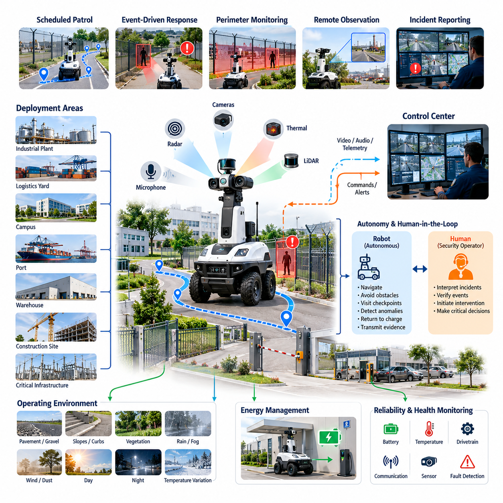{width="7.268055555555556in" height="7.268055555555556in"}

Outdoor security robots are autonomous or semi-autonomous mobile platforms designed to extend security operations across large, exposed, and continuously changing environments. Their mission is not simply to replace stationary cameras or human guards, but to provide mobile sensing, persistent observation, rapid verification, and structured data collection. Typical deployment areas include industrial plants, logistics yards, campuses, ports, energy facilities, warehouses, construction sites, and critical infrastructure.

A security robot mission profile defines what the robot must accomplish, where it operates, how long it must remain available, and how it interacts with human operators and security systems. The profile normally combines scheduled patrol, event-driven inspection, perimeter monitoring, anomaly verification, remote observation, and incident reporting. These activities establish operational requirements for mobility, perception, communications, autonomy, energy management, reliability, and environmental protection.

Scheduled patrol is one of the fundamental mission modes. The robot follows predefined or dynamically generated routes through checkpoints, fence lines, building exteriors, parking areas, storage zones, or other security-sensitive locations. At each checkpoint, it may capture visible images, thermal measurements, video, audio, or environmental observations. Patrol execution should record position, time, sensor status, detected events, and route completion so that every mission can be reconstructed later.

Event-driven response complements routine patrol. When a fixed camera, access-control system, fence sensor, security analytics platform, or human operator reports an abnormal condition, the robot can be dispatched to the affected location. Mobile deployment allows sensors to approach the event and observe it from different viewpoints. The robot therefore acts as a remote verification platform that helps operators distinguish genuine incidents from false alarms before personnel are sent into the area.

Perimeter security missions require continuous awareness of people, vehicles, objects, and activities near restricted boundaries. Cameras, thermal sensors, LiDAR, radar, microphones, and other sensors can contribute complementary observations. Perception software may detect unauthorized entry, loitering, unusual motion, abandoned objects, vehicles entering restricted zones, or unexpected activity. Detection alone is insufficient; observations must be associated with location, time, confidence, and mission context before an alert becomes operationally useful.

Outdoor security robots operate under conditions that are substantially more variable than indoor service robots. Pavement, gravel, slopes, curbs, drainage structures, vegetation, puddles, shadows, dust, rain, fog, wind, and changing illumination can affect navigation and perception simultaneously. The mission scope must therefore specify terrain limits, weather limits, temperature ranges, allowable slopes, obstacle dimensions, visibility conditions, and degraded operating modes rather than assuming that nominal autonomous navigation will always remain available.

Day and night operation introduces another important mission requirement. Visible-light cameras can provide detailed appearance information during favorable illumination, while thermal imaging can improve observation in darkness and support detection based on heat signatures. Security systems may combine these modalities instead of treating either sensor as universally sufficient. Sensor selection, field of view, mounting position, illumination support, image quality, and perception confidence should consequently be derived from the actual surveillance environment.

The autonomy scope must clearly define which decisions belong to the robot and which remain under human authority. A robot may autonomously navigate, avoid obstacles, visit checkpoints, detect candidate anomalies, return to charge, and transmit evidence, while security personnel retain responsibility for interpreting critical incidents and initiating physical intervention. This separation creates a practical human-in-the-loop model in which automation increases coverage and persistence without giving the mobile platform unnecessary authority.

Communication is central to this operating model because a security robot is usually part of a larger security infrastructure rather than an isolated machine. The platform may exchange video, voice, telemetry, alarms, maps, mission commands, and diagnostic information with a control center. Two-way communication can also allow an operator to observe a situation remotely or communicate with a person near the robot. The chapter structure therefore treats communication, reporting, and fleet-level incident response as integral parts of the security application.

Mission planning must also consider the relationship between patrol coverage and available energy. A robot that can navigate accurately but repeatedly interrupts patrol because of charging requirements may provide inadequate security coverage. Route length, patrol frequency, sensor power consumption, communication load, terrain resistance, battery state, charging time, and reserve energy should be evaluated together. Continuous operation may require automated charging, overlapping robot assignments, or fleet-level scheduling that preserves coverage while individual robots recharge.

Reliability requirements are particularly demanding because security missions often extend beyond normal working hours. The robot may be expected to operate at night, during weekends, or in areas with limited personnel presence. Fault detection should therefore cover localization degradation, sensor failure, communication loss, low battery, blocked routes, excessive temperature, drivetrain faults, and compute failures. Safe fallback behaviors may include stopping, returning to a designated location, requesting assistance, or switching to a reduced-capability operating mode.

The physical mission boundary must be defined as carefully as the software functionality. Geofences can prevent the robot from entering public roads, hazardous machinery zones, restricted pedestrian areas, steep terrain, or locations outside authorized surveillance regions. Speed limits may vary by zone, time, visibility, or proximity to people. Emergency stopping, remote intervention, obstacle avoidance, controlled recovery, and safe-state behavior form essential constraints around autonomous patrol rather than optional features added after deployment.

Security data management is another major element of mission scope because mobile robots can continuously collect identifiable images, video, audio, location records, and behavioral observations. Operators should define what information is collected, why it is required, how long it is retained, who can access it, and how it is protected. Privacy requirements should influence camera orientation, recording policies, access control, encryption, audit logging, retention rules, and data deletion mechanisms throughout the system lifecycle.

A practical deployment also requires explicit performance indicators. Patrol completion rate, checkpoint coverage, anomaly detection rate, false alarm rate, response time, localization availability, communication availability, autonomous operating time, intervention frequency, charging utilization, mission failure rate, and mean time between failures can reveal whether the robot is delivering operational value. These metrics should be evaluated under representative weather, lighting, traffic, terrain, and communication conditions rather than only in controlled demonstrations.

The overall mission scope is therefore broader than autonomous movement with surveillance sensors. An outdoor security robot is a coordinated physical security platform integrating patrol execution, perception, anomaly detection, communications, incident response, environmental robustness, privacy protection, and continuous operation. This framing also provides the foundation for the subsequent application topics of autonomous patrol, AI-based intrusion detection, abnormal-event reporting, thermal perception, two-way communication, fleet dispatch, reliability, privacy, and 24/7 operation.

실외 보안 로봇(Outdoor Security Robot)은 넓고 개방되어 있으며 지속적으로 변화하는 환경에서 보안 업무(Security Operation)를 확장하기 위해 설계된 자율형(Autonomous) 또는 반자율형(Semi-Autonomous) 이동 플랫폼이다. 이러한 로봇의 임무는 단순히 고정형 카메라나 인간 경비원을 대체하는 것이 아니라 이동형 센싱(Mobile Sensing), 지속적인 감시(Persistent Observation), 신속한 상황 확인(Rapid Verification), 체계적인 데이터 수집(Structured Data Collection)을 제공하는 것이다. 대표적인 배치 환경에는 산업 플랜트, 물류 야드, 캠퍼스, 항만, 에너지 시설, 창고, 건설 현장 및 주요 기반 시설(Critical Infrastructure) 등이 포함된다.

보안 로봇 임무 프로파일(Mission Profile)은 로봇이 무엇을 수행해야 하는지, 어디에서 운용되는지, 얼마나 오랫동안 가용 상태를 유지해야 하는지, 그리고 인간 운영자 및 보안 시스템과 어떻게 상호작용하는지를 정의한다. 일반적인 임무 프로파일은 정기 순찰(Scheduled Patrol), 이벤트 기반 점검(Event-Driven Inspection), 경계 감시(Perimeter Monitoring), 이상 상황 확인(Anomaly Verification), 원격 관찰(Remote Observation), 사고 보고(Incident Reporting)를 결합한다. 이러한 활동은 이동성, 인지, 통신, 자율성, 에너지 관리, 신뢰성 및 환경 보호에 대한 운용 요구사항을 결정한다.

정기 순찰(Scheduled Patrol)은 가장 기본적인 임무 모드(Mission Mode) 중 하나이다. 로봇은 체크포인트(Checkpoint), 울타리 경계선, 건물 외곽, 주차 구역, 저장 구역 또는 기타 보안 중요 지역을 따라 사전에 정의되거나 동적으로 생성된 경로를 이동한다. 각 체크포인트에서 가시광 이미지, 열 측정 정보, 비디오, 오디오 또는 환경 관측 데이터를 수집할 수 있다. 순찰 수행 과정에서는 위치, 시간, 센서 상태, 탐지된 이벤트 및 경로 완료 여부를 기록하여 이후 모든 임무를 재구성할 수 있어야 한다.

이벤트 기반 대응(Event-Driven Response)은 정기 순찰을 보완한다. 고정형 카메라, 출입 통제 시스템(Access-Control System), 울타리 센서, 보안 분석 플랫폼 또는 인간 운영자가 비정상적인 상황을 보고하면 로봇을 해당 위치로 출동시킬 수 있다. 이동형 플랫폼은 센서를 이벤트 발생 지점 가까이 이동시키고 다양한 관점에서 상황을 관찰할 수 있도록 한다. 따라서 로봇은 인력을 현장에 투입하기 전에 운영자가 실제 사고와 오경보(False Alarm)를 구분하도록 지원하는 원격 확인 플랫폼(Remote Verification Platform)의 역할을 수행한다.

경계 보안 임무(Perimeter Security Mission)는 제한 구역 경계 주변의 사람, 차량, 물체 및 활동에 대한 지속적인 상황 인식(Situational Awareness)을 요구한다. 카메라, 열화상 센서(Thermal Sensor), 라이다(LiDAR), 레이더(Radar), 마이크 및 기타 센서가 상호 보완적인 관측 정보를 제공할 수 있다. 인지 소프트웨어(Perception Software)는 무단 침입, 배회(Loitering), 비정상적인 움직임, 방치된 물체, 제한 구역에 진입하는 차량 또는 예상하지 못한 활동을 탐지할 수 있다. 그러나 단순한 탐지만으로는 충분하지 않으며, 관측 정보가 위치, 시간, 신뢰도(Confidence) 및 임무 상황 정보와 연결되어야 실제 운용에 유용한 경보가 될 수 있다.

실외 보안 로봇은 실내 서비스 로봇보다 훨씬 변화가 큰 환경 조건에서 운용된다. 포장도로, 자갈길, 경사면, 연석, 배수 구조물, 식생, 물웅덩이, 그림자, 먼지, 비, 안개, 바람 및 변화하는 조명 조건은 내비게이션(Navigation)과 인지(Perception)에 동시에 영향을 줄 수 있다. 따라서 임무 범위(Mission Scope)는 정상적인 자율주행이 항상 가능하다고 가정하는 대신 지형 제한, 기상 제한, 온도 범위, 허용 경사도, 장애물 크기, 가시성 조건 및 성능 저하 운용 모드(Degraded Operating Mode)를 명확하게 정의해야 한다.

주간 및 야간 운용(Day and Night Operation)은 또 다른 중요한 임무 요구사항을 발생시킨다. 가시광 카메라는 적절한 조명 환경에서 상세한 외형 정보를 제공할 수 있으며, 열화상 이미징(Thermal Imaging)은 어두운 환경에서 관찰 성능을 향상시키고 열 신호(Heat Signature)를 기반으로 한 탐지를 지원할 수 있다. 보안 시스템은 특정 센서 하나를 모든 환경에 적합한 것으로 간주하기보다 여러 센서 모달리티(Sensor Modality)를 결합할 수 있다. 따라서 센서 선택, 시야각(Field of View), 장착 위치, 조명 지원, 영상 품질 및 인지 신뢰도는 실제 감시 환경을 기반으로 결정되어야 한다.

자율성 범위(Autonomy Scope)는 어떤 판단을 로봇이 수행하고 어떤 판단을 인간이 담당할 것인지 명확하게 정의해야 한다. 로봇은 자율적으로 이동하고 장애물을 회피하며 체크포인트를 방문하고 잠재적인 이상 상황을 탐지하고 충전소로 복귀하며 증거 데이터를 전송할 수 있다. 반면 보안 담당자는 중요 사고의 해석과 물리적인 대응 개시를 담당한다. 이러한 역할 분리는 자동화를 통해 감시 범위와 지속성을 향상시키면서 이동 로봇에 불필요한 권한을 부여하지 않는 인간 참여형(Human-in-the-Loop) 운용 모델을 구성한다.

통신(Communication)은 이러한 운용 모델에서 핵심적인 요소이다. 보안 로봇은 일반적으로 독립된 기계가 아니라 더 큰 보안 인프라(Security Infrastructure)의 일부로 동작하기 때문이다. 로봇 플랫폼은 관제 센터(Control Center)와 비디오, 음성, 텔레메트리(Telemetry), 경보, 지도, 임무 명령 및 진단 정보를 교환할 수 있다. 양방향 통신(Two-Way Communication)을 이용하면 운영자가 원격으로 상황을 관찰하거나 로봇 주변에 있는 사람과 대화할 수도 있다. 따라서 통신, 보고 및 플릿 수준 사고 대응(Fleet-Level Incident Response)은 보안 로봇 응용 시스템의 핵심적인 구성 요소이다.

임무 계획(Mission Planning)은 순찰 범위와 사용 가능한 에너지 사이의 관계도 고려해야 한다. 정확하게 자율주행할 수 있는 로봇이라도 충전을 위해 순찰을 반복적으로 중단한다면 충분한 보안 감시 범위를 제공하기 어렵다. 경로 길이, 순찰 빈도, 센서 전력 소비, 통신 부하, 지형 저항, 배터리 상태, 충전 시간 및 예비 에너지를 함께 평가해야 한다. 지속적인 운용(Continuous Operation)을 위해서는 자동 충전(Automated Charging), 여러 로봇 간 임무 중첩 또는 개별 로봇이 충전하는 동안에도 감시 범위를 유지할 수 있는 플릿 수준 스케줄링(Fleet-Level Scheduling)이 필요할 수 있다.

보안 임무는 일반적인 근무 시간 이후에도 계속되는 경우가 많기 때문에 높은 수준의 신뢰성(Reliability)이 요구된다. 로봇은 야간, 주말 또는 현장 인력이 제한된 구역에서 운용될 수 있다. 따라서 고장 탐지(Fault Detection)는 위치추정 성능 저하, 센서 고장, 통신 단절, 배터리 부족, 경로 차단, 과도한 온도, 구동계 고장 및 컴퓨팅 시스템 장애 등을 포함해야 한다. 안전한 대체 동작(Safe Fallback Behavior)에는 정지, 지정된 위치로 복귀, 지원 요청 또는 제한된 기능의 운용 모드로 전환하는 방법 등이 포함될 수 있다.

물리적인 임무 경계(Physical Mission Boundary)는 소프트웨어 기능만큼 명확하게 정의되어야 한다. 지오펜스(Geofence)를 이용하면 로봇이 공공 도로, 위험 기계 구역, 제한된 보행자 구역, 급경사 지형 또는 허가된 감시 영역 외부로 진입하는 것을 방지할 수 있다. 속도 제한은 구역, 시간, 가시성 또는 사람과의 거리에 따라 달라질 수 있다. 비상 정지(Emergency Stop), 원격 개입(Remote Intervention), 장애물 회피, 제어된 복구(Controlled Recovery) 및 안전 상태 동작(Safe-State Behavior)은 배치 이후 추가되는 선택 기능이 아니라 자율 순찰을 제한하고 보호하는 필수적인 안전 조건이다.

보안 데이터 관리(Security Data Management) 역시 임무 범위의 주요 요소이다. 이동 로봇은 식별 가능한 이미지, 비디오, 오디오, 위치 기록 및 행동 관측 정보를 지속적으로 수집할 수 있기 때문이다. 운영자는 어떤 정보를 수집하는지, 해당 정보가 왜 필요한지, 얼마나 오랫동안 보관하는지, 누가 접근할 수 있는지, 그리고 데이터를 어떻게 보호하는지를 정의해야 한다. 개인정보 보호 요구사항(Privacy Requirement)은 시스템 전체 수명주기에 걸쳐 카메라 방향, 녹화 정책, 접근 제어(Access Control), 암호화(Encryption), 감사 로그(Audit Logging), 데이터 보존 정책 및 데이터 삭제 메커니즘에 반영되어야 한다.

실제 배치를 위해서는 명확한 성능 지표(Performance Indicator)도 필요하다. 순찰 완료율(Patrol Completion Rate), 체크포인트 커버리지(Checkpoint Coverage), 이상 탐지율(Anomaly Detection Rate), 오경보율(False Alarm Rate), 대응 시간(Response Time), 위치추정 가용성(Localization Availability), 통신 가용성, 자율 운용 시간, 인간 개입 빈도, 충전 활용률, 임무 실패율 및 평균 고장 간격(Mean Time Between Failures, MTBF) 등을 이용하여 로봇이 실제 운용 가치를 제공하는지 평가할 수 있다. 이러한 지표는 통제된 시연 환경뿐만 아니라 실제 운용을 대표하는 기상, 조명, 교통, 지형 및 통신 조건에서 평가되어야 한다.

따라서 전체적인 임무 범위(Overall Mission Scope)는 감시 센서를 장착한 로봇의 자율 이동보다 훨씬 넓은 개념이다. 실외 보안 로봇은 순찰 수행(Patrol Execution), 인지, 이상 탐지, 통신, 사고 대응, 환경 강건성(Environmental Robustness), 개인정보 보호 및 지속 운용을 통합하는 물리 보안 플랫폼(Physical Security Platform)이다. 이러한 관점은 이후 다루게 될 자율 순찰(Autonomous Patrol), 인공지능 기반 침입 탐지(AI-Based Intrusion Detection), 비정상 이벤트 보고(Abnormal-Event Reporting), 열화상 인지(Thermal Perception), 양방향 통신, 플릿 디스패치(Fleet Dispatch), 신뢰성, 개인정보 보호 및 연중무휴 운용(24/7 Operation)을 위한 기반을 제공한다.

##  

## 04.02. Autonomous Patrol Route Planning and Execution [w/Code]

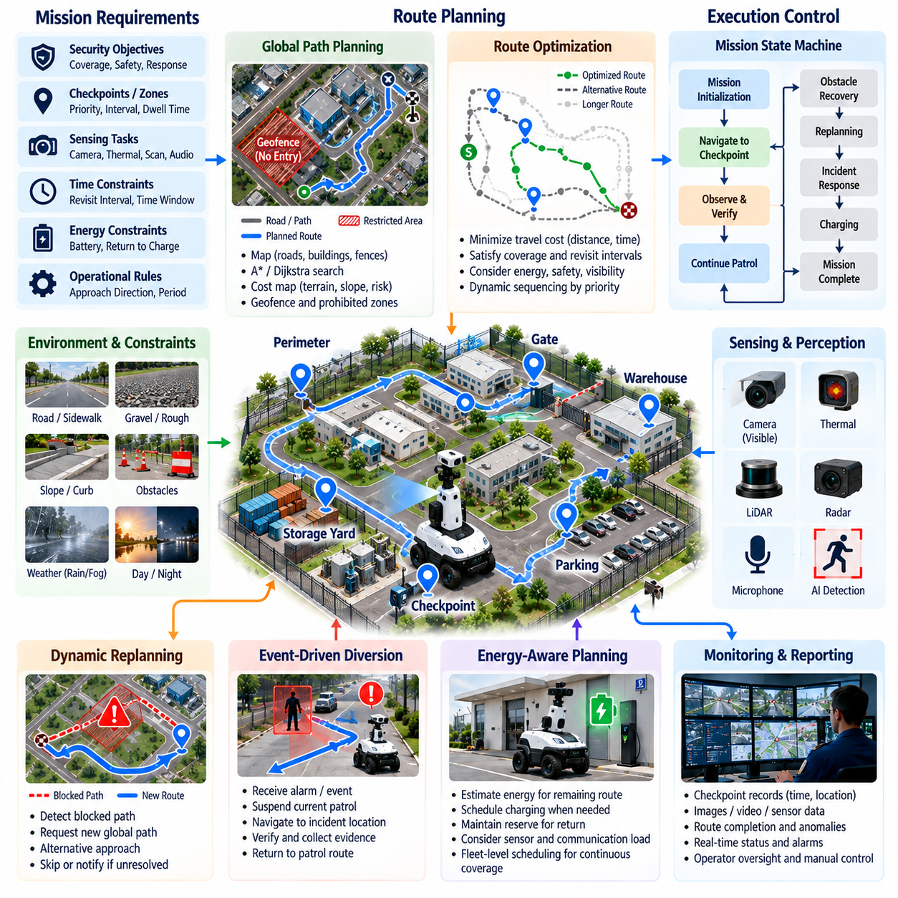{width="7.268055555555556in" height="7.268055555555556in"}

Autonomous patrol route planning transforms security objectives into executable robot motion across an outdoor site. Unlike ordinary point-to-point navigation, patrol planning must repeatedly cover security-sensitive areas while satisfying timing, safety, energy, and observation requirements. The robot therefore manages not only where it travels, but also which checkpoints it visits, how frequently they are inspected, and what sensing actions are performed at each location.

A patrol mission can be represented as a collection of checkpoints, patrol zones, connecting paths, observation tasks, and operational constraints. Checkpoints may correspond to gates, fences, equipment areas, building entrances, parking zones, storage yards, or other locations requiring periodic inspection. Each checkpoint can contain attributes such as priority, required arrival interval, dwell time, camera orientation, sensing task, allowable approach direction, and permitted operating period.

The route planner converts these mission requirements into an ordered sequence that can be executed efficiently. A simple patrol may follow a fixed cyclic route, while a larger facility may require dynamic sequencing based on priority, elapsed time since the previous inspection, travel cost, battery state, or current security conditions. Route optimization therefore resembles a constrained routing problem in which minimizing distance is only one objective among coverage, response readiness, safety, and inspection quality.

Global path planning determines feasible paths between patrol locations using a map of the operating environment. The planner must consider roads, sidewalks, open yards, restricted areas, fences, buildings, slopes, charging stations, and other persistent features. Graph-based methods such as Dijkstra or A\* can search connected route networks, while cost maps can represent traversal difficulty and risk. Geofenced regions can be assigned extremely high or prohibited costs to prevent unauthorized entry.

Outdoor environments require the route representation to include more than geometric distance. A short path across rough terrain, a steep slope, a congested pedestrian zone, or an unreliable communication area may be less desirable than a longer but safer route. Navigation costs can therefore incorporate terrain traversability, slope, surface condition, expected traffic, visibility, localization quality, communication coverage, and security priority. This produces routes that better reflect operational risk rather than distance alone.

Local planning handles conditions that cannot be completely predicted during global route generation. People, vehicles, temporary barriers, construction materials, parked equipment, vegetation, and other obstacles may appear along an otherwise valid patrol path. The local planner continuously evaluates sensor observations and generates collision-free motion while attempting to preserve progress toward the current checkpoint. Speed and clearance can be adjusted according to obstacle density and uncertainty.

Patrol execution is typically controlled by a mission state machine or behavior-based task manager. States may include mission initialization, navigation to checkpoint, observation, checkpoint verification, route continuation, obstacle recovery, charging, incident response, and mission completion. Transitions occur according to navigation results, sensor events, timers, battery conditions, operator commands, or detected anomalies. This structure separates high-level security objectives from lower-level motion control and navigation behavior.

Checkpoint arrival should be verified rather than assumed from a navigation command alone. The robot can evaluate localization position, distance to the target, heading, velocity, and sensor readiness before declaring the checkpoint reached. Once validated, it performs the assigned observation action, such as rotating a camera, capturing images, recording thermal data, scanning a fence line, or waiting for a specified duration. The resulting evidence can be associated with checkpoint identity and timestamp.

A robust patrol system must manage blocked paths without terminating the entire mission. When an obstacle persists beyond a configured period, the robot may retry local navigation, request a new global path, approach the checkpoint from another direction, temporarily skip the location, or notify the control center. Recovery policies should distinguish transient obstacles from persistent route failures so that repeated unsuccessful attempts do not waste energy or leave other security zones unobserved.

Dynamic replanning becomes especially important when the security context changes during patrol. A newly detected event can temporarily override the scheduled route and create a high-priority destination. The robot may suspend its current patrol, navigate toward the incident, collect additional observations, transmit evidence, and then resume the interrupted route. The planner must retain mission state so that emergency diversions do not cause checkpoints to be unintentionally omitted after incident handling.

Time is another critical planning dimension. Some locations may require inspection every few minutes, while others need only occasional observation. Route scheduling can therefore use maximum revisit intervals, time windows, checkpoint deadlines, or priority-weighted lateness. If the robot falls behind schedule because of obstacles or incidents, the planner can reorder remaining checkpoints according to operational importance instead of blindly continuing the original sequence.

Energy-aware planning prevents a patrol mission from consuming more battery capacity than the robot can safely support. The mission manager estimates energy required for remaining travel, sensing, communication, and return to a charging station. When available energy approaches a defined reserve threshold, the robot can shorten the route, defer low-priority checkpoints, or initiate charging. Charging decisions should preserve sufficient reserve energy for localization uncertainty, detours, and unexpected recovery actions.

Patrol planning can also coordinate multiple robots. A fleet manager may partition a large facility into patrol sectors, assign checkpoints according to robot position and capability, and redistribute tasks when a robot charges or becomes unavailable. Overlapping coverage can be maintained for critical areas while unnecessary duplication is reduced elsewhere. Dynamic allocation also enables the nearest suitable robot to interrupt its patrol and respond to a newly reported security incident.

Mission monitoring provides operators with continuous visibility into patrol execution. The system can report the current robot position, active route, next checkpoint, completed checkpoints, delayed tasks, battery state, navigation status, detected obstacles, and mission exceptions. Historical mission records allow operators to compare planned and actual routes, identify repeatedly blocked locations, analyze missed inspections, and determine whether patrol policies should be modified for changing site conditions.

Safety constraints always take precedence over patrol efficiency. Route execution must respect geofences, speed limits, minimum obstacle clearances, restricted zones, emergency-stop conditions, and environmental operating limits. If localization confidence becomes insufficient or a required safety sensor fails, the robot should not continue merely to satisfy a patrol schedule. Instead, the mission manager transitions to a defined degraded or safe state and reports the reason to the supervisory system.

Reliable autonomous patrol is ultimately a closed operational loop connecting mission definition, route optimization, navigation, checkpoint verification, sensing, exception handling, and mission reporting. Successful execution is measured not simply by whether the robot traveled through the facility, but by whether required areas were observed at the correct frequency and quality while maintaining safety and availability. This framework provides the navigation foundation for intrusion detection, abnormal-event reporting, incident response, and continuous outdoor security operation.

자율 순찰 경로 계획(Autonomous Patrol Route Planning)은 보안 목표(Security Objective)를 실외 현장에서 로봇이 실행할 수 있는 이동 경로로 변환하는 과정이다. 일반적인 지점 간 내비게이션(Point-to-Point Navigation)과 달리 순찰 계획은 시간, 안전, 에너지 및 관측 요구사항을 만족하면서 보안상 중요한 영역을 반복적으로 감시해야 한다. 따라서 로봇은 단순히 어디로 이동할 것인지만 결정하는 것이 아니라 어떤 체크포인트(Checkpoint)를 방문하고, 얼마나 자주 점검하며, 각 위치에서 어떤 센싱 작업(Sensing Action)을 수행할 것인지까지 관리해야 한다.

순찰 임무(Patrol Mission)는 체크포인트, 순찰 구역(Patrol Zone), 연결 경로, 관측 작업(Observation Task) 및 운용 제약조건(Operational Constraint)의 집합으로 표현할 수 있다. 체크포인트는 출입구, 울타리, 장비 구역, 건물 입구, 주차 구역, 저장 야드 또는 정기적인 점검이 필요한 기타 위치에 대응할 수 있다. 각 체크포인트에는 우선순위, 요구 방문 주기, 체류 시간(Dwell Time), 카메라 방향, 센싱 작업, 허용 접근 방향 및 운용 가능 시간과 같은 속성을 포함할 수 있다.

경로 계획기(Route Planner)는 이러한 임무 요구사항을 효율적으로 실행할 수 있는 순서로 변환한다. 단순한 순찰은 고정된 순환 경로(Fixed Cyclic Route)를 따를 수 있지만, 대규모 시설에서는 우선순위, 이전 점검 이후 경과 시간, 이동 비용, 배터리 상태 또는 현재 보안 상황을 기반으로 동적인 순서 결정이 필요할 수 있다. 따라서 경로 최적화(Route Optimization)는 이동 거리 최소화뿐만 아니라 감시 범위, 대응 준비성, 안전성 및 점검 품질을 함께 고려하는 제약 경로 문제(Constrained Routing Problem)로 볼 수 있다.

전역 경로 계획(Global Path Planning)은 운용 환경의 지도를 이용하여 순찰 위치 사이의 이동 가능한 경로를 결정한다. 계획기는 도로, 보도, 개방형 야드, 제한 구역, 울타리, 건물, 경사면, 충전소 및 기타 지속적으로 존재하는 환경 요소를 고려해야 한다. 다익스트라(Dijkstra) 또는 A\*(A-Star)와 같은 그래프 기반 방법(Graph-Based Method)을 이용하여 연결된 경로 네트워크를 탐색할 수 있으며, 비용 지도(Cost Map)를 통해 이동 난이도와 위험도를 표현할 수 있다. 지오펜스(Geofence) 영역에는 매우 높은 비용 또는 통행 금지 비용을 설정하여 허가되지 않은 진입을 방지할 수 있다.

실외 환경에서는 경로 표현에 단순한 기하학적 거리 이상의 요소가 포함되어야 한다. 거친 지형, 급경사, 혼잡한 보행자 구역 또는 통신 신뢰성이 낮은 구역을 통과하는 짧은 경로보다 더 길더라도 안전한 경로가 바람직할 수 있다. 따라서 내비게이션 비용(Navigation Cost)에는 지형 주행 가능성(Terrain Traversability), 경사도, 노면 상태, 예상 교통량, 가시성, 위치추정 품질, 통신 범위 및 보안 우선순위를 포함할 수 있다. 이를 통해 단순한 거리보다 실제 운용 위험을 더 적절하게 반영하는 경로를 생성할 수 있다.

지역 경로 계획(Local Planning)은 전역 경로 생성 단계에서 완전히 예측할 수 없는 상황을 처리한다. 사람, 차량, 임시 장애물, 건설 자재, 주차된 장비, 식생 및 기타 장애물이 정상적인 순찰 경로에 나타날 수 있다. 지역 계획기(Local Planner)는 센서 관측 정보를 지속적으로 평가하고 현재 체크포인트를 향한 진행을 유지하면서 충돌 없는 이동(Collision-Free Motion)을 생성한다. 장애물 밀도와 불확실성에 따라 이동 속도와 안전 거리(Clearance)를 조정할 수도 있다.

순찰 실행(Patrol Execution)은 일반적으로 임무 상태 머신(Mission State Machine) 또는 행동 기반 작업 관리자(Behavior-Based Task Manager)에 의해 제어된다. 상태에는 임무 초기화, 체크포인트 이동, 관측, 체크포인트 검증, 경로 계속 수행, 장애물 복구, 충전, 사고 대응 및 임무 완료 등이 포함될 수 있다. 상태 전환(State Transition)은 내비게이션 결과, 센서 이벤트, 타이머, 배터리 상태, 운영자 명령 또는 탐지된 이상 상황에 따라 발생한다. 이러한 구조는 상위 수준의 보안 목표와 하위 수준의 모션 제어(Motion Control) 및 내비게이션 동작을 분리한다.

체크포인트 도착(Checkpoint Arrival)은 단순히 내비게이션 명령의 완료 결과를 신뢰하는 것이 아니라 별도로 검증되어야 한다. 로봇은 체크포인트에 도달했다고 판단하기 전에 위치추정 좌표, 목표까지의 거리, 방향(Heading), 속도 및 센서 준비 상태를 평가할 수 있다. 검증이 완료되면 카메라 회전, 이미지 촬영, 열 데이터(Thermal Data) 기록, 울타리 구간 스캔 또는 지정된 시간 동안 대기하는 등의 관측 작업을 수행한다. 생성된 증거 데이터는 체크포인트 식별 정보 및 타임스탬프(Timestamp)와 연결하여 관리할 수 있다.

강건한 순찰 시스템(Robust Patrol System)은 경로가 차단되더라도 전체 임무를 종료하지 않고 상황을 처리할 수 있어야 한다. 장애물이 설정된 시간 이상 지속되는 경우 로봇은 지역 내비게이션을 다시 시도하거나 새로운 전역 경로를 요청하고, 다른 방향에서 체크포인트에 접근하거나 해당 위치를 일시적으로 건너뛰거나 관제 센터(Control Center)에 상황을 알릴 수 있다. 복구 정책(Recovery Policy)은 일시적인 장애물과 지속적인 경로 장애를 구분하여 반복적인 실패 시도로 에너지를 낭비하거나 다른 보안 구역의 감시가 누락되지 않도록 해야 한다.

동적 재계획(Dynamic Replanning)은 순찰 중 보안 상황이 변화할 때 특히 중요하다. 새롭게 탐지된 이벤트는 기존 순찰 경로보다 높은 우선순위의 목적지를 생성할 수 있다. 로봇은 현재 순찰을 일시 중단하고 사고 위치로 이동하여 추가 관측 정보를 수집하고 증거 데이터를 전송한 후 중단되었던 경로를 다시 수행할 수 있다. 계획기는 임무 상태(Mission State)를 유지하여 긴급 출동 이후 체크포인트가 의도하지 않게 누락되지 않도록 해야 한다.

시간(Time)은 경로 계획의 또 다른 핵심 요소이다. 일부 위치는 몇 분마다 점검해야 할 수 있지만 다른 위치는 간헐적인 관측만으로 충분할 수 있다. 따라서 경로 스케줄링(Route Scheduling)은 최대 재방문 간격(Maximum Revisit Interval), 시간 창(Time Window), 체크포인트 마감시간 또는 우선순위 가중 지연(Priority-Weighted Lateness)을 사용할 수 있다. 장애물이나 사고로 인해 일정이 지연되면 계획기는 기존 순서를 그대로 따르는 대신 운용 중요도에 따라 남아 있는 체크포인트의 순서를 재조정할 수 있다.

에너지 인식 계획(Energy-Aware Planning)은 순찰 임무가 로봇이 안전하게 사용할 수 있는 배터리 용량 이상을 소비하지 않도록 한다. 임무 관리자(Mission Manager)는 남아 있는 이동, 센싱, 통신 및 충전소 복귀에 필요한 에너지를 추정한다. 사용 가능한 에너지가 정의된 예비 에너지 임계값(Reserve Threshold)에 가까워지면 로봇은 경로를 단축하거나 우선순위가 낮은 체크포인트를 연기하거나 충전을 시작할 수 있다. 충전 결정에는 위치추정 불확실성, 우회 경로 및 예상하지 못한 복구 동작을 위한 충분한 예비 에너지가 확보되어야 한다.

순찰 계획은 여러 대의 로봇(Multiple Robots)을 협조적으로 운용하도록 확장할 수도 있다. 플릿 관리자(Fleet Manager)는 대규모 시설을 여러 순찰 구역으로 분할하고 로봇의 위치와 기능에 따라 체크포인트를 할당하며 특정 로봇이 충전하거나 사용할 수 없게 되었을 때 작업을 재분배할 수 있다. 중요 구역에서는 중복 감시(Overlapping Coverage)를 유지하면서 다른 구역의 불필요한 중복을 줄일 수 있다. 동적 할당(Dynamic Allocation)을 이용하면 새로운 보안 사고가 발생했을 때 가장 가까우면서 적합한 로봇이 기존 순찰을 중단하고 사고 대응 임무를 수행할 수도 있다.

임무 모니터링(Mission Monitoring)은 운영자가 순찰 실행 상황을 지속적으로 파악할 수 있도록 한다. 시스템은 현재 로봇 위치, 활성 경로, 다음 체크포인트, 완료된 체크포인트, 지연된 작업, 배터리 상태, 내비게이션 상태, 탐지된 장애물 및 임무 예외(Mission Exception)를 보고할 수 있다. 과거 임무 기록을 이용하면 계획된 경로와 실제 이동 경로를 비교하고, 반복적으로 차단되는 위치를 식별하며, 누락된 점검을 분석하고, 변화하는 현장 조건에 따라 순찰 정책을 수정해야 하는지 판단할 수 있다.

안전 제약조건(Safety Constraint)은 항상 순찰 효율보다 우선해야 한다. 경로 실행은 지오펜스, 속도 제한, 최소 장애물 안전거리, 제한 구역, 비상 정지 조건 및 환경 운용 한계를 준수해야 한다. 위치추정 신뢰도(Localization Confidence)가 충분하지 않거나 필수 안전 센서에 장애가 발생한 경우 로봇은 단순히 순찰 일정을 만족시키기 위해 계속 이동해서는 안 된다. 대신 임무 관리자는 사전에 정의된 성능 저하 상태(Degraded State) 또는 안전 상태(Safe State)로 전환하고 그 원인을 상위 감독 시스템(Supervisory System)에 보고해야 한다.

신뢰할 수 있는 자율 순찰(Reliable Autonomous Patrol)은 궁극적으로 임무 정의, 경로 최적화, 내비게이션, 체크포인트 검증, 센싱, 예외 처리(Exception Handling) 및 임무 보고를 연결하는 폐루프 운용 체계(Closed Operational Loop)이다. 성공적인 순찰은 단순히 로봇이 시설을 이동했는지 여부가 아니라 안전성과 가용성을 유지하면서 필요한 영역을 적절한 주기와 품질로 관측했는지를 기준으로 평가해야 한다. 이러한 프레임워크는 침입 탐지(Intrusion Detection), 비정상 이벤트 보고(Abnormal-Event Reporting), 사고 대응(Incident Response) 및 지속적인 실외 보안 운용(Continuous Outdoor Security Operation)을 위한 내비게이션 기반을 제공한다.

##  

## 04.03. Perimeter Intrusion Detection AI Vision [w/Code]

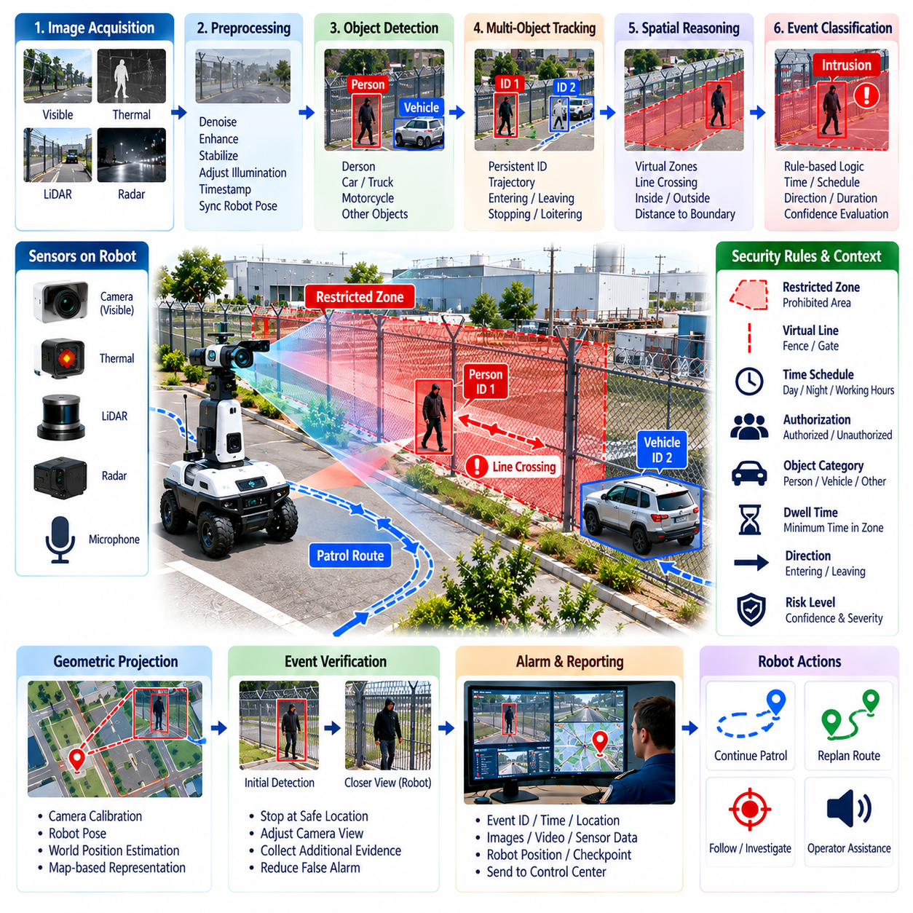{width="7.268055555555556in" height="7.268055555555556in"}

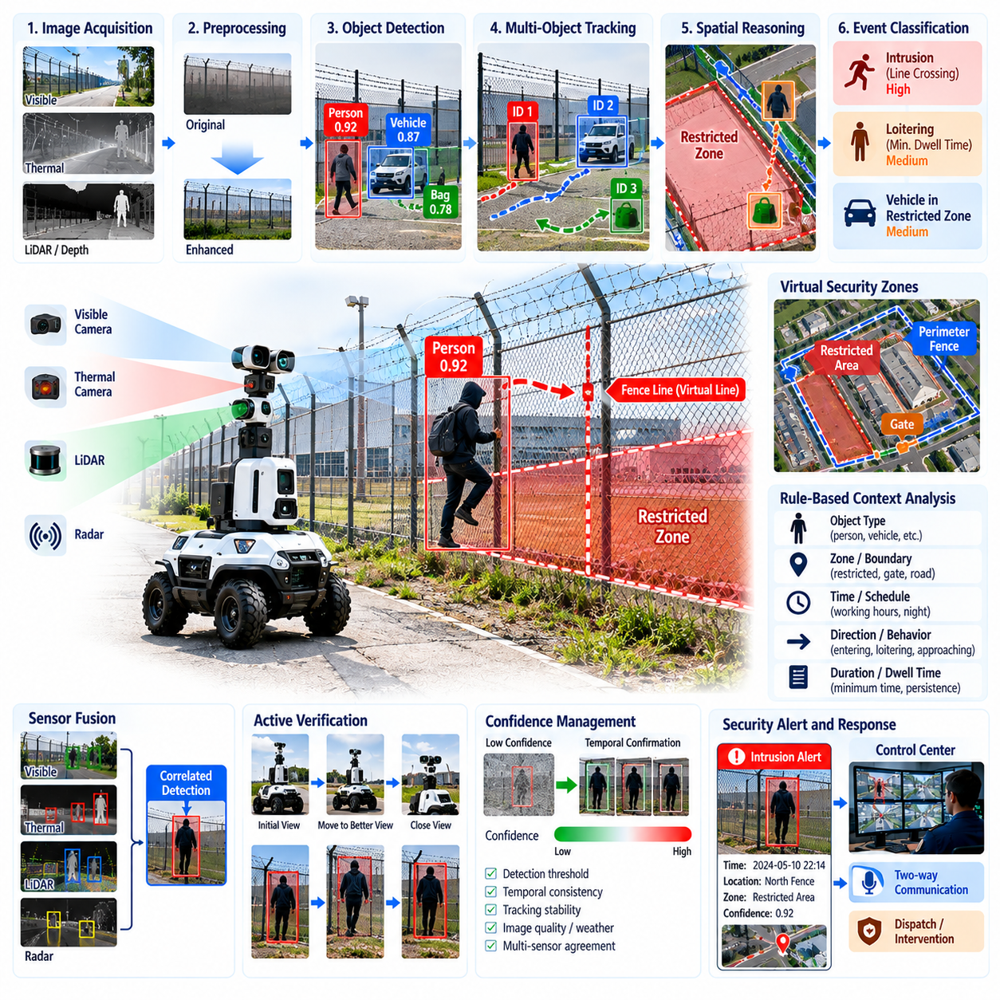{width="7.268055555555556in" height="7.268055555555556in"}

Perimeter intrusion detection using AI vision extends the outdoor security robot from a mobile observation platform into an active threat-detection system. During patrol, cameras continuously observe fences, gates, restricted zones, equipment areas, and open boundaries while vision models identify people, vehicles, and relevant objects. The objective is to recognize potentially unauthorized activity early and provide operators with sufficient visual evidence for rapid verification and response.

The perception pipeline typically begins with image acquisition, preprocessing, object detection, tracking, spatial reasoning, and event classification. Images from visible-light or other imaging sensors are timestamped and associated with robot position and orientation. Preprocessing may compensate for exposure, noise, vibration, or changing illumination before inference. Detection results are then transformed from individual image observations into persistent objects and security events that can be evaluated over time.

Object detection provides the basic semantic information required for intrusion analysis. A detector can identify classes such as person, car, truck, motorcycle, or other site-specific objects and return bounding boxes with confidence values. However, detecting a person does not automatically indicate an intrusion. The security system must combine the detected object class with its position, movement, time, authorization context, and relationship to protected areas before generating an operational alarm.

Restricted areas can be represented as virtual security zones associated with the robot map or camera image. A polygon may define a prohibited region, while a virtual line can represent a fence, gate, or access boundary. After detecting an object, the system estimates whether its representative point or spatial footprint lies inside a protected zone. Line-crossing logic can additionally determine whether a tracked object has moved from an authorized side of a boundary into a restricted side.

Multi-object tracking is important because security events develop over time rather than within a single frame. A tracker assigns a persistent identifier to each detected person or vehicle and estimates its trajectory across consecutive observations. This allows the system to distinguish entering, leaving, passing nearby, stopping, or repeatedly approaching a boundary. Tracking also reduces duplicate alarms because multiple detections belonging to the same physical object can be treated as one continuing event.

Temporal reasoning helps distinguish genuine intrusion behavior from short-lived detection noise. A system may require an object to remain inside a restricted zone for several frames or exceed a minimum dwell time before raising an alert. Similarly, line crossing can be confirmed only when a tracked trajectory clearly moves across both sides of the boundary. These temporal conditions suppress alarms caused by uncertain bounding boxes, partial occlusion, image noise, or momentary detector errors.

Security rules can combine object category, zone, direction, schedule, and duration. For example, a person entering a maintenance area during authorized working hours may not represent the same risk as a person entering the same area at night. A vehicle traveling along an approved road can be ignored while the same vehicle entering a pedestrian-only zone generates an event. Rule-based context therefore converts generic AI detections into site-specific security interpretations.

Confidence management is necessary because AI vision models operate probabilistically. A single detection with marginal confidence should not always trigger a high-severity alarm. Systems can apply class-specific thresholds, temporal confirmation, tracker consistency, or secondary verification before escalating an event. Confidence may also be influenced by image quality, distance, object size, weather, illumination, and occlusion so that uncertain observations are handled differently from clear detections.

A mobile robot introduces perception challenges that differ from fixed surveillance cameras. Camera position, heading, vibration, background, and viewing distance continuously change as the robot moves. Apparent motion caused by robot movement can complicate conventional motion detection, while turns may temporarily change the visible security zone. Robot localization and camera pose should therefore be associated with visual observations so that detected objects can be interpreted relative to the physical site rather than only image coordinates.

Geometric projection can connect image detections with the robot navigation map. Using camera calibration, robot pose, depth information, or supporting sensors, the system can estimate the approximate world position of an observed object. This allows intrusion events to be represented as georeferenced security information. An operator can then receive not only an image containing a detected person but also the robot location, estimated event location, affected security zone, and corresponding patrol checkpoint.

Sensor fusion can improve reliability when vision alone becomes uncertain. LiDAR may provide range and geometric structure, radar can support detection under difficult visibility, and thermal imaging can improve observation in darkness. The system can correlate detections from multiple sensors according to position and time. Agreement between modalities may increase event confidence, while disagreement can cause the system to request additional observation instead of immediately issuing a high-priority alarm.

Active verification is a major advantage of a mobile security robot. When a possible intrusion is detected, the robot can stop at a safe location, orient its camera, adjust its viewpoint, or move to another observation position. Additional images or video can then be collected before escalation. This transforms perception from passive detection into an observe--verify--report process and can reduce false alarms caused by poor viewpoints, temporary occlusion, or ambiguous objects.

An intrusion event should contain more information than a simple alarm flag. A useful event record may include event type, object class, tracking identifier, detection confidence, zone identifier, robot pose, estimated target position, timestamp, representative image, video segment, and current mission state. This structured evidence allows the control center to review what happened and enables later analysis of detection performance, response effectiveness, and recurring activity around specific locations.

False-positive control is essential for practical deployment. Shadows, reflections, vegetation, animals, rain, headlights, partially visible objects, unusual clothing, and distant pedestrians can challenge perception models. Threshold tuning alone is rarely sufficient. Combining object detection, tracking, spatial rules, temporal persistence, multimodal sensing, and active verification provides a stronger approach because several independent conditions must support the intrusion hypothesis before a critical alert is generated.

False negatives are equally important because missed intrusions directly reduce security coverage. Evaluation should therefore measure precision and recall together with event-level detection rate, false alarms per operating hour, detection latency, tracking continuity, and performance across distance and environmental conditions. Test scenarios should include daylight, darkness, backlighting, rain, partial occlusion, multiple people, moving vehicles, and different approach directions to expose weaknesses hidden by ordinary image benchmarks.

The complete AI vision system forms a closed perception and security reasoning loop connecting sensing, detection, tracking, spatial interpretation, temporal validation, event generation, and operator verification. Its purpose is not merely to recognize objects but to determine whether observed behavior violates the security policy of the physical environment. When integrated with autonomous patrol, reporting, thermal perception, and incident response, perimeter intrusion detection becomes a central intelligence function of the outdoor security robot.

인공지능 비전(AI Vision)을 활용한 경계 침입 탐지(Perimeter Intrusion Detection)는 실외 보안 로봇(Outdoor Security Robot)을 이동형 관측 플랫폼에서 능동적인 위협 탐지 시스템(Threat-Detection System)으로 확장한다. 순찰 중 카메라는 울타리, 출입구, 제한 구역, 장비 구역 및 개방형 경계를 지속적으로 관찰하고, 비전 모델(Vision Model)은 사람, 차량 및 관련 객체를 식별한다. 핵심 목적은 잠재적인 무단 활동을 조기에 인식하고 운영자가 신속하게 상황을 확인하고 대응할 수 있도록 충분한 시각적 증거를 제공하는 것이다.

인지 파이프라인(Perception Pipeline)은 일반적으로 영상 획득(Image Acquisition), 전처리(Preprocessing), 객체 탐지(Object Detection), 추적(Tracking), 공간 추론(Spatial Reasoning), 이벤트 분류(Event Classification) 과정으로 구성된다. 가시광 카메라 또는 기타 영상 센서에서 획득한 영상에는 타임스탬프(Timestamp)를 부여하고 로봇의 위치 및 방향 정보와 연결한다. 추론(Inference) 전에 노출, 노이즈, 진동 또는 변화하는 조명 조건을 보정할 수 있다. 이후 탐지 결과를 개별 영상 관측에서 지속적으로 추적되는 객체 및 시간에 따라 평가할 수 있는 보안 이벤트(Security Event)로 변환한다.

객체 탐지(Object Detection)는 침입 분석에 필요한 기본적인 의미 정보(Semantic Information)를 제공한다. 탐지기는 사람, 승용차, 트럭, 오토바이 또는 기타 현장 특화 객체를 식별하고 신뢰도(Confidence)와 함께 경계 상자(Bounding Box)를 반환할 수 있다. 그러나 사람을 탐지했다고 해서 자동으로 침입을 의미하는 것은 아니다. 보안 시스템은 운용 경보를 생성하기 전에 탐지된 객체 클래스와 위치, 움직임, 시간, 권한 상황 및 보호 구역과의 관계를 결합하여 판단해야 한다.

제한 구역(Restricted Area)은 로봇 지도 또는 카메라 영상과 연결된 가상 보안 구역(Virtual Security Zone)으로 표현할 수 있다. 다각형(Polygon)을 이용하여 출입 금지 영역을 정의할 수 있으며, 가상선(Virtual Line)은 울타리, 출입구 또는 접근 경계를 나타낼 수 있다. 객체를 탐지한 후 시스템은 객체의 대표 지점 또는 공간적 점유 영역이 보호 구역 내부에 있는지를 추정한다. 선 통과(Line Crossing) 판단을 추가하면 추적 객체가 허가된 경계 측면에서 제한된 측면으로 이동했는지도 판단할 수 있다.

다중 객체 추적(Multi-Object Tracking)은 보안 이벤트가 단일 프레임이 아니라 시간에 따라 전개되기 때문에 중요하다. 추적기(Tracker)는 탐지된 각각의 사람이나 차량에 지속적인 식별자(Identifier)를 할당하고 연속된 관측을 통해 이동 궤적(Trajectory)을 추정한다. 이를 통해 시스템은 진입, 이탈, 주변 통과, 정지 또는 경계에 반복적으로 접근하는 행동을 구분할 수 있다. 또한 동일한 물리적 객체에 대한 여러 탐지를 하나의 지속적인 이벤트로 처리함으로써 중복 경보를 줄일 수 있다.

시간적 추론(Temporal Reasoning)은 실제 침입 행동과 일시적인 탐지 노이즈를 구분하는 데 도움을 준다. 시스템은 경보를 발생시키기 전에 객체가 여러 프레임 동안 제한 구역 내부에 유지되거나 최소 체류 시간(Minimum Dwell Time)을 초과하도록 요구할 수 있다. 마찬가지로 추적 궤적이 경계의 양쪽을 명확하게 통과한 경우에만 선 통과를 확정할 수 있다. 이러한 시간 조건은 불확실한 경계 상자, 부분 가림(Partial Occlusion), 영상 노이즈 또는 순간적인 탐지 오류로 발생하는 경보를 억제한다.

보안 규칙(Security Rule)은 객체 유형, 구역, 이동 방향, 일정 및 지속 시간을 결합할 수 있다. 예를 들어 허가된 근무 시간에 유지보수 구역으로 진입하는 사람과 야간에 동일한 구역으로 진입하는 사람은 서로 다른 위험 수준으로 평가할 수 있다. 승인된 도로를 이동하는 차량은 무시할 수 있지만 동일한 차량이 보행자 전용 구역으로 진입하면 이벤트를 생성할 수 있다. 따라서 규칙 기반 상황 정보(Rule-Based Context)는 일반적인 인공지능 탐지 결과를 현장에 특화된 보안 판단으로 변환한다.

신뢰도 관리(Confidence Management)는 인공지능 비전 모델이 확률적으로 동작하기 때문에 필요하다. 경계 수준의 신뢰도를 가진 단일 탐지 결과가 항상 높은 심각도의 경보로 연결되어서는 안 된다. 시스템은 이벤트를 상위 수준으로 전환하기 전에 클래스별 임계값(Class-Specific Threshold), 시간적 확인, 추적기 일관성(Tracker Consistency) 또는 2차 검증(Secondary Verification)을 적용할 수 있다. 또한 신뢰도는 영상 품질, 거리, 객체 크기, 날씨, 조명 및 가림 정도에 따라 조정하여 불확실한 관측과 명확한 탐지를 서로 다르게 처리할 수 있다.

이동 로봇(Mobile Robot)은 고정형 감시 카메라와 다른 인지 문제를 발생시킨다. 로봇이 이동함에 따라 카메라 위치, 방향, 진동, 배경 및 관측 거리가 지속적으로 변화한다. 로봇 자체의 이동으로 발생하는 겉보기 움직임(Apparent Motion)은 기존의 움직임 탐지를 어렵게 만들 수 있으며, 회전 동작은 일시적으로 가시 보안 구역을 변화시킬 수 있다. 따라서 로봇 위치추정(Localization) 및 카메라 자세(Camera Pose)를 시각적 관측 정보와 연결하여 탐지된 객체를 단순한 영상 좌표가 아니라 실제 물리적 현장을 기준으로 해석해야 한다.

기하학적 투영(Geometric Projection)을 이용하면 영상 탐지 결과를 로봇 내비게이션 지도와 연결할 수 있다. 카메라 보정(Camera Calibration), 로봇 자세, 깊이 정보 또는 보조 센서를 이용하여 관측된 객체의 대략적인 실제 공간 위치(World Position)를 추정할 수 있다. 이를 통해 침입 이벤트를 지리 참조 보안 정보(Georeferenced Security Information)로 표현할 수 있다. 운영자는 탐지된 사람이 포함된 영상뿐만 아니라 로봇 위치, 추정된 이벤트 위치, 관련 보안 구역 및 대응하는 순찰 체크포인트 정보를 함께 전달받을 수 있다.

센서 융합(Sensor Fusion)은 비전만으로 판단하기 어려운 상황에서 신뢰성을 향상시킬 수 있다. 라이다(LiDAR)는 거리 및 기하학적 구조 정보를 제공하고, 레이더(Radar)는 가시성이 좋지 않은 환경에서 탐지를 지원하며, 열화상 이미징(Thermal Imaging)은 어두운 환경에서 관측 성능을 향상시킬 수 있다. 시스템은 위치와 시간을 기준으로 여러 센서의 탐지 결과를 연관시킬 수 있다. 여러 모달리티(Modality)의 결과가 일치하면 이벤트 신뢰도를 높이고, 결과가 일치하지 않으면 즉시 높은 우선순위의 경보를 생성하는 대신 추가 관측을 요청할 수 있다.

능동 검증(Active Verification)은 이동형 보안 로봇이 제공하는 중요한 장점이다. 잠재적인 침입이 탐지되면 로봇은 안전한 위치에 정지하고 카메라 방향을 조절하거나 관측 시점을 변경하거나 다른 관측 위치로 이동할 수 있다. 이후 상위 수준의 경보로 전환하기 전에 추가 이미지 또는 비디오를 수집할 수 있다. 이를 통해 인지 과정을 수동적인 탐지에서 관측-검증-보고(Observe--Verify--Report) 과정으로 확장하고, 좋지 않은 시점, 일시적인 가림 또는 모호한 객체로 인해 발생하는 오경보(False Alarm)를 줄일 수 있다.

침입 이벤트(Intrusion Event)는 단순한 경보 플래그(Alarm Flag)보다 많은 정보를 포함해야 한다. 유용한 이벤트 기록에는 이벤트 유형, 객체 클래스, 추적 식별자, 탐지 신뢰도, 구역 식별자, 로봇 자세, 추정된 대상 위치, 타임스탬프, 대표 이미지, 비디오 구간 및 현재 임무 상태 등이 포함될 수 있다. 이러한 구조화된 증거(Structured Evidence)를 통해 관제 센터(Control Center)는 발생한 상황을 검토할 수 있으며, 이후 탐지 성능, 대응 효과 및 특정 위치 주변에서 반복적으로 발생하는 활동을 분석할 수 있다.

실제 배치를 위해서는 오탐(False Positive) 제어가 필수적이다. 그림자, 반사, 식생, 동물, 비, 차량 전조등, 부분적으로 보이는 객체, 특이한 복장 및 멀리 떨어진 보행자 등은 인지 모델의 성능을 저하시킬 수 있다. 단순한 임계값 조정만으로는 충분하지 않은 경우가 많다. 객체 탐지, 추적, 공간 규칙, 시간적 지속성(Temporal Persistence), 다중 모달 센싱(Multimodal Sensing) 및 능동 검증을 결합하면 중요 경보가 생성되기 전에 여러 독립적인 조건을 통해 침입 가능성을 확인할 수 있으므로 더욱 강건한 판단이 가능하다.

미탐(False Negative) 역시 중요하다. 실제 침입을 탐지하지 못하면 보안 감시 범위가 직접적으로 감소하기 때문이다. 따라서 평가는 정밀도(Precision)와 재현율(Recall)을 함께 측정하고, 이벤트 수준 탐지율(Event-Level Detection Rate), 운용 시간당 오경보 수, 탐지 지연시간(Detection Latency), 추적 연속성(Tracking Continuity), 거리 및 환경 조건별 성능을 평가해야 한다. 시험 시나리오에는 주간, 야간, 역광, 비, 부분 가림, 다수의 사람, 이동 차량 및 다양한 접근 방향을 포함하여 일반적인 이미지 벤치마크에서 나타나지 않는 취약점을 확인해야 한다.

전체 인공지능 비전 시스템(AI Vision System)은 센싱, 탐지, 추적, 공간 해석, 시간적 검증, 이벤트 생성 및 운영자 확인을 연결하는 폐루프 인지 및 보안 추론 체계(Closed Perception and Security Reasoning Loop)를 구성한다. 시스템의 목적은 단순히 객체를 인식하는 것이 아니라 관측된 행동이 물리적 환경에 정의된 보안 정책(Security Policy)을 위반하는지를 판단하는 것이다. 자율 순찰(Autonomous Patrol), 보고, 열화상 인지, 사고 대응(Incident Response)과 통합될 때 경계 침입 탐지는 실외 보안 로봇의 핵심 지능 기능으로 동작한다.

##  

## 04.04. Abnormal Event Alert and Reporting SW [w/Code]

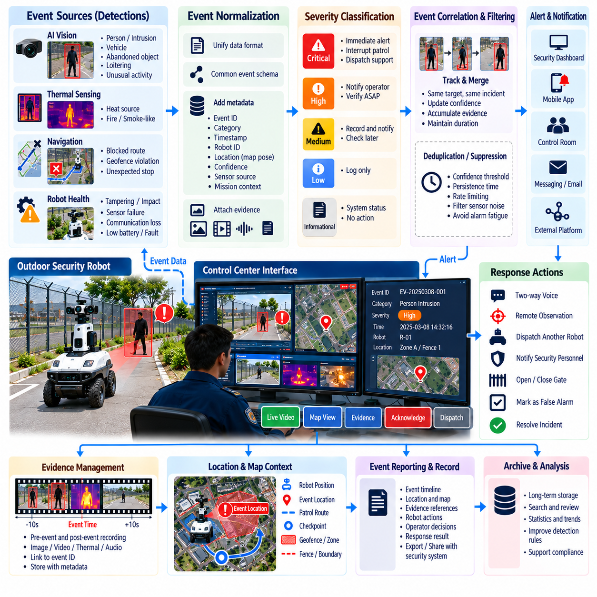{width="7.268055555555556in" height="7.268055555555556in"}

Abnormal event alert and reporting software converts observations from an outdoor security robot into actionable security information. Detection alone is insufficient because operators need to understand what occurred, where it occurred, when it happened, how reliable the observation is, and what response may be required. The software therefore connects perception, navigation, mission status, communications, evidence management, and human supervision into a structured event-processing workflow.

An abnormal event can originate from multiple robot subsystems. AI vision may detect an intrusion, loitering person, abandoned object, unauthorized vehicle, smoke-like appearance, or unusual activity, while thermal sensing may identify an unexpected heat source. Navigation software can report blocked routes or geofence violations, and hardware monitoring may detect tampering, impact, sensor failure, communication degradation, or other conditions that affect security operations.

The event-processing pipeline begins by converting heterogeneous detections into a common event representation. Each event should contain a unique identifier, event category, severity, timestamp, robot identity, robot pose, estimated event location, confidence value, sensor source, and mission context. Images, video clips, thermal frames, audio, or other evidence can be attached to the same record so that downstream systems process a consistent security object rather than unrelated sensor messages.

Event normalization is important because different perception modules may describe similar situations using different data formats. A vision model may produce bounding boxes and class confidence, while a thermal module reports temperature regions and navigation software reports coordinates or fault codes. The event manager translates these outputs into a shared schema. This abstraction allows alert logic and reporting services to operate independently of the specific algorithms or sensors that generated the original observation.

Severity classification determines how urgently an event should be handled. Informational events may simply be recorded, while low-priority anomalies can be queued for later review. Higher-severity events may immediately notify an operator, interrupt a patrol mission, or dispatch another robot for verification. Severity can be calculated from event type, confidence, protected-zone priority, time of day, persistence, target behavior, and proximity to critical assets rather than using a single fixed threshold.

Event correlation prevents the control center from being overwhelmed by repeated alerts describing the same physical incident. A person remaining near a restricted fence may generate detections across hundreds of video frames, but the event manager should associate these observations with one continuing incident. Correlation can use tracking identifiers, spatial distance, event category, and temporal proximity to merge related observations while updating confidence, duration, evidence, and target position.

Deduplication and suppression policies further reduce unnecessary alarms. Events with low confidence may require persistence for several seconds before notification, while repeated warnings from the same location can be rate-limited. Temporary sensor noise or short communication interruptions may be recorded without immediately escalating them. These policies must be carefully designed because excessive suppression can hide real incidents, whereas insufficient filtering produces alarm fatigue and reduces operator trust.

When an event satisfies escalation criteria, the alert service selects appropriate notification channels according to severity and operational policy. Alerts may be delivered to a security dashboard, mobile application, control-room workstation, messaging infrastructure, or external security management platform. Critical events should include concise information that allows rapid assessment, such as event category, location, robot identifier, detection confidence, timestamp, representative image, and current event status.

Reliable alert delivery requires acknowledgment and retry mechanisms. Sending a network message does not guarantee that an operator or external system received and processed it. The software can therefore maintain states such as generated, transmitted, delivered, acknowledged, assigned, resolved, and closed. If acknowledgment is not received within a configured interval, the system may retry delivery, use another communication channel, or escalate the event to another responsible operator.

Evidence capture should preserve information surrounding the event rather than recording only the instant at which an alarm was generated. A circular video buffer can retain several seconds of observations before detection and continue recording afterward. This pre-event and post-event context helps operators understand how the situation developed. Evidence should be linked to the event identifier so that images, video, thermal observations, robot telemetry, and mission logs can later be reviewed together.

Location information significantly improves the usefulness of an alert. The report can include the robot pose, patrol zone, checkpoint, geofence identifier, and estimated target coordinates when available. A control-room interface can use this information to place the incident on a site map and determine which cameras, guards, gates, or other robots are nearby. Spatial context also enables automatic routing of incidents to teams responsible for particular areas of a large facility.

The reporting subsystem creates a durable record of both the abnormal event and the actions taken in response. A report may include detection time, notification time, acknowledgment time, event severity, evidence references, robot actions, operator decisions, dispatched resources, resolution status, and closing comments. Maintaining this lifecycle history supports incident investigation, operational auditing, performance evaluation, and later improvement of security rules and AI models.

Human operators should remain able to classify and update events after reviewing evidence. An alert may be confirmed as a genuine intrusion, marked as a false positive, downgraded, escalated, assigned to another operator, or closed after investigation. These decisions should be stored as part of the event history rather than overwriting the original machine prediction. Preserving both AI output and human judgment creates valuable labeled operational data for future analysis.

Integration with autonomous patrol allows abnormal-event handling to influence robot behavior. When an event is generated, the mission manager may pause the current route and command the robot to maintain observation, move to a safer viewpoint, approach within a permitted distance, or return to normal patrol after verification. Another robot can also be dispatched when additional viewpoints or sensors are required, linking event management directly with fleet-level incident response.

Communication failures must be considered because outdoor security robots may operate in areas with unstable wireless coverage. If the central server cannot be reached, the robot should retain important events and evidence locally using a store-and-forward mechanism. Critical information can be prioritized over routine telemetry when bandwidth is limited. After connectivity is restored, queued records can be synchronized while preserving their original timestamps and event sequence.

Security and privacy controls are required because incident reports may contain sensitive video, audio, location information, and identifiable individuals. Event records should be protected through authenticated access, encrypted communication, authorization policies, audit logging, and controlled retention. Evidence integrity is also important; timestamps, event identifiers, hashes, or other mechanisms can help demonstrate that stored records correspond to the information captured during the original incident.

Operational metrics allow the alerting system itself to be evaluated. Useful measures include events per patrol hour, false-alert rate, average detection-to-notification latency, acknowledgment time, resolution time, percentage of unacknowledged alerts, communication retry frequency, and event closure rate. Comparing these metrics by location, event category, environmental condition, and robot can reveal weak detection zones, ineffective escalation policies, or recurring operational problems.

Abnormal event alert and reporting software ultimately forms the bridge between autonomous robot perception and human security operations. Its value depends not on producing the largest number of alarms, but on delivering reliable, contextualized, traceable, and prioritized information at the correct time. By combining event normalization, correlation, severity assessment, evidence capture, notification, acknowledgment, reporting, and mission integration, the system turns raw robot observations into manageable security incidents.

비정상 이벤트 경보 및 보고 소프트웨어(Abnormal Event Alert and Reporting Software)는 실외 보안 로봇(Outdoor Security Robot)의 관측 결과를 실제 대응 가능한 보안 정보(Actionable Security Information)로 변환한다. 단순한 탐지만으로는 충분하지 않으며, 운영자는 무엇이 발생했는지, 어디에서 발생했는지, 언제 발생했는지, 관측 결과의 신뢰성이 어느 정도인지, 어떤 대응이 필요한지를 파악해야 한다. 따라서 소프트웨어는 인지(Perception), 내비게이션(Navigation), 임무 상태, 통신, 증거 관리(Evidence Management) 및 인간 감독(Human Supervision)을 구조화된 이벤트 처리 워크플로(Event-Processing Workflow)로 연결한다.

비정상 이벤트(Abnormal Event)는 여러 로봇 하위 시스템에서 발생할 수 있다. 인공지능 비전(AI Vision)은 침입, 배회하는 사람, 방치된 물체, 허가되지 않은 차량, 연기와 유사한 현상 또는 비정상적인 활동을 탐지할 수 있으며, 열화상 센싱(Thermal Sensing)은 예상하지 못한 열원을 식별할 수 있다. 내비게이션 소프트웨어는 경로 차단이나 지오펜스 위반(Geofence Violation)을 보고할 수 있고, 하드웨어 모니터링(Hardware Monitoring)은 변조, 충격, 센서 고장, 통신 성능 저하 또는 보안 운용에 영향을 미치는 기타 상태를 탐지할 수 있다.

이벤트 처리 파이프라인(Event-Processing Pipeline)은 서로 다른 형태의 탐지 결과를 공통 이벤트 표현(Common Event Representation)으로 변환하는 것에서 시작한다. 각 이벤트에는 고유 식별자, 이벤트 범주, 심각도(Severity), 타임스탬프(Timestamp), 로봇 식별 정보, 로봇 자세(Robot Pose), 추정 이벤트 위치, 신뢰도 값, 센서 출처 및 임무 상황 정보가 포함되어야 한다. 이미지, 비디오 클립, 열화상 프레임, 오디오 또는 기타 증거를 동일한 기록에 연결하여 하위 시스템이 서로 관련되지 않은 센서 메시지가 아니라 일관된 보안 객체(Security Object)를 처리하도록 할 수 있다.

이벤트 정규화(Event Normalization)는 서로 다른 인지 모듈이 유사한 상황을 서로 다른 데이터 형식으로 표현할 수 있기 때문에 중요하다. 비전 모델은 경계 상자(Bounding Box)와 클래스 신뢰도를 생성할 수 있고, 열화상 모듈은 온도 영역을 보고하며, 내비게이션 소프트웨어는 좌표 또는 고장 코드(Fault Code)를 제공할 수 있다. 이벤트 관리자(Event Manager)는 이러한 출력을 공통 스키마(Shared Schema)로 변환한다. 이러한 추상화(Abstraction)를 통해 경보 로직과 보고 서비스가 원래 관측을 생성한 특정 알고리즘이나 센서와 독립적으로 동작할 수 있다.

심각도 분류(Severity Classification)는 이벤트를 얼마나 긴급하게 처리해야 하는지를 결정한다. 정보성 이벤트는 단순히 기록할 수 있으며, 낮은 우선순위의 이상 상황은 이후 검토를 위해 대기열에 저장할 수 있다. 높은 심각도의 이벤트는 즉시 운영자에게 알리거나 순찰 임무를 중단하거나 다른 로봇을 출동시켜 검증할 수 있다. 심각도는 하나의 고정 임계값만 사용하는 대신 이벤트 유형, 신뢰도, 보호 구역 우선순위, 시간대, 지속 시간, 대상 행동 및 중요 자산과의 거리를 기반으로 계산할 수 있다.

이벤트 상관관계 분석(Event Correlation)은 동일한 물리적 사고를 설명하는 반복적인 경보로 인해 관제 센터(Control Center)에 과도한 경보가 발생하는 것을 방지한다. 제한된 울타리 주변에 계속 머무르는 한 사람은 수백 개의 비디오 프레임에서 반복적으로 탐지될 수 있지만, 이벤트 관리자는 이러한 관측을 하나의 지속적인 사고로 연결해야 한다. 상관관계 분석에는 추적 식별자, 공간적 거리, 이벤트 범주 및 시간적 근접성을 이용할 수 있으며, 관련 관측을 통합하면서 신뢰도, 지속 시간, 증거 및 대상 위치를 지속적으로 갱신할 수 있다.

중복 제거(Deduplication) 및 억제 정책(Suppression Policy)은 불필요한 경보를 추가적으로 감소시킨다. 신뢰도가 낮은 이벤트는 알림을 전송하기 전에 수 초 동안 지속되는지를 확인할 수 있으며, 동일한 위치에서 반복적으로 발생하는 경고는 전송 빈도를 제한할 수 있다. 일시적인 센서 노이즈 또는 짧은 통신 단절은 즉시 상위 경보로 전환하지 않고 기록만 할 수 있다. 그러나 과도한 억제는 실제 사고를 숨길 수 있고 부족한 필터링은 경보 피로(Alarm Fatigue)를 발생시켜 운영자의 신뢰를 감소시키므로 이러한 정책은 신중하게 설계해야 한다.

이벤트가 상위 경보 조건(Escalation Criteria)을 만족하면 경보 서비스(Alert Service)는 심각도와 운용 정책에 따라 적절한 알림 채널(Notification Channel)을 선택한다. 경보는 보안 대시보드(Security Dashboard), 모바일 애플리케이션, 관제실 워크스테이션(Control-Room Workstation), 메시징 인프라 또는 외부 보안 관리 플랫폼으로 전달할 수 있다. 중요 이벤트에는 이벤트 범주, 위치, 로봇 식별자, 탐지 신뢰도, 타임스탬프, 대표 이미지 및 현재 이벤트 상태와 같이 신속한 판단에 필요한 간결한 정보가 포함되어야 한다.

신뢰할 수 있는 경보 전달(Reliable Alert Delivery)을 위해서는 확인 응답(Acknowledgment) 및 재시도(Retry) 메커니즘이 필요하다. 네트워크 메시지를 전송했다고 해서 운영자나 외부 시스템이 해당 메시지를 수신하고 처리했다는 것을 보장할 수는 없다. 따라서 소프트웨어는 생성됨(Generated), 전송됨(Transmitted), 전달됨(Delivered), 확인됨(Acknowledged), 할당됨(Assigned), 해결됨(Resolved), 종료됨(Closed)과 같은 상태를 관리할 수 있다. 설정된 시간 내에 확인 응답을 받지 못하면 시스템은 전송을 재시도하거나 다른 통신 채널을 사용하거나 다른 담당 운영자에게 이벤트를 상향 전달할 수 있다.

증거 수집(Evidence Capture)은 경보가 생성된 순간만 기록하는 것이 아니라 이벤트 전후의 정보를 함께 보존해야 한다. 순환 비디오 버퍼(Circular Video Buffer)를 이용하면 탐지 이전 수 초 동안의 관측 정보를 유지하고 탐지 이후에도 일정 시간 동안 녹화를 계속할 수 있다. 이러한 이벤트 전후 상황 정보(Pre-Event and Post-Event Context)는 운영자가 상황이 어떻게 전개되었는지 이해하는 데 도움을 준다. 이미지, 비디오, 열화상 관측, 로봇 텔레메트리(Robot Telemetry) 및 임무 로그를 이후 함께 검토할 수 있도록 모든 증거를 이벤트 식별자와 연결해야 한다.

위치 정보(Location Information)는 경보의 활용도를 크게 향상시킨다. 보고서에는 로봇 자세, 순찰 구역, 체크포인트, 지오펜스 식별자 및 가능한 경우 추정된 대상 좌표를 포함할 수 있다. 관제실 인터페이스(Control-Room Interface)는 이러한 정보를 이용하여 현장 지도에 사고 위치를 표시하고 주변에 어떤 카메라, 경비 인력, 출입구 또는 다른 로봇이 있는지 파악할 수 있다. 공간적 상황 정보(Spatial Context)를 활용하면 대규모 시설에서 특정 구역을 담당하는 팀으로 사고를 자동 전달할 수도 있다.

보고 하위 시스템(Reporting Subsystem)은 비정상 이벤트와 해당 이벤트에 대응하기 위해 수행된 조치에 대한 지속적인 기록을 생성한다. 보고서에는 탐지 시간, 알림 시간, 확인 시간, 이벤트 심각도, 증거 참조 정보, 로봇 동작, 운영자 판단, 출동 자원, 해결 상태 및 종료 의견 등이 포함될 수 있다. 이러한 수명주기 기록(Lifecycle History)을 유지하면 사고 조사, 운용 감사(Operational Auditing), 성능 평가 및 향후 보안 규칙과 인공지능 모델 개선을 지원할 수 있다.

인간 운영자(Human Operator)는 증거를 검토한 후에도 이벤트를 분류하고 갱신할 수 있어야 한다. 경보는 실제 침입으로 확인하거나 오탐(False Positive)으로 표시하거나 심각도를 낮추거나 상향 조정하거나 다른 운영자에게 할당하거나 조사 후 종료할 수 있다. 이러한 판단은 원래의 기계 예측(Machine Prediction)을 덮어쓰는 대신 이벤트 이력(Event History)의 일부로 저장해야 한다. 인공지능 출력과 인간의 판단을 모두 보존하면 향후 분석에 활용할 수 있는 가치 있는 레이블링 운용 데이터(Labeled Operational Data)를 생성할 수 있다.

자율 순찰(Autonomous Patrol)과 통합하면 비정상 이벤트 처리가 로봇의 행동에도 영향을 줄 수 있다. 이벤트가 생성되면 임무 관리자(Mission Manager)는 현재 경로를 일시 중지하고 로봇이 지속적으로 관측하도록 하거나, 더 안전한 관측 위치로 이동하거나, 허용된 거리까지 접근하거나, 검증이 완료된 이후 정상 순찰로 복귀하도록 명령할 수 있다. 추가적인 관측 시점이나 센서가 필요한 경우 다른 로봇을 출동시킬 수도 있으며, 이를 통해 이벤트 관리가 플릿 수준 사고 대응(Fleet-Level Incident Response)과 직접 연결된다.

실외 보안 로봇은 무선 통신 범위가 불안정한 구역에서 운용될 수 있으므로 통신 장애(Communication Failure)를 고려해야 한다. 중앙 서버에 연결할 수 없는 경우 로봇은 저장 후 전달(Store-and-Forward) 메커니즘을 이용하여 중요한 이벤트와 증거를 로컬에 보존해야 한다. 대역폭이 제한된 상황에서는 일반적인 텔레메트리보다 중요 정보를 우선적으로 전송할 수 있다. 연결이 복구되면 대기 중인 기록을 원래의 타임스탬프와 이벤트 순서를 유지하면서 동기화할 수 있다.

사고 보고에는 민감한 비디오, 오디오, 위치 정보 및 식별 가능한 개인 정보가 포함될 수 있으므로 보안 및 개인정보 보호 제어(Security and Privacy Control)가 필요하다. 이벤트 기록은 인증된 접근(Authenticated Access), 암호화 통신(Encrypted Communication), 권한 정책(Authorization Policy), 감사 로그(Audit Logging) 및 통제된 데이터 보존 정책을 통해 보호해야 한다. 증거 무결성(Evidence Integrity)도 중요하며, 타임스탬프, 이벤트 식별자, 해시(Hash) 또는 기타 메커니즘을 이용하여 저장된 기록이 원래 사고 발생 시 수집된 정보와 일치한다는 것을 확인할 수 있다.

운용 지표(Operational Metric)를 이용하면 경보 시스템 자체의 성능도 평가할 수 있다. 유용한 지표에는 순찰 시간당 이벤트 수, 오경보율(False-Alert Rate), 평균 탐지-알림 지연시간(Detection-to-Notification Latency), 확인 응답 시간, 해결 시간, 미확인 경보 비율, 통신 재시도 빈도 및 이벤트 종료율(Event Closure Rate) 등이 포함된다. 위치, 이벤트 범주, 환경 조건 및 로봇별로 이러한 지표를 비교하면 탐지 취약 구역, 비효율적인 상향 정책 또는 반복적으로 발생하는 운용 문제를 식별할 수 있다.

비정상 이벤트 경보 및 보고 소프트웨어는 궁극적으로 자율 로봇 인지(Autonomous Robot Perception)와 인간 중심의 보안 운용(Human Security Operations)을 연결하는 역할을 수행한다. 시스템의 가치는 최대한 많은 경보를 생성하는 것이 아니라 적절한 시점에 신뢰할 수 있고 상황 정보가 포함되며 추적 가능하고 우선순위가 지정된 정보를 전달하는 데 있다. 이벤트 정규화, 상관관계 분석, 심각도 평가, 증거 수집, 알림, 확인 응답, 보고 및 임무 통합을 결합함으로써 시스템은 로봇의 원시 관측 정보(Raw Robot Observation)를 실제 관리 가능한 보안 사고(Security Incident)로 변환한다.

##  

## 04.05. Night Vision Thermal Perception Integration [w/Code]

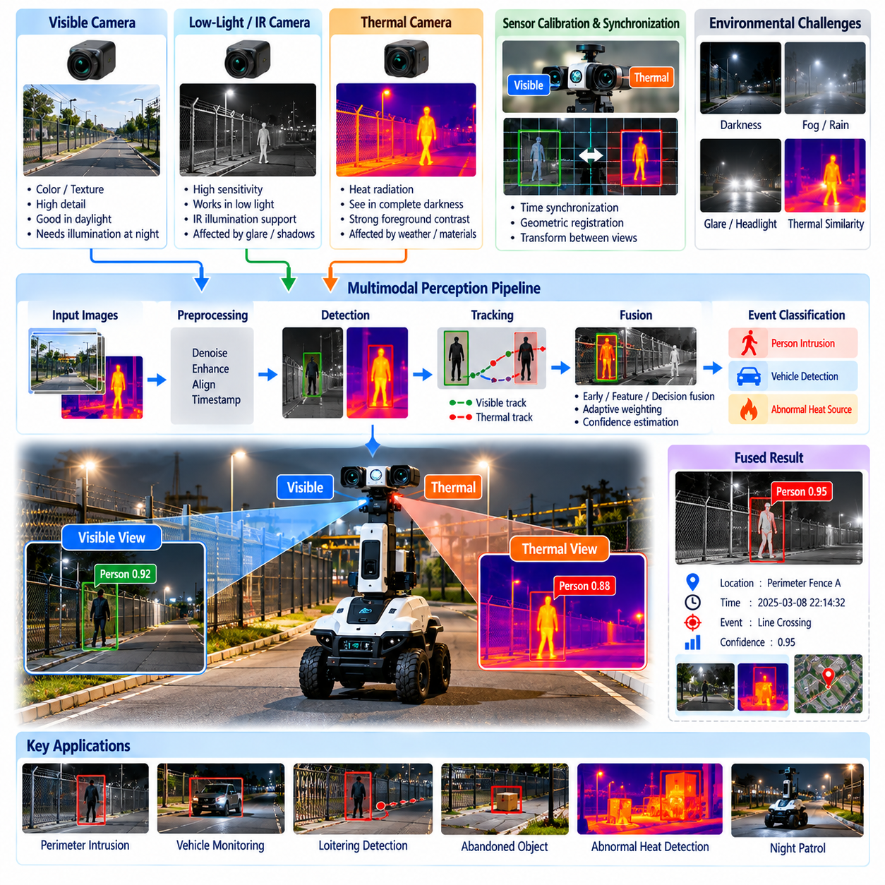{width="7.268055555555556in" height="7.268055555555556in"}

Night vision and thermal perception extend outdoor security robot operation beyond the limitations of ordinary visible-light cameras. Security patrols often continue through darkness, poorly illuminated areas, shadows, fog, or rapidly changing lighting conditions. A robust perception system therefore combines complementary sensing modalities so that people, vehicles, animals, equipment, and abnormal heat sources can remain observable when conventional RGB imagery becomes unreliable.

Visible-light cameras provide detailed appearance, color, texture, signage, and object information when sufficient illumination is available. At night, their performance depends heavily on ambient light, artificial lighting, exposure settings, and sensor sensitivity. Low-light cameras can improve sensitivity, while infrared illumination may provide additional visibility. However, headlights, reflections, deep shadows, glare, and sudden transitions between bright and dark regions can still reduce image quality and detection reliability.

Thermal cameras measure infrared radiation associated with surface temperature rather than relying on reflected visible light. Warm people, operating vehicles, electrical equipment, and other heat-producing objects may therefore remain detectable in darkness. Thermal imagery can provide strong foreground-background contrast under suitable conditions, making it particularly valuable for perimeter monitoring, nighttime patrol, and initial detection of targets that are difficult to recognize using visible imagery alone.

Thermal sensing is not equivalent to perfect night vision. Apparent temperature differences vary with weather, material properties, solar heating, wind, rain, and time of day. Warm pavement or machinery can create backgrounds with temperatures similar to a human body, while rain may reduce thermal contrast. Glass and other materials also interact differently with long-wave infrared radiation. The perception software must therefore treat thermal observations as another uncertain sensing modality rather than absolute evidence.

A multimodal security robot can operate visible and thermal cameras simultaneously and associate their observations in time. Accurate timestamps are necessary because the robot and targets may both be moving. When cameras have different positions, fields of view, resolutions, and frame rates, calibration is required to determine their geometric relationship. Synchronization and calibration allow observations from both sensors to describe the same physical target with sufficient consistency for downstream fusion.

Sensor registration maps corresponding information between visible and thermal images. Calibration estimates intrinsic parameters for each camera and the extrinsic transformation between them. With these parameters, detections or image coordinates from one modality can be projected toward the other, although differences in viewpoint and depth can introduce alignment errors. Registration quality should therefore be validated across the expected operating distance rather than only using nearby calibration targets.

Fusion can occur at several stages of the perception pipeline. Early fusion combines aligned sensor data before feature extraction, while feature-level fusion combines representations learned independently from visible and thermal inputs. Decision-level fusion allows separate detectors to generate candidate objects and then combines their outputs according to position, class, confidence, and time. Decision-level approaches can be practical because each sensing pipeline can continue operating when the other becomes degraded.

Adaptive fusion can change the contribution of each modality according to environmental conditions. During daylight, visible imagery may provide richer object appearance and identification information. In darkness, thermal sensing may receive greater weight for target detection. The system can estimate image brightness, contrast, sensor noise, thermal contrast, weather conditions, or detection consistency and use these indicators to adjust confidence instead of assuming that one fixed fusion policy is optimal throughout the entire patrol.

Object detection models used with thermal imagery must account for the different visual characteristics of infrared data. Models trained only on ordinary RGB datasets may not transfer directly because thermal images contain different textures, intensity distributions, and object boundaries. Thermal-specific or multimodal training data can improve performance. Dataset design should represent the target deployment environment, including different temperatures, seasons, distances, viewing angles, backgrounds, and human appearances.

Tracking provides an important connection between visible and thermal detections over time. Once a person or vehicle has been detected, a multi-object tracker can maintain an identity as sensor quality changes during robot movement. A target initially detected by the visible camera may later enter a dark area where thermal sensing becomes dominant. Cross-modal tracking can preserve continuity and prevent the same target from being incorrectly reported as multiple independent security events.

Thermal perception can support more than intrusion detection. Abnormal heat signatures may indicate overheating machinery, electrical faults, recently operated vehicles, hot surfaces, or other conditions relevant to industrial security and safety. The robot can associate thermal observations with patrol checkpoints and compare them with expected conditions. However, temperature interpretation requires suitable calibration and context because apparent thermal intensity does not automatically provide an accurate physical temperature measurement.

The robot can actively modify its observation behavior when multimodal perception produces an uncertain result. It may stop, rotate its sensor head, reduce vibration, approach within a permitted distance, or observe the target from another viewpoint. Additional visible and thermal frames can then be collected and evaluated. This active perception strategy is particularly useful at night because a target that is ambiguous from one viewpoint may become much easier to classify after the robot changes position.

Nighttime navigation and nighttime security perception should also be coordinated. A robot may navigate using LiDAR, radar, GNSS, inertial sensing, or other sensors that do not depend strongly on visible illumination while cameras perform security observation. Perception quality can nevertheless influence mission behavior. If visibility becomes severely degraded, the mission manager may reduce speed, increase observation time, modify checkpoint positions, or classify certain surveillance tasks as temporarily degraded.

Environmental monitoring can help the system interpret sensor reliability. Ambient temperature, humidity, precipitation, illumination level, lens contamination, and sensor temperature may influence image quality. A health-monitoring process can detect blocked lenses, excessive noise, loss of thermal calibration, frozen frames, or unavailable camera streams. The robot should report such degradation because continuing a patrol with failed perception may create the appearance of coverage without actually providing effective surveillance.

Event generation should preserve the contribution of each sensing modality. An intrusion report may include a visible image, thermal frame, object class, tracking identifier, confidence values from individual detectors, fused confidence, robot position, and event timestamp. Operators can then inspect both forms of evidence rather than receiving only the final AI decision. Maintaining modality-specific information also supports later diagnosis of false alarms and missed detections under difficult nighttime conditions.

Performance evaluation must reflect realistic night operation rather than relying only on daytime benchmarks. Tests should cover twilight, complete darkness, artificial lighting, headlights, shadows, warm backgrounds, cold weather, rain, fog, partial occlusion, and targets at different distances. Metrics can include detection precision, recall, false alarms per hour, detection range, tracking continuity, fusion improvement, inference latency, and performance degradation when one sensor becomes unavailable.

Night vision and thermal perception integration ultimately provides sensing redundancy and complementary environmental awareness for continuous outdoor security operation. Visible imagery contributes detailed appearance information, while thermal sensing provides an alternative observation channel when illumination is inadequate. Through synchronization, calibration, multimodal fusion, tracking, confidence management, active verification, and sensor health monitoring, the robot can maintain more reliable perception across the changing conditions encountered during 24/7 security patrols.

야간 투시(Night Vision) 및 열화상 인지(Thermal Perception)는 일반적인 가시광 카메라(Visible-Light Camera)의 한계를 넘어 실외 보안 로봇의 운용 범위를 확장한다. 보안 순찰은 어두운 환경, 조명이 부족한 구역, 그림자, 안개 또는 조명이 급격하게 변화하는 조건에서도 지속되는 경우가 많다. 따라서 강건한 인지 시스템(Robust Perception System)은 상호 보완적인 센싱 모달리티(Sensing Modality)를 결합하여 기존 RGB 영상의 신뢰성이 저하되는 상황에서도 사람, 차량, 동물, 장비 및 비정상적인 열원을 지속적으로 관측할 수 있어야 한다.

가시광 카메라(Visible-Light Camera)는 충분한 조명이 확보되었을 때 상세한 외형, 색상, 질감, 표지판 및 객체 정보를 제공한다. 야간에는 주변광(Ambient Light), 인공조명, 노출 설정 및 센서 감도에 따라 성능이 크게 달라진다. 저조도 카메라(Low-Light Camera)는 감도를 향상시킬 수 있으며, 적외선 조명(Infrared Illumination)을 이용하면 추가적인 가시성을 확보할 수 있다. 그러나 차량 전조등, 반사, 짙은 그림자, 눈부심 및 밝은 영역과 어두운 영역 사이의 급격한 전환은 여전히 영상 품질과 탐지 신뢰성을 저하시킬 수 있다.

열화상 카메라(Thermal Camera)는 반사된 가시광에 의존하는 대신 표면 온도와 관련된 적외선 복사(Infrared Radiation)를 측정한다. 따라서 따뜻한 사람, 운행 중인 차량, 전기 장비 및 기타 열을 발생시키는 객체는 어두운 환경에서도 탐지할 수 있다. 열화상 영상(Thermal Imagery)은 적절한 조건에서 전경과 배경 사이에 높은 대비를 제공할 수 있으므로 경계 감시, 야간 순찰 및 가시광 영상만으로 인식하기 어려운 대상을 초기 탐지하는 데 특히 유용하다.

열화상 센싱(Thermal Sensing)이 완벽한 야간 투시를 의미하는 것은 아니다. 겉보기 온도 차이(Apparent Temperature Difference)는 날씨, 재료 특성, 태양열 가열, 바람, 비 및 시간대에 따라 변화한다. 가열된 포장도로 또는 기계는 사람의 신체와 유사한 온도의 배경을 형성할 수 있으며, 비는 열적 대비(Thermal Contrast)를 감소시킬 수 있다. 유리와 기타 재료도 장파 적외선(Long-Wave Infrared Radiation)과 서로 다르게 상호작용한다. 따라서 인지 소프트웨어는 열화상 관측을 절대적인 증거가 아니라 또 하나의 불확실성을 가진 센싱 모달리티로 처리해야 한다.

다중 모달 보안 로봇(Multimodal Security Robot)은 가시광 카메라와 열화상 카메라를 동시에 운용하고 두 센서의 관측 결과를 시간적으로 연관시킬 수 있다. 로봇과 대상이 모두 움직일 수 있으므로 정확한 타임스탬프(Timestamp)가 필요하다. 카메라마다 위치, 시야각(Field of View), 해상도 및 프레임 속도가 서로 다른 경우 두 센서 사이의 기하학적 관계를 결정하기 위한 보정(Calibration)이 필요하다. 동기화(Synchronization)와 보정을 통해 두 센서의 관측 결과가 동일한 물리적 대상을 일관성 있게 표현하도록 할 수 있다.

센서 정합(Sensor Registration)은 가시광 영상과 열화상 영상 사이에서 서로 대응되는 정보를 매핑한다. 보정 과정에서는 각 카메라의 내부 파라미터(Intrinsic Parameter)와 두 카메라 사이의 외부 변환(Extrinsic Transformation)을 추정한다. 이러한 파라미터를 이용하면 한 모달리티에서 얻은 탐지 결과 또는 영상 좌표를 다른 모달리티로 투영할 수 있지만, 시점과 깊이의 차이로 인해 정렬 오차(Alignment Error)가 발생할 수 있다. 따라서 정합 품질은 가까운 보정 대상만을 이용하는 것이 아니라 실제 예상 운용 거리 전체에 걸쳐 검증해야 한다.

융합(Fusion)은 인지 파이프라인(Perception Pipeline)의 여러 단계에서 수행할 수 있다. 초기 융합(Early Fusion)은 특징 추출 전에 정렬된 센서 데이터를 결합하고, 특징 수준 융합(Feature-Level Fusion)은 가시광 및 열화상 입력에서 독립적으로 학습된 표현을 결합한다. 결정 수준 융합(Decision-Level Fusion)은 각각의 탐지기가 후보 객체를 생성한 후 위치, 클래스, 신뢰도 및 시간을 기준으로 결과를 결합한다. 결정 수준 방식은 한 센서의 성능이 저하되더라도 다른 센싱 파이프라인이 계속 동작할 수 있다는 점에서 실용적일 수 있다.

적응형 융합(Adaptive Fusion)은 환경 조건에 따라 각 모달리티의 기여도를 변경할 수 있다. 주간에는 가시광 영상이 더욱 풍부한 객체 외형과 식별 정보를 제공할 수 있다. 어두운 환경에서는 대상 탐지를 위해 열화상 센싱에 더 높은 가중치를 부여할 수 있다. 시스템은 영상 밝기, 대비, 센서 노이즈, 열적 대비, 기상 조건 또는 탐지 일관성을 추정하고 이러한 지표를 이용하여 신뢰도를 조정함으로써 하나의 고정된 융합 정책이 전체 순찰 과정에서 항상 최적이라고 가정하지 않도록 할 수 있다.

열화상 영상에 사용되는 객체 탐지 모델(Object Detection Model)은 적외선 데이터의 서로 다른 시각적 특성을 고려해야 한다. 일반적인 RGB 데이터셋만으로 학습된 모델은 열화상 영상의 질감, 밝기 분포 및 객체 경계가 다르기 때문에 직접적으로 적용되지 않을 수 있다. 열화상 특화 또는 다중 모달 학습 데이터(Thermal-Specific or Multimodal Training Data)를 사용하면 성능을 향상시킬 수 있다. 데이터셋은 다양한 온도, 계절, 거리, 관측 각도, 배경 및 사람의 외형을 포함하여 실제 배치 환경을 반영해야 한다.

추적(Tracking)은 시간에 따라 가시광 및 열화상 탐지를 연결하는 중요한 기능을 제공한다. 사람이나 차량이 탐지되면 다중 객체 추적기(Multi-Object Tracker)는 로봇 이동 과정에서 센서 품질이 변화하더라도 객체의 식별 정보를 유지할 수 있다. 처음에는 가시광 카메라로 탐지된 대상이 이후 어두운 영역으로 이동하면서 열화상 센싱이 주요 관측 수단이 될 수 있다. 교차 모달 추적(Cross-Modal Tracking)은 추적의 연속성을 유지하고 동일한 대상이 여러 개의 독립적인 보안 이벤트로 잘못 보고되는 것을 방지할 수 있다.

열화상 인지(Thermal Perception)는 침입 탐지 이외의 기능도 지원할 수 있다. 비정상적인 열 신호(Abnormal Heat Signature)는 과열된 기계, 전기적 고장, 최근 운행된 차량, 고온 표면 또는 산업 보안 및 안전과 관련된 다른 상태를 나타낼 수 있다. 로봇은 열화상 관측 결과를 순찰 체크포인트(Patrol Checkpoint)와 연결하고 예상 상태와 비교할 수 있다. 그러나 겉보기 열 강도(Apparent Thermal Intensity)가 자동으로 정확한 물리적 온도를 의미하는 것은 아니므로 온도 해석에는 적절한 보정과 상황 정보가 필요하다.

다중 모달 인지(Multimodal Perception) 결과가 불확실한 경우 로봇은 능동적으로 관측 행동을 변경할 수 있다. 로봇은 정지하거나 센서 헤드의 방향을 변경하고, 진동을 줄이거나, 허용된 거리까지 접근하거나, 다른 관측 위치에서 대상을 확인할 수 있다. 이후 추가적인 가시광 및 열화상 프레임을 수집하여 평가할 수 있다. 이러한 능동 인지 전략(Active Perception Strategy)은 하나의 시점에서는 모호했던 대상을 로봇의 위치 변경 이후 훨씬 쉽게 분류할 수 있다는 점에서 야간 환경에서 특히 유용하다.

야간 내비게이션(Nighttime Navigation)과 야간 보안 인지(Nighttime Security Perception)도 서로 연계되어야 한다. 로봇은 가시광 조명에 크게 의존하지 않는 라이다(LiDAR), 레이더(Radar), 위성항법시스템(GNSS), 관성 센싱(Inertial Sensing) 또는 기타 센서를 이용하여 이동하면서 카메라를 통해 보안 관측을 수행할 수 있다. 그러나 인지 품질은 임무 행동에 영향을 줄 수 있다. 가시성이 심각하게 저하되면 임무 관리자(Mission Manager)는 이동 속도를 낮추고, 관측 시간을 증가시키거나, 체크포인트 위치를 변경하거나, 특정 감시 작업을 일시적인 성능 저하 상태(Degraded State)로 분류할 수 있다.

환경 모니터링(Environmental Monitoring)은 시스템이 센서 신뢰성을 해석하는 데 도움을 줄 수 있다. 주변 온도, 습도, 강수량, 조도 수준, 렌즈 오염 및 센서 온도는 영상 품질에 영향을 줄 수 있다. 상태 모니터링 프로세스(Health-Monitoring Process)는 가려진 렌즈, 과도한 노이즈, 열화상 보정 손실, 정지된 프레임(Frozen Frame) 또는 사용할 수 없는 카메라 스트림을 탐지할 수 있다. 인지 기능이 고장난 상태에서 순찰을 계속하면 실제로 효과적인 감시가 이루어지지 않으면서 감시 범위가 유지되는 것처럼 보일 수 있으므로 로봇은 이러한 성능 저하를 보고해야 한다.

이벤트 생성(Event Generation) 과정에서는 각 센싱 모달리티의 기여 정보를 보존해야 한다. 침입 보고에는 가시광 이미지, 열화상 프레임, 객체 클래스, 추적 식별자, 개별 탐지기의 신뢰도, 융합 신뢰도(Fused Confidence), 로봇 위치 및 이벤트 타임스탬프가 포함될 수 있다. 이를 통해 운영자는 최종 인공지능 판단만 전달받는 것이 아니라 두 종류의 증거를 모두 확인할 수 있다. 모달리티별 정보를 유지하면 어려운 야간 조건에서 발생한 오경보(False Alarm)와 미탐(Missed Detection)의 원인을 이후 분석하는 데에도 도움이 된다.

성능 평가(Performance Evaluation)는 주간 벤치마크에만 의존하지 않고 실제적인 야간 운용 조건을 반영해야 한다. 시험에는 황혼, 완전한 어둠, 인공조명, 차량 전조등, 그림자, 따뜻한 배경, 추운 날씨, 비, 안개, 부분 가림 및 서로 다른 거리의 대상을 포함해야 한다. 평가 지표에는 탐지 정밀도(Precision), 재현율(Recall), 시간당 오경보 수, 탐지 거리(Detection Range), 추적 연속성(Tracking Continuity), 융합 성능 향상(Fusion Improvement), 추론 지연시간(Inference Latency) 및 하나의 센서를 사용할 수 없을 때 발생하는 성능 저하 등이 포함될 수 있다.

야간 투시 및 열화상 인지 통합(Night Vision and Thermal Perception Integration)은 궁극적으로 지속적인 실외 보안 운용을 위한 센싱 중복성(Sensing Redundancy)과 상호 보완적인 환경 인식(Complementary Environmental Awareness)을 제공한다. 가시광 영상은 상세한 외형 정보를 제공하고, 열화상 센싱은 조명이 부족할 때 대체 관측 채널을 제공한다. 동기화, 보정, 다중 모달 융합(Multimodal Fusion), 추적, 신뢰도 관리, 능동 검증(Active Verification) 및 센서 상태 모니터링을 결합하면 로봇은 24시간 연중무휴(24/7) 보안 순찰 과정에서 발생하는 다양한 환경 변화에서도 더욱 신뢰성 높은 인지 성능을 유지할 수 있다.

##  

## 04.06. Two Way Voice and Video Communication [w/Code]

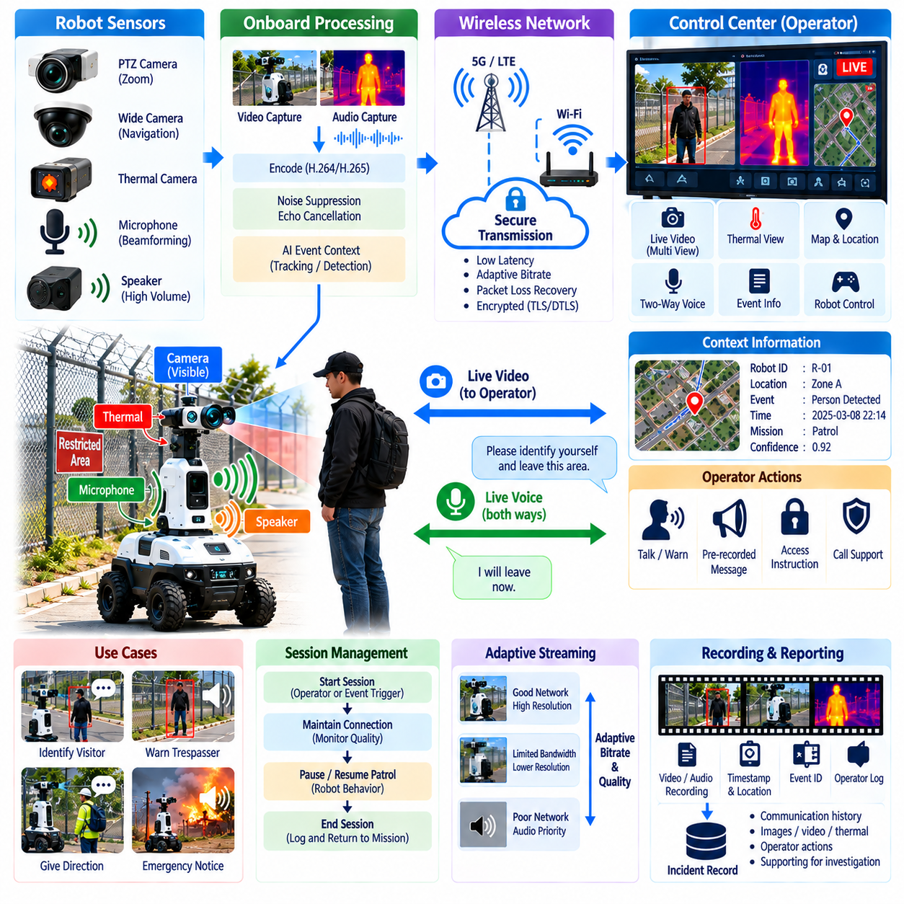{width="7.268055555555556in" height="7.268055555555556in"}

Two-way voice and video communication transforms an outdoor security robot from an autonomous sensing platform into a mobile communication endpoint between remote security personnel and people in the field. When the robot encounters a visitor, worker, suspicious individual, or emergency situation, an operator can establish real-time audio and visual communication without physically traveling to the location. This capability extends remote supervision into direct human interaction.

The communication architecture typically connects cameras, microphones, speakers, onboard computing, wireless networking, and a remote control center. Video captured by the robot is encoded and transmitted to an operator interface, while microphone signals provide environmental audio or speech. In the opposite direction, the operator's voice is transmitted to the robot and reproduced through onboard speakers, creating an interactive communication channel between the control room and the robot's physical location.

Audio communication must remain intelligible in challenging outdoor environments. Wind, vehicle engines, industrial machinery, rain, echoes, and robot drivetrain noise can significantly reduce speech quality. Signal-processing functions such as noise suppression, acoustic echo cancellation, automatic gain control, and microphone beamforming can improve intelligibility. Microphone and speaker placement should also minimize mechanical vibration and feedback generated by the robot itself.

Video communication provides the operator with situational awareness that voice alone cannot deliver. The video stream may include a wide-angle navigation camera, a pan-tilt-zoom security camera, thermal imagery, or other views available on the robot. Operators can use these streams to identify the person being addressed, inspect surrounding conditions, verify access credentials, observe gestures, or determine whether additional security personnel should be dispatched.

Interactive communication imposes stricter latency requirements than ordinary surveillance recording. Large delays make conversations unnatural and can cause operators and field personnel to speak over one another. The communication system should therefore control capture, encoding, transmission, decoding, and playback latency while maintaining acceptable media quality. Low-latency operation is especially important when the operator is giving safety instructions or responding to a rapidly developing incident.

Network conditions in outdoor facilities can vary considerably as the robot moves between buildings, yards, fences, parking areas, and remote sections of a site. Wi-Fi, private LTE or 5G, and other wireless networks may provide different levels of bandwidth and coverage. Communication software should monitor packet loss, delay, jitter, signal quality, and available throughput so that media transmission can adapt to changing connectivity without unnecessarily terminating the session.

Adaptive bitrate and resolution control can maintain communication when bandwidth decreases. Instead of attempting to transmit a high-resolution video stream until the connection fails, the system can reduce frame rate, image resolution, or encoding bitrate while preserving the audio channel. Because spoken instructions may remain operationally useful even when video quality becomes poor, the system can prioritize voice traffic and critical control messages over nonessential high-bandwidth data.

Session management controls how communication is established, maintained, and terminated. A remote operator may initiate a call to a selected robot, or the robot may request operator assistance after detecting an abnormal event. The software should maintain session identifiers, participant information, connection state, media status, and timestamps. Clear state management prevents multiple operators from unintentionally issuing conflicting voice commands or attempting to control the same communication channel.

Two-way communication should be integrated with the robot's autonomous mission logic. When an operator begins interacting with a person, the robot may pause its patrol, stop at a safe distance, orient its camera toward the target, and maintain a stable observation pose. After the communication session ends, the mission manager can resume the interrupted route, continue incident monitoring, or execute another command depending on the outcome of the interaction.

Remote operators may use the robot to deliver warnings, instructions, or access-related messages. For example, an operator can ask an unknown person to identify themselves, instruct someone to leave a restricted area, provide directions to an authorized visitor, or communicate emergency evacuation information. Pre-recorded or text-to-speech messages can supplement live voice communication when standardized announcements must be delivered consistently across repeated situations.

The communication interface should provide operators with sufficient context before they begin speaking. Robot identity, location, current mission, event category, live video, target tracking information, and recent alert history can be displayed together. This prevents the operator from entering a conversation without understanding why the robot initiated contact. Contextual information is particularly important when one control center supervises multiple robots distributed across a large industrial or logistics facility.

Video and audio recording can support incident investigation when permitted by operational policy and applicable privacy requirements. Communication records can be associated with the same event identifier used by the abnormal-event reporting system. Relevant timestamps, robot location, operator identity, session duration, and evidence references can then become part of the incident history. Recording policies should define when capture begins, how long information is retained, and who is authorized to access it.

Authentication and authorization are critical because the communication channel allows remote users to observe the environment and speak through a physical robot. Only approved operators should be able to initiate sessions, access camera streams, activate microphones, or use robot speakers. User identities, roles, permissions, and session actions should be logged. Strong access control reduces the risk that compromised accounts could transform a security robot into an unauthorized surveillance or communication device.

Media streams should also be protected while they travel across wireless and backend networks. Encryption can prevent unauthorized interception of video, audio, and session-control messages, while authenticated signaling helps ensure that commands originate from trusted systems. Communication services should be separated appropriately from safety-critical robot control so that failures or attacks affecting media functions do not directly compromise navigation, emergency stopping, or other essential safety mechanisms.

Failure handling is important because communication sessions may be interrupted by coverage loss, server faults, software errors, or robot movement. The system should detect broken media streams and inform the operator rather than silently presenting frozen video or missing audio. Automatic reconnection can be attempted within defined limits. If communication cannot be restored, the robot can preserve the incident state, continue local observation, and follow a predefined autonomous fallback policy.

Multiple robots introduce additional communication-management requirements. A control center may receive simultaneous requests from several robots while only a limited number of operators are available. Sessions can therefore be prioritized according to incident severity, location, waiting time, and security policy. High-risk events may preempt routine interactions, while lower-priority communication requests remain queued until an operator becomes available. This connects media communication with fleet-level resource management.

Performance evaluation should measure communication quality under realistic operating conditions. Important indicators include end-to-end audio and video latency, packet loss, connection setup time, reconnection time, audio intelligibility, video frame rate, bitrate adaptation behavior, session completion rate, and coverage-related failure frequency. Testing should include stationary and moving robots, network handovers, weak-signal regions, noisy environments, nighttime operation, and concurrent fleet communications.

Two-way voice and video communication ultimately provides the human interaction layer of the outdoor security robot system. Autonomous perception can detect and classify events, but many security situations require conversation, judgment, instruction, and negotiation by a human operator. By integrating low-latency media streaming, adaptive networking, session management, mission coordination, security controls, evidence recording, and failure recovery, the robot becomes a mobile extension of the remote security control center.

양방향 음성 및 영상 통신(Two-Way Voice and Video Communication)은 실외 보안 로봇(Outdoor Security Robot)을 자율 센싱 플랫폼(Autonomous Sensing Platform)에서 원격 보안 인력과 현장에 있는 사람을 연결하는 이동형 통신 단말(Mobile Communication Endpoint)로 확장한다. 로봇이 방문자, 작업자, 의심스러운 사람 또는 비상 상황을 마주하면 운영자는 해당 위치로 직접 이동하지 않고도 실시간 음성 및 영상 통신을 설정할 수 있다. 이러한 기능은 원격 감독(Remote Supervision)을 직접적인 인간 상호작용(Human Interaction)으로 확장한다.

통신 아키텍처(Communication Architecture)는 일반적으로 카메라, 마이크, 스피커, 온보드 컴퓨팅(Onboard Computing), 무선 네트워크 및 원격 관제 센터(Remote Control Center)를 연결한다. 로봇에서 촬영된 영상은 인코딩되어 운영자 인터페이스로 전송되며, 마이크 신호는 주변 환경의 소리 또는 음성을 제공한다. 반대 방향으로는 운영자의 음성이 로봇으로 전송되어 온보드 스피커를 통해 재생되며, 이를 통해 관제실과 로봇의 실제 위치 사이에 대화형 통신 채널(Interactive Communication Channel)이 형성된다.

음성 통신(Audio Communication)은 까다로운 실외 환경에서도 명확하게 이해할 수 있어야 한다. 바람, 차량 엔진, 산업용 기계, 비, 반향 및 로봇 구동계 소음은 음성 품질을 크게 저하시킬 수 있다. 잡음 억제(Noise Suppression), 음향 반향 제거(Acoustic Echo Cancellation), 자동 이득 제어(Automatic Gain Control) 및 마이크 빔포밍(Microphone Beamforming)과 같은 신호 처리 기능을 이용하면 음성 명료도를 향상시킬 수 있다. 마이크와 스피커의 배치 역시 로봇 자체에서 발생하는 기계적 진동과 피드백을 최소화하도록 설계해야 한다.

영상 통신(Video Communication)은 음성만으로 제공할 수 없는 상황 인식(Situational Awareness)을 운영자에게 제공한다. 영상 스트림에는 광각 내비게이션 카메라(Wide-Angle Navigation Camera), 팬-틸트-줌 보안 카메라(Pan-Tilt-Zoom Security Camera), 열화상 영상(Thermal Imagery) 또는 로봇에서 사용할 수 있는 기타 시점이 포함될 수 있다. 운영자는 이러한 영상 스트림을 이용하여 대화 상대를 식별하고, 주변 상황을 확인하며, 출입 자격을 검증하고, 몸짓을 관찰하거나 추가 보안 인력을 출동시켜야 하는지를 판단할 수 있다.

대화형 통신(Interactive Communication)은 일반적인 감시 영상 녹화보다 엄격한 지연시간(Latency) 요구사항을 가진다. 지연이 길어지면 대화가 자연스럽지 않게 되고 운영자와 현장 인력이 동시에 말하는 상황이 발생할 수 있다. 따라서 통신 시스템은 적절한 미디어 품질을 유지하면서 캡처, 인코딩, 전송, 디코딩 및 재생 과정의 지연시간을 제어해야 한다. 운영자가 안전 지침을 전달하거나 빠르게 전개되는 사고에 대응하는 경우에는 저지연 운용(Low-Latency Operation)이 특히 중요하다.

실외 시설의 네트워크 환경(Network Condition)은 로봇이 건물, 야드, 울타리, 주차 구역 및 현장의 원격 구역 사이를 이동하면서 크게 달라질 수 있다. 와이파이(Wi-Fi), 사설 LTE(Private LTE), 5G 및 기타 무선 네트워크는 서로 다른 대역폭과 통신 범위를 제공할 수 있다. 통신 소프트웨어는 패킷 손실(Packet Loss), 지연, 지터(Jitter), 신호 품질 및 사용 가능한 처리량(Throughput)을 모니터링하여 연결 상태가 변화하더라도 세션을 불필요하게 종료하지 않고 미디어 전송을 적응적으로 조정할 수 있어야 한다.

적응형 비트레이트 및 해상도 제어(Adaptive Bitrate and Resolution Control)를 사용하면 대역폭이 감소하더라도 통신을 유지할 수 있다. 연결이 끊어질 때까지 고해상도 영상 스트림을 계속 전송하는 대신 시스템은 음성 채널을 유지하면서 프레임 속도, 영상 해상도 또는 인코딩 비트레이트를 낮출 수 있다. 영상 품질이 저하된 상황에서도 음성 지시는 운용상 유용할 수 있으므로 시스템은 중요하지 않은 고대역폭 데이터보다 음성 트래픽과 핵심 제어 메시지를 우선적으로 처리할 수 있다.

세션 관리(Session Management)는 통신이 어떻게 설정되고 유지되며 종료되는지를 제어한다. 원격 운영자가 선택한 로봇에 통화를 시작할 수도 있고, 로봇이 비정상 이벤트를 탐지한 후 운영자 지원을 요청할 수도 있다. 소프트웨어는 세션 식별자(Session Identifier), 참여자 정보, 연결 상태, 미디어 상태 및 타임스탬프(Timestamp)를 관리해야 한다. 명확한 상태 관리를 통해 여러 운영자가 의도하지 않게 서로 충돌하는 음성 명령을 내리거나 동일한 통신 채널을 동시에 제어하려는 상황을 방지할 수 있다.

양방향 통신은 로봇의 자율 임무 로직(Autonomous Mission Logic)과 통합되어야 한다. 운영자가 사람과 상호작용을 시작하면 로봇은 순찰을 일시 중지하고 안전한 거리에 정지하며 카메라를 대상 방향으로 조정하고 안정적인 관측 자세(Observation Pose)를 유지할 수 있다. 통신 세션이 종료되면 임무 관리자(Mission Manager)는 상호작용 결과에 따라 중단된 경로를 재개하거나 사고 모니터링을 계속하거나 다른 명령을 실행할 수 있다.

원격 운영자는 로봇을 이용하여 경고, 지시 또는 출입 관련 메시지를 전달할 수 있다. 예를 들어 운영자는 신원이 확인되지 않은 사람에게 신원 확인을 요청하거나, 제한 구역을 떠나도록 지시하거나, 허가된 방문자에게 이동 방향을 안내하거나, 비상 대피 정보를 전달할 수 있다. 표준화된 안내를 반복적으로 일관되게 전달해야 하는 상황에서는 사전 녹음 메시지(Pre-Recorded Message) 또는 텍스트 음성 변환(Text-to-Speech) 기능을 실시간 음성 통신과 함께 사용할 수 있다.

통신 인터페이스(Communication Interface)는 운영자가 대화를 시작하기 전에 충분한 상황 정보(Context)를 제공해야 한다. 로봇 식별 정보, 위치, 현재 임무, 이벤트 범주, 실시간 영상, 대상 추적 정보 및 최근 경보 이력을 함께 표시할 수 있다. 이를 통해 운영자는 로봇이 왜 접촉을 시작했는지 이해하지 못한 상태에서 대화를 시작하는 상황을 방지할 수 있다. 하나의 관제 센터가 대규모 산업 또는 물류 시설에 분산된 여러 로봇을 감독하는 경우 이러한 상황 정보는 특히 중요하다.

운용 정책과 적용되는 개인정보 보호 요구사항이 허용하는 경우 영상 및 음성 녹화(Video and Audio Recording)는 사고 조사(Incident Investigation)를 지원할 수 있다. 통신 기록은 비정상 이벤트 보고 시스템에서 사용하는 동일한 이벤트 식별자와 연결할 수 있다. 관련 타임스탬프, 로봇 위치, 운영자 식별 정보, 세션 지속 시간 및 증거 참조 정보는 사고 이력(Incident History)의 일부로 저장될 수 있다. 녹화 정책은 기록이 언제 시작되는지, 정보를 얼마나 오래 보존하는지, 누가 해당 정보에 접근할 권한을 가지는지를 정의해야 한다.

통신 채널을 통해 원격 사용자가 주변 환경을 관찰하고 물리적인 로봇을 통해 음성을 전달할 수 있으므로 인증(Authentication)과 권한 부여(Authorization)는 매우 중요하다. 승인된 운영자만 세션을 시작하고 카메라 스트림에 접근하며 마이크를 활성화하거나 로봇 스피커를 사용할 수 있어야 한다. 사용자 신원, 역할, 권한 및 세션 동작을 기록해야 한다. 강력한 접근 제어(Access Control)는 탈취된 계정으로 인해 보안 로봇이 허가되지 않은 감시 또는 통신 장치로 악용될 위험을 줄인다.

미디어 스트림(Media Stream)은 무선 네트워크와 백엔드 네트워크(Backend Network)를 통과하는 동안에도 보호되어야 한다. 암호화(Encryption)를 이용하면 영상, 음성 및 세션 제어 메시지의 무단 도청을 방지할 수 있으며, 인증된 시그널링(Authenticated Signaling)을 통해 명령이 신뢰할 수 있는 시스템에서 전송되었는지를 확인할 수 있다. 미디어 기능의 장애나 공격이 내비게이션, 비상 정지 또는 기타 필수 안전 메커니즘에 직접적인 영향을 미치지 않도록 통신 서비스는 안전 필수 로봇 제어(Safety-Critical Robot Control)와 적절하게 분리되어야 한다.

통신 세션은 통신 범위 손실, 서버 장애, 소프트웨어 오류 또는 로봇 이동으로 인해 중단될 수 있으므로 장애 처리(Failure Handling)가 중요하다. 시스템은 미디어 스트림의 단절을 탐지하고 정지된 영상이나 누락된 음성을 그대로 표시하는 대신 운영자에게 장애 상태를 알려야 한다. 정의된 범위 내에서 자동 재연결(Automatic Reconnection)을 시도할 수 있다. 통신을 복구할 수 없는 경우 로봇은 사고 상태를 보존하고 로컬 관측을 계속하면서 사전에 정의된 자율 대체 정책(Autonomous Fallback Policy)을 수행할 수 있다.

다수의 로봇을 운용하는 환경에서는 추가적인 통신 관리 요구사항이 발생한다. 제한된 수의 운영자만 사용할 수 있는 상황에서 관제 센터는 여러 로봇으로부터 동시에 통신 요청을 받을 수 있다. 따라서 사고 심각도, 위치, 대기 시간 및 보안 정책에 따라 세션의 우선순위를 결정할 수 있다. 고위험 이벤트는 일반적인 상호작용보다 우선적으로 처리하고, 낮은 우선순위의 통신 요청은 운영자가 사용 가능해질 때까지 대기열(Queue)에 유지할 수 있다. 이를 통해 미디어 통신을 플릿 수준 자원 관리(Fleet-Level Resource Management)와 연결할 수 있다.

성능 평가(Performance Evaluation)는 실제 운용 조건에서 통신 품질을 측정해야 한다. 중요한 지표에는 종단 간 음성 및 영상 지연시간(End-to-End Audio and Video Latency), 패킷 손실, 연결 설정 시간, 재연결 시간, 음성 명료도(Audio Intelligibility), 영상 프레임 속도, 비트레이트 적응 동작, 세션 완료율 및 통신 범위와 관련된 장애 발생 빈도 등이 포함된다. 시험에는 정지 및 이동 중인 로봇, 네트워크 핸드오버(Network Handover), 약한 신호 구역, 소음이 심한 환경, 야간 운용 및 여러 로봇의 동시 통신 상황을 포함해야 한다.

양방향 음성 및 영상 통신은 궁극적으로 실외 보안 로봇 시스템의 인간 상호작용 계층(Human Interaction Layer)을 제공한다. 자율 인지(Autonomous Perception)는 이벤트를 탐지하고 분류할 수 있지만, 많은 보안 상황에서는 인간 운영자의 대화, 판단, 지시 및 협의가 필요하다. 저지연 미디어 스트리밍(Low-Latency Media Streaming), 적응형 네트워킹(Adaptive Networking), 세션 관리, 임무 조정(Mission Coordination), 보안 제어, 증거 기록 및 장애 복구를 통합함으로써 로봇은 원격 보안 관제 센터(Remote Security Control Center)의 이동형 확장 시스템으로 동작할 수 있다.

##  

## 04.07. Fleet Dispatch and Incident Response Integration [w/Code]

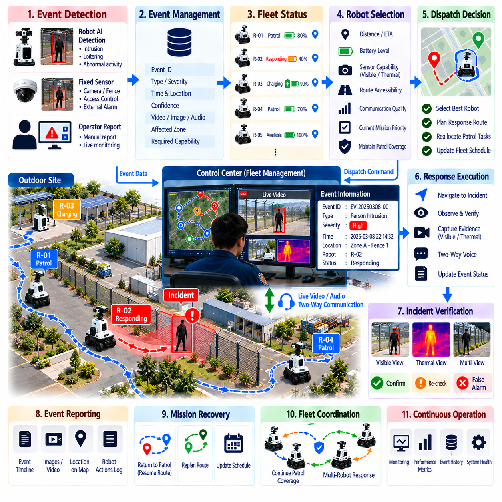{width="7.268055555555556in" height="7.268055555555556in"}

Fleet dispatch and incident response integration coordinates multiple outdoor security robots as a shared operational resource rather than treating each robot as an independent patrol unit. When an abnormal event occurs, the system determines which robot or combination of robots can respond effectively while maintaining essential patrol coverage. This coordination connects event management, fleet status, mission planning, communications, operator supervision, and security response into one operational process.

A fleet management system continuously maintains the operational state of every robot. Relevant information includes position, current mission, patrol route, battery level, charging status, sensor availability, communication quality, payload capability, health condition, and whether the robot is already responding to another incident. This shared state provides the information required to select an appropriate responder instead of simply dispatching the geographically closest robot.

Incident dispatch begins when an event is created by a robot, fixed security sensor, control-center operator, or external security platform. The event manager provides the fleet system with incident type, severity, location, timestamp, confidence, affected security zone, and required sensing capabilities. These attributes are converted into a response task that can be evaluated against the current availability and capabilities of the robot fleet.

Robot selection can be formulated as a task-allocation problem. Distance to the incident is important, but it is not the only criterion. Estimated travel time, remaining battery, route accessibility, sensor configuration, communication coverage, current mission priority, and future patrol obligations can also influence assignment. A thermal-camera-equipped robot, for example, may be preferred for a nighttime incident even when another robot is physically closer.

Dispatch decisions should consider the operational cost of removing a robot from its current patrol. Redirecting the only robot monitoring a high-priority perimeter may create a new security gap. The fleet manager can therefore compare incident urgency with patrol coverage requirements and determine whether another robot should respond, whether an existing patrol should be temporarily delayed, or whether multiple missions must be rescheduled to preserve minimum surveillance coverage.

Once a robot is assigned, its current mission can be interrupted through controlled mission preemption. The mission manager records the patrol state, checkpoint progress, and remaining route before switching to the incident-response task. This allows the robot to return to the interrupted patrol after the incident is resolved. Priority rules are necessary so that low-severity events do not repeatedly interrupt critical missions while high-severity incidents receive immediate attention.

Incident navigation differs from routine patrol because the robot may need to approach an uncertain or potentially dangerous situation. The response route should respect geofences, traffic restrictions, terrain limitations, and safe approach distances. Rather than navigating directly to the event coordinates, the robot can move to a predefined observation position that provides useful sensor coverage while maintaining physical separation from people, vehicles, hazardous equipment, or other risks.

After arriving, the robot can perform an incident verification procedure. Cameras may be oriented toward the target, thermal sensing activated, video streaming increased, or additional observations collected from different viewpoints. The robot can remain stationary to improve image stability or reposition when occlusion prevents confirmation. Verification results are sent to the event manager so that the original alert can be confirmed, downgraded, escalated, or classified as a false alarm.

Multiple robots can be dispatched when one viewpoint or sensor configuration is insufficient. One robot may maintain visual observation while another approaches from a different direction or provides thermal sensing. Coordinated positioning can reduce blind spots and improve target tracking across a large area. Multi-robot response should nevertheless avoid unnecessary congestion, conflicting paths, or excessive concentration of fleet resources around a single event.

Fleet-level tracking becomes useful when a person or vehicle moves beyond the observation range of the responding robot. The system can predict the target direction and transfer observation responsibility to another robot located near the expected path. Event identifiers and target information should remain consistent during this handoff so that the control center sees one continuing incident rather than a sequence of unrelated detections generated by different robots.

Human operators remain responsible for decisions that require security judgment or physical intervention. The fleet system can recommend a robot, calculate response routes, and automatically initiate predefined low-risk actions, but operators should be able to approve, modify, cancel, or escalate assignments according to operational policy. Live video, robot position, incident evidence, response status, and available fleet resources provide the context needed for effective supervision.

Integration with two-way communication allows a responding robot to become a mobile contact point at the incident location. A remote operator can observe the scene, speak to a person through the robot, issue warnings, request identification, or provide safety instructions. The outcome of the conversation can influence the incident state and subsequent fleet actions. The robot may continue observation, return to patrol, request another robot, or remain until human security personnel arrive.

The fleet system should also integrate with external incident-response resources when available. Security guards, fixed cameras, access-control systems, gates, alarms, or facility management platforms may contribute to the same response workflow. Robot-generated location and evidence can help human teams understand the situation before arrival, while external systems can provide access status or additional sensor information that changes the robot's response strategy.

Communication reliability is essential during fleet dispatch because assignment, navigation, video, and event updates depend on network connectivity. If a responding robot temporarily loses connection, it should not immediately abandon the incident or continue indefinitely without supervision. A predefined fallback policy can determine whether the robot holds position, returns to a safe point, continues local observation, or attempts to reconnect while preserving event data for later synchronization.

Incident resolution should trigger an orderly recovery of fleet operations. Once the event is closed, robots assigned to the response can return to their previous patrols, move to charging stations, or accept newly prioritized tasks. The fleet manager should reconsider coverage because the response may have delayed checkpoints or consumed significant battery capacity. Dynamic rescheduling restores the patrol plan while accounting for the operational effects of the completed incident.

Every dispatch and response action should be recorded for later analysis. The incident history can contain event creation time, dispatch decision, selected robot, estimated and actual arrival times, route changes, observations, operator actions, communication sessions, resolution status, and mission recovery. These records provide traceability and allow organizations to evaluate whether dispatch policies produce fast and effective responses without unnecessarily reducing routine security coverage.

Performance metrics should evaluate both response speed and overall fleet effectiveness. Useful measures include dispatch latency, travel time to incidents, verification time, total resolution time, percentage of incidents successfully reached, patrol coverage lost during response, battery consumed per incident, reassignment frequency, and robot utilization. Simulation and field tests can expose situations in which locally optimal dispatch decisions create poor fleet-wide security performance.

Fleet dispatch and incident response integration ultimately creates a closed operational loop from detection to coordinated action. An event is detected, classified, assigned, investigated, communicated, resolved, and incorporated back into fleet scheduling. By combining task allocation, mission preemption, safe navigation, multimodal verification, operator supervision, multi-robot coordination, and post-incident recovery, outdoor security robots can function as a coordinated security fleet rather than isolated autonomous machines.

플릿 배차 및 사고 대응 통합(Fleet Dispatch and Incident Response Integration)은 각각의 로봇을 독립적인 순찰 장치로 취급하는 대신 여러 실외 보안 로봇(Outdoor Security Robot)을 공동 운용 자원(Shared Operational Resource)으로 조정한다. 비정상 이벤트가 발생하면 시스템은 필수 순찰 범위를 유지하면서 어떤 로봇 또는 로봇 조합이 효과적으로 대응할 수 있는지를 결정한다. 이러한 조정은 이벤트 관리(Event Management), 플릿 상태, 임무 계획(Mission Planning), 통신, 운영자 감독 및 보안 대응을 하나의 운용 프로세스로 연결한다.

플릿 관리 시스템(Fleet Management System)은 모든 로봇의 운용 상태(Operational State)를 지속적으로 관리한다. 관련 정보에는 위치, 현재 임무, 순찰 경로, 배터리 잔량, 충전 상태, 센서 가용성, 통신 품질, 탑재 장비 능력(Payload Capability), 시스템 상태 및 다른 사고에 이미 대응하고 있는지 여부 등이 포함된다. 이러한 공유 상태(Shared State)는 단순히 지리적으로 가장 가까운 로봇을 선택하는 대신 적절한 대응 로봇을 선정하는 데 필요한 정보를 제공한다.

사고 배차(Incident Dispatch)는 로봇, 고정형 보안 센서, 관제 센터 운영자 또는 외부 보안 플랫폼에서 이벤트가 생성되면서 시작된다. 이벤트 관리자(Event Manager)는 사고 유형, 심각도, 위치, 타임스탬프(Timestamp), 신뢰도, 영향을 받는 보안 구역 및 필요한 센싱 기능을 플릿 시스템에 제공한다. 이러한 속성은 현재 로봇 플릿의 가용성과 기능을 기준으로 평가할 수 있는 대응 작업(Response Task)으로 변환된다.

로봇 선택(Robot Selection)은 작업 할당 문제(Task-Allocation Problem)로 정의할 수 있다. 사고 발생 위치까지의 거리는 중요하지만 유일한 기준은 아니다. 예상 이동 시간, 잔여 배터리, 경로 접근 가능성, 센서 구성, 통신 범위, 현재 임무 우선순위 및 향후 순찰 의무도 할당에 영향을 줄 수 있다. 예를 들어 열화상 카메라(Thermal Camera)를 장착한 로봇은 다른 로봇이 물리적으로 더 가까이 있더라도 야간 사고 대응에 우선적으로 선택될 수 있다.

배차 결정(Dispatch Decision)은 로봇을 현재 순찰에서 이탈시키는 데 따른 운용 비용(Operational Cost)도 고려해야 한다. 높은 우선순위의 경계를 감시하는 유일한 로봇을 다른 곳으로 이동시키면 새로운 보안 공백(Security Gap)이 발생할 수 있다. 따라서 플릿 관리자(Fleet Manager)는 사고의 긴급성과 순찰 범위 요구사항을 비교하여 다른 로봇을 대응시키거나, 기존 순찰을 일시적으로 지연시키거나, 최소 감시 범위를 유지하기 위해 여러 임무를 재조정해야 하는지를 결정할 수 있다.

로봇이 할당되면 제어된 임무 선점(Mission Preemption)을 통해 현재 임무를 중단할 수 있다. 임무 관리자(Mission Manager)는 사고 대응 작업으로 전환하기 전에 순찰 상태, 체크포인트 진행 상황 및 남은 경로를 기록한다. 이를 통해 사고가 해결된 이후 로봇이 중단되었던 순찰로 복귀할 수 있다. 낮은 심각도의 이벤트가 중요한 임무를 반복적으로 중단하지 않으면서 높은 심각도의 사고에는 즉시 대응할 수 있도록 우선순위 규칙(Priority Rule)이 필요하다.

사고 대응 내비게이션(Incident Navigation)은 로봇이 불확실하거나 잠재적으로 위험한 상황에 접근해야 할 수 있다는 점에서 일반적인 순찰과 다르다. 대응 경로는 지오펜스(Geofence), 교통 제한, 지형 제약 및 안전 접근 거리(Safe Approach Distance)를 준수해야 한다. 로봇은 이벤트 좌표로 직접 이동하는 대신 사람, 차량, 위험 장비 또는 기타 위험 요소와 물리적인 거리를 유지하면서 충분한 센서 관측 범위를 확보할 수 있는 사전에 정의된 관측 위치(Observation Position)로 이동할 수 있다.

현장에 도착한 로봇은 사고 검증 절차(Incident Verification Procedure)를 수행할 수 있다. 카메라를 대상 방향으로 조정하고, 열화상 센싱(Thermal Sensing)을 활성화하며, 영상 스트리밍을 강화하거나 서로 다른 시점에서 추가 관측 정보를 수집할 수 있다. 영상 안정성을 향상시키기 위해 정지 상태를 유지하거나 가림(Occlusion)으로 인해 확인이 어려운 경우 위치를 변경할 수 있다. 검증 결과는 이벤트 관리자에게 전달되어 최초 경보를 확인, 하향 조정, 상향 조정하거나 오경보(False Alarm)로 분류할 수 있다.

하나의 관측 시점이나 센서 구성만으로 충분하지 않은 경우 여러 로봇을 출동시킬 수 있다. 하나의 로봇이 시각적 관측(Visual Observation)을 유지하는 동안 다른 로봇은 다른 방향에서 접근하거나 열화상 센싱을 제공할 수 있다. 협력 위치 선정(Coordinated Positioning)을 통해 사각지대(Blind Spot)를 줄이고 넓은 구역에서 대상 추적 성능을 향상시킬 수 있다. 그러나 다중 로봇 대응(Multi-Robot Response)은 불필요한 혼잡, 경로 충돌 또는 하나의 이벤트에 과도한 플릿 자원이 집중되는 상황을 방지해야 한다.

플릿 수준 추적(Fleet-Level Tracking)은 사람이나 차량이 대응 로봇의 관측 범위를 벗어나는 경우 유용하다. 시스템은 대상의 이동 방향을 예측하고 예상 이동 경로 근처에 있는 다른 로봇으로 관측 책임을 전달할 수 있다. 이러한 핸드오프(Handoff) 과정에서도 이벤트 식별자와 대상 정보의 일관성을 유지해야 관제 센터에서 서로 다른 로봇이 생성한 여러 개의 독립적인 탐지 결과가 아니라 하나의 지속적인 사고(Continuing Incident)로 인식할 수 있다.

보안 판단(Security Judgment)이나 물리적인 개입이 필요한 결정에 대해서는 인간 운영자(Human Operator)가 계속 책임을 담당한다. 플릿 시스템은 대응 로봇을 추천하고 대응 경로를 계산하며 사전에 정의된 저위험 동작을 자동으로 시작할 수 있지만, 운영자는 운용 정책에 따라 할당을 승인, 수정, 취소 또는 상향 조정할 수 있어야 한다. 실시간 영상, 로봇 위치, 사고 증거, 대응 상태 및 사용 가능한 플릿 자원은 효과적인 감독에 필요한 상황 정보(Context)를 제공한다.

양방향 통신(Two-Way Communication)과 통합하면 대응 로봇을 사고 현장의 이동형 통신 지점(Mobile Contact Point)으로 활용할 수 있다. 원격 운영자는 현장을 관찰하고 로봇을 통해 사람과 대화하며 경고를 전달하고 신원 확인을 요청하거나 안전 지침을 제공할 수 있다. 대화 결과는 사고 상태와 이후 플릿 동작에 영향을 줄 수 있다. 로봇은 관측을 계속하거나 순찰로 복귀하거나 다른 로봇의 지원을 요청하거나 인간 보안 인력(Human Security Personnel)이 도착할 때까지 현장에 머무를 수 있다.

플릿 시스템은 가능한 경우 외부 사고 대응 자원(External Incident-Response Resource)과도 통합되어야 한다. 보안 요원, 고정형 카메라, 출입 통제 시스템(Access-Control System), 출입 게이트, 경보 장치 또는 시설 관리 플랫폼이 동일한 대응 워크플로에 참여할 수 있다. 로봇이 생성한 위치 및 증거 정보는 인간 대응팀이 현장에 도착하기 전에 상황을 파악하는 데 도움을 주며, 외부 시스템은 로봇의 대응 전략을 변경할 수 있는 출입 상태 또는 추가 센서 정보를 제공할 수 있다.

플릿 배차 과정에서는 할당, 내비게이션, 영상 및 이벤트 갱신이 네트워크 연결에 의존하기 때문에 통신 신뢰성(Communication Reliability)이 필수적이다. 대응 중인 로봇의 연결이 일시적으로 끊어진 경우 즉시 사고 대응을 포기하거나 감독 없이 무기한 동작해서는 안 된다. 사전에 정의된 대체 정책(Fallback Policy)에 따라 로봇이 현재 위치를 유지하거나 안전한 지점으로 복귀하거나 로컬 관측을 계속하거나 재연결을 시도하도록 결정할 수 있으며, 이벤트 데이터는 이후 동기화를 위해 보존해야 한다.

사고 해결(Incident Resolution)이 완료되면 플릿 운용을 체계적으로 복구해야 한다. 대응에 할당된 로봇은 이전 순찰로 복귀하거나 충전소로 이동하거나 새롭게 우선순위가 지정된 작업을 수행할 수 있다. 사고 대응으로 인해 체크포인트 방문이 지연되거나 상당한 배터리가 소모되었을 수 있으므로 플릿 관리자는 전체 감시 범위를 다시 평가해야 한다. 동적 재스케줄링(Dynamic Rescheduling)은 완료된 사고 대응이 운용에 미친 영향을 반영하면서 순찰 계획을 복구한다.

모든 배차 및 대응 동작은 이후 분석을 위해 기록되어야 한다. 사고 이력(Incident History)에는 이벤트 생성 시간, 배차 결정, 선택된 로봇, 예상 및 실제 도착 시간, 경로 변경, 관측 결과, 운영자 동작, 통신 세션, 해결 상태 및 임무 복구 과정이 포함될 수 있다. 이러한 기록은 추적 가능성(Traceability)을 제공하며, 조직이 배차 정책을 통해 일반적인 보안 감시 범위를 불필요하게 감소시키지 않으면서 신속하고 효과적인 대응을 수행하고 있는지를 평가할 수 있도록 한다.

성능 지표(Performance Metric)는 대응 속도뿐만 아니라 전체적인 플릿 효율성(Fleet Effectiveness)도 평가해야 한다. 유용한 지표에는 배차 지연시간(Dispatch Latency), 사고 현장까지의 이동 시간, 검증 시간, 전체 해결 시간, 사고 현장 도달 성공률, 대응 과정에서 손실된 순찰 범위, 사고당 배터리 소비량, 재할당 빈도 및 로봇 활용률(Robot Utilization)이 포함된다. 시뮬레이션과 현장 시험을 통해 개별적으로는 최적인 배차 결정이 플릿 전체의 보안 성능을 저하시킬 수 있는 상황을 확인할 수 있다.

플릿 배차 및 사고 대응 통합은 궁극적으로 탐지에서 협력 대응까지 연결되는 폐루프 운용 체계(Closed Operational Loop)를 구성한다. 이벤트는 탐지되고, 분류되고, 할당되고, 조사되고, 전달되고, 해결된 후 다시 플릿 스케줄링(Fleet Scheduling)에 반영된다. 작업 할당, 임무 선점, 안전 내비게이션(Safe Navigation), 다중 모달 검증(Multimodal Verification), 운영자 감독, 다중 로봇 조정(Multi-Robot Coordination) 및 사고 후 복구(Post-Incident Recovery)를 결합함으로써 실외 보안 로봇은 서로 분리된 자율 기계가 아니라 하나의 협력형 보안 플릿(Coordinated Security Fleet)으로 운용될 수 있다.

##  

## 04.08. Outdoor Robot Weather and Reliability Design

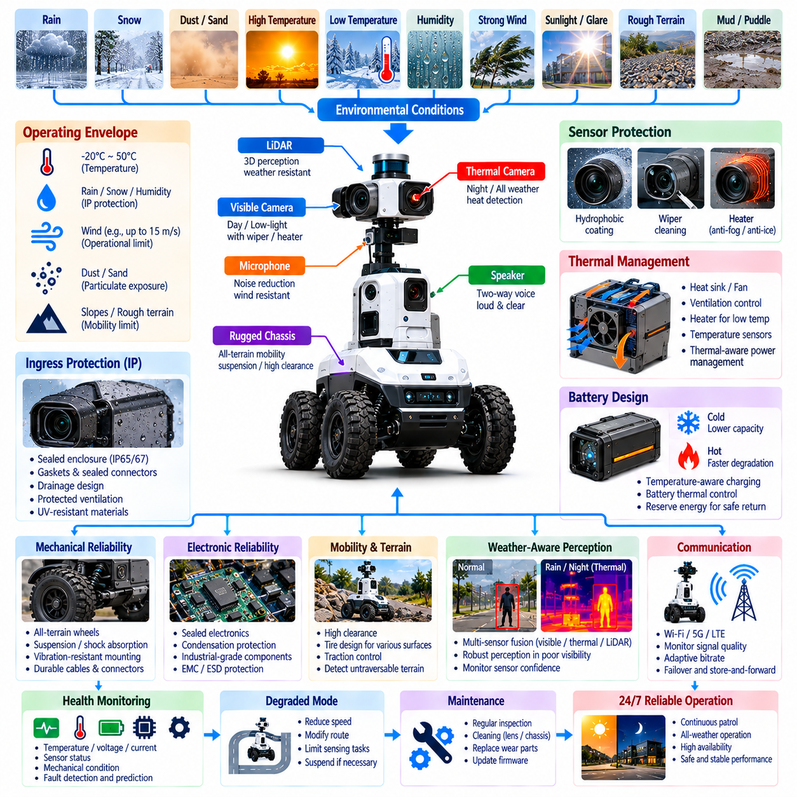{width="7.268055555555556in" height="7.268055555555556in"}

Outdoor security robots must operate reliably in environmental conditions that are substantially more variable than those encountered by indoor mobile robots. Rain, dust, wind, sunlight, temperature extremes, moisture, uneven terrain, and seasonal changes can simultaneously affect mechanical components, electronics, sensors, batteries, communications, and autonomous navigation. Weather and reliability design must therefore be treated as a system-level engineering requirement rather than an enclosure problem alone.

Environmental requirements should be defined from the intended operational site before hardware design is finalized. Expected minimum and maximum temperatures, rainfall intensity, humidity, dust exposure, wind conditions, solar radiation, puddle depth, surface contamination, and seasonal weather patterns establish the robot's operating envelope. Designers should also distinguish normal operating conditions from degraded conditions and environmental limits beyond which autonomous operation must be suspended.

Ingress protection is essential because water and particulate contamination can damage electronics, connectors, motors, sensors, and battery systems. Mechanical enclosures require appropriate sealing around panels, cable entries, joints, buttons, charging interfaces, and maintenance access points. Gaskets, sealed connectors, drainage paths, and protected ventilation can reduce ingress risk, but sealing strategies must also consider heat dissipation and pressure changes inside the enclosure.

Rain affects more than enclosure integrity because it can directly degrade perception. Water droplets on camera windows may distort images, while wet surfaces create reflections that challenge vision algorithms. LiDAR returns can be affected by airborne water, and heavy precipitation can reduce useful sensing range. Sensor covers may therefore use hydrophobic surfaces, protective hoods, heating, air flow, or cleaning mechanisms while perception software monitors whether environmental contamination is reducing sensor confidence.

Dust and debris create similar long-term reliability problems. Fine particles can accumulate on lenses, cooling surfaces, seals, mechanical joints, and charging contacts. Industrial yards may additionally expose robots to sand, metallic particles, mud, or material generated by vehicle traffic. Mechanical protection should be combined with inspection and cleaning procedures because even well-sealed equipment can gradually lose performance when contamination accumulates over extended 24/7 operation.

Temperature management influences almost every subsystem. High ambient temperatures and direct sunlight can increase internal enclosure temperature beyond electronic component limits, while low temperatures can reduce battery output and alter mechanical properties. Thermal design may combine passive conduction, heat sinks, controlled ventilation, fans, heaters, and temperature-aware power management. Temperature sensors should monitor critical components so that software can detect thermal stress before permanent damage occurs.

Battery behavior requires particular attention because available energy, charging efficiency, and allowable current vary with temperature. Cold conditions may reduce usable capacity and increase the energy required for propulsion, while excessive heat can accelerate degradation and trigger protection mechanisms. The mission manager should therefore interpret battery state together with temperature and expected travel requirements rather than relying only on a simple percentage indicator when deciding whether a patrol can safely continue.

Solar radiation can heat the enclosure and also create difficult optical conditions. Direct sunlight, glare, strong shadows, and rapid transitions between illuminated and shaded areas may reduce camera performance. Materials and coatings should tolerate ultraviolet exposure without excessive degradation, discoloration, or embrittlement. Perception systems can use exposure control, high-dynamic-range imaging, thermal sensing, and confidence monitoring to maintain useful observations across changing outdoor illumination.

Wind introduces both mechanical and sensing effects. Strong gusts can influence stability, especially for tall robots or platforms carrying elevated sensor masts, and may increase the load on actuators. Wind also creates vegetation motion, airborne debris, microphone noise, and rapidly changing environmental conditions that affect security perception. Operational limits should define wind conditions under which normal patrol is allowed and conditions requiring reduced speed, sheltered waiting, or mission suspension.

Mobility reliability depends strongly on terrain and surface conditions. Outdoor patrol routes may contain asphalt, concrete, gravel, slopes, expansion joints, drainage channels, small curbs, mud, leaves, snow, or standing water. Wheel size, tire design, suspension, ground clearance, traction, and drivetrain torque should reflect these conditions. Navigation software should recognize terrain that exceeds safe traversability limits rather than forcing the robot to follow a nominal route regardless of surface condition.

Mechanical reliability requires consideration of continuous vibration, shock, repeated acceleration, and long operating cycles. Bearings, gearboxes, wheels, suspension components, sensor mounts, and cable assemblies experience repeated loading during patrol. Fasteners can loosen and connectors can fatigue if mechanical design does not account for vibration. Reliability engineering should therefore include component derating, structural analysis, vibration-resistant mounting, cable strain relief, and inspection of predictable wear items.

Electronic reliability depends on more than protecting circuits from direct water exposure. Condensation can form when temperature changes cause moist air inside an enclosure to reach the dew point. Corrosion may then develop gradually on connectors and circuit assemblies even without visible water ingress. Moisture management, conformal protection where appropriate, corrosion-resistant materials, controlled ventilation, and environmental monitoring can reduce failures caused by long-term exposure.

Fault detection should be built into the robot rather than depending exclusively on periodic human inspection. Health monitoring can track motor current, wheel behavior, battery temperature, internal humidity, processor temperature, communication quality, sensor availability, storage status, and charging performance. Deviations from normal operating patterns can indicate degradation before complete failure. These observations can support preventive maintenance and reduce unexpected downtime during security operations.

Reliability design should also define how the robot behaves after faults occur. Failure of a noncritical sensor may permit continued operation in a degraded mode, while loss of localization, braking capability, critical perception, or battery safety may require an immediate safe stop. The system should distinguish recoverable faults from safety-critical failures and provide clear diagnostic information to the control center. Autonomous recovery must never conceal a persistent fault that requires maintenance.

Redundancy can improve availability when selected carefully. Multiple sensing modalities can preserve environmental awareness when one sensor becomes unreliable, while redundant communication paths can maintain contact during network degradation. However, duplicating every component increases cost, weight, power consumption, and complexity. Reliability engineering should identify functions whose failure would terminate the mission or create unacceptable risk and apply redundancy where it provides meaningful system-level benefit.

Charging infrastructure must be designed for the same outdoor reliability requirements as the robot. Charging contacts, docking markers, communication interfaces, and station electronics may be exposed to water, dust, temperature variation, and contamination. The robot should verify successful docking and charging rather than assuming that physical arrival at the station restored energy. Failed charging attempts should trigger retry, alternate-station selection, or operator notification before battery reserve becomes critical.

Maintenance planning connects reliability design with actual long-term availability. Components such as tires, seals, cleaning mechanisms, fans, batteries, and protective windows have different wear and replacement intervals. Maintenance software can use operating hours, traveled distance, charging cycles, fault history, and environmental exposure to schedule inspection. Condition-based maintenance can be more effective than waiting for failure, particularly when a security fleet is expected to provide continuous patrol coverage.

Environmental and reliability validation should reproduce realistic combinations of stress rather than testing each factor only in isolation. Temperature cycling, water exposure, dust, vibration, prolonged operation, charging cycles, sensor contamination, and degraded communication should be evaluated together with autonomous missions. Field testing across different seasons is also important because laboratory tests may not reproduce every interaction among weather, terrain, perception, mobility, and human operations.

Outdoor robot weather and reliability design ultimately determines whether autonomous security capability remains available when environmental conditions become difficult. A robot that performs well only in favorable weather cannot provide dependable 24/7 security coverage. By combining environmental protection, thermal management, robust mobility, sensor protection, health monitoring, fault handling, maintainability, redundancy, and realistic validation, the system can sustain safe and predictable operation throughout its intended service life.

실외 보안 로봇(Outdoor Security Robot)은 실내 이동 로봇(Indoor Mobile Robot)이 경험하는 환경보다 훨씬 더 변화가 심한 환경 조건에서도 신뢰성 있게 동작해야 한다. 비, 먼지, 바람, 햇빛, 극한 온도, 습기, 불규칙한 지형 및 계절 변화는 기계 부품, 전자 장치, 센서, 배터리, 통신 및 자율 내비게이션(Autonomous Navigation)에 동시에 영향을 줄 수 있다. 따라서 내후성 및 신뢰성 설계(Weather and Reliability Design)는 단순한 외함 문제만이 아니라 시스템 수준 엔지니어링 요구사항(System-Level Engineering Requirement)으로 다루어야 한다.

환경 요구사항(Environmental Requirement)은 하드웨어 설계를 확정하기 전에 실제 운용 현장을 기준으로 정의해야 한다. 예상되는 최저 및 최고 온도, 강우 강도, 습도, 먼지 노출, 바람 조건, 일사량(Solar Radiation), 물웅덩이 깊이, 노면 오염 및 계절별 기상 패턴을 이용하여 로봇의 운용 범위(Operating Envelope)를 설정한다. 또한 정상 운용 조건과 성능 저하 조건(Degraded Condition), 그리고 자율 운용을 중단해야 하는 환경 한계(Environmental Limit)를 구분해야 한다.

침투 보호(Ingress Protection)는 물과 미세 입자 오염이 전자 장치, 커넥터, 모터, 센서 및 배터리 시스템을 손상시킬 수 있기 때문에 필수적이다. 기계 외함(Mechanical Enclosure)은 패널, 케이블 인입부, 연결부, 버튼, 충전 인터페이스 및 유지보수 접근부 주변을 적절하게 밀봉해야 한다. 개스킷(Gasket), 밀폐형 커넥터(Sealed Connector), 배수 경로 및 보호된 환기 구조를 이용하여 침투 위험을 줄일 수 있지만, 밀봉 설계에서는 외함 내부의 열 방출과 압력 변화도 함께 고려해야 한다.

비는 외함의 방수 성능뿐만 아니라 인지(Perception) 성능에도 직접적인 영향을 준다. 카메라 창에 맺힌 물방울은 영상을 왜곡할 수 있으며, 젖은 표면에서 발생하는 반사는 비전 알고리즘(Vision Algorithm)의 성능을 저하시킬 수 있다. 공기 중의 물방울은 라이다(LiDAR) 반사 신호에 영향을 줄 수 있고 폭우는 유효 센싱 거리를 감소시킬 수 있다. 따라서 센서 커버에는 소수성 표면(Hydrophobic Surface), 보호 후드, 히터, 공기 흐름 또는 세척 장치를 적용할 수 있으며, 인지 소프트웨어는 환경 오염으로 센서 신뢰도가 감소하는지를 모니터링해야 한다.

먼지와 이물질(Dust and Debris)도 장기적인 신뢰성 문제를 발생시킨다. 미세 입자는 렌즈, 냉각 표면, 밀봉부, 기계 연결부 및 충전 접점에 축적될 수 있다. 산업용 야드에서는 차량 통행으로 인해 모래, 금속성 입자, 진흙 또는 기타 물질에 추가로 노출될 수 있다. 밀폐 성능이 우수한 장비도 장기간의 24시간 연중무휴(24/7) 운용 과정에서 오염이 누적되면 점진적으로 성능이 저하될 수 있으므로 기계적 보호와 함께 정기적인 검사 및 청소 절차를 적용해야 한다.

온도 관리(Temperature Management)는 거의 모든 하위 시스템에 영향을 준다. 높은 주변 온도와 직사광선은 외함 내부 온도를 전자 부품의 허용 범위 이상으로 상승시킬 수 있으며, 낮은 온도는 배터리 출력 감소와 기계적 특성 변화를 발생시킬 수 있다. 열 설계(Thermal Design)에는 수동 열전도, 방열판(Heat Sink), 제어형 환기, 팬, 히터 및 온도 인식 전력 관리(Temperature-Aware Power Management)를 결합할 수 있다. 온도 센서는 중요 부품을 모니터링하여 영구적인 손상이 발생하기 전에 소프트웨어가 열 스트레스(Thermal Stress)를 감지할 수 있도록 해야 한다.

배터리 동작(Battery Behavior)은 사용 가능한 에너지, 충전 효율 및 허용 전류가 온도에 따라 변화하기 때문에 특별한 고려가 필요하다. 저온 환경에서는 사용 가능한 용량이 감소하고 추진에 필요한 에너지가 증가할 수 있으며, 지나치게 높은 온도는 배터리 열화를 가속하고 보호 메커니즘을 작동시킬 수 있다. 따라서 임무 관리자(Mission Manager)는 순찰을 안전하게 계속할 수 있는지를 결정할 때 단순한 배터리 잔량 비율에만 의존하지 않고 배터리 상태를 온도 및 예상 이동 요구사항과 함께 해석해야 한다.

일사(Solar Radiation)는 외함을 가열하는 동시에 까다로운 광학 환경을 형성할 수 있다. 직사광선, 눈부심, 강한 그림자 및 밝은 영역과 그늘 사이의 급격한 변화는 카메라 성능을 저하시킬 수 있다. 재료와 코팅은 과도한 열화, 변색 또는 취성화(Embrittlement) 없이 자외선 노출(Ultraviolet Exposure)을 견딜 수 있어야 한다. 인지 시스템은 노출 제어(Exposure Control), 고동적 범위 영상(High-Dynamic-Range Imaging), 열화상 센싱(Thermal Sensing) 및 신뢰도 모니터링을 이용하여 변화하는 실외 조명에서도 유효한 관측 성능을 유지할 수 있다.

바람은 기계 시스템과 센싱 시스템 모두에 영향을 준다. 강한 돌풍은 특히 높이가 높은 로봇이나 높은 위치에 센서 마스트(Sensor Mast)를 장착한 플랫폼의 안정성에 영향을 줄 수 있으며 액추에이터(Actuator)의 부하를 증가시킬 수 있다. 또한 바람은 식생의 움직임, 공중 이물질, 마이크 잡음 및 보안 인지에 영향을 주는 급격한 환경 변화를 발생시킨다. 운용 한계(Operational Limit)를 정의하여 정상 순찰이 가능한 풍속 조건과 감속, 안전 구역 대기 또는 임무 중단이 필요한 조건을 구분해야 한다.

이동 신뢰성(Mobility Reliability)은 지형 및 노면 조건에 크게 영향을 받는다. 실외 순찰 경로에는 아스팔트, 콘크리트, 자갈, 경사면, 신축 이음부(Expansion Joint), 배수로, 작은 연석, 진흙, 낙엽, 눈 또는 고인 물 등이 존재할 수 있다. 휠 크기, 타이어 설계, 서스펜션(Suspension), 지상고(Ground Clearance), 견인력 및 구동계 토크는 이러한 조건을 고려하여 설계해야 한다. 내비게이션 소프트웨어는 노면 상태와 관계없이 명목상의 경로를 강제로 추종하는 대신 안전한 주행 가능성(Safe Traversability)의 한계를 초과하는 지형을 인식해야 한다.

기계적 신뢰성(Mechanical Reliability)을 확보하려면 지속적인 진동, 충격, 반복적인 가감속 및 장시간 운용 주기를 고려해야 한다. 베어링, 기어박스, 휠, 서스펜션 부품, 센서 마운트 및 케이블 조립체는 순찰 과정에서 반복적인 하중을 받는다. 기계 설계에서 진동을 충분히 고려하지 않으면 체결부가 느슨해지거나 커넥터에 피로가 발생할 수 있다. 따라서 신뢰성 엔지니어링(Reliability Engineering)에는 부품 디레이팅(Component Derating), 구조 해석, 내진동 장착, 케이블 변형 방지(Strain Relief) 및 예측 가능한 마모 부품의 검사가 포함되어야 한다.

전자 시스템 신뢰성(Electronic Reliability)은 회로를 직접적인 물 노출로부터 보호하는 것만으로 확보되지 않는다. 온도 변화로 인해 외함 내부의 습한 공기가 이슬점(Dew Point)에 도달하면 결로(Condensation)가 발생할 수 있다. 눈에 보이는 물의 침투가 없어도 커넥터와 회로 조립체에 점진적으로 부식(Corrosion)이 발생할 수 있다. 습기 관리, 필요한 경우의 컨포멀 보호(Conformal Protection), 내식성 재료, 제어형 환기 및 환경 모니터링을 이용하면 장기간 환경 노출로 발생하는 고장을 줄일 수 있다.

고장 탐지(Fault Detection)는 정기적인 인간의 점검에만 의존하지 않고 로봇 자체에 내장되어야 한다. 상태 모니터링(Health Monitoring)은 모터 전류, 휠 동작, 배터리 온도, 내부 습도, 프로세서 온도, 통신 품질, 센서 가용성, 저장장치 상태 및 충전 성능을 추적할 수 있다. 정상적인 운용 패턴에서 벗어나는 변화는 완전한 고장이 발생하기 전에 성능 저하를 나타낼 수 있다. 이러한 관측 정보를 활용하면 예방 정비(Preventive Maintenance)를 지원하고 보안 운용 과정에서 예상하지 못한 가동 중단(Downtime)을 줄일 수 있다.

신뢰성 설계는 고장이 발생한 이후 로봇이 어떻게 동작해야 하는지도 정의해야 한다. 중요도가 낮은 센서의 고장은 성능 저하 모드(Degraded Mode)에서 계속 운용할 수 있지만, 위치추정(Localization), 제동 기능, 핵심 인지 또는 배터리 안전 기능이 상실되면 즉각적인 안전 정지(Safe Stop)가 필요할 수 있다. 시스템은 복구 가능한 고장과 안전 필수 고장(Safety-Critical Failure)을 구분하고 관제 센터에 명확한 진단 정보를 제공해야 한다. 자율 복구(Autonomous Recovery)가 유지보수가 필요한 지속적인 고장을 숨겨서는 안 된다.

중복성(Redundancy)은 적절하게 선택하여 적용하면 가용성(Availability)을 향상시킬 수 있다. 여러 센싱 모달리티(Sensing Modality)를 사용하면 하나의 센서가 신뢰할 수 없는 상태가 되어도 환경 인식을 유지할 수 있으며, 중복 통신 경로(Redundant Communication Path)는 네트워크 성능이 저하될 때도 연결을 유지할 수 있다. 그러나 모든 부품을 중복하면 비용, 중량, 전력 소비 및 복잡성이 증가한다. 따라서 신뢰성 엔지니어링은 고장 시 임무를 중단시키거나 허용할 수 없는 위험을 발생시키는 기능을 식별하고 시스템 수준에서 실질적인 효과를 제공하는 부분에 중복성을 적용해야 한다.

충전 인프라(Charging Infrastructure)는 로봇과 동일한 수준의 실외 신뢰성 요구사항을 고려하여 설계해야 한다. 충전 접점, 도킹 마커(Docking Marker), 통신 인터페이스 및 충전소 전자 장치는 물, 먼지, 온도 변화 및 오염에 노출될 수 있다. 로봇은 충전소에 물리적으로 도착했다는 사실만으로 에너지가 복구되었다고 가정하지 않고 정상적인 도킹과 충전이 이루어졌는지를 확인해야 한다. 충전에 실패하면 배터리 예비 용량이 임계 수준에 도달하기 전에 재시도, 대체 충전소 선택 또는 운영자 알림을 수행해야 한다.

유지보수 계획(Maintenance Planning)은 신뢰성 설계를 실제 장기간 가용성과 연결한다. 타이어, 밀봉 부품, 세척 장치, 팬, 배터리 및 보호창과 같은 구성요소는 서로 다른 마모 및 교체 주기를 가진다. 유지보수 소프트웨어는 운용 시간, 이동 거리, 충전 주기, 고장 이력 및 환경 노출 정보를 이용하여 점검 일정을 설정할 수 있다. 특히 보안 플릿(Security Fleet)이 지속적인 순찰 범위를 제공해야 하는 경우 고장이 발생할 때까지 기다리는 것보다 상태 기반 유지보수(Condition-Based Maintenance)가 더욱 효과적일 수 있다.

환경 및 신뢰성 검증(Environmental and Reliability Validation)은 각각의 스트레스 요인을 개별적으로만 시험하는 대신 실제적인 스트레스 조합을 재현해야 한다. 온도 사이클링(Temperature Cycling), 물 노출, 먼지, 진동, 장시간 운용, 충전 사이클, 센서 오염 및 통신 성능 저하를 자율 임무와 함께 평가해야 한다. 또한 실험실 시험만으로는 날씨, 지형, 인지, 이동성 및 인간 운용 사이의 모든 상호작용을 재현하기 어려우므로 서로 다른 계절에 걸친 현장 시험(Field Testing)도 중요하다.

실외 로봇의 내후성 및 신뢰성 설계(Outdoor Robot Weather and Reliability Design)는 궁극적으로 환경 조건이 악화되었을 때도 자율 보안 기능을 지속적으로 사용할 수 있는지를 결정한다. 좋은 날씨에서만 정상적으로 동작하는 로봇은 신뢰할 수 있는 24시간 연중무휴 보안 범위(24/7 Security Coverage)를 제공할 수 없다. 환경 보호, 열 관리, 강건한 이동성(Robust Mobility), 센서 보호, 상태 모니터링, 고장 처리(Fault Handling), 유지보수성(Maintainability), 중복성 및 현실적인 검증을 결합함으로써 시스템은 의도된 전체 서비스 수명(Service Life) 동안 안전하고 예측 가능한 운용을 지속할 수 있다.

##  

## 04.09. Security Robot Data Privacy GDPR Compliance

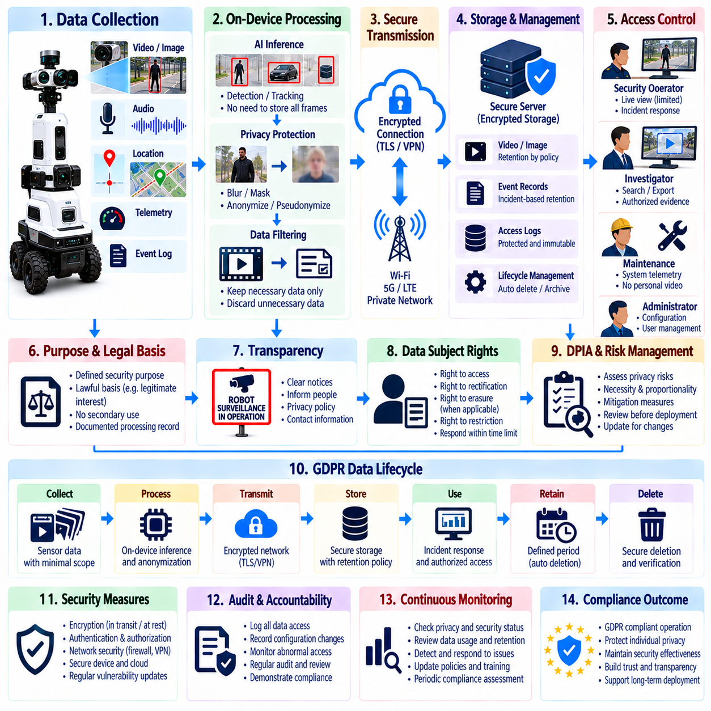{width="7.268055555555556in" height="7.268055555555556in"}

Outdoor security robots continuously observe physical environments and may collect video, images, audio, location information, timestamps, access events, and other data associated with identifiable people. Privacy must therefore be considered throughout system design rather than added after deployment. When robots operate where the General Data Protection Regulation applies, data processing should be designed around lawful purpose, transparency, proportionality, security, accountability, and protection of individual rights.

The first step is to understand what information the robot collects and why it is required. Navigation sensor data may contain little personal information, while security video can capture faces, clothing, vehicle registration information, behavior, and movement patterns. Microphones may record conversations, and event logs can connect observations with locations and times. A data inventory helps distinguish operational telemetry from personal data and supports appropriate controls for each category.

Purpose limitation requires collected information to be used for defined security objectives rather than unrestricted secondary purposes. Video gathered for perimeter intrusion detection, for example, should not automatically become a general employee-monitoring dataset. Each processing activity should have a documented purpose, responsible organization, expected data categories, processing location, retention period, recipients, and applicable legal basis. This creates a traceable relationship between robot functionality and data processing.

Data minimization reduces privacy risk by limiting collection to information that is necessary for the intended task. A robot performing autonomous navigation may not need to retain every camera frame, and routine patrol footage may not require long-term storage when no security event occurs. Sensor resolution, field of view, recording duration, sampling frequency, and retention policy can be configured according to operational need rather than maximizing data collection simply because storage is available.

Privacy by design integrates protection mechanisms into the architecture from the beginning. Processing can be performed locally on the robot when raw data does not need to leave the device. AI inference may convert camera frames into temporary object detections while discarding unnecessary imagery. Where appropriate, masking, blurring, cropping, pseudonymization, or extraction of non-identifying metadata can reduce exposure while still supporting security functions such as intrusion detection and patrol verification.

Privacy by default complements this approach by ensuring that the normal system configuration uses the least intrusive settings compatible with the security mission. Continuous audio recording, unrestricted remote camera access, excessive retention, or broad sharing should not automatically be enabled when they are unnecessary. More intrusive functions can require explicit authorization, defined operational conditions, or event-triggered activation so that exceptional capabilities do not become routine surveillance practices.

Transparency is especially important because a mobile robot can observe people from changing positions. Individuals should be able to understand that robotic surveillance is operating, the general purposes of processing, the responsible organization, and where additional privacy information can be obtained. Appropriate notices, signage, policies, and operator procedures can support this requirement. The visibility of the robot itself should not be treated as sufficient explanation of how collected data is processed.

A Data Protection Impact Assessment can be important when robotic surveillance is likely to create elevated privacy risks, particularly when systematic monitoring, new technologies, large areas, or vulnerable individuals are involved. The assessment identifies processing operations, necessity, proportionality, risks to individuals, and measures used to reduce those risks. Conducting this analysis before deployment can influence camera placement, recording policies, retention periods, access controls, and operational procedures.

Retention management determines how long security data remains available. Different information may require different lifetimes. Routine footage without an incident may be deleted quickly, while evidence associated with a confirmed security event may need longer retention according to organizational policy and legal requirements. Automated lifecycle rules can delete or archive information when retention periods expire, reducing dependence on manual cleanup and preventing indefinite accumulation of historical surveillance data.

Access control should follow the principle of least privilege. Robot operators may need live video for incident response but may not require unrestricted access to historical recordings. Investigators may need specific evidence, while maintenance personnel may require technical telemetry without personal video. Role-based permissions, strong authentication, session controls, and authorization checks can separate these responsibilities and reduce unnecessary exposure of sensitive information.

Audit logging supports accountability by recording who accessed data, what actions were performed, when access occurred, and which records were affected. Important actions can include viewing live streams, retrieving recordings, exporting evidence, changing retention settings, or modifying privacy configurations. Logs should themselves be protected against unauthorized modification. Regular review can reveal inappropriate access patterns and provide evidence that privacy and security procedures are being followed.

Encryption protects information both during transmission and while stored. Video, audio, incident reports, and robot telemetry may travel through wireless networks, edge servers, control centers, or cloud services. Secure communication protocols and authenticated endpoints reduce interception and manipulation risks. Stored information should also receive appropriate protection, while encryption keys and credentials require controlled lifecycle management so that encryption does not depend on poorly protected secrets.

Data integrity and availability are also important because privacy protection is part of broader information security. Altered evidence can lead to incorrect conclusions, while unavailable records can prevent investigation or fulfillment of legitimate data requests. Backup, integrity verification, secure timestamps, controlled replication, and recovery procedures should be designed according to the importance of the information. Security controls should protect confidentiality without making operationally necessary data unusable.

Data subject rights must be considered in the system architecture and organizational workflow. Depending on the applicable circumstances, individuals may have rights relating to access, correction, erasure, restriction, objection, or information about processing. Robotic video systems can make these requests technically difficult because identifying relevant footage may require location and time information. Data indexing and controlled retrieval mechanisms can help authorized privacy personnel respond without exposing unrelated individuals.

Third-party services require careful governance when robot data is processed outside the operating organization. Cloud storage, video analytics, fleet platforms, communications services, and maintenance providers may receive or process information generated by the robot. Responsibilities should be defined through appropriate agreements and technical controls. Organizations should understand where data is processed, who can access it, how long it is retained, and whether international transfers introduce additional requirements.

Security incidents involving personal data require preparation before they occur. Unauthorized access, stolen credentials, exposed storage, compromised robots, or accidental data sharing can create privacy breaches. Monitoring and incident-response procedures should identify affected systems and information, contain the exposure, preserve evidence, evaluate impact, and support required organizational or regulatory actions. Privacy breach response should therefore be integrated with the broader cybersecurity incident process.

AI-based security functions introduce additional governance concerns because automated models can produce false detections, biased outcomes, or uncertain classifications. A person should not be treated as a security threat merely because an algorithm generated a low-confidence result. Confidence management, human verification, documented escalation rules, and performance testing can reduce inappropriate decisions. Training and evaluation data should also be governed carefully when they contain images or other personal information.

Compliance must continue after deployment rather than being treated as a one-time certification activity. Software updates, new sensors, changed patrol routes, expanded camera coverage, additional AI functions, cloud migration, or new data-sharing relationships can alter privacy risk. Change management should therefore include privacy review, security assessment, configuration verification, and documentation updates whenever system capabilities or processing purposes materially change.

Security robot data privacy and GDPR compliance ultimately require coordination among robotics engineering, cybersecurity, security operations, privacy governance, and organizational policy. The objective is not to eliminate data collection that is necessary for legitimate security functions, but to ensure that collection and processing remain purposeful, proportionate, protected, transparent, and accountable. Integrating these principles into the robot lifecycle enables autonomous security operations while reducing unnecessary privacy risk.

실외 보안 로봇(Outdoor Security Robot)은 물리적 환경을 지속적으로 관찰하며 식별 가능한 개인과 관련된 비디오, 이미지, 오디오, 위치 정보, 타임스탬프(Timestamp), 출입 이벤트 및 기타 데이터를 수집할 수 있다. 따라서 개인정보 보호(Privacy)는 배치 이후에 추가하는 기능이 아니라 시스템 설계 전 과정에서 고려해야 한다. 일반개인정보보호규정(General Data Protection Regulation, GDPR)이 적용되는 환경에서 로봇을 운용하는 경우 데이터 처리는 적법한 목적, 투명성, 비례성, 보안, 책임성(Accountability) 및 개인의 권리 보호를 중심으로 설계해야 한다.

첫 번째 단계는 로봇이 어떤 정보를 수집하고 해당 정보가 왜 필요한지를 파악하는 것이다. 내비게이션 센서 데이터(Navigation Sensor Data)는 개인정보를 거의 포함하지 않을 수 있지만, 보안 영상은 얼굴, 복장, 차량 등록 정보, 행동 및 이동 패턴을 기록할 수 있다. 마이크는 대화를 녹음할 수 있으며 이벤트 로그(Event Log)는 관측 결과를 위치 및 시간과 연결할 수 있다. 데이터 목록(Data Inventory)을 작성하면 운용 텔레메트리(Operational Telemetry)와 개인정보(Personal Data)를 구분하고 각 데이터 범주에 적절한 통제를 적용할 수 있다.

목적 제한(Purpose Limitation)은 수집된 정보를 제한 없는 2차 목적으로 사용하는 것이 아니라 정의된 보안 목적을 위해 사용하도록 요구한다. 예를 들어 경계 침입 탐지(Perimeter Intrusion Detection)를 위해 수집한 영상을 일반적인 직원 감시 데이터셋으로 자동 전환해서는 안 된다. 각각의 처리 활동에는 문서화된 목적, 책임 조직, 예상 데이터 범주, 처리 위치, 보존 기간, 데이터 수신자 및 적용 가능한 법적 근거(Legal Basis)를 정의해야 한다. 이를 통해 로봇 기능과 데이터 처리 사이에 추적 가능한 관계를 형성할 수 있다.

데이터 최소화(Data Minimization)는 의도된 작업에 필요한 정보만 수집하도록 제한하여 개인정보 보호 위험을 감소시킨다. 자율 내비게이션(Autonomous Navigation)을 수행하는 로봇은 모든 카메라 프레임을 저장할 필요가 없을 수 있으며, 보안 이벤트가 발생하지 않은 일반 순찰 영상은 장기간 보관할 필요가 없을 수 있다. 센서 해상도, 시야각(Field of View), 녹화 시간, 샘플링 주기 및 보존 정책은 저장 공간이 있다는 이유만으로 데이터 수집을 최대화하는 것이 아니라 실제 운용 필요성에 따라 설정할 수 있다.

설계 단계부터의 개인정보 보호(Privacy by Design)는 시스템 아키텍처에 보호 메커니즘을 처음부터 통합한다. 원시 데이터(Raw Data)를 장치 외부로 전송할 필요가 없다면 로봇 내부에서 로컬 처리를 수행할 수 있다. 인공지능 추론(AI Inference)은 카메라 프레임을 일시적인 객체 탐지 결과로 변환한 후 불필요한 영상을 폐기할 수 있다. 필요한 경우 마스킹(Masking), 블러링(Blurring), 크로핑(Cropping), 가명처리(Pseudonymization) 또는 비식별 메타데이터(Non-Identifying Metadata) 추출을 적용하여 침입 탐지 및 순찰 검증 기능을 유지하면서 개인정보 노출을 줄일 수 있다.

기본 설정에 의한 개인정보 보호(Privacy by Default)는 일반적인 시스템 설정이 보안 임무에 필요한 범위에서 가장 덜 침해적인 설정을 사용하도록 함으로써 이러한 접근법을 보완한다. 불필요한 경우 지속적인 오디오 녹음, 제한 없는 원격 카메라 접근, 과도한 데이터 보존 또는 광범위한 데이터 공유를 자동으로 활성화해서는 안 된다. 침해 가능성이 높은 기능에는 명시적 승인, 정의된 운용 조건 또는 이벤트 기반 활성화(Event-Triggered Activation)를 적용하여 예외적인 기능이 일상적인 감시 방식으로 변하지 않도록 할 수 있다.

투명성(Transparency)은 이동형 로봇이 변화하는 위치에서 사람을 관찰할 수 있기 때문에 특히 중요하다. 개인은 로봇 감시가 수행되고 있다는 사실, 데이터 처리의 일반적인 목적, 책임 조직 및 추가적인 개인정보 보호 정보를 확인할 수 있는 방법을 이해할 수 있어야 한다. 적절한 안내문, 표지판, 정책 및 운영자 절차를 통해 이러한 요구사항을 지원할 수 있다. 로봇 자체가 눈에 보인다는 사실만으로 수집된 데이터가 어떻게 처리되는지를 충분히 설명했다고 간주해서는 안 된다.

데이터 보호 영향평가(Data Protection Impact Assessment, DPIA)는 로봇 감시가 높은 개인정보 보호 위험을 발생시킬 가능성이 있는 경우 중요할 수 있으며, 특히 체계적인 모니터링(Systematic Monitoring), 신기술, 넓은 구역 또는 취약한 개인이 관련되는 경우 더욱 중요하다. 영향평가는 처리 활동, 필요성, 비례성, 개인에게 발생할 수 있는 위험 및 위험 감소 조치를 식별한다. 배치 전에 이러한 분석을 수행하면 카메라 배치, 녹화 정책, 보존 기간, 접근 제어 및 운용 절차에 반영할 수 있다.

보존 관리(Retention Management)는 보안 데이터를 얼마나 오랫동안 사용할 수 있도록 유지할지를 결정한다. 서로 다른 정보에는 서로 다른 보존 기간이 필요할 수 있다. 사고가 없는 일반 영상은 빠르게 삭제할 수 있지만, 확인된 보안 이벤트와 관련된 증거는 조직 정책과 법적 요구사항에 따라 더 오랫동안 보존해야 할 수 있다. 자동화된 수명주기 규칙(Automated Lifecycle Rule)을 사용하여 보존 기간이 만료되면 정보를 삭제하거나 보관함으로써 수동 정리에 대한 의존도를 줄이고 과거 감시 데이터가 무기한 축적되는 것을 방지할 수 있다.

접근 제어(Access Control)는 최소 권한 원칙(Principle of Least Privilege)을 따라야 한다. 로봇 운영자는 사고 대응을 위해 실시간 영상이 필요할 수 있지만 과거 녹화 영상 전체에 제한 없이 접근할 필요는 없을 수 있다. 조사 담당자는 특정 증거가 필요할 수 있으며, 유지보수 담당자는 개인정보가 포함된 영상 없이 기술적 텔레메트리만 필요할 수 있다. 역할 기반 권한(Role-Based Permission), 강력한 인증, 세션 제어 및 권한 검사를 이용하여 이러한 책임을 분리하고 민감한 정보의 불필요한 노출을 줄일 수 있다.

감사 로깅(Audit Logging)은 누가 데이터에 접근했는지, 어떤 작업을 수행했는지, 언제 접근했는지, 어떤 기록이 영향을 받았는지를 기록함으로써 책임성(Accountability)을 지원한다. 주요 작업에는 실시간 스트림 조회, 녹화 데이터 검색, 증거 내보내기, 보존 설정 변경 또는 개인정보 보호 구성 변경 등이 포함될 수 있다. 로그 자체도 무단 변경으로부터 보호해야 한다. 정기적인 검토를 통해 부적절한 접근 패턴을 발견하고 개인정보 보호 및 보안 절차가 준수되고 있다는 증거를 확보할 수 있다.

암호화(Encryption)는 전송 중 데이터(Data in Transit)와 저장된 데이터(Data at Rest)를 모두 보호한다. 비디오, 오디오, 사고 보고서 및 로봇 텔레메트리는 무선 네트워크, 엣지 서버(Edge Server), 관제 센터 또는 클라우드 서비스를 통해 이동할 수 있다. 안전한 통신 프로토콜과 인증된 엔드포인트(Authenticated Endpoint)는 데이터 가로채기와 변조 위험을 줄인다. 저장된 정보에도 적절한 보호를 적용해야 하며, 암호화 키와 자격증명(Credential)은 취약하게 보호되는 비밀 정보에 암호화 보안이 의존하지 않도록 통제된 수명주기 관리가 필요하다.

데이터 무결성(Data Integrity)과 가용성(Availability)도 중요하다. 개인정보 보호는 더 광범위한 정보 보안(Information Security)의 일부이기 때문이다. 변조된 증거는 잘못된 판단으로 이어질 수 있으며, 사용할 수 없는 기록은 조사 또는 정당한 데이터 요청 처리를 방해할 수 있다. 백업, 무결성 검증(Integrity Verification), 안전한 타임스탬프, 통제된 복제(Controlled Replication) 및 복구 절차는 정보의 중요도에 따라 설계해야 한다. 보안 제어는 기밀성(Confidentiality)을 보호하면서도 운용상 필요한 데이터를 사용할 수 없게 만들어서는 안 된다.

정보주체 권리(Data Subject Rights)는 시스템 아키텍처와 조직의 업무 절차에서 고려해야 한다. 적용되는 상황에 따라 개인은 데이터 접근, 정정, 삭제, 처리 제한, 이의 제기 또는 데이터 처리에 관한 정보와 관련된 권리를 가질 수 있다. 로봇 영상 시스템에서는 관련 영상을 식별하기 위해 위치와 시간 정보가 필요할 수 있으므로 이러한 요청을 기술적으로 처리하기 어려울 수 있다. 데이터 인덱싱(Data Indexing)과 통제된 검색 메커니즘을 이용하면 승인된 개인정보 보호 담당자가 관련 없는 다른 개인의 정보를 노출하지 않으면서 요청을 처리하는 데 도움을 받을 수 있다.

로봇 데이터가 운용 조직 외부에서 처리되는 경우 제3자 서비스(Third-Party Service)에 대한 신중한 거버넌스(Governance)가 필요하다. 클라우드 저장소, 영상 분석, 플릿 플랫폼(Fleet Platform), 통신 서비스 및 유지보수 제공업체가 로봇에서 생성된 정보를 수신하거나 처리할 수 있다. 책임은 적절한 계약과 기술적 통제를 통해 정의해야 한다. 조직은 데이터가 어디에서 처리되는지, 누가 접근할 수 있는지, 얼마나 오래 보존되는지, 국제 데이터 이전(International Transfer)이 추가적인 요구사항을 발생시키는지를 파악해야 한다.

개인정보와 관련된 보안 사고(Security Incident)는 실제 발생하기 전에 대응 준비가 이루어져야 한다. 무단 접근, 탈취된 자격증명, 노출된 저장소, 침해된 로봇 또는 실수로 발생한 데이터 공유는 개인정보 침해(Privacy Breach)를 발생시킬 수 있다. 모니터링 및 사고 대응 절차는 영향을 받은 시스템과 정보를 식별하고, 노출을 차단하고, 증거를 보존하며, 영향을 평가하고, 필요한 조직적 또는 규제 대응을 지원해야 한다. 따라서 개인정보 침해 대응은 전체 사이버보안 사고 대응 프로세스(Cybersecurity Incident Process)와 통합되어야 한다.

인공지능 기반 보안 기능(AI-Based Security Function)은 자동화된 모델이 오탐(False Detection), 편향된 결과 또는 불확실한 분류를 생성할 수 있기 때문에 추가적인 거버넌스 문제를 발생시킨다. 알고리즘이 낮은 신뢰도의 결과를 생성했다는 이유만으로 사람을 보안 위협으로 취급해서는 안 된다. 신뢰도 관리(Confidence Management), 인간 검증(Human Verification), 문서화된 상향 조정 규칙(Escalation Rule) 및 성능 시험을 통해 부적절한 판단을 줄일 수 있다. 학습 및 평가 데이터에 이미지 또는 기타 개인정보가 포함되는 경우 해당 데이터 역시 신중하게 관리해야 한다.

규정 준수(Compliance)는 일회성 인증 활동으로 처리하는 것이 아니라 배치 이후에도 지속되어야 한다. 소프트웨어 업데이트, 새로운 센서, 변경된 순찰 경로, 확대된 카메라 감시 범위, 추가적인 인공지능 기능, 클라우드 마이그레이션(Cloud Migration) 또는 새로운 데이터 공유 관계는 개인정보 보호 위험을 변화시킬 수 있다. 따라서 시스템 기능 또는 처리 목적이 실질적으로 변경될 때마다 변경 관리(Change Management)에 개인정보 보호 검토, 보안 평가, 구성 검증 및 문서 갱신을 포함해야 한다.

보안 로봇 데이터 개인정보 보호 및 GDPR 규정 준수(Security Robot Data Privacy and GDPR Compliance)는 궁극적으로 로봇공학 엔지니어링(Robotics Engineering), 사이버보안(Cybersecurity), 보안 운용(Security Operations), 개인정보 보호 거버넌스(Privacy Governance) 및 조직 정책 사이의 협력을 요구한다. 목적은 정당한 보안 기능에 필요한 데이터 수집을 제거하는 것이 아니라 데이터 수집과 처리가 목적에 부합하고, 비례적이며, 보호되고, 투명하며, 책임성을 갖도록 보장하는 것이다. 이러한 원칙을 로봇 수명주기(Robot Lifecycle) 전체에 통합하면 불필요한 개인정보 보호 위험을 줄이면서 자율 보안 운용을 수행할 수 있다.

##  

## 04.10. Outdoor Security Robot 24/7 Operation Case

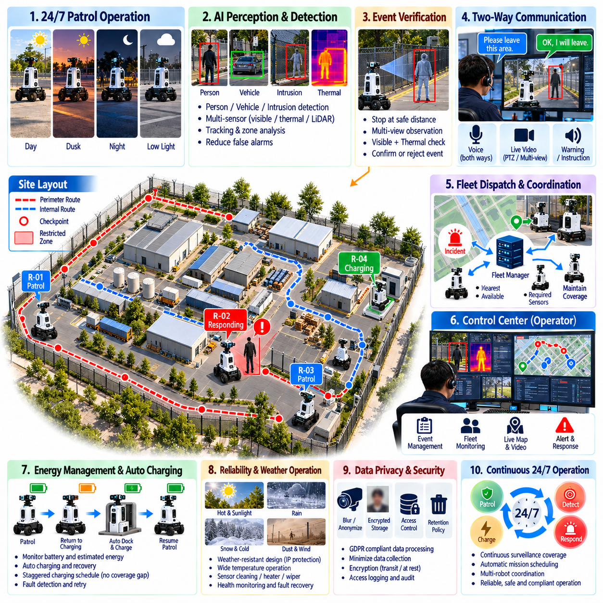{width="7.268055555555556in" height="7.268055555555556in"}

A 24/7 outdoor security robot deployment demonstrates how autonomous patrol, AI perception, communications, fleet management, charging, reliability engineering, and human supervision operate as one continuous security service. The objective is not simply to keep a robot moving throughout the day, but to maintain dependable surveillance coverage across changing shifts, weather, illumination, network conditions, battery states, and security events without creating unacceptable operational gaps.

A representative deployment can involve an industrial facility with perimeter fences, vehicle gates, warehouses, outdoor storage areas, parking zones, utility equipment, and restricted infrastructure. Patrol routes are divided into security zones and checkpoints according to risk and required inspection frequency. Higher-priority areas receive shorter revisit intervals, while lower-risk sections are scheduled less frequently so that available robot time is allocated according to operational importance.

Before each patrol cycle, the mission manager evaluates robot health, battery state, sensor availability, communication quality, localization confidence, and route conditions. A robot that does not satisfy minimum operational requirements should not begin an ordinary mission merely to preserve the schedule. Instead, the fleet system can assign another available robot, modify the route, or notify an operator that expected security coverage has been reduced.

During routine operation, the robot follows scheduled patrol routes while continuously performing navigation and security perception. Visible cameras, thermal sensors, and other available sensing systems observe fences, gates, roads, buildings, and equipment areas. The robot records checkpoint completion, relevant observations, system health, and mission progress while AI perception searches for people, vehicles, intrusions, abnormal activity, or other events defined by site security policy.

Daytime operation benefits from strong visible-light imagery but introduces challenges such as glare, shadows, vehicle traffic, workers, and changing site activity. Security logic must distinguish normal authorized movement from suspicious behavior so that routine operations do not produce excessive alarms. Context such as zone permissions, time schedules, movement direction, object tracking, and persistence can convert generic object detections into operationally meaningful security events.

At night, the sensing strategy changes as visible illumination decreases. Low-light cameras, infrared illumination, and thermal perception can maintain observation of people, vehicles, and selected equipment. The robot may reduce speed or increase observation time at important checkpoints when perception becomes more difficult. Multimodal sensing provides redundancy so that the loss of useful information from one camera does not automatically eliminate nighttime surveillance capability.

When the robot detects a possible perimeter intrusion, the event is not immediately treated as a confirmed security breach. Object detection, tracking, virtual-zone logic, temporal confirmation, and confidence evaluation are used to validate the observation. The robot can stop at a safe position and collect additional visible or thermal evidence. This active verification step reduces false alarms while providing the control center with better information for human assessment.

A confirmed or sufficiently high-confidence event enters the abnormal-event management workflow. The event record includes time, location, robot identity, event category, confidence, relevant images or video, and current mission context. The alert system assigns severity and notifies the appropriate operator. Repeated detections associated with the same tracked target are correlated into one continuing incident rather than generating a new independent alarm for every video frame.

The responding operator can establish two-way voice and video communication through the robot when interaction is appropriate. Live video provides situational awareness while the robot speaker allows the operator to issue warnings, request identification, provide instructions, or communicate safety information. The robot becomes a mobile presence at the incident location while the human operator retains responsibility for decisions requiring contextual judgment or escalation.

If additional observation is necessary, the fleet manager can dispatch another robot without losing awareness of existing patrol obligations. Robot selection considers distance, estimated arrival time, battery level, sensor capability, route accessibility, and current mission priority. A thermal-equipped robot may be selected for nighttime verification, while another robot can temporarily cover a patrol area left unattended by the responding unit. Fleet coordination therefore balances incident response with continued surveillance.

Energy management is fundamental to continuous operation because individual robots cannot patrol indefinitely. Battery state is monitored together with expected route energy, environmental conditions, and reserve requirements. Before energy reaches a critical level, the robot returns to a charging station and verifies successful docking and charging. Another robot can assume patrol responsibility during this period, allowing fleet-level security coverage to continue even though individual units alternate between operation and charging.

Charging schedules should avoid creating simultaneous coverage gaps. The fleet manager can stagger charging periods according to battery state, patrol demand, incident probability, and available charging stations. If a robot fails to dock or charging does not begin correctly, the system should detect the failure and attempt recovery before reserve energy becomes insufficient. Charging is therefore managed as part of mission scheduling rather than as an independent maintenance activity.

Weather conditions can change the operational strategy throughout the day. Rain may reduce camera and LiDAR performance, high temperatures may increase thermal load, cold weather may reduce battery capacity, and strong wind may affect stability or audio quality. Environmental measurements and sensor-health indicators allow the mission manager to reduce speed, increase safety margins, modify sensing behavior, reroute patrols, or suspend specific missions when operating conditions exceed defined limits.

Communication coverage also varies as robots move across large outdoor facilities. The system monitors bandwidth, latency, packet loss, and connection state while prioritizing critical alarms and control information. Temporary loss of central connectivity should not erase event information or leave the robot without defined behavior. Store-and-forward mechanisms preserve evidence locally, while fallback policies determine whether the robot continues observation, waits safely, returns, or attempts reconnection.

Continuous operation depends on predictive and preventive maintenance as much as autonomy. Motor current, battery temperature, wheel behavior, internal humidity, processor temperature, sensor availability, charging performance, and fault history can reveal gradual degradation. Maintenance can then be scheduled before complete failure occurs. A fleet with one robot temporarily unavailable for service should redistribute missions according to remaining capacity instead of allowing hidden coverage gaps.

Shift changes in the human security team should not interrupt robotic surveillance. Event state, active incidents, robots under manual supervision, degraded equipment, patrol exceptions, and unresolved maintenance conditions should remain available through the control system. Structured digital records reduce dependence on verbal handover and provide incoming operators with a consistent operational picture of what occurred during previous hours and what conditions still require attention.

Privacy and cybersecurity requirements remain active throughout continuous operation. Video and audio collection should follow defined purposes, retention rules, and access permissions, while communications and stored evidence require appropriate protection. Operator access, evidence retrieval, configuration changes, and incident actions should be logged. Continuous availability must not be achieved by weakening authentication, privacy safeguards, or security controls during unattended nighttime periods.

Operational performance should be evaluated over complete days and weeks rather than only during short demonstrations. Important indicators include patrol completion rate, checkpoint revisit compliance, security coverage, false alarms, missed events, incident response time, robot availability, charging success, communication interruptions, maintenance downtime, and operator intervention frequency. Long-duration measurements reveal recurring problems that may not appear during controlled acceptance tests.

The 24/7 operation case ultimately demonstrates that dependable robotic security is a system capability rather than the performance of a single autonomous machine. Continuous coverage emerges from coordinated patrol planning, AI perception, event verification, human supervision, fleet dispatch, charging, weather adaptation, communication recovery, maintenance, privacy, and cybersecurity. When these functions operate as one closed operational cycle, outdoor security robots can provide persistent and measurable support to human security teams across day and night operations.

24시간 연중무휴 실외 보안 로봇 운용(24/7 Outdoor Security Robot Operation)은 자율 순찰(Autonomous Patrol), 인공지능 인지(AI Perception), 통신, 플릿 관리(Fleet Management), 충전, 신뢰성 엔지니어링(Reliability Engineering) 및 인간 감독(Human Supervision)이 하나의 지속적인 보안 서비스로 동작하는 방식을 보여준다. 목표는 단순히 로봇을 하루 종일 움직이게 하는 것이 아니라 교대 근무, 날씨, 조명, 네트워크 상태, 배터리 상태 및 보안 이벤트가 변화하는 상황에서도 허용할 수 없는 운용 공백 없이 신뢰할 수 있는 감시 범위를 유지하는 것이다.

대표적인 배치 환경(Deployment Environment)으로는 경계 울타리, 차량 출입구, 창고, 실외 보관 구역, 주차 구역, 유틸리티 설비 및 제한 구역 인프라를 갖춘 산업 시설을 고려할 수 있다. 순찰 경로(Patrol Route)는 위험도와 필요한 점검 빈도에 따라 보안 구역(Security Zone)과 체크포인트(Checkpoint)로 구분된다. 우선순위가 높은 구역에는 짧은 재방문 간격(Revisit Interval)을 적용하고 위험도가 낮은 구역에는 상대적으로 낮은 순찰 빈도를 적용하여 가용한 로봇 운용 시간을 중요도에 따라 배분한다.

각 순찰 주기(Patrol Cycle)가 시작되기 전에 임무 관리자(Mission Manager)는 로봇 상태, 배터리 상태, 센서 가용성, 통신 품질, 위치추정 신뢰도(Localization Confidence) 및 경로 상태를 평가한다. 최소 운용 요구사항(Minimum Operational Requirement)을 충족하지 못하는 로봇은 단순히 일정을 유지하기 위해 일반적인 임무를 시작해서는 안 된다. 대신 플릿 시스템(Fleet System)은 사용 가능한 다른 로봇을 할당하거나 경로를 변경하거나 예상되는 보안 감시 범위가 감소했음을 운영자에게 알릴 수 있다.

일상적인 운용 과정에서 로봇은 예정된 순찰 경로를 따라 이동하면서 내비게이션과 보안 인지(Security Perception)를 지속적으로 수행한다. 가시광 카메라(Visible Camera), 열화상 센서(Thermal Sensor) 및 기타 사용 가능한 센싱 시스템은 울타리, 출입구, 도로, 건물 및 장비 구역을 관찰한다. 로봇은 체크포인트 완료 상태, 관련 관측 정보, 시스템 상태 및 임무 진행 상황을 기록하는 동시에 인공지능 인지 시스템을 이용하여 사람, 차량, 침입, 비정상 활동 또는 현장 보안 정책에서 정의한 기타 이벤트를 탐지한다.

주간 운용(Daytime Operation)에서는 양호한 가시광 영상을 확보할 수 있지만 눈부심, 그림자, 차량 통행, 작업자 및 변화하는 현장 활동과 같은 문제가 발생한다. 보안 로직(Security Logic)은 정상적으로 허가된 이동과 의심스러운 행동을 구분하여 일상적인 활동이 과도한 경보를 발생시키지 않도록 해야 한다. 구역별 권한, 시간 일정, 이동 방향, 객체 추적(Object Tracking) 및 지속성(Persistence)과 같은 상황 정보를 이용하면 일반적인 객체 탐지 결과를 운용적으로 의미 있는 보안 이벤트로 변환할 수 있다.

야간에는 가시광 조명이 감소함에 따라 센싱 전략(Sensing Strategy)이 변경된다. 저조도 카메라(Low-Light Camera), 적외선 조명(Infrared Illumination) 및 열화상 인지(Thermal Perception)를 이용하여 사람, 차량 및 특정 장비에 대한 관측을 유지할 수 있다. 인지가 어려워지는 경우 로봇은 중요한 체크포인트에서 이동 속도를 줄이거나 관측 시간을 증가시킬 수 있다. 다중 모달 센싱(Multimodal Sensing)은 하나의 카메라에서 유효한 정보가 손실되더라도 야간 감시 능력이 완전히 사라지지 않도록 중복성을 제공한다.

로봇이 잠재적인 경계 침입(Perimeter Intrusion)을 탐지하더라도 해당 이벤트를 즉시 확인된 보안 침해(Security Breach)로 처리하지 않는다. 객체 탐지, 추적, 가상 구역 로직(Virtual-Zone Logic), 시간적 확인(Temporal Confirmation) 및 신뢰도 평가를 이용하여 관측 결과를 검증한다. 로봇은 안전한 위치에서 정지하고 추가적인 가시광 또는 열화상 증거를 수집할 수 있다. 이러한 능동 검증(Active Verification) 단계는 오경보(False Alarm)를 감소시키면서 관제 센터에 인간 판단을 위한 더욱 정확한 정보를 제공한다.

확인되었거나 충분히 높은 신뢰도를 가진 이벤트는 비정상 이벤트 관리 워크플로(Abnormal-Event Management Workflow)로 전달된다. 이벤트 기록(Event Record)에는 시간, 위치, 로봇 식별 정보, 이벤트 범주, 신뢰도, 관련 이미지 또는 영상 및 현재 임무 상황이 포함된다. 경보 시스템(Alert System)은 심각도를 지정하고 적절한 운영자에게 알림을 전달한다. 동일한 추적 대상과 관련된 반복 탐지는 각각의 영상 프레임마다 새로운 독립 경보를 생성하는 대신 하나의 지속적인 사고(Continuing Incident)로 연계된다.

대응 운영자(Responding Operator)는 상호작용이 필요한 경우 로봇을 통해 양방향 음성 및 영상 통신(Two-Way Voice and Video Communication)을 설정할 수 있다. 실시간 영상(Live Video)은 상황 인식(Situational Awareness)을 제공하고 로봇 스피커를 통해 운영자가 경고를 전달하거나 신원 확인을 요청하거나 지시 또는 안전 정보를 제공할 수 있다. 로봇은 사고 현장에서 이동형 존재(Mobile Presence)의 역할을 수행하지만 상황적 판단이나 상향 대응(Escalation)이 필요한 결정에 대한 책임은 인간 운영자가 유지한다.

추가적인 관측이 필요한 경우 플릿 관리자(Fleet Manager)는 기존 순찰 의무에 대한 인식을 유지하면서 다른 로봇을 배차할 수 있다. 로봇 선택은 거리, 예상 도착 시간, 배터리 수준, 센서 기능, 경로 접근 가능성 및 현재 임무 우선순위를 고려한다. 야간 검증에는 열화상 장비를 갖춘 로봇을 선택할 수 있으며, 다른 로봇은 대응 로봇이 비운 순찰 구역을 일시적으로 담당할 수 있다. 따라서 플릿 협조(Fleet Coordination)는 사고 대응과 지속적인 감시 사이의 균형을 유지한다.

개별 로봇은 무한정 순찰할 수 없기 때문에 에너지 관리(Energy Management)는 지속적인 운용에 필수적이다. 배터리 상태는 예상 경로 에너지, 환경 조건 및 예비 에너지 요구사항과 함께 모니터링된다. 에너지가 임계 수준에 도달하기 전에 로봇은 충전소(Charging Station)로 복귀하여 정상적인 도킹(Docking)과 충전이 이루어졌는지를 확인한다. 이 기간에는 다른 로봇이 순찰 책임을 인계함으로써 개별 로봇이 운용과 충전을 교대로 수행하더라도 플릿 수준의 보안 감시 범위를 지속할 수 있다.

충전 일정(Charging Schedule)은 여러 로봇의 동시 충전으로 감시 공백이 발생하지 않도록 구성해야 한다. 플릿 관리자는 배터리 상태, 순찰 요구량, 사고 발생 가능성 및 사용 가능한 충전소를 고려하여 충전 시간을 분산할 수 있다. 로봇의 도킹에 실패하거나 충전이 정상적으로 시작되지 않으면 시스템은 예비 에너지가 부족해지기 전에 문제를 탐지하고 복구를 시도해야 한다. 따라서 충전은 독립적인 유지보수 활동이 아니라 임무 스케줄링(Mission Scheduling)의 일부로 관리된다.

기상 조건(Weather Condition)은 하루 동안 운용 전략을 변화시킬 수 있다. 비는 카메라와 라이다(LiDAR)의 성능을 저하시킬 수 있고, 높은 온도는 열 부하(Thermal Load)를 증가시키며, 추운 날씨는 배터리 용량을 감소시키고, 강한 바람은 안정성 또는 오디오 품질에 영향을 줄 수 있다. 환경 측정값과 센서 상태 지표(Sensor-Health Indicator)를 이용하여 운용 조건이 정의된 한계를 초과하는 경우 임무 관리자는 속도를 줄이고, 안전 여유(Safety Margin)를 확대하고, 센싱 동작을 변경하고, 순찰 경로를 재설정하거나 특정 임무를 중단할 수 있다.

로봇이 넓은 실외 시설을 이동함에 따라 통신 범위(Communication Coverage)도 변화한다. 시스템은 대역폭(Bandwidth), 지연시간(Latency), 패킷 손실(Packet Loss) 및 연결 상태를 모니터링하면서 중요한 경보와 제어 정보를 우선적으로 처리한다. 중앙 시스템과의 연결이 일시적으로 끊어지더라도 이벤트 정보가 손실되거나 로봇의 동작이 정의되지 않은 상태가 되어서는 안 된다. 저장 후 전달 메커니즘(Store-and-Forward Mechanism)은 증거를 로컬에 보존하고, 대체 정책(Fallback Policy)은 로봇이 관측을 계속할지, 안전하게 대기할지, 복귀할지 또는 재연결을 시도할지를 결정한다.

지속적인 운용(Continuous Operation)은 자율성뿐만 아니라 예측 및 예방 정비(Predictive and Preventive Maintenance)에 크게 의존한다. 모터 전류, 배터리 온도, 휠 동작, 내부 습도, 프로세서 온도, 센서 가용성, 충전 성능 및 고장 이력은 점진적인 성능 저하를 나타낼 수 있다. 이를 통해 완전한 고장이 발생하기 전에 유지보수를 계획할 수 있다. 하나의 로봇이 일시적으로 정비를 위해 운용에서 제외되는 경우 플릿은 감시 공백을 방치하는 대신 남아 있는 운용 용량에 따라 임무를 재분배해야 한다.

인간 보안팀(Human Security Team)의 교대 근무가 변경되더라도 로봇 감시는 중단되어서는 안 된다. 이벤트 상태, 진행 중인 사고, 수동 감독 상태의 로봇, 성능이 저하된 장비, 순찰 예외 사항 및 해결되지 않은 유지보수 상태는 관제 시스템(Control System)을 통해 계속 확인할 수 있어야 한다. 구조화된 디지털 기록(Structured Digital Record)은 구두 인계에 대한 의존도를 줄이고 새로 근무를 시작하는 운영자에게 이전 시간 동안 발생한 상황과 지속적인 주의가 필요한 조건에 대한 일관된 운용 상황(Operational Picture)을 제공한다.

개인정보 보호(Privacy)와 사이버보안(Cybersecurity) 요구사항은 지속적인 운용 과정에서도 계속 적용된다. 비디오와 오디오 수집은 정의된 목적, 보존 규칙 및 접근 권한을 따라야 하며 통신과 저장된 증거에는 적절한 보호 조치를 적용해야 한다. 운영자 접근, 증거 검색, 구성 변경 및 사고 대응 동작은 기록되어야 한다. 지속적인 가용성(Continuous Availability)을 확보한다는 이유로 무인 야간 운용 시간에 인증, 개인정보 보호 조치 또는 보안 통제를 약화시켜서는 안 된다.

운용 성능(Operational Performance)은 짧은 시연만을 기준으로 평가하는 것이 아니라 전체 일간 및 주간 운용을 대상으로 평가해야 한다. 주요 지표에는 순찰 완료율(Patrol Completion Rate), 체크포인트 재방문 준수율, 보안 감시 범위, 오경보, 미탐지 이벤트(Missed Event), 사고 대응 시간, 로봇 가용성, 충전 성공률, 통신 중단, 유지보수 가동 중단 시간(Maintenance Downtime) 및 운영자 개입 빈도(Operator Intervention Frequency)가 포함된다. 장기간 측정(Long-Duration Measurement)을 통해 통제된 인수 시험(Acceptance Test)에서는 나타나지 않을 수 있는 반복적인 문제를 확인할 수 있다.

24시간 연중무휴 운용 사례(24/7 Operation Case)는 궁극적으로 신뢰할 수 있는 로봇 보안이 단일 자율 기계의 성능이 아니라 시스템 수준의 능력(System Capability)임을 보여준다. 지속적인 감시 범위는 협조된 순찰 계획, 인공지능 인지, 이벤트 검증, 인간 감독, 플릿 배차, 충전, 기상 적응(Weather Adaptation), 통신 복구, 유지보수, 개인정보 보호 및 사이버보안의 결합을 통해 구현된다. 이러한 기능이 하나의 폐루프 운용 주기(Closed Operational Cycle)로 동작할 때 실외 보안 로봇은 주간과 야간 운용 전반에서 인간 보안팀에 지속적이고 측정 가능한 지원을 제공할 수 있다.
