**Volume 26. Industrial Robot Applications**


# Chapter 05. GPR and Infrastructure Inspection

##  

## 05.01. GPR Robot System Overview and Workflow

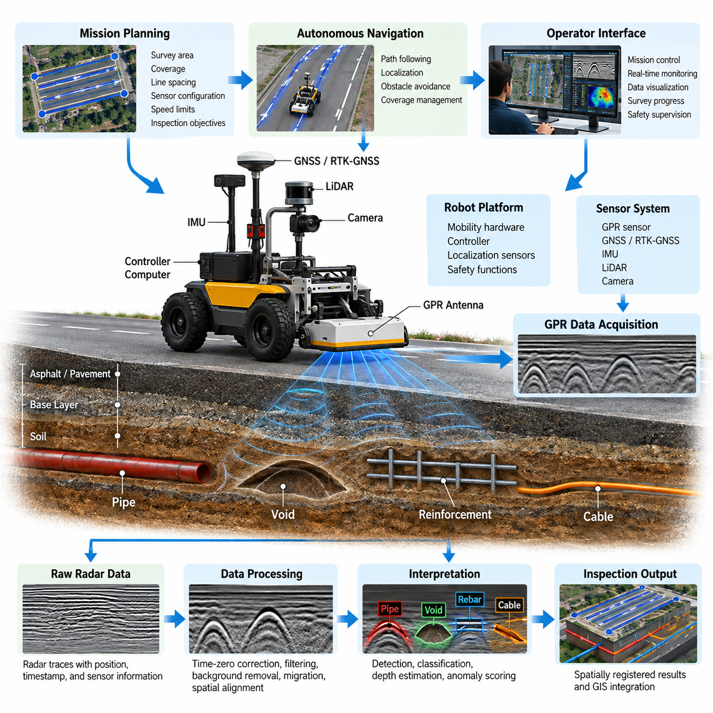{width="7.268055555555556in" height="7.268055555555556in"}

Ground-penetrating radar (GPR) inspection robots combine autonomous mobility, subsurface sensing, positioning, and data-processing functions into a unified infrastructure inspection platform. Unlike conventional inspection vehicles that primarily observe visible surfaces, a GPR robot investigates structures beneath roads, bridge decks, floors, and other accessible surfaces. The robotic platform provides controlled sensor motion while the radar subsystem continuously measures electromagnetic reflections from underground or embedded features.

The overall system is organized around several interacting layers: the mobile robot, GPR sensor, localization subsystem, navigation software, data-acquisition pipeline, inspection-processing software, and operator interface. This architecture reflects the broader robotics software organization in which navigation, perception, sensor management, data architecture, and application software cooperate through modular interfaces. The inspection application therefore acts as an orchestration layer connecting robot autonomy with specialized nondestructive sensing functions. 08_Robotics_Software_Tree

A typical GPR sensor transmits short electromagnetic pulses or frequency-modulated signals toward the inspected medium and measures reflected energy produced by changes in electromagnetic properties. Boundaries between pavement layers, reinforcement bars, buried pipes, cables, voids, moisture regions, or different soil materials may generate recognizable reflections. The robot does not directly observe these objects; instead, it collects radar measurements whose spatial and temporal patterns must later be interpreted to infer subsurface structure.

The robotic mobility platform provides a repeatable spatial trajectory for this sensing process. Wheel encoders, inertial sensors, GNSS or RTK-GNSS outdoors, LiDAR, cameras, and SLAM-based localization can be combined according to the inspection environment. Accurate localization is particularly important because every radar measurement must ultimately be associated with a physical position. The inspection result is therefore not simply a radar image but a spatially registered representation of subsurface observations.

Before an inspection mission begins, the operator defines the survey area, required coverage, lane or grid spacing, sensor configuration, speed limits, and inspection objectives. Existing maps, GIS information, engineering drawings, or known utility records may also be imported. The mission planner transforms these requirements into executable survey trajectories. Depending on the site, the robot may follow parallel lines, grids, road lanes, bridge sections, corridors, or manually defined inspection boundaries.

During mission initialization, the robot verifies the operational state of mobility hardware, radar electronics, localization sensors, storage devices, communication links, and safety functions. Sensor timestamps and coordinate frames must be synchronized so that radar measurements can later be correlated with robot poses. Calibration may also establish antenna height, sensor offset relative to the robot reference frame, wheel odometry parameters, localization alignment, and radar acquisition settings appropriate for the expected inspection depth.

Once the survey begins, autonomous navigation and radar acquisition operate as synchronized processes. The navigation subsystem commands the robot along the planned path while continuously estimating position and orientation. At the same time, the GPR subsystem acquires radar traces at controlled spatial or temporal intervals. Robot pose, velocity, radar parameters, timestamps, diagnostic states, and environmental information can be recorded together, producing a traceable dataset for subsequent processing and analysis.

Maintaining stable motion is important because irregular speed, excessive vibration, wheel slip, or abrupt steering can degrade spatial sampling consistency. The motion controller therefore attempts to maintain survey velocity and trajectory accuracy while the mission manager monitors localization confidence and radar acquisition status. When an obstacle appears, the system must determine whether local avoidance is compatible with inspection coverage or whether the affected section should be interrupted, replanned, and surveyed again.

Coverage management distinguishes inspection robots from ordinary autonomous navigation systems. Reaching a destination is insufficient; the robot must verify that the required surface has been scanned with appropriate spacing and measurement density. Survey software tracks completed and uncompleted segments and can identify gaps caused by obstacles, localization loss, sensor faults, or emergency stops. Missing regions can then be scheduled for recovery passes before the inspection mission is considered complete.

Raw radar measurements require a processing pipeline before meaningful subsurface features can be extracted. Typical processing stages may include time-zero correction, background removal, filtering, gain compensation, noise suppression, migration, and spatial alignment. Individual radar traces form profiles such as B-scans, while repeated parallel passes can be combined into larger two-dimensional or three-dimensional representations. Processing parameters must remain linked to the original data so results can be reproduced or reprocessed.

Interpretation converts processed radar responses into engineering information. Characteristic hyperbolic reflections may indicate compact buried objects, while continuous responses can represent material boundaries or structural layers. Automated algorithms can assist with detection, segmentation, classification, depth estimation, and anomaly scoring. AI-based interpretation may further identify patterns associated with utilities, reinforcement, voids, delamination, deterioration, or other subsurface conditions, but confidence information should accompany automated findings.

The system workflow therefore separates measurement from interpretation. Raw sensor data should be retained even when real-time detection is available, because improved algorithms or revised engineering assumptions may require later reprocessing. Processed radar products, detected anomalies, robot trajectories, localization confidence, and inspection metadata can be stored as related but distinguishable data products. This preserves evidence provenance and makes the inspection result auditable throughout its lifecycle.

Georeferencing connects radar interpretation with infrastructure management. Detected objects and anomalies can be transformed from the radar or robot coordinate frame into site, map, or geographic coordinates. These results can then be associated with road sections, bridge components, utility corridors, or asset identifiers. The chapter structure explicitly extends this workflow toward autonomous survey planning, AI-based utility interpretation, bridge and road inspection, pipeline inspection, GIS integration, and field deployment. Volume_26_Industrial_Robot_Appl...

The operator interface provides mission supervision rather than requiring continuous manual driving. It can display robot position, planned and completed survey paths, localization status, sensor health, radar acquisition progress, storage capacity, communication quality, and detected anomalies. Operators may pause or resume surveys, modify mission boundaries, mark regions for rescanning, or assume manual control when required. Remote supervision also allows inspection personnel to remain outside hazardous traffic or construction areas.

Safety management operates independently from the inspection objective. Emergency stops, obstacle detection, speed limits, geofencing, communication-loss behavior, fault monitoring, and safe-stop states prevent the sensing mission from overriding fundamental robot safety. Infrastructure sites can contain vehicles, workers, uneven surfaces, excavations, restricted zones, and electromagnetic interference. Consequently, the mission manager must treat safety events as state transitions that can suspend acquisition and preserve enough context for controlled recovery.

System reliability also depends on continuous health monitoring. The robot should detect loss of radar communication, insufficient storage, degraded localization, abnormal motion, sensor overheating, timestamp errors, power limitations, or inconsistent measurement rates. Instead of silently continuing a compromised survey, the system can flag affected data, stop the mission, or schedule the corresponding region for reacquisition. This prevents technically complete trajectories from being mistaken for valid inspection coverage.

At mission completion, the system verifies survey coverage and data integrity before generating inspection products. Radar profiles, subsurface maps, anomaly locations, estimated depths, confidence values, trajectory records, and diagnostic logs can be assembled into an inspection package. Engineering review may then validate automated interpretations and convert selected findings into maintenance or investigation actions. The resulting information can also be exported to GIS, asset-management, or infrastructure digital-twin environments.

The complete workflow can therefore be understood as a closed information chain: mission definition leads to survey planning, robot localization and autonomous motion enable controlled sensing, synchronized acquisition produces spatially referenced GPR measurements, signal processing transforms measurements into interpretable representations, and detection or AI interpretation produces infrastructure findings. Data management, safety supervision, and operator oversight support every stage rather than functioning as isolated downstream activities.

A well-designed GPR robot ultimately transforms subsurface inspection from a manually positioned sensing task into a repeatable robotic measurement process. Its principal value is not autonomy alone, but the integration of controlled mobility, precise localization, consistent sensor acquisition, systematic coverage, automated processing, and spatial data management. This integrated workflow establishes the foundation for the later chapter topics covering GPR acquisition software, subsurface detection, autonomous survey planning, AI interpretation, infrastructure inspection applications, GIS integration, and field operation.

지표투과레이더(Ground-Penetrating Radar, GPR) 검사 로봇은 자율 이동(Autonomous Mobility), 지하 탐지(Subsurface Sensing), 위치 추정(Positioning), 데이터 처리(Data Processing) 기능을 하나의 통합된 인프라 검사 플랫폼(Infrastructure Inspection Platform)으로 결합한다. 주로 눈에 보이는 표면을 관찰하는 기존 검사 차량과 달리, GPR 로봇은 도로, 교량 상판(Bridge Deck), 바닥 및 기타 접근 가능한 표면 아래의 구조를 조사한다. 로봇 플랫폼(Robotic Platform)은 센서의 이동을 정밀하게 제어하고, 레이더 서브시스템(Radar Subsystem)은 지하 또는 구조물 내부의 물체에서 발생하는 전자기파 반사(Electromagnetic Reflection)를 지속적으로 측정한다.

전체 시스템은 이동 로봇(Mobile Robot), GPR 센서(GPR Sensor), 위치 추정 서브시스템(Localization Subsystem), 내비게이션 소프트웨어(Navigation Software), 데이터 수집 파이프라인(Data-Acquisition Pipeline), 검사 처리 소프트웨어(Inspection-Processing Software), 운영자 인터페이스(Operator Interface) 등 상호 연동되는 여러 계층으로 구성된다. 이러한 아키텍처(Architecture)는 내비게이션, 인지(Perception), 센서 관리(Sensor Management), 데이터 아키텍처(Data Architecture), 응용 소프트웨어(Application Software)가 모듈형 인터페이스(Modular Interface)를 통해 협력하는 일반적인 로봇 소프트웨어 구조를 반영한다. 따라서 검사 애플리케이션(Inspection Application)은 로봇 자율성과 특수 비파괴 센싱(Nondestructive Sensing) 기능을 연결하는 오케스트레이션 계층(Orchestration Layer)으로 동작한다.

일반적인 GPR 센서(GPR Sensor)는 짧은 전자기 펄스(Electromagnetic Pulse) 또는 주파수 변조 신호(Frequency-Modulated Signal)를 검사 대상 매질로 전송하고, 전자기적 특성이 변화하는 경계에서 발생하는 반사 에너지를 측정한다. 포장층(Pavement Layer) 사이의 경계, 철근(Reinforcement Bar), 매설 파이프(Buried Pipe), 케이블(Cable), 공동(Void), 수분 영역(Moisture Region), 서로 다른 토양 물질 등이 식별 가능한 반사를 생성할 수 있다. 로봇은 이러한 객체를 직접 관찰하는 것이 아니라 레이더 측정값을 수집하며, 이후 공간적·시간적 패턴을 해석하여 지하 구조를 추론해야 한다.

로봇 이동 플랫폼(Robotic Mobility Platform)은 이러한 센싱 과정에 필요한 반복 가능하고 일정한 공간 궤적(Spatial Trajectory)을 제공한다. 검사 환경에 따라 휠 인코더(Wheel Encoder), 관성 센서(Inertial Sensor), 실외 환경의 위성항법시스템(GNSS) 또는 실시간 이동측위 위성항법시스템(RTK-GNSS), 라이다(LiDAR), 카메라(Camera), 동시적 위치추정 및 지도작성 기반 위치 추정(SLAM-Based Localization)을 조합할 수 있다. 모든 레이더 측정값은 궁극적으로 실제 물리적 위치와 연결되어야 하므로 정확한 위치 추정이 특히 중요하다. 따라서 검사 결과는 단순한 레이더 영상이 아니라 공간 좌표가 등록된(Spatially Registered) 지하 관측 정보로 구성된다.

검사 임무(Inspection Mission)를 시작하기 전에 운영자는 조사 영역(Survey Area), 요구되는 커버리지(Coverage), 주행 차선 또는 격자 간격(Grid Spacing), 센서 설정(Sensor Configuration), 속도 제한(Speed Limit), 검사 목적을 정의한다. 기존 지도(Map), 지리정보시스템(GIS) 정보, 엔지니어링 도면(Engineering Drawing), 알려진 유틸리티 기록(Utility Record)도 함께 가져올 수 있다. 임무 계획기(Mission Planner)는 이러한 요구사항을 실제 실행 가능한 조사 궤적(Survey Trajectory)으로 변환한다. 현장 특성에 따라 로봇은 평행 경로, 격자(Grid), 도로 차선, 교량 구간, 복도 또는 사용자가 정의한 검사 경계를 따라 이동할 수 있다.

임무 초기화(Mission Initialization) 과정에서 로봇은 이동 하드웨어(Mobility Hardware), 레이더 전자장치(Radar Electronics), 위치 추정 센서(Localization Sensor), 저장장치(Storage Device), 통신 링크(Communication Link), 안전 기능(Safety Function)의 작동 상태를 확인한다. 이후 레이더 측정값과 로봇 자세(Robot Pose)를 정확하게 연결할 수 있도록 센서 타임스탬프(Timestamp)와 좌표계(Coordinate Frame)를 동기화해야 한다. 또한 안테나 높이(Antenna Height), 로봇 기준 좌표계에 대한 센서 오프셋(Sensor Offset), 휠 오도메트리(Wheel Odometry) 파라미터, 위치 정렬(Localization Alignment), 예상 검사 깊이에 적합한 레이더 데이터 수집 설정을 교정(Calibration)할 수 있다.

조사가 시작되면 자율 내비게이션(Autonomous Navigation)과 레이더 데이터 수집(Radar Acquisition)이 동기화된 프로세스로 동작한다. 내비게이션 서브시스템(Navigation Subsystem)은 계획된 경로를 따라 로봇을 제어하면서 위치와 방향을 지속적으로 추정한다. 동시에 GPR 서브시스템(GPR Subsystem)은 일정한 공간적 또는 시간적 간격으로 레이더 트레이스(Radar Trace)를 획득한다. 로봇 자세, 속도, 레이더 파라미터, 타임스탬프, 진단 상태(Diagnostic State), 환경 정보를 함께 기록하여 이후 처리와 분석 과정에서 추적 가능한 데이터셋(Traceable Dataset)을 생성할 수 있다.

안정적인 움직임을 유지하는 것은 매우 중요하다. 불규칙한 속도, 과도한 진동(Vibration), 휠 슬립(Wheel Slip), 급격한 조향은 공간 샘플링(Spatial Sampling)의 일관성을 저하시킬 수 있기 때문이다. 따라서 모션 제어기(Motion Controller)는 조사 속도와 궤적 정확도를 유지하고, 임무 관리자(Mission Manager)는 위치 추정 신뢰도(Localization Confidence)와 레이더 데이터 수집 상태를 감시한다. 장애물이 나타나면 시스템은 국부 장애물 회피(Local Obstacle Avoidance)가 검사 커버리지를 유지하면서 가능한지를 판단하거나, 해당 구간을 중단한 후 경로를 다시 계획하여 재검사해야 하는지를 결정한다.

커버리지 관리(Coverage Management)는 검사 로봇과 일반적인 자율 내비게이션 시스템을 구별하는 중요한 요소이다. 단순히 목적지에 도달하는 것만으로는 충분하지 않으며, 요구된 표면 영역이 적절한 간격과 측정 밀도(Measurement Density)로 스캔되었는지를 확인해야 한다. 조사 소프트웨어(Survey Software)는 완료된 구간과 미완료 구간을 추적하고 장애물, 위치 추정 손실(Localization Loss), 센서 고장(Sensor Fault), 비상 정지(Emergency Stop) 등으로 발생한 누락 영역을 식별한다. 검사 임무가 완료되기 전에 이러한 영역에 대해 복구 주행(Recovery Pass)을 계획할 수 있다.

원시 레이더 측정 데이터(Raw Radar Measurement)는 의미 있는 지하 특징(Subsurface Feature)을 추출하기 전에 처리 파이프라인(Processing Pipeline)을 거쳐야 한다. 일반적인 처리 단계에는 시간 영점 보정(Time-Zero Correction), 배경 제거(Background Removal), 필터링(Filtering), 이득 보상(Gain Compensation), 잡음 억제(Noise Suppression), 마이그레이션(Migration), 공간 정렬(Spatial Alignment) 등이 포함될 수 있다. 개별 레이더 트레이스는 B-스캔(B-Scan)과 같은 프로파일을 구성하며, 반복적인 평행 주행으로 얻어진 데이터를 결합하여 더 큰 2차원 또는 3차원 표현을 생성할 수 있다. 처리 결과를 재현하거나 다시 처리할 수 있도록 처리 파라미터는 원본 데이터와 연결하여 관리해야 한다.

해석(Interpretation) 과정에서는 처리된 레이더 응답을 실제 엔지니어링 정보(Engineering Information)로 변환한다. 특징적인 쌍곡선 반사(Hyperbolic Reflection)는 작은 매설 물체를 나타낼 수 있으며, 연속적인 응답은 물질 또는 구조층의 경계를 나타낼 수 있다. 자동화 알고리즘(Automated Algorithm)은 탐지(Detection), 분할(Segmentation), 분류(Classification), 깊이 추정(Depth Estimation), 이상 점수화(Anomaly Scoring)를 지원할 수 있다. 인공지능 기반 해석(AI-Based Interpretation)은 유틸리티(Utility), 철근, 공동, 박리(Delamination), 열화(Deterioration) 등과 관련된 패턴을 추가로 식별할 수 있으며, 자동화된 탐지 결과에는 신뢰도 정보(Confidence Information)가 함께 제공되어야 한다.

따라서 시스템 워크플로(System Workflow)는 측정(Measurement)과 해석(Interpretation)을 분리한다. 실시간 탐지(Real-Time Detection)가 제공되더라도 원시 센서 데이터(Raw Sensor Data)를 보존해야 한다. 향상된 알고리즘이나 변경된 엔지니어링 가정에 따라 데이터를 다시 처리해야 할 수 있기 때문이다. 처리된 레이더 데이터, 탐지된 이상(Detected Anomaly), 로봇 궤적(Robot Trajectory), 위치 추정 신뢰도, 검사 메타데이터(Inspection Metadata)는 서로 연관되면서도 구분 가능한 데이터 제품(Data Product)으로 저장할 수 있다. 이러한 구조는 증거의 출처와 처리 이력(Evidence Provenance)을 보존하고 전체 검사 수명주기에서 결과를 감사(Audit)할 수 있도록 한다.

지리참조(Georeferencing)는 레이더 해석 결과를 인프라 관리(Infrastructure Management)와 연결한다. 탐지된 객체와 이상 영역은 레이더 또는 로봇 좌표계에서 현장 좌표계(Site Coordinate), 지도 좌표계(Map Coordinate), 지리 좌표계(Geographic Coordinate)로 변환할 수 있다. 이후 이러한 결과를 도로 구간, 교량 구성요소, 유틸리티 회랑(Utility Corridor), 자산 식별자(Asset Identifier)와 연계할 수 있다. 이를 통해 GPR 검사 결과는 자율 조사 경로 계획, 인공지능 기반 유틸리티 해석, 교량 및 도로 검사, 파이프라인 검사, GIS 통합, 실제 현장 운용으로 확장될 수 있다.

운영자 인터페이스(Operator Interface)는 로봇을 지속적으로 수동 운전하는 대신 임무 감독(Mission Supervision) 기능을 제공한다. 로봇 위치, 계획 및 완료된 조사 경로, 위치 추정 상태, 센서 상태(Sensor Health), 레이더 데이터 수집 진행률, 저장 공간, 통신 품질, 탐지된 이상을 표시할 수 있다. 운영자는 조사를 일시 정지하거나 재개하고, 임무 경계를 수정하거나, 재스캔(Rescanning)이 필요한 영역을 지정하고, 필요한 경우 수동 제어(Manual Control)로 전환할 수 있다. 원격 감독(Remote Supervision)을 활용하면 검사 인력이 위험한 교통 구역이나 건설 현장에서 떨어진 안전한 위치에서 작업할 수 있다.

안전 관리(Safety Management)는 검사 목적과 독립적으로 작동해야 한다. 비상 정지(Emergency Stop), 장애물 탐지(Obstacle Detection), 속도 제한, 지오펜싱(Geofencing), 통신 두절 대응(Communication-Loss Behavior), 고장 모니터링(Fault Monitoring), 안전 정지 상태(Safe-Stop State)는 센싱 임무가 기본적인 로봇 안전보다 우선하지 않도록 보장한다. 인프라 현장에는 차량, 작업자, 불규칙한 노면, 굴착 구역, 제한 구역, 전자기 간섭(Electromagnetic Interference) 등이 존재할 수 있다. 따라서 임무 관리자는 안전 이벤트를 데이터 수집을 중단하고 통제된 복구가 가능하도록 충분한 상태 정보를 보존하는 상태 전이(State Transition)로 처리해야 한다.

시스템 신뢰성(System Reliability)은 지속적인 상태 모니터링(Health Monitoring)에도 의존한다. 로봇은 레이더 통신 손실, 저장 공간 부족, 위치 추정 성능 저하, 비정상적인 움직임, 센서 과열, 타임스탬프 오류, 전력 부족, 불규칙한 측정 속도 등을 감지해야 한다. 문제가 발생한 상태에서 조사를 그대로 계속하는 대신 시스템은 영향을 받은 데이터에 표시를 남기거나 임무를 중단하거나 해당 영역의 재수집(Reacquisition)을 계획할 수 있다. 이를 통해 궤적상으로는 완료된 조사 구간이 유효한 검사 커버리지로 잘못 판단되는 것을 방지한다.

임무 완료(Mission Completion) 단계에서는 검사 결과물을 생성하기 전에 조사 커버리지와 데이터 무결성(Data Integrity)을 검증한다. 레이더 프로파일(Radar Profile), 지하 구조 지도(Subsurface Map), 이상 위치(Anomaly Location), 추정 깊이(Estimated Depth), 신뢰도 값(Confidence Value), 궤적 기록(Trajectory Record), 진단 로그(Diagnostic Log)를 하나의 검사 패키지(Inspection Package)로 구성할 수 있다. 이후 엔지니어링 검토(Engineering Review)를 통해 자동 해석 결과를 검증하고 선택된 결과를 유지보수 또는 추가 조사 조치로 전환할 수 있다. 결과 정보는 GIS, 자산 관리 시스템(Asset-Management System), 인프라 디지털 트윈(Infrastructure Digital Twin) 환경으로 내보낼 수도 있다.

전체 워크플로는 하나의 폐쇄형 정보 체인(Closed Information Chain)으로 이해할 수 있다. 임무 정의(Mission Definition)는 조사 계획(Survey Planning)으로 이어지고, 로봇 위치 추정과 자율 이동은 제어된 센싱을 가능하게 한다. 동기화된 데이터 수집은 공간적으로 참조된 GPR 측정값을 생성하고, 신호 처리(Signal Processing)는 측정값을 해석 가능한 표현으로 변환하며, 탐지 알고리즘 또는 인공지능 해석은 최종적으로 인프라 관련 정보를 생성한다. 데이터 관리(Data Management), 안전 감독(Safety Supervision), 운영자 감독(Operator Oversight)은 독립적인 후처리 기능이 아니라 모든 단계에 걸쳐 전체 워크플로를 지원한다.

잘 설계된 GPR 로봇은 지하 검사를 사람이 직접 센서를 배치하고 이동시키는 작업에서 반복 가능하고 체계적인 로봇 측정 프로세스(Robotic Measurement Process)로 전환한다. 이러한 시스템의 핵심 가치는 자율성 자체에만 있는 것이 아니라 제어된 이동(Controlled Mobility), 정밀한 위치 추정(Precise Localization), 일관된 센서 데이터 수집(Consistent Sensor Acquisition), 체계적인 커버리지(Systematic Coverage), 자동화된 데이터 처리(Automated Processing), 공간 데이터 관리(Spatial Data Management)를 통합하는 데 있다. 이러한 통합 워크플로는 이후 다루게 될 GPR 데이터 수집 소프트웨어, 지하 객체 탐지, 자율 조사 계획, 인공지능 기반 해석, 인프라 검사 응용, GIS 통합 및 현장 운용을 위한 기반을 제공한다.

##  

## 05.02. GPR Sensor Integration and Data Acquisition SW [w/Code]

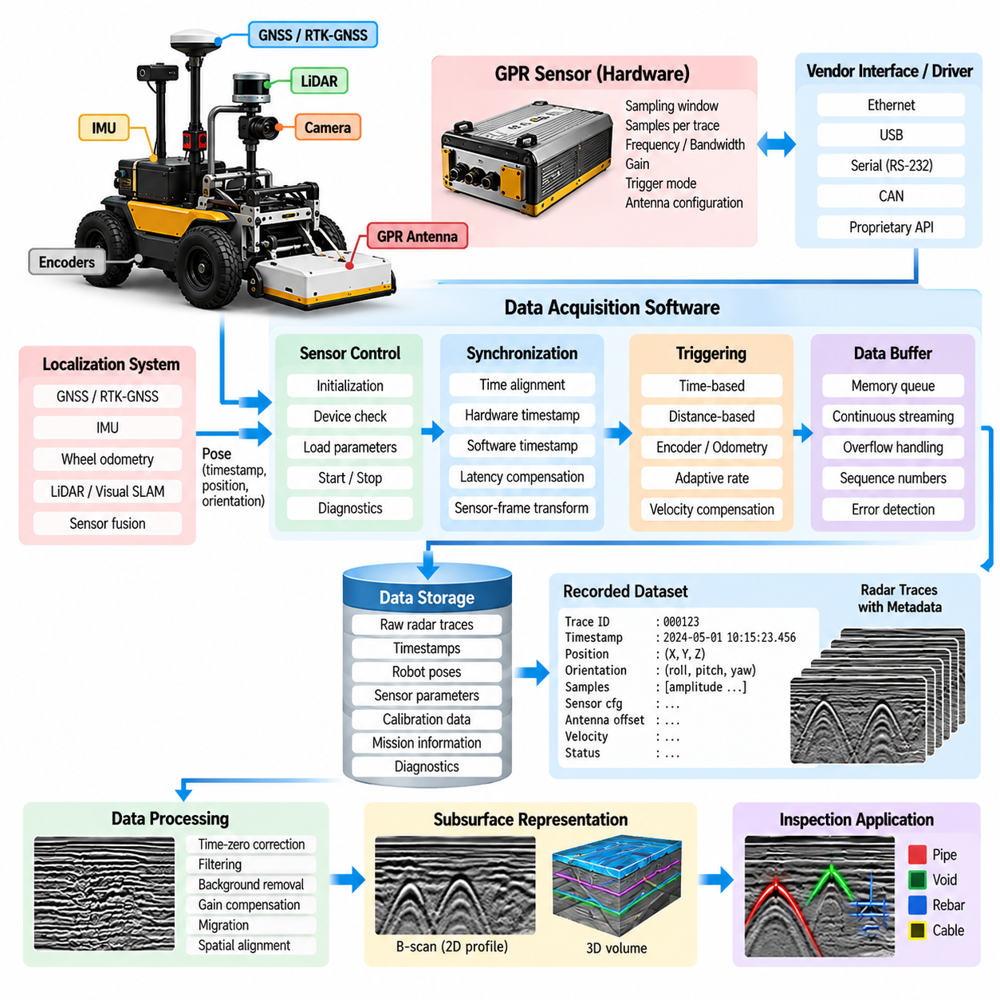{width="7.268055555555556in" height="7.268055555555556in"}

Ground-penetrating radar sensor integration requires the robotic platform and radar instrument to operate as a synchronized measurement system rather than as independent devices. The data-acquisition software provides the interface between the GPR hardware, robot localization, motion control, storage, and inspection applications. Its primary responsibility is to capture radar measurements reliably while preserving the spatial, temporal, and configuration information required for later subsurface analysis.

A typical integration architecture separates the vendor-specific radar interface from the rest of the robot software. The GPR may communicate through Ethernet, USB, serial communication, CAN, or a proprietary hardware interface, while a dedicated device driver or adapter converts these commands and measurements into a standardized internal representation. This abstraction prevents higher-level inspection software from depending directly on a particular radar manufacturer or communication protocol.

The acquisition software normally manages radar initialization before measurement begins. It establishes communication with the sensor, verifies device identity and firmware state, loads acquisition parameters, checks antenna configuration, and confirms that valid radar traces can be received. Parameters may include sampling window, number of samples per trace, pulse repetition settings, frequency characteristics, gain, triggering mode, and other sensor-specific options supported by the selected GPR equipment.

A radar trace represents reflected electromagnetic energy sampled over propagation time. Each trace must therefore contain not only amplitude samples but also metadata describing how the measurement was produced. The acquisition layer should associate trace identifiers, timestamps, sensor configuration, antenna information, measurement sequence numbers, and diagnostic states with the samples. Preserving this metadata is essential because later processing depends on knowing the conditions under which the original signal was acquired.

Robotic GPR inspection additionally requires every radar measurement to be associated with robot position and orientation. The software can receive localization estimates from wheel odometry, IMU, GNSS or RTK-GNSS, LiDAR localization, visual localization, or fused SLAM systems. A sensor transform defines the position and orientation of the GPR antenna relative to the robot base, allowing measurements to be transformed from the sensor coordinate frame into the robot, map, or geographic coordinate frame.

Time synchronization is one of the most important integration requirements. Radar measurements, robot poses, encoder readings, IMU measurements, and navigation events may originate from devices with different clocks and update rates. The software must maintain a consistent timestamping strategy so that each radar trace can be matched with an appropriate robot pose. Hardware timestamps are preferable when available, while software timestamps require careful management of communication and processing latency.

Spatial triggering can improve measurement consistency when robot velocity changes during a survey. Instead of recording radar traces only at fixed time intervals, the acquisition system can trigger measurements according to traveled distance derived from a wheel encoder or localization estimate. For example, the system may request a measurement after a specified displacement. This approach produces approximately uniform spatial sampling even when the robot accelerates, decelerates, or temporarily reduces speed.

Time-based acquisition remains useful when the GPR sensor operates continuously at a predefined trace rate. In this configuration, the robot software records each incoming trace and interpolates or associates the corresponding pose using synchronized localization data. The relationship between robot velocity, radar trace rate, and required spatial resolution must be considered carefully. Excessive speed can produce sparse spatial sampling, whereas unnecessarily high acquisition rates increase processing and storage requirements.

The acquisition pipeline should be designed for continuous streaming rather than assuming that every radar measurement can immediately be written to permanent storage. Incoming traces can first enter a bounded memory buffer, where acquisition and storage operations are decoupled. A dedicated writer process or thread then transfers buffered measurements to disk. This architecture reduces the possibility that temporary storage latency will interrupt radar communication or cause measurement loss during continuous inspection.

Buffer management requires explicit overflow behavior. If processing or storage becomes slower than the incoming radar stream, the software should detect the condition instead of silently discarding measurements. Depending on system requirements, it may reduce robot speed, pause the survey, generate a fault, or mark missing traces in the dataset. Sequence numbers make dropped or duplicated measurements detectable and allow the integrity of the acquired radar stream to be evaluated after the mission.

Data storage should preserve both raw radar information and the contextual information necessary to reconstruct the inspection. Raw traces may be stored in a vendor-neutral binary format, structured dataset, or converted representation while retaining the original measurements when practical. Pose data, timestamps, calibration parameters, mission identifiers, radar settings, robot velocity, coordinate transforms, and sensor diagnostics should remain logically associated with the corresponding radar records.

For large infrastructure surveys, storage throughput and capacity become operational constraints. Continuous high-resolution radar acquisition can generate substantial datasets, particularly when multiple antennas or channels are used. The acquisition software should monitor available storage and estimated remaining recording time. Chunked files can limit the impact of corruption and simplify later processing, while asynchronous writing and suitable compression can improve storage efficiency without blocking the real-time acquisition path.

Calibration connects the physical sensor installation with software interpretation. The system should record antenna position, orientation, height, channel arrangement, and relevant sensor-specific calibration values. Mechanical changes to the antenna mount can invalidate previous transformations even when the radar electronics remain unchanged. Configuration versioning therefore allows every inspection dataset to identify precisely which robot geometry, sensor configuration, and calibration state were active during acquisition.

The software must also coordinate GPR operation with robot mission states. Radar recording should begin only when the inspection system enters an authorized acquisition state and should stop or pause during selected transitions such as emergency stops, localization failures, manual repositioning, or non-survey navigation. This state-aware acquisition prevents unrelated robot movement from being mixed with valid inspection measurements and simplifies identification of usable survey segments during later processing.

Quality monitoring can operate concurrently with data acquisition without replacing detailed offline processing. The software may calculate basic indicators such as signal amplitude range, saturation, noise level, trace continuity, acquisition frequency, antenna communication status, and spatial sampling interval. These indicators provide immediate feedback about measurement quality and can identify disconnected sensors, abnormal signals, excessive vehicle speed, or other conditions that could compromise the survey.

Diagnostic monitoring should cover the complete acquisition chain rather than only the radar device. Communication timeout, malformed packets, timestamp discontinuity, sequence gaps, localization loss, encoder faults, storage errors, excessive buffer occupancy, and sensor temperature can all affect inspection validity. Each event should be logged with sufficient context to determine which radar measurements were affected and whether the corresponding survey region requires reacquisition.

A robust implementation uses explicit fault and recovery states. Temporary communication interruptions may permit automatic reconnection, while repeated sensor failures can force the robot into a controlled stop. After recovery, the acquisition system should avoid silently joining discontinuous measurements as though no interruption occurred. Recording segment boundaries, fault events, restart timestamps, and configuration changes creates a transparent history of the inspection and supports reliable downstream analysis.

Integration with robotic middleware can expose radar acquisition through modular interfaces. A sensor driver publishes raw measurements and diagnostics, localization components provide robot poses, and the inspection application coordinates acquisition through services, actions, or lifecycle states. Such separation allows navigation, sensing, processing, visualization, and storage components to evolve independently while maintaining well-defined data contracts between subsystems.

The broader industrial inspection structure places this acquisition layer directly between the GPR robot overview and later subsurface processing, autonomous survey planning, AI-based utility interpretation, bridge and road inspection, pipeline inspection, GIS integration, and safety functions. The acquisition software therefore serves as the measurement foundation on which the subsequent inspection workflow depends.

At mission completion, the acquisition system should finalize files safely, flush remaining buffers, calculate integrity statistics, and store a mission manifest describing the collected dataset. The manifest can summarize radar channels, trace counts, recording segments, time ranges, coordinate references, calibration versions, detected data gaps, and relevant fault events. These records allow downstream software to determine whether the dataset is complete before computationally expensive processing begins.

Well-designed GPR data-acquisition software ultimately transforms a stream of radar samples into trustworthy robotic inspection evidence. Reliable hardware communication alone is insufficient; measurements must be synchronized, spatially referenced, calibrated, monitored, stored, and linked to robot operating states. By preserving this chain from physical sensing to structured data, the integration layer enables reproducible signal processing, automated subsurface detection, geospatial mapping, and defensible infrastructure inspection results.

지표투과레이더(Ground-Penetrating Radar, GPR) 센서 통합(Sensor Integration)에서는 로봇 플랫폼(Robotic Platform)과 레이더 장비(Radar Instrument)가 서로 독립적인 장치가 아니라 동기화된 측정 시스템(Synchronized Measurement System)으로 동작해야 한다. 데이터 수집 소프트웨어(Data-Acquisition Software)는 GPR 하드웨어, 로봇 위치 추정(Robot Localization), 모션 제어(Motion Control), 저장장치(Storage), 검사 애플리케이션(Inspection Application)을 연결하는 인터페이스를 제공한다. 핵심 역할은 레이더 측정값을 안정적으로 수집하면서 이후 지하 분석(Subsurface Analysis)에 필요한 공간, 시간 및 설정 정보를 함께 보존하는 것이다.

일반적인 통합 아키텍처(Integration Architecture)는 제조업체별 레이더 인터페이스(Vendor-Specific Radar Interface)를 로봇 소프트웨어의 나머지 부분과 분리한다. GPR은 이더넷(Ethernet), USB, 직렬 통신(Serial Communication), CAN 또는 독자적인 하드웨어 인터페이스(Proprietary Hardware Interface)를 통해 통신할 수 있으며, 전용 장치 드라이버(Device Driver) 또는 어댑터(Adapter)가 명령과 측정 데이터를 표준화된 내부 표현(Standardized Internal Representation)으로 변환한다. 이러한 추상화(Abstraction)를 통해 상위 검사 소프트웨어가 특정 레이더 제조업체나 통신 프로토콜에 직접 종속되는 것을 방지할 수 있다.

데이터 수집 소프트웨어는 일반적으로 측정을 시작하기 전에 레이더 초기화(Radar Initialization)를 관리한다. 센서와 통신을 설정하고, 장치 식별 정보(Device Identity)와 펌웨어 상태(Firmware State)를 확인하며, 데이터 수집 파라미터(Acquisition Parameter)를 로드하고, 안테나 설정(Antenna Configuration)을 검사한 다음 유효한 레이더 트레이스(Radar Trace)가 수신되는지 확인한다. 파라미터에는 샘플링 윈도우(Sampling Window), 트레이스당 샘플 수(Number of Samples per Trace), 펄스 반복 설정(Pulse Repetition Setting), 주파수 특성(Frequency Characteristic), 이득(Gain), 트리거 모드(Triggering Mode) 및 선택된 GPR 장비가 지원하는 기타 센서별 설정이 포함될 수 있다.

레이더 트레이스(Radar Trace)는 전파 시간(Propagation Time)에 따라 샘플링된 반사 전자기 에너지(Reflected Electromagnetic Energy)를 나타낸다. 따라서 각 트레이스에는 진폭 샘플(Amplitude Sample)뿐만 아니라 측정값이 어떤 조건에서 생성되었는지를 설명하는 메타데이터(Metadata)도 포함되어야 한다. 데이터 수집 계층(Acquisition Layer)은 트레이스 식별자(Trace Identifier), 타임스탬프(Timestamp), 센서 설정, 안테나 정보, 측정 시퀀스 번호(Measurement Sequence Number), 진단 상태(Diagnostic State)를 샘플 데이터와 연결해야 한다. 이후의 데이터 처리는 원본 신호가 어떤 조건에서 수집되었는지를 알아야 하므로 이러한 메타데이터를 보존하는 것이 매우 중요하다.

로봇 기반 GPR 검사(Robotic GPR Inspection)에서는 각각의 레이더 측정값을 로봇의 위치와 자세(Position and Orientation)에 연결해야 한다. 소프트웨어는 휠 오도메트리(Wheel Odometry), 관성측정장치(IMU), 위성항법시스템(GNSS) 또는 실시간 이동측위 위성항법시스템(RTK-GNSS), 라이다 위치 추정(LiDAR Localization), 비전 기반 위치 추정(Visual Localization), 융합 SLAM 시스템(Fused SLAM System)으로부터 위치 추정값을 받을 수 있다. 센서 변환(Sensor Transform)은 로봇 베이스(Robot Base)에 대한 GPR 안테나의 위치와 방향을 정의하며, 이를 통해 측정값을 센서 좌표계에서 로봇, 지도 또는 지리 좌표계로 변환할 수 있다.

시간 동기화(Time Synchronization)는 가장 중요한 통합 요구사항 중 하나이다. 레이더 측정값, 로봇 자세, 인코더 측정값, IMU 측정값, 내비게이션 이벤트(Navigation Event)는 서로 다른 클록(Clock)과 갱신 주기(Update Rate)를 사용하는 장치에서 생성될 수 있다. 소프트웨어는 각 레이더 트레이스를 적절한 로봇 자세와 연결할 수 있도록 일관된 타임스탬프 전략(Timestamping Strategy)을 유지해야 한다. 가능한 경우 하드웨어 타임스탬프(Hardware Timestamp)를 사용하는 것이 바람직하며, 소프트웨어 타임스탬프(Software Timestamp)를 사용할 경우 통신 및 처리 지연(Processing Latency)을 세심하게 관리해야 한다.

공간 기반 트리거링(Spatial Triggering)은 조사 과정에서 로봇 속도가 변할 때 측정의 일관성을 향상시킬 수 있다. 고정된 시간 간격으로만 레이더 트레이스를 기록하는 대신 데이터 수집 시스템은 휠 인코더 또는 위치 추정 결과로 계산된 이동 거리에 따라 측정을 트리거할 수 있다. 예를 들어 시스템은 지정된 거리만큼 이동할 때마다 새로운 측정을 요청할 수 있다. 이러한 방식은 로봇이 가속하거나 감속하거나 일시적으로 속도를 줄이는 상황에서도 비교적 균일한 공간 샘플링(Spatial Sampling)을 생성한다.

시간 기반 데이터 수집(Time-Based Acquisition)은 GPR 센서가 사전에 정의된 트레이스 속도(Trace Rate)로 연속 동작하는 경우에도 유용하다. 이러한 구성에서는 로봇 소프트웨어가 수신되는 각각의 트레이스를 기록하고 동기화된 위치 추정 데이터를 이용하여 해당 위치를 보간(Interpolation)하거나 연결한다. 로봇 속도, 레이더 트레이스 속도, 요구되는 공간 해상도(Spatial Resolution) 사이의 관계를 신중하게 고려해야 한다. 속도가 지나치게 높으면 공간 샘플링이 희박해질 수 있으며, 불필요하게 높은 데이터 수집 속도는 처리 및 저장 요구량을 증가시킨다.

데이터 수집 파이프라인(Acquisition Pipeline)은 모든 레이더 측정값을 즉시 영구 저장장치에 기록할 수 있다고 가정하기보다 연속 스트리밍(Continuous Streaming)을 처리할 수 있도록 설계해야 한다. 수신된 트레이스는 먼저 제한된 메모리 버퍼(Bounded Memory Buffer)에 저장하여 데이터 수집 작업과 저장 작업을 분리할 수 있다. 이후 전용 기록 프로세스 또는 스레드(Writer Process or Thread)가 버퍼의 측정값을 디스크로 전송한다. 이러한 아키텍처는 일시적인 저장 지연(Storage Latency)이 레이더 통신을 중단시키거나 연속 검사 중 측정 데이터 손실을 발생시키는 가능성을 줄인다.

버퍼 관리(Buffer Management)에는 명확한 오버플로 동작(Overflow Behavior)이 필요하다. 처리 또는 저장 속도가 입력되는 레이더 스트림보다 느려지면 소프트웨어는 측정값을 조용히 폐기하는 대신 이러한 상태를 감지해야 한다. 시스템 요구사항에 따라 로봇 속도를 낮추거나, 조사를 일시 정지하거나, 고장 상태(Fault)를 발생시키거나, 데이터셋에서 누락된 트레이스를 표시할 수 있다. 시퀀스 번호(Sequence Number)를 사용하면 누락되거나 중복된 측정값을 식별할 수 있으며, 임무 완료 후 수집된 레이더 스트림의 무결성(Integrity)을 평가할 수 있다.

데이터 저장(Data Storage)은 원시 레이더 정보뿐만 아니라 검사 과정을 재구성하는 데 필요한 상황 정보(Contextual Information)도 보존해야 한다. 원시 트레이스(Raw Trace)는 제조업체에 독립적인 바이너리 형식(Vendor-Neutral Binary Format), 구조화된 데이터셋(Structured Dataset) 또는 변환된 표현으로 저장할 수 있으며, 가능한 경우 원래의 측정 데이터도 유지해야 한다. 자세 데이터(Pose Data), 타임스탬프, 보정 파라미터(Calibration Parameter), 임무 식별자(Mission Identifier), 레이더 설정, 로봇 속도, 좌표 변환(Coordinate Transform), 센서 진단 정보도 해당 레이더 레코드와 논리적으로 연결된 상태로 유지해야 한다.

대규모 인프라 조사(Large-Scale Infrastructure Survey)에서는 저장 처리량(Storage Throughput)과 용량이 실제 운용상의 제약 조건이 된다. 특히 여러 개의 안테나 또는 채널을 사용할 경우 연속적인 고해상도 레이더 데이터 수집으로 상당한 규모의 데이터셋이 생성될 수 있다. 데이터 수집 소프트웨어는 사용 가능한 저장 공간과 예상 잔여 기록 시간을 모니터링해야 한다. 청크 파일(Chunked File)을 사용하면 데이터 손상의 영향을 제한하고 이후 처리를 단순화할 수 있으며, 비동기 기록(Asynchronous Writing)과 적절한 압축(Compression)을 사용하면 실시간 데이터 수집 경로를 차단하지 않으면서 저장 효율을 향상시킬 수 있다.

보정(Calibration)은 실제 센서 설치 상태와 소프트웨어 해석(Software Interpretation)을 연결한다. 시스템은 안테나 위치, 방향, 높이, 채널 배열(Channel Arrangement), 관련 센서별 보정값을 기록해야 한다. 레이더 전자장치가 변경되지 않았더라도 안테나 장착부(Antenna Mount)의 기계적 변경으로 기존 좌표 변환이 더 이상 유효하지 않을 수 있다. 따라서 설정 버전 관리(Configuration Versioning)를 통해 각각의 검사 데이터셋에서 데이터 수집 당시 적용된 로봇 형상(Robot Geometry), 센서 설정 및 보정 상태를 정확하게 식별할 수 있어야 한다.

소프트웨어는 GPR 동작을 로봇 임무 상태(Robot Mission State)와도 조정해야 한다. 레이더 기록은 검사 시스템이 허가된 데이터 수집 상태(Authorized Acquisition State)에 진입했을 때만 시작되어야 하며, 비상 정지, 위치 추정 실패, 수동 재배치(Manual Repositioning), 비검사 목적 이동(Non-Survey Navigation)과 같은 특정 상태 전이에서는 중지되거나 일시 정지되어야 한다. 이러한 상태 인식형 데이터 수집(State-Aware Acquisition)은 검사와 관계없는 로봇 이동이 유효한 검사 측정값과 혼합되는 것을 방지하고, 이후 처리 과정에서 사용 가능한 조사 구간을 쉽게 식별하도록 한다.

품질 모니터링(Quality Monitoring)은 상세한 오프라인 처리(Offline Processing)를 대체하지 않으면서 데이터 수집과 동시에 수행될 수 있다. 소프트웨어는 신호 진폭 범위(Signal Amplitude Range), 포화(Saturation), 잡음 수준(Noise Level), 트레이스 연속성(Trace Continuity), 데이터 수집 주파수(Acquisition Frequency), 안테나 통신 상태, 공간 샘플링 간격과 같은 기본 지표를 계산할 수 있다. 이러한 지표는 측정 품질에 대한 즉각적인 피드백을 제공하며 센서 연결 해제, 비정상 신호, 과도한 차량 속도 등 조사 품질을 저하시킬 수 있는 조건을 식별하는 데 사용된다.

진단 모니터링(Diagnostic Monitoring)은 레이더 장치만이 아니라 전체 데이터 수집 체인(Acquisition Chain)을 대상으로 해야 한다. 통신 타임아웃(Communication Timeout), 비정상 패킷(Malformed Packet), 타임스탬프 불연속(Timestamp Discontinuity), 시퀀스 누락(Sequence Gap), 위치 추정 손실, 인코더 고장, 저장 오류, 과도한 버퍼 점유율(Buffer Occupancy), 센서 온도 등이 모두 검사 데이터의 유효성에 영향을 줄 수 있다. 각각의 이벤트는 어떤 레이더 측정값이 영향을 받았으며 해당 조사 영역을 다시 측정해야 하는지를 판단할 수 있도록 충분한 상황 정보와 함께 기록되어야 한다.

견고한 구현(Robust Implementation)에서는 명시적인 고장 및 복구 상태(Fault and Recovery State)를 사용한다. 일시적인 통신 중단은 자동 재연결(Automatic Reconnection)을 허용할 수 있지만 반복적인 센서 고장은 로봇을 제어된 정지(Controlled Stop) 상태로 전환해야 할 수 있다. 복구 후 데이터 수집 시스템은 불연속적인 측정값을 아무런 중단이 없었던 것처럼 연결해서는 안 된다. 기록 구간 경계(Recording Segment Boundary), 고장 이벤트, 재시작 타임스탬프(Restart Timestamp), 설정 변경을 기록하면 검사 과정의 투명한 이력(Inspection History)을 구축하고 신뢰할 수 있는 후속 분석을 지원할 수 있다.

로봇 미들웨어(Robotic Middleware)와 통합하면 모듈형 인터페이스(Modular Interface)를 통해 레이더 데이터 수집 기능을 제공할 수 있다. 센서 드라이버(Sensor Driver)는 원시 측정값과 진단 정보를 발행하고, 위치 추정 컴포넌트(Localization Component)는 로봇 자세를 제공하며, 검사 애플리케이션은 서비스(Service), 액션(Action), 생명주기 상태(Lifecycle State)를 이용해 데이터 수집을 조정한다. 이러한 분리를 통해 내비게이션, 센싱, 처리, 시각화(Visualization), 저장 컴포넌트를 독립적으로 발전시키면서도 서브시스템 사이에 명확하게 정의된 데이터 계약(Data Contract)을 유지할 수 있다.

전체 산업용 검사 구조(Industrial Inspection Structure)에서 이러한 데이터 수집 계층은 GPR 로봇 개요와 이후의 지하 데이터 처리(Subsurface Processing), 자율 조사 계획(Autonomous Survey Planning), 인공지능 기반 유틸리티 해석(AI-Based Utility Interpretation), 교량 및 도로 검사, 파이프라인 검사, GIS 통합, 안전 기능 사이에 직접 위치한다. 따라서 데이터 수집 소프트웨어는 이후의 전체 검사 워크플로가 의존하는 핵심적인 측정 기반(Measurement Foundation)의 역할을 수행한다.

임무 완료 시 데이터 수집 시스템은 파일을 안전하게 종료하고, 남아 있는 버퍼를 모두 저장하며, 데이터 무결성 통계(Integrity Statistics)를 계산하고, 수집된 데이터셋을 설명하는 임무 매니페스트(Mission Manifest)를 저장해야 한다. 매니페스트에는 레이더 채널(Radar Channel), 트레이스 개수(Trace Count), 기록 구간, 시간 범위(Time Range), 좌표 참조(Coordinate Reference), 보정 버전(Calibration Version), 감지된 데이터 누락(Data Gap), 관련 고장 이벤트 등을 요약할 수 있다. 이러한 기록을 통해 후속 소프트웨어는 계산 비용이 높은 데이터 처리를 시작하기 전에 데이터셋이 완전한지 판단할 수 있다.

잘 설계된 GPR 데이터 수집 소프트웨어(GPR Data-Acquisition Software)는 단순한 레이더 샘플 스트림을 신뢰할 수 있는 로봇 검사 증거(Robotic Inspection Evidence)로 변환한다. 안정적인 하드웨어 통신만으로는 충분하지 않으며, 측정값을 동기화하고 공간 좌표와 연결하며 보정하고 모니터링하고 저장하고 로봇의 운용 상태와 연계해야 한다. 물리적 센싱(Physical Sensing)에서 구조화된 데이터(Structured Data)에 이르는 이러한 연결 관계를 보존함으로써 통합 계층(Integration Layer)은 재현 가능한 신호 처리(Reproducible Signal Processing), 자동화된 지하 객체 탐지(Automated Subsurface Detection), 지리공간 매핑(Geospatial Mapping), 신뢰할 수 있는 인프라 검사 결과를 가능하게 한다.

##  

## 05.03. GPR Data Processing and Subsurface Detection [w/Code]

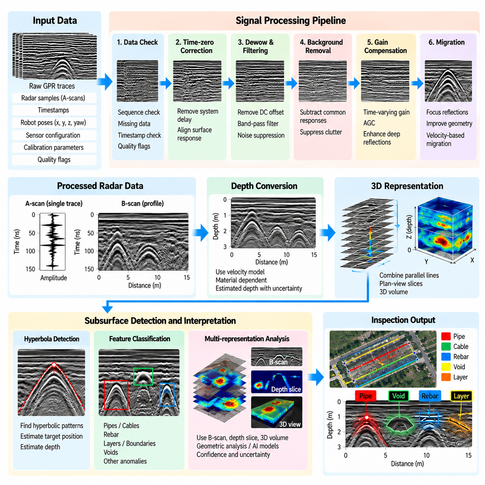{width="7.268055555555556in" height="7.268055555555556in"}

Ground-penetrating radar data processing transforms raw electromagnetic measurements into interpretable representations of subsurface structures. The processing pipeline begins after synchronized radar traces, robot poses, calibration parameters, and acquisition metadata have been collected. Its purpose is to suppress measurement artifacts, enhance meaningful reflections, estimate spatial relationships, and produce reliable inputs for detecting buried utilities, structural components, voids, and other subsurface anomalies.

A raw GPR trace contains signal amplitude as a function of propagation time and normally includes both useful reflections and unwanted components. Direct antenna coupling, system ringing, environmental interference, background responses, attenuation, and random noise can obscure weak targets. Processing therefore should not be treated merely as visualization enhancement. Each operation modifies the evidence available for interpretation and must preserve sufficient metadata to reproduce the processing sequence.

The first stage commonly performs data integrity checks before signal transformation begins. Software verifies trace sequence continuity, timestamp consistency, expected sample counts, sensor configuration, spatial coordinates, and acquisition intervals. Missing or corrupted traces can be marked rather than silently interpolated. Quality flags generated during acquisition should also remain associated with the data so that later detection algorithms can distinguish poor measurements from genuine subsurface anomalies.

Time-zero correction aligns the effective beginning of radar propagation across traces. Electronic delays, antenna characteristics, triggering differences, and system configuration may shift the apparent location of the surface response. If these offsets are not corrected, estimated target depths and layer boundaries can become inconsistent. The processing software identifies or estimates a reference position and shifts traces into a common temporal coordinate while recording the applied correction.

Low-frequency baseline variations and direct-current components can be removed through dewow or similar preprocessing operations. Frequency-domain or time-domain filtering can then suppress signal components outside the useful radar bandwidth. Filter selection requires care because aggressive filtering may eliminate weak target responses together with noise. Processing parameters should therefore be configurable according to antenna frequency, inspected material, expected target dimensions, and required penetration depth.

Background removal is especially useful when strong responses remain nearly constant across consecutive radar traces. Averaging or estimating the common component and subtracting it can suppress antenna coupling and horizontally persistent clutter, making localized objects easier to observe. However, continuous structural features may also resemble background energy. The algorithm must therefore be selected according to whether the inspection objective emphasizes discrete utilities, continuous layers, reinforcement patterns, or deterioration zones.

Radar signals normally attenuate as they propagate through the inspected medium, causing deeper reflections to appear weaker than shallow ones. Gain compensation increases selected portions of the signal to improve visibility across depth. Time-varying gain, automatic gain control, or other compensation methods may be applied, but gain does not recover information that was never measured. Excessive amplification can also strengthen noise and create misleading features, so original amplitudes should remain accessible.

Individual processed traces are arranged according to robot motion to construct radar profiles. Consecutive A-scans form a B-scan in which one axis represents survey distance and the other represents propagation time or estimated depth. Parallel survey lines can subsequently be combined into plan-view representations or three-dimensional radar volumes. Accurate robot localization and spatial sampling are therefore essential because geometric errors in the trajectory propagate directly into the reconstructed subsurface representation.

Conversion from propagation time to depth requires an estimate of electromagnetic wave velocity within the material. This velocity depends strongly on dielectric properties and can vary among soil, asphalt, concrete, aggregate, and moisture conditions. Software may use assumed material parameters, calibration targets, hyperbola fitting, or other field-derived estimates. Depth values should consequently be associated with the velocity model used rather than presented as measurements independent of material assumptions.

Compact buried objects such as pipes and cables often produce characteristic hyperbolic patterns in B-scan imagery. The shape occurs because the antenna detects the target from multiple positions while approaching and moving away from it. Detection software can exploit this geometry using template matching, curve fitting, image-processing techniques, or learned models. The estimated hyperbola apex can provide a target position, while its curvature can contribute to depth or propagation-velocity estimation.

Migration attempts to reposition distributed radar energy toward the physical location of the reflecting object. Hyperbolic responses from compact targets can be focused, while dipping interfaces and complex structures can become geometrically easier to interpret. Migration quality depends on an appropriate propagation-velocity model and accurate spatial sampling. Incorrect assumptions may distort rather than improve the result, making parameter traceability important when migrated data are used for engineering decisions.

Subsurface detection can operate on several representations rather than relying on a single processed image. Algorithms may analyze individual traces, B-scans, depth slices, three-dimensional volumes, extracted features, or combinations of these inputs. Classical signal-processing and computer-vision methods remain useful for strong geometric patterns, while machine-learning approaches can learn more complex relationships. Detection confidence should account for both algorithmic evidence and measurement quality.

A practical detector separates candidate generation from engineering interpretation. Signal peaks, hyperbolic structures, discontinuities, layer changes, or localized high-energy regions can first be identified as candidates. Subsequent processing estimates their position, depth, dimensions, continuity, and confidence before assigning possible semantic meaning. This separation reduces the risk of converting every unusual radar response directly into a claimed pipe, cable, void, reinforcement bar, or structural defect.

Three-dimensional surveys provide additional evidence by comparing detections across neighboring scan lines. A buried pipe that produces separate hyperbolic responses in multiple B-scans may form a continuous linear feature after spatial registration. Software can associate these detections using geometric consistency and localization information. Repeated observations increase confidence and allow the system to estimate utility direction, extent, and relationship with other subsurface structures.

Robotic inspection makes georeferencing an integral part of the processing pipeline. Every detected feature can be transformed from radar sample coordinates into the sensor frame, robot frame, local map frame, and ultimately a geographic or infrastructure coordinate system. Localization uncertainty, antenna offset, depth uncertainty, and processing assumptions should accompany this transformation. The result becomes a spatial inspection object rather than merely a feature visible in a radar image.

Processing software should retain multiple data levels instead of overwriting raw measurements with the latest processed result. Raw traces, corrected traces, filtered data, migrated products, detection candidates, confirmed objects, and associated metadata can be stored as linked artifacts. A processing manifest records algorithm versions and parameters. This provenance allows engineers to reproduce findings, compare processing methods, and reprocess historical surveys when improved algorithms become available.

Automated quality control can identify conditions that reduce detection reliability. Excessive noise, saturated traces, inconsistent sampling distance, localization discontinuities, weak coupling, unexpected signal loss, or large gaps between survey lines can trigger warnings. Detection confidence can then be reduced in affected regions, or the system can request another survey pass. This links data processing with autonomous coverage management rather than treating analysis as an isolated offline activity.

Real-time processing and offline processing serve different purposes. Lightweight preprocessing and candidate detection can run onboard the robot to provide immediate feedback and identify regions requiring rescanning. More computationally demanding migration, three-dimensional reconstruction, multi-pass fusion, and advanced detection can execute after the mission on edge or server resources. Both paths should use compatible data definitions so that field observations remain traceable to final results.

The chapter structure places this processing stage between GPR sensor acquisition and subsequent autonomous survey planning, AI-based utility interpretation, bridge and road inspection, pipeline inspection, GIS integration, and inspection safety. This position reflects its role as the transformation layer that converts synchronized measurements into spatial subsurface evidence suitable for higher-level inspection applications.

A robust GPR processing system ultimately combines signal conditioning, geometric reconstruction, localization, target detection, uncertainty management, and data provenance. The objective is not simply to produce visually clear radar images, but to generate repeatable and spatially defensible evidence about hidden infrastructure. When processing assumptions and confidence are preserved together with detections, robotic GPR can support systematic mapping, automated interpretation, maintenance planning, and long-term infrastructure assessment.

지표투과레이더(Ground-Penetrating Radar, GPR) 데이터 처리(Data Processing)는 원시 전자기 측정값(Raw Electromagnetic Measurement)을 지하 구조(Subsurface Structure)를 해석할 수 있는 표현으로 변환한다. 처리 파이프라인(Processing Pipeline)은 동기화된 레이더 트레이스(Radar Trace), 로봇 자세(Robot Pose), 보정 파라미터(Calibration Parameter), 데이터 수집 메타데이터(Acquisition Metadata)가 수집된 이후 시작된다. 주요 목적은 측정 과정에서 발생한 인공 신호(Measurement Artifact)를 억제하고 의미 있는 반사를 강화하며 공간적 관계를 추정하여 매설 유틸리티(Buried Utility), 구조 구성요소, 공동(Void), 기타 지하 이상(Subsurface Anomaly)을 안정적으로 탐지할 수 있는 입력 데이터를 생성하는 것이다.

원시 GPR 트레이스(Raw GPR Trace)는 전파 시간(Propagation Time)에 따른 신호 진폭(Signal Amplitude)을 포함하며, 일반적으로 유용한 반사 신호와 불필요한 성분이 함께 존재한다. 안테나 직접 결합(Direct Antenna Coupling), 시스템 링잉(System Ringing), 환경 간섭(Environmental Interference), 배경 응답(Background Response), 감쇠(Attenuation), 무작위 잡음(Random Noise)은 약한 표적 신호를 가릴 수 있다. 따라서 데이터 처리는 단순한 시각화 향상(Visualization Enhancement) 과정으로 취급해서는 안 된다. 각각의 처리 연산은 해석에 사용할 수 있는 증거를 변화시키므로 처리 과정을 재현할 수 있도록 충분한 메타데이터를 보존해야 한다.

첫 번째 단계에서는 일반적으로 신호 변환을 시작하기 전에 데이터 무결성 검사(Data Integrity Check)를 수행한다. 소프트웨어는 트레이스 시퀀스 연속성(Trace Sequence Continuity), 타임스탬프 일관성(Timestamp Consistency), 예상 샘플 개수, 센서 설정, 공간 좌표, 데이터 수집 간격을 확인한다. 누락되거나 손상된 트레이스는 자동으로 보간(Interpolation)하여 숨기기보다 명시적으로 표시할 수 있다. 데이터 수집 과정에서 생성된 품질 플래그(Quality Flag) 역시 데이터와 연결하여 이후 탐지 알고리즘이 품질이 낮은 측정값과 실제 지하 이상을 구분할 수 있도록 해야 한다.

시간 영점 보정(Time-Zero Correction)은 트레이스 사이에서 실제 레이더 전파가 시작되는 시점을 정렬한다. 전자회로 지연(Electronic Delay), 안테나 특성(Antenna Characteristic), 트리거 차이(Triggering Difference), 시스템 설정으로 인해 표면 반응의 겉보기 위치가 이동할 수 있다. 이러한 오프셋(Offset)을 보정하지 않으면 추정된 표적 깊이와 구조층 경계가 서로 일치하지 않을 수 있다. 처리 소프트웨어는 기준 위치를 식별하거나 추정하고 트레이스를 공통 시간 좌표(Common Temporal Coordinate)로 이동시키면서 적용된 보정값을 기록한다.

저주파 기준선 변화(Low-Frequency Baseline Variation)와 직류 성분(Direct-Current Component)은 디와우(Dewow) 또는 유사한 전처리 연산을 통해 제거할 수 있다. 이후 주파수 영역(Frequency Domain) 또는 시간 영역(Time Domain) 필터링을 사용하여 유효한 레이더 대역폭 밖의 신호 성분을 억제할 수 있다. 지나치게 강한 필터링은 잡음과 함께 약한 표적 응답까지 제거할 수 있으므로 필터 선택에는 주의가 필요하다. 따라서 처리 파라미터는 안테나 주파수, 검사 대상 물질, 예상 표적 크기, 요구되는 침투 깊이(Penetration Depth)에 따라 설정할 수 있어야 한다.

배경 제거(Background Removal)는 강한 응답이 연속된 레이더 트레이스에서 거의 일정하게 유지될 때 특히 유용하다. 공통 성분을 평균하거나 추정한 후 이를 제거하면 안테나 결합과 수평 방향으로 지속되는 클러터(Clutter)를 억제하여 국부적인 객체를 더욱 쉽게 관찰할 수 있다. 그러나 연속적인 구조적 특징 역시 배경 에너지와 유사하게 나타날 수 있다. 따라서 검사 목적이 개별 유틸리티, 연속 구조층, 철근 패턴(Reinforcement Pattern), 열화 영역(Deterioration Zone) 가운데 무엇에 중점을 두는지에 따라 적절한 알고리즘을 선택해야 한다.

레이더 신호는 일반적으로 검사 대상 매질을 통과하면서 감쇠되므로 깊은 곳에서 발생하는 반사는 얕은 곳의 반사보다 약하게 나타난다. 이득 보상(Gain Compensation)은 깊이에 따른 신호 구간을 선택적으로 증폭하여 전체 깊이 범위에서 신호의 가시성을 향상한다. 시간 가변 이득(Time-Varying Gain), 자동 이득 제어(Automatic Gain Control) 또는 기타 보상 방법을 적용할 수 있지만, 이득 처리는 처음부터 측정되지 않은 정보를 복원하지는 못한다. 또한 지나친 증폭은 잡음을 강화하여 잘못된 특징을 생성할 수 있으므로 원본 진폭 정보에 접근할 수 있도록 유지해야 한다.

처리된 개별 트레이스는 로봇 이동 경로에 따라 배열되어 레이더 프로파일(Radar Profile)을 구성한다. 연속적인 A-스캔(A-Scan)은 한 축에는 조사 거리, 다른 축에는 전파 시간 또는 추정 깊이가 표시되는 B-스캔(B-Scan)을 형성한다. 평행한 조사 경로에서 획득한 데이터를 결합하면 평면도 형태의 표현(Plan-View Representation)이나 3차원 레이더 볼륨(Three-Dimensional Radar Volume)을 구성할 수 있다. 따라서 로봇 위치 추정과 공간 샘플링의 정확도가 매우 중요하며, 궤적의 기하학적 오차는 재구성된 지하 구조 표현에 직접 반영된다.

전파 시간에서 깊이로 변환하려면 대상 물질 내부의 전자기파 전파 속도(Electromagnetic Wave Velocity)를 추정해야 한다. 이 속도는 유전 특성(Dielectric Property)에 크게 의존하며 토양, 아스팔트, 콘크리트, 골재(Aggregate), 수분 상태에 따라 달라질 수 있다. 소프트웨어는 가정된 물질 파라미터, 보정 표적(Calibration Target), 쌍곡선 피팅(Hyperbola Fitting), 기타 현장 기반 추정 방법을 사용할 수 있다. 따라서 깊이 값은 물질 특성과 무관한 절대적인 측정값으로 표현하기보다 사용된 전파 속도 모델(Velocity Model)과 함께 관리해야 한다.

파이프와 케이블 같은 작은 매설 객체는 B-스캔 영상에서 특징적인 쌍곡선 패턴(Hyperbolic Pattern)을 생성하는 경우가 많다. 이러한 형태는 안테나가 표적에 접근하고 다시 멀어지는 동안 여러 위치에서 동일한 표적을 탐지하기 때문에 발생한다. 탐지 소프트웨어는 템플릿 매칭(Template Matching), 곡선 피팅(Curve Fitting), 영상 처리(Image Processing), 학습 기반 모델(Learned Model) 등을 이용하여 이러한 기하학적 특성을 활용할 수 있다. 추정된 쌍곡선 정점(Hyperbola Apex)은 표적 위치 정보를 제공하며, 곡률(Curvature)은 깊이 또는 전파 속도를 추정하는 데 활용될 수 있다.

마이그레이션(Migration)은 넓게 분산된 레이더 에너지를 실제 반사 객체의 물리적 위치로 재배치하는 것을 목적으로 한다. 작은 표적에서 생성되는 쌍곡선 응답을 집중시킬 수 있으며, 경사진 경계면(Dipping Interface)과 복잡한 구조를 기하학적으로 더욱 쉽게 해석할 수 있도록 만든다. 마이그레이션 품질은 적절한 전파 속도 모델과 정확한 공간 샘플링에 크게 의존한다. 잘못된 가정을 사용하면 결과를 개선하기보다 오히려 왜곡할 수 있으므로 마이그레이션 데이터를 엔지니어링 판단에 사용할 경우 처리 파라미터의 추적성(Traceability)이 중요하다.

지하 객체 탐지(Subsurface Detection)는 하나의 처리 영상에만 의존하지 않고 여러 표현을 대상으로 수행할 수 있다. 알고리즘은 개별 트레이스, B-스캔, 깊이 슬라이스(Depth Slice), 3차원 볼륨, 추출된 특징(Extracted Feature), 또는 이러한 입력의 조합을 분석할 수 있다. 고전적인 신호 처리(Classical Signal Processing)와 컴퓨터 비전(Computer Vision) 방법은 강한 기하학적 패턴을 분석하는 데 여전히 유용하며, 머신러닝(Machine Learning) 기반 접근법은 더욱 복잡한 관계를 학습할 수 있다. 탐지 신뢰도(Detection Confidence)는 알고리즘의 판단 근거뿐 아니라 측정 품질까지 고려해야 한다.

실용적인 탐지기(Detector)는 후보 생성(Candidate Generation)과 엔지니어링 해석(Engineering Interpretation)을 분리한다. 신호 피크(Signal Peak), 쌍곡선 구조, 불연속 영역, 구조층 변화, 국부적인 고에너지 영역을 먼저 후보로 식별할 수 있다. 이후 처리 과정에서 위치, 깊이, 크기, 연속성(Continuity), 신뢰도를 추정한 다음 가능한 의미론적 정보(Semantic Meaning)를 부여한다. 이러한 분리는 모든 비정상적인 레이더 응답을 즉시 파이프, 케이블, 공동, 철근 또는 구조적 결함이라고 판단하는 위험을 줄여준다.

3차원 조사(Three-Dimensional Survey)는 인접한 스캔 라인 사이의 탐지 결과를 비교함으로써 추가적인 증거를 제공한다. 여러 B-스캔에서 각각 쌍곡선 응답을 생성한 하나의 매설 파이프는 공간 정합(Spatial Registration) 이후 연속적인 선형 특징(Linear Feature)으로 나타날 수 있다. 소프트웨어는 기하학적 일관성(Geometric Consistency)과 위치 추정 정보를 사용하여 이러한 탐지 결과를 연결할 수 있다. 반복적인 관측은 신뢰도를 높이고 유틸리티의 방향, 범위 및 다른 지하 구조물과의 관계를 추정할 수 있도록 한다.

로봇 기반 검사(Robotic Inspection)에서는 지리참조(Georeferencing)가 데이터 처리 파이프라인의 핵심적인 부분이 된다. 탐지된 모든 특징은 레이더 샘플 좌표에서 센서 좌표계(Sensor Frame), 로봇 좌표계(Robot Frame), 로컬 지도 좌표계(Local Map Frame), 최종적으로 지리 좌표계 또는 인프라 좌표계(Infrastructure Coordinate System)로 변환할 수 있다. 위치 추정 불확실성(Localization Uncertainty), 안테나 오프셋(Antenna Offset), 깊이 불확실성(Depth Uncertainty), 데이터 처리 과정의 가정도 이러한 변환 결과와 함께 관리해야 한다. 이를 통해 최종 결과는 단순히 레이더 영상에서 보이는 특징이 아니라 공간 정보를 갖는 검사 객체(Spatial Inspection Object)가 된다.

처리 소프트웨어는 최신 처리 결과로 원시 측정값을 덮어쓰기보다 여러 단계의 데이터 레벨(Data Level)을 유지해야 한다. 원시 트레이스, 보정된 트레이스(Corrected Trace), 필터링 데이터(Filtered Data), 마이그레이션 결과, 탐지 후보, 확인된 객체(Confirmed Object), 관련 메타데이터를 서로 연결된 데이터 산출물(Linked Artifact)로 저장할 수 있다. 처리 매니페스트(Processing Manifest)는 사용된 알고리즘 버전과 파라미터를 기록한다. 이러한 데이터 출처 관리(Data Provenance)를 통해 엔지니어는 검사 결과를 재현하고 처리 방법을 비교하며 향상된 알고리즘이 개발되었을 때 과거 조사 데이터를 다시 처리할 수 있다.

자동화된 품질 관리(Automated Quality Control)는 탐지 신뢰성을 감소시키는 조건을 식별할 수 있다. 과도한 잡음, 포화된 트레이스(Saturated Trace), 불규칙한 샘플링 거리, 위치 추정 불연속, 불량한 센서 결합(Weak Coupling), 예상하지 못한 신호 손실, 조사 라인 사이의 큰 간격 등이 경고를 발생시킬 수 있다. 이러한 영역에서는 탐지 신뢰도를 낮추거나 시스템이 추가 조사 주행(Additional Survey Pass)을 요청하도록 할 수 있다. 이를 통해 데이터 처리를 독립적인 오프라인 작업으로 취급하지 않고 자율 커버리지 관리(Autonomous Coverage Management)와 연결할 수 있다.

실시간 처리(Real-Time Processing)와 오프라인 처리(Offline Processing)는 서로 다른 목적을 수행한다. 비교적 가벼운 전처리와 후보 탐지는 로봇에 탑재된 컴퓨팅 시스템에서 실행하여 즉각적인 피드백을 제공하고 재스캔이 필요한 영역을 식별할 수 있다. 계산량이 많은 마이그레이션, 3차원 재구성(Three-Dimensional Reconstruction), 다중 패스 융합(Multi-Pass Fusion), 고급 탐지는 임무 완료 후 엣지(Edge) 또는 서버 자원에서 수행할 수 있다. 두 처리 경로는 호환 가능한 데이터 정의를 사용하여 현장 관측 결과가 최종 결과까지 추적될 수 있도록 해야 한다.

전체 장의 구조에서 이러한 데이터 처리 단계는 GPR 센서 데이터 수집 이후에 위치하며, 이후의 자율 조사 계획(Autonomous Survey Planning), 인공지능 기반 유틸리티 해석(AI-Based Utility Interpretation), 교량 및 도로 검사, 파이프라인 검사, GIS 통합, 검사 안전(Inspection Safety)으로 연결된다. 이러한 위치는 동기화된 원시 측정값을 상위 검사 애플리케이션에서 활용할 수 있는 공간 기반 지하 증거(Spatial Subsurface Evidence)로 변환하는 핵심 계층으로서 데이터 처리 단계의 역할을 보여준다.

견고한 GPR 데이터 처리 시스템(GPR Processing System)은 궁극적으로 신호 조정(Signal Conditioning), 기하학적 재구성(Geometric Reconstruction), 위치 추정, 표적 탐지(Target Detection), 불확실성 관리(Uncertainty Management), 데이터 출처 관리(Data Provenance)를 통합한다. 목표는 단순히 시각적으로 선명한 레이더 영상을 생성하는 것이 아니라 숨겨진 인프라에 대해 반복 가능하고 공간적으로 신뢰할 수 있는 증거를 생성하는 것이다. 처리 과정의 가정과 신뢰도를 탐지 결과와 함께 보존하면 로봇 기반 GPR 시스템은 체계적인 매핑(Systematic Mapping), 자동화된 해석(Automated Interpretation), 유지보수 계획(Maintenance Planning), 장기적인 인프라 상태 평가(Long-Term Infrastructure Assessment)를 지원할 수 있다.

##  

## 05.04. Autonomous GPR Survey Path Planning [w/Code]

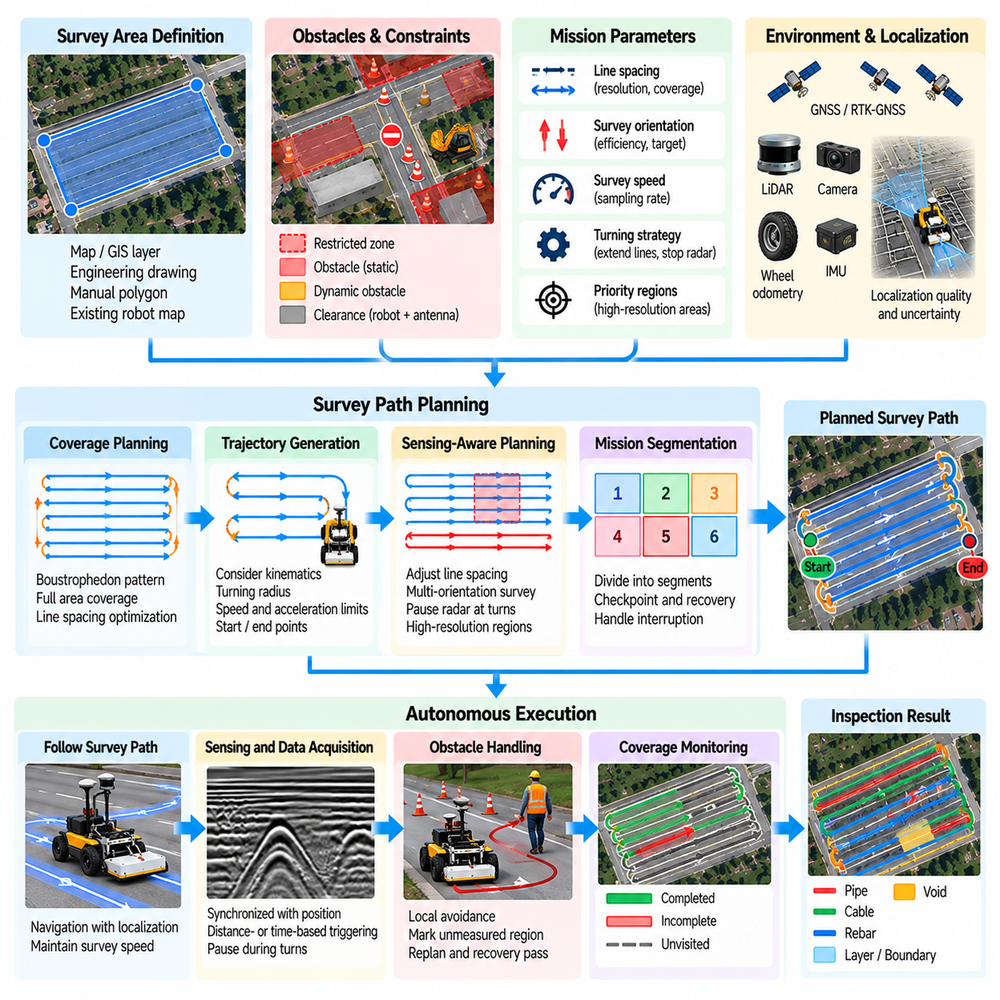{width="7.268055555555556in" height="7.268055555555556in"}

Autonomous GPR survey path planning transforms an infrastructure inspection area into a sequence of robot trajectories that provides systematic radar coverage. Unlike ordinary navigation, where the primary objective is reaching a destination safely, a GPR survey must ensure that measurements are collected across the required surface with controlled spacing, orientation, speed, and overlap. The planner therefore optimizes both robot motion and sensing quality as parts of the same inspection mission.

The planning process begins with a survey region defined from a map, GIS layer, engineering drawing, manually selected polygon, or previously generated robot map. The region may represent a road section, bridge deck, pavement area, utility corridor, industrial floor, or other accessible infrastructure. Boundaries are converted into a coordinate frame compatible with robot localization so that planned radar measurements can later be georeferenced to the inspected asset.

Before generating scan paths, the planner identifies areas that cannot or should not be traversed. Fixed structures, barriers, curbs, excavations, equipment, traffic zones, steep slopes, and safety exclusion regions can be represented as obstacles or restricted polygons. Additional clearance is normally applied according to robot dimensions and antenna geometry. This converts the physical inspection environment into a navigable survey region suitable for coverage planning.

Coverage path planning differs fundamentally from point-to-point route planning. The robot must pass sufficiently close to every required portion of the survey area rather than simply finding the shortest route between two locations. A common strategy decomposes the region into parallel survey lines arranged in a back-and-forth or boustrophedon pattern. The spacing between lines is selected according to the radar footprint, target dimensions, required resolution, and intended three-dimensional reconstruction quality.

Survey orientation can significantly affect both mission efficiency and radar interpretation. The planner may align scan lines with the longest dimension of the inspection region to reduce turning, or orient them relative to expected underground objects. For example, scanning across the expected direction of a buried linear utility can produce stronger and more recognizable cross-sectional signatures. Multiple survey orientations may be scheduled when higher confidence or three-dimensional characterization is required.

Path spacing represents a direct connection between sensing requirements and robot motion. Wide spacing reduces survey time but can leave subsurface features insufficiently sampled, while narrow spacing increases coverage density, mission duration, storage requirements, and energy consumption. The planner should therefore derive spacing from the inspection objective rather than treating it as an arbitrary navigation parameter. High-resolution regions can also use denser trajectories than low-priority areas.

Turning behavior requires special consideration because GPR sensing is most reliable during controlled, predictable motion. Tight turns can change antenna orientation, increase wheel slip, disturb localization, and produce irregular spatial sampling. The planner can extend survey lines beyond the inspection boundary when space permits, allowing the robot to complete turns outside the primary measurement region. Radar acquisition may be paused during turns and resumed after the robot stabilizes on the next scan line.

Robot kinematic constraints must be incorporated into trajectory generation. Differential-drive, skid-steer, Ackermann-steered, and omnidirectional platforms have different minimum turning radii and motion capabilities. A geometrically valid coverage pattern may therefore be physically impossible for a particular inspection robot. The planner converts ideal scan lines into feasible trajectories while respecting steering limits, velocity limits, acceleration constraints, robot footprint, and antenna placement.

Survey speed is also a sensing parameter. The maximum allowable velocity depends on radar trace rate and required spatial sampling distance. If the robot moves too quickly, consecutive measurements may become too widely separated to support reliable detection or reconstruction. The planner can therefore calculate velocity limits from acquisition requirements and request slower motion in high-resolution regions. Motion control and radar acquisition become coordinated components of the same planning problem.

Localization quality can influence where and how the robot surveys. Outdoor road inspections may use GNSS or RTK-GNSS, while bridge decks, tunnels, indoor structures, or GNSS-denied areas may depend on LiDAR, cameras, wheel odometry, landmarks, or SLAM. The planner can avoid regions with known localization difficulties or reduce speed where pose uncertainty increases. Survey results should retain localization confidence because positional uncertainty directly affects mapped subsurface detections.

The mission planner divides long inspections into manageable survey segments. Each segment can contain entry motion, radar acquisition lines, transitions, turning maneuvers, and an exit condition. Segmenting the mission simplifies recovery from interruption and allows progress to be checkpointed. If the robot stops because of an obstacle, sensor fault, communication failure, or low battery, completed segments remain recorded while incomplete sections can be scheduled again.

Dynamic obstacles require coordination between local navigation and coverage planning. A conventional navigation system may simply drive around a pedestrian, vehicle, or temporary barrier, but such a deviation can create an unmeasured region in a GPR survey. The system must distinguish safe obstacle avoidance from valid inspection coverage. When the robot leaves a planned scan line, the affected portion can be marked incomplete and automatically inserted into a later recovery trajectory.

Coverage tracking continuously compares the planned survey with the trajectory actually executed by the robot. A line should not be considered complete merely because the robot reached its endpoint. The software can evaluate positional deviation, measurement availability, sampling interval, localization confidence, and radar health along the path. Only portions satisfying inspection-quality criteria are marked as successfully covered, creating a measurement-aware coverage map rather than a simple navigation history.

Adaptive replanning allows the mission to respond to information discovered during inspection. Preliminary radar processing may identify an unusual reflection, suspected utility, void, or structurally important region. The planner can generate additional passes with reduced line spacing, different orientations, or slower velocity around the candidate. This creates a closed-loop inspection process in which sensor observations influence subsequent robot motion instead of waiting for the entire mission to finish.

Energy management becomes important during large-area surveys because dense coverage can require long travel distances. The planner can estimate path length, mission duration, computational load, and expected battery consumption before execution. Charging or battery replacement can be incorporated between survey segments when necessary. Mission partitioning should minimize unnecessary transit while ensuring that the robot retains sufficient energy to reach a safe location if inspection is interrupted.

Safety constraints have higher priority than coverage efficiency. Geofences, traffic boundaries, minimum obstacle clearances, maximum slopes, prohibited surfaces, worker zones, and emergency-stop conditions constrain the path that may be executed. If a required inspection area cannot be reached safely, the planner should report it as inaccessible rather than forcing coverage. The resulting mission record can distinguish physically uninspected regions from areas missed because of sensing or navigation failures.

For repeated infrastructure inspection, previously executed trajectories can be reused as reference paths. Following similar scan lines across multiple inspection dates improves spatial correspondence between historical datasets and supports change detection. The planner can register an earlier survey to the current map and regenerate feasible paths while preserving measurement locations as closely as practical. This repeatability is valuable for monitoring progressive deterioration or changes around buried infrastructure.

The planning system should maintain explicit relationships between planned paths, executed trajectories, and acquired radar data. Each survey line can have an identifier associated with expected geometry, actual robot poses, radar trace ranges, quality statistics, and completion state. These relationships allow later processing software to determine exactly where each B-scan or three-dimensional radar volume originated and make it possible to reconstruct the inspection mission from stored records.

A modular robotic implementation separates global coverage generation from local trajectory execution. The coverage planner determines where measurements are required, while the navigation subsystem converts survey lines into collision-free robot motion. The mission manager coordinates radar acquisition, localization, safety states, and recovery behavior. This separation allows conventional autonomous navigation capabilities to be reused while adding the measurement-specific logic required for GPR inspection.

Within the infrastructure inspection workflow, autonomous survey planning connects GPR data acquisition and subsurface processing with later AI interpretation, bridge and road inspection, pipeline inspection, GIS integration, and field safety functions. The chapter structure places autonomous GPR survey planning directly after GPR sensor integration and data processing, emphasizing that sensing, interpretation, and robot motion must operate as a coordinated inspection system.

A successful autonomous GPR planner therefore optimizes more than travel distance. It must balance coverage completeness, radar sampling density, trajectory accuracy, robot kinematics, localization confidence, obstacle avoidance, safety, energy, and mission duration. By continuously comparing intended measurements with measurements actually acquired, the system can detect coverage gaps and generate recovery or adaptive scans, transforming autonomous navigation into a repeatable infrastructure measurement process.

자율 GPR 조사 경로 계획(Autonomous GPR Survey Path Planning)은 인프라 검사 영역(Infrastructure Inspection Area)을 체계적인 레이더 커버리지(Radar Coverage)를 제공하는 일련의 로봇 궤적(Robot Trajectory)으로 변환한다. 일반적인 내비게이션에서는 목적지에 안전하게 도달하는 것이 주요 목표이지만, GPR 조사에서는 요구되는 표면 전체에서 제어된 간격, 방향, 속도 및 중첩(Overlap)을 유지하면서 측정 데이터를 수집해야 한다. 따라서 경로 계획기(Planner)는 로봇 이동과 센싱 품질(Sensing Quality)을 하나의 통합된 검사 임무(Inspection Mission)로 최적화한다.

경로 계획 과정은 지도(Map), 지리정보시스템 계층(GIS Layer), 엔지니어링 도면(Engineering Drawing), 사용자가 지정한 다각형(Manually Selected Polygon), 또는 기존에 생성된 로봇 지도(Robot Map)에서 정의된 조사 영역(Survey Region)으로부터 시작된다. 조사 영역은 도로 구간, 교량 상판(Bridge Deck), 포장 영역(Pavement Area), 유틸리티 회랑(Utility Corridor), 산업 시설 바닥 또는 기타 접근 가능한 인프라가 될 수 있다. 경계는 로봇 위치 추정(Robot Localization)과 호환되는 좌표계(Coordinate Frame)로 변환되며, 이를 통해 계획된 레이더 측정 결과를 이후 검사 대상 자산과 지리적으로 연결할 수 있다.

스캔 경로(Scan Path)를 생성하기 전에 경로 계획기는 로봇이 이동할 수 없거나 이동해서는 안 되는 영역을 식별한다. 고정 구조물, 장벽, 연석(Curb), 굴착 구역, 장비, 교통 구역, 급경사, 안전 제외 영역(Safety Exclusion Region)은 장애물 또는 제한 다각형(Restricted Polygon)으로 표현할 수 있다. 일반적으로 로봇 크기와 안테나 형상(Antenna Geometry)에 따라 추가 안전 여유 공간(Clearance)을 적용한다. 이를 통해 실제 검사 환경을 커버리지 계획(Coverage Planning)에 적합한 주행 가능한 조사 영역으로 변환한다.

커버리지 경로 계획(Coverage Path Planning)은 지점 간 경로 계획(Point-to-Point Route Planning)과 근본적으로 다르다. 로봇은 두 위치 사이의 최단 경로만 찾는 것이 아니라 조사 영역의 모든 필요한 부분을 충분히 근접하여 통과해야 한다. 일반적인 방법은 조사 영역을 평행한 조사 라인(Parallel Survey Line)으로 분해하고 왕복 또는 부스트로피돈 패턴(Boustrophedon Pattern)으로 배열하는 것이다. 라인 사이의 간격은 레이더 탐지 범위(Radar Footprint), 표적 크기, 요구 해상도(Required Resolution), 3차원 재구성(Three-Dimensional Reconstruction)에 필요한 품질을 고려하여 결정한다.

조사 방향(Survey Orientation)은 임무 효율과 레이더 해석(Radar Interpretation)에 큰 영향을 미칠 수 있다. 경로 계획기는 회전 횟수를 줄이기 위해 검사 영역의 가장 긴 방향에 스캔 라인을 정렬하거나 예상되는 지하 객체의 방향을 기준으로 배치할 수 있다. 예를 들어 예상되는 선형 매설 유틸리티(Buried Linear Utility)의 진행 방향을 가로질러 스캔하면 더욱 강하고 식별하기 쉬운 단면 신호(Cross-Sectional Signature)를 얻을 수 있다. 높은 신뢰도나 3차원 특성 분석이 필요한 경우에는 여러 방향의 조사 경로를 계획할 수도 있다.

경로 간격(Path Spacing)은 센싱 요구사항과 로봇 이동을 직접 연결하는 요소이다. 넓은 간격은 조사 시간을 단축하지만 지하 특징(Subsurface Feature)이 충분히 샘플링되지 않을 수 있으며, 좁은 간격은 커버리지 밀도(Coverage Density)를 증가시키는 대신 임무 시간, 저장 공간, 에너지 소비량을 증가시킨다. 따라서 경로 계획기는 간격을 단순한 내비게이션 파라미터로 설정하기보다 검사 목적에 따라 결정해야 한다. 높은 해상도가 필요한 영역에는 낮은 우선순위 영역보다 더욱 조밀한 궤적을 사용할 수도 있다.

회전 동작(Turning Behavior)은 GPR 센싱이 제어되고 예측 가능한 움직임에서 가장 안정적으로 수행되기 때문에 특별한 고려가 필요하다. 급격한 회전은 안테나 방향을 변화시키고 휠 슬립(Wheel Slip)을 증가시키며 위치 추정 성능을 저하시키고 불규칙한 공간 샘플링(Spatial Sampling)을 발생시킬 수 있다. 공간이 허용되는 경우 경로 계획기는 조사 라인을 검사 경계 외부까지 연장하여 로봇이 주요 측정 영역 밖에서 회전을 완료하도록 할 수 있다. 회전 중에는 레이더 데이터 수집을 일시 정지하고 다음 스캔 라인에서 로봇이 안정화된 후 다시 시작할 수 있다.

로봇 운동학적 제약(Robot Kinematic Constraint)은 궤적 생성 과정에 반영되어야 한다. 차동구동(Differential-Drive), 스키드 스티어(Skid-Steer), 애커먼 조향(Ackermann Steering), 전방향 이동(Omnidirectional) 플랫폼은 서로 다른 최소 회전 반경(Minimum Turning Radius)과 이동 특성을 가진다. 따라서 기하학적으로 유효한 커버리지 패턴이라도 특정 검사 로봇에서는 실제 실행이 불가능할 수 있다. 경로 계획기는 이상적인 스캔 라인을 조향 제한, 속도 제한, 가속도 제약, 로봇 외형(Robot Footprint), 안테나 위치를 만족하는 실행 가능한 궤적으로 변환한다.

조사 속도(Survey Speed) 역시 센싱 파라미터(Sensing Parameter)이다. 허용 가능한 최대 속도는 레이더 트레이스 속도(Radar Trace Rate)와 요구되는 공간 샘플링 거리(Spatial Sampling Distance)에 따라 결정된다. 로봇이 지나치게 빠르게 이동하면 연속 측정값 사이의 간격이 너무 넓어져 안정적인 탐지 또는 재구성이 어려워질 수 있다. 따라서 경로 계획기는 데이터 수집 요구사항으로부터 속도 제한을 계산하고 고해상도 영역에서는 더욱 느린 이동을 요구할 수 있다. 이와 같이 모션 제어(Motion Control)와 레이더 데이터 수집(Radar Acquisition)은 동일한 계획 문제를 구성하는 상호 연계된 요소가 된다.

위치 추정 품질(Localization Quality)은 로봇이 어디에서 어떤 방식으로 조사해야 하는지에 영향을 미칠 수 있다. 실외 도로 검사에서는 위성항법시스템(GNSS) 또는 실시간 이동측위 위성항법시스템(RTK-GNSS)을 사용할 수 있지만, 교량 상판, 터널, 실내 구조물 또는 위성항법 신호가 제한되는 환경(GNSS-Denied Area)에서는 라이다(LiDAR), 카메라, 휠 오도메트리(Wheel Odometry), 랜드마크(Landmark), 동시적 위치추정 및 지도작성(SLAM)에 의존할 수 있다. 경로 계획기는 위치 추정이 어려운 것으로 알려진 영역을 피하거나 자세 불확실성이 증가하는 영역에서 속도를 낮출 수 있다. 위치 불확실성은 매핑된 지하 탐지 결과에 직접 영향을 미치므로 조사 결과에는 위치 추정 신뢰도(Localization Confidence)를 함께 보존해야 한다.

임무 계획기(Mission Planner)는 장시간의 검사를 관리 가능한 조사 세그먼트(Survey Segment)로 분할한다. 각 세그먼트에는 진입 이동(Entry Motion), 레이더 데이터 수집 라인, 구간 전환(Transition), 회전 동작, 종료 조건(Exit Condition)이 포함될 수 있다. 임무를 세그먼트화하면 중단 이후의 복구가 단순해지고 진행 상태를 체크포인트(Checkpoint)로 저장할 수 있다. 장애물, 센서 고장, 통신 장애 또는 배터리 부족으로 로봇이 정지하더라도 완료된 세그먼트는 그대로 기록하고 미완료 구간만 다시 계획할 수 있다.

동적 장애물(Dynamic Obstacle)을 처리하려면 로컬 내비게이션(Local Navigation)과 커버리지 계획을 함께 조정해야 한다. 일반적인 내비게이션 시스템은 보행자, 차량 또는 임시 장애물을 단순히 우회할 수 있지만 GPR 조사에서는 이러한 경로 이탈로 인해 측정되지 않은 영역이 발생할 수 있다. 시스템은 안전한 장애물 회피와 유효한 검사 커버리지를 구분해야 한다. 로봇이 계획된 스캔 라인을 벗어난 경우 영향을 받은 구간을 미완료 상태로 표시하고 이후 복구 궤적(Recovery Trajectory)에 자동으로 추가할 수 있다.

커버리지 추적(Coverage Tracking)은 계획된 조사 경로와 로봇이 실제로 실행한 궤적을 지속적으로 비교한다. 로봇이 스캔 라인의 끝점에 도달했다는 이유만으로 해당 라인을 완료된 것으로 판단해서는 안 된다. 소프트웨어는 경로상의 위치 편차(Positional Deviation), 측정 데이터 존재 여부, 샘플링 간격, 위치 추정 신뢰도, 레이더 상태(Radar Health)를 평가할 수 있다. 검사 품질 기준을 만족한 부분만 성공적으로 조사된 영역으로 표시함으로써 단순한 내비게이션 이력이 아니라 측정 인식형 커버리지 지도(Measurement-Aware Coverage Map)를 생성한다.

적응형 재계획(Adaptive Replanning)은 검사 과정에서 발견되는 정보에 따라 임무를 변경할 수 있도록 한다. 초기 레이더 처리(Preliminary Radar Processing)를 통해 비정상적인 반사, 의심되는 유틸리티, 공동 또는 구조적으로 중요한 영역이 발견될 수 있다. 경로 계획기는 이러한 후보 영역 주변에 더 좁은 라인 간격, 다른 조사 방향 또는 느린 속도를 적용한 추가 경로를 생성할 수 있다. 이를 통해 전체 임무가 종료될 때까지 기다리지 않고 센서 관측 결과가 이후의 로봇 이동에 영향을 미치는 폐루프 검사 프로세스(Closed-Loop Inspection Process)를 구성할 수 있다.

에너지 관리(Energy Management)는 조밀한 커버리지로 인해 긴 이동 거리가 요구되는 대규모 조사에서 중요해진다. 경로 계획기는 실행 전에 경로 길이, 임무 시간, 계산 부하(Computational Load), 예상 배터리 소비량을 추정할 수 있다. 필요한 경우 조사 세그먼트 사이에 충전 또는 배터리 교체를 포함할 수 있다. 임무 분할(Mission Partitioning)은 불필요한 이동을 최소화하면서 검사가 중단될 경우에도 로봇이 안전한 위치에 도달할 수 있는 충분한 에너지를 확보하도록 설계되어야 한다.

안전 제약(Safety Constraint)은 커버리지 효율보다 높은 우선순위를 가진다. 지오펜스(Geofence), 교통 경계(Traffic Boundary), 최소 장애물 이격 거리, 최대 경사도, 이동 금지 표면, 작업자 구역, 비상 정지 조건은 실행 가능한 경로를 제한한다. 필요한 검사 영역에 안전하게 접근할 수 없다면 경로 계획기는 강제로 커버리지를 수행하는 대신 해당 영역을 접근 불가(Inaccessible) 상태로 보고해야 한다. 최종 임무 기록에서는 물리적으로 접근할 수 없어 검사하지 못한 영역과 센싱 또는 내비게이션 실패로 누락된 영역을 구분할 수 있다.

반복적인 인프라 검사(Repeated Infrastructure Inspection)에서는 이전에 실행된 궤적을 기준 경로(Reference Path)로 다시 사용할 수 있다. 여러 검사 시점에 유사한 스캔 라인을 따라 이동하면 과거 데이터셋 사이의 공간적 대응 관계(Spatial Correspondence)가 향상되어 변화 탐지(Change Detection)를 지원할 수 있다. 경로 계획기는 이전 조사 경로를 현재 지도에 정합(Registration)한 후 측정 위치를 가능한 한 유지하면서 실행 가능한 경로를 다시 생성할 수 있다. 이러한 반복성(Repeatability)은 점진적인 구조 열화 또는 매설 인프라 주변의 변화를 모니터링하는 데 유용하다.

경로 계획 시스템은 계획 경로(Planned Path), 실제 실행 궤적(Executed Trajectory), 수집된 레이더 데이터 사이의 관계를 명시적으로 유지해야 한다. 각 조사 라인에는 예상 경로 형상, 실제 로봇 자세, 레이더 트레이스 범위, 품질 통계(Quality Statistics), 완료 상태와 연결된 식별자를 부여할 수 있다. 이러한 관계를 통해 후속 처리 소프트웨어는 각각의 B-스캔(B-Scan) 또는 3차원 레이더 볼륨이 정확히 어느 위치에서 생성되었는지 판단할 수 있으며 저장된 기록으로 전체 검사 임무를 재구성할 수 있다.

모듈형 로봇 구현(Modular Robotic Implementation)에서는 전역 커버리지 생성(Global Coverage Generation)과 로컬 궤적 실행(Local Trajectory Execution)을 분리한다. 커버리지 계획기는 어디에서 측정해야 하는지를 결정하고, 내비게이션 서브시스템(Navigation Subsystem)은 조사 라인을 충돌 없는 로봇 이동으로 변환한다. 임무 관리자(Mission Manager)는 레이더 데이터 수집, 위치 추정, 안전 상태, 복구 동작(Recovery Behavior)을 조정한다. 이러한 분리를 통해 기존 자율 내비게이션 기능을 재사용하면서 GPR 검사에 필요한 측정 중심의 로직(Measurement-Specific Logic)을 추가할 수 있다.

전체 인프라 검사 워크플로(Infrastructure Inspection Workflow)에서 자율 조사 계획(Autonomous Survey Planning)은 GPR 데이터 수집과 지하 데이터 처리(Subsurface Processing)를 이후의 인공지능 기반 해석(AI-Based Interpretation), 교량 및 도로 검사, 파이프라인 검사, GIS 통합, 현장 안전 기능과 연결한다. 전체 장의 구조에서 자율 GPR 조사 계획은 GPR 센서 통합과 데이터 처리 이후에 위치하며, 이는 센싱, 해석, 로봇 이동이 서로 독립적인 기능이 아니라 하나의 통합된 검사 시스템으로 동작해야 함을 의미한다.

성공적인 자율 GPR 경로 계획기(Autonomous GPR Planner)는 단순한 이동 거리만을 최적화하지 않는다. 커버리지 완전성(Coverage Completeness), 레이더 샘플링 밀도(Radar Sampling Density), 궤적 정확도(Trajectory Accuracy), 로봇 운동학, 위치 추정 신뢰도, 장애물 회피, 안전, 에너지, 임무 시간을 종합적으로 균형화해야 한다. 계획된 측정과 실제로 획득된 측정 데이터를 지속적으로 비교함으로써 시스템은 커버리지 누락을 탐지하고 복구 조사 또는 적응형 스캔(Adaptive Scan)을 생성할 수 있으며, 이를 통해 일반적인 자율 내비게이션을 반복 가능하고 체계적인 인프라 측정 프로세스(Infrastructure Measurement Process)로 확장할 수 있다.

##  

## 05.05. GPR AI Interpretation Utility Detection [w/Code]

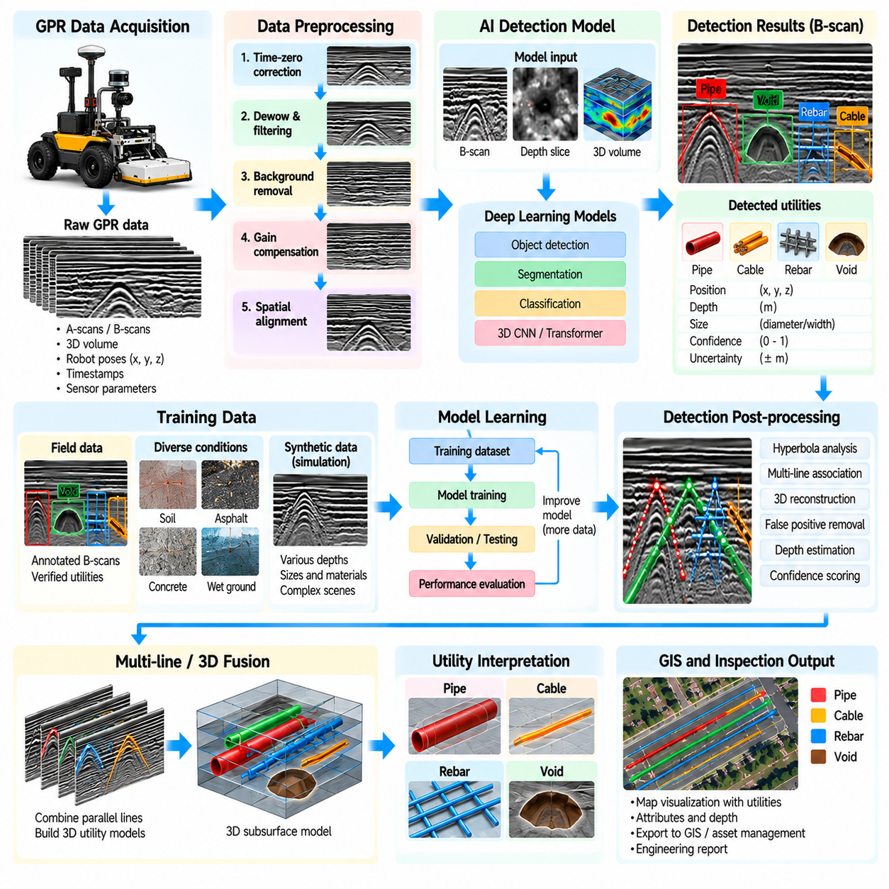{width="7.268055555555556in" height="7.268055555555556in"}

Artificial intelligence extends GPR interpretation from signal visualization toward automated recognition of buried infrastructure. After preprocessing, spatial registration, and geometric reconstruction, AI models can analyze radar traces, B-scans, depth slices, or three-dimensional volumes to identify patterns associated with pipes, cables, conduits, drainage structures, and other utilities. The objective is to convert radar responses into structured detection results while retaining confidence and spatial uncertainty.

Utility detection is difficult because GPR does not directly measure the semantic identity of an underground object. It measures electromagnetic reflections produced by contrasts in material properties. Similar radar signatures may originate from utilities, rocks, reinforcement, construction joints, moisture boundaries, or clutter. AI interpretation therefore operates as probabilistic inference, combining signal appearance, geometry, spatial continuity, acquisition quality, and contextual information rather than treating every strong reflection as a confirmed utility.

For many buried cylindrical objects, the characteristic hyperbolic response visible in a B-scan provides an important detection cue. Traditional algorithms can search for hyperbola-like curves, while machine-learning models can learn variations caused by target depth, diameter, orientation, soil condition, antenna frequency, and survey geometry. AI becomes particularly useful when responses are incomplete, overlapping, noisy, or distorted enough that fixed geometric templates cannot reliably describe them.

A practical AI pipeline begins by converting processed GPR measurements into standardized model inputs. Signal amplitudes can be normalized, resized, windowed, or transformed into image-like representations while preserving spatial scale. B-scans may be divided into overlapping patches for detection, while three-dimensional surveys can generate depth slices or local volumes. The transformation must retain relationships between model coordinates and original radar coordinates so that detections can later be mapped back into physical space.

Supervised learning requires annotated examples describing known underground targets. Labels may identify bounding boxes, segmentation masks, hyperbola centers, target classes, depths, or utility trajectories. High-quality annotation is difficult because the true underground configuration is often unknown until excavation or another verification method is available. Training datasets should therefore distinguish confirmed ground truth from uncertain field interpretation to avoid teaching the model that expert guesses are equivalent to physically verified targets.

Training data should represent the diversity expected in deployment. Radar signatures vary with soil composition, moisture, pavement structure, concrete condition, antenna frequency, target material, burial depth, target diameter, robot velocity, and sensor orientation. A model trained only on clean measurements from one test site can perform poorly in different environments. Dataset design should therefore include multiple sites, acquisition conditions, sensor configurations, and target types whenever possible.

Synthetic data can supplement scarce field measurements. Electromagnetic simulation can generate radar responses for controlled combinations of target geometry, depth, material, and surrounding medium. Simulated datasets provide precise labels and can expose models to rare configurations that are difficult to collect experimentally. However, simulation-to-reality differences must be considered because real measurements contain antenna effects, heterogeneous materials, localization errors, environmental noise, and construction complexity that simplified models may not reproduce.

Different AI architectures can support different stages of interpretation. Classification models can determine whether a candidate region contains a likely utility response, object detectors can localize targets within B-scans, and segmentation networks can identify response regions at pixel level. Sequence or transformer-based models can analyze relationships across traces, while three-dimensional networks can process volumetric surveys. The architecture should be selected according to the required output rather than simply choosing the most complex available model.

Candidate-based detection can reduce computational requirements and false alarms. Conventional signal processing first identifies strong reflections, hyperbolic structures, or other suspicious regions, and an AI model subsequently evaluates these candidates. An alternative end-to-end approach allows a neural network to learn detection directly from larger radar representations. Hybrid systems are often attractive for robotic inspection because physically meaningful preprocessing can constrain the search space while AI handles complex classification and ambiguity.

A single B-scan detection provides limited evidence about a buried utility. When parallel survey lines are available, detections from neighboring scans can be associated according to position, depth, orientation, and appearance. A pipe or cable should normally form a spatially coherent structure rather than a collection of unrelated points. Multi-line fusion therefore allows AI interpretation to estimate utility trajectories, reject isolated false positives, and increase confidence through repeated observations.

Depth estimation can be integrated with utility detection, but it remains dependent on electromagnetic propagation velocity. An AI model may estimate hyperbola geometry or directly regress target depth, yet its output can still be biased if dielectric conditions differ from those represented during training. A robust system should retain both the predicted depth and the assumptions or uncertainty associated with the material model. AI prediction should not conceal the physical dependencies of GPR measurement.

Utility classification is generally more uncertain than utility localization. Radar responses may provide clues about geometry and electromagnetic properties, but distinguishing electrical cables, communication lines, water pipes, gas pipes, or other services solely from GPR can be unreliable. Classification models should therefore report probabilities or broad categories when evidence is insufficient. External information such as utility records, GIS layers, surface features, and known construction layouts can provide additional contextual evidence.

Confidence estimation is essential for operational use. A detection score from a neural network should not automatically be interpreted as engineering certainty. Confidence can incorporate model probability, signal quality, localization accuracy, agreement across multiple scan lines, consistency with expected geometry, and similarity to the training distribution. Regions containing unfamiliar radar patterns can be flagged as uncertain rather than forcing the model to assign a confident known class.

Uncertainty can also control autonomous robot behavior. If onboard AI detects a possible utility with insufficient confidence, the mission planner can request additional scans across the region using smaller line spacing, slower velocity, or a different orientation. New measurements can then be fused with the original evidence. This creates active inspection, where AI does not merely analyze completed data but influences subsequent sensing actions to reduce ambiguity before the robot leaves the site.

False-positive and false-negative errors have different operational consequences. Excessive false positives can create unnecessary excavation, engineering review, and maintenance work, while false negatives may leave critical buried infrastructure undocumented. Detection thresholds should therefore reflect the inspection objective and risk level. Performance evaluation should include precision, recall, localization error, depth error, and object-level detection rather than relying only on generic image-classification accuracy.

Model validation should separate training environments from evaluation environments whenever possible. Testing random radar patches from the same survey used for training can produce unrealistically optimistic results because neighboring measurements are strongly correlated. More meaningful evaluation holds out complete sites, survey sessions, or environmental conditions. This site-level validation better measures whether the AI system can generalize to infrastructure that was not represented during model development.

Human review remains important for high-consequence interpretations. The software can present detected utilities together with the supporting B-scan, depth slice, estimated trajectory, confidence, and relevant quality indicators. Engineers can accept, reject, modify, or mark detections for additional investigation. These decisions can be stored as structured feedback, creating a mechanism for dataset improvement and future model retraining without discarding the original automated prediction.

Georeferencing converts AI output into information usable by infrastructure management systems. Detected targets are transformed from model coordinates into radar, robot, map, and geographic coordinates using the acquisition trajectory and sensor calibration. Multiple detections can then be assembled into utility objects containing estimated position, depth, direction, extent, class probability, confidence, and provenance. These objects can subsequently be exported to GIS or asset-management applications.

Deployment on inspection robots requires attention to computational resources and latency. Lightweight models can perform preliminary candidate detection on an onboard GPU or edge processor, while larger models and three-dimensional fusion may execute after the mission. Model version, preprocessing configuration, calibration state, and inference parameters should be stored with every result. This traceability ensures that later users can determine exactly how an automated interpretation was produced.

Within the GPR inspection workflow, AI utility interpretation builds directly on sensor integration, radar processing, and autonomous survey planning. Its outputs support later bridge and road inspection, pipeline inspection, GIS integration, and field decision making. The value of AI is therefore not simply automatic pattern recognition, but the conversion of spatially registered radar evidence into structured hypotheses that can participate in a larger robotic infrastructure inspection system.

A dependable GPR AI system combines learned models with signal processing, physical measurement knowledge, spatial consistency, uncertainty estimation, and human verification. It should distinguish observation from interpretation and prediction from confirmed ground truth. When these boundaries are preserved, AI can reduce manual review effort, prioritize suspicious regions, guide adaptive rescanning, reconstruct probable utility trajectories, and make large-scale robotic GPR surveys more consistent and operationally useful.

인공지능(Artificial Intelligence, AI)은 GPR 해석(GPR Interpretation)을 단순한 신호 시각화(Signal Visualization)에서 매설 인프라(Buried Infrastructure)의 자동 인식(Automated Recognition)으로 확장한다. 전처리(Preprocessing), 공간 정합(Spatial Registration), 기하학적 재구성(Geometric Reconstruction)이 완료되면 AI 모델은 레이더 트레이스(Radar Trace), B-스캔(B-Scan), 깊이 슬라이스(Depth Slice), 3차원 볼륨(Three-Dimensional Volume)을 분석하여 파이프, 케이블, 전선관(Conduit), 배수 구조물(Drainage Structure), 기타 유틸리티와 관련된 패턴을 식별할 수 있다. 목표는 신뢰도와 공간적 불확실성(Spatial Uncertainty)을 유지하면서 레이더 응답을 구조화된 탐지 결과로 변환하는 것이다.

유틸리티 탐지(Utility Detection)가 어려운 이유는 GPR이 지하 객체의 의미론적 정체성(Semantic Identity)을 직접 측정하지 않기 때문이다. GPR은 물질 특성 차이에 의해 발생하는 전자기 반사(Electromagnetic Reflection)를 측정한다. 유사한 레이더 신호가 유틸리티, 암석, 철근(Reinforcement), 시공 이음부(Construction Joint), 수분 경계(Moisture Boundary), 클러터(Clutter) 등에서 발생할 수 있다. 따라서 AI 해석은 모든 강한 반사를 확인된 유틸리티로 판단하기보다 신호 형태, 기하학적 특성, 공간적 연속성, 데이터 수집 품질, 상황 정보를 결합하는 확률적 추론(Probabilistic Inference)으로 수행되어야 한다.

많은 원통형 매설 객체(Buried Cylindrical Object)에서는 B-스캔에 나타나는 특징적인 쌍곡선 응답(Hyperbolic Response)이 중요한 탐지 단서를 제공한다. 전통적인 알고리즘은 쌍곡선 형태의 곡선을 검색할 수 있으며, 머신러닝(Machine Learning) 모델은 표적 깊이, 직경, 방향, 토양 상태, 안테나 주파수, 조사 형상에 따라 달라지는 패턴을 학습할 수 있다. 특히 응답이 불완전하거나 서로 중첩되고 잡음이 많거나 왜곡되어 고정된 기하학적 템플릿(Geometric Template)으로 안정적인 표현이 어려울 때 AI가 유용하다.

실용적인 AI 파이프라인(AI Pipeline)은 처리된 GPR 측정값을 표준화된 모델 입력(Standardized Model Input)으로 변환하는 과정에서 시작된다. 신호 진폭은 공간 스케일을 유지하면서 정규화(Normalization), 크기 조정(Resizing), 윈도잉(Windowing) 또는 영상 형태의 표현으로 변환할 수 있다. B-스캔은 탐지를 위해 서로 중첩되는 패치(Overlapping Patch)로 나눌 수 있으며, 3차원 조사 데이터에서는 깊이 슬라이스나 국부 볼륨(Local Volume)을 생성할 수 있다. 탐지 결과를 다시 실제 물리 공간으로 변환할 수 있도록 모델 좌표와 원본 레이더 좌표 사이의 관계를 유지해야 한다.

지도학습(Supervised Learning)을 위해서는 알려진 지하 표적을 설명하는 주석 데이터(Annotated Example)가 필요하다. 라벨(Label)은 경계 상자(Bounding Box), 분할 마스크(Segmentation Mask), 쌍곡선 중심(Hyperbola Center), 표적 클래스(Target Class), 깊이 또는 유틸리티 궤적(Utility Trajectory)을 나타낼 수 있다. 실제 지하 구조는 굴착이나 다른 검증 방법을 사용하기 전까지 정확히 알기 어려우므로 고품질 주석을 생성하는 것은 쉽지 않다. 따라서 훈련 데이터셋은 확인된 정답 데이터(Confirmed Ground Truth)와 불확실한 현장 해석을 구분하여 전문가의 추정이 물리적으로 검증된 표적과 동일한 정답으로 학습되는 것을 방지해야 한다.

훈련 데이터(Training Data)는 실제 배포 환경에서 예상되는 다양성을 포함해야 한다. 레이더 신호는 토양 구성, 수분, 포장 구조, 콘크리트 상태, 안테나 주파수, 표적 재질, 매설 깊이, 표적 직경, 로봇 속도, 센서 방향에 따라 달라진다. 하나의 시험 장소에서 획득한 깨끗한 측정 데이터만으로 훈련된 모델은 다른 환경에서 성능이 크게 저하될 수 있다. 따라서 가능한 경우 여러 현장, 데이터 수집 조건, 센서 설정, 표적 종류를 데이터셋 설계에 포함해야 한다.

합성 데이터(Synthetic Data)는 부족한 현장 측정 데이터를 보완할 수 있다. 전자기 시뮬레이션(Electromagnetic Simulation)을 사용하면 표적 형상, 깊이, 재질, 주변 매질의 조합을 제어하면서 레이더 응답을 생성할 수 있다. 시뮬레이션 데이터셋은 정확한 라벨을 제공하며 실제 실험으로 수집하기 어려운 희귀한 조건을 모델에 학습시킬 수 있다. 그러나 실제 측정에는 안테나 효과, 불균질한 물질, 위치 추정 오차, 환경 잡음, 복잡한 시공 구조가 존재하므로 시뮬레이션-현실 차이(Simulation-to-Reality Gap)를 고려해야 한다.

서로 다른 AI 아키텍처(AI Architecture)는 해석 과정의 서로 다른 단계를 지원할 수 있다. 분류 모델(Classification Model)은 후보 영역에 유틸리티 응답이 존재할 가능성을 판단하고, 객체 탐지기(Object Detector)는 B-스캔 내부에서 표적 위치를 탐지하며, 분할 네트워크(Segmentation Network)는 픽셀 수준에서 응답 영역을 식별할 수 있다. 시퀀스 모델(Sequence Model)이나 트랜스포머 기반 모델(Transformer-Based Model)은 트레이스 사이의 관계를 분석하고, 3차원 네트워크(Three-Dimensional Network)는 볼륨 조사 데이터를 처리할 수 있다. 가장 복잡한 모델을 선택하기보다 필요한 출력 형태에 적합한 아키텍처를 선택해야 한다.

후보 기반 탐지(Candidate-Based Detection)는 계산 요구량과 오탐(False Alarm)을 줄일 수 있다. 기존 신호 처리(Conventional Signal Processing)를 통해 강한 반사, 쌍곡선 구조 또는 기타 의심 영역을 먼저 식별한 다음 AI 모델이 이러한 후보를 평가할 수 있다. 다른 방법으로는 신경망(Neural Network)이 넓은 레이더 표현에서 직접 탐지를 학습하는 종단간 접근법(End-to-End Approach)을 사용할 수 있다. 물리적으로 의미 있는 전처리로 탐색 공간을 제한하고 AI가 복잡한 분류와 모호성을 처리하는 하이브리드 시스템(Hybrid System)은 로봇 검사에 특히 유용하다.

하나의 B-스캔 탐지만으로는 매설 유틸리티에 대한 충분한 증거를 제공하기 어렵다. 평행한 조사 라인(Parallel Survey Line)이 존재하는 경우 인접 스캔의 탐지 결과를 위치, 깊이, 방향, 신호 형태에 따라 연결할 수 있다. 파이프 또는 케이블은 일반적으로 서로 관련 없는 여러 점의 집합이 아니라 공간적으로 일관된 구조(Spatially Coherent Structure)를 형성해야 한다. 따라서 다중 라인 융합(Multi-Line Fusion)을 통해 유틸리티 궤적을 추정하고 독립적인 오탐을 제거하며 반복 관측으로 탐지 신뢰도를 높일 수 있다.

깊이 추정(Depth Estimation)은 유틸리티 탐지와 통합할 수 있지만 여전히 전자기파 전파 속도(Electromagnetic Propagation Velocity)에 의존한다. AI 모델은 쌍곡선 형상을 추정하거나 표적 깊이를 직접 회귀(Regression)할 수 있지만, 유전 조건(Dielectric Condition)이 훈련 데이터에 포함된 조건과 다르면 결과에 편향(Bias)이 발생할 수 있다. 견고한 시스템은 예측된 깊이와 함께 사용된 물질 모델에 관련된 가정 또는 불확실성을 유지해야 한다. AI 예측이 GPR 측정의 물리적 의존성을 감추어서는 안 된다.

유틸리티 분류(Utility Classification)는 일반적으로 유틸리티 위치 추정보다 불확실성이 크다. 레이더 응답은 형상과 전자기적 특성에 대한 단서를 제공할 수 있지만 GPR 데이터만으로 전력 케이블, 통신선, 수도관, 가스관 또는 기타 설비를 정확히 구별하는 것은 신뢰성이 낮을 수 있다. 따라서 분류 모델은 증거가 충분하지 않은 경우 확률(Probability)이나 넓은 범주의 클래스(Broad Category)를 제공해야 한다. 유틸리티 기록, GIS 계층, 지표면 특징(Surface Feature), 기존 시공 배치와 같은 외부 정보를 활용하면 추가적인 상황 증거(Contextual Evidence)를 확보할 수 있다.

신뢰도 추정(Confidence Estimation)은 실제 운용에서 필수적이다. 신경망이 생성한 탐지 점수(Detection Score)를 자동으로 공학적 확실성(Engineering Certainty)으로 해석해서는 안 된다. 신뢰도에는 모델 확률, 신호 품질, 위치 추정 정확도, 여러 스캔 라인 사이의 일치성, 예상 형상과의 일관성, 훈련 데이터 분포와의 유사성을 함께 반영할 수 있다. 익숙하지 않은 레이더 패턴이 나타나는 영역에서는 모델이 강제로 높은 확률의 기존 클래스를 할당하기보다 불확실(Uncertain) 상태로 표시할 수 있어야 한다.

불확실성(Uncertainty)은 자율 로봇 동작을 제어하는 데에도 활용할 수 있다. 온보드 AI(Onboard AI)가 충분한 신뢰도를 확보하지 못한 잠재적 유틸리티를 탐지하면 임무 계획기(Mission Planner)가 해당 영역에서 더 좁은 라인 간격, 느린 속도 또는 다른 방향을 사용하여 추가 스캔을 요청할 수 있다. 새롭게 획득한 측정값은 기존 증거와 융합할 수 있다. 이를 통해 AI가 완료된 데이터만 분석하는 것이 아니라 로봇이 현장을 떠나기 전에 모호성을 줄이기 위한 추가 센싱 동작에 영향을 주는 능동 검사(Active Inspection)를 구현할 수 있다.

위양성(False Positive)과 위음성(False Negative)은 실제 운용에서 서로 다른 결과를 초래한다. 과도한 위양성은 불필요한 굴착, 엔지니어링 검토, 유지보수 작업을 발생시킬 수 있으며, 위음성은 중요한 매설 인프라가 기록되지 않은 상태로 남게 할 수 있다. 따라서 탐지 임계값(Detection Threshold)은 검사 목적과 위험 수준에 따라 설정해야 한다. 성능 평가에는 일반적인 영상 분류 정확도만 사용하는 대신 정밀도(Precision), 재현율(Recall), 위치 오차(Localization Error), 깊이 오차(Depth Error), 객체 수준 탐지(Object-Level Detection)를 포함해야 한다.

모델 검증(Model Validation)에서는 가능한 경우 훈련 환경과 평가 환경을 분리해야 한다. 동일한 조사 데이터에서 무작위로 레이더 패치를 나누어 훈련과 시험에 사용하면 인접한 측정값 사이의 강한 상관관계 때문에 실제보다 지나치게 높은 성능이 나타날 수 있다. 더욱 의미 있는 평가는 전체 현장, 조사 세션(Survey Session), 환경 조건을 훈련 데이터에서 제외하고 평가하는 것이다. 이러한 현장 수준 검증(Site-Level Validation)은 AI 시스템이 모델 개발 과정에서 경험하지 않은 인프라 환경으로 일반화(Generalization)할 수 있는지를 더욱 정확하게 평가한다.

중요도가 높은 해석(High-Consequence Interpretation)에서는 사람의 검토(Human Review)가 여전히 중요하다. 소프트웨어는 탐지된 유틸리티와 함께 관련 B-스캔, 깊이 슬라이스, 추정 궤적, 신뢰도, 관련 품질 지표를 제공할 수 있다. 엔지니어는 탐지 결과를 승인, 거부, 수정하거나 추가 조사가 필요한 상태로 표시할 수 있다. 이러한 판단을 구조화된 피드백(Structured Feedback)으로 저장하면 원래의 자동 예측 결과를 보존하면서 데이터셋 개선과 향후 모델 재학습(Model Retraining)에 활용할 수 있다.

지리참조(Georeferencing)는 AI 출력을 인프라 관리 시스템(Infrastructure Management System)에서 사용할 수 있는 정보로 변환한다. 탐지된 표적은 데이터 수집 궤적과 센서 보정을 사용하여 모델 좌표에서 레이더 좌표, 로봇 좌표, 지도 좌표, 지리 좌표로 변환된다. 여러 탐지 결과를 결합하여 추정 위치, 깊이, 방향, 범위, 클래스 확률(Class Probability), 신뢰도, 데이터 출처(Provenance)를 포함하는 유틸리티 객체(Utility Object)를 생성할 수 있다. 이러한 객체는 이후 GIS 또는 자산 관리 애플리케이션(Asset-Management Application)으로 내보낼 수 있다.

검사 로봇에 AI를 배포하려면 계산 자원(Computational Resource)과 지연 시간(Latency)을 고려해야 한다. 경량 모델(Lightweight Model)은 온보드 GPU 또는 엣지 프로세서(Edge Processor)에서 초기 후보 탐지를 수행할 수 있으며, 더 큰 모델과 3차원 융합은 임무 완료 이후 수행할 수 있다. 모든 결과에는 모델 버전(Model Version), 전처리 설정, 보정 상태, 추론 파라미터(Inference Parameter)를 함께 저장해야 한다. 이러한 추적성(Traceability)을 통해 이후 사용자는 자동화된 해석 결과가 정확히 어떤 조건과 과정에서 생성되었는지를 확인할 수 있다.

전체 GPR 검사 워크플로(GPR Inspection Workflow)에서 AI 기반 유틸리티 해석(AI Utility Interpretation)은 센서 통합, 레이더 데이터 처리, 자율 조사 계획의 결과를 직접 활용한다. AI 출력은 이후 교량 및 도로 검사, 파이프라인 검사, GIS 통합, 현장 의사결정(Field Decision Making)을 지원한다. 따라서 AI의 가치는 단순한 자동 패턴 인식(Automatic Pattern Recognition)에 있는 것이 아니라 공간적으로 정합된 레이더 증거를 더 큰 로봇 인프라 검사 시스템에서 활용할 수 있는 구조화된 가설(Structured Hypothesis)로 변환하는 데 있다.

신뢰할 수 있는 GPR AI 시스템(GPR AI System)은 학습 모델(Learned Model)을 신호 처리, 물리적 측정 지식(Physical Measurement Knowledge), 공간적 일관성(Spatial Consistency), 불확실성 추정, 사람에 의한 검증(Human Verification)과 결합한다. 시스템은 관측(Observation)과 해석(Interpretation), 예측(Prediction)과 확인된 정답 데이터(Confirmed Ground Truth)를 명확하게 구분해야 한다. 이러한 경계를 유지하면 AI는 수동 검토 작업을 줄이고, 의심 영역의 우선순위를 결정하며, 적응형 재스캔(Adaptive Rescanning)을 유도하고, 예상 유틸리티 궤적을 재구성하여 대규모 로봇 GPR 조사를 더욱 일관되고 실용적으로 수행할 수 있도록 한다.

##  

## 05.06. Bridge and Road Inspection AMR SW [w/Code]

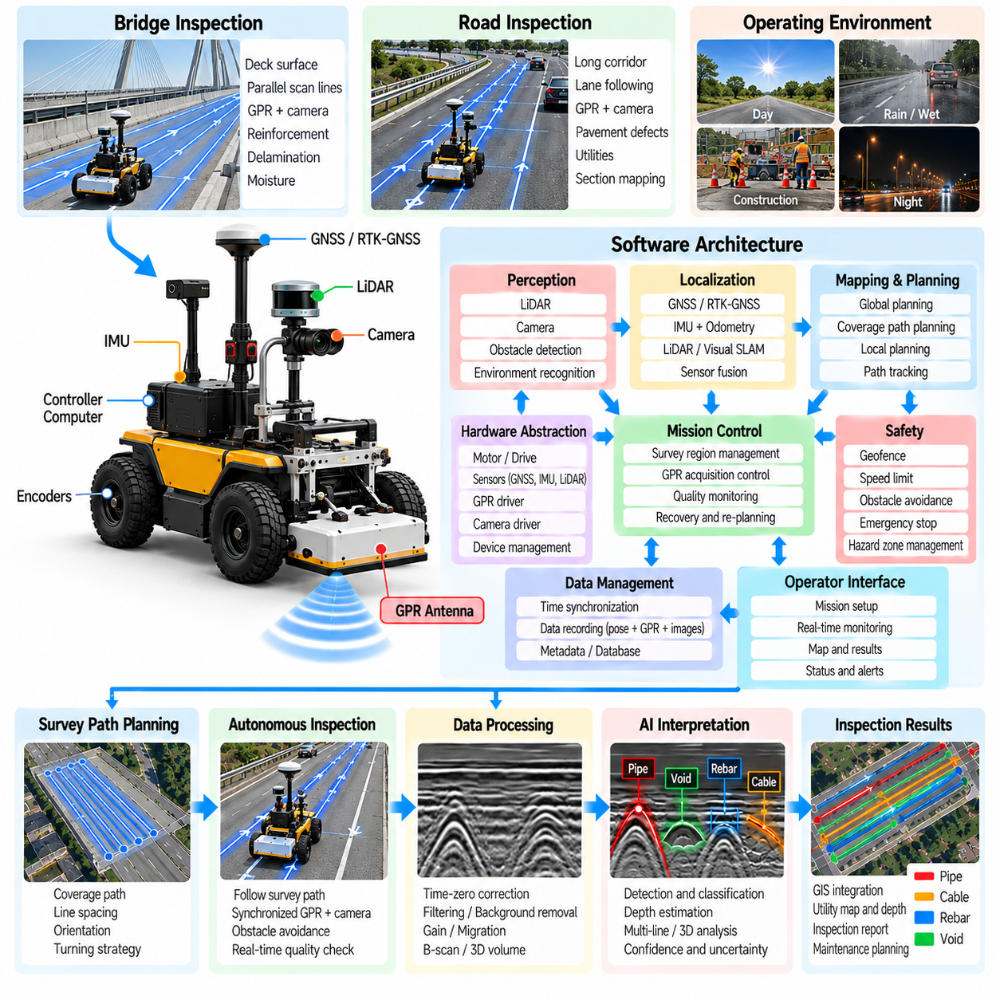{width="7.268055555555556in" height="7.268055555555556in"}

Bridge and road inspection AMR software integrates autonomous mobility, subsurface sensing, surface inspection, localization, mission management, and infrastructure data processing into a field-ready robotic system. Unlike warehouse AMRs operating in structured indoor environments, inspection robots must traverse large outdoor surfaces with changing pavement conditions, traffic constraints, weather exposure, GNSS variability, and irregular obstacles while maintaining consistent measurement quality.

The software architecture is typically divided into hardware abstraction, localization, perception, navigation, inspection sensing, mission control, safety, data management, and operator-interface layers. Hardware drivers isolate wheel encoders, motor controllers, IMUs, GNSS receivers, LiDAR, cameras, GPR sensors, and auxiliary instruments from higher-level applications. This modular structure allows inspection sensors or mobile platforms to change without redesigning the complete software stack.

Localization provides the spatial reference required to associate every inspection measurement with infrastructure coordinates. Outdoor road surveys can combine GNSS or RTK-GNSS with wheel odometry and IMU measurements, while bridge structures may create multipath, partial satellite visibility, or signal degradation. LiDAR or visual localization can supplement satellite positioning, and sensor fusion maintains a continuous robot pose estimate when individual localization sources temporarily become unreliable.

The navigation subsystem converts inspection missions into executable robot trajectories. Global planning determines how the AMR moves between survey regions, while local planning handles nearby obstacles, temporary barriers, workers, vehicles, and unexpected surface conditions. Inspection motion differs from ordinary autonomous driving because the robot must follow predefined scan lines accurately. Cross-track error, heading deviation, velocity variation, and missed path segments directly influence measurement quality.

Bridge deck inspection commonly requires systematic coverage rather than destination-oriented navigation. The mission software divides the deck into parallel lanes or survey cells and generates repeated passes with defined spacing and orientation. GPR measurements can investigate reinforcement, layer boundaries, moisture-related changes, delamination indicators, or subsurface anomalies. Other sensors can be synchronized with the same trajectory to create complementary surface and subsurface inspection records.

Road inspection missions may extend over longer linear corridors and therefore require different planning behavior. The AMR can follow road geometry while maintaining a specified offset from curbs, lane boundaries, or reference trajectories. Survey segments can be divided according to distance, pavement section, intersection, or asset identifier. Long missions benefit from checkpointing so that completed sections remain valid when the robot must stop for traffic, charging, communication loss, or environmental conditions.

GPR acquisition software is coordinated with robot motion rather than operating as an independent recorder. Radar traces are timestamped and associated with robot poses, survey-line identifiers, velocity, sensor configuration, and quality information. The mission controller can enable recording only within valid inspection sections and pause acquisition during turns, obstacle avoidance, manual repositioning, or transit. This prevents unrelated movement from contaminating the inspection dataset.

Surface sensing can complement GPR by providing information that electromagnetic subsurface measurements cannot directly describe. Cameras may document cracks, potholes, joints, markings, corrosion-related surface evidence, or visible deterioration, while LiDAR can measure surface geometry and structural features. When these observations share a common coordinate system, the software can relate visible defects to subsurface responses and create a richer representation of infrastructure condition.

Inspection quality monitoring operates continuously during autonomous execution. The system can evaluate radar trace availability, spatial sampling interval, antenna communication, robot velocity, trajectory deviation, localization uncertainty, camera status, and storage performance. If quality falls below defined limits, the affected path is marked incomplete rather than automatically accepted. The mission manager can then schedule a recovery pass so that navigation completion and inspection completion remain distinct concepts.

Bridge and road environments contain dynamic hazards that require explicit safety behavior. Pedestrians, maintenance workers, moving vehicles, construction equipment, temporary barriers, drop-offs, damaged pavement, and restricted traffic areas may appear during operation. Perception and local navigation provide obstacle detection and avoidance, while safety functions impose speed limits, geofences, emergency stops, minimum clearances, and controlled-stop behavior when safe autonomous continuation cannot be guaranteed.

Obstacle avoidance must preserve inspection coverage. If the AMR leaves a survey line to move around a temporary object, the software records the deviation and identifies the resulting measurement gap. Once the obstacle disappears or another safe approach becomes available, the mission planner can generate a short recovery trajectory through the missing region. This measurement-aware behavior prevents successful obstacle avoidance from being incorrectly interpreted as successful infrastructure inspection.

Weather and surface conditions can influence both mobility and sensing. Rain, standing water, dust, strong illumination changes, wet pavement, temperature, and reduced tire traction may affect cameras, LiDAR, GPR responses, localization, and vehicle control. Environmental states should therefore be recorded with the inspection mission when available. The software can reduce speed, adjust operational limits, suspend selected sensing operations, or terminate the mission when conditions exceed validated operating boundaries.

Data management must handle the large and heterogeneous datasets generated by infrastructure inspection. Radar traces, images, point clouds, localization trajectories, mission events, sensor diagnostics, and processed detections should share consistent timestamps and spatial references. Data can be organized by project, asset, survey date, segment, and scan line. A mission manifest preserves calibration versions, sensor configurations, coordinate systems, software versions, and quality events required for later reconstruction.

Processing may occur partly onboard and partly after the mission. Lightweight algorithms can detect missing radar data, excessive trajectory error, obvious surface defects, or candidate subsurface anomalies in real time. More computationally demanding GPR migration, three-dimensional reconstruction, AI interpretation, image analysis, and multi-sensor fusion can run later on edge or server systems. The same identifiers should connect onboard observations with final engineering products.

Repeated inspections are particularly valuable for bridges and roads because deterioration develops over time. The software can store previous survey trajectories and use them as references for later missions, allowing the AMR to reproduce similar measurement paths. Spatial registration between inspection dates supports comparison of radar responses, surface defects, and detected anomalies. Consistent acquisition geometry improves the reliability of change detection and long-term condition monitoring.

Infrastructure assets require results to be expressed in engineering coordinates rather than only robot coordinates. Detected anomalies can be associated with bridge stationing, deck regions, road chainage, lanes, GIS coordinates, or asset identifiers. Coordinate transformations connect sensor observations with maps and maintenance databases. Each reported defect or anomaly can retain links to the original measurements, processing results, location uncertainty, and inspection confidence supporting the finding.

Operator software provides supervision without requiring continuous manual driving. A field interface can display robot position, planned and completed survey lines, sensor health, remaining mission coverage, battery state, communication status, and detected faults. Operators may pause, resume, cancel, or authorize recovery operations. Manual control can be available for deployment and exceptional situations while preserving clear boundaries between autonomous survey data and manually acquired measurements.

Fault management is essential because infrastructure missions may occur far from convenient recovery locations. The software monitors localization loss, motor faults, sensor disconnection, storage exhaustion, excessive temperature, communication interruption, and battery state. Recoverable faults may trigger controlled retries or mission pauses, while critical failures produce a safe stop. Checkpointed mission state allows inspection to continue later without unnecessarily repeating successfully validated survey regions.

The bridge and road inspection AMR forms a practical application layer above GPR acquisition, data processing, autonomous survey planning, and AI interpretation. These earlier functions provide synchronized sensing, subsurface reconstruction, coverage control, and automated detection, while the application software combines them with field navigation, safety, asset coordinates, operator workflows, and inspection records required for real infrastructure operations.

A mature inspection AMR therefore measures success by more than autonomous driving distance. It must demonstrate that required infrastructure regions were safely reached, valid sensor data were collected at sufficient spatial quality, measurement gaps were identified, results were correctly georeferenced, and the complete inspection remains traceable. This integration transforms an autonomous mobile robot from a sensor carrier into a repeatable bridge and road condition-assessment platform.

교량 및 도로 검사 자율이동로봇(Bridge and Road Inspection AMR) 소프트웨어는 자율 이동(Autonomous Mobility), 지하 센싱(Subsurface Sensing), 표면 검사(Surface Inspection), 위치 추정(Localization), 임무 관리(Mission Management), 인프라 데이터 처리(Infrastructure Data Processing)를 현장 운용이 가능한 하나의 로봇 시스템으로 통합한다. 구조화된 실내 환경에서 운용되는 물류창고 자율이동로봇(Warehouse AMR)과 달리 검사 로봇은 변화하는 포장 상태, 교통 제약, 기상 노출, GNSS 변동, 불규칙한 장애물이 존재하는 넓은 실외 표면을 이동하면서도 일관된 측정 품질을 유지해야 한다.

소프트웨어 아키텍처(Software Architecture)는 일반적으로 하드웨어 추상화(Hardware Abstraction), 위치 추정, 인지(Perception), 내비게이션(Navigation), 검사 센싱(Inspection Sensing), 임무 제어(Mission Control), 안전(Safety), 데이터 관리(Data Management), 운영자 인터페이스(Operator Interface) 계층으로 구분된다. 하드웨어 드라이버(Hardware Driver)는 휠 인코더, 모터 제어기, 관성측정장치(IMU), GNSS 수신기, 라이다(LiDAR), 카메라, GPR 센서, 보조 계측장비를 상위 애플리케이션으로부터 분리한다. 이러한 모듈형 구조(Modular Structure)를 통해 전체 소프트웨어 스택을 재설계하지 않고도 검사 센서 또는 이동 플랫폼을 변경할 수 있다.

위치 추정(Localization)은 모든 검사 측정값을 인프라 좌표(Infrastructure Coordinate)와 연결하는 데 필요한 공간 기준(Spatial Reference)을 제공한다. 실외 도로 조사에서는 GNSS 또는 실시간 이동측위 위성항법시스템(RTK-GNSS)을 휠 오도메트리(Wheel Odometry), 관성측정장치(IMU)와 결합할 수 있지만, 교량 구조에서는 다중경로(Multipath), 부분적인 위성 가시성(Partial Satellite Visibility), 신호 저하가 발생할 수 있다. 라이다 또는 비전 기반 위치 추정(Visual Localization)을 위성 측위와 함께 사용하고 센서 융합(Sensor Fusion)을 적용하면 개별 위치 추정 수단의 신뢰성이 일시적으로 저하되더라도 연속적인 로봇 자세 추정(Robot Pose Estimate)을 유지할 수 있다.

내비게이션 서브시스템(Navigation Subsystem)은 검사 임무를 로봇이 실행할 수 있는 궤적으로 변환한다. 전역 경로 계획(Global Planning)은 자율이동로봇이 조사 영역 사이를 어떻게 이동할지 결정하며, 로컬 경로 계획(Local Planning)은 주변 장애물, 임시 장벽, 작업자, 차량, 예상하지 못한 노면 상태를 처리한다. 검사 이동은 일반적인 자율주행과 달리 로봇이 사전에 정의된 스캔 라인(Scan Line)을 정확하게 추종해야 한다. 횡방향 오차(Cross-Track Error), 방향각 편차(Heading Deviation), 속도 변화, 누락된 경로 구간은 측정 품질에 직접적인 영향을 미친다.

교량 상판 검사(Bridge Deck Inspection)는 일반적으로 목적지 중심의 내비게이션보다 체계적인 커버리지(Systematic Coverage)를 요구한다. 임무 소프트웨어는 교량 상판을 평행한 주행 레인(Parallel Lane) 또는 조사 셀(Survey Cell)로 분할하고 정의된 간격과 방향으로 반복 주행 경로를 생성한다. GPR 측정을 통해 철근(Reinforcement), 구조층 경계(Layer Boundary), 수분 관련 변화, 박리 지표(Delamination Indicator), 지하 이상(Subsurface Anomaly)을 조사할 수 있다. 다른 센서 역시 동일한 궤적에 동기화하여 상호 보완적인 표면 및 지하 검사 기록을 생성할 수 있다.

도로 검사 임무(Road Inspection Mission)는 더 긴 선형 회랑(Linear Corridor)을 대상으로 수행될 수 있으므로 서로 다른 경로 계획 동작이 필요하다. 자율이동로봇은 연석, 차선 경계 또는 기준 궤적으로부터 지정된 오프셋(Offset)을 유지하면서 도로 형상을 따라 이동할 수 있다. 조사 구간은 거리, 포장 구간, 교차로 또는 자산 식별자(Asset Identifier)를 기준으로 분할할 수 있다. 장시간 임무에서는 체크포인트(Checkpoint)를 활용하여 교통 상황, 충전, 통신 두절 또는 환경 조건으로 로봇이 정지해야 하더라도 이미 완료된 구간의 유효성을 유지할 수 있다.

GPR 데이터 수집 소프트웨어(GPR Acquisition Software)는 독립적인 기록 장치로 동작하는 것이 아니라 로봇 이동과 연계되어 제어된다. 레이더 트레이스(Radar Trace)는 타임스탬프와 함께 로봇 자세, 조사 라인 식별자, 속도, 센서 설정, 품질 정보와 연결된다. 임무 제어기(Mission Controller)는 유효한 검사 구간에서만 기록을 활성화하고 회전, 장애물 회피, 수동 재배치 또는 단순 이동 과정에서는 데이터 수집을 일시 중지할 수 있다. 이를 통해 검사와 관계없는 로봇 이동이 검사 데이터셋에 혼입되는 것을 방지한다.

표면 센싱(Surface Sensing)은 전자기 기반 지하 측정으로 직접 파악하기 어려운 정보를 제공하여 GPR을 보완할 수 있다. 카메라는 균열, 포트홀(Pothole), 이음부, 노면 표시, 부식과 관련된 표면 징후, 육안으로 확인 가능한 열화(Visible Deterioration)를 기록할 수 있으며, 라이다는 표면 형상과 구조적 특징을 측정할 수 있다. 이러한 관측값이 공통 좌표계(Common Coordinate System)를 공유하면 소프트웨어는 육안으로 확인되는 결함과 지하 반응을 연계하여 더욱 풍부한 인프라 상태 표현(Infrastructure Condition Representation)을 생성할 수 있다.

검사 품질 모니터링(Inspection Quality Monitoring)은 자율 운용 중 지속적으로 수행된다. 시스템은 레이더 트레이스 가용성, 공간 샘플링 간격, 안테나 통신, 로봇 속도, 궤적 편차, 위치 추정 불확실성(Localization Uncertainty), 카메라 상태, 저장장치 성능을 평가할 수 있다. 품질이 정의된 기준 이하로 떨어지면 해당 경로를 자동으로 완료 처리하지 않고 미완료 상태로 표시한다. 이후 임무 관리자가 복구 주행(Recovery Pass)을 계획함으로써 내비게이션 완료(Navigation Completion)와 검사 완료(Inspection Completion)를 서로 다른 개념으로 관리할 수 있다.

교량 및 도로 환경에는 명시적인 안전 동작(Safety Behavior)이 필요한 동적 위험 요소(Dynamic Hazard)가 존재한다. 보행자, 유지보수 작업자, 이동 차량, 건설 장비, 임시 장벽, 낙차 구역(Drop-Off), 손상된 포장면, 교통 제한 구역 등이 운용 중 나타날 수 있다. 인지 및 로컬 내비게이션은 장애물 탐지와 회피를 수행하며, 안전 기능은 속도 제한, 지오펜스(Geofence), 비상 정지(Emergency Stop), 최소 이격 거리, 안전한 자율 운행을 보장할 수 없는 경우의 제어 정지(Controlled Stop)를 적용한다.

장애물 회피(Obstacle Avoidance)는 검사 커버리지를 유지할 수 있도록 수행되어야 한다. 자율이동로봇이 임시 장애물을 우회하기 위해 조사 라인을 벗어나면 소프트웨어는 해당 경로 편차를 기록하고 이로 인해 발생한 측정 누락 영역(Measurement Gap)을 식별한다. 장애물이 사라지거나 다른 안전한 접근 경로를 사용할 수 있게 되면 임무 계획기는 누락 영역을 통과하는 짧은 복구 궤적(Recovery Trajectory)을 생성할 수 있다. 이러한 측정 인식형 동작(Measurement-Aware Behavior)은 성공적인 장애물 회피가 성공적인 인프라 검사로 잘못 판단되는 것을 방지한다.

기상 및 노면 조건(Weather and Surface Condition)은 이동 성능과 센싱 성능 모두에 영향을 미칠 수 있다. 비, 고인 물, 먼지, 강한 조도 변화, 젖은 포장면, 온도, 타이어 접지력 저하는 카메라, 라이다, GPR 응답, 위치 추정, 차량 제어에 영향을 줄 수 있다. 따라서 가능한 경우 환경 상태(Environmental State)를 검사 임무 데이터와 함께 기록해야 한다. 소프트웨어는 속도를 낮추거나 운용 제한을 조정하고 특정 센싱 동작을 중단하거나 환경 조건이 검증된 운용 범위(Validated Operating Boundary)를 초과하면 임무를 종료할 수 있다.

데이터 관리(Data Management)는 인프라 검사 과정에서 생성되는 대용량의 이질적 데이터셋(Heterogeneous Dataset)을 처리할 수 있어야 한다. 레이더 트레이스, 영상, 포인트 클라우드(Point Cloud), 위치 추정 궤적, 임무 이벤트, 센서 진단 정보, 처리된 탐지 결과는 일관된 타임스탬프와 공간 기준을 공유해야 한다. 데이터는 프로젝트, 자산, 조사 날짜, 세그먼트, 스캔 라인 단위로 구성할 수 있다. 임무 매니페스트(Mission Manifest)는 이후 검사 과정을 재구성하는 데 필요한 보정 버전, 센서 설정, 좌표계, 소프트웨어 버전, 품질 이벤트를 보존한다.

데이터 처리는 일부는 로봇에 탑재된 시스템에서 수행하고 일부는 임무 완료 후 수행할 수 있다. 경량 알고리즘(Lightweight Algorithm)은 레이더 데이터 누락, 과도한 궤적 오차, 명확한 표면 결함 또는 잠재적인 지하 이상을 실시간으로 탐지할 수 있다. 계산량이 많은 GPR 마이그레이션(GPR Migration), 3차원 재구성(Three-Dimensional Reconstruction), AI 해석(AI Interpretation), 영상 분석(Image Analysis), 다중 센서 융합(Multi-Sensor Fusion)은 이후 엣지(Edge) 또는 서버 시스템에서 수행할 수 있다. 동일한 식별자를 사용하여 온보드 관측 결과와 최종 엔지니어링 산출물(Engineering Product)을 연결해야 한다.

반복 검사(Repeated Inspection)는 열화가 시간에 따라 진행되는 교량과 도로에서 특히 중요하다. 소프트웨어는 이전 조사 궤적을 저장하고 이후 임무에서 기준 경로(Reference Path)로 활용하여 자율이동로봇이 유사한 측정 경로를 재현하도록 할 수 있다. 검사 시점 사이의 공간 정합(Spatial Registration)을 통해 레이더 응답, 표면 결함, 탐지된 이상을 비교할 수 있다. 일관된 데이터 수집 형상(Consistent Acquisition Geometry)은 변화 탐지(Change Detection)와 장기 상태 모니터링(Long-Term Condition Monitoring)의 신뢰성을 향상시킨다.

인프라 자산(Infrastructure Asset)의 검사 결과는 단순한 로봇 좌표가 아니라 엔지니어링 좌표(Engineering Coordinate)로 표현되어야 한다. 탐지된 이상은 교량 측점(Bridge Stationing), 상판 영역, 도로 체이니지(Road Chainage), 차선, GIS 좌표 또는 자산 식별자와 연결할 수 있다. 좌표 변환(Coordinate Transformation)은 센서 관측값을 지도 및 유지보수 데이터베이스와 연결한다. 보고되는 각각의 결함이나 이상에는 해당 판단을 뒷받침하는 원본 측정값, 처리 결과, 위치 불확실성, 검사 신뢰도와의 연결 관계를 유지할 수 있다.

운영자 소프트웨어(Operator Software)는 지속적인 수동 운전 없이도 로봇을 감독할 수 있도록 한다. 현장 인터페이스(Field Interface)는 로봇 위치, 계획 및 완료된 조사 라인, 센서 상태, 남은 임무 커버리지, 배터리 상태, 통신 상태, 탐지된 고장을 표시할 수 있다. 운영자는 임무를 일시 정지, 재개, 취소하거나 복구 작업을 승인할 수 있다. 배치 및 예외 상황을 위해 수동 제어(Manual Control)를 제공할 수 있지만, 자율 조사 데이터와 수동으로 획득한 측정 데이터 사이에는 명확한 경계를 유지해야 한다.

고장 관리(Fault Management)는 인프라 검사 임무가 편리하게 복구하기 어려운 장소에서 수행될 수 있기 때문에 필수적이다. 소프트웨어는 위치 추정 손실, 모터 고장, 센서 연결 해제, 저장 공간 고갈(Storage Exhaustion), 과도한 온도, 통신 중단, 배터리 상태를 모니터링한다. 복구 가능한 고장은 제어된 재시도(Controlled Retry) 또는 임무 일시 정지를 실행할 수 있으며, 치명적인 고장은 안전 정지(Safe Stop)를 발생시킨다. 체크포인트화된 임무 상태(Checkpointed Mission State)를 이용하면 이미 성공적으로 검증된 조사 영역을 불필요하게 반복하지 않고 이후 검사를 계속할 수 있다.

교량 및 도로 검사 자율이동로봇(Bridge and Road Inspection AMR)은 GPR 데이터 수집, 데이터 처리, 자율 조사 계획, AI 해석의 상위에 위치하는 실질적인 응용 계층(Application Layer)을 형성한다. 이러한 선행 기능은 동기화된 센싱, 지하 구조 재구성, 커버리지 제어, 자동 탐지를 제공하며, 응용 소프트웨어는 이를 현장 내비게이션, 안전, 자산 좌표, 운영자 워크플로(Operator Workflow), 실제 인프라 운용에 필요한 검사 기록과 통합한다.

성숙한 검사 자율이동로봇(Inspection AMR)은 단순한 자율주행 거리만으로 성공 여부를 평가해서는 안 된다. 필요한 인프라 영역에 안전하게 접근했는지, 충분한 공간 품질을 가진 유효한 센서 데이터를 수집했는지, 측정 누락 영역을 식별했는지, 결과가 올바르게 지리참조(Georeferencing)되었는지, 전체 검사 과정의 추적성(Traceability)이 유지되는지를 입증해야 한다. 이러한 통합을 통해 자율이동로봇은 단순한 센서 운반 플랫폼에서 반복 가능한 교량 및 도로 상태 평가 플랫폼(Bridge and Road Condition-Assessment Platform)으로 발전할 수 있다.

##  

## 05.07. Pipeline Inspection Robot SW Architecture [w/Code]

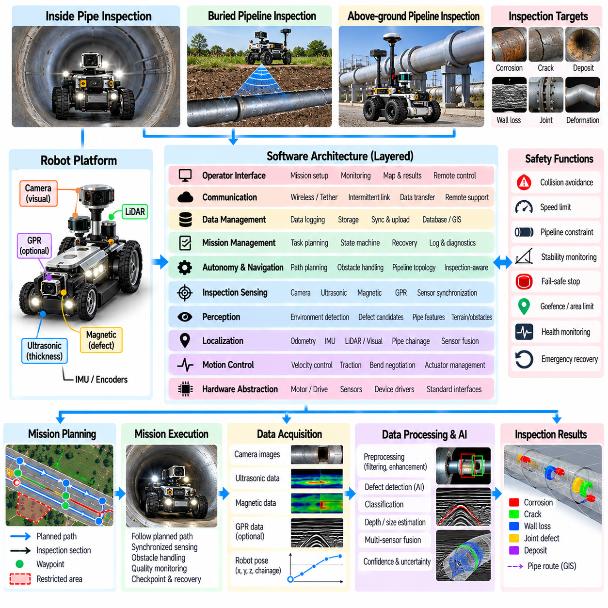{width="7.268055555555556in" height="7.268055555555556in"}

Pipeline inspection robot software architecture must support mobility, sensing, localization, mission execution, communication, safety, and defect assessment within environments that are often inaccessible to people. Depending on the application, the robot may travel inside a pipe, along an external pipeline corridor, or across facilities containing connected pipe assets. The software must therefore separate reusable robotic functions from inspection modules that depend on pipe geometry, sensor type, and operating environment.

A layered architecture commonly includes hardware abstraction, real-time motion control, localization, perception, inspection sensing, autonomy, mission management, data management, communication, safety, and operator interfaces. Hardware abstraction isolates motors, encoders, IMUs, cameras, LiDAR, GPR, ultrasonic sensors, magnetic sensors, and other instruments from higher software layers. Standardized interfaces make it possible to replace individual sensors or vehicle components without redesigning the complete inspection application.

The motion-control layer translates commanded velocity or trajectory targets into actuator commands while monitoring wheel speed, motor current, traction, and mechanical limits. Pipe environments can impose strong geometric constraints, including narrow diameters, bends, joints, slopes, and irregular surfaces. Control software must maintain stable movement without excessive slip or oscillation because unstable motion reduces both localization accuracy and the spatial consistency of inspection measurements.

Localization is challenging because underground or enclosed pipelines frequently prevent reliable GNSS reception. Wheel odometry and IMU measurements can provide continuous relative motion estimates but accumulate drift over long distances. Cameras, LiDAR, structural landmarks, pipe joints, known bends, or other recognizable features can provide additional corrections. Sensor fusion combines these sources into a pose estimate while retaining uncertainty so that inspection results are not reported with unrealistic positional precision.

For long linear pipelines, position may be represented not only in Cartesian coordinates but also as distance along the pipe centerline. This representation allows inspection events to be associated with chainage, pipe segment identifiers, joints, valves, branches, or other known assets. Where an external geographic reference is available, the software can connect local robot coordinates with GIS coordinates. Maintaining both representations simplifies engineering interpretation and later maintenance operations.

Perception software identifies environmental conditions relevant to safe motion and inspection. Cameras or ranging sensors can detect obstructions, deformation, debris, standing liquid, unexpected branches, severe surface irregularities, or restricted passages. For external inspection robots, perception additionally handles terrain, vegetation, structures, vehicles, and workers. The perception output is used by navigation and safety functions rather than being treated only as recorded inspection imagery.

Inspection sensing depends on the defect mechanisms and pipe material being evaluated. Visual cameras can identify visible corrosion, cracking, deposits, coating damage, and joint conditions, while ultrasonic or magnetic methods may provide information about wall thickness or material loss. GPR can contribute to selected buried-pipeline applications by detecting pipe location or surrounding subsurface conditions. The software architecture should support multiple sensor modalities without assuming that one sensor can identify every defect type.

Sensor synchronization is essential for converting inspection measurements into spatial evidence. Each image, radar trace, ultrasonic measurement, point cloud, or diagnostic sample should be associated with a timestamp and robot pose or pipeline position. Calibration defines the spatial relationship between sensors and the robot body. Without consistent timing and calibration, a detected anomaly may be correctly identified by the sensor but incorrectly assigned to a physical location on the pipeline.

The mission-management layer coordinates robot motion and inspection sensing as a state-driven workflow. Typical states can include initialization, self-test, deployment, transit, inspection, obstacle handling, recovery, return, and shutdown. Sensor recording is activated only in appropriate states, while transitions are logged with timestamps and positions. This prevents deployment motion or recovery maneuvers from being mixed unintentionally with valid inspection data.

Autonomous navigation must respect the physical topology of the pipeline. Inside a pipe, the robot may primarily follow the available passage but still needs decisions for speed control, branches, obstacles, bends, and turnaround conditions. External pipeline robots may require conventional path planning along a mapped corridor. In both cases, navigation should be inspection-aware so that successful movement is not considered complete unless required measurements were acquired at acceptable quality.

Communication architecture must account for severe connectivity limitations. Metallic pipes, underground structures, long distances, and complex facilities can reduce wireless reliability or eliminate continuous communication entirely. The robot should therefore tolerate intermittent links and continue validated portions of a mission autonomously when permitted. Critical commands and status messages require priority, while large inspection datasets can be buffered locally and transferred when sufficient bandwidth becomes available.

Local data storage is particularly important for high-resolution inspection. Images, video, GPR measurements, ultrasonic data, point clouds, localization estimates, and system diagnostics can generate large datasets. A structured recording system associates these streams with mission identifiers, pipeline segments, timestamps, calibration versions, and robot states. Chunked storage and integrity checks reduce the impact of file corruption and make interrupted missions easier to reconstruct.

Health monitoring continuously evaluates the robot as well as its inspection instruments. Battery state, motor temperature, current consumption, storage capacity, communication quality, sensor status, localization uncertainty, and computational load can indicate developing problems. Trends such as increasing drive current may reveal mechanical resistance before complete immobilization occurs. Health information should therefore participate in mission decisions instead of appearing only in post-mission diagnostic logs.

Fault management is especially important when physical recovery is difficult. A pipeline robot that fails deep inside a confined asset can create significant operational cost. Software should classify faults according to severity and determine whether to retry, reduce capability, stop inspection, return, or enter a safe state. Recovery decisions must consider remaining energy, estimated distance to an access point, communication availability, localization confidence, and the robot\'s mechanical condition.

Energy-aware autonomy prevents inspection goals from consuming the reserve needed for safe recovery. The mission manager can estimate remaining range using battery state, traveled distance, terrain or pipe resistance, sensor power demand, and historical consumption. A return threshold should include uncertainty rather than assuming ideal energy use. When the estimated recovery margin becomes insufficient, the robot should terminate further inspection and begin an appropriate return or retrieval procedure.

Safety software operates independently from normal mission objectives wherever practical. Limits on speed, motor current, temperature, tilt, obstacle proximity, communication loss, and other hazardous states can trigger protective behavior. External pipeline inspection additionally requires geofencing and interaction rules for people, vehicles, and industrial equipment. Safety events must be preserved in the mission record because they can explain missing data or unusual robot trajectories.

Defect-processing software transforms raw measurements into inspection candidates. Classical signal processing, computer vision, geometric analysis, or AI models can identify corrosion-like regions, cracks, deformation, material loss, anomalous subsurface responses, or other sensor-specific features. Candidate detections should retain links to their source measurements and processing configuration. Confidence and uncertainty are important because automated detection does not necessarily constitute confirmed engineering diagnosis.

Multi-sensor fusion can improve defect interpretation when different instruments observe complementary properties. A visual anomaly can be compared with geometric deformation, wall-thickness measurements, or other nondestructive inspection data at the same pipeline position. Fusion requires accurate spatial registration and should preserve disagreements rather than forcing all sensors into a single conclusion. Conflicting evidence can itself indicate that additional inspection or human review is necessary.

Operator software provides mission preparation and supervision while minimizing the need for continuous teleoperation. The interface can display robot state, pipeline position, sensor health, inspection progress, energy margin, communication status, and detected anomalies. Operators can authorize mission transitions, request return, annotate observations, or assume manual control when communication and system design permit. Autonomous and manually controlled segments should remain identifiable in the recorded dataset.

Post-mission processing reconstructs the inspection from synchronized robot and sensor records. Measurements can be organized according to pipeline segment, chainage, asset identifier, or geographic coordinates and then compared with previous inspections. Detected anomalies can be linked to images, sensor signals, estimated dimensions, confidence, and processing history. This traceability allows engineers to move from a reported defect back to the original evidence supporting the result.

Repeated pipeline inspection benefits from consistent spatial referencing. Previous anomaly locations and survey records can guide subsequent missions so that the robot intentionally reacquires measurements around known areas of concern. Changes in defect dimensions, signal characteristics, or surrounding conditions can then be evaluated over time. The software therefore supports not only one-time detection but also longitudinal condition monitoring and maintenance planning.

The pipeline inspection robot forms another application layer above sensor integration, signal processing, autonomous survey planning, and AI interpretation. Its software architecture combines these capabilities with constrained mobility, communication-loss tolerance, energy-aware recovery, pipeline-specific coordinates, fault management, and engineering data organization. A robust implementation transforms the robot from a remotely operated sensor carrier into a traceable autonomous platform for systematic pipeline condition assessment.

Inspection data management provides the information backbone that connects robotic sensing with engineering decisions. GPR traces, images, point clouds, localization trajectories, detected anomalies, robot states, and mission events must remain associated with the physical infrastructure that was inspected. GIS integration extends this relationship into geographic space, allowing measurements and interpreted results to be managed together with roads, bridges, pipelines, utilities, and other infrastructure assets.

A useful data architecture separates raw measurements, processed products, interpreted inspection objects, and asset-level records. Raw data preserve the original sensor evidence, while processed data contain filtering, reconstruction, registration, or AI outputs. Inspection objects describe detected utilities, defects, voids, structural features, or other anomalies. Asset records connect these findings to infrastructure identifiers, locations, inspection dates, maintenance history, and engineering context.

Every inspection mission should have a unique identifier that links robot operations with recorded datasets. Mission metadata can describe the project, inspected asset, robot platform, sensors, operators, software versions, calibration states, coordinate references, start and end times, and environmental conditions. Survey segments and scan lines can receive additional identifiers so that individual measurements remain traceable through processing, interpretation, reporting, and later reanalysis.

Time synchronization provides the first major relationship among heterogeneous sensor streams. Radar traces, camera frames, LiDAR scans, IMU measurements, GNSS observations, odometry, robot states, and diagnostic events may arrive at different frequencies. Consistent timestamps allow these records to be aligned during processing. The original acquisition time should remain preserved even when data are later transformed, resampled, fused, or exported into engineering applications.

Spatial referencing provides the second major relationship. Measurements may initially exist in sensor coordinates and then be transformed through robot, local-map, project, and geographic coordinate frames. Calibration defines sensor-to-robot transformations, while localization determines the robot pose within the environment. GIS integration requires these transformations to remain explicit so that a detected feature can be traced from its map position back to the exact sensor measurements that generated it.

Coordinate reference systems must be managed carefully because infrastructure organizations may use geographic coordinates, projected map coordinates, local construction grids, bridge stationing, road chainage, or pipeline-specific references. A dataset should identify its coordinate reference system rather than assuming that numerical coordinates are self-explanatory. Transformation parameters and reference definitions should be stored so that inspection results can be exchanged without introducing hidden positional errors.

Georeferencing converts robotic detections into spatial infrastructure objects. A buried utility detected in a GPR survey can be represented by a point, line, or three-dimensional geometry containing estimated depth, orientation, extent, confidence, and uncertainty. Road defects can be linked to lane and chainage, while bridge anomalies can be associated with deck regions or structural elements. Pipeline findings can similarly reference pipe segments, joints, valves, or centerline distance.

GIS layers provide contextual information that can improve inspection interpretation. Existing utility maps, road centerlines, bridge boundaries, parcel information, drainage networks, pipeline routes, construction drawings, and previous inspection results can be displayed with new robotic measurements. Spatial comparison can reveal whether a detected feature agrees with an existing record, represents a possible undocumented asset, or occurs near a known area requiring engineering attention.

The relationship between GIS records and robotic observations should preserve uncertainty. A detected underground feature may have uncertainty in horizontal position, depth, classification, and spatial extent. Localization error, sensor calibration error, propagation assumptions, and AI confidence can all contribute to the final result. GIS visualization should therefore avoid presenting every detection as an exact surveyed object when the underlying evidence supports only an estimated position or probable classification.

Large inspection datasets require storage policies that balance accessibility, performance, and preservation. High-volume raw radar data, imagery, video, and point clouds may be stored in optimized files or object storage, while searchable metadata and interpreted results can reside in databases. The database can reference the larger files rather than embedding every measurement directly. This separation supports scalable storage while allowing engineers to search by asset, location, date, anomaly type, or mission.

Spatial databases can provide efficient management of geographically referenced inspection results. Points, lines, polygons, trajectories, and three-dimensional attributes can be queried according to location and relationship with infrastructure assets. An engineer may retrieve all anomalies within a road section, compare detections around a pipeline segment, or identify inspection regions that have not been surveyed recently. Spatial indexing becomes increasingly important as repeated robotic missions accumulate large historical datasets.

Data provenance records how each result was produced. A processed radar volume should identify the source mission, raw measurements, calibration version, processing algorithms, and parameters used to generate it. An AI detection should additionally record model version, preprocessing configuration, inference settings, and confidence. Provenance makes it possible to reproduce results, compare algorithms, audit automated interpretations, and reprocess historical data when improved methods become available.

Version management is necessary because inspection results can change after engineering review or algorithm updates. An automatically detected anomaly may later be confirmed, rejected, reclassified, or assigned a different geometry. Rather than overwriting the previous result, the system can preserve revisions and their authorship or processing source. This history distinguishes original machine predictions from later human interpretation and maintains a defensible record of how the final assessment evolved.

Data quality indicators should accompany inspection records. Completeness, localization accuracy, sensor status, spatial sampling density, signal quality, trajectory deviation, and environmental conditions can influence whether a dataset is suitable for a particular engineering purpose. Quality metadata allows downstream users to filter unreliable regions or understand why confidence differs across an inspection area. Missing data should be represented explicitly rather than appearing as normal inspected space.

Repeated inspections make temporal data management important. Measurements collected at different dates can be spatially registered to the same asset and compared over time. A bridge defect, road anomaly, buried utility region, or pipeline condition can therefore be represented as a time series of observations rather than isolated reports. Consistent asset identifiers and spatial references enable change detection and support analysis of deterioration, movement, repair effectiveness, or newly appearing anomalies.

Integration with asset-management systems extends GIS beyond visualization. Inspection findings can be associated with maintenance records, work orders, risk classifications, repair histories, and asset condition scores. A robotic detection does not necessarily become an immediate maintenance action, but it can create evidence for engineering review. Once validated, the finding can participate in established infrastructure management workflows without requiring manual re-entry of its location and supporting measurements.

Interoperability requires well-defined exchange formats and interfaces. GIS applications may consume vector features, raster products, spatial databases, web services, or structured files, while engineering systems may require asset-specific schemas. The robotic inspection platform should maintain an internal canonical representation and convert it into required external formats. This reduces dependence on one GIS vendor and prevents sensor-processing software from being tightly coupled to downstream applications.

Access control and data integrity become important when inspection information describes critical infrastructure. Users may require different permissions for viewing raw measurements, editing interpretations, approving findings, or exporting asset data. Audit records can document important modifications and approvals. Integrity checks can verify that files have not been corrupted or unintentionally altered, while controlled backups protect long-term inspection evidence from hardware failure or accidental deletion.

Field operations may occur without reliable network connectivity, so data management should support disconnected workflows. The robot or field computer can maintain a local mission package containing sensor data, maps, metadata, and preliminary detections. When communication becomes available, synchronized transfer can upload new records to central storage while preserving identifiers and provenance. Partial transfers should be detectable so that incomplete datasets are not mistaken for complete inspections.

Visualization should connect geographic context with the original inspection evidence. Selecting a mapped anomaly can open its associated B-scan, image, point cloud, processed result, AI confidence, or engineering note. Conversely, selecting a feature in sensor data can highlight its geographic location. This bidirectional linkage helps engineers verify automated findings and prevents GIS symbols from becoming detached from the measurements that support them.

Within the infrastructure inspection workflow, data management and GIS integration consolidate outputs from GPR acquisition, subsurface processing, autonomous survey planning, AI utility interpretation, bridge and road inspection, and pipeline inspection. They transform individual robotic missions into persistent infrastructure knowledge that can be searched, compared, reviewed, and reused across inspection cycles.

A mature inspection information system therefore preserves more than final maps. It maintains raw evidence, processing history, coordinate transformations, uncertainty, quality, human review, and relationships to physical assets. By combining robotic inspection records with GIS and asset-management information, infrastructure organizations can move from isolated sensor surveys toward traceable spatial databases that support long-term condition monitoring, maintenance planning, and evidence-based engineering decisions.

##  

## 05.08. Inspection Data Management and GIS Integration [w/Code]

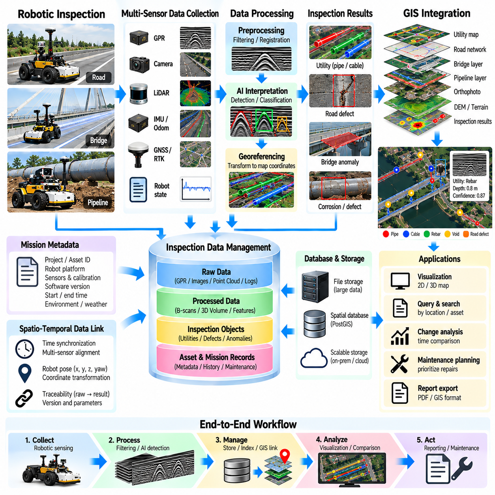{width="7.268055555555556in" height="7.268055555555556in"}

Inspection data management provides the information backbone that connects robotic sensing with engineering decisions. GPR traces, images, point clouds, localization trajectories, detected anomalies, robot states, and mission events must remain associated with the physical infrastructure that was inspected. GIS integration extends this relationship into geographic space, allowing measurements and interpreted results to be managed together with roads, bridges, pipelines, utilities, and other infrastructure assets.

A useful data architecture separates raw measurements, processed products, interpreted inspection objects, and asset-level records. Raw data preserve the original sensor evidence, while processed data contain filtering, reconstruction, registration, or AI outputs. Inspection objects describe detected utilities, defects, voids, structural features, or other anomalies. Asset records connect these findings to infrastructure identifiers, locations, inspection dates, maintenance history, and engineering context.

Every inspection mission should have a unique identifier that links robot operations with recorded datasets. Mission metadata can describe the project, inspected asset, robot platform, sensors, operators, software versions, calibration states, coordinate references, start and end times, and environmental conditions. Survey segments and scan lines can receive additional identifiers so that individual measurements remain traceable through processing, interpretation, reporting, and later reanalysis.

Time synchronization provides the first major relationship among heterogeneous sensor streams. Radar traces, camera frames, LiDAR scans, IMU measurements, GNSS observations, odometry, robot states, and diagnostic events may arrive at different frequencies. Consistent timestamps allow these records to be aligned during processing. The original acquisition time should remain preserved even when data are later transformed, resampled, fused, or exported into engineering applications.

Spatial referencing provides the second major relationship. Measurements may initially exist in sensor coordinates and then be transformed through robot, local-map, project, and geographic coordinate frames. Calibration defines sensor-to-robot transformations, while localization determines the robot pose within the environment. GIS integration requires these transformations to remain explicit so that a detected feature can be traced from its map position back to the exact sensor measurements that generated it.

Coordinate reference systems must be managed carefully because infrastructure organizations may use geographic coordinates, projected map coordinates, local construction grids, bridge stationing, road chainage, or pipeline-specific references. A dataset should identify its coordinate reference system rather than assuming that numerical coordinates are self-explanatory. Transformation parameters and reference definitions should be stored so that inspection results can be exchanged without introducing hidden positional errors.

Georeferencing converts robotic detections into spatial infrastructure objects. A buried utility detected in a GPR survey can be represented by a point, line, or three-dimensional geometry containing estimated depth, orientation, extent, confidence, and uncertainty. Road defects can be linked to lane and chainage, while bridge anomalies can be associated with deck regions or structural elements. Pipeline findings can similarly reference pipe segments, joints, valves, or centerline distance.

GIS layers provide contextual information that can improve inspection interpretation. Existing utility maps, road centerlines, bridge boundaries, parcel information, drainage networks, pipeline routes, construction drawings, and previous inspection results can be displayed with new robotic measurements. Spatial comparison can reveal whether a detected feature agrees with an existing record, represents a possible undocumented asset, or occurs near a known area requiring engineering attention.

The relationship between GIS records and robotic observations should preserve uncertainty. A detected underground feature may have uncertainty in horizontal position, depth, classification, and spatial extent. Localization error, sensor calibration error, propagation assumptions, and AI confidence can all contribute to the final result. GIS visualization should therefore avoid presenting every detection as an exact surveyed object when the underlying evidence supports only an estimated position or probable classification.

Large inspection datasets require storage policies that balance accessibility, performance, and preservation. High-volume raw radar data, imagery, video, and point clouds may be stored in optimized files or object storage, while searchable metadata and interpreted results can reside in databases. The database can reference the larger files rather than embedding every measurement directly. This separation supports scalable storage while allowing engineers to search by asset, location, date, anomaly type, or mission.

Spatial databases can provide efficient management of geographically referenced inspection results. Points, lines, polygons, trajectories, and three-dimensional attributes can be queried according to location and relationship with infrastructure assets. An engineer may retrieve all anomalies within a road section, compare detections around a pipeline segment, or identify inspection regions that have not been surveyed recently. Spatial indexing becomes increasingly important as repeated robotic missions accumulate large historical datasets.

Data provenance records how each result was produced. A processed radar volume should identify the source mission, raw measurements, calibration version, processing algorithms, and parameters used to generate it. An AI detection should additionally record model version, preprocessing configuration, inference settings, and confidence. Provenance makes it possible to reproduce results, compare algorithms, audit automated interpretations, and reprocess historical data when improved methods become available.

Version management is necessary because inspection results can change after engineering review or algorithm updates. An automatically detected anomaly may later be confirmed, rejected, reclassified, or assigned a different geometry. Rather than overwriting the previous result, the system can preserve revisions and their authorship or processing source. This history distinguishes original machine predictions from later human interpretation and maintains a defensible record of how the final assessment evolved.

Data quality indicators should accompany inspection records. Completeness, localization accuracy, sensor status, spatial sampling density, signal quality, trajectory deviation, and environmental conditions can influence whether a dataset is suitable for a particular engineering purpose. Quality metadata allows downstream users to filter unreliable regions or understand why confidence differs across an inspection area. Missing data should be represented explicitly rather than appearing as normal inspected space.

Repeated inspections make temporal data management important. Measurements collected at different dates can be spatially registered to the same asset and compared over time. A bridge defect, road anomaly, buried utility region, or pipeline condition can therefore be represented as a time series of observations rather than isolated reports. Consistent asset identifiers and spatial references enable change detection and support analysis of deterioration, movement, repair effectiveness, or newly appearing anomalies.

Integration with asset-management systems extends GIS beyond visualization. Inspection findings can be associated with maintenance records, work orders, risk classifications, repair histories, and asset condition scores. A robotic detection does not necessarily become an immediate maintenance action, but it can create evidence for engineering review. Once validated, the finding can participate in established infrastructure management workflows without requiring manual re-entry of its location and supporting measurements.

Interoperability requires well-defined exchange formats and interfaces. GIS applications may consume vector features, raster products, spatial databases, web services, or structured files, while engineering systems may require asset-specific schemas. The robotic inspection platform should maintain an internal canonical representation and convert it into required external formats. This reduces dependence on one GIS vendor and prevents sensor-processing software from being tightly coupled to downstream applications.

Access control and data integrity become important when inspection information describes critical infrastructure. Users may require different permissions for viewing raw measurements, editing interpretations, approving findings, or exporting asset data. Audit records can document important modifications and approvals. Integrity checks can verify that files have not been corrupted or unintentionally altered, while controlled backups protect long-term inspection evidence from hardware failure or accidental deletion.

Field operations may occur without reliable network connectivity, so data management should support disconnected workflows. The robot or field computer can maintain a local mission package containing sensor data, maps, metadata, and preliminary detections. When communication becomes available, synchronized transfer can upload new records to central storage while preserving identifiers and provenance. Partial transfers should be detectable so that incomplete datasets are not mistaken for complete inspections.

Visualization should connect geographic context with the original inspection evidence. Selecting a mapped anomaly can open its associated B-scan, image, point cloud, processed result, AI confidence, or engineering note. Conversely, selecting a feature in sensor data can highlight its geographic location. This bidirectional linkage helps engineers verify automated findings and prevents GIS symbols from becoming detached from the measurements that support them.

Within the infrastructure inspection workflow, data management and GIS integration consolidate outputs from GPR acquisition, subsurface processing, autonomous survey planning, AI utility interpretation, bridge and road inspection, and pipeline inspection. They transform individual robotic missions into persistent infrastructure knowledge that can be searched, compared, reviewed, and reused across inspection cycles.

A mature inspection information system therefore preserves more than final maps. It maintains raw evidence, processing history, coordinate transformations, uncertainty, quality, human review, and relationships to physical assets. By combining robotic inspection records with GIS and asset-management information, infrastructure organizations can move from isolated sensor surveys toward traceable spatial databases that support long-term condition monitoring, maintenance planning, and evidence-based engineering decisions.

검사 데이터 관리(Inspection Data Management)는 로봇 센싱(Robotic Sensing)과 엔지니어링 의사결정(Engineering Decision)을 연결하는 정보 기반(Information Backbone)을 제공한다. GPR 트레이스(GPR Trace), 영상, 포인트 클라우드(Point Cloud), 위치 추정 궤적(Localization Trajectory), 탐지된 이상(Detected Anomaly), 로봇 상태, 임무 이벤트(Mission Event)는 실제 검사된 물리적 인프라와의 연결 관계를 유지해야 한다. GIS 통합(GIS Integration)은 이러한 관계를 지리 공간(Geographic Space)으로 확장하여 측정 데이터와 해석 결과를 도로, 교량, 파이프라인, 유틸리티 및 기타 인프라 자산과 함께 관리할 수 있도록 한다.

효과적인 데이터 아키텍처(Data Architecture)는 원시 측정 데이터(Raw Measurement), 처리된 결과물(Processed Product), 해석된 검사 객체(Interpreted Inspection Object), 자산 수준 기록(Asset-Level Record)을 분리한다. 원시 데이터는 최초 센서 증거를 보존하며, 처리 데이터에는 필터링, 재구성(Reconstruction), 정합(Registration), AI 출력 등이 포함된다. 검사 객체는 탐지된 유틸리티, 결함, 공동(Void), 구조적 특징 또는 기타 이상을 표현한다. 자산 기록은 이러한 결과를 인프라 식별자, 위치, 검사 날짜, 유지보수 이력 및 엔지니어링 상황 정보와 연결한다.

각각의 검사 임무에는 로봇 운용과 기록된 데이터셋을 연결하는 고유 식별자(Unique Identifier)가 있어야 한다. 임무 메타데이터(Mission Metadata)는 프로젝트, 검사 대상 자산, 로봇 플랫폼, 센서, 운영자, 소프트웨어 버전, 보정 상태(Calibration State), 좌표 기준(Coordinate Reference), 시작 및 종료 시간, 환경 조건 등을 설명할 수 있다. 조사 세그먼트(Survey Segment)와 스캔 라인(Scan Line)에 추가 식별자를 부여하면 개별 측정 데이터의 처리, 해석, 보고 및 이후 재분석 과정 전체에서 추적성(Traceability)을 유지할 수 있다.

시간 동기화(Time Synchronization)는 이질적인 센서 데이터 스트림(Heterogeneous Sensor Stream) 사이의 첫 번째 핵심 연결 관계를 제공한다. 레이더 트레이스, 카메라 프레임, 라이다 스캔(LiDAR Scan), 관성측정장치(IMU) 측정값, GNSS 관측값, 오도메트리(Odometry), 로봇 상태, 진단 이벤트는 서로 다른 주기로 입력될 수 있다. 일관된 타임스탬프(Timestamp)를 사용하면 처리 과정에서 이러한 기록을 정렬할 수 있다. 데이터가 이후 변환, 재샘플링(Resampling), 융합 또는 엔지니어링 애플리케이션으로 내보내지더라도 원래의 데이터 수집 시간은 보존되어야 한다.

공간 참조(Spatial Referencing)는 두 번째 핵심 연결 관계를 제공한다. 측정 데이터는 처음에는 센서 좌표계(Sensor Coordinate System)에 존재하고 이후 로봇, 로컬 지도(Local Map), 프로젝트 및 지리 좌표계(Geographic Coordinate Frame)를 거쳐 변환될 수 있다. 보정(Calibration)은 센서와 로봇 사이의 좌표 변환을 정의하며, 위치 추정(Localization)은 환경 내에서 로봇의 자세를 결정한다. GIS 통합에서는 이러한 변환 관계를 명시적으로 유지하여 탐지된 특징의 지도상 위치로부터 해당 결과를 생성한 정확한 센서 측정 데이터까지 역으로 추적할 수 있어야 한다.

좌표 참조 시스템(Coordinate Reference System, CRS)은 인프라 기관에서 지리 좌표, 투영 지도 좌표(Projected Map Coordinate), 로컬 건설 격자(Local Construction Grid), 교량 측점(Bridge Stationing), 도로 체이니지(Road Chainage), 파이프라인 전용 기준 등을 사용할 수 있으므로 주의 깊게 관리해야 한다. 데이터셋은 숫자로 표현된 좌표만으로 의미가 명확하다고 가정하지 않고 사용된 좌표 참조 시스템을 식별해야 한다. 좌표 변환 파라미터와 기준 정의를 저장하면 숨겨진 위치 오차를 발생시키지 않고 검사 결과를 서로 교환할 수 있다.

지리참조(Georeferencing)는 로봇이 탐지한 결과를 공간 인프라 객체(Spatial Infrastructure Object)로 변환한다. GPR 조사에서 탐지된 매설 유틸리티는 추정 깊이, 방향, 범위, 신뢰도(Confidence), 불확실성(Uncertainty)을 포함하는 점(Point), 선(Line), 또는 3차원 형상(Three-Dimensional Geometry)으로 표현할 수 있다. 도로 결함은 차선 및 체이니지와 연결할 수 있으며, 교량 이상은 상판 영역 또는 구조 요소와 연결할 수 있다. 파이프라인 검사 결과 역시 파이프 세그먼트, 이음부, 밸브 또는 중심선을 따라 측정된 거리와 연결할 수 있다.

GIS 계층(GIS Layer)은 검사 결과의 해석을 향상할 수 있는 상황 정보를 제공한다. 기존 유틸리티 지도, 도로 중심선, 교량 경계, 필지 정보(Parcel Information), 배수망(Drainage Network), 파이프라인 경로, 시공 도면, 이전 검사 결과를 새로운 로봇 측정 데이터와 함께 표시할 수 있다. 공간 비교(Spatial Comparison)를 통해 탐지된 특징이 기존 기록과 일치하는지, 문서화되지 않은 자산일 가능성이 있는지, 또는 엔지니어링 검토가 필요한 기존 관심 영역 주변에서 발생했는지를 판단할 수 있다.

GIS 기록과 로봇 관측 사이의 관계에는 불확실성(Uncertainty)이 보존되어야 한다. 탐지된 지하 특징은 수평 위치, 깊이, 분류, 공간적 범위에 각각 불확실성을 가질 수 있다. 위치 추정 오차(Localization Error), 센서 보정 오차, 전파 모델 가정(Propagation Assumption), AI 신뢰도 등이 최종 결과에 영향을 줄 수 있다. 따라서 실제 증거가 추정 위치 또는 가능성이 높은 분류만을 지원하는 경우 GIS 시각화(GIS Visualization)에서 모든 탐지 결과를 정확하게 측량된 객체처럼 표현해서는 안 된다.

대규모 검사 데이터셋(Large Inspection Dataset)은 접근성, 성능, 장기 보존 사이의 균형을 고려한 저장 정책(Storage Policy)을 필요로 한다. 대용량 원시 레이더 데이터, 영상, 비디오, 포인트 클라우드는 최적화된 파일 또는 객체 저장소(Object Storage)에 저장하고, 검색 가능한 메타데이터와 해석 결과는 데이터베이스(Database)에 저장할 수 있다. 데이터베이스가 모든 측정 데이터를 직접 포함하는 대신 대용량 파일을 참조하도록 구성할 수 있다. 이러한 분리는 확장 가능한 저장을 지원하면서 자산, 위치, 날짜, 이상 유형 또는 임무를 기준으로 검색할 수 있도록 한다.

공간 데이터베이스(Spatial Database)는 지리참조된 검사 결과를 효율적으로 관리할 수 있다. 점, 선, 다각형(Polygon), 궤적, 3차원 속성(Attribute)을 위치와 인프라 자산과의 관계에 따라 조회할 수 있다. 엔지니어는 특정 도로 구간 내의 모든 이상을 검색하거나 파이프라인 세그먼트 주변의 탐지 결과를 비교하고 최근 일정 기간 동안 검사되지 않은 영역을 식별할 수 있다. 반복적인 로봇 임무를 통해 대규모 이력 데이터가 축적될수록 공간 인덱싱(Spatial Indexing)의 중요성이 증가한다.

데이터 출처 관리(Data Provenance)는 각각의 결과가 어떻게 생성되었는지를 기록한다. 처리된 레이더 볼륨(Processed Radar Volume)은 원본 임무, 원시 측정값, 보정 버전, 사용된 처리 알고리즘 및 파라미터를 식별할 수 있어야 한다. AI 탐지 결과에는 추가로 모델 버전(Model Version), 전처리 설정(Preprocessing Configuration), 추론 설정(Inference Setting), 신뢰도를 기록해야 한다. 데이터 출처를 유지하면 결과 재현, 알고리즘 비교, 자동 해석 감사(Audit), 개선된 방법을 이용한 과거 데이터 재처리가 가능하다.

버전 관리(Version Management)는 엔지니어링 검토나 알고리즘 업데이트 이후 검사 결과가 변경될 수 있기 때문에 필요하다. 자동으로 탐지된 이상은 이후 확인, 거부, 재분류 또는 다른 형상으로 수정될 수 있다. 시스템은 이전 결과를 덮어쓰기보다 수정 이력과 해당 결과를 생성하거나 변경한 사용자 또는 처리 출처를 보존할 수 있다. 이러한 이력은 최초 기계 예측(Machine Prediction)과 이후 사람의 해석(Human Interpretation)을 구분하고 최종 평가 결과가 어떻게 변화했는지에 대한 방어 가능한 기록(Defensible Record)을 유지한다.

데이터 품질 지표(Data Quality Indicator)는 검사 기록과 함께 관리되어야 한다. 완전성(Completeness), 위치 추정 정확도, 센서 상태, 공간 샘플링 밀도(Spatial Sampling Density), 신호 품질, 궤적 편차, 환경 조건은 특정 데이터셋이 특정 엔지니어링 목적에 적합한지에 영향을 미친다. 품질 메타데이터(Quality Metadata)를 이용하면 후속 사용자가 신뢰성이 낮은 영역을 필터링하거나 검사 영역별 신뢰도가 서로 다른 이유를 파악할 수 있다. 누락 데이터(Missing Data)는 정상적으로 검사가 완료된 공간처럼 표시하지 않고 명시적으로 표현해야 한다.

반복 검사(Repeated Inspection)에서는 시간 데이터 관리(Temporal Data Management)가 중요하다. 서로 다른 날짜에 수집된 측정 데이터를 동일한 자산에 공간적으로 정합하여 시간에 따른 변화를 비교할 수 있다. 교량 결함, 도로 이상, 매설 유틸리티 영역 또는 파이프라인 상태를 개별적인 검사 보고서가 아니라 시간에 따른 일련의 관측(Time Series of Observations)으로 표현할 수 있다. 일관된 자산 식별자와 공간 기준을 사용하면 변화 탐지(Change Detection)를 수행하고 열화, 이동, 보수 효과 또는 새롭게 발생한 이상을 분석할 수 있다.

자산 관리 시스템(Asset-Management System)과의 통합은 GIS의 역할을 단순한 시각화 이상으로 확장한다. 검사 결과를 유지보수 기록, 작업 지시(Work Order), 위험 등급(Risk Classification), 보수 이력, 자산 상태 점수(Asset Condition Score)와 연결할 수 있다. 로봇이 탐지한 결과가 반드시 즉각적인 유지보수 작업으로 이어지는 것은 아니지만 엔지니어링 검토를 위한 증거를 제공할 수 있다. 검증된 결과는 위치와 근거 측정 데이터를 다시 수동 입력할 필요 없이 기존 인프라 관리 워크플로에 활용할 수 있다.

상호운용성(Interoperability)을 위해서는 명확하게 정의된 데이터 교환 형식(Exchange Format)과 인터페이스가 필요하다. GIS 애플리케이션은 벡터 피처(Vector Feature), 래스터 데이터(Raster Product), 공간 데이터베이스, 웹 서비스(Web Service), 구조화된 파일을 사용할 수 있으며, 엔지니어링 시스템은 자산별 스키마(Asset-Specific Schema)를 요구할 수 있다. 로봇 검사 플랫폼은 내부 표준 표현(Canonical Representation)을 유지하고 이를 필요한 외부 형식으로 변환해야 한다. 이를 통해 특정 GIS 공급업체에 대한 의존성을 줄이고 센서 처리 소프트웨어가 후속 애플리케이션과 강하게 결합되는 것을 방지한다.

접근 제어(Access Control)와 데이터 무결성(Data Integrity)은 검사 정보가 중요 인프라(Critical Infrastructure)를 설명하는 경우 특히 중요해진다. 사용자는 원시 측정값 조회, 해석 결과 수정, 검사 결과 승인 또는 자산 데이터 내보내기에 대해 서로 다른 권한을 가질 수 있다. 감사 기록(Audit Record)은 중요한 변경 및 승인 과정을 기록할 수 있다. 무결성 검사는 파일이 손상되거나 의도하지 않게 변경되지 않았는지 확인할 수 있으며, 통제된 백업(Controlled Backup)을 통해 하드웨어 장애 또는 실수로 인한 삭제로부터 장기간의 검사 증거를 보호할 수 있다.

현장 운용(Field Operation)은 신뢰할 수 있는 네트워크 연결 없이 수행될 수 있으므로 데이터 관리 시스템은 비연결 워크플로(Disconnected Workflow)를 지원해야 한다. 로봇 또는 현장 컴퓨터는 센서 데이터, 지도, 메타데이터, 초기 탐지 결과를 포함하는 로컬 임무 패키지(Local Mission Package)를 유지할 수 있다. 통신이 가능해지면 동기화된 전송(Synchronized Transfer)을 통해 식별자와 데이터 출처를 유지하면서 새로운 기록을 중앙 저장소로 업로드할 수 있다. 부분적인 전송 상태를 탐지하여 불완전한 데이터셋이 완전한 검사 결과로 잘못 판단되지 않도록 해야 한다.

시각화(Visualization)는 지리적 상황 정보와 원본 검사 증거를 서로 연결해야 한다. 지도에서 이상을 선택하면 관련 B-스캔(B-Scan), 영상, 포인트 클라우드, 처리 결과, AI 신뢰도 또는 엔지니어링 메모(Engineering Note)를 열 수 있어야 한다. 반대로 센서 데이터에서 특정 특징을 선택하면 해당 특징의 지리적 위치를 지도에서 표시할 수 있다. 이러한 양방향 연결(Bidirectional Linkage)은 엔지니어가 자동 탐지 결과를 검증하도록 지원하고 GIS 심볼이 이를 뒷받침하는 원본 측정 데이터와 분리되는 것을 방지한다.

전체 인프라 검사 워크플로(Infrastructure Inspection Workflow)에서 데이터 관리 및 GIS 통합은 GPR 데이터 수집, 지하 데이터 처리(Subsurface Processing), 자율 조사 계획(Autonomous Survey Planning), AI 기반 유틸리티 해석(AI Utility Interpretation), 교량 및 도로 검사, 파이프라인 검사에서 생성되는 결과를 통합한다. 이를 통해 개별 로봇 임무에서 생성된 데이터를 여러 검사 주기에 걸쳐 검색, 비교, 검토 및 재사용할 수 있는 지속적인 인프라 지식(Persistent Infrastructure Knowledge)으로 변환한다.

성숙한 검사 정보 시스템(Inspection Information System)은 최종 지도만을 보존하는 것이 아니라 원시 증거(Raw Evidence), 처리 이력(Processing History), 좌표 변환(Coordinate Transformation), 불확실성, 품질, 사람의 검토 결과, 물리적 자산과의 관계까지 함께 유지한다. 로봇 검사 기록을 GIS 및 자산 관리 정보와 통합하면 인프라 운영 기관은 개별적인 센서 조사에서 벗어나 장기 상태 모니터링(Long-Term Condition Monitoring), 유지보수 계획(Maintenance Planning), 증거 기반 엔지니어링 의사결정(Evidence-Based Engineering Decision)을 지원하는 추적 가능한 공간 데이터베이스(Traceable Spatial Database)를 구축할 수 있다.

##  

## 05.09. Inspection Robot Safety and Hazard Zone [w/Code]

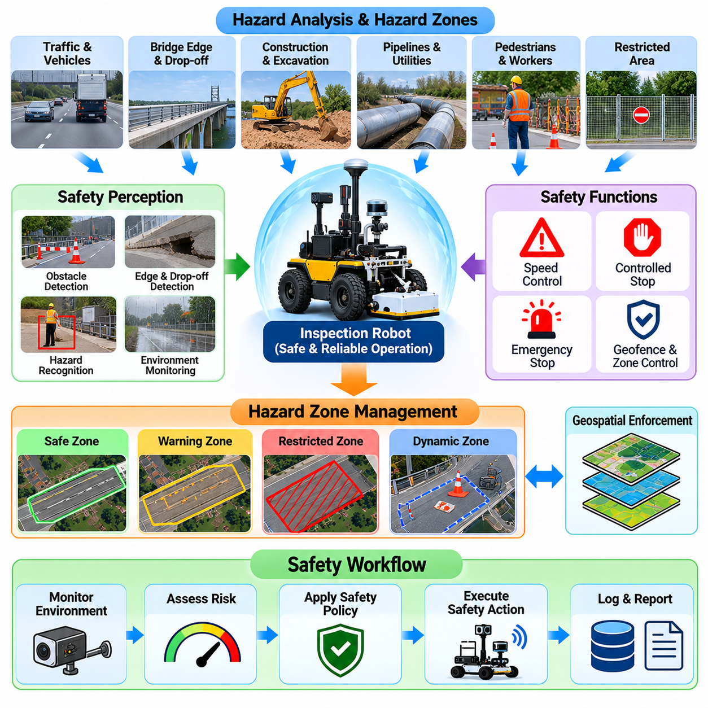{width="7.268055555555556in" height="7.268055555555556in"}

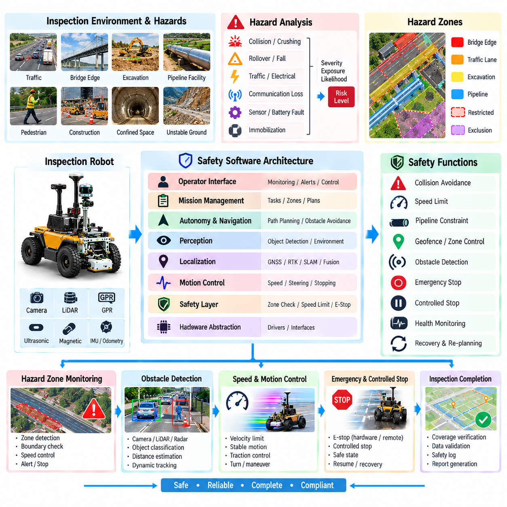{width="7.268055555555556in" height="7.268055555555556in"}

Inspection robot safety must be designed as a system-level property rather than added after autonomous navigation and sensing have been implemented. Infrastructure inspection robots may operate near traffic, bridge edges, excavation zones, pipelines, construction equipment, pedestrians, confined spaces, or unstable surfaces. Safety software must therefore coordinate perception, motion control, mission logic, communications, hardware protection, and operator supervision throughout the complete inspection lifecycle.

Hazard analysis begins by identifying possible sources of harm associated with the robot, environment, inspection equipment, and operational procedure. Hazards may include collision, crushing, unintended motion, rollover, falling from an elevated structure, entering traffic, electrical exposure, loss of communication, sensor failure, battery faults, or becoming immobilized in a restricted location. Each hazard can be evaluated according to severity, exposure, and likelihood to determine appropriate risk-reduction measures.

A hazard zone represents an area where robot operation requires specific restrictions or protective behavior. Zones can describe bridge edges, active traffic lanes, excavation boundaries, railway areas, high-voltage equipment, pipeline facilities, pedestrian workspaces, unstable ground, or prohibited infrastructure regions. The safety system associates each zone with operational rules such as maximum velocity, required clearance, permitted direction, sensor requirements, or complete exclusion from autonomous entry.

Geofencing provides a software mechanism for enforcing spatial safety boundaries. Geographic or local-map polygons can define allowed operating regions, restricted regions, and conditional-access areas. The robot continuously compares its estimated pose with these boundaries and predicts whether its current motion could cross them. Because localization contains uncertainty, safety margins should extend beyond the nominal boundary rather than assuming that the estimated robot position is perfectly accurate.

Localization quality is therefore directly connected to safety. A robot cannot reliably enforce a hazard boundary if it does not know its position with sufficient confidence. The safety layer should monitor localization uncertainty, GNSS or RTK status, odometry consistency, map matching, and other available indicators. When uncertainty exceeds the level required for the current zone, the robot can reduce speed, increase clearance, request operator intervention, or perform a controlled stop.

Obstacle detection protects people, vehicles, equipment, and the robot itself. LiDAR, cameras, radar, ultrasonic sensors, bumpers, or other proximity devices may provide overlapping detection capabilities. Safety-related perception should consider sensor range, blind regions, environmental degradation, and detection latency. The required stopping distance must account for robot velocity, control delay, braking performance, surface traction, and uncertainty rather than relying only on instantaneous obstacle distance.

Dynamic safety zones can change according to robot velocity and operational context. At low speed, a small protective region may provide adequate stopping distance, while faster motion requires a larger region. Different zones can be established in the forward, lateral, and rear directions according to vehicle geometry and motion. When an object enters a warning region the robot may reduce speed, while entry into a protective region can trigger an immediate controlled or emergency stop.

Inspection robots operating near bridge edges, curbs, pits, trenches, or elevated structures require protection against drop-off hazards. Forward-facing obstacle sensors may not detect the absence of supporting ground, so downward-looking ranging sensors, cameras, map constraints, or dedicated edge detectors can be required. Detection logic should distinguish traversable surface changes from dangerous discontinuities and apply conservative behavior when terrain classification is uncertain.

Speed management is one of the most effective software safety controls. Maximum velocity can vary according to environment, localization quality, obstacle density, sensing mode, surface condition, and proximity to hazardous regions. Inspection operations often benefit from relatively low speeds because measurement quality also depends on controlled motion. The mission planner should therefore treat safety speed limits as hard constraints rather than optimization preferences that can be violated to improve productivity.

Emergency stop functionality provides a direct mechanism for terminating hazardous motion. Physical emergency-stop devices, remote operator commands, safety controllers, or onboard fault detection may initiate the stop depending on the system design. Emergency stopping should place actuators into a defined safe condition and prevent unintended automatic restart. Recovery should require an explicit procedure confirming that the original hazard has been removed or adequately controlled.

A controlled stop differs from an emergency stop because it allows the robot to decelerate normally while maintaining stability and system awareness. Communication degradation, temporary localization uncertainty, blocked paths, or inspection sensor faults may justify a controlled stop without immediately removing actuator power. Distinguishing stop categories allows the robot to respond proportionally while ensuring that safety-critical conditions always receive priority over mission completion.

Safety supervision should remain logically separated from ordinary autonomy wherever practical. Navigation software may request motion toward a waypoint, but a supervisory safety layer evaluates whether the command satisfies current speed, zone, obstacle, localization, and system-health constraints. Unsafe commands can be limited or rejected before reaching low-level control. This architecture prevents a planning error or application-software fault from directly commanding unrestricted hazardous motion.

System health monitoring contributes to safety by detecting internal failures before they produce dangerous behavior. Motor temperature, current, battery voltage, brake status, steering response, sensor communication, computational load, storage capacity, and network condition can be monitored continuously. Inconsistent actuator feedback or unexpected current may indicate mechanical obstruction or drivetrain failure. Safety responses can range from degraded operation to immediate stopping according to fault severity.

Communication loss requires predefined behavior rather than improvised recovery. Some missions may permit continued autonomous operation inside a validated region, while others require the robot to stop or return when supervision is lost. The decision depends on environmental risk, autonomy capability, mission type, and recovery options. The communication policy should specify timeout thresholds and clearly distinguish loss of telemetry from loss of safety-critical command channels.

Human interaction requires special attention because infrastructure inspection frequently occurs in shared work areas. Workers may approach the robot to examine equipment, cross its route, or unintentionally enter an active survey zone. Visual indicators, audible warnings, predictable motion, low-speed modes, and clearly defined operating boundaries help communicate robot state. The system should avoid relying exclusively on workers understanding autonomous navigation behavior.

Traffic-adjacent inspection introduces additional hazards because road vehicles may move faster than the robot can avoid them. Route planning should respect lane closures, barriers, approved work zones, and traffic-management procedures rather than assuming onboard perception alone can guarantee safety. The robot can monitor nearby traffic and remain inside protected areas, but operational controls and physical separation may still be required for high-risk road environments.

Confined-space and pipeline operations introduce different safety concerns. Communication may be weak, access points limited, and physical robot recovery difficult. Energy reserves, thermal state, traction, obstruction detection, and return distance therefore become safety variables. Mission software should maintain sufficient recovery margin and terminate further inspection before the remaining energy or mechanical condition makes retrieval unreliable.

Environmental conditions can modify hazard severity. Rain, ice, standing water, dust, darkness, strong sunlight, high temperature, or reduced traction may degrade sensing and braking performance. The safety system can use environmental observations or operator-defined conditions to change speed limits and operating boundaries. When conditions exceed the validated operational envelope, suspending the mission is safer than attempting to compensate with unverified autonomous behavior.

Hazard-zone configuration should be stored as part of the mission record. Maps, geofences, speed limits, exclusion areas, safety parameters, and relevant configuration versions should be traceable to the inspection that used them. Safety events such as emergency stops, boundary violations, localization degradation, obstacle interventions, and operator overrides should also be timestamped and associated with robot position for later review.

Safety validation requires more than demonstrating successful nominal missions. Testing should include sensor loss, localization degradation, communication interruption, obstacle appearance, boundary approach, actuator faults, low battery, emergency stopping, and other foreseeable abnormal conditions. Simulation and controlled field testing can expose the software to hazardous scenarios without unnecessarily creating real risk. Acceptance criteria should define expected safe behavior for each tested condition.

Within the infrastructure inspection architecture, safety constrains every other subsystem rather than functioning as an isolated module. Survey planning must respect hazard zones, navigation must obey safe-motion limits, sensing must provide sufficient environmental awareness, data management must record safety events, and operator interfaces must communicate system state. These relationships make safety an architectural property of the complete robotic inspection workflow.

A dependable inspection robot therefore treats hazard awareness as a continuous process from mission preparation through deployment, autonomous inspection, recovery, and shutdown. Safe operation depends on combining hazard maps, geofencing, localization confidence, obstacle detection, speed control, system-health monitoring, emergency functions, and human supervision. The objective is not merely to prevent collisions, but to ensure that inspection remains within explicitly defined and verifiable operational risk boundaries.

검사 로봇 안전(Inspection Robot Safety)은 자율 내비게이션(Autonomous Navigation)과 센싱(Sensing)을 구현한 이후 추가하는 기능이 아니라 시스템 수준 특성(System-Level Property)으로 설계되어야 한다. 인프라 검사 로봇은 교통 구역, 교량 가장자리, 굴착 구역, 파이프라인, 건설 장비, 보행자, 밀폐 공간 또는 불안정한 노면 주변에서 운용될 수 있다. 따라서 안전 소프트웨어(Safety Software)는 전체 검사 수명주기 동안 인지(Perception), 모션 제어(Motion Control), 임무 로직(Mission Logic), 통신(Communication), 하드웨어 보호(Hardware Protection), 운영자 감독(Operator Supervision)을 조정해야 한다.

위험 분석(Hazard Analysis)은 로봇, 환경, 검사 장비 및 운용 절차와 관련하여 발생할 수 있는 위해 요인(Hazard)을 식별하는 것에서 시작한다. 위험에는 충돌(Collision), 압착(Crushing), 의도하지 않은 움직임(Unintended Motion), 전복(Rollover), 고가 구조물에서의 추락, 교통 구역 진입, 전기적 노출(Electrical Exposure), 통신 두절, 센서 고장, 배터리 고장 또는 제한된 장소에서의 이동 불능 등이 포함될 수 있다. 각 위험은 심각도(Severity), 노출도(Exposure), 발생 가능성(Likelihood)을 기준으로 평가하여 적절한 위험 저감 조치(Risk-Reduction Measure)를 결정할 수 있다.

위험 구역(Hazard Zone)은 로봇 운용 시 특정 제한 또는 보호 동작(Protective Behavior)이 요구되는 영역을 의미한다. 위험 구역에는 교량 가장자리, 활성 교통 차선, 굴착 경계, 철도 구역, 고전압 장비, 파이프라인 시설, 보행자 작업 공간, 불안정한 지반 또는 진입이 금지된 인프라 영역 등이 포함될 수 있다. 안전 시스템은 각 구역에 최대 속도, 필수 이격 거리, 허용 이동 방향, 요구 센서 또는 자율 진입의 완전 금지와 같은 운용 규칙을 연결한다.

지오펜싱(Geofencing)은 공간적 안전 경계(Spatial Safety Boundary)를 적용하기 위한 소프트웨어 메커니즘을 제공한다. 지리 좌표 또는 로컬 지도(Local Map)의 다각형(Polygon)을 사용하여 허용 운용 영역, 제한 영역, 조건부 접근 영역을 정의할 수 있다. 로봇은 추정된 자신의 위치를 이러한 경계와 지속적으로 비교하고 현재 이동이 경계를 넘어갈 가능성이 있는지를 예측한다. 위치 추정에는 불확실성(Uncertainty)이 존재하므로 안전 여유(Safety Margin)는 추정된 로봇 위치가 완벽하게 정확하다고 가정하지 않고 명목상의 경계보다 확장되어야 한다.

따라서 위치 추정 품질(Localization Quality)은 안전과 직접적으로 연결된다. 로봇이 자신의 위치를 충분한 신뢰도로 파악하지 못한다면 위험 경계를 안정적으로 적용할 수 없다. 안전 계층(Safety Layer)은 위치 추정 불확실성, GNSS 또는 RTK 상태, 오도메트리 일관성(Odometry Consistency), 지도 정합(Map Matching) 및 기타 사용 가능한 지표를 모니터링해야 한다. 불확실성이 현재 구역에서 요구되는 수준을 초과하면 로봇은 속도를 줄이고 이격 거리를 증가시키거나 운영자 개입을 요청하거나 제어 정지(Controlled Stop)를 수행할 수 있다.

장애물 탐지(Obstacle Detection)는 사람, 차량, 장비 및 로봇 자체를 보호한다. 라이다(LiDAR), 카메라, 레이더(Radar), 초음파 센서(Ultrasonic Sensor), 범퍼(Bumper) 또는 기타 근접 센서(Proximity Device)를 이용하여 서로 중첩되는 탐지 기능을 제공할 수 있다. 안전 관련 인지(Safety-Related Perception)는 센서 범위, 사각 영역(Blind Region), 환경적 성능 저하, 탐지 지연(Detection Latency)을 고려해야 한다. 필요한 정지 거리(Stopping Distance)는 순간적인 장애물 거리뿐만 아니라 로봇 속도, 제어 지연, 제동 성능, 노면 접지력 및 불확실성을 함께 고려해야 한다.

동적 안전 구역(Dynamic Safety Zone)은 로봇 속도와 운용 상황에 따라 변경될 수 있다. 저속에서는 작은 보호 영역으로도 충분한 정지 거리를 확보할 수 있지만 빠른 이동에서는 더 큰 영역이 필요하다. 차량 형상과 이동 방향에 따라 전방, 측면, 후방에 서로 다른 구역을 설정할 수 있다. 물체가 경고 영역(Warning Region)에 진입하면 로봇이 속도를 감소시키고, 보호 영역(Protective Region)에 진입하면 즉각적인 제어 정지 또는 비상 정지(Emergency Stop)를 실행할 수 있다.

교량 가장자리, 연석, 구덩이, 도랑 또는 고가 구조물 주변에서 운용되는 검사 로봇은 낙차 위험(Drop-Off Hazard)에 대한 보호 기능이 필요하다. 전방 장애물 센서는 지지면이 사라지는 상황을 탐지하지 못할 수 있으므로 하향식 거리 센서(Downward-Looking Ranging Sensor), 카메라, 지도 제약(Map Constraint) 또는 전용 가장자리 탐지기(Edge Detector)가 필요할 수 있다. 탐지 로직은 주행 가능한 노면 변화와 위험한 단절을 구분해야 하며, 지형 분류(Terrain Classification)가 불확실할 경우 보수적인 동작을 적용해야 한다.

속도 관리(Speed Management)는 가장 효과적인 소프트웨어 안전 제어(Safety Control) 중 하나이다. 최대 속도는 환경, 위치 추정 품질, 장애물 밀도, 센싱 모드(Sensing Mode), 노면 상태, 위험 구역과의 근접성에 따라 달라질 수 있다. 검사 작업은 측정 품질 또한 제어된 이동에 의존하기 때문에 상대적으로 낮은 속도가 유리한 경우가 많다. 따라서 임무 계획기(Mission Planner)는 안전 속도 제한을 생산성 향상을 위해 위반할 수 있는 최적화 선호 조건이 아니라 반드시 준수해야 하는 제약 조건(Hard Constraint)으로 취급해야 한다.

비상 정지 기능(Emergency Stop Functionality)은 위험한 움직임을 종료하기 위한 직접적인 메커니즘을 제공한다. 시스템 설계에 따라 물리적 비상 정지 장치, 원격 운영자 명령, 안전 제어기(Safety Controller), 온보드 고장 탐지(Onboard Fault Detection)가 정지를 시작할 수 있다. 비상 정지는 액추에이터(Actuator)를 정의된 안전 상태(Safe Condition)로 전환하고 의도하지 않은 자동 재시작을 방지해야 한다. 복구 과정에서는 최초의 위험이 제거되었거나 적절하게 통제되었음을 확인하는 명시적인 절차가 필요하다.

제어 정지(Controlled Stop)는 로봇이 안정성과 시스템 인식을 유지하면서 정상적으로 감속할 수 있다는 점에서 비상 정지와 다르다. 통신 품질 저하, 일시적인 위치 추정 불확실성, 경로 차단 또는 검사 센서 고장은 액추에이터 전원을 즉시 차단하지 않고 제어 정지를 수행해야 하는 상황일 수 있다. 정지 유형(Stop Category)을 구분하면 로봇이 위험 수준에 비례하여 대응하면서도 안전 필수 조건(Safety-Critical Condition)이 항상 임무 완료보다 우선되도록 할 수 있다.

안전 감독(Safety Supervision)은 가능한 경우 일반적인 자율 기능(Autonomy)과 논리적으로 분리되어야 한다. 내비게이션 소프트웨어가 웨이포인트(Waypoint)를 향한 이동을 요청하더라도 상위 안전 감독 계층(Supervisory Safety Layer)은 해당 명령이 현재 속도, 구역, 장애물, 위치 추정 및 시스템 상태 제약을 만족하는지 평가한다. 안전하지 않은 명령은 저수준 제어(Low-Level Control)에 도달하기 전에 제한하거나 거부할 수 있다. 이러한 아키텍처는 경로 계획 오류 또는 애플리케이션 소프트웨어 고장이 직접적으로 제한 없는 위험 동작을 명령하는 것을 방지한다.

시스템 상태 모니터링(System Health Monitoring)은 위험한 동작으로 이어지기 전에 내부 고장을 탐지하여 안전성 향상에 기여한다. 모터 온도, 전류, 배터리 전압, 브레이크 상태, 조향 응답(Steering Response), 센서 통신, 계산 부하(Computational Load), 저장 용량, 네트워크 상태를 지속적으로 모니터링할 수 있다. 일관되지 않은 액추에이터 피드백 또는 예상하지 못한 전류 변화는 기계적 장애(Mechanical Obstruction)나 구동계 고장(Drivetrain Failure)을 나타낼 수 있다. 안전 대응은 고장의 심각도에 따라 성능 저하 운전(Degraded Operation)부터 즉각적인 정지까지 다양하게 적용할 수 있다.

통신 두절(Communication Loss)에 대해서는 즉흥적인 복구가 아니라 사전에 정의된 동작이 필요하다. 일부 임무에서는 검증된 영역 내부에서 자율 운행을 계속하도록 허용할 수 있지만, 다른 임무에서는 감독 연결이 끊어지면 로봇이 정지하거나 귀환하도록 요구할 수 있다. 이러한 결정은 환경 위험, 자율 기능 수준, 임무 유형, 복구 가능성에 따라 달라진다. 통신 정책(Communication Policy)은 타임아웃 임계값(Timeout Threshold)을 명시하고 일반 텔레메트리(Telemetry) 손실과 안전 필수 명령 채널(Safety-Critical Command Channel)의 손실을 명확하게 구분해야 한다.

인프라 검사는 사람과 로봇이 작업 공간을 공유하는 경우가 많으므로 사람과의 상호작용(Human Interaction)에 특별한 주의가 필요하다. 작업자는 장비를 점검하기 위해 로봇에 접근하거나 로봇의 이동 경로를 가로지르거나 의도하지 않게 활성 조사 구역에 진입할 수 있다. 시각 표시기(Visual Indicator), 음향 경고(Audible Warning), 예측 가능한 이동(Predictable Motion), 저속 모드(Low-Speed Mode), 명확하게 정의된 운용 경계는 로봇의 상태를 사람에게 전달하는 데 도움을 준다. 시스템은 작업자가 자율 내비게이션의 동작을 이해할 것이라고 전적으로 가정해서는 안 된다.

교통 인접 검사(Traffic-Adjacent Inspection)는 도로 차량이 로봇의 회피 능력보다 빠르게 이동할 수 있기 때문에 추가적인 위험을 발생시킨다. 경로 계획은 온보드 인지만으로 안전을 보장할 수 있다고 가정하지 않고 차선 폐쇄(Lane Closure), 방호벽, 승인된 작업 구역, 교통 관리 절차(Traffic-Management Procedure)를 준수해야 한다. 로봇은 주변 교통을 모니터링하고 보호 구역 내부에 머물 수 있지만 고위험 도로 환경에서는 운용 통제(Operational Control)와 물리적 분리(Physical Separation)가 여전히 필요할 수 있다.

밀폐 공간(Confined Space)과 파이프라인 운용에서는 서로 다른 안전 문제가 발생한다. 통신이 약할 수 있고 접근 지점이 제한되며 물리적인 로봇 회수가 어려울 수 있다. 따라서 에너지 예비량(Energy Reserve), 열 상태(Thermal State), 접지력(Traction), 장애물 탐지, 귀환 거리가 안전 변수(Safety Variable)가 된다. 임무 소프트웨어는 충분한 복구 여유(Recovery Margin)를 유지하고 남은 에너지나 기계적 상태로 인해 안정적인 회수가 어려워지기 전에 추가 검사를 종료해야 한다.

환경 조건(Environmental Condition)은 위험의 심각도를 변화시킬 수 있다. 비, 얼음, 고인 물, 먼지, 어둠, 강한 햇빛, 높은 온도 또는 낮은 접지력은 센싱 및 제동 성능을 저하시킬 수 있다. 안전 시스템은 환경 관측 정보 또는 운영자가 정의한 조건을 이용하여 속도 제한과 운용 경계를 변경할 수 있다. 환경 조건이 검증된 운용 범위(Validated Operational Envelope)를 초과하면 검증되지 않은 자율 동작으로 이를 보상하려 하기보다 임무를 중단하는 것이 더 안전하다.

위험 구역 설정(Hazard-Zone Configuration)은 임무 기록(Mission Record)의 일부로 저장되어야 한다. 지도, 지오펜스, 속도 제한, 진입 금지 영역, 안전 파라미터 및 관련 설정 버전(Configuration Version)은 해당 설정을 사용한 검사 임무까지 추적할 수 있어야 한다. 비상 정지, 경계 위반, 위치 추정 성능 저하, 장애물 개입(Obstacle Intervention), 운영자 오버라이드(Operator Override)와 같은 안전 이벤트 역시 타임스탬프 및 로봇 위치와 함께 기록하여 이후 검토할 수 있어야 한다.

안전 검증(Safety Validation)은 정상적인 임무가 성공적으로 수행되는 것을 입증하는 것만으로 충분하지 않다. 테스트에는 센서 손실, 위치 추정 성능 저하, 통신 중단, 장애물 출현, 경계 접근, 액추에이터 고장, 배터리 부족, 비상 정지 및 기타 예측 가능한 비정상 조건(Foreseeable Abnormal Condition)이 포함되어야 한다. 시뮬레이션(Simulation)과 통제된 현장 시험(Controlled Field Testing)을 이용하면 불필요하게 실제 위험을 발생시키지 않으면서 소프트웨어를 위험 시나리오에 노출할 수 있다. 승인 기준(Acceptance Criteria)은 각각의 시험 조건에서 예상되는 안전 동작을 정의해야 한다.

인프라 검사 아키텍처(Infrastructure Inspection Architecture)에서 안전은 독립된 하나의 모듈로만 기능하는 것이 아니라 다른 모든 서브시스템을 제약한다. 조사 계획(Survey Planning)은 위험 구역을 준수해야 하고, 내비게이션은 안전 이동 제한(Safe-Motion Limit)을 따라야 하며, 센싱은 충분한 환경 인식(Environmental Awareness)을 제공해야 한다. 데이터 관리는 안전 이벤트를 기록하고 운영자 인터페이스는 시스템 상태를 전달해야 한다. 이러한 관계를 통해 안전은 전체 로봇 검사 워크플로(Robotic Inspection Workflow)의 아키텍처적 특성(Architectural Property)이 된다.

신뢰할 수 있는 검사 로봇(Dependable Inspection Robot)은 임무 준비부터 배치, 자율 검사, 복구, 종료에 이르는 전체 과정에서 위험 인식(Hazard Awareness)을 지속적인 프로세스로 다룬다. 안전한 운용은 위험 지도(Hazard Map), 지오펜싱, 위치 추정 신뢰도(Localization Confidence), 장애물 탐지, 속도 제어, 시스템 상태 모니터링, 비상 기능(Emergency Function), 사람의 감독(Human Supervision)을 결합함으로써 달성된다. 목표는 단순히 충돌을 방지하는 것이 아니라 검사가 명확하게 정의되고 검증 가능한 운용 위험 경계(Operational Risk Boundary) 내에서 수행되도록 보장하는 것이다.

##  

## 05.10. Infrastructure Inspection Robot Field Case

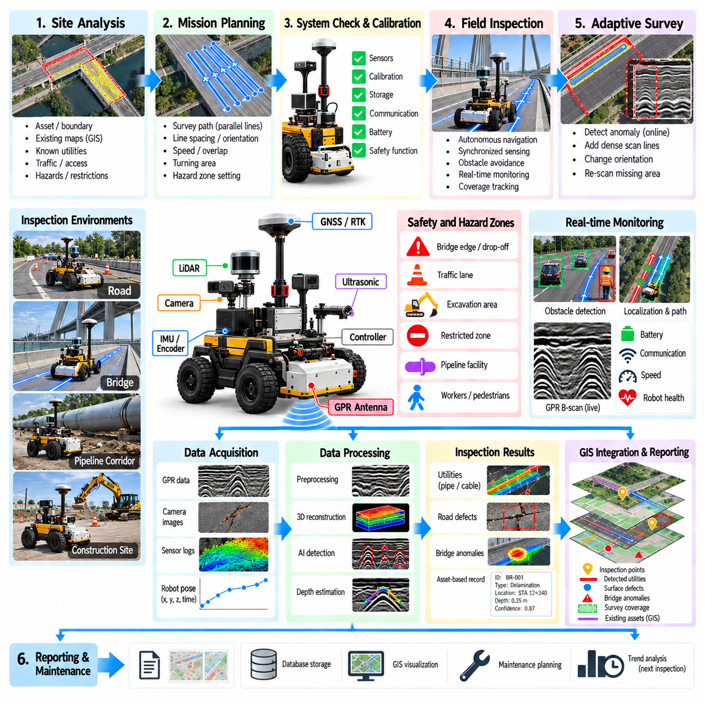{width="7.268055555555556in" height="7.268055555555556in"}

A field case for an infrastructure inspection robot demonstrates how sensing, autonomous mobility, data processing, safety, and engineering interpretation operate as one integrated workflow. The objective is not merely to prove that a robot can move across an infrastructure site, but to verify that it can repeatedly collect spatially valid inspection evidence under realistic environmental and operational constraints while maintaining traceability from mission planning to final assessment.

A representative field deployment begins with site characterization. Engineers identify the inspection asset, expected deterioration mechanisms, survey boundaries, access points, traffic conditions, surface characteristics, known utilities, restricted areas, and potential hazards. Existing drawings, GIS records, previous inspection reports, and maintenance history can be reviewed before deployment. These inputs establish both the inspection objectives and the operational constraints that the robotic system must satisfy.

Mission preparation converts engineering requirements into robot-executable survey plans. For a bridge deck or road section, the inspection region can be represented as a polygon divided into parallel survey lines with defined spacing. For a buried utility or pipeline corridor, the mission may use transverse and longitudinal passes. Path orientation, sampling density, robot velocity, turning areas, and required overlap are selected according to sensor characteristics and the spatial resolution required by the inspection objective.

Before autonomous operation begins, the robot performs initialization and system checks. Motor controllers, wheel encoders, IMU, GNSS or RTK-GNSS, cameras, LiDAR, GPR equipment, communication links, storage devices, and safety functions are verified. Sensor calibration and coordinate transformations are loaded with identifiable versions. The mission software also confirms sufficient battery capacity and storage resources before allowing the robot to enter the active inspection state.

A short calibration or reference run can be performed before the primary survey. The operator verifies localization quality, trajectory tracking, GPR triggering, image acquisition, timestamp synchronization, and data recording. Known surface or subsurface features can provide useful reference observations when available. Detecting configuration problems at this stage prevents an apparently successful autonomous mission from producing unusable inspection data that is discovered only after leaving the site.

During autonomous inspection, the AMR follows the planned survey lines while maintaining the velocity required for measurement quality. GPR traces are synchronized with robot position, and cameras or other sensors record complementary information. Navigation software controls cross-track error and heading while local perception detects temporary obstacles. The mission manager distinguishes valid inspection motion from turns, repositioning, obstacle avoidance, and transit between survey regions.

Field conditions rarely match the original plan perfectly. Workers, vehicles, equipment, debris, temporary barriers, wet surfaces, or inaccessible areas may interrupt a survey line. The robot can stop, wait, or execute a validated avoidance maneuver according to safety policy. Any deviation that creates a measurement gap is recorded explicitly. Once the obstruction is removed or a safe route becomes available, the planner can generate a recovery pass through the incomplete inspection region.

Localization performance is monitored throughout the mission because spatial accuracy determines the engineering value of the measurements. RTK-GNSS may provide high-quality outdoor positioning, but bridges, nearby structures, vegetation, or other environmental conditions can degrade satellite measurements. Odometry, IMU, LiDAR, or visual information can maintain continuity. The software records localization uncertainty so that later anomaly positions are reported with appropriate spatial confidence.

Inspection quality is evaluated separately from navigation success. The robot may physically traverse a survey line while radar communication fails, spatial sampling becomes too sparse, trajectory deviation exceeds limits, or localization quality becomes unacceptable. Such a line should not automatically be marked complete. Quality-control logic identifies the affected interval and requests reacquisition when practical, ensuring that mission progress represents valid measurements rather than distance traveled.

Preliminary processing can occur onboard while the field mission continues. GPR software may perform time-zero correction, filtering, background removal, gain adjustment, or simple candidate detection. Camera processing may identify visible surface defects, while trajectory analysis checks coverage quality. These preliminary results are not necessarily final engineering conclusions, but they can reveal suspicious regions requiring denser scanning or additional measurements before the robot leaves the site.

An adaptive field workflow can use preliminary interpretation to modify the survey. If a possible buried utility, void, structural anomaly, or ambiguous radar response is detected, the robot can perform additional passes with smaller line spacing or a different orientation. Repeated observations provide stronger spatial evidence than a single scan. This closes the loop between sensing and planning and demonstrates an important advantage of autonomous inspection over fixed manual data collection.

Safety supervision remains active independently of inspection productivity. Hazard zones, bridge edges, traffic boundaries, restricted regions, obstacle distances, speed limits, localization confidence, and robot health are continuously evaluated. A safety constraint can override the planned survey trajectory at any time. Emergency or controlled stops are recorded with their positions and causes so that resulting measurement gaps can later be distinguished from ordinary sensor or processing failures.

At the end of each survey segment, the system verifies coverage and data integrity before declaring completion. Recorded files can be checked for expected size, timestamps, sensor availability, trajectory association, and storage integrity. Missing or corrupted intervals are identified while the robot is still available for reacquisition. This field-level validation reduces the risk of discovering critical gaps only after equipment and traffic-control resources have been removed from the site.

After the mission, raw measurements are transferred into the inspection data-management workflow without losing their original identifiers. Radar traces, images, point clouds, trajectories, diagnostics, mission events, safety records, calibration information, and configuration versions remain associated with the same mission. Processing creates derived products while preserving links to the raw evidence, allowing later users to reconstruct how each reported result was generated.

Detailed GPR processing can transform synchronized radar measurements into B-scans, depth representations, spatially registered slices, or three-dimensional survey volumes. Filtering, gain compensation, migration, velocity assumptions, and depth conversion are documented as processing provenance. Candidate subsurface features can then be analyzed using geometric methods, AI models, or expert interpretation. Automated results retain confidence and uncertainty instead of being treated immediately as confirmed infrastructure objects.

Multi-sensor interpretation provides additional context for field findings. A subsurface radar anomaly can be compared with surface imagery, LiDAR geometry, known utility records, construction drawings, or previous inspection results. Agreement among independent sources can increase confidence, while disagreement identifies areas requiring further review. The system preserves both supporting and conflicting evidence so that the final engineering interpretation does not hide uncertainty present in the field measurements.

Georeferencing converts interpreted findings into infrastructure coordinates. Buried features can be represented as estimated utility trajectories with depth and confidence, road anomalies can be associated with lanes and chainage, and bridge findings can be connected to deck regions or structural elements. GIS integration allows these results to be viewed together with existing asset records while retaining links from each mapped feature to its original sensor evidence.

Engineering review forms the final interpretation stage of the field case. Specialists examine automated detections together with radar views, images, spatial context, data-quality indicators, uncertainty, and historical information. A finding can be accepted, rejected, modified, or marked for additional investigation. The review decision is stored without deleting the original machine output, preserving a traceable distinction between automated interpretation and validated engineering assessment.

Field performance should be evaluated using inspection-oriented metrics rather than autonomous-navigation metrics alone. Useful measures include valid coverage ratio, trajectory accuracy, localization uncertainty, sensor-data completeness, spatial sampling consistency, reacquisition frequency, anomaly localization error, inspection duration, intervention frequency, and safety events. Detection precision and recall can be evaluated when verified ground truth is available, but field datasets should not imply certainty where physical verification does not exist.

Operational lessons from a field case often reveal integration problems that individual subsystem tests cannot expose. Sensor cables may loosen under vibration, GNSS performance may vary across the site, storage bandwidth may become limiting, turning behavior may disturb GPR acquisition, or safety interventions may create unexpected coverage gaps. Recording these interactions provides evidence for improving mechanical design, software architecture, mission procedures, and subsequent validation tests.

Repeated deployment provides an even stronger demonstration of infrastructure inspection capability. The robot can return to the same asset using previous trajectories and spatial references, reacquire comparable measurements, and evaluate changes over time. Consistent survey geometry improves comparison of radar responses and surface conditions. Historical inspection records can therefore evolve from isolated datasets into a spatial and temporal representation of infrastructure condition.

The complete field case integrates the major functions of the GPR and infrastructure inspection workflow: sensor acquisition, radar processing, autonomous survey planning, AI interpretation, bridge and road inspection, pipeline-oriented inspection concepts, GIS data management, and hazard-zone safety. Success is achieved when the robot produces reproducible, spatially referenced, quality-controlled, and traceable evidence that engineers can use for infrastructure assessment rather than merely demonstrating autonomous movement in the field.

인프라 검사 로봇 현장 사례(Infrastructure Inspection Robot Field Case)는 센싱(Sensing), 자율 이동(Autonomous Mobility), 데이터 처리(Data Processing), 안전(Safety), 엔지니어링 해석(Engineering Interpretation)이 하나의 통합된 워크플로(Integrated Workflow)로 어떻게 작동하는지를 보여준다. 목표는 단순히 로봇이 인프라 현장을 이동할 수 있음을 입증하는 것이 아니라 현실적인 환경 및 운용 제약 조건에서도 공간적으로 유효한 검사 증거(Inspection Evidence)를 반복적으로 수집하고, 임무 계획부터 최종 평가까지 추적성(Traceability)을 유지할 수 있음을 검증하는 것이다.

대표적인 현장 배치(Field Deployment)는 현장 특성 분석(Site Characterization)으로 시작한다. 엔지니어는 검사 대상 자산, 예상되는 열화 메커니즘(Deterioration Mechanism), 조사 경계, 접근 지점, 교통 조건, 표면 특성, 알려진 유틸리티, 제한 구역, 잠재적 위험 요소를 식별한다. 배치 전에 기존 도면, GIS 기록, 이전 검사 보고서, 유지보수 이력을 검토할 수 있다. 이러한 입력 정보는 검사 목표와 로봇 시스템이 충족해야 할 운용 제약 조건(Operational Constraint)을 설정한다.

임무 준비(Mission Preparation)는 엔지니어링 요구사항을 로봇이 실행할 수 있는 조사 계획으로 변환한다. 교량 상판이나 도로 구간에서는 검사 영역을 다각형(Polygon)으로 표현하고 정의된 간격의 평행 조사 라인(Parallel Survey Line)으로 분할할 수 있다. 매설 유틸리티 또는 파이프라인 회랑에서는 횡방향 및 종방향 주행을 사용할 수 있다. 경로 방향, 샘플링 밀도(Sampling Density), 로봇 속도, 회전 영역, 필요한 중첩 범위는 센서 특성과 검사 목표에서 요구되는 공간 해상도(Spatial Resolution)에 따라 결정한다.

자율 운용을 시작하기 전에 로봇은 초기화(Initialization)와 시스템 점검(System Check)을 수행한다. 모터 제어기, 휠 인코더, 관성측정장치(IMU), GNSS 또는 실시간 이동측위 위성항법시스템(RTK-GNSS), 카메라, 라이다(LiDAR), 지표투과레이더(GPR) 장비, 통신 링크, 저장장치, 안전 기능을 검증한다. 센서 보정(Sensor Calibration)과 좌표 변환(Coordinate Transformation)은 식별 가능한 버전과 함께 로드된다. 임무 소프트웨어는 로봇이 실제 검사 상태에 진입하기 전에 충분한 배터리 용량과 저장 자원이 확보되었는지도 확인한다.

주요 조사를 시작하기 전에 짧은 보정 또는 기준 주행(Calibration or Reference Run)을 수행할 수 있다. 운영자는 위치 추정 품질(Localization Quality), 궤적 추종(Trajectory Tracking), GPR 트리거링(GPR Triggering), 영상 획득, 타임스탬프 동기화(Timestamp Synchronization), 데이터 기록 상태를 확인한다. 이용 가능한 경우 위치가 알려진 표면 또는 지하 특징을 기준 관측값(Reference Observation)으로 활용할 수 있다. 이 단계에서 설정 문제를 탐지하면 외관상 성공적인 자율 임무를 수행하고도 현장을 떠난 후에야 검사 데이터가 사용할 수 없음을 발견하는 문제를 방지할 수 있다.

자율 검사(Autonomous Inspection) 중 자율이동로봇(AMR)은 측정 품질에 필요한 속도를 유지하면서 계획된 조사 라인을 추종한다. GPR 트레이스(GPR Trace)는 로봇 위치와 동기화되며 카메라 또는 다른 센서는 상호 보완적인 정보를 기록한다. 내비게이션 소프트웨어는 횡방향 오차(Cross-Track Error)와 방향각을 제어하며 로컬 인지(Local Perception)는 임시 장애물을 탐지한다. 임무 관리자(Mission Manager)는 유효한 검사 이동을 회전, 재배치, 장애물 회피 및 조사 영역 사이의 단순 이동과 구분한다.

현장 조건(Field Condition)은 초기 계획과 완벽하게 일치하는 경우가 드물다. 작업자, 차량, 장비, 잔해물, 임시 장벽, 젖은 노면 또는 접근할 수 없는 영역으로 인해 조사 라인이 중단될 수 있다. 로봇은 안전 정책(Safety Policy)에 따라 정지하거나 대기하거나 검증된 회피 동작(Validated Avoidance Maneuver)을 수행할 수 있다. 측정 누락 영역(Measurement Gap)을 발생시키는 모든 경로 편차는 명시적으로 기록된다. 장애물이 제거되거나 안전한 경로가 확보되면 계획기는 미완료 검사 영역을 통과하는 복구 주행(Recovery Pass)을 생성할 수 있다.

공간 정확도(Spatial Accuracy)가 측정 데이터의 엔지니어링 가치를 결정하기 때문에 임무 전체에서 위치 추정 성능을 모니터링한다. RTK-GNSS는 실외에서 고품질 위치 정보를 제공할 수 있지만 교량, 인접 구조물, 식생 또는 기타 환경 조건으로 인해 위성 측정 성능이 저하될 수 있다. 오도메트리(Odometry), 관성측정장치(IMU), 라이다 또는 비전 정보를 이용하여 위치 추정의 연속성을 유지할 수 있다. 소프트웨어는 위치 추정 불확실성(Localization Uncertainty)을 기록하여 이후 이상 위치를 적절한 공간 신뢰도(Spatial Confidence)와 함께 보고할 수 있도록 한다.

검사 품질(Inspection Quality)은 내비게이션 성공 여부와 별도로 평가한다. 로봇이 물리적으로 조사 라인을 통과했더라도 레이더 통신이 실패하거나 공간 샘플링이 지나치게 희박하거나 궤적 편차가 허용 한계를 초과하거나 위치 추정 품질이 허용되지 않는 수준으로 저하될 수 있다. 이러한 조사 라인을 자동으로 완료 처리해서는 안 된다. 품질 제어 로직(Quality-Control Logic)은 문제가 발생한 구간을 식별하고 가능한 경우 재수집(Reacquisition)을 요청하여 임무 진행률이 단순한 이동 거리가 아니라 유효한 측정 데이터의 확보 상태를 나타내도록 한다.

현장 임무가 진행되는 동안 온보드 예비 처리(Onboard Preliminary Processing)를 수행할 수 있다. GPR 소프트웨어는 시간 영점 보정(Time-Zero Correction), 필터링, 배경 제거(Background Removal), 이득 조정(Gain Adjustment), 간단한 후보 탐지(Candidate Detection)를 수행할 수 있다. 카메라 처리는 육안으로 확인 가능한 표면 결함을 탐지할 수 있으며 궤적 분석은 커버리지 품질(Coverage Quality)을 확인한다. 이러한 예비 결과가 반드시 최종 엔지니어링 결론을 의미하는 것은 아니지만 로봇이 현장을 떠나기 전에 더 조밀한 스캔이나 추가 측정이 필요한 의심 영역을 식별할 수 있다.

적응형 현장 워크플로(Adaptive Field Workflow)는 예비 해석 결과를 이용하여 조사 방법을 변경할 수 있다. 잠재적인 매설 유틸리티, 공동(Void), 구조적 이상(Structural Anomaly) 또는 모호한 레이더 응답이 탐지되면 로봇은 더 작은 라인 간격 또는 다른 방향을 이용하여 추가 주행을 수행할 수 있다. 반복적인 관측은 단일 스캔보다 강력한 공간적 증거(Spatial Evidence)를 제공한다. 이는 센싱과 계획 사이의 폐루프(Closed Loop)를 형성하며 고정된 수동 데이터 수집과 비교할 때 자율 검사가 제공하는 중요한 장점을 보여준다.

안전 감독(Safety Supervision)은 검사 생산성과 독립적으로 지속해서 활성화된다. 위험 구역(Hazard Zone), 교량 가장자리, 교통 경계, 제한 구역, 장애물 거리, 속도 제한, 위치 추정 신뢰도, 로봇 상태를 지속적으로 평가한다. 안전 제약 조건(Safety Constraint)은 언제든지 계획된 조사 궤적보다 우선할 수 있다. 비상 정지(Emergency Stop) 또는 제어 정지(Controlled Stop)는 위치 및 발생 원인과 함께 기록되어 이후 발생한 측정 누락을 일반적인 센서 또는 처리 오류와 구분할 수 있도록 한다.

각 조사 세그먼트(Survey Segment)가 종료되면 시스템은 완료를 선언하기 전에 커버리지와 데이터 무결성(Data Integrity)을 검증한다. 기록된 파일에서 예상 파일 크기, 타임스탬프, 센서 가용성, 궤적 연결 관계, 저장 무결성을 확인할 수 있다. 누락되거나 손상된 구간은 로봇이 아직 현장에 있어 데이터를 다시 획득할 수 있을 때 식별한다. 이러한 현장 수준 검증(Field-Level Validation)은 장비와 교통 통제 자원이 현장에서 철수한 이후에야 중요한 데이터 누락을 발견하는 위험을 줄인다.

임무가 완료되면 원시 측정 데이터(Raw Measurement)는 최초 식별자를 잃지 않은 상태로 검사 데이터 관리 워크플로(Inspection Data-Management Workflow)에 전달된다. 레이더 트레이스, 영상, 포인트 클라우드(Point Cloud), 궤적, 진단 정보, 임무 이벤트, 안전 기록, 보정 정보, 설정 버전(Configuration Version)은 동일한 임무와 연결된 상태를 유지한다. 데이터 처리 과정에서는 파생 결과물(Derived Product)을 생성하면서 원시 증거(Raw Evidence)와의 연결 관계를 보존하여 이후 사용자가 각각의 보고 결과가 어떻게 생성되었는지를 재구성할 수 있도록 한다.

상세 GPR 처리(Detailed GPR Processing)는 동기화된 레이더 측정 데이터를 B-스캔(B-Scan), 깊이 표현(Depth Representation), 공간적으로 정합된 슬라이스(Spatially Registered Slice) 또는 3차원 조사 볼륨(Three-Dimensional Survey Volume)으로 변환할 수 있다. 필터링, 이득 보상(Gain Compensation), 마이그레이션(Migration), 전파 속도 가정(Velocity Assumption), 깊이 변환(Depth Conversion)은 처리 출처 정보(Processing Provenance)로 기록된다. 이후 잠재적인 지하 특징은 기하학적 방법, AI 모델 또는 전문가 해석(Expert Interpretation)을 이용하여 분석할 수 있다. 자동화된 결과는 즉시 확정된 인프라 객체로 처리하지 않고 신뢰도(Confidence)와 불확실성(Uncertainty)을 유지한다.

다중 센서 해석(Multi-Sensor Interpretation)은 현장 검사 결과에 추가적인 상황 정보를 제공한다. 지하 레이더 이상은 표면 영상, 라이다 형상, 알려진 유틸리티 기록, 시공 도면 또는 이전 검사 결과와 비교할 수 있다. 서로 독립적인 정보가 일치하면 신뢰도가 증가할 수 있으며, 결과가 일치하지 않으면 추가 검토가 필요한 영역을 식별할 수 있다. 시스템은 최종 엔지니어링 해석에서 현장 측정에 존재하는 불확실성이 감춰지지 않도록 이를 지지하는 증거와 상충되는 증거(Conflicting Evidence)를 모두 보존한다.

지리참조(Georeferencing)는 해석된 결과를 인프라 좌표(Infrastructure Coordinate)로 변환한다. 매설 특징은 깊이와 신뢰도를 포함하는 추정 유틸리티 궤적(Estimated Utility Trajectory)으로 표현할 수 있고, 도로 이상은 차선과 체이니지(Chainage)에 연결할 수 있으며, 교량 검사 결과는 상판 영역이나 구조 요소와 연결할 수 있다. GIS 통합(GIS Integration)을 통해 이러한 결과를 기존 자산 기록과 함께 확인하면서 각각의 지도 객체에서 원본 센서 증거까지의 연결 관계를 유지할 수 있다.

엔지니어링 검토(Engineering Review)는 현장 사례의 최종 해석 단계를 구성한다. 전문가는 자동 탐지 결과를 레이더 화면, 영상, 공간적 상황 정보, 데이터 품질 지표(Data-Quality Indicator), 불확실성, 과거 정보와 함께 검토한다. 검사 결과는 승인, 거부, 수정하거나 추가 조사가 필요한 상태로 표시할 수 있다. 검토 결정은 최초의 기계 출력(Machine Output)을 삭제하지 않고 저장하여 자동화된 해석과 검증된 엔지니어링 평가(Validated Engineering Assessment) 사이의 추적 가능한 차이를 보존한다.

현장 성능(Field Performance)은 자율 내비게이션 지표만이 아니라 검사 중심 지표(Inspection-Oriented Metric)를 이용하여 평가해야 한다. 유효 커버리지 비율(Valid Coverage Ratio), 궤적 정확도, 위치 추정 불확실성, 센서 데이터 완전성, 공간 샘플링 일관성, 재수집 빈도, 이상 위치 오차, 검사 시간, 개입 빈도, 안전 이벤트 등을 활용할 수 있다. 검증된 정답 데이터(Ground Truth)가 존재하는 경우 탐지 정밀도(Precision)와 재현율(Recall)을 평가할 수 있지만 물리적인 검증 결과가 존재하지 않는 현장 데이터에 확정적인 정확성을 부여해서는 안 된다.

현장 사례에서 얻는 운용 경험(Operational Lesson)은 개별 서브시스템 시험만으로는 발견하기 어려운 통합 문제를 드러내는 경우가 많다. 진동으로 인해 센서 케이블이 느슨해질 수 있고, 현장 위치에 따라 GNSS 성능이 달라질 수 있으며, 저장 대역폭(Storage Bandwidth)이 제한 요소가 될 수 있다. 또한 회전 동작이 GPR 데이터 수집에 영향을 주거나 안전 개입(Safety Intervention)으로 예상하지 못한 커버리지 누락이 발생할 수 있다. 이러한 상호작용을 기록하면 기계 설계, 소프트웨어 아키텍처, 임무 절차 및 후속 검증 시험을 개선하기 위한 근거를 확보할 수 있다.

반복적인 현장 배치(Repeated Deployment)는 인프라 검사 역량을 더욱 강력하게 입증할 수 있다. 로봇은 이전 궤적과 공간 참조를 이용하여 동일한 자산으로 다시 이동하고 비교 가능한 측정 데이터를 재수집하며 시간에 따른 변화를 평가할 수 있다. 일관된 조사 형상(Consistent Survey Geometry)은 레이더 응답과 표면 상태의 비교 정확도를 향상한다. 따라서 과거 검사 기록은 서로 독립된 데이터셋에서 인프라 상태에 대한 공간적·시간적 표현(Spatial and Temporal Representation)으로 발전할 수 있다.

전체 현장 사례(Complete Field Case)는 GPR 및 인프라 검사 워크플로의 주요 기능인 센서 데이터 수집(Sensor Acquisition), 레이더 처리(Radar Processing), 자율 조사 계획(Autonomous Survey Planning), AI 해석(AI Interpretation), 교량 및 도로 검사, 파이프라인 중심 검사 개념, GIS 데이터 관리, 위험 구역 안전(Hazard-Zone Safety)을 통합한다. 성공적인 현장 적용은 단순히 로봇이 현장에서 자율 이동하는 것을 보여주는 것이 아니라 엔지니어가 인프라 평가에 활용할 수 있는 재현 가능하고(Reproducible), 공간적으로 참조되며(Spatially Referenced), 품질이 관리되고(Quality-Controlled), 추적 가능한(Traceable) 검사 증거를 생성하는 것으로 판단해야 한다.
