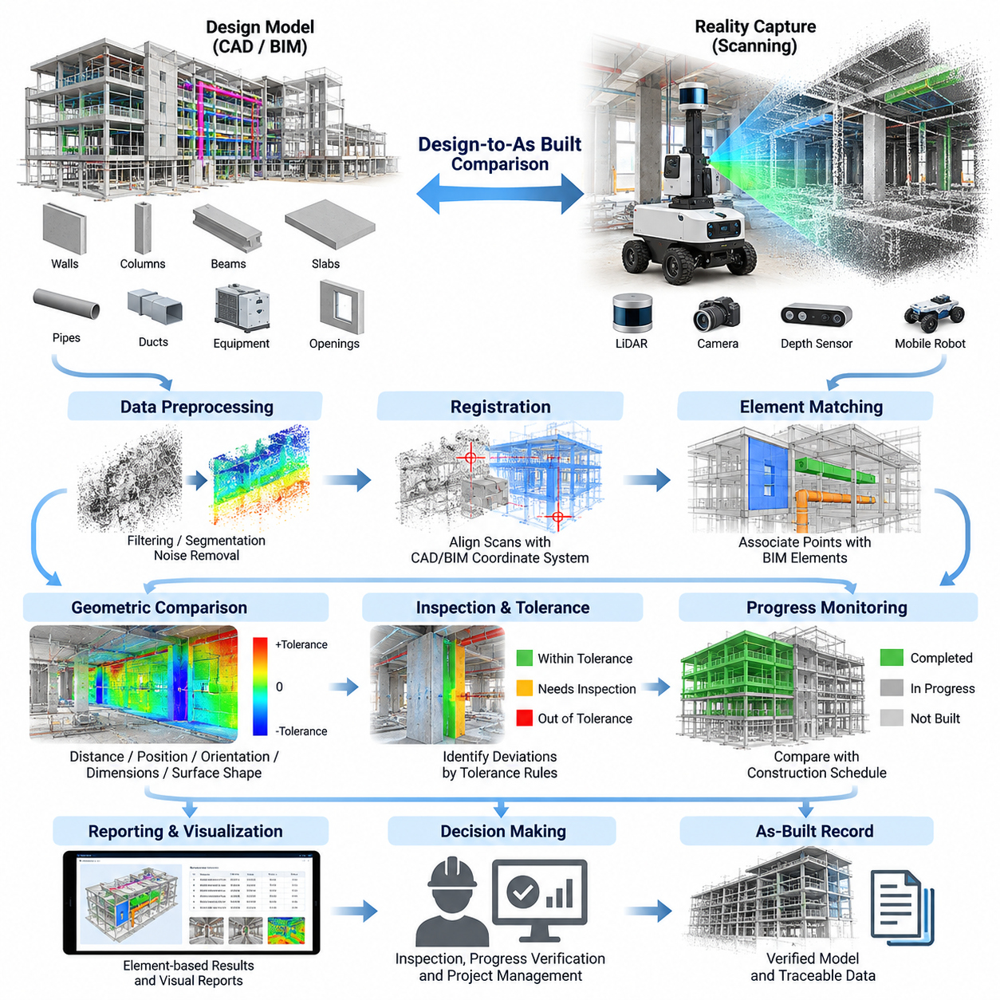
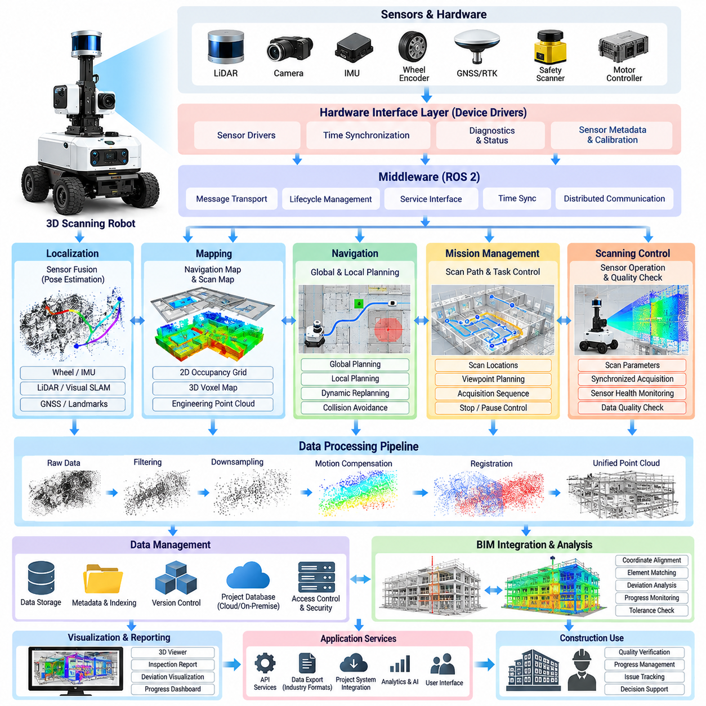
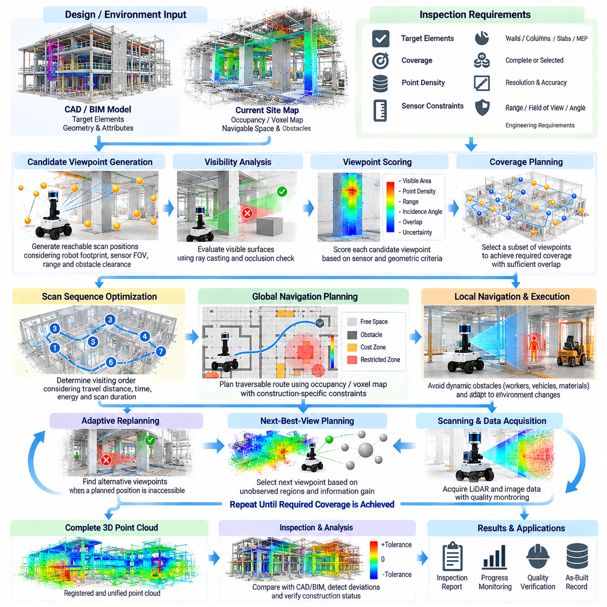
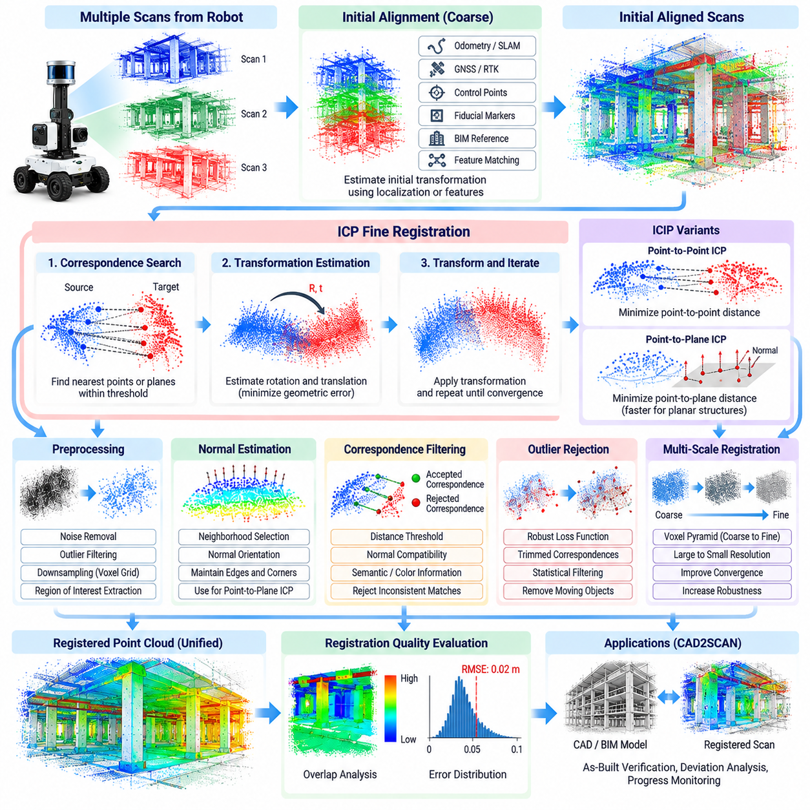
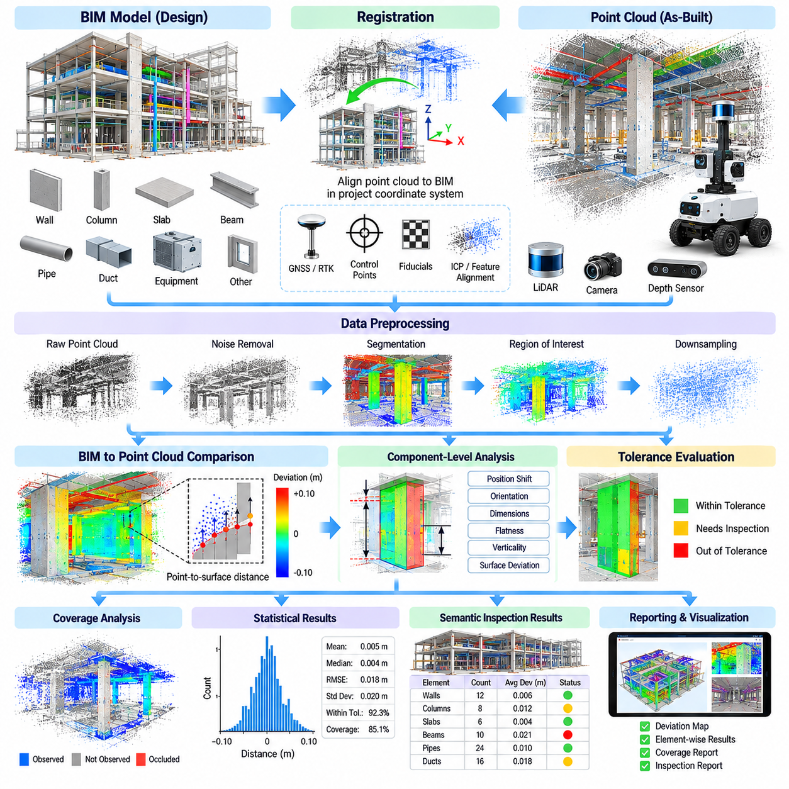
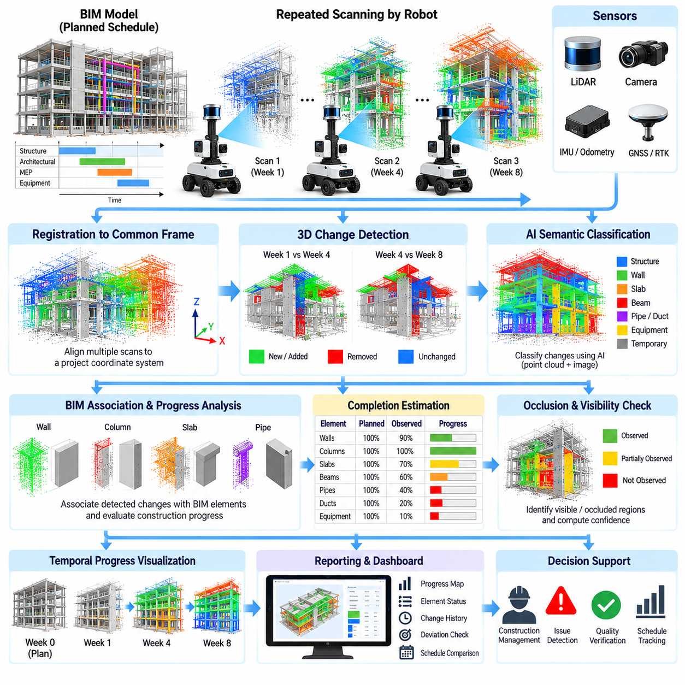
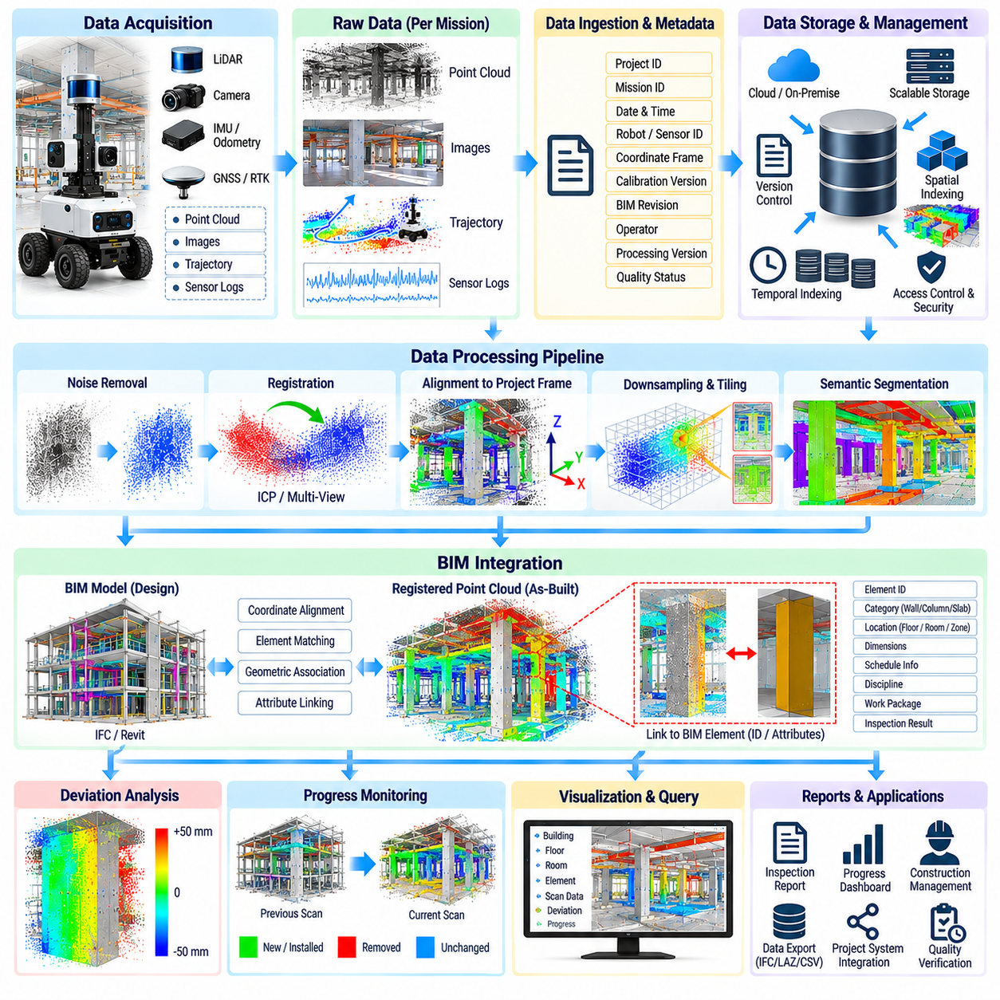
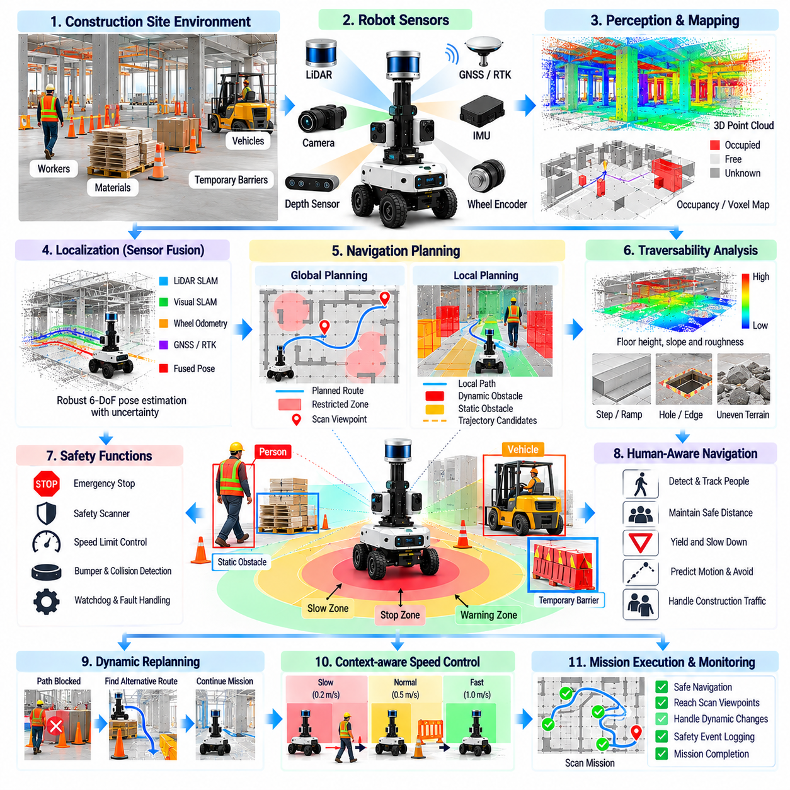
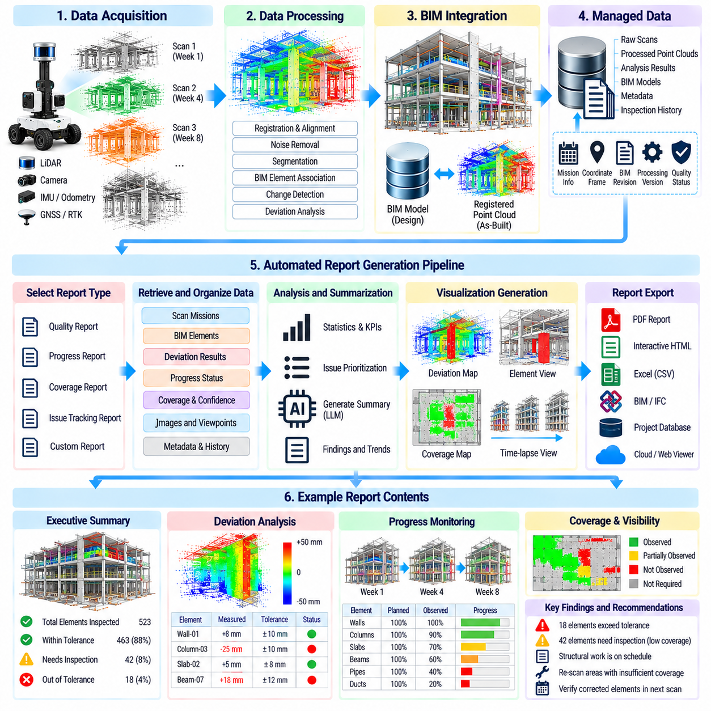
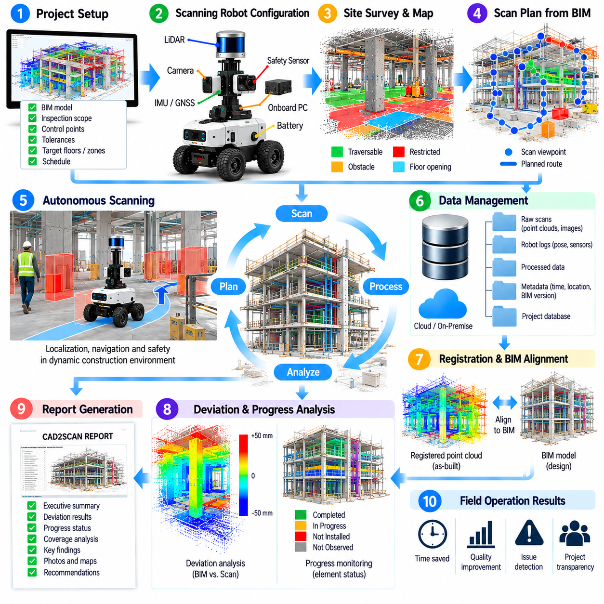

**Volume 26. Industrial Robot Applications**

# Chapter 06. CAD2SCAN and Construction Scanning

## 06.01. CAD2SCAN Concept Design to As Built Comparison

{width="7.268055555555556in" height="7.268055555555556in"}

CAD2SCAN은 디지털 설계 정보와 실제 시공 환경의 물리적 상태를 연결하는 건설 검증 방법론(Construction Verification Methodology)이다. 이 작업 흐름에서 캐드(CAD) 또는 빌딩 정보 모델링(Building Information Modeling, BIM) 데이터는 의도된 설계 형상(Design Geometry)을 나타내며, 3차원 스캐닝(3D Scanning)은 현장에서 실제로 시공된 형상을 획득한다. 이를 비교함으로써 설계 의도(Design Intent)와 준공 상태(As-Built Condition) 사이의 차이를 정량적으로 측정할 수 있다.

이 개념은 기존의 건설 검사(Construction Inspection)가 수작업 측정, 육안 관찰, 사진 촬영, 정기적인 측량 등에 크게 의존한다는 점에서 특히 중요하다. 이러한 방법은 주요 문제를 발견할 수 있지만 대규모 구조물 전체에 분산되어 발생하는 기하학적 편차(Geometric Deviation)를 놓칠 수 있다. CAD2SCAN은 건설 현장을 공간 데이터(Spatial Data)로 변환하여 기준 설계와 체계적으로 비교함으로써 더욱 포괄적이고 반복 가능한 검증을 가능하게 한다.

일반적인 CAD2SCAN 작업 흐름(Workflow)은 구조, 건축 또는 기계 형상을 포함하는 디지털 기준 모델(Digital Reference Model)에서 시작된다. 벽, 기둥, 슬래브, 보, 배관, 덕트, 장비 기초 및 개구부와 같은 관련 객체를 모델에서 추출한다. 좌표계(Coordinate System), 모델 단위(Model Unit), 기준점(Reference Point), 시공 허용오차(Construction Tolerance)를 정확하게 정의해야 하며, 이러한 요소들은 이후 수행되는 기하학적 비교의 신뢰성을 결정한다.

준공 상태 표현(As-Built Representation)은 일반적으로 지상형 라이다(Terrestrial LiDAR), 모바일 레이저 스캐닝(Mobile Laser Scanning), 깊이 카메라(Depth Camera), 사진측량(Photogrammetry), 또는 로봇에 장착된 3차원 센서(3D Sensor)를 통해 획득한다. 각각의 데이터 획득 방식은 하나 이상의 관측 위치에서 보이는 표면을 측정한다. 여러 스캔 데이터를 공통 좌표계(Common Coordinate Frame)로 결합하여 원래 설계와 다를 수 있는 실제 시공 형상을 표현하는 포인트 클라우드(Point Cloud)를 생성한다.

로봇 스캐닝(Robotic Scanning)은 일정한 이동 경로와 센서 구성을 기반으로 반복적인 데이터 획득을 가능하게 하여 이러한 과정을 확장한다. 자율이동로봇(Autonomous Mobile Robot)은 복도, 층, 실내 공간 또는 부분적으로 시공된 건설 구역을 이동하면서 라이다(LiDAR)와 이미지 데이터를 수집할 수 있다. 반복적인 스캐닝 임무(Scanning Mission)를 수행하면 설계와 실제 상태뿐만 아니라 서로 다른 날짜와 프로젝트 단계에서 건설 현장이 어떻게 변화하는지도 비교할 수 있다.

설계와 준공 상태(Design-to-As-Built)를 비교하기 전에 스캔된 포인트 클라우드를 CAD 또는 BIM 좌표계와 정렬해야 한다. 정합(Registration)에는 측량 기준점(Surveyed Control Point), 적절한 실외 환경에서의 위성항법시스템 또는 실시간 이동측위(GNSS/RTK), 기준 마커(Fiducial Marker), 동시적 위치추정 및 지도작성 궤적(SLAM Trajectory), 기하학적 특징(Geometric Feature), 반복 정렬 알고리즘(Iterative Alignment Algorithm) 등을 사용할 수 있다. 정합 오차가 실제 시공 편차로 잘못 해석될 수 있기 때문에 정합 정확도(Registration Accuracy)는 매우 중요하다.

정합이 완료되면 설계 표면과 측정된 포인트 사이의 기하학적 대응 관계(Geometric Correspondence)를 평가할 수 있다. 간단한 방법은 각 관측 포인트에서 예상되는 CAD 또는 BIM 표면까지의 최단거리를 계산하는 것이다. 보다 발전된 방법에서는 스캔 영역을 개별 BIM 요소와 연결하여 위치(Position), 방향(Orientation), 치수(Dimension), 표면 형상(Surface Shape), 완전성(Completeness)을 평가한다. 이렇게 생성된 편차장(Deviation Field)은 실제 시공 결과가 설계와 얼마나 일치하는지를 정량적으로 보여준다.

편차 값(Deviation Value)은 허용 가능한 형상과 추가 검사가 필요한 상태를 구분하는 허용오차 범위(Tolerance Band)로 표현할 수 있다. 예를 들어 지정된 허용오차 내의 측정값은 적합(Compliant)으로 판단할 수 있으며, 더 큰 양의 편차 또는 음의 편차는 위치 이동, 과도한 재료, 재료 부족, 잘못된 정렬 또는 설치 오류를 나타낼 수 있다. 허용오차는 구성 요소, 시공 단계, 측정 불확실성(Measurement Uncertainty), 관련 엔지니어링 요구사항에 따라 정의해야 한다.

CAD2SCAN은 설계된 요소가 스캔 환경에 실제로 존재하는지를 판단하여 공정 진행 모니터링(Progress Monitoring)도 지원할 수 있다. BIM 모델에 예상 시공 순서가 포함되어 있다면 관측된 형상을 예정된 구성 요소와 연결하여 공정 완료 상태를 추정할 수 있다. 이를 통해 스캐닝은 단순한 치수 검사(Dimensional Inspection) 기술을 넘어 공정 검증과 증거 기반 프로젝트 관리(Evidence-Based Project Management)를 지원하는 건설 지능화(Construction Intelligence) 기술로 확장된다.

비교 과정에서는 실제 시공 차이와 센싱 오류(Sensing Artifact)를 구분해야 한다. 장비, 임시 구조물, 적재 자재, 작업자, 차량 및 미완성 구조물이 센서의 시야를 가릴 수 있기 때문에 가림(Occlusion)은 건설 현장에서 흔히 발생한다. 반사 표면, 유리, 먼지, 비, 카메라의 열악한 조명 조건, 긴 센싱 거리 역시 측정 품질을 저하시킬 수 있다. 따라서 신뢰할 수 있는 CAD2SCAN 시스템은 기하학적 편차뿐만 아니라 데이터 신뢰도(Data Confidence)와 관측 범위(Coverage)도 함께 관리해야 한다.

데이터 전처리(Data Preprocessing) 역시 필수적인 단계이다. 원시 스캔 데이터(Raw Scan Data)에는 노이즈, 중복 관측값, 이동 객체, 이상치(Outlier), 불필요한 주변 환경 정보 등이 포함될 수 있다. 필터링(Filtering), 다운샘플링(Downsampling), 지면 또는 구조물 분할(Segmentation), 법선 추정(Normal Estimation), 관심 영역 추출(Region Extraction)을 통해 비교 전에 포인트 클라우드를 단순화할 수 있다. 그러나 지나친 필터링은 작지만 중요한 시공 편차를 제거할 수 있으므로 검사에 필요한 기하학적 특징을 보존해야 한다.

BIM의 의미 정보(Semantic Information)는 단순한 기하학적 비교에 비해 중요한 장점을 제공한다. 기준 표면에서 수 센티미터 떨어져 있는 익명의 포인트 집합으로 편차를 보고하는 대신, 시스템은 해당 편차를 특정 벽, 보, 배관 또는 장비 기초와 연결할 수 있다. 이러한 연결을 통해 검사 결과를 건축 요소(Building Element), 위치(Location), 작업 패키지(Work Package), 담당 분야(Discipline), 시공 일정(Construction Schedule)에 따라 체계적으로 관리할 수 있다.

실용적인 CAD2SCAN 소프트웨어 파이프라인(Software Pipeline)은 여러 로봇 및 건설 데이터 기술을 결합한다. 센서 데이터 획득(Sensor Acquisition)은 포인트 클라우드와 이미지를 생성하고, 위치추정(Localization)은 스캐너의 이동 궤적을 결정하며, 정합(Registration)은 공통 기준 좌표계를 설정한다. BIM 처리는 설계 형상을 추출하고 비교 알고리즘(Comparison Algorithm)은 편차를 계산한다. 이후 보고 계층(Reporting Layer)은 수치 결과를 엔지니어, 시공사, 검사 담당자 및 프로젝트 관리자가 이해하고 활용할 수 있는 정보로 변환한다.

스캐닝을 자주 반복해야 하는 경우 자율 로봇(Autonomous Robot)이 특히 유용하다. 수동 스캐닝(Manual Scanning)은 기술자가 장비를 반복적으로 이동시키고 여러 위치를 다시 방문해야 하지만, 로봇은 사전에 정의하거나 상황에 따라 적응적으로 생성된 스캔 임무(Scan Mission)를 수행할 수 있다. 또한 로봇은 이동 궤적과 센서 자세(Sensor Pose)를 기록할 수 있어 검사 작업 간 반복성을 향상시킨다. 이를 통해 공사가 진행되는 동안 동일한 건설 영역을 체계적으로 비교할 수 있다.

그러나 건설 환경(Construction Environment)은 로봇 내비게이션(Robot Navigation)에 매우 어려운 조건을 제공한다. 로봇은 불균일한 바닥, 임시 장애물, 좁은 통로, 경사로, 지속적으로 변경되는 공간 배치, 이동하는 작업자, 건설 장비, 먼지 및 GNSS 신호를 안정적으로 사용할 수 없는 영역을 마주할 수 있다. 따라서 CAD2SCAN 로봇 시스템에는 견고한 위치추정(Robust Localization), 장애물 회피(Obstacle Avoidance), 지도 갱신(Map Updating), 임무 복구(Mission Recovery), 안전 메커니즘(Safety Mechanism)이 필요하다.

설계 변경(Design Revision) 역시 중요한 고려사항이다. 비교에 사용하는 기준 모델(Reference Model)은 스캔 데이터가 획득된 시점에 적용되는 승인된 설계 버전과 일치해야 한다. 현재 시공 상태를 오래된 CAD 또는 BIM 모델과 비교하면 많은 잘못된 편차(False Deviation)가 발생할 수 있다. 따라서 CAD2SCAN 시스템은 모델 버전(Model Version), 스캔 시간(Scan Timestamp), 좌표 기준(Coordinate Reference), 처리 매개변수(Processing Parameter), 비교 결과를 추적 가능한 프로젝트 기록(Project Record)으로 관리해야 한다.

측정 불확실성(Measurement Uncertainty) 역시 명시적으로 다루어야 한다. 스캐너 정확도(Scanner Accuracy), 위치추정 드리프트(Localization Drift), 정합 잔차(Registration Residual), 표면 특성(Surface Property), 포인트 밀도(Point Density), 환경 조건(Environmental Condition)은 모두 최종 편차 추정의 불확실성에 영향을 준다. 검출된 차이가 전체 불확실성과 지정된 엔지니어링 허용오차를 초과하지 않는다면 이를 자동으로 시공 결함으로 분류해서는 안 된다. 이러한 접근은 시스템이 실제보다 과도하게 정밀한 결과를 제시하는 것을 방지한다.

프로젝트 수준에서 CAD2SCAN은 설계(Design), 시공(Construction), 검증(Verification)을 연결하는 디지털 피드백 루프(Digital Feedback Loop)를 형성한다. 설계 정보는 무엇이 존재해야 하는지를 정의하고, 로봇 또는 고정형 스캐닝 시스템은 실제로 무엇이 존재하는지를 관측하며, 비교 알고리즘은 그 차이를 식별한다. 이후 엔지니어링 팀은 수정 작업의 필요성을 판단한다. 수정 또는 추가 시공 후 다시 환경을 스캔하여 물리적 공정 상태를 지속적으로 갱신할 수 있다.

생성된 준공 정보(As-Built Information)는 궁극적으로 시운전(Commissioning), 시설 관리(Facility Management), 개보수(Renovation), 디지털 트윈(Digital Twin) 응용에도 활용할 수 있다. 완공된 시설을 정확하게 반영하지 못할 가능성이 있는 기존 설계 모델만 남기는 대신, 실제 물리적 관측 데이터와 연결된 기하학적으로 검증된 디지털 표현(Digital Representation)을 유지할 수 있다. 따라서 CAD2SCAN은 자동화된 건설 검사(Automated Construction Inspection)와 디지털 모델과 실제 인프라 사이의 신뢰할 수 있는 연결을 구축하는 기반을 제공한다.

보다 광범위한 건설 스캐닝 작업 흐름(Construction Scanning Workflow)에서 이 개념은 이후 다루어지는 로봇 3차원 스캐닝 아키텍처(Robotic 3D Scanning Architecture), 자율 스캔 경로 계획(Autonomous Scan-Path Planning), 포인트 클라우드 정합(Point-Cloud Registration), BIM-포인트 클라우드 편차 분석(BIM-to-Point-Cloud Deviation Analysis), 인공지능 기반 변화 감지(AI-Based Change Detection), 스캔 데이터 관리(Scan-Data Management), 건설 현장 내비게이션(Construction-Site Navigation), 자동 보고서 생성(Automated Reporting) 등의 기반을 형성한다. 이러한 기능들은 CAD2SCAN 장에서 정의된 기술적 발전 과정(Technical Progression)을 구성한다.

## 06.02. 3D Scanning Robot SW Architecture [w/Code]

{width="7.268055555555556in" height="7.268055555555556in"}

3차원 스캐닝 로봇 소프트웨어 아키텍처(3D Scanning Robot Software Architecture)는 자율 이동(Autonomous Mobility), 위치추정(Localization), 센서 제어(Sensor Control), 공간 데이터 획득(Spatial Data Acquisition), 포인트 클라우드 처리(Point-Cloud Processing), 건설 정보 관리(Construction Information Management)를 하나의 통합된 로봇 시스템으로 구성한다. 주요 목적은 건설 환경을 이동하면서 기하학적으로 일관된 데이터를 지속적으로 생성하고, 이를 이후 캐드(CAD) 또는 빌딩 정보 모델링(Building Information Modeling, BIM) 모델과 비교하여 검사와 검증에 활용하는 것이다.

이 아키텍처는 일반적으로 하드웨어 인터페이스(Hardware Interface)를 인지(Perception), 위치추정(Localization), 내비게이션(Navigation), 스캐닝(Scanning), 데이터 처리(Data Processing), 응용 서비스(Application Service)와 분리하는 계층형 시스템(Layered System)으로 구성된다. 이러한 분리는 전체 플랫폼을 재설계하지 않고도 개별 센서나 알고리즘을 교체할 수 있도록 한다. ROS 2와 같은 미들웨어(Middleware)는 이러한 소프트웨어 구성 요소 사이에서 메시지 전송, 생명주기 관리(Lifecycle Management), 서비스 인터페이스, 시간 동기화(Time Synchronization), 분산 통신(Distributed Communication)을 제공할 수 있다.

하드웨어 인터페이스 계층(Hardware Interface Layer)에서 장치 드라이버(Device Driver)는 소프트웨어 스택을 라이다(LiDAR) 스캐너, RGB 또는 깊이 카메라(Depth Camera), 관성측정장치(Inertial Measurement Unit, IMU), 휠 인코더(Wheel Encoder), 위성항법시스템(GNSS) 수신기, 모터 제어기(Motor Controller), 안전 스캐너(Safety Scanner) 및 기타 장비와 연결한다. 각 드라이버는 제조사별 측정 데이터를 표준화된 내부 메시지로 변환하면서 타임스탬프(Timestamp), 보정 매개변수(Calibration Parameter), 진단 상태(Diagnostic State), 센서 메타데이터(Sensor Metadata)를 보존한다.

시간 동기화(Time Synchronization)는 스캐닝 로봇이 이동하면서 공간 정보를 수집하기 때문에 특히 중요하다. 라이다 측정값, 카메라 프레임(Camera Frame), IMU 관측값, 휠 오도메트리(Wheel Odometry), 로봇 자세(Robot Pose)는 서로 일관된 시간 지점에 대응해야 한다. 하드웨어 트리거링(Hardware Triggering), 정밀 시간 프로토콜(Precision Time Protocol, PTP), 동기화된 클록(Synchronized Clock), 소프트웨어 타임스탬프 보정(Software Timestamp Correction)을 이용하여 포인트 클라우드 왜곡과 부정확한 기하학적 재구성을 유발하는 시간 오차를 줄일 수 있다.

좌표 프레임 관리 서브시스템(Coordinate-Frame Management Subsystem)은 로봇 베이스(Robot Base), 센서, 오도메트리 프레임(Odometry Frame), 로컬 지도(Local Map), 건설 좌표계(Construction Coordinate System), BIM 기준 프레임(BIM Reference Frame) 사이의 공간적 관계를 정의한다. 정적 변환(Static Transformation)은 보정된 센서 장착 위치를 나타내고, 동적 변환(Dynamic Transformation)은 로봇의 움직임을 표현한다. 일관된 변환 트리(Transformation Tree)를 유지하면 획득한 모든 포인트를 센서 좌표계에서 공통 프로젝트 좌표계로 변환할 수 있다.

위치추정 계층(Localization Layer)은 데이터 획득 과정에서 스캐닝 플랫폼의 6자유도 자세(Six-Degree-of-Freedom Pose)를 추정한다. 환경에 따라 로봇은 휠 오도메트리, IMU 측정값, 라이다 동시적 위치추정 및 지도작성(LiDAR SLAM), 비주얼 SLAM(Visual SLAM), GNSS/RTK, 측량 랜드마크(Surveyed Landmark), 기준 마커(Fiducial Reference)를 결합할 수 있다. 센서 융합(Sensor Fusion)은 특정 센서에 대한 의존성을 줄이고 반복적인 구조나 빠르게 변화하는 주변 환경에서도 더욱 안정적인 이동 궤적을 제공한다.

매핑 소프트웨어(Mapping Software)는 로봇 내비게이션과 스캔 데이터 관리를 위해 환경 표현(Environment Representation)을 구축한다. 내비게이션 지도는 2차원 점유 격자(2D Occupancy Grid), 3차원 복셀 지도(3D Voxel Map), 고도 지도(Elevation Map), 로컬 장애물 표현(Local Obstacle Representation)을 사용할 수 있으며, 검사 데이터는 훨씬 고밀도의 포인트 클라우드를 유지할 수 있다. 내비게이션용 지도와 엔지니어링 품질의 스캔 데이터를 분리하면 고해상도 스캔 데이터로 인해 실시간 내비게이션 계산량이 불필요하게 증가하는 것을 방지할 수 있다.

내비게이션 서브시스템(Navigation Subsystem)은 스캐닝 임무(Scanning Mission)를 안전한 로봇 이동으로 변환한다. 전역 경로 계획(Global Planning)은 검사 영역 사이의 이동 경로를 결정하고, 지역 경로 계획(Local Planning)은 주변 장애물과 플랫폼 제약조건을 고려하여 충돌 없는 이동 명령을 생성한다. 건설 환경에서는 작업자, 차량, 임시 장애물, 적재 자재, 부분적으로 완성된 구조물로 인해 이동 가능한 공간이 지속적으로 변화하므로 반복적인 재계획(Replanning)이 필요하다.

임무 관리 계층(Mission-Management Layer)은 상위 수준에서 내비게이션과 스캐닝 활동을 조정한다. 단순히 로봇이 목적지에 도달하도록 명령하는 것이 아니라 스캔 위치(Scan Location), 관측 방향(Observation Orientation), 센서 설정(Sensor Configuration), 요구되는 관측 범위(Required Coverage), 종료 조건(Stopping Condition), 데이터 획득 순서(Acquisition Sequence)를 임무에 정의한다. 임무 관리자는 정지 스캐닝(Stationary Scanning)을 위해 이동을 일시 중지하거나 이동 중에도 안정적인 측정이 가능한 센서를 사용하여 연속적인 데이터 획득을 조정할 수 있다.

스캐닝 서브시스템(Scanning Subsystem)은 센서 작동 모드(Sensor Operating Mode)를 제어하고 엔지니어링 품질의 관측 데이터를 언제 기록할 것인지 결정한다. 대상 구조물에 따라 스캔 주파수(Scan Frequency), 각도 해상도(Angular Resolution), 카메라 노출(Camera Exposure), 깊이 범위(Depth Range), 시야각(Field of View), 획득 시간(Acquisition Duration)을 설정할 수 있다. 각 작업 중 센서 상태와 데이터 획득 품질을 모니터링하여 불완전하거나 손상된 스캔을 로봇이 검사 영역을 떠나기 전에 식별할 수 있다.

원시 센서 데이터(Raw Sensor Data)는 기하학적 재구성에 적합하지 않은 측정값을 제거하는 전처리 파이프라인(Preprocessing Pipeline)을 거친다. 포인트 클라우드 필터링(Point-Cloud Filtering)은 거리 이상치(Range Outlier), 신뢰도가 낮은 반사값, 이동 객체 또는 관심 영역 외부의 포인트를 제거할 수 있다. 다운샘플링(Downsampling)은 중요한 형상을 유지하면서 계산량을 줄이고, 모션 보정(Motion Compensation)은 데이터 획득 중 플랫폼 이동으로 발생한 왜곡을 보정한다. 추적성(Traceability)이 필요한 경우에는 원본 측정 데이터도 보존해야 한다.

정합 소프트웨어(Registration Software)는 서로 다른 로봇 자세에서 획득한 스캔 데이터를 하나의 일관된 3차원 표현으로 결합한다. 초기 정렬(Initial Alignment)은 위치추정 궤적(Localization Trajectory), 측량 기준(Surveyed Reference), 알려진 센서 자세를 이용하여 얻을 수 있으며, 이후 기하학적 알고리즘을 통해 변환 관계를 정밀하게 조정한다. 반복 최근접점(Iterative Closest Point, ICP)과 같은 기법은 중첩된 포인트 클라우드 사이의 잔차를 최소화할 수 있지만, 정렬 오류가 누적되지 않도록 정합 품질(Registration Quality)을 지속적으로 확인해야 한다.

생성된 포인트 클라우드는 건설 스캐닝 과정에서 매우 큰 데이터셋이 만들어질 수 있으므로 구조화된 데이터 관리 계층(Data-Management Layer)이 필요하다. 각 스캔에는 타임스탬프, 로봇 궤적(Robot Trajectory), 센서 보정 정보(Sensor Calibration), 좌표 프레임, 임무 식별자(Mission Identifier), 프로젝트 위치, 처리 버전(Processing Version), 품질 지표(Quality Indicator)가 연결되어야 한다. 공간 인덱싱(Spatial Indexing), 압축(Compression), 타일 기반 저장(Tiled Storage), 계층형 포인트 클라우드 형식(Hierarchical Point-Cloud Format)을 활용하면 대규모 건물이나 인프라를 반복적으로 스캔하는 프로젝트에서 데이터 검색 효율을 향상시킬 수 있다.

BIM 통합 서비스(BIM Integration Service)는 로봇이 획득한 관측 데이터와 디지털 건설 모델(Digital Construction Model)을 연결한다. 이 서비스는 CAD 또는 BIM 데이터에서 필요한 형상과 의미 정보(Semantic Information)를 가져오고, 설계 데이터를 스캐닝에서 사용하는 동일한 좌표 기준으로 변환하며, 개별 건축 요소를 후속 분석 계층에 제공한다. 이를 통해 포인트 클라우드 영역을 벽, 기둥, 슬래브, 보, 배관, 덕트, 개구부 및 기타 모델링된 구성 요소와 연결할 수 있다.

분석 계층(Analysis Layer)은 정합된 관측 데이터를 이용하여 설계 대비 준공 상태 비교(Design-to-As-Built Comparison)를 지원한다. 포인트와 표면 사이의 거리(Point-to-Surface Distance)를 계산하고, 치수 편차(Dimensional Deviation)를 추정하며, 누락되거나 새롭게 시공된 형상을 감지하고, 측정된 요소가 지정된 허용오차 범위에 포함되는지를 평가할 수 있다. 결과에는 단순한 기하학적 차이뿐만 아니라 스캔 범위, 센서 정확도, 위치추정 불확실성, 정합 품질에서 도출된 신뢰도 정보(Confidence Information)가 포함되어야 한다.

건설 현장에서의 운용에는 전용 안전 아키텍처(Safety Architecture)도 필요하다. 비상 정지(Emergency Stop) 입력, 안전 라이다(Safety LiDAR), 범퍼 신호(Bumper Signal), 속도 제한(Speed Limit), 제한 구역(Restricted Zone), 통신 감시기(Communication Watchdog), 모션 제어기 상태(Motion-Controller State)는 상위 수준의 스캐닝 응용 프로그램과 독립적으로 모니터링되어야 한다. 매핑, 인지, 네트워크 통신 또는 스캔 처리에 장애가 발생하더라도 위험 상황이 감지되면 로봇이 정의된 안전 상태(Safe State)로 진입할 수 있어야 한다.

고장 관리(Fault Management)는 복구 가능한 문제가 발생했을 때 로봇이 유용한 작업을 계속 수행할 수 있도록 한다. 시스템은 위치추정 성능 저하(Localization Degradation), 경로 차단(Blocked Route), 센서 연결 해제(Sensor Disconnection), 불충분한 스캔 범위(Insufficient Scan Coverage), 저장 공간 부족, 정합 실패 등을 감지하고 적절한 복구 동작(Recovery Behavior)을 수행할 수 있다. 문제의 심각도에 따라 데이터 획득을 다시 시도하거나 위치를 변경하고, 다른 경로를 선택하거나, 알려진 위치추정 기준점으로 복귀하거나, 원격 운영자(Remote Operator)의 지원을 요청할 수 있다.

시스템 관측성(System Observability)은 현장 배치(Field Deployment)에서 필수적이다. 실제 장애는 여러 서브시스템 사이의 상호작용으로 발생하는 경우가 많기 때문이다. 구조화된 로그(Structured Log), 센서 진단 정보, 위치추정 신뢰도, CPU 및 GPU 사용률, 네트워크 상태, 저장 공간, 내비게이션 이벤트, 임무 상태를 동기화된 타임스탬프와 함께 기록해야 한다. 이를 통해 엔지니어는 스캔 임무에서 발생한 상황을 재구성하고 로봇 자체의 장애와 센싱 또는 환경 문제를 구분할 수 있다.

분산 구현(Distributed Implementation)에서는 계산 작업을 로봇, 엣지 워크스테이션(Edge Workstation), 중앙 프로젝트 인프라(Centralized Project Infrastructure)로 분리할 수 있다. 실시간 위치추정, 장애물 회피, 안전 감독(Safety Supervision), 기본적인 스캔 검증은 로봇 가까이에서 수행하고, 계산량이 많은 정합, BIM 비교, 변화 감지(Change Detection), 보고서 생성(Report Generation)은 엣지 또는 서버 자원에서 수행할 수 있다. 이러한 분리는 자율 운용 능력을 유지하면서 로봇 탑재 컴퓨팅 자원의 요구량을 줄인다.

이러한 계층 사이의 신뢰할 수 있는 인터페이스(Reliable Interface)는 스캐닝 로봇을 단순한 이동형 센서 운반체(Mobile Sensor Carrier)에서 통합 건설 검사 플랫폼(Integrated Construction Inspection Platform)으로 전환한다. 내비게이션은 로봇이 어디로 안전하게 이동할 수 있는지를 결정하고, 임무 관리는 무엇을 관측해야 하는지를 결정하며, 스캐닝은 실제 환경을 획득한다. 위치추정은 관측 위치를 결정하고, 데이터 처리는 측정값을 엔지니어링 모델과 연결할 수 있는 정합된 공간 정보로 변환한다.

CAD2SCAN 작업 흐름(CAD2SCAN Workflow)에서 이러한 소프트웨어 아키텍처는 자율 스캔 경로 계획(Autonomous Scan-Path Planning), 포인트 클라우드 정합과 ICP 정렬(Point-Cloud Registration and ICP Alignment), BIM-포인트 클라우드 편차 분석(BIM-to-Point-Cloud Deviation Analysis), 공정 진행 모니터링(Progress Monitoring), 스캔 데이터 관리(Scan-Data Management), 건설 현장 안전(Construction-Site Safety), 자동 보고서 생성(Automated Report Generation)을 위한 운용 기반을 제공한다. 이러한 기능들은 건설 스캐닝 장의 후속 기술 흐름을 구성하며 공통 로봇 데이터 파이프라인(Common Robotic Data Pipeline)을 기반으로 발전한다.

## 06.03. Autonomous Scan Path Planning for Structures [w/Code]

{width="7.268055555555556in" height="7.268055555555556in"}

자율 스캔 경로 계획(Autonomous Scan Path Planning)은 모바일 스캐닝 로봇(Mobile Scanning Robot)이 충분한 3차원 관측 범위(3D Coverage)를 확보하기 위해 구조물 주변의 어디로 이동하고 센서가 어느 위치에서 구조물을 관측해야 하는지를 결정한다. 주로 위치 사이의 충돌 없는 경로를 탐색하는 일반적인 내비게이션(Navigation)과 달리, 스캔 경로 계획은 불필요한 이동과 데이터 획득 시간을 최소화하면서 가시성(Visibility), 센서 범위(Sensor Range), 관측 각도(Viewing Angle), 포인트 밀도(Point Density), 위치추정 품질(Localization Quality), 검사 요구사항(Inspection Requirements)을 함께 고려해야 한다.

경로 계획 문제는 구조물과 주변의 접근 가능한 공간을 표현하는 것에서 시작한다. 캐드(CAD) 또는 빌딩 정보 모델링(Building Information Modeling, BIM) 형상은 예상되는 벽, 기둥, 슬래브, 보, 장비 및 기타 건설 요소에 대한 정보를 제공하며, 점유 지도(Occupancy Map) 또는 복셀 지도(Voxel Map)는 로봇이 현재 관측한 환경을 표현한다. 설계 정보와 실시간 매핑(Live Mapping)을 결합하면 계획기가 검사 대상과 장애물 및 이동 가능한 영역을 구분할 수 있다.

검사 요구사항(Inspection Requirements)은 성공적인 스캔 임무(Scan Mission)를 판단하는 기준을 정의한다. 일부 작업에서는 전체 표면의 완전한 관측이 필요하지만, 다른 작업에서는 특정 구조 요소나 시공 편차가 발생할 가능성이 높은 영역에 집중할 수 있다. 계획기는 개별 검사 대상의 엔지니어링 중요성과 예상 측정 정확도에 따라 서로 다른 우선순위(Priority), 요구 포인트 밀도, 최대 센싱 거리(Maximum Sensing Distance), 허용 입사각(Acceptable Incidence Angle)을 지정할 수 있다.

후보 관측점(Candidate Viewpoint)은 검사해야 하는 표면 주변에 생성된다. 각각의 관측점은 구조물의 일부를 관측할 수 있는 잠재적인 로봇 위치와 센서 방향(Sensor Orientation)을 나타낸다. 후보 관측점을 생성할 때에는 로봇의 점유 영역(Robot Footprint), 최소 장애물 이격거리(Minimum Obstacle Clearance), 스캐너 높이, 센서 시야각(Field of View), 센싱 범위, 플랫폼 운동학(Platform Kinematics)을 고려하여 이론적으로 유용한 관측 위치가 실제로도 접근 가능하도록 해야 한다.

가시성 분석(Visibility Analysis)은 각각의 후보 관측점에서 검사 대상의 어느 부분을 실제로 측정할 수 있는지를 추정한다. 광선 추적(Ray Casting) 또는 기하학적 교차 검사(Geometric Intersection Test)를 이용하면 벽, 기둥, 임시 객체 또는 기타 구조물이 센서와 대상 표면 사이의 시선(Line of Sight)을 차단하는지를 판단할 수 있다. 건설 현장에서는 가림(Occlusion)이 빈번하게 발생하여 기하학적으로 가까운 스캐닝 위치도 실제로는 효과적이지 않을 수 있으므로 이 단계가 중요하다.

센서 특성(Sensor Characteristics)은 기하학적 가시성만큼 관측점의 품질에 큰 영향을 미친다. 센서의 유효 범위(Effective Range) 내에서 적절한 입사각으로 획득한 측정값은 일반적으로 먼 거리 또는 표면을 스치듯 관측한 데이터보다 우수한 기하학적 정보를 제공한다. 따라서 관측점 평가 함수(Viewpoint Scoring Function)는 가시 표면적, 예상 포인트 밀도, 거리, 입사각, 인접 스캔과의 중첩도(Overlap), 예상 측정 불확실성(Measurement Uncertainty)을 하나의 효용값(Utility Value)으로 결합할 수 있다.

관측 범위 계획(Coverage Planning)은 필요한 구조물을 전체적으로 관측할 수 있는 관측점 집합을 선택한다. 많은 후보 관측점이 서로 중복된 정보를 포함할 수 있으므로 가능한 모든 위치를 방문하면 시간과 에너지가 낭비된다. 계획기는 요구되는 관측 범위를 충족하면서 포인트 클라우드 정합(Point-Cloud Registration)에 필요한 충분한 중첩 영역을 유지할 수 있는 더 작은 관측점 집합을 선택한다. 이 과정에서는 검사 완전성(Inspection Completeness)과 운용 효율성(Operational Efficiency) 사이의 균형이 필요하다.

여러 관측 데이터를 하나의 공통 포인트 클라우드로 정합해야 하는 경우 스캔 중첩(Scan Overlap)은 특히 중요하다. 인접한 스캔 데이터에는 신뢰할 수 있는 정렬을 지원할 수 있도록 충분한 공통 기하학적 특징(Shared Geometric Feature)이 포함되어야 한다. 새로운 관측 범위만을 최대화하도록 경로를 최적화하면 대응 관계가 부족한 고립된 관측 데이터가 발생할 수 있으므로, 스캔 계획에서는 기하학적 중첩을 명시적으로 유지하거나 연속된 데이터 획득을 연결할 수 있을 정도로 충분한 위치추정 정확도를 확보해야 한다.

관측점이 선택되면 시스템은 해당 위치들을 방문하는 순서를 결정한다. 이는 이동 거리, 예상 이동 시간, 회전 비용(Turning Cost), 에너지 소비(Energy Consumption), 스캔 소요 시간이 목적 함수(Objective Function)에 포함되는 경로 최적화 문제(Route Optimization Problem)로 구성할 수 있다. 가장 짧은 기하학적 이동 순서가 항상 최적의 경로는 아니며, 일부 경로는 위험 구역, 좁은 통로, 경사면 또는 건설 차량의 이동이 많은 영역을 통과할 수 있다.

전역 내비게이션 계획기(Global Navigation Planner)는 순서가 결정된 스캔 위치를 건설 현장에서 실제로 이동할 수 있는 경로로 변환한다. 점유 격자(Occupancy Grid), 복셀 지도 또는 기타 공간 표현을 이용하여 자유 영역과 점유 영역을 식별하며, 비용 지도(Cost Map)는 장애물이나 위험 구역 주변에 추가적인 비용을 부여한다. 건설 환경에 특화된 제약조건을 적용하면 미완성 바닥, 출입 제한 작업 구역, 불안정한 표면, 작업자와 건설 장비를 위해 지정된 영역에 로봇이 진입하는 것을 방지할 수 있다.

지역 경로 계획(Local Planning)은 스캔 임무가 생성되었을 때 지도에 포함되지 않았던 환경 변화를 처리한다. 작업자, 차량, 자재 팔레트, 케이블, 공구, 임시 장애물이 계획된 이동 경로나 스캐닝 위치를 갑자기 차단할 수 있다. 로봇은 이러한 장애물을 회피하면서 원래의 검사 목적을 최대한 유지해야 하며, 사전에 정의된 경로에서 벗어나는 모든 상황을 임무 실패로 처리해서는 안 된다.

선택된 관측점에 접근할 수 없게 되면 적응형 재계획(Adaptive Replanning)을 통해 유사한 대상 가시성을 제공하는 대체 관측 자세(Alternative Observation Pose)를 탐색할 수 있다. 대체 관측점은 현재 환경에서 접근 가능하면서 요구되는 센서 거리, 관측 기하학(Viewing Geometry), 관측 범위를 유지해야 한다. 건설 환경은 임무 계획 시점과 실제 실행 시점 사이에 크게 변화할 수 있기 때문에 이러한 기능은 특히 중요하다.

다음 최적 관측점 계획(Next-Best-View Planning)은 환경이나 구조물이 부분적으로만 알려진 경우 더욱 동적인 접근 방법을 제공한다. 전체 임무를 사전에 계산하는 대신 로봇은 각각의 데이터 획득 이후 현재의 3차원 지도를 분석하고, 아직 관측되지 않은 가장 유용한 기하학적 정보를 확보할 것으로 예상되는 다음 관측점을 선택한다. 이 과정은 요구되는 관측 범위를 충족하거나 추가 관측을 통해 얻을 수 있는 정보가 충분하지 않을 때까지 반복된다.

정보 이득(Information Gain)은 알려지지 않은 복셀(Unknown Voxel), 아직 관측되지 않은 대상 표면, 예상되는 기하학적 불확실성 감소 또는 정합 신뢰도(Registration Confidence)의 향상 정도를 이용하여 추정할 수 있다. 유용한 다음 관측점은 과도한 이동이나 허용할 수 없는 위험을 발생시키지 않으면서 상당한 새로운 정보를 제공해야 한다. 정보 이득과 이동 비용(Movement Cost)의 균형을 조절하면 로봇은 검사 중심의 임무 목적을 유지하면서 복잡한 구조물을 효율적으로 탐색할 수 있다.

위치추정 품질(Localization Quality) 역시 경로 계획에 영향을 주어야 한다. 특징이 거의 없는 긴 복도, 반복적으로 배치된 기둥, 넓은 개방 공간, 유리 표면, 빠르게 변화하는 건설 구역에서는 동시적 위치추정 및 지도작성(SLAM)의 신뢰성이 저하될 수 있다. 계획기는 안정적인 기하학적 특징이나 알려진 랜드마크(Known Landmark)가 존재하는 경로를 우선적으로 선택하고 주기적으로 위치추정 신뢰도가 높은 영역으로 복귀할 수 있다. 이를 통해 누적 자세 오차(Accumulated Pose Error)를 줄이고 대규모 구조물에서 수집된 스캔 데이터의 기하학적 일관성을 향상시킬 수 있다.

정지형 고해상도 스캐닝(Stationary High-Resolution Scanning)을 수행하는 경우 로봇은 데이터 획득을 시작하기 전에 안정된 자세에서 정지해야 한다. 모션 제어기(Motion Controller)는 선속도와 각속도가 충분히 낮은지, 플랫폼에서 과도한 진동이 발생하지 않는지, 센서가 요구되는 작동 상태에 도달했는지를 확인한다. 데이터 획득과 기본적인 품질 검증이 완료되면 임무 관리자(Mission Manager)는 로봇이 다음 스캐닝 위치로 이동하도록 허용한다.

연속 이동 스캐닝(Continuous Mobile Scanning)은 개별 관측점에서만 데이터를 획득하는 것이 아니라 이동 궤적 전체에서 측정이 이루어지기 때문에 서로 다른 계획 전략을 사용한다. 과도한 이동 속도는 포인트 밀도를 감소시키거나 모션 왜곡(Motion Distortion)을 증가시킬 수 있으므로 로봇 속도도 센싱 설정의 일부가 된다. 따라서 계획기는 대상의 복잡성, 센서 샘플링 주파수(Sampling Frequency), 요구 해상도, 회전 운동, 예상 위치추정 품질에 따라 이동 속도를 조절할 수 있다.

스캔 품질(Scan Quality)은 로봇이 임무를 마치고 복귀한 이후에만 평가하는 것이 아니라 임무 실행 중에도 평가해야 한다. 관측 범위 지도(Coverage Map)는 어떤 대상 표면이 관측되었는지와 측정 데이터가 요구되는 밀도, 거리, 관측 조건을 만족하는지를 기록할 수 있다. 품질이 지정된 임계값(Threshold)보다 낮으면 계획기는 추가 관측점을 즉시 배정하여 별도의 수동 재스캔 임무(Manual Rescan Mission)가 필요한 상황을 줄일 수 있다.

대규모 구조물에는 계층적 계획(Hierarchical Planning)이 필요할 수 있다. 가장 높은 수준에서는 건물을 층, 방, 복도, 구조 구역 또는 작업 패키지(Work Package)로 구분할 수 있다. 영역 계획기(Regional Planner)는 이러한 영역의 방문 순서를 결정하고, 지역 계획기는 각각의 영역 내부에서 세부적인 관측점과 이동 경로를 생성한다. 이러한 분해 방식은 계산 복잡도(Computational Complexity)를 줄이고 검사 우선순위를 시공 일정이나 프로젝트 관리 요구사항과 연계할 수 있도록 한다.

에너지와 임무 수행 시간(Mission Duration)은 자율 스캐닝에 추가적인 제약조건을 부여한다. 계획기는 이동 에너지, 스캐닝 시간, 계산 부하(Computational Load), 잔여 배터리 용량(Remaining Battery Capacity)을 추정하면서 로봇이 충전 위치 또는 복구 지점까지 도달할 수 있도록 해야 한다. 대규모 건설 현장에서는 하나의 대형 검사 임무를 여러 차례의 운용 구간(Sortie)으로 분할하면서도 세션 사이에서 일관된 관측 기록과 좌표 기준을 유지할 수 있다.

안전 제약조건(Safety Constraints)은 관측 범위 최적화보다 항상 우선해야 한다. 계획된 관측점과 이동 경로는 로봇 이격거리, 정지 거리(Stopping Distance), 바닥 경계, 제한 구역, 최대 경사도 및 기타 플랫폼 제약조건을 준수해야 한다. 동적 안전 센서(Dynamic Safety Sensor)는 위험 상황이 감지되면 계획된 움직임을 중단하거나 무시할 수 있어야 한다. 스캔 데이터는 작업자, 장비 또는 로봇 플랫폼을 허용할 수 없는 위험에 노출하지 않고 획득할 수 있을 때만 가치가 있다.

임무 수행 결과는 이후의 계획 주기에 피드백(Feedback)을 제공한다. 성공적으로 관측된 표면은 관측 완료 상태로 표시하고, 실패한 관측점은 기록하며, 접근할 수 없었던 영역은 대기 상태로 유지하고, 새롭게 발견된 장애물은 환경 지도(Environmental Map)에 반영한다. 이를 통해 스캐닝 전략이 초기 CAD 또는 BIM 표현에만 의존하지 않고 실제 현장 조건에 따라 지속적으로 변화하는 폐루프 계획 과정(Closed-Loop Planning Process)을 구축할 수 있다.

CAD2SCAN 작업 흐름(CAD2SCAN Workflow)에서 자율 스캔 경로 계획은 로봇 내비게이션(Robotic Navigation)을 엔지니어링 검사 목적(Engineering Inspection Objective)과 직접 연결한다. 이는 단순히 로봇이 특정 위치까지 어떻게 이동할 것인지를 결정하는 것이 아니라, 유용한 기하학적 증거(Geometric Evidence)를 생성하기 위해 어디에서 관측해야 하는지를 결정한다. 이렇게 획득된 스캔 데이터는 이후의 포인트 클라우드 정합(Point-Cloud Registration), 반복 최근접점 정렬(ICP Alignment), BIM 편차 분석(BIM Deviation Analysis), 공정 진행 모니터링(Progress Monitoring), 자동 보고서 생성(Automated Reporting)에 필요한 구조화된 공간 데이터(Structured Spatial Data)를 제공한다.

## 06.04. Point Cloud Registration and ICP Alignment [w/Code]

{width="7.268055555555556in" height="7.268055555555556in"}

포인트 클라우드 정합(Point-Cloud Registration)은 여러 개의 3차원 스캔 데이터를 공통 좌표계(Common Coordinate System)로 변환하여 건설 환경에 대한 기하학적으로 일관된 표현을 생성하는 과정이다. CAD2SCAN 응용에서 정합은 서로 다른 로봇 자세(Robot Pose)에서 획득한 관측 데이터를 연결하고, 생성된 포인트 클라우드를 캐드(CAD) 또는 빌딩 정보 모델링(Building Information Modeling, BIM) 형상과 비교할 수 있도록 준비한다. 따라서 정확한 정렬(Alignment)은 신뢰할 수 있는 준공 상태 검증(As-Built Verification)의 핵심 요소이다.

각각의 스캔 데이터는 처음에는 데이터 획득 시점의 센서 로컬 좌표 프레임(Local Coordinate Frame)으로 표현된다. 모바일 로봇이 건물 내부를 이동하면 스캐너의 위치와 방향이 지속적으로 변화하므로 동일한 구조물 표면도 서로 다른 좌표계에 나타난다. 정합은 이러한 관측 데이터를 공통 지도(Map), 프로젝트(Project) 또는 BIM 기준 프레임(Reference Frame)으로 표현하는 데 필요한 강체 변환(Rigid Transformation)을 추정한다.

3차원 강체 변환(Rigid 3D Transformation)은 회전(Rotation)과 이동(Translation)으로 구성된다. 정합 알고리즘은 소스 포인트 클라우드(Source Cloud)의 각 포인트를 대상 포인트 클라우드(Target Cloud)의 대응 위치에 배치하는 변환을 추정한다. 건설 스캐닝에서는 일반적으로 벽, 기둥, 슬래브 및 기타 구조물이 강체 상태를 유지한다고 가정하지만, 임시 객체나 이동 장비는 이러한 가정을 위반하므로 정합 과정에서 제외해야 한다.

정합은 일반적으로 하나의 최적화 과정에만 의존하지 않고 여러 단계로 수행한다. 초기 변환(Initial Transformation)은 두 스캔 사이의 상대 자세(Relative Pose)에 대한 대략적인 추정값을 제공하고, 이후 정밀 정합 알고리즘(Fine-Registration Algorithm)이 정렬 상태를 세밀하게 개선한다. 초기 추정값은 로봇 오도메트리(Robot Odometry), 라이다 SLAM(LiDAR SLAM), 시각-관성 위치추정(Visual-Inertial Localization), 측량 기준점(Surveyed Control Point), GNSS/RTK, 기준 마커(Fiducial Marker), BIM 기준 또는 이전에 정합된 스캔에서 얻을 수 있다.

대략적 정렬(Coarse Alignment)이 중요한 이유는 지역 정합 알고리즘(Local Registration Algorithm)이 일반적으로 초기 변환값이 정확한 해에 충분히 가까운 경우에만 안정적으로 수렴하기 때문이다. 두 스캔 사이에 큰 이동 또는 회전 차이가 존재하면 최적화 알고리즘이 서로 관련 없는 표면을 대응시켜 잘못된 정렬 결과로 수렴할 수 있다. 따라서 신뢰할 수 있는 로봇 위치추정은 탐색 공간(Search Space)을 크게 줄이고 이후 기하학적 정합의 강건성(Robustness)을 향상시킬 수 있다.

정확한 자세 추정값을 사용할 수 없는 경우 특징 기반 정합(Feature-Based Registration)을 이용하여 초기 정렬을 수행할 수 있다. 두 포인트 클라우드에서 기하학적 키포인트(Geometric Keypoint)와 지역 특징 기술자(Local Descriptor)를 추출하고 후보 대응점(Candidate Correspondence)을 설정한 다음, 강건한 추정 방법(Robust Estimation Method)을 이용하여 일관되지 않은 대응 관계를 제거한다. 건설 환경에서는 반복되는 기둥, 평행한 벽, 유사한 형태의 공간, 평면 구조가 많기 때문에 기하학적으로 모호한 대응 관계가 발생하기 쉽다.

반복 최근접점(Iterative Closest Point, ICP)은 정밀 포인트 클라우드 정합에 사용되는 대표적인 기본 알고리즘 중 하나이다. 초기 자세 추정값에서 시작하여 ICP는 중첩되는 두 포인트 클라우드 사이에서 대응 포인트 또는 대응 표면을 반복적으로 탐색하고, 이들 사이의 기하학적 차이를 감소시키는 변환을 추정한 다음 해당 변환을 적용한다. 이러한 과정은 지정된 수렴 조건(Convergence Condition)이 만족될 때까지 반복된다.

가장 단순한 포인트 대 포인트 ICP(Point-to-Point ICP)는 서로 대응하는 3차원 포인트 사이의 거리를 최소화한다. 각 소스 포인트에 대해 가까운 대상 포인트를 대응점으로 선택하고 누적 제곱거리(Accumulated Squared Distance)를 최소화하는 강체 변환을 추정한다. 이러한 방식은 개념적으로 단순하고 다양한 데이터셋에 적용할 수 있지만, 포인트 클라우드에 노이즈, 불균일한 샘플링(Uneven Sampling), 넓은 평면 영역이 존재하면 수렴 속도가 느려지거나 불안정해질 수 있다.

포인트 대 평면 ICP(Point-to-Plane ICP)는 포인트 위치뿐만 아니라 표면 방향(Surface Orientation) 정보도 이용한다. 대상 포인트 클라우드에서 표면 법선(Surface Normal)을 추정하고, 변환된 각각의 소스 포인트와 해당 대응점의 접평면(Tangent Plane) 사이 거리를 최소화한다. 벽, 바닥, 천장 및 기타 평면 구조가 많은 건설 환경에서는 포인트 대 평면 정렬이 기본적인 포인트 대 포인트 ICP보다 효율적으로 수렴할 수 있다.

대응점 선택(Correspondence Selection)은 정합 정확도에 큰 영향을 준다. 최근접 이웃 탐색(Nearest-Neighbor Search)은 일반적으로 k-d 트리(k-d Tree) 또는 복셀 인덱스(Voxel Index)와 같은 공간 자료구조를 사용하여 가속하지만, 가장 가까운 포인트가 반드시 올바른 대응점인 것은 아니다. 최대 대응 거리(Maximum Correspondence Distance), 법선 호환성(Normal Compatibility), 표면 유형, 색상 정보 또는 의미 라벨(Semantic Label)을 이용하여 변환 추정 전에 부적절한 대응 관계를 제거할 수 있다.

건설 스캐닝에서는 두 스캔이 완전히 동일한 환경을 관측하는 경우가 드물기 때문에 이상치 제거(Outlier Rejection)가 필수적이다. 작업자가 이동하거나 장비 위치가 변경될 수 있으며, 가림(Occlusion)으로 인해 일부 구조물 표면이 하나의 스캔에만 나타날 수도 있다. 강건 손실 함수(Robust Loss Function), 절단 대응점(Trimmed Correspondence), 거리 임계값(Distance Threshold), 통계적 필터링(Statistical Filtering)을 사용하면 이러한 일관되지 않은 측정값이 변환 추정에 미치는 영향을 줄일 수 있다.

다운샘플링(Downsampling)은 ICP 처리 전에 계산 효율성을 크게 향상시킬 수 있다. 복셀 격자 필터(Voxel-Grid Filter)는 지배적인 기하학적 형상을 유지하면서 밀집된 주변 포인트들을 더 작은 공간 표현으로 대체한다. 먼저 낮은 해상도의 포인트 클라우드를 이용하여 큰 자세 오차를 보정하고 이후 점진적으로 높은 해상도를 사용하는 방법도 가능하다. 이러한 다중 스케일 정합(Multi-Scale Registration) 전략은 일반적으로 수렴 속도와 강건성을 모두 향상시킨다.

포인트 대 평면 방법을 사용할 경우 법선 추정(Normal Estimation)을 위한 주변 영역의 크기를 신중하게 결정해야 한다. 주변 영역이 지나치게 작으면 측정 노이즈 때문에 불안정한 법선이 생성될 수 있고, 지나치게 크면 정합에 유용한 모서리와 코너가 평활화될 수 있다. 따라서 센서 해상도, 포인트 밀도, 표면 곡률(Surface Curvature), 예상되는 건설 구조의 기하학적 특성을 고려하여 법선 추정 매개변수를 설정해야 한다.

스캔 사이의 중첩 비율(Overlap Ratio) 역시 매우 중요한 요소이다. ICP가 의미 있는 변환을 추정하려면 충분한 공통 기하학(Common Geometry)이 존재해야 한다. 따라서 자율 스캔 경로 계획(Autonomous Scan-Path Planning)은 인접 관측 데이터 사이에 충분한 중첩 영역과 구별 가능한 구조적 특징을 확보하도록 설계되어야 한다. 연속된 스캔 사이의 공통 영역이 너무 작거나 반복적인 평면 형상만 존재하면 각각의 스캔 정확도가 높더라도 정합 문제가 충분한 제약을 갖지 못할 수 있다.

정합 품질(Registration Quality)은 잔차 오차(Residual Error), 대응점 수(Correspondence Count), 중첩 비율, 변환 크기(Transformation Magnitude), 수렴 특성(Convergence Behavior)을 이용하여 평가할 수 있다. 그러나 낮은 수치적 잔차가 반드시 올바른 정합을 의미하는 것은 아니다. 반복되는 구조 사이에서 잘못된 정렬이 발생해도 작은 오차가 나타날 수 있기 때문이다. 따라서 품질 평가는 기하학적 지표와 함께 위치추정 결과, 구조적 문맥(Structural Context), 인접 스캔과의 일관성을 함께 고려해야 한다.

쌍별 정합(Pairwise Registration)은 하나의 스캔을 다른 하나의 스캔과 직접 정렬하지만, 대규모 건설 프로젝트에서는 일반적으로 여러 방, 층 또는 반복적인 임무에서 수집된 많은 스캔을 처리해야 한다. 쌍별 변환을 순차적으로 연결하면 각각의 작은 정렬 오차가 전체 스캔 시퀀스에 전파되면서 드리프트(Drift)가 누적될 수 있다. 따라서 넓은 공간에서 기하학적 일관성을 유지하기 위해 전역 정합(Global Registration)이 필요하다.

자세 그래프 최적화(Pose-Graph Optimization)는 스캔 자세를 노드(Node)로, 상대 정합 제약조건(Relative Registration Constraint)을 에지(Edge)로 표현한다. 연속된 스캔은 지역 제약조건을 생성하고, 루프 폐쇄(Loop Closure)는 로봇이 이후 다시 관측한 위치를 연결한다. 전체 그래프를 최적화하면 정합 오차가 순차적으로 누적되지 않고 이동 궤적 전체에 분산된다. 측량 기준점 또는 알려진 BIM 기준을 이용하여 결과를 프로젝트 좌표계에 추가적으로 고정할 수도 있다.

루프 폐쇄(Loop Closure)는 스캐닝 로봇이 복도를 이동하거나 건물 코어 주변을 순환하거나 서로 연결된 여러 공간을 통과한 후 이전에 관측했던 영역으로 돌아오는 경우 특히 유용하다. 반복적으로 방문한 위치를 감지하면 장거리 기하학적 제약조건(Long-Range Geometric Constraint)이 생성되어 누적된 드리프트를 보정할 수 있다. 그러나 잘못된 루프 폐쇄는 전체 재구성 결과를 왜곡할 수 있으므로 후보 루프 폐쇄에 대한 강건한 기하학적 검증이 필요하다.

건설 프로젝트에서는 서로 다른 날짜에 획득된 스캔 사이의 정합도 필요하다. 새로운 벽, 장비, 배관 또는 임시 구조물이 추가되면서 환경이 크게 변화할 수 있다. 시간적 정합(Temporal Registration)은 관측된 모든 표면이 동일하게 유지된다고 가정하기보다 안정적인 구조물 형상(Stable Structural Geometry)이나 측량 기준을 이용해야 한다. 이를 통해 반복적인 스캐닝 임무가 공정 진행 모니터링(Progress Monitoring)을 위한 일관된 좌표계를 공유할 수 있다.

지역 정합과 전역 정합이 완료된 이후 재구성된 포인트 클라우드는 CAD 또는 BIM 기준 프레임으로 변환되어야 한다. 기준점(Control Point), 측량 좌표(Surveyed Coordinate), 알려진 구조적 특징 또는 수동으로 검증된 대응 관계를 이용하여 최종 변환 관계를 설정할 수 있다. 스캔 데이터와 설계 데이터가 동일한 좌표계를 공유하면 기하학적 차이를 좌표계 불일치가 아닌 잠재적인 준공 상태 편차(As-Built Deviation)로 해석할 수 있다.

작은 편차를 해석할 때에는 정합 불확실성(Registration Uncertainty)을 고려해야 한다. 스캐너 노이즈, 위치추정 드리프트, 대응점 오류, 보정 불확실성(Calibration Uncertainty), 불충분한 중첩 영역, 불리한 기하학적 조건은 모두 변환 불확실성에 영향을 준다. 측정된 변위가 예상되는 정합 오차와 비슷한 수준이라면 이를 자동으로 시공 결함으로 분류해서는 안 된다. 검사 임계값(Inspection Threshold)은 측정 불확실성과 엔지니어링 허용오차를 모두 고려해야 한다.

실제 정합 파이프라인(Registration Pipeline)은 중간 변환 결과(Intermediate Transformation), 매개변수 설정(Parameter Setting), 품질 지표(Quality Metric), 제거된 대응점, 소프트웨어 버전, 좌표 기준을 보존해야 한다. 이러한 기록은 재현성(Reproducibility)을 지원하고 엔지니어가 관측된 시공 편차가 실제 구조물에서 발생한 것인지 데이터 처리 과정에서 발생한 것인지 판단할 수 있도록 한다. 따라서 정합은 단순한 기하학적 연산이 아니라 추적 가능한 검사 증거(Traceable Inspection Evidence)의 일부이다.

CAD2SCAN 작업 흐름(CAD2SCAN Workflow)에서 포인트 클라우드 정합과 ICP 정렬(Point-Cloud Registration and ICP Alignment)은 자율 스캐닝(Autonomous Scanning)과 BIM 기반 편차 분석(BIM-Based Deviation Analysis)을 연결하는 기하학적 가교 역할을 한다. 신뢰할 수 있는 정합은 여러 위치에서 획득된 로컬 관측 데이터를 일관된 준공 공간 모델(As-Built Spatial Model)로 변환하고, 프로젝트 좌표계 정렬(Project-Frame Alignment)은 이 모델을 설계 의도와 연결한다. 이렇게 생성된 정합 데이터는 이후 BIM-포인트 클라우드 편차 분석, 공정 진행 모니터링, 데이터 관리(Data Management), 자동 보고서 생성(Automated Reporting)을 지원한다.

## 06.05. BIM to Point Cloud Deviation Analysis [w/Code]

{width="7.268055555555556in" height="7.268055555555556in"}

BIM-포인트 클라우드 편차 분석(BIM-to-Point-Cloud Deviation Analysis)은 건설 현장에서 획득한 실제 기하학적 형상이 빌딩 정보 모델(Building Information Model, BIM)에 정의된 설계 형상과 얼마나 일치하는지를 평가한다. 스캔 데이터가 프로젝트 좌표계(Project Coordinate System)에 정합된 이후 측정된 3차원 포인트를 설계 표면 및 구성요소와 직접 비교할 수 있다. 이렇게 산출된 편차는 시공 오류, 치수 차이, 설치 문제를 식별하기 위한 정량적 증거(Quantitative Evidence)를 제공한다.

분석의 신뢰성은 BIM 모델과 정합된 준공 상태 포인트 클라우드(As-Built Point Cloud) 사이의 정확한 정렬에 의존한다. 작은 좌표 변환 오차라도 여러 구성요소에 걸쳐 체계적인 시공 편차처럼 나타날 수 있다. 따라서 기하학적 검사를 시작하기 전에 기준점(Control Point), 정합 잔차(Registration Residual), 좌표 규약(Coordinate Convention), 모델 단위(Model Unit), 기준 표고(Reference Elevation)를 검증하여 관측된 차이가 정렬 오류가 아닌 실제 시공 상태에서 발생했는지를 확인해야 한다.

BIM 형상(BIM Geometry)은 공간 비교에 적합한 표현으로 변환되어야 한다. 벽, 슬래브, 기둥, 보, 배관, 덕트, 장비와 같은 파라메트릭 객체(Parametric Object)는 다각형 메시(Polygon Mesh), 표면(Surface) 또는 기타 기하학적 기본 요소(Geometric Primitive)로 변환할 수 있다. 의미 식별자(Semantic Identifier)는 이러한 표현과 함께 유지되어야 하며, 이를 통해 측정된 편차를 익명의 공간 오차로만 보고하지 않고 특정 BIM 요소와 연결할 수 있다.

포인트 클라우드 역시 편차 계산 전에 전처리(Preprocessing)가 필요하다. 노이즈, 고립된 포인트, 이동하는 작업자, 차량, 임시 자재 및 검사 영역 외부의 측정값은 잘못된 차이를 발생시킬 수 있다. 필터링(Filtering)과 분할(Segmentation)을 통해 이러한 영향을 줄일 수 있으며, 공간 자르기(Spatial Cropping)를 사용하여 평가 대상 BIM 요소와 관련된 스캔 영역을 선택할 수 있다. 또한 과도하게 밀집된 샘플 영역이 통계 결과를 지배하지 않도록 포인트 밀도(Point Density)를 정규화할 수 있다.

기본적인 비교 방법은 각각의 측정 포인트에서 대응하는 BIM 표면까지의 최단 거리(Shortest Distance)를 계산하는 것이다. 작은 거리는 관측된 형상이 설계 형상을 잘 따르고 있음을 의미하고, 큰 거리는 잠재적인 위치 변위 또는 형상 차이를 나타낸다. 부호 거리(Signed Distance)를 사용하면 측정 포인트가 예상 표면의 외부에 있는지 내부에 있는지를 추가적으로 구분할 수 있어 편차 방향에 대한 정보를 제공한다.

포인트 대 표면 거리(Point-to-Surface Distance)만으로는 차이가 가지는 엔지니어링 의미를 항상 정확하게 파악할 수 없다. 예를 들어 벽의 형상은 정확하지만 설계 위치에서 이동되어 있을 수 있으며, 기둥의 위치는 정확하지만 약간 회전되어 있을 수 있다. 따라서 구성요소 수준 분석(Component-Level Analysis)을 통해 이동량, 방향, 치수, 표면 평탄도(Surface Flatness), 수직도(Verticality) 및 기타 기하학적 특성을 추정하여 편차를 실제 건설 검사 요구사항과 직접 연결할 수 있다.

허용오차 관리(Tolerance Management)는 기하학적 측정 결과를 엔지니어링 판단으로 변환한다. 각 BIM 객체 또는 객체 클래스(Object Class)에 프로젝트 사양과 건설 표준에 따른 허용 위치, 각도 또는 치수 오차를 지정할 수 있다. 허용 범위 내부의 측정 결과는 적합한 것으로 분류하고 더 큰 편차는 검토 대상으로 표시할 수 있다. 구조 콘크리트, 건축 마감, 기계 설비, 정밀 장비에는 서로 다른 허용오차가 필요할 수 있다.

편차 지도(Deviation Map)는 표면 전체의 비교 결과를 공간적으로 표현한다. 하나의 평균 오차만 보고하는 대신 시스템은 관측된 형상의 서로 다른 영역에 지역 거리값(Local Distance Value)을 연결한다. 이를 통해 기울어진 벽, 불균일한 슬래브, 위치가 이동된 보, 휘어진 표면 또는 국부적으로 잘못 설치된 영역과 같은 패턴을 식별할 수 있다. 이후 통계적 요약(Statistical Summary)은 이러한 공간적 분포를 대체하는 것이 아니라 보완하는 역할을 한다.

건설 포인트 클라우드에는 불완전하고 부정확한 관측값이 포함될 수 있으므로 강건 통계(Robust Statistics)가 중요하다. 평균 편차(Mean Deviation)는 이상치의 영향을 크게 받을 수 있으므로 중앙값(Median), 백분위수(Percentile), 표준편차(Standard Deviation), 평균제곱근오차(Root-Mean-Square Error), 최대 편차(Maximum Deviation)를 함께 보고할 수 있다. 허용오차 범위 내에 존재하는 관측 포인트의 비율도 단일 대표값에 의존하지 않고 측정 표면 전체의 적합성을 표현하는 유용한 지표이다.

관측 범위(Coverage)와 적합성(Compliance)은 구분되어야 한다. BIM 요소의 작은 부분만 포인트 클라우드에서 관측된 경우 해당 관측 영역은 허용오차를 만족하더라도 나머지 영역은 검증되지 않은 상태일 수 있다. 따라서 시스템은 각 구성요소의 스캔 관측 범위 또는 관측 가능성(Observability)을 계산하고 관측되지 않은 형상을 적합한 것으로 해석해서는 안 된다. 관측 범위가 부족한 구성요소는 추가적인 로봇 스캐닝 대상으로 지정할 수 있다.

가림(Occlusion)은 불완전한 비교 데이터를 발생시키는 주요 원인이다. 임시 비계, 적재 자재, 건설 장비, 인접 구성요소, 작업자 등이 스캐너에서 구조물 표면으로 향하는 시야를 차단할 수 있다. BIM 형상 자체를 이용하여 알려진 스캐너 자세(Scanner Pose)에서 예상 가시성을 추정할 수 있으며, 실제 포인트 밀도를 통해 관측 데이터가 성공적으로 획득되었는지를 확인할 수 있다. 이러한 정보는 실제 누락된 시공 요소와 단순히 관측할 수 없었던 형상을 구분하는 데 도움이 된다.

BIM 의미 정보(Semantic BIM Information)를 이용하면 구성요소 수준에서 편차 분석을 수행할 수 있다. 포인트를 벽 식별자, 기둥 번호, 슬래브 영역, 배관 구간, 덕트 구간 또는 장비 객체와 연결할 수 있다. 이후 검사 결과는 층, 방, 공종(Discipline), 시스템, 작업 패키지(Work Package), 담당 시공업체와 같은 BIM 메타데이터(BIM Metadata)를 상속할 수 있다. 이를 통해 원시 기하학적 차이를 구조화된 건설 품질 정보(Structured Construction Quality Information)로 변환할 수 있다.

인접한 요소들이 서로 가까이 배치된 경우 측정 포인트와 BIM 객체 사이의 연계(Association)가 어려워진다. 예를 들어 벽과 슬래브의 교차점 주변에 위치한 포인트는 기하학적으로 두 표면 모두와 가까울 수 있다. 의미 분할(Semantic Segmentation), 표면 법선(Surface Normal), 공간 경계(Spatial Boundary), 예상 가시성, 객체 위상(Object Topology)을 최근접 거리 매칭(Nearest-Distance Matching)과 함께 사용하면 잘못된 할당을 줄이고 요소 수준 통계의 신뢰성을 향상시킬 수 있다.

편차 분석은 누락된 형상(Missing Geometry)과 예상하지 못한 형상(Unexpected Geometry)도 식별할 수 있다. BIM에 존재할 것으로 예상되는 요소에 충분한 스캔 관측 데이터가 없다면 미완성 시공, 가려진 객체 또는 누락된 설치를 의미할 수 있다. 반대로 BIM 모델로 설명할 수 없는 포인트 클라우드 형상이 지속적으로 관측된다면 임시 구조물, 문서화되지 않은 객체, 설계 변경(Design Revision) 또는 기준 모델과 다르게 수행된 시공을 의미할 수 있다.

시공 편차(Construction Deviation)와 설계 변경(Design Revision)을 구분하는 것은 운영 측면에서 중요하다. BIM 모델이 최신 상태가 아니라면 올바르게 시공된 형상도 오래된 설계와 비교할 때 잘못된 것으로 나타날 수 있다. 따라서 분석 파이프라인은 각각의 스캔 데이터에 적용 가능한 BIM 개정판(BIM Revision), 데이터 획득 날짜, 시공 단계(Construction Phase), 비교 설정(Comparison Configuration)을 연결해야 한다. 이를 통해 모델 버전 관리(Model Version Control)는 단순한 문서 관리가 아니라 측정 추적성(Measurement Traceability)의 일부가 된다.

편차값에는 측정 불확실성(Measurement Uncertainty)이 함께 고려되어야 한다. 스캐너 정확도, 거리, 입사각, 표면 반사율(Surface Reflectivity), 위치추정 불확실성(Localization Uncertainty), 포인트 클라우드 정합 오차가 모두 최종 비교 결과의 신뢰도에 영향을 준다. 측정된 편차가 명목 허용오차보다 약간 크더라도 불확실성이 상당하다면 결함이라고 판단할 충분한 증거가 되지 않을 수 있다. 신뢰도 기반 분류(Confidence-Aware Classification)는 오경보(False Alarm)와 과도하게 정밀한 해석을 줄일 수 있다.

직접적인 포인트 단위 비교가 측정 노이즈에 지나치게 민감한 경우 적합된 기본 형상(Fitted Primitive)을 이용하여 구조 형상을 분석할 수 있다. 벽과 슬래브에는 평면(Plane)을, 보와 배관에는 선 또는 축(Line or Axis)을, 기둥이나 관로에는 원통 모델(Cylindrical Model)을 적합할 수 있다. 이후 적합된 형상의 매개변수를 BIM 형상과 비교하여 위치 오프셋, 각도 차이, 직경 오차, 평탄도 또는 수직도를 더욱 강건하게 추정할 수 있다.

대규모 건설 프로젝트에서는 BIM 모델과 포인트 클라우드 모두 수백만 개의 기하학적 요소를 포함할 수 있으므로 효율적인 공간 처리(Spatial Processing)가 필요하다. 공간 인덱싱 구조(Spatial Indexing Structure)를 이용하면 각각의 포인트 주변에 존재하는 후보 모델 표면을 빠르게 탐색할 수 있으며, 타일 기반 또는 계층적 처리(Tiled or Hierarchical Processing)를 이용하여 건물을 관리 가능한 영역으로 분할할 수 있다. 반복적인 대규모 비교가 필요한 경우 병렬 CPU 또는 GPU 계산을 이용하여 거리 계산을 더욱 가속할 수 있다.

반복 스캔(Repeated Scan)을 이용하면 편차 분석을 정적인 품질 검사에서 시간 기반 시공 모니터링(Temporal Construction Monitoring)으로 확장할 수 있다. 서로 다른 날짜의 결과를 비교하여 이전에 발견된 편차가 수정되었는지, 새롭게 설치된 구성요소가 설계와 일치하는지 또는 예상하지 못한 형상 변화가 발생했는지를 확인할 수 있다. 동일한 BIM 기준과 프로젝트 좌표계를 유지하면 시스템은 측정된 시공 상태에 대한 이력 기록(Historical Record)을 구축할 수 있다.

품질 관리 작업 흐름(Quality-Control Workflow)은 발견된 각 문제를 뒷받침하는 증거를 보존해야 한다. 편차 기록(Deviation Record)은 BIM 요소, 측정된 포인트 클라우드 영역, 스캔 시간, 센서 출처, 정합 품질, 허용오차 규칙, 통계 결과, 처리 버전과 연결될 수 있다. 엔지니어는 자동으로 생성된 판단을 승인하거나 거부하기 전에 원본 공간 증거(Spatial Evidence)를 검토할 수 있으며, 이를 통해 건설 관련 의사결정에 대한 인간 감독(Human Oversight)을 유지할 수 있다.

편차 분석 결과는 단순히 밀집된 수치 데이터로 남는 것이 아니라 실제 현장 조치(Field Action)를 지원해야 한다. 발견된 문제를 심각도(Severity), 위치, 구성요소, 공종, 신뢰도에 따라 구성할 수 있다. 결과를 BIM 기반 협업 또는 검사 작업 흐름과 연결하면 담당 팀이 영향을 받은 구조물을 찾고 원인을 조사하며 수정 작업을 수행한 후 후속 스캔을 통해 결과를 검증할 수 있다.

CAD2SCAN 작업 흐름(CAD2SCAN Workflow)에서 BIM-포인트 클라우드 편차 분석은 정합된 3차원 측정 데이터를 시공 적합성(Construction Conformity)에 관한 엔지니어링 정보로 변환한다. 이는 기하학적 센싱(Geometric Sensing)을 구성요소 수준의 품질 평가(Component-Level Quality Assessment)와 연결하고, 공정 진행 모니터링(Progress Monitoring), 스캔 데이터 관리(Scan-Data Management), 자동 보고서 생성(Automated Reporting)을 위한 데이터 기반을 구축한다. 자율 스캐닝과 정합 과정과 함께 CAD2SCAN 건설 스캐닝 시스템의 핵심적인 설계 대비 준공 상태 검증(Design-to-As-Built Verification) 프로세스를 구성한다.

## 06.06. Progress Monitoring AI Change Detection [w/Code]

{width="7.268055555555556in" height="7.268055555555556in"}

건설 공정 진행 모니터링(Construction Progress Monitoring)은 현장을 반복적으로 관측하여 물리적인 시공 작업이 시간에 따라 어떻게 변화하는지, 그리고 실제 시공이 계획된 일정에 따라 진행되는지를 판단한다. CAD2SCAN 시스템에서는 자율 로봇(Autonomous Robot)이 비교 가능한 위치에서 포인트 클라우드(Point Cloud)와 이미지를 반복적으로 획득할 수 있다. 이러한 관측 데이터는 준공 상태 환경(As-Built Environment)의 시간적 기록(Temporal Record)을 생성하며, BIM 형상, 이전 스캔 및 예상 시공 상태와 비교하여 분석할 수 있다.

전통적인 공정 평가(Progress Assessment)는 일반적으로 수동 현장 점검, 사진, 시공업체 보고서 및 프로젝트 담당자가 입력하는 진행률 추정값에 의존한다. 이러한 방법은 여전히 유용하지만 주관적일 수 있으며 동일한 결과를 재현하기 어렵다. 로봇 스캐닝(Robotic Scanning)은 어떤 구성요소가 실제로 존재하는지, 각 요소가 어느 정도 시공되었는지, 그리고 관측된 상태가 검사 날짜 사이에서 어떻게 변화하는지를 기록하여 측정 가능한 기하학적 증거(Geometric Evidence)를 제공한다.

신뢰할 수 있는 시간적 분석(Temporal Analysis)을 위해서는 서로 다른 임무에서 획득한 스캔 데이터가 일관된 좌표계(Consistent Coordinate System)를 공유해야 한다. 변화 감지(Change Detection)를 시작하기 전에 각각의 새로운 포인트 클라우드를 안정적인 프로젝트 기준 또는 공통 BIM 좌표 프레임(Common BIM Frame)에 정합해야 한다. 그렇지 않으면 작은 위치추정 또는 정합 오차가 실제 물리적 이동처럼 나타날 수 있다. 안정적인 구조물 표면과 측량 기준점(Surveyed Control Point)은 임시적인 건설 환경이 크게 변화하더라도 장기적인 기준을 제공할 수 있다.

변화 감지(Change Detection)는 서로 다른 시점에 획득된 공간 관측 데이터를 비교하여 형상이 새롭게 나타나거나 사라지거나 변화한 영역을 식별한다. 새롭게 관측된 표면은 완료된 시공, 반입된 장비, 임시 자재 또는 예상하지 못한 객체를 나타낼 수 있다. 사라진 형상은 제거된 거푸집, 이동된 장비, 철거된 요소 또는 이전의 가림(Occlusion)에 해당할 수 있다. 따라서 변화의 의미를 해석하려면 단순한 기하학적 차이 계산 이상의 분석이 필요하다.

기본적인 3차원 변화 감지기(3D Change Detector)는 서로 정합된 두 스캔의 포인트 또는 표면 사이 거리를 측정한다. 차이가 설정된 임계값(Threshold)보다 작은 영역은 변화가 없는 것으로 처리하고, 더 큰 차이를 보이는 영역은 변화 후보(Change Candidate)로 지정할 수 있다. 복셀 점유 비교(Voxel Occupancy Comparison)는 비어 있음, 점유됨, 알 수 없음 상태 사이에서 변화하는 셀을 식별하는 또 다른 표현 방법이다. 이러한 방법은 유용한 기하학적 증거를 제공하지만 감지된 변화의 의미를 자동으로 설명하지는 않는다.

BIM은 공간 변화를 건설 공정으로 변환하는 데 필요한 의미적 문맥(Semantic Context)을 제공한다. 단순히 형상이 변화했는지를 판단하는 것을 넘어 계획된 벽, 기둥, 보, 슬래브, 배관, 덕트 또는 장비 구성요소가 예상 위치에서 실제로 관측되기 시작했는지를 판단할 수 있다. 감지된 각각의 기하학적 영역은 BIM 요소 식별자(BIM Element Identifier), 시공 구역, 작업 패키지(Work Package), 공종(Discipline), 계획된 작업 활동과 연결할 수 있다.

구성요소의 완료 상태(Component Completion)는 단순한 존재 또는 부재만으로 항상 판단할 수 있는 것은 아니다. 벽이 부분적으로 시공되었거나 배관 구간이 완성되지 않았거나 슬래브의 일부 영역만 관측될 수 있다. 관측 범위 기반 지표(Coverage-Based Metric)를 이용하면 예상 BIM 형상 가운데 실제 관측 포인트가 뒷받침하는 비율을 추정할 수 있다. 따라서 표면 관측 범위, 점유 부피(Occupied Volume), 기하학적 완성도(Geometric Completeness), 신뢰도 값을 이용하면 단순한 설치됨/설치되지 않음 분류보다 더 유용한 공정 진행률을 산출할 수 있다.

기하학적 규칙만으로 변화의 의미를 판단하기 어려운 경우 인공지능(Artificial Intelligence, AI)을 이용하여 변화 해석을 개선할 수 있다. 학습된 모델(Learned Model)은 포인트 클라우드 영역, 이미지 관측 또는 융합된 다중모달 특징(Multimodal Feature)을 건설 관련 범주로 분류할 수 있다. 의미 분할(Semantic Segmentation)을 이용하면 구조 구성요소와 작업자, 기계, 적재 자재 및 임시 객체를 구분할 수 있어 일반적인 현장 활동을 영구적인 시공 진척으로 잘못 판단할 가능성을 줄일 수 있다.

3차원 신경망(3D Neural Network)은 스캔된 환경의 포인트, 복셀(Voxel), 희소 텐서(Sparse Tensor) 또는 투영 표현(Projected Representation)을 대상으로 동작할 수 있다. 사용 가능한 학습 데이터에 따라 모델은 의미 분할, 객체 감지(Object Detection), 인스턴스 인식(Instance Recognition) 또는 직접적인 변화 분류(Change Classification)를 수행할 수 있다. 대규모 건설 현장에서는 주변 3차원 공간의 대부분에 측정된 형상이 존재하지 않으므로 불필요한 계산을 줄이기 위해 희소 표현(Sparse Representation)이 특히 유용하다.

기하학적 증거만으로 판단하기 어려운 경우 이미지 정보(Image Information)를 포인트 클라우드 분석과 결합할 수 있다. RGB 이미지는 형상만으로 추론하기 어려운 재료 외관, 구성요소 경계, 라벨, 표면 마감 또는 시공 상태를 제공할 수 있다. 카메라와 라이다(LiDAR)가 보정되어 있으면 시각 특징(Visual Feature)을 동일한 공간 기준으로 투영하여 기하학적 구조와 시각적 의미 정보를 결합하는 다중모달 분석(Multimodal Analysis)을 수행할 수 있다.

시간적 인공지능 모델(Temporal AI Model)은 각각의 스캔을 독립적으로 처리하는 대신 여러 시점의 시퀀스를 분석할 수 있다. 여러 검사 날짜의 특징을 비교하여 관측된 구성요소가 새롭게 설치되었는지, 변화가 없는지, 제거되었는지 또는 점진적으로 완성되고 있는지를 판단할 수 있다. 시간적 일관성(Temporal Consistency)은 일시적으로 존재하는 객체를 제거하는 데에도 도움이 된다. 하나의 스캔에 나타났다가 이후 사라지는 자재 팔레트나 차량은 일반적으로 영구적인 프로젝트 진척으로 해석해서는 안 된다.

가림(Occlusion)은 자동화된 공정 진행 모니터링에서 가장 어려운 문제 중 하나이다. BIM 요소가 관측되지 않았다고 해서 해당 요소가 반드시 존재하지 않는 것은 아니다. 임시 자재, 장비, 비계 또는 이미 완성된 다른 구성요소에 의해 가려질 수 있다. 센서 자세(Sensor Pose), BIM 형상 및 광선 추적(Ray Tracing)을 기반으로 한 가시성 분석(Visibility Analysis)을 이용하면 원래 관측 가능했어야 하는 영역과 신뢰할 수 있는 공정 판단을 수행할 수 없는 영역을 구분할 수 있다.

자동화된 공정 판단에는 신뢰도 추정(Confidence Estimation)이 함께 제공되어야 한다. 신뢰도는 스캔 관측 범위, 포인트 밀도, 센서 거리, 입사각(Incidence Angle), 정합 품질, 의미 분류 확률(Semantic Classification Probability), 시간적 일관성, 가시성에 따라 결정될 수 있다. 여러 관측점에서 밀집된 데이터로 확인된 구성요소에는 높은 신뢰도를 부여할 수 있지만, 불리한 기하학적 조건에서 부분적으로 가려진 요소는 강제로 명확한 완료 상태로 분류하지 않고 불확실한 상태로 유지해야 한다.

BIM 요소가 계획된 작업 활동과 연결되어 있으면 공정 상태(Progress State)를 프로젝트 일정(Project Schedule)에 매핑할 수 있다. 완료된 것으로 감지된 구성요소는 해당 시공 작업과 연결된 증거를 갱신할 수 있으며, 예정된 형상이 관측되지 않으면 잠재적인 일정 지연을 나타낼 수 있다. 그러나 기하학적 완성만으로 계약상 완료(Contractual Completion)가 입증되는 것은 아니다. 작업이 공식적으로 승인되기 전에 검사, 시험, 문서화 및 시운전(Commissioning)이 추가적으로 필요할 수 있기 때문이다.

실제 물리적 공정 진행 상태를 시간에 따라 변화하는 예상 모델(Time-Dependent Expected Model)과 비교하면 일정 분석의 활용성이 더욱 높아진다. 시스템은 스캔 날짜를 기준으로 어떤 구성요소가 존재하도록 계획되어 있었는지를 판단하고 해당 예상 상태를 실제 관측 형상과 비교할 수 있다. 이를 통해 계획보다 조기에 완료된 요소, 일정대로 진행된 요소, 지연된 요소 또는 아직 검증할 수 없는 요소를 구분하여 공간 센싱 데이터(Spatial Sensing Data)를 프로젝트 관리 의사결정에 활용할 수 있다.

변화 감지는 설치 이후 발생하는 예상하지 못한 변경도 식별해야 한다. 이전에 검증된 구성요소가 이후 이동하거나 사라지거나 형상이 변화하면 재작업(Rework), 손상, 임시 제거 또는 설계 변경(Design Modification)을 의미할 수 있다. BIM 요소 수준에서 시간적 이력(Temporal History)을 유지하면 정상적인 시공 진행 과정과 조사해야 하는 역행 또는 비정상적인 상태 전이(State Transition)를 구분할 수 있다.

잘못된 변화 감지(False Change Detection)는 센서 노이즈, 정합 드리프트(Registration Drift), 서로 다른 관측 각도, 변화하는 포인트 밀도, 반사 표면 또는 불완전한 관측으로 인해 발생할 수 있다. 따라서 강건한 처리(Robust Processing)에서는 고립된 차이를 의미 있는 사건으로 즉시 분류하기보다 공간 임계값, 주변 영역 일관성(Neighborhood Consistency), 반복 관측 및 불확실성 모델(Uncertainty Model)을 사용해야 한다. 여러 날짜에 걸친 확인(Multi-Date Confirmation)을 이용하면 일시적인 현장 조건으로 인한 오경보(False Alarm)를 더욱 줄일 수 있다.

공정 분석(Progress Analysis)은 각각의 판단에 대한 데이터 출처와 처리 이력(Provenance)을 보존해야 한다. 각 BIM 요소에 대해 시스템은 원본 스캔, 데이터 획득 날짜, 로봇 자세, 관측 범위 측정값, 변화 감지 결과, AI 모델 버전, 분류 신뢰도(Classification Confidence), 적용된 BIM 개정판(BIM Revision)을 기록할 수 있다. 이러한 추적성(Traceability)을 통해 프로젝트 담당자는 특정 요소가 완료, 미완료, 변경 또는 불확실 상태로 분류된 이유를 검토할 수 있다.

중요도가 높은 판단에는 사람의 검토(Human Review)가 여전히 필요하다. 자동화 시스템은 심각한 일정 편차, 예상하지 못한 형상, 낮은 신뢰도 또는 재작업이 의심되는 구성요소에 우선순위를 부여하고 이를 뒷받침하는 공간적 증거(Spatial Evidence)를 엔지니어에게 제공할 수 있다. 이후 사람은 기계가 생성한 평가를 승인, 거부 또는 수정할 수 있다. 검토된 결과는 향후 AI 모델과 프로젝트별 의사결정 규칙을 개선하기 위한 라벨 데이터(Labeled Data)로도 활용할 수 있다.

반복적인 로봇 임무(Repeated Robotic Mission)는 폐루프 모니터링 과정(Closed-Loop Monitoring Process)을 구축한다. 현재 스캔은 알려진 시공 상태를 갱신하고, 불확실한 영역은 추가 관측 요청을 생성하며, 다음 자율 임무는 이러한 위치를 우선적으로 스캔할 수 있다. 이를 통해 공정 분석과 스캔 경로 계획(Scan-Path Planning)이 연결되며, 프로젝트 관리에 추가 정보가 가장 높은 가치를 제공하는 영역으로 센싱 자원을 집중할 수 있다.

프로젝트 규모에서는 개별 BIM 요소의 공정 정보를 방, 층, 구역, 공종, 작업 패키지 또는 주요 일정 단계(Milestone) 수준으로 집계할 수 있다. 이러한 집계 과정에서도 신뢰도와 관측 가능성(Observability)을 유지하여 불완전한 센싱을 불완전한 시공으로 잘못 해석하지 않도록 해야 한다. 이후 공간 대시보드(Spatial Dashboard)와 보고서는 전체 공정 진행 상태를 요약하면서 각각의 상위 수준 지표를 뒷받침하는 세부 기하학적 증거와의 연결을 유지할 수 있다.

CAD2SCAN 작업 흐름(CAD2SCAN Workflow)에서 AI 기반 변화 감지(AI-Based Change Detection)는 반복적으로 획득하고 정합한 스캔 데이터를 실제 시공 과정에 관한 시간적 지식(Temporal Knowledge)으로 변환한다. BIM은 예상 구조와 의미 정보를 제공하고, 로봇 스캐닝은 객관적인 현장 관측 데이터를 제공하며, 시간적 분석은 실제 현장이 어떻게 변화하는지를 식별한다. 이렇게 생성된 정보는 이후 단계의 공정 진행 모니터링, 편차 조사(Deviation Investigation), 재스캔 계획(Rescan Planning), 데이터 관리(Data Management), 자동 건설 보고서 생성(Automated Construction Reporting)을 지원한다.

## 06.07. Scan Data Management and BIM Integration [w/Code]

{width="7.268055555555556in" height="7.268055555555556in"}

스캔 데이터 관리(Scan Data Management)는 대규모 로봇 측정 데이터(Robotic Measurement)를 지속적으로 활용 가능한 건설 기록(Construction Record)으로 변환하기 위해 필요한 정보 인프라(Information Infrastructure)를 제공한다. CAD2SCAN 플랫폼은 각각의 임무에서 포인트 클라우드(Point Cloud), 이미지, 이동 궤적(Trajectory), 위치추정 상태(Localization State), 보정 파일(Calibration File), 품질 지표(Quality Metric), 분석 결과를 생성할 수 있다. 이러한 데이터셋은 엔지니어가 현장 관측 결과를 BIM 요소 및 프로젝트 의사결정과 신뢰성 있게 연결할 수 있도록 체계적으로 관리되고 추적 가능해야 한다.

가능한 경우 원시 센서 데이터(Raw Sensor Data)는 처리된 결과물(Processed Product)과 분리하여 보존해야 한다. 원본 라이다(LiDAR) 측정값, 카메라 이미지, 관성 측정 장치(Inertial Measurement Unit, IMU) 데이터, 로봇 이동 궤적, 센서 타임스탬프(Sensor Timestamp)는 이후 결과가 생성되는 원천 증거를 제공한다. 처리된 포인트 클라우드, 정합 지도(Registered Map), 편차 분석 결과, 의미 라벨(Semantic Label), 보고서는 원본 측정 기록을 손실하지 않으면서 알고리즘, 보정 매개변수 또는 엔지니어링 요구사항이 변경될 때 다시 생성할 수 있다.

메타데이터(Metadata)는 데이터가 획득된 임무 이후에도 스캔 데이터셋을 이해할 수 있도록 하는 핵심 요소이다. 각각의 데이터셋에는 프로젝트 식별자, 로봇 및 센서 식별자, 데이터 획득 날짜, 임무 식별자, 좌표 프레임(Coordinate Frame), 보정 버전(Calibration Version), BIM 개정판(BIM Revision), 운영자 정보, 처리 소프트웨어 버전, 품질 상태를 포함할 수 있다. 일관된 메타데이터를 이용하면 건설 측정 데이터를 자동으로 검색, 필터링, 비교하고 장기적으로 해석할 수 있다.

좌표계 정보(Coordinate-System Information)는 문서화되지 않은 가정이 아니라 관리되는 데이터로 취급해야 한다. 원시 스캔 데이터는 센서 프레임(Sensor Frame), 로봇 프레임(Robot Frame), SLAM 지도, 측량 현장 좌표(Surveyed Site Coordinate) 또는 전역 기준 좌표계(Global Reference System)에서 생성될 수 있다. 이러한 프레임을 연결하는 변환 관계는 출처, 타임스탬프, 정확도, 버전과 함께 저장해야 한다. 이를 통해 유효한 기하학적 데이터가 해석에 필요한 공간 기준을 잃어 사용할 수 없게 되는 문제를 방지할 수 있다.

자율 로봇이 건물을 고해상도로 반복 스캔하면 포인트 클라우드의 데이터 크기가 매우 커질 수 있다. 따라서 효율적인 저장을 위해 적절한 데이터 구조(Data Structure), 압축(Compression), 공간 분할(Spatial Partitioning), 다중 상세도(Level of Detail)가 필요하다. 엔지니어링 검증을 위해 고밀도 원본 데이터를 유지하면서, 다운샘플링(Downsampling) 또는 타일 기반 표현(Tiled Representation)을 사용하면 프로젝트 전체 규모의 포인트 클라우드를 매번 불러오지 않고도 빠른 시각화와 대화형 분석(Interactive Analysis)을 수행할 수 있다.

공간 인덱싱(Spatial Indexing)을 이용하면 응용 프로그램이 요청된 영역과 관련된 데이터만 검색할 수 있다. 건물은 층, 구역, 방, 격자 셀(Grid Cell), 복셀 계층(Voxel Hierarchy) 또는 BIM 구성요소 경계에 따라 분할할 수 있다. 엔지니어가 특정 기둥이나 배관 구간을 조사할 경우 시스템은 프로젝트의 모든 포인트를 검색하는 대신 해당 위치 주변의 측정 데이터만 불러올 수 있다. 반복 임무를 통해 수개월 또는 수년간의 스캔 이력이 축적될수록 이러한 기능은 더욱 중요해진다.

건설 스캐닝은 지속적으로 변화하는 환경을 기록하므로 시간 인덱싱(Temporal Indexing)도 중요하다. 데이터는 획득 날짜, 시공 단계(Construction Phase), 임무, BIM 개정판, 처리 상태(Processing State)를 기준으로 검색할 수 있어야 한다. 서로 다른 날짜의 관측 데이터를 개별적으로 유지하면 과거 현장 상태를 재구성하고, 변화 감지(Change Detection)를 수행하며, 수정 작업을 검증하고, 현재 형상과 더 이상 유효하지 않은 이전 측정 데이터를 구분할 수 있다.

데이터 출처 이력(Data Provenance)은 각각의 파생 결과물(Derived Product)이 어떻게 생성되었는지를 기록한다. 정합된 포인트 클라우드는 원본 스캔, 정합 변환(Registration Transformation), 처리 매개변수, 소프트웨어 버전, 품질 지표를 참조해야 한다. 편차 분석 결과에는 비교에 사용된 BIM 모델과 허용오차 설정(Tolerance Configuration)도 추가적으로 기록해야 한다. 데이터 출처 이력을 이용하면 엔지니어가 분석을 재현하고 소프트웨어 또는 모델이 갱신된 이후 결과가 변경된 이유를 파악할 수 있다.

BIM 통합(BIM Integration)은 기하학적 측정 데이터와 건설 프로젝트의 의미적 구조(Semantic Structure)를 연결한다. BIM 요소는 벽, 기둥, 슬래브, 보, 배관, 덕트, 장비, 공간, 시스템 및 기타 객체를 설명하는 식별자와 속성을 포함한다. 스캔 영역과 분석 결과를 이러한 요소 식별자와 연결함으로써 CAD2SCAN은 포인트 클라우드 형상을 건설 관리 작업 흐름(Construction Management Workflow)에 직접 활용할 수 있는 정보로 변환한다.

BIM과 스캔 데이터를 연결하려면 신뢰할 수 있는 공간 변환(Spatial Transformation)이 필요하다. BIM 모델과 정합된 포인트 클라우드는 호환 가능한 원점(Origin), 축(Axis), 단위(Unit), 방향(Orientation), 표고 기준(Elevation Reference)을 공유해야 한다. 측량 기준(Survey Control), 알려진 구조적 특징 또는 검증된 변환 관계를 이용하여 이러한 관계를 설정할 수 있다. 장기간의 건설 프로젝트에서는 프로젝트 좌표 정의나 가져온 모델 설정이 변경될 수 있으므로 해당 변환 관계도 버전 관리해야 한다.

BIM 모델 버전(BIM Model Version)은 스캔 버전과 함께 관리해야 한다. 특정 날짜에 획득한 스캔은 일반적으로 당시 적용되었던 설계 개정판(Design Revision)을 기준으로 분석해야 한다. 이후 현재 BIM 모델이 변경되더라도 과거의 비교 결과에 새로운 형상이 자동으로 적용되어서는 안 된다. 스캔 날짜와 BIM 개정판 사이의 관계를 보존하면 설계 변경이 시공 오류로 잘못 해석되는 것을 방지할 수 있다.

요소 수준 연결(Element-Level Linking)은 기하학적 정보와 의미 정보를 연결하는 실용적인 방법을 제공한다. 측정된 포인트 그룹을 특정 BIM 전역 고유 식별자(Globally Unique Identifier) 또는 이에 대응하는 프로젝트 식별자와 연결할 수 있다. 이후 원본 센서 측정값을 변경하지 않고도 정합 품질, 관측 범위, 편차 통계(Deviation Statistics), 공정 상태(Progress State), 신뢰도, 검사 상태(Inspection Status)를 해당 요소와 연결된 속성 또는 기록으로 저장할 수 있다.

로봇 소프트웨어, BIM 플랫폼, 엔지니어링 도구, 프로젝트 데이터베이스 사이에서 정보를 교환해야 하는 경우 개방형 상호운용 데이터 형식(Open and Interoperable Data Format)이 유용하다. 포인트 클라우드 형식은 좌표, 강도(Intensity), 색상, 법선(Normal), 분류(Classification), 타임스탬프를 저장할 수 있으며, BIM 교환 메커니즘(BIM Exchange Mechanism)은 객체 형상과 의미 정보를 유지한다. 통합 소프트웨어는 엔지니어링 추적성에 필요한 메타데이터를 손실하지 않으면서 서로 다른 표현 사이를 변환해야 한다.

응용 프로그래밍 인터페이스(Application Programming Interface, API)를 이용하면 다른 프로젝트 시스템에서 스캔 및 BIM 정보에 접근할 수 있다. 서비스는 임무, 포인트 클라우드 영역, BIM 요소, 편차 분석 결과, 공정 상태, 품질 지표에 대한 접근 기능을 제공할 수 있다. 전체 데이터셋을 응용 프로그램 사이에서 복사하는 대신 프로젝트 도구가 시각화, 검사, 보고 또는 분석에 필요한 정보만 요청하도록 하면 데이터 중복과 동기화 문제를 줄일 수 있다.

공통 데이터 모델(Common Data Model)은 로봇, 스캔, 공간 영역, BIM 구성요소, 처리 결과 및 프로젝트 활동 사이의 관계를 단순화한다. 이 모델은 어떤 로봇이 특정 데이터셋을 수집했는지, 어떤 좌표 변환이 적용되었는지, 어떤 BIM 요소가 관측되었는지, 어떤 분석이 특정 결과를 생성했는지를 표현할 수 있다. 명시적인 관계를 정의하면 CAD2SCAN 정보를 데이터베이스 질의(Database Query)와 자동화된 후속 처리(Automated Downstream Processing)에 활용할 수 있다.

대규모 프로젝트에서는 객체 저장소(Object Storage)와 검색 가능한 메타데이터(Searchable Metadata)를 분리하는 것이 유리하다. 대용량 포인트 클라우드, 이미지, 원시 센서 파일은 확장 가능한 파일 또는 객체 저장소에 저장하고, 데이터베이스에는 임무 기록, BIM 식별자, 타임스탬프, 공간 인덱스, 처리 상태, 결과 참조 정보를 유지할 수 있다. 이러한 아키텍처를 사용하면 대규모 바이너리 데이터셋을 트랜잭션 데이터베이스(Transactional Database)에 직접 저장하지 않고도 관련 정보를 빠르게 탐색할 수 있다.

엣지(Edge)와 클라우드(Cloud) 자원은 데이터 관리 작업을 분담할 수 있다. 로봇 또는 인접한 엣지 컴퓨터(Edge Computer)는 데이터 획득 직후 초기 검증, 임시 버퍼링(Temporary Buffering), 압축 및 선택적인 전처리를 수행할 수 있다. 이후 대규모 데이터셋은 프로젝트 연결성과 보안 요구사항에 따라 장기 저장, 전역 정합(Global Registration), BIM 비교, AI 분석, 협업 접근을 위해 프로젝트 서버 또는 클라우드 인프라로 전송할 수 있다.

건설 현장의 무선 연결이 불안정할 수 있으므로 신뢰할 수 있는 전송 메커니즘(Reliable Transfer Mechanism)이 필요하다. 무결성 검사(Integrity Check)를 통해 전송 성공이 확인되기 전까지 스캔 데이터가 안전하게 업로드된 것으로 간주해서는 안 된다. 중단된 업로드는 알려진 상태에서 다시 시작할 수 있어야 하며, 로컬 버퍼링(Local Buffering)을 이용하여 네트워크 장애 중에도 데이터 손실을 방지해야 한다. 체크섬(Checksum), 데이터셋 식별자, 전송 로그(Transfer Log)는 중앙에 저장된 파일이 스캐닝 시스템에서 생성된 데이터와 동일한지를 확인하는 데 도움이 된다.

스캔 데이터에는 건물, 인프라, 장비 또는 접근이 제한된 프로젝트 영역에 대한 상세 정보가 포함될 수 있으므로 접근 제어(Access Control)와 사이버보안(Cybersecurity)이 중요해진다. 사용자와 소프트웨어 서비스에는 각자의 역할에 필요한 권한만 제공해야 한다. 따라서 인증(Authentication), 권한 부여(Authorization), 암호화(Encryption), 감사 로그(Audit Log), 백업 정책(Backup Policy), 보존 규칙(Retention Rule)을 배포 이후에 추가하는 것이 아니라 데이터 아키텍처 설계 단계부터 통합해야 한다.

품질 상태(Quality Status)는 데이터의 전체 생명주기(Data Lifecycle)에 걸쳐 함께 유지되어야 한다. 스캔 데이터에는 관측 범위, 위치추정 신뢰도, 정합 품질, 센서 상태(Sensor Health), 처리 완료 수준에 따라 상태를 지정할 수 있다. 후속 응용 프로그램은 검증된 엔지니어링 데이터(Verified Engineering Data)와 예비 데이터 또는 낮은 신뢰도의 관측 데이터를 구분할 수 있어야 한다. 이를 통해 불확실한 측정값이 BIM 비교나 보고 과정에서 의도하지 않게 공식적인 증거로 사용되는 것을 방지할 수 있다.

생명주기 관리(Lifecycle Management)는 서로 다른 데이터 결과물을 얼마나 오랫동안 보존하고 언제 보관 처리(Archive)하거나 다시 생성할 수 있는지를 결정한다. 원시 측정 데이터는 추적성을 위해 장기간 보존해야 할 수 있지만, 일부 임시 중간 결과물(Intermediate Product)은 원본 데이터에서 다시 생성할 수 있다. 데이터 보존 정책(Retention Policy)은 계약 요구사항, 저장 비용, 향후 재처리 요구, 시운전(Commissioning), 시설 관리(Facility Management), 잠재적인 디지털 트윈(Digital Twin) 활용을 고려해야 한다.

통합된 스캔 및 BIM 저장소(Integrated Scan and BIM Repository)는 협업(Collaboration)도 지원한다. 설계자, 시공업체, 검사자, 프로젝트 관리자는 공종별 응용 프로그램을 사용하면서 동일한 공간적 증거(Spatial Evidence)를 참조할 수 있다. 발견된 편차는 검토 및 수정 조치 작업 흐름을 거치는 동안 해당 BIM 구성요소, 이를 뒷받침하는 포인트 클라우드, 스캔 날짜, 분석 결과와 연결된 상태를 유지할 수 있다. 이를 통해 서로 연결되지 않은 스크린샷이나 수동으로 교환되는 파일로 인해 발생하는 모호성을 줄일 수 있다.

CAD2SCAN 작업 흐름(CAD2SCAN Workflow)에서 스캔 데이터 관리와 BIM 통합은 로봇 기반 데이터 획득(Robotic Acquisition)을 엔지니어링 활용과 연결하는 지속적인 정보 계층(Persistent Information Layer)을 구축한다. 체계적으로 관리되는 좌표, 메타데이터, 버전, 데이터 출처 이력, 공간 인덱스, 의미적 연결(Semantic Link)을 통해 측정 데이터는 프로젝트 생명주기 전체에서 의미를 유지할 수 있다. 이러한 기반은 신뢰할 수 있는 공정 진행 모니터링(Progress Monitoring), 안전을 고려한 현장 운영(Safety-Aware Field Operation), 자동 보고서 생성(Automated Reporting), 이력 분석(Historical Analysis), 건설 스캔 데이터의 향후 재사용을 가능하게 한다.

## 06.08. Construction Site AMR Safety and Navigation [w/Code]

{width="7.268055555555556in" height="7.268055555555556in"}

건설 현장 자율 이동 로봇(Autonomous Mobile Robot, AMR)은 창고나 공장보다 훨씬 비정형적인 환경에서 운용된다. 바닥이 완성되지 않았거나 이동 경로가 매일 변경될 수 있으며, 자재가 임시 위치에 적재되고 작업자와 중장비가 예측하기 어렵게 이동한다. 따라서 스캐닝 AMR(Scanning AMR)은 계획된 이동이 현재 현장 조건에서도 안전한지를 지속적으로 평가하는 안전 메커니즘(Safety Mechanism)과 자율 내비게이션(Autonomous Navigation)을 결합해야 한다.

내비게이션(Navigation)은 로봇 이동에 적합한 환경 표현(Environmental Representation)을 구축하는 것에서 시작한다. 라이다(LiDAR), 깊이 카메라(Depth Camera), 휠 인코더(Wheel Encoder), 관성 측정 장치(Inertial Measurement Unit, IMU) 및 기타 센서를 이용하여 점유 격자(Occupancy Grid), 복셀 지도(Voxel Map), 고도 지도(Elevation Map), 지역 장애물 표현(Local Obstacle Representation)을 생성할 수 있다. 정적인 시설 지도와 달리 건설 현장 지도는 벽, 임시 장벽, 적재 자재, 개구부, 이동 가능한 통로가 공정 진행에 따라 변화하므로 빈번한 갱신을 지원해야 한다.

이러한 환경 변화에도 위치추정(Localization)은 신뢰성을 유지해야 한다. 라이다 기반 동시적 위치추정 및 지도작성(LiDAR SLAM), 시각-관성 방식(Visual-Inertial Method), 휠 오도메트리(Wheel Odometry), 적절한 실외 영역에서의 GNSS/RTK, 측량 랜드마크(Surveyed Landmark)는 상호 보완적인 자세 정보를 제공할 수 있다. 센서 융합(Sensor Fusion)은 특정 정보원에 대한 의존성을 줄이며, 위치추정 신뢰도를 지속적으로 감시하여 추정 자세가 불안정해질 경우 AMR이 감속하거나 정지하거나 복구 절차를 요청하도록 해야 한다.

건설 환경에는 반복적이거나 기하학적 특징이 부족한 영역이 많아 위치추정에 어려움을 줄 수 있다. 긴 복도, 마감되지 않은 콘크리트 표면, 반복되는 기둥, 유리, 먼지, 지속적으로 변화하는 객체는 특징 품질(Feature Quality)을 저하시킬 수 있다. 내비게이션 시스템은 위치추정 성능 저하(Localization Degradation)를 인식하고, 누적된 불확실성으로 인해 로봇이 잘못된 복도, 스캔 위치 또는 제한 구역으로 진입할 가능성이 있는 경우 정상적인 자율 운행을 계속하지 않아야 한다.

전역 경로 계획(Global Path Planning)은 현재 로봇 자세에서 스캔 위치까지 이동하는 경로를 알려진 현장 배치를 고려하여 결정한다. 계획기는 점유 지도와 비용 지도(Cost Map)를 이용하여 영구 구조물, 출입 제한 영역, 위험 구역 및 충분한 이격거리를 확보할 수 없는 영역을 회피할 수 있다. CAD2SCAN 임무에서는 단순한 운송 효율만 최적화하는 것이 아니라 자율 스캔 경로 계획기(Autonomous Scan-Path Planner)가 선택한 관측점(Viewpoint)에 효율적으로 접근할 수 있도록 경로를 생성해야 한다.

지역 내비게이션(Local Navigation)은 주변 장애물과 환경 변화에 대응하여 로봇의 움직임을 지속적으로 수정한다. 작업자, 카트, 지게차, 건설 차량, 팔레트, 케이블, 공구 및 임시 장벽은 전역 경로가 계획된 이후에도 새롭게 나타날 수 있다. 지역 계획기(Local Planner)는 현재 센서 관측 데이터를 이용하여 안전한 이격거리를 유지하면서 속도와 이동 궤적(Trajectory)을 조정하고 지정된 스캔 목적지까지 계속 이동할 수 있도록 한다.

주행 가능성 분석(Traversability Analysis)은 완성되지 않은 건설 현장 표면에서 특히 중요하다. 2차원 점유 지도에서 비어 있는 영역으로 나타나더라도 계단, 구멍, 급경사, 잔해, 바닥 가장자리 또는 불균일한 지면 때문에 실제로는 안전하지 않을 수 있다. 3차원 센싱(3D Sensing)과 고도 분석(Elevation Analysis)을 이용하여 표면 높이, 경사도, 거칠기(Roughness), 불연속성을 추정함으로써 로봇은 기하학적으로 비어 있는 공간과 실제로 주행 가능한 공간을 구분할 수 있다.

음의 장애물(Negative Obstacle)은 일반적인 장애물과 동일한 센서 반응을 발생시키지 않을 수 있으므로 특별한 주의가 필요하다. 계단 개구부, 바닥 가장자리, 구덩이, 도랑, 미완성 슬래브는 모바일 로봇에 심각한 위험을 초래할 수 있다. 하향 센서(Downward-Looking Sensor), 깊이 카메라, 3차원 라이다(3D LiDAR), 전용 가장자리 감지기(Edge Detector) 또는 지도 기반 제외 구역(Exclusion Zone)을 이용하여 일반적인 수평 장애물 감지만으로 충분하지 않은 영역을 추가적으로 보호할 수 있다.

가능한 경우 안전(Safety)은 상위 수준 임무 로직(High-Level Mission Logic)과 독립적으로 구현해야 한다. 비상 정지(Emergency Stop), 안전 등급 스캐너(Safety-Rated Scanner), 범퍼(Bumper), 모터 제어기 제한(Motor-Controller Limit), 감시 타이머(Watchdog), 보호 정지 기능(Protective Stop Function)은 내비게이션이나 응용 소프트웨어에 장애가 발생하더라도 로봇의 움직임을 차단할 수 있다. 원하는 관측 위치에 도달하거나 예정된 검사를 완료하기 위한 목적으로 스캐닝 임무가 기본적인 보호 메커니즘을 무시할 수 있어서는 안 된다.

보호 구역(Protective Zone)은 로봇 속도와 운용 상황에 따라 달라질 수 있다. 높은 속도로 이동할 때에는 더 긴 정지 거리(Stopping Distance)가 필요하며, 작업자 주변, 좁은 통로 또는 스캐닝 장비 주변에서는 더 낮은 속도 제한이 필요할 수 있다. 동적 안전 영역(Dynamic Safety Field)은 로봇의 속도와 이동 방향에 따라 확대되거나 축소될 수 있으며, 이를 통해 개방된 공간에서는 효율적으로 이동하면서 제한된 환경에서는 보수적인 운용을 유지할 수 있다.

건설 현장은 로봇 전용 환경이 아니라 작업자와 공유하는 작업 공간이므로 사람 인지형 내비게이션(Human-Aware Navigation)이 필수적이다. AMR은 주변 작업자를 감지하고 가능한 경우 단기적인 움직임을 예측하며 작업자에게 지나치게 가까이 접근하는 이동 궤적을 피해야 한다. 특히 시야, 소음 또는 현장 활동으로 인해 작업자와 로봇 사이의 상호 인식이 제한되는 경우 작업자가 스스로 경로에서 벗어날 것이라고 가정하기보다 보수적인 양보 동작(Conservative Yielding Behavior)을 수행하는 것이 바람직하다.

중장비(Heavy Construction Equipment)는 보행자와는 다른 형태의 위험을 발생시킨다. 지게차, 굴착기, 리프트, 트럭, 자재 운반 장비는 넓은 사각지대(Blind Spot)와 복잡한 이동 패턴을 가질 수 있다. AMR은 이러한 장비와 더 큰 안전거리를 유지해야 하며 지정된 차량 이동 구역을 완전히 회피해야 할 수도 있다. 현장 규칙을 알고 있는 경우 차량 통행로, 교차 지점, 제한 시간대 및 일방통행 규칙을 현장 지도에 반영할 수 있다.

속도 관리(Speed Management)는 기하학적 위험과 의미적 위험(Semantic Risk)을 모두 반영해야 한다. 위치추정 신뢰도가 높은 개방형 복도에서는 정상적인 이동 속도를 허용할 수 있지만, 혼잡 구역, 시야가 제한된 코너, 경사로, 좁은 통로 또는 위치추정 신뢰도가 낮은 영역에서는 감속해야 한다. 상황 의존형 속도 정책(Context-Dependent Speed Policy)은 인지(Perception), 내비게이션 불확실성, 현장 규칙, AMR의 물리적 정지 능력을 실질적으로 연결한다.

계획된 경로가 차단되면 동적 재계획(Dynamic Replanning)이 필요하다. 내비게이션 시스템은 먼저 안전한 지역 우회 경로(Local Detour)를 탐색하고, 적절한 경로가 존재하지 않으면 새로운 전역 경로를 요청할 수 있다. 스캔 관측점 자체에 접근할 수 없는 경우 임무 관리 시스템(Mission Management System)은 스캔 경로 계획과 연계하여 대체 관측점을 선택할 수 있다. 로봇은 일시적인 경로 차단과 지속적인 접근 불가능 상태를 구분하여 위험한 경로를 반복적으로 시도하지 않아야 한다.

복구 동작(Recovery Behavior)은 건설 환경에 적합하도록 보수적으로 설계해야 한다. 제자리 회전이나 후진과 같은 일반적인 복구 동작은 바닥 가장자리, 작업자 또는 좁은 통로 주변에서는 적절하지 않을 수 있다. 복구 과정에서는 주변 자유 공간(Local Free Space), 안전 구역, 최근 센서 이력(Sensor History), 위치추정 신뢰도를 고려해야 한다. 안전한 자율 복구가 가능하다고 판단할 수 없다면 로봇은 점점 더 공격적인 동작을 시도하기보다 제어된 정지 상태(Controlled Stopped State)로 전환해야 한다.

가능한 경우 내비게이션 지도(Navigation Map)는 임시 장애물과 지속적인 환경 변화를 구분해야 한다. 하나의 임무에서 발견된 팔레트는 이후 사라질 수 있지만 새롭게 시공된 벽은 환경의 영구적인 변경을 의미할 수 있다. 반복 관측(Repeated Observation)과 시간적 지도 관리(Temporal Map Management)를 이용하면 특정 장애물이 현재의 지역 경로 계획에만 영향을 주어야 하는지 또는 향후 스캐닝 임무에서 사용되는 장기 지도(Long-Term Map)를 갱신해야 하는지를 판단할 수 있다.

BIM과 건설 계획 정보(Construction Planning Information)는 센서 기반 내비게이션을 보완할 수 있다. 알려진 벽, 방, 바닥 경계, 작업 구역 및 계획된 구조 변경 정보는 유용한 사전 정보(Prior Information)를 제공하고, 실시간 센싱은 현재의 실제 주행 가능 상태를 판단한다. 그러나 실제 현장은 설계와 다르거나 운용 시점에 아직 완성되지 않았을 수 있으므로 로봇은 BIM 형상을 무조건적인 절대 기준(Ground Truth)으로 취급해서는 안 된다.

임무 수준 안전(Mission-Level Safety)에는 에너지, 통신 및 시스템 상태(System Health)도 포함된다. AMR은 스캐닝 작업을 수행하는 동안 배터리 상태, 센서 상태, 계산 부하(Computing Load), 저장 용량, 네트워크 가용성(Network Availability), 구동기 고장(Actuator Fault)을 추적해야 한다. 남아 있는 자원이 작업을 완료하고 적절한 여유를 유지한 상태로 지정된 안전 위치까지 복귀하기에 충분하지 않다면 임무를 중단하거나 단축해야 한다.

통신 손실(Communication Loss)이 즉시 위험한 동작으로 이어져서는 안 된다. 필수적인 장애물 회피, 보호 정지, 하위 수준 모션 제어(Low-Level Motion Control)는 원격 서버에 의존하지 않고 로컬에서 계속 동작해야 한다. 운용 정책에 따라 장시간 통신이 끊기면 AMR은 안전하게 정지하거나 알려진 위치로 복귀하거나 연결이 회복될 때까지 대기할 수 있다. 원격 연결은 감독 기능을 향상시켜야 하지만 안전 기능의 단일 장애점(Single Point of Failure)이 되어서는 안 된다.

안전 사건(Safety Event)과 내비게이션 의사결정은 이후 분석을 위해 기록해야 한다. 로그에는 보호 정지, 비상 정지 활성화, 장애물 조우, 위치추정 성능 저하, 경로 재계획, 접근할 수 없는 관측점, 속도 감소, 복구 시도를 포함할 수 있다. 이러한 기록을 타임스탬프와 로봇 자세 정보와 결합하면 사고 조사(Incident Investigation), 내비게이션 개선, 시스템이 정의된 안전 정책에 따라 운용되었는지에 대한 검증을 지원할 수 있다.

배포(Deployment) 과정에서는 대표적인 건설 현장 조건에서 체계적인 검증(Systematic Validation)을 수행해야 한다. 내비게이션 시험은 좁은 통로, 동적으로 이동하는 보행자, 임시 장애물, 경사로, 특징이 부족한 영역, 변화하는 현장 배치, 통신 손실, 위치추정 실패, 비상 정지 등을 포함할 수 있다. 시험에서는 AMR이 목적지에 도달하는지만 확인하는 것이 아니라 자율 운용에 필요한 가정이 위반되었을 때 시스템이 안전 상태(Safe State)로 전환되는지도 검증해야 한다.

CAD2SCAN 작업 흐름(CAD2SCAN Workflow)에서 건설 현장 AMR 안전 및 내비게이션(Construction-Site AMR Safety and Navigation)은 지속적으로 변화하는 사람 중심의 작업 공간에서 자율 스캐닝을 수행할 수 있도록 하는 운영 기반(Operational Foundation)을 제공한다. 신뢰할 수 있는 위치추정과 경로 계획은 로봇을 유용한 스캔 관측점까지 이동시키며, 주행 가능성 분석과 독립적인 보호 메커니즘은 위험한 움직임을 제한한다. 이러한 기능을 결합함으로써 검사 성능과 작업자 및 로봇의 안전을 분리하지 않으면서 반복 가능한 현장 데이터 획득(Repeatable Field Acquisition)을 수행할 수 있다.

## 06.09. CAD2SCAN Report Generation Automation [w/Code]

{width="7.268055555555556in" height="7.268055555555556in"}

CAD2SCAN 보고서 생성 자동화(CAD2SCAN Report Generation Automation)는 로봇 스캐닝 결과를 모든 측정값을 수작업으로 정리하지 않고도 검토, 배포, 보관할 수 있는 구조화된 엔지니어링 문서(Structured Engineering Document)로 변환한다. 보고 파이프라인(Reporting Pipeline)은 스캔 임무, 정합된 포인트 클라우드, BIM 비교, 편차 분석, 공정 진행 모니터링, 시스템 메타데이터를 연결하여 현장 측정 데이터를 건설 품질 및 프로젝트 관리에 활용할 수 있는 이해 가능한 증거로 변환한다.

자동 보고(Automated Reporting)는 명확하게 정의된 보고서 목적(Report Objective)에서 시작한다. 품질 관리 보고서(Quality-Control Report)는 기하학적 편차와 허용오차 위반을 강조할 수 있으며, 공정 보고서(Progress Report)는 설치된 구성요소와 일정 상태에 중점을 둘 수 있다. 다른 보고서에서는 스캔 관측 범위, 접근할 수 없는 영역, 내비게이션 사건 또는 측정 신뢰도를 기록할 수 있다. 공통 보고 프레임워크(Common Reporting Framework)는 각 대상 독자에게 적절한 정보를 선택하면서 이러한 다양한 목적을 지원할 수 있다.

가능한 경우 보고서 생성기(Report Generator)는 수동으로 복사한 파일이 아니라 관리되는 CAD2SCAN 데이터에서 정보를 가져와야 한다. 임무 식별자, 획득 날짜, 로봇 및 센서 정보, 좌표 기준, BIM 개정판, 정합 결과, 관측 범위 통계, 편차 측정값, 공정 상태 등을 표준화된 데이터 인터페이스(Standardized Data Interface)를 통해 가져올 수 있다. 이를 통해 전사 오류(Transcription Error)를 줄이고 분석 결과와 발행된 보고서 사이의 일관성을 유지할 수 있다.

추적성(Traceability)은 자동화된 엔지니어링 보고(Automated Engineering Reporting)의 기본 요소이다. 보고되는 모든 결과는 해당 결과를 생성한 측정 및 처리 이력과 연결된 상태를 유지해야 한다. 편차 기록은 원본 스캔, 로봇 임무, 획득 타임스탬프, 정합 변환, BIM 요소, 허용오차 규칙, 처리 소프트웨어 버전, 신뢰도 값을 참조할 수 있다. 이러한 증거 사슬(Evidence Chain)을 통해 엔지니어는 생성된 보고서를 독립된 문서로만 취급하지 않고 결과의 생성 과정을 조사할 수 있다.

BIM 요소 식별자(BIM Element Identifier)는 검사 결과를 구성하는 자연스러운 구조를 제공한다. 결과는 건물, 층, 구역, 방, 공종(Discipline), 작업 패키지(Work Package) 또는 개별 구성요소에 따라 그룹화할 수 있다. 보고서는 벽, 기둥, 보, 슬래브, 배관, 덕트 또는 장비 객체를 식별하고 측정된 편차, 스캔 관측 범위, 공정 상태, 검사 상태와 연결할 수 있다. 의미 기반 구성(Semantic Organization)은 포인트 클라우드 좌표만 사용하는 것보다 대규모 데이터셋을 쉽게 해석할 수 있도록 한다.

편차 보고(Deviation Reporting)는 측정값과 함께 해당 값을 해석하는 데 사용된 엔지니어링 규칙(Engineering Rule)을 제시해야 한다. 위치 오프셋(Positional Offset), 각도 차이, 치수 오차, 평탄도(Flatness), 수직도(Verticality), 표면 거리 통계 등을 정의된 허용오차와 비교할 수 있다. 보고서는 수치 측정값만 제시하는 것이 아니라 해당 결과가 허용오차 이내인지, 허용오차를 초과했는지 또는 불확실한지를 명확히 나타내야 한다.

측정 불확실성(Measurement Uncertainty)이 결과에 실질적인 영향을 미치는 경우 보고서에 이를 표시해야 한다. 스캐너 정확도, 위치추정 품질, 정합 잔차(Registration Residual), 포인트 밀도, 입사각(Incidence Angle), 관측 범위는 보고된 편차의 신뢰도에 영향을 줄 수 있다. 측정된 차이가 허용오차 임계값에 가까운 경우 기반 데이터의 신뢰성을 넘어서는 인위적으로 정밀한 합격 또는 불합격 결론을 제시하지 않고 이러한 불확실성을 보존해야 한다.

관측 범위 보고(Coverage Reporting)는 관측되지 않은 영역이 검증된 시공 영역으로 잘못 해석되는 것을 방지한다. 각각의 BIM 구성요소 또는 검사 영역에 대해 시스템은 충분하게 관측된 형상의 비율을 보고할 수 있다. 관측 범위가 부족한 요소는 검증되지 않음(Not Verified) 또는 추가 스캐닝 필요 상태로 분류할 수 있다. 이러한 구분은 비계, 적재 자재, 장비 또는 인접 구조물이 로봇의 시야를 차단하는 경우 특히 중요하다.

공정 보고서(Progress Report)는 반복적인 스캔 관측과 BIM에 연결된 변화 감지(Change Detection)를 이용하여 시공 상태를 요약할 수 있다. 구성요소는 프로젝트별 규칙에 따라 관측됨, 부분 완료, 완료, 변경됨, 누락됨 또는 불확실 상태로 분류할 수 있다. 일정 정보가 제공되는 경우 실제 관측 상태를 검사 날짜의 예상 상태와 비교하여 프로젝트 담당자가 잠재적인 지연이나 예상하지 못한 공정 진행을 식별하도록 지원할 수 있다.

시간 기반 보고(Temporal Reporting)는 스캐닝 임무 사이에서 결과가 어떻게 변화하는지를 보여줄 수 있다. 이전 검사에서 감지된 편차가 수정 작업 이후 사라질 수 있으며, 이전에 미완성 상태였던 구성요소가 이후 완전히 관측될 수도 있다. 서로 관련된 결과 사이의 연결을 유지하면 모든 검사를 독립적인 스냅샷으로 제시하는 대신 새롭게 감지된 문제, 해결되지 않은 문제, 수정된 문제 및 반복적으로 발생하는 문제를 구분할 수 있다.

자동화된 문제 우선순위 지정(Automated Issue Prioritization)은 엔지니어가 주의가 필요한 결과에 집중하도록 지원한다. 결과는 편차 크기, 허용오차 초과 정도, 구성요소 중요도, 일정 영향, 신뢰도 또는 여러 스캔에 걸친 지속성에 따라 우선순위를 지정할 수 있다. 기하학적 차이의 중요성은 프로젝트 요구사항과 영향을 받는 건설 구성요소의 기능에 따라 달라지므로 우선순위 규칙(Priority Rule)은 설정 가능해야 한다.

보고서 생성에는 구조화된 분석 결과(Structured Analysis Result)를 기반으로 하는 기계 생성 요약(Machine-Generated Summary)을 포함할 수 있다. 시스템은 검사된 요소의 수, 허용오차를 초과한 요소의 수, 관측 범위가 부족한 영역, 잠재적인 일정 불일치를 보이는 작업 패키지를 설명할 수 있다. 이러한 요약은 자연어 설명이 기반 정량 증거와 일관성을 유지하도록 검증된 데이터 필드(Verified Data Field)를 기반으로 생성해야 한다.

인공지능(Artificial Intelligence, AI)은 분류와 요약을 지원할 수 있지만 생성된 설명은 측정 가능한 결과에 근거해야 한다. 언어 모델(Language Model)은 구조화된 결과를 읽기 쉬운 엔지니어링 설명으로 변환하거나, 관련 관측 결과를 그룹화하거나, 검토자를 위한 설명 초안을 작성할 수 있다. 그러나 사용 가능한 스캔 증거가 기하학적 차이나 불확실성만 보여주는 경우 편차의 원인을 임의로 생성하거나 시공 결함이라고 단정해서는 안 된다.

보고서 템플릿(Report Template)은 반복적인 로봇 검사에서 일관성을 제공한다. 표준 섹션에는 프로젝트 정보, 임무 메타데이터, 스캔 품질, 정합 품질, 관측 범위, 편차 결과, 공정 상태, 미해결 문제 및 결론을 포함할 수 있다. 템플릿은 다양한 프로젝트 이해관계자(Project Stakeholder)에 맞게 설정하면서도 모든 생성 결과에서 공통된 기본 데이터 모델과 추적성 구조를 유지할 수 있다.

핵심 보고서가 수치 데이터를 기반으로 생성되더라도 시각적 참조(Visual Reference)를 보고서 기록과 연결할 수 있다. 특정 결과는 관련 포인트 클라우드 영역, BIM 요소, 스캔 위치 또는 촬영 이미지와 연결하여 엔지니어가 외부 뷰어(External Viewer)에서 이를 뒷받침하는 증거를 검사할 수 있도록 한다. 원본 공간 데이터를 상세 조사에 계속 사용할 수 있으므로 정적인 스크린샷에만 의존하는 것보다 이러한 참조 관계를 유지하는 것이 바람직하다.

보고서 자동화(Report Automation)는 기계가 생성한 모든 결과를 자동으로 최종 결과로 처리하기보다 검토 및 승인(Review and Approval)을 지원해야 한다. 초안 보고서(Draft Report)는 결과를 확인하고, 분류를 수정하고, 의견을 추가하거나, 잘못된 감지를 거부할 수 있는 엔지니어에게 전달할 수 있다. 이후 승인 상태, 검토자 식별 정보, 검토 시간, 수정 내용을 보고서 이력에 포함함으로써 건설 검사를 위한 감사 가능한 작업 흐름(Auditable Workflow)을 구축할 수 있다.

스캔 처리, BIM 모델, 허용오차 설정 및 분석 결과는 변경될 수 있으므로 버전 관리(Version Control)가 필요하다. 다시 생성된 보고서는 해당 보고서를 생성하는 데 사용된 정확한 데이터 및 소프트웨어 버전을 식별해야 한다. BIM 개정판이나 향상된 정합 결과로 인해 편차 결과가 변경되는 경우 이전 보고서를 조용히 대체하지 않고 기존 보고서를 보존하면서 새로운 버전을 생성해야 한다.

보고서 생성(Report Generation)은 사전에 정의된 작업 흐름 사건(Workflow Event)이 완료되면 자동으로 시작할 수 있다. 로봇 스캔 임무가 완료되면 데이터 검증, 정합, BIM 비교, 편차 분석, 공정 분석, 보고서 준비를 순차적으로 실행할 수 있다. 정합 실패, 불충분한 관측 범위, 필수 메타데이터 누락 또는 미완료 처리 상태에서는 품질 게이트(Quality Gate)가 보고서 발행을 차단하여 자동화가 필수 검증 절차를 우회하지 않도록 해야 한다.

알림(Notification)과 프로젝트 시스템 통합(Project-System Integration)을 이용하면 승인된 결과를 적절한 이해관계자에게 배포할 수 있다. 우선순위가 높은 편차는 검사 작업(Inspection Task)을 생성할 수 있으며, 공정 결과는 프로젝트 대시보드 또는 협업 시스템을 갱신할 수 있다. 후속 시스템에서도 원본 CAD2SCAN 측정값과의 연결을 유지할 수 있도록 사람이 읽을 수 있는 설명과 함께 구조화된 식별자 및 증거 참조(Evidence Reference)를 전달해야 한다.

자동화된 보고는 여러 임무에 걸친 통계 분석(Statistical Analysis)도 지원한다. 반복적으로 축적된 기록을 이용하면 자주 문제가 발생하는 구성요소 유형, 지속적으로 스캔 관측 범위가 부족한 영역, 반복적인 정합 문제 또는 편차가 빈번하게 발생하는 작업 패키지를 식별할 수 있다. 이러한 경향 분석(Trend Analysis)은 개별 검사 사건을 넘어 건설 공정, 로봇 스캔 계획, 허용오차 설정, 품질 관리 전략을 개선하는 데 활용할 수 있다.

보안(Security)과 접근 제어(Access Control)는 원시 스캔 데이터뿐만 아니라 생성된 보고서에도 적용되어야 한다. 보고서에는 상세한 건물 형상, 시공 상태, 품질 문제, 장비 정보 또는 접근이 제한된 현장 위치가 포함될 수 있다. 배포 규칙, 사용자 권한, 감사 로그(Audit Log), 보존 정책(Retention Policy), 통제된 내보내기 메커니즘(Controlled Export Mechanism)을 이용하면 자동화된 정보 흐름을 개선하면서 민감한 프로젝트 정보가 의도하지 않게 노출되는 것을 방지할 수 있다.

장기 보관(Long-Term Archiving)은 사람이 읽을 수 있는 보고서뿐만 아니라 그 결론을 재현하는 데 필요한 구조화된 증거(Structured Evidence)도 함께 보존해야 한다. 향후 프로젝트 담당자는 특정 구성요소가 승인된 이유를 확인하거나, 이후 발생한 결함을 조사하거나, 시운전(Commissioning)을 지원하거나, 시공 기록을 시설 상태와 비교해야 할 수 있다. 스캔, BIM 개정판, 처리 설정, 승인 이력과의 연결을 유지하면 CAD2SCAN 문서의 장기적인 활용 가치를 높일 수 있다.

CAD2SCAN 작업 흐름(CAD2SCAN Workflow)에서 자동 보고서 생성(Automated Report Generation)은 로봇 인지(Robotic Perception)와 실행 가능한 엔지니어링 커뮤니케이션(Actionable Engineering Communication)을 연결하는 최종 변환 계층(Final Translation Layer)이다. 정합된 스캔, BIM에 연결된 편차, 공정 상태, 품질 지표, 추적 가능한 메타데이터를 일관된 프로젝트 기록으로 변환한다. 자동화에 신뢰도 정보, 버전 관리, 사람의 승인(Human Approval)을 결합하면 책임 있는 건설 의사결정에 필요한 증거를 보존하면서 보고 업무를 가속할 수 있다.

## 06.10. Construction Scanning Robot Field Case

{width="7.268055555555556in" height="7.268055555555556in"}

건설 스캐닝 로봇 현장 배치(Construction Scanning Robot Field Deployment)는 CAD2SCAN 기능이 개별적인 알고리즘이 아니라 통합된 운영 작업 흐름(Operational Workflow)으로 어떻게 구현되는지를 보여준다. 현장 시스템은 자율 이동 로봇(Autonomous Mobile Robot, AMR), 라이다(LiDAR), 카메라, 위치추정 센서(Localization Sensor), 온보드 컴퓨팅(Onboard Computing), 안전 장치, BIM 연계 소프트웨어를 통합한다. 주요 목적은 변화하는 건설 환경을 반복적으로 획득하고 물리적 관측 결과를 추적 가능한 엔지니어링 정보(Traceable Engineering Information)로 변환하는 것이다.

현장 배치 전에 프로젝트 팀은 검사 범위(Inspection Scope)를 정의하고 디지털 설계(Digital Design)와 실제 현장(Physical Site) 사이의 관계를 설정한다. 관련 BIM 모델, 좌표 기준(Coordinate Reference), 측량 기준점(Survey Control Point), 대상 층, 검사 구역, 허용오차 요구사항(Tolerance Requirement)을 준비한다. 스캔 목적에는 구조물 검증, 설치 공정 확인, 치수 검사(Dimensional Inspection), 향후 건설 품질 검토에 사용할 증거 수집 등이 포함될 수 있다.

로봇 플랫폼(Robotic Platform)은 현장 조건에 맞게 구성한다. 모바일 베이스(Mobile Base)에는 주 3차원 스캐너와 함께 카메라, 관성 측정 장치(Inertial Measurement Unit, IMU), 휠 인코더(Wheel Encoder), 안전 센서, 컴퓨팅 하드웨어를 탑재한다. 측정 데이터를 일관성 있게 변환할 수 있도록 센서 장착 위치를 로봇 좌표 프레임(Robot Coordinate Frame)에 대해 보정한다. 현장 운용 전에는 배터리 용량, 저장 공간, 네트워크 연결성, 스캐너 운용 범위도 검증한다.

초기 현장 조사(Initial Site Survey)를 통해 주행 가능한 통로, 경사로, 좁은 통로, 바닥 개구부, 제한 구역, 자재 보관 구역, 작업자 또는 차량과 공유하는 영역을 식별한다. 이러한 관측 결과는 내비게이션 지도(Navigation Map)와 안전 제약조건(Safety Constraint)을 생성하거나 검증하는 데 사용한다. 건설 현장 배치는 빈번하게 변화하므로 초기 지도는 실제 환경을 영구적으로 표현하는 지도가 아니라 시작 기준(Start Reference)으로 취급한다.

BIM 모델은 예상 형상(Expected Geometry)과 검사 대상에 대한 사전 정보(Prior Information)를 제공한다. 벽, 기둥, 슬래브, 보, 기계 설비 시스템, 방 및 기타 관련 요소를 관측이 필요한 공간 영역과 연결할 수 있다. 이후 시스템은 센서 거리, 시야각(Field of View), 예상 가림(Occlusion), 로봇 이격거리, 요구 포인트 밀도(Point Density)를 고려하여 검사 요구사항을 후보 스캔 관측점(Candidate Scan Viewpoint)으로 변환한다.

임무 계획기(Mission Planner)는 선택된 관측점을 실행 가능한 경로로 구성한다. 이동 거리, 스캔 시간, 인접 관측 사이의 중첩(Overlap), 위치추정 신뢰성, 안전 제한조건이 관측 순서에 영향을 준다. 고해상도 정지 스캔(High-Resolution Stationary Scan)은 각 관측점에서 로봇을 정지시키고 안정화해야 할 수 있으며, 연속 스캐닝 임무(Continuous Scanning Mission)는 포인트 밀도와 이동 왜곡(Motion Distortion)을 제어하기 위해 로봇 속도와 센서 데이터 획득을 조정한다.

자율 주행 중 AMR은 지속적으로 자신의 위치를 추정하고 주변 장애물을 감시한다. 작업자, 임시 장벽, 팔레트, 장비, 케이블, 건설 차량은 처음 계획된 경로를 사용할 수 없게 만들 수 있다. 안전한 대체 경로가 존재하면 지역 내비게이션(Local Navigation)이 이동 궤적을 수정하며, 더 큰 경로 변경이 필요한 경우 전역 재계획(Global Replanning)을 수행한다. 위험하거나 접근할 수 없는 영역에서는 모든 계획 관측점을 강제로 완료하려 하지 않고 해당 상태를 기록한다.

안전 기능(Safety Function)은 검사 목적과 독립적으로 임무 전체에서 지속적으로 동작한다. 보호 스캐너(Protective Scanner), 비상 정지(Emergency Stop), 속도 제한, 범퍼(Bumper), 감시 타이머(Watchdog), 제한 구역(Restricted Zone)은 로봇 움직임을 제약한다. 바닥 가장자리, 개구부, 경사로, 중장비 주변에서는 추가적인 주의가 필요하다. 위치추정 신뢰도 또는 센서 상태(Sensor Health)가 허용 가능한 수준 이하로 떨어지면 불확실한 상태 정보로 운행을 계속하는 대신 시스템이 정지하거나 자율 운용을 일시 중단할 수 있다.

각 스캔 위치에서 시스템은 기하학적 측정 데이터뿐만 아니라 해당 데이터를 해석하는 데 필요한 문맥 정보(Context Information)도 함께 기록한다. 로봇 자세(Robot Pose), 센서 타임스탬프, 보정 버전(Calibration Version), 임무 식별자, 좌표 프레임, 스캔 매개변수, 품질 지표(Quality Indicator)가 포인트 클라우드와 이미지에 함께 저장된다. 이러한 메타데이터(Metadata)는 이후 여러 관측점과 서로 다른 검사 날짜에서 획득한 측정 데이터를 결합할 때 필수적인 정보가 된다.

현장 데이터 품질(Field Data Quality)은 가능한 한 조기에 평가한다. 로봇은 검사 영역을 떠나기 전에 센서 가용성, 포인트 밀도, 예상 관측 범위, 이동 영향, 위치추정 신뢰도, 저장 상태를 확인할 수 있다. 불완전한 스캔을 즉시 감지하면 임무 계획기가 관측을 반복하거나 대체 관측점을 선택할 수 있으므로 로봇이 현장을 떠난 이후 누락된 증거를 발견하는 데 필요한 비용을 줄일 수 있다.

개별 스캔은 공통 좌표계(Common Coordinate System)로 변환되고 정합(Registration)되어 일관된 현장 표현을 생성한다. 로봇 위치추정 결과는 초기 정렬(Initial Alignment)을 제공하고, 기하학적 정합(Geometric Registration)은 중첩된 관측 데이터 사이의 관계를 정밀하게 보정한다. 안정적인 구조 표면과 측량 기준점을 이용하여 정합 결과를 제한할 수 있다. 정합 잔차(Registration Residual)와 중첩 통계(Overlap Statistics)를 기록하면 후속 분석에서 신뢰할 수 있는 정렬과 불확실한 결과를 구분할 수 있다.

정합된 포인트 클라우드는 이후 BIM 좌표계(BIM Coordinate System)에 정렬된다. 측량 기준, 알려진 기준 형상 또는 이전에 검증된 변환 관계를 이용하여 측정 공간과 설계 공간 사이의 연결을 설정한다. 자동 비교를 수행하기 전에 현장 팀은 단위, 축, 표고(Elevation), 방향(Orientation), BIM 개정판(BIM Revision)을 검증한다. 이 단계에서 좌표 오류가 발생하면 실제 시공 상태가 정확하더라도 광범위한 잘못된 편차(False Deviation)가 생성될 수 있다.

BIM-포인트 클라우드 분석(BIM-to-Point-Cloud Analysis)은 관측된 형상을 예상 구성요소와 비교하여 평가한다. 요소 유형에 따라 표면 거리, 위치 오프셋(Positional Offset), 각도 차이, 치수 측정, 평탄도(Flatness), 수직도(Verticality)를 계산할 수 있다. 결과는 BIM 식별자와 적용 가능한 허용오차 규칙(Tolerance Rule)에 연결되므로 엔지니어는 어떤 구성요소가 허용 기준을 만족하는지, 어떤 요소가 한계를 초과하는지, 어떤 요소가 추가 조사를 필요로 하는지를 식별할 수 있다.

현장 사례(Field Case)는 편차와 불충분한 관측(Insufficient Observation)을 구분하는 것이 중요하다는 점도 보여준다. 비계, 적재 자재, 인접 구성요소, 임시 장비는 스캐너가 특정 요소의 일부를 관측하지 못하게 할 수 있다. 가시성 및 관측 범위 분석(Visibility and Coverage Analysis)을 이용하여 이러한 영역을 식별하면 결함으로 분류하는 대신 검증되지 않은 상태(Unverified State)로 처리할 수 있다. 누락된 증거가 중요한 경우 추가 스캔 관측점을 계획할 수 있다.

현장을 반복적으로 스캔하면 시간적 비교(Temporal Comparison)를 통해 건설 공정 정보를 생성할 수 있다. 새롭게 관측된 형상은 구성요소가 설치되었음을 나타낼 수 있으며, 기존 BIM 요소의 관측 범위 증가도 시공이 계속 진행되고 있음을 의미할 수 있다. 시스템은 현재 스캔을 이전 관측 및 예상 BIM 상태와 비교하여 공정 정보를 층, 구역, 구성요소, 작업 패키지(Work Package) 또는 계획된 작업 활동과 연결할 수 있다.

AI 기반 분석(AI-Based Analysis)은 영구적인 시공 결과와 임시적인 현장 활동을 구분하는 데 도움을 줄 수 있다. 의미 분할(Semantic Segmentation) 또는 객체 인식(Object Recognition)을 이용하여 센서 데이터에서 작업자, 차량, 장비, 적재 자재, 구조 구성요소를 식별할 수 있다. 시간적 일관성(Temporal Consistency)을 추가로 이용하면 잠시 나타났다가 이후 스캔에서 사라지는 객체가 영구적으로 완료된 시공 결과로 잘못 판단될 가능성을 줄일 수 있다.

실제 현장 배치(Practical Field Deployment)에서는 필연적으로 다양한 실패와 예외 상황이 발생한다. 경로가 차단되거나, 위치추정 성능이 저하되거나, 스캔 관측점에 접근할 수 없거나, 네트워크 연결이 끊기거나, 중첩 부족으로 정합에 실패할 수 있다. 시스템은 이러한 상황을 숨기는 대신 임무 결과(Mission Outcome)로 기록하고 재계획, 재스캔, 알려진 자세로 복귀, 운영자 검토 요청과 같은 정의된 복구 절차(Recovery Procedure)를 적용한다.

임무 중 수집된 데이터는 무결성 검사(Integrity Check)와 추적 가능한 식별자를 이용하여 프로젝트 정보 인프라(Project Information Infrastructure)로 전송된다. 원시 스캔(Raw Scan)은 정합 및 분석된 결과물과 분리하여 보존하고, 메타데이터를 이용하여 각 결과를 원본 임무와 연결한다. BIM 개정판, 처리 매개변수, 소프트웨어 버전, 품질 지표, 승인 상태를 보존하여 이후 엔지니어링 결과를 재현하거나 다시 처리할 수 있도록 한다.

자동 보고(Automated Reporting)는 분석된 현장 데이터를 프로젝트 담당자가 활용할 수 있는 정보로 변환한다. 보고서는 스캔 영역, 관측 범위, 정합 품질, 편차, 공정 상태, 불확실한 결과, 재스캔이 필요한 위치를 요약할 수 있다. 우선순위가 높은 결과는 해당 BIM 구성요소와 원본 측정 데이터에 계속 연결되므로 엔지니어는 보고서 수준의 결과에서 이를 뒷받침하는 공간적 증거(Spatial Evidence)까지 추적할 수 있다.

사람의 검토(Human Review)는 현장 작업 흐름에서 여전히 중요한 단계이다. 엔지니어는 공식 승인 또는 수정 조치를 수행하기 전에 중요한 허용오차 위반, 불확실한 측정, 예상하지 못한 형상, 잠재적인 일정 불일치를 검토한다. 검토자는 자동화된 결과를 확인, 수정 또는 거부할 수 있다. 이러한 결정은 검사 이력(Inspection History)의 일부가 되며 프로젝트별 분석 규칙과 향후 AI 모델을 개선하는 데 활용할 수 있다.

반복적인 현장 배치(Repeated Deployment)는 폐루프 검사 과정(Closed-Loop Inspection Process)을 구축한다. 하나의 임무에서 발견된 결과는 관측이 부족한 영역, 해결되지 않은 편차, 변화된 접근 조건, 재확인이 필요한 구성요소를 식별하여 다음 임무에 영향을 준다. 이후 스캔에서 로봇은 이러한 위치를 우선적으로 관측할 수 있으므로 추가 정보가 가장 높은 엔지니어링 가치를 제공하는 영역에 센싱 자원을 집중할 수 있다.

운영 성능(Operational Performance)은 기하학적 검사 정확도와 독립적으로 평가해야 한다. 유용한 지표에는 임무 완료율(Mission Completion Rate), 자율 주행 거리, 운영자 개입 빈도(Intervention Frequency), 접근 불가능 관측점 비율, 스캔 관측 범위, 위치추정 실패, 보호 정지, 데이터 전송 성공률, 처리 시간, 보고서 생성 소요시간(Report Turnaround)이 포함된다. 이러한 측정값을 통해 전체 로봇 작업 흐름이 반복적인 건설 현장 운용에 실질적으로 적용 가능한지를 평가할 수 있다.

현장 사례는 성공적인 CAD2SCAN 배치가 로보틱스(Robotics), 센싱(Sensing), BIM, 데이터 관리(Data Management), 안전(Safety), 분석(Analysis), 인간 의사결정(Human Decision-Making)의 통합에 달려 있음을 보여준다. 로봇이 관측점에 안전하게 접근할 수 없거나 결과를 프로젝트 정보와 추적 가능하게 연결할 수 없다면 정확한 스캐닝만으로는 충분하지 않다. 통합된 작업 흐름은 반복적인 로봇 관측을 건설 검증, 공정 진행 모니터링, 수정 조치(Corrective Action), 장기 디지털 기록(Long-Term Digital Record)을 위한 신뢰할 수 있는 증거로 변환한다.
