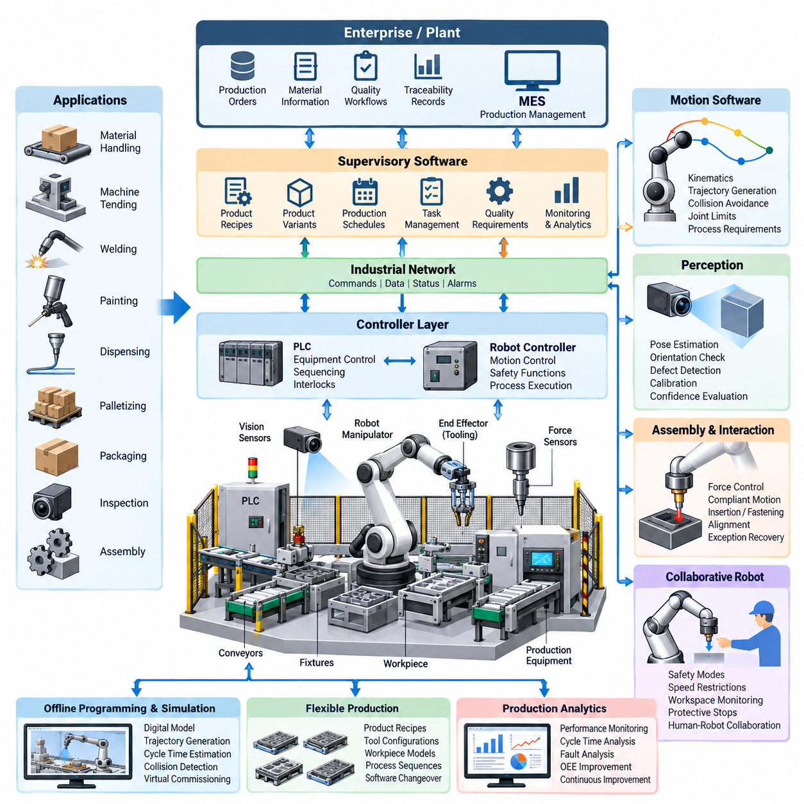
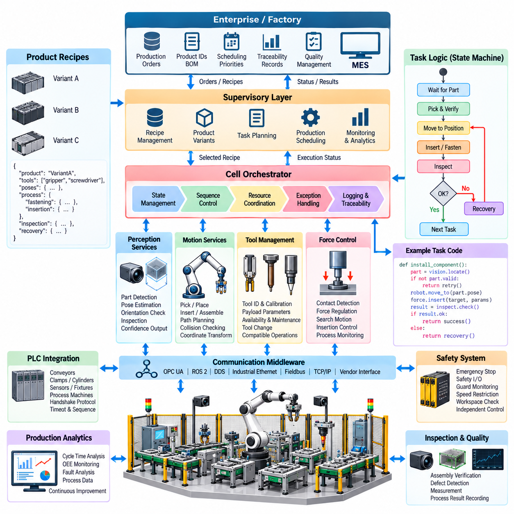
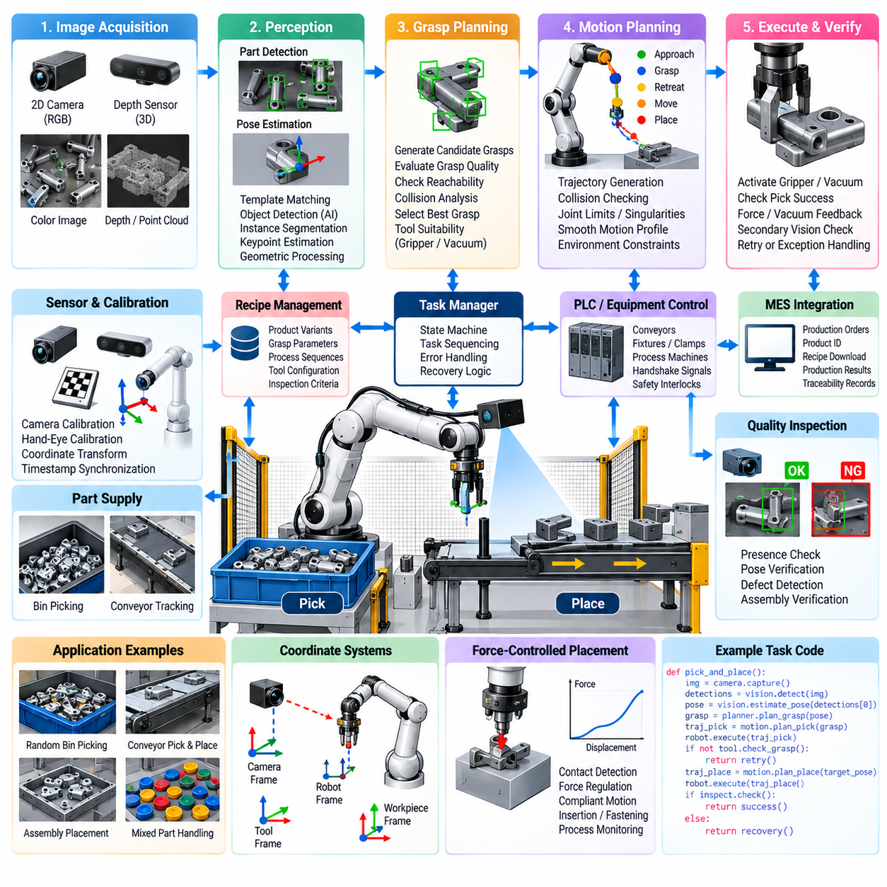
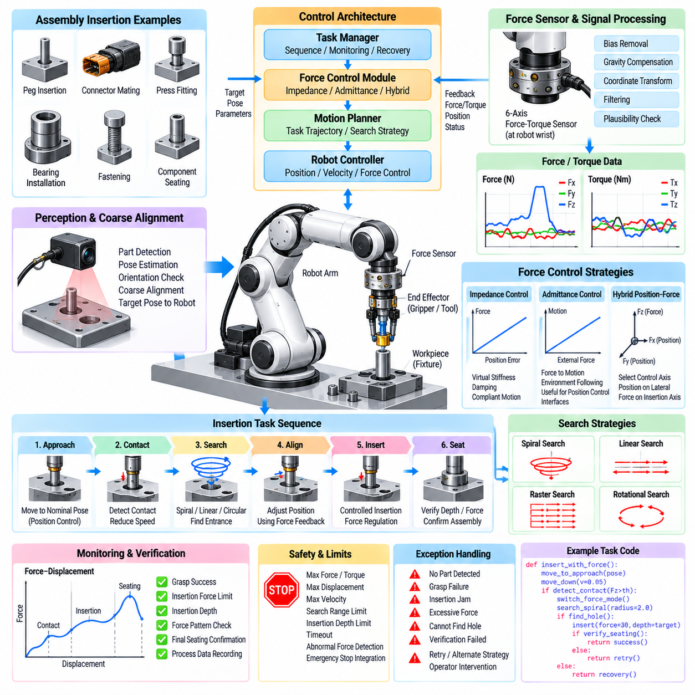
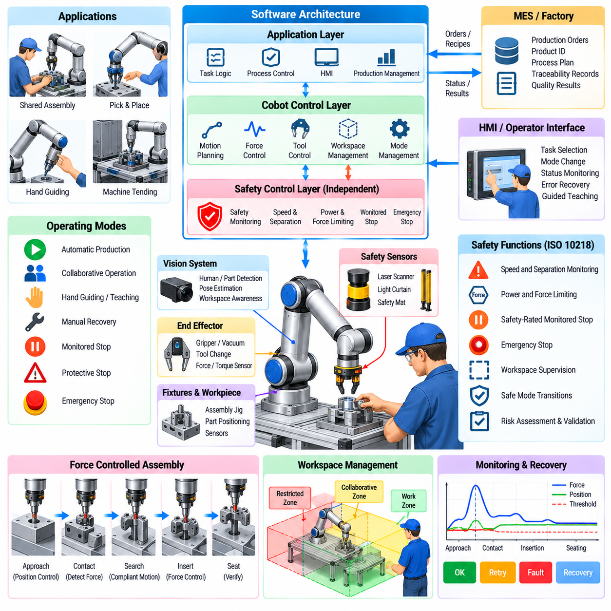
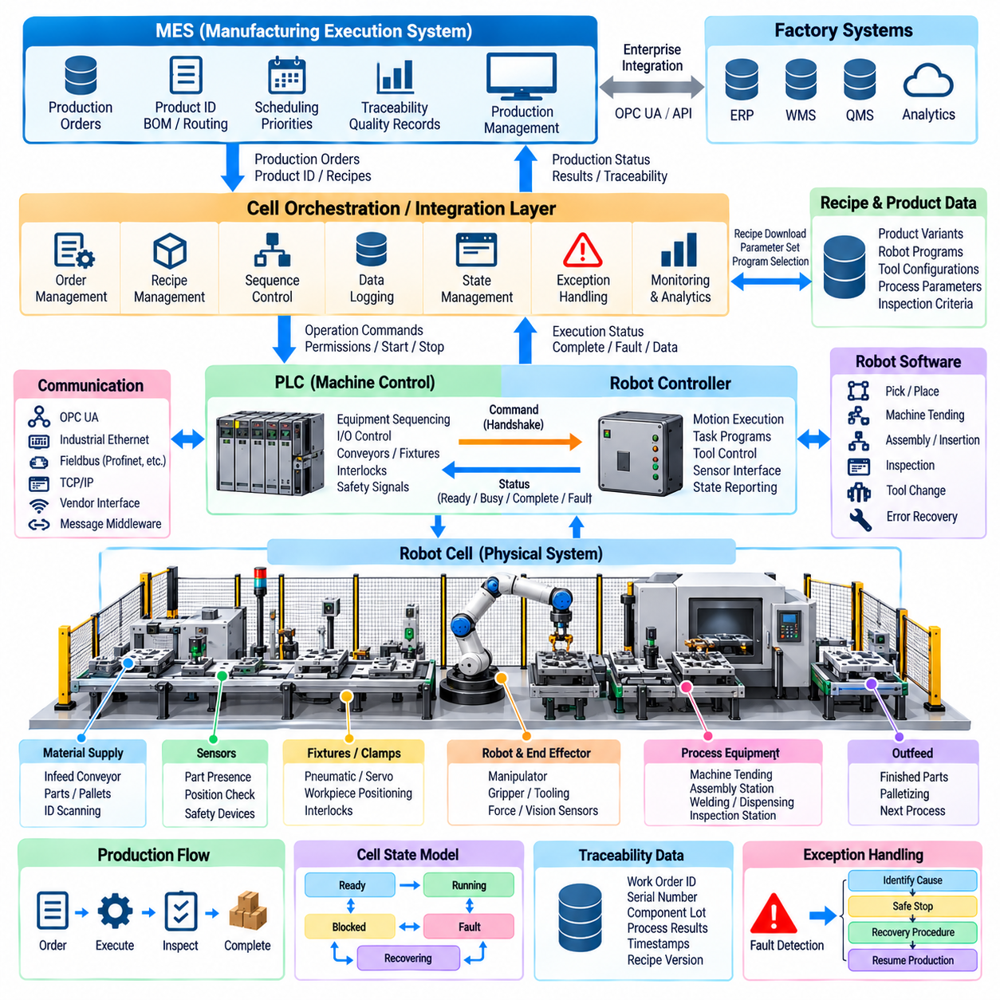
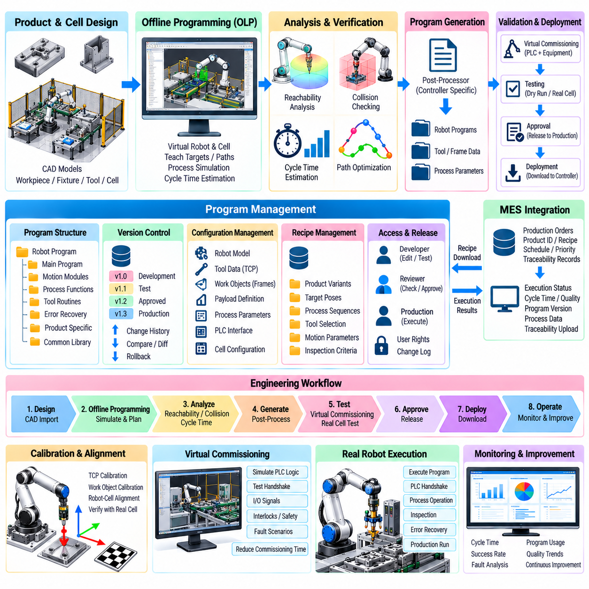
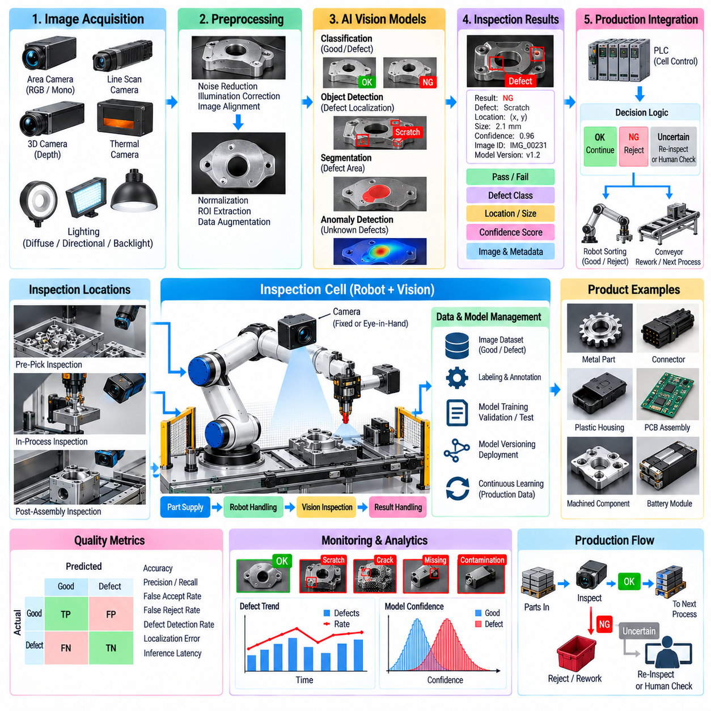
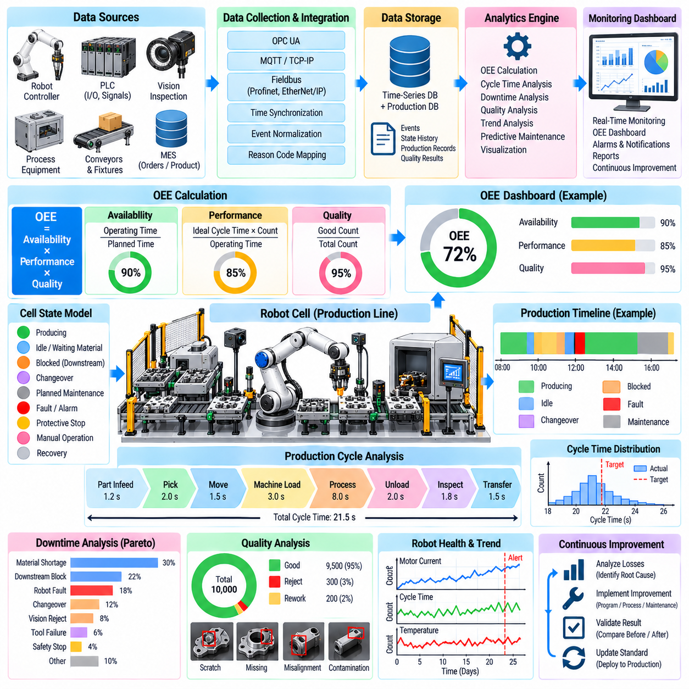
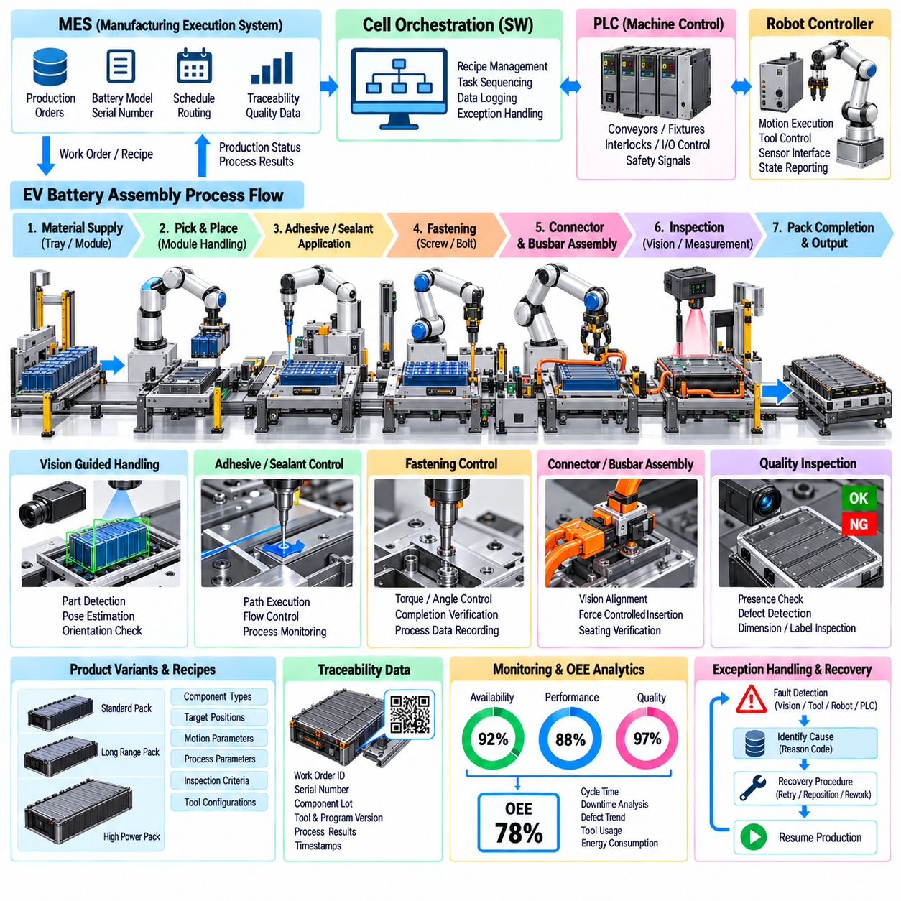

**Volume 26. Industrial Robot Applications**


# Chapter 07. Manufacturing and Assembly Robots

##  

## 07.01. Manufacturing Robot Application Overview SW Focus

{width="7.268055555555556in" height="7.268055555555556in"}

Manufacturing robots form the programmable execution layer of modern production systems, connecting mechanical equipment, sensors, controllers, industrial networks, and enterprise software. Their role extends far beyond repetitive motion. A manufacturing robot must interpret production commands, coordinate tools and fixtures, execute precise trajectories, respond to process conditions, and continuously report operational status to surrounding automation systems.

From a software perspective, manufacturing robotics is fundamentally a real-time cyber-physical integration problem. Robot controllers execute deterministic motion and safety functions while higher-level software manages tasks, recipes, product variants, quality requirements, and production schedules. This layered architecture allows fast control loops to remain isolated from slower supervisory functions while still exchanging state, commands, alarms, and production data through controlled interfaces.

Industrial applications include material handling, machine tending, welding, painting, dispensing, palletizing, packaging, inspection, and assembly. Each application places different demands on the software stack. A welding robot emphasizes trajectory consistency and process synchronization, while an assembly robot requires accurate pose estimation, force interaction, sequence management, and exception recovery. Software therefore converts a general robot platform into an application-specific production resource.

A typical robot cell combines robot manipulators, end effectors, programmable logic controllers, safety controllers, machine vision, force sensors, conveyors, fixtures, and production equipment. Cell software coordinates these components as one operational system rather than treating the robot as an isolated machine. State machines or behavior-oriented task logic commonly represent production sequences and determine when operations may start, continue, pause, retry, or terminate.

Robot motion software transforms application objectives into executable joint movement. Kinematic models convert between Cartesian tool poses and joint configurations, trajectory generators produce smooth motion profiles, and servo controllers maintain the commanded position, velocity, or torque. Collision constraints, joint limits, singularities, payload characteristics, tool geometry, and process requirements must be considered before motion is accepted for production execution.

Modern manufacturing increasingly requires flexible production rather than fixed automation dedicated to one product. Software manages product recipes, robot parameters, tool configurations, workpiece models, and process sequences so that the same cell can manufacture multiple variants. Changeover can therefore become a controlled software operation in which validated configurations are loaded automatically instead of requiring extensive mechanical adjustment and manual robot reprogramming.

Perception adds another layer of flexibility. Cameras and three-dimensional sensors can locate randomly positioned parts, estimate object poses, verify component orientation, inspect assembly states, and detect defects. Perception results must be transformed into the coordinate frames used by the robot controller. Calibration, timestamp consistency, confidence evaluation, and error handling are therefore as important as the underlying computer vision algorithm in a production system.

Assembly applications introduce physical interaction between the robot and workpiece. Position control alone may be insufficient for connector insertion, press fitting, fastening, alignment, or mating operations. Force and torque sensing allows software to detect contact, regulate interaction forces, identify abnormal resistance, and execute compliant search motions. These capabilities enable robots to handle tolerance variations that cannot be represented by ideal geometric coordinates alone.

Collaborative robots extend manufacturing automation into workspaces shared with people. Their software must integrate production behavior with safety-related operating modes, speed restrictions, workspace supervision, protective stops, and recovery procedures. Collaboration should therefore be considered a system-level property involving robot control, tooling, sensors, layout, task design, and risk assessment rather than a capability provided solely by the manipulator.

Manufacturing robot cells also depend on integration with programmable logic controllers and factory automation networks. PLCs frequently control conveyors, clamps, pneumatic devices, process machines, and interlocks while exchanging commands with robot controllers. Reliable interfaces require explicit handshake states, timeout rules, command acknowledgements, fault codes, and recovery transitions so that asynchronous equipment behavior cannot leave the production cell in an ambiguous state.

At the supervisory level, Manufacturing Execution Systems connect robot cells to production orders, material information, traceability records, and quality workflows. A robot may receive a product identifier and associated recipe, execute the required process, and return completion status and measured process values. This connection transforms robotic execution into a traceable element of the broader manufacturing information architecture rather than an independent automation island.

Offline programming and simulation reduce dependence on physical production equipment during development. Engineers can construct digital representations of robots, fixtures, tools, and workpieces, generate trajectories, estimate cycle times, evaluate reachability, and detect potential collisions before deployment. Virtual commissioning extends this concept by testing control logic and interfaces against simulated equipment, reducing commissioning time and production disruption.

Production software must address abnormal conditions as carefully as nominal operation. Missing parts, failed grasps, vision uncertainty, fixture faults, communication timeouts, tool wear, excessive force, and blocked equipment can interrupt a sequence. Robust systems classify these events and select controlled responses such as retrying, repositioning, requesting operator assistance, rejecting a workpiece, entering a safe state, or stopping the cell when recovery cannot be guaranteed.

Observability is therefore essential for industrial robot operation. Robot state, cycle time, controller alarms, process parameters, sensor measurements, quality results, and recovery events can be collected as structured telemetry. These data support troubleshooting and production analytics while also enabling calculation of availability, performance, quality, downtime, and Overall Equipment Effectiveness. The robot cell becomes both a production asset and a continuous source of operational evidence.

Software lifecycle management becomes increasingly important as robot cells grow more connected. Robot programs, PLC logic, perception models, configuration files, calibration parameters, and production recipes should be versioned and associated with validated releases. Controlled deployment, rollback, access management, change history, and backup procedures reduce the risk that an undocumented software modification will alter production behavior or invalidate a previously qualified process.

Artificial intelligence expands manufacturing robotics beyond explicitly programmed conditions. Learning-based perception can classify components and defects, predictive models can identify abnormal process patterns, and adaptive manipulation can improve performance under variation. However, AI outputs must be integrated with deterministic constraints, confidence thresholds, fallback behaviors, and validation procedures. Production robustness remains more important than maximizing model capability under ideal benchmark conditions.

The resulting manufacturing robot is best understood as a software-defined production system whose physical behavior emerges from coordinated control, perception, planning, safety, communication, and production-management functions. This software-centered perspective provides the foundation for flexible assembly cells, vision-guided manipulation, force-controlled insertion, collaborative operation, MES and PLC integration, offline programming, AI quality inspection, and production analytics developed throughout this chapter.

Within the broader robotics software structure, these manufacturing capabilities reuse technologies developed across control software, ROS 2 and middleware, robot communication, data architecture, cloud and edge computing, DevOps, simulation, perception, planning, and manipulation. Manufacturing applications therefore represent an integration layer in which previously separated robotics technologies must operate together under the timing, safety, availability, maintainability, and traceability requirements of real production environments.

제조 로봇(Manufacturing Robot)은 현대 생산 시스템(Production System)의 프로그래밍 가능한 실행 계층(Programmable Execution Layer)을 구성하며, 기계 장비, 센서, 제어기, 산업용 네트워크(Industrial Network), 기업 소프트웨어(Enterprise Software)를 연결한다. 제조 로봇의 역할은 반복적인 동작 수행을 훨씬 넘어선다. 제조 로봇은 생산 명령을 해석하고, 공구와 지그(Fixture)를 조정하며, 정밀한 궤적을 실행하고, 공정 조건에 대응하는 동시에 주변 자동화 시스템에 지속적으로 운영 상태를 보고해야 한다.

소프트웨어(Software) 관점에서 제조 로봇 시스템은 근본적으로 실시간 사이버 물리 통합 문제(Real-Time Cyber-Physical Integration Problem)이다. 로봇 제어기(Robot Controller)는 결정론적 모션(Deterministic Motion)과 안전 기능을 실행하는 반면, 상위 소프트웨어는 작업, 레시피(Recipe), 제품 변형(Product Variant), 품질 요구사항, 생산 일정을 관리한다. 이러한 계층형 아키텍처(Layered Architecture)는 빠른 제어 루프(Control Loop)를 느린 감독 기능(Supervisory Function)으로부터 분리하면서도 상태, 명령, 경보, 생산 데이터를 제어된 인터페이스를 통해 교환할 수 있도록 한다.

산업용 응용 분야에는 자재 취급(Material Handling), 머신 텐딩(Machine Tending), 용접(Welding), 도장(Painting), 디스펜싱(Dispensing), 팔레타이징(Palletizing), 포장(Packaging), 검사(Inspection), 조립(Assembly) 등이 포함된다. 각 응용 분야는 소프트웨어 스택(Software Stack)에 서로 다른 요구사항을 부여한다. 용접 로봇은 궤적 일관성과 공정 동기화를 중시하는 반면, 조립 로봇은 정확한 자세 추정(Pose Estimation), 힘 상호작용, 작업 순서 관리, 예외 복구(Exception Recovery)를 필요로 한다. 따라서 소프트웨어는 범용 로봇 플랫폼을 응용 분야에 특화된 생산 자원으로 변환한다.

일반적인 로봇 셀(Robot Cell)은 로봇 매니퓰레이터(Robot Manipulator), 엔드 이펙터(End Effector), 프로그래머블 로직 컨트롤러(Programmable Logic Controller, PLC), 안전 제어기(Safety Controller), 머신 비전(Machine Vision), 힘 센서(Force Sensor), 컨베이어, 지그, 생산 설비를 결합한다. 셀 소프트웨어(Cell Software)는 로봇을 독립된 기계로 취급하지 않고 이러한 구성요소를 하나의 운영 시스템으로 조정한다. 상태 머신(State Machine) 또는 행동 중심 작업 로직(Behavior-Oriented Task Logic)은 일반적으로 생산 순서를 표현하며 작업의 시작, 지속, 일시 정지, 재시도 또는 종료 여부를 결정한다.

로봇 모션 소프트웨어(Robot Motion Software)는 응용 작업의 목표를 실행 가능한 관절 움직임으로 변환한다. 운동학 모델(Kinematic Model)은 직교좌표계의 공구 자세와 관절 구성 사이를 변환하고, 궤적 생성기(Trajectory Generator)는 부드러운 모션 프로파일을 생성하며, 서보 제어기(Servo Controller)는 명령된 위치, 속도 또는 토크를 유지한다. 모션이 실제 생산 작업에 적용되기 전에 충돌 제약조건, 관절 한계, 특이점(Singularity), 페이로드(Payload) 특성, 공구 형상, 공정 요구사항 등을 고려해야 한다.

현대 제조 환경에서는 특정 제품에만 고정된 자동화보다 유연 생산(Flexible Production)이 점점 중요해지고 있다. 소프트웨어는 제품 레시피, 로봇 파라미터, 공구 구성, 작업물 모델, 공정 순서를 관리하여 동일한 셀에서 여러 제품 변형을 생산할 수 있도록 한다. 이에 따라 제품 전환(Changeover)은 광범위한 기계적 조정이나 수동 로봇 재프로그래밍 대신 검증된 설정을 자동으로 불러오는 제어된 소프트웨어 작업으로 구현될 수 있다.

인지(Perception)는 제조 자동화에 또 다른 수준의 유연성을 제공한다. 카메라와 3차원 센서(3D Sensor)는 임의로 배치된 부품의 위치를 찾고, 객체 자세(Object Pose)를 추정하며, 부품 방향과 조립 상태를 확인하고, 결함을 검출할 수 있다. 인지 결과는 로봇 제어기가 사용하는 좌표 프레임(Coordinate Frame)으로 변환되어야 한다. 따라서 생산 시스템에서는 기반 컴퓨터 비전(Computer Vision) 알고리즘 자체뿐만 아니라 캘리브레이션(Calibration), 타임스탬프 일관성, 신뢰도 평가, 오류 처리도 중요하다.

조립 응용에서는 로봇과 작업물 사이의 물리적 상호작용이 발생한다. 커넥터 삽입, 압입(Press Fitting), 체결(Fastening), 정렬(Alignment), 부품 결합과 같은 작업에서는 위치 제어만으로 충분하지 않을 수 있다. 힘·토크 센싱(Force and Torque Sensing)을 활용하면 소프트웨어가 접촉을 감지하고, 상호작용 힘을 조절하며, 비정상적인 저항을 식별하고, 순응형 탐색 동작(Compliant Search Motion)을 수행할 수 있다. 이러한 기능을 통해 이상적인 기하학적 좌표만으로 표현하기 어려운 공차 변화에 대응할 수 있다.

협동 로봇(Collaborative Robot, Cobot)은 제조 자동화를 작업자와 공유하는 작업 공간으로 확장한다. 협동 로봇 소프트웨어는 생산 동작을 안전 관련 운전 모드, 속도 제한, 작업 공간 감시, 보호 정지(Protective Stop), 복구 절차와 통합해야 한다. 따라서 협업(Collaboration)은 매니퓰레이터만으로 제공되는 기능이 아니라 로봇 제어, 공구, 센서, 작업 공간 배치, 작업 설계, 위험성 평가(Risk Assessment)를 포함하는 시스템 수준의 특성으로 이해해야 한다.

제조 로봇 셀은 프로그래머블 로직 컨트롤러(PLC) 및 공장 자동화 네트워크(Factory Automation Network)와의 통합에도 의존한다. PLC는 일반적으로 컨베이어, 클램프, 공압 장치, 공정 설비, 인터록(Interlock)을 제어하면서 로봇 제어기와 명령을 교환한다. 신뢰성 있는 인터페이스를 구현하려면 명확한 핸드셰이크 상태(Handshake State), 타임아웃 규칙, 명령 확인, 오류 코드, 복구 전환을 정의하여 비동기적으로 동작하는 설비가 생산 셀을 모호한 상태에 남겨두지 않도록 해야 한다.

감독 계층(Supervisory Level)에서는 제조 실행 시스템(Manufacturing Execution System, MES)이 로봇 셀을 생산 지시, 자재 정보, 추적성 기록(Traceability Record), 품질 워크플로(Quality Workflow)와 연결한다. 로봇은 제품 식별자와 관련 레시피를 전달받아 필요한 공정을 실행하고, 완료 상태와 측정된 공정 값을 반환할 수 있다. 이러한 연결을 통해 로봇 실행 과정은 독립적인 자동화 섬(Automation Island)이 아니라 전체 제조 정보 아키텍처(Manufacturing Information Architecture)의 추적 가능한 구성요소가 된다.

오프라인 프로그래밍(Offline Programming, OLP)과 시뮬레이션(Simulation)은 개발 과정에서 실제 생산 설비에 대한 의존성을 줄인다. 엔지니어는 로봇, 지그, 공구, 작업물의 디지털 모델을 구성하고, 궤적을 생성하며, 사이클 타임(Cycle Time)을 예측하고, 도달 가능성(Reachability)을 평가하며, 배포 전에 잠재적인 충돌을 검출할 수 있다. 가상 시운전(Virtual Commissioning)은 이러한 개념을 확장하여 시뮬레이션된 설비를 대상으로 제어 로직과 인터페이스를 시험함으로써 시운전 시간과 생산 중단을 줄인다.

생산 소프트웨어는 정상적인 동작뿐만 아니라 비정상 조건도 체계적으로 처리해야 한다. 부품 누락, 파지 실패, 비전 불확실성, 지그 오류, 통신 타임아웃, 공구 마모, 과도한 힘, 설비 차단 등은 작업 순서를 중단시킬 수 있다. 견고한 시스템은 이러한 이벤트를 분류하고 재시도, 재배치, 작업자 지원 요청, 작업물 불량 처리, 안전 상태 전환 또는 복구가 보장되지 않을 경우 셀 정지와 같은 제어된 대응 방법을 선택한다.

따라서 산업용 로봇 운영에서는 관측 가능성(Observability)이 필수적이다. 로봇 상태, 사이클 타임, 제어기 경보, 공정 파라미터, 센서 측정값, 품질 결과, 복구 이벤트 등을 구조화된 텔레메트리(Telemetry)로 수집할 수 있다. 이러한 데이터는 문제 해결과 생산 분석을 지원하며 가용성(Availability), 성능(Performance), 품질(Quality), 다운타임(Downtime), 설비 종합 효율(Overall Equipment Effectiveness, OEE)을 계산하는 데 활용된다. 로봇 셀은 생산 자산인 동시에 지속적인 운영 증거 데이터를 생성하는 정보 자원이 된다.

로봇 셀의 연결성이 증가할수록 소프트웨어 수명주기 관리(Software Lifecycle Management)의 중요성도 커진다. 로봇 프로그램, PLC 로직, 인지 모델, 구성 파일, 캘리브레이션 파라미터, 생산 레시피는 버전 관리되고 검증된 릴리스(Validated Release)와 연계되어야 한다. 제어된 배포, 롤백(Rollback), 접근 관리, 변경 이력, 백업 절차를 적용하면 문서화되지 않은 소프트웨어 변경으로 인해 생산 동작이 달라지거나 기존에 검증된 공정이 무효화될 위험을 줄일 수 있다.

인공지능(Artificial Intelligence, AI)은 명시적으로 프로그래밍된 조건을 넘어 제조 로봇의 기능을 확장한다. 학습 기반 인지(Learning-Based Perception)는 부품과 결함을 분류할 수 있으며, 예측 모델(Predictive Model)은 비정상적인 공정 패턴을 식별하고, 적응형 조작(Adaptive Manipulation)은 변화하는 조건에서 작업 성능을 개선할 수 있다. 그러나 AI 출력은 결정론적 제약조건, 신뢰도 임계값, 대체 동작(Fallback Behavior), 검증 절차와 통합되어야 한다. 실제 생산 환경에서는 이상적인 벤치마크 조건에서 모델 성능을 극대화하는 것보다 생산 견고성(Production Robustness)이 더욱 중요하다.

결과적으로 제조 로봇은 제어(Control), 인지(Perception), 계획(Planning), 안전(Safety), 통신(Communication), 생산 관리(Production Management)가 조정되어 물리적 동작을 생성하는 소프트웨어 정의 생산 시스템(Software-Defined Production System)으로 이해하는 것이 적절하다. 이러한 소프트웨어 중심 관점은 이 장에서 다루는 유연 조립 셀(Flexible Assembly Cell), 비전 유도 조작(Vision-Guided Manipulation), 힘 제어 삽입(Force-Controlled Insertion), 협동 작업, MES·PLC 통합, 오프라인 프로그래밍, AI 품질 검사, 생산 분석의 기반을 제공한다.

보다 광범위한 로보틱스 소프트웨어(Robotics Software) 구조에서 이러한 제조 기능은 제어 소프트웨어, ROS 2 및 미들웨어(Middleware), 로봇 통신, 데이터 아키텍처(Data Architecture), 클라우드·엣지 컴퓨팅(Cloud and Edge Computing), 데브옵스(DevOps), 시뮬레이션, 인지, 계획, 조작 기술을 재사용하고 통합한다. 따라서 제조 응용은 기존에 분리되어 있던 로보틱스 기술들이 실제 생산 환경에서 요구되는 타이밍, 안전성, 가용성, 유지보수성, 추적성 요구조건 아래 함께 동작해야 하는 통합 계층(Integration Layer)을 구성한다.

##  

## 07.02. Flexible Assembly Cell SW Architecture [w/Code]

{width="7.268055555555556in" height="7.268055555555556in"}

A flexible assembly cell is a software-coordinated manufacturing system designed to execute multiple product variants without rebuilding the automation architecture for every change. Instead of binding robot programs directly to one fixed sequence, the cell separates production recipes, task logic, motion execution, perception, equipment control, and safety. This separation allows manufacturing behavior to be reconfigured while preserving validated control functions.

The software architecture is typically organized into hierarchical layers with different timing and responsibility boundaries. A supervisory layer interprets production orders and selects product recipes, while a cell orchestration layer coordinates assembly tasks. Robot and equipment control layers execute motion and device commands, and real-time controllers close servo and process loops. Safety functions operate independently where required to prevent production logic from overriding protective behavior.

At the center of the architecture is the cell orchestrator, which converts a production request into an executable sequence of operations. It determines when parts should be supplied, when fixtures should be locked, when robots may enter shared workspaces, and when inspection should occur. Rather than embedding every condition inside robot programs, orchestration software maintains the overall process state and coordinates distributed equipment through explicit commands and acknowledgements.

Production recipes provide the configuration required for product variation. A recipe can reference component types, assembly sequences, robot programs, tool selections, target poses, process parameters, inspection criteria, and recovery policies. Separating this information from executable control code reduces duplication and allows validated software components to be reused. Recipe versions should be traceable so that every manufactured unit can be associated with the configuration used during production.

Task execution is commonly represented using state machines, hierarchical state machines, behavior trees, or workflow engines. A high-level task such as installing a component can be decomposed into acquiring the part, verifying identity, moving to an approach pose, performing insertion, confirming completion, and releasing the tool. Each step defines entry conditions, success criteria, timeout behavior, and failure transitions so that execution remains deterministic and observable.

Robot motion services translate task-level requests into physical trajectories. They manage coordinate transformations, inverse kinematics, collision checking, trajectory generation, velocity limits, and controller interfaces. Application logic should request meaningful actions such as pick, place, insert, or inspect rather than directly controlling individual joints whenever possible. This abstraction improves portability when robot models, tooling, or cell geometry change during the production lifecycle.

Flexible assembly depends heavily on perception because physical components rarely appear at mathematically perfect nominal positions. Vision systems detect parts, estimate poses, verify orientation, identify product variants, and inspect intermediate assembly states. Perception software must provide confidence values and coordinate-frame information together with detection results. The task layer can then decide whether to proceed, repeat sensing, reposition the camera, or request operator intervention.

Tool management is another important architectural service. A single robot may use grippers, screwdrivers, dispensing heads, welding tools, cameras, or specialized assembly fixtures during different production steps. Software maintains tool identifiers, calibration information, payload parameters, availability, maintenance state, and compatible operations. Automatic tool changing therefore becomes a managed production transaction rather than merely a mechanical coupling operation.

Assembly processes involving contact require force-aware execution services. Force and torque measurements can be used to detect initial contact, regulate insertion force, perform spiral or linear search patterns, and recognize abnormal resistance. These functions should expose controlled parameters such as force limits, search distance, velocity, and termination conditions. Higher-level task logic can invoke them without implementing low-level force-control algorithms for every product recipe.

PLC integration connects robotic software with conventional factory automation. Conveyors, clamps, cylinders, sensors, fixtures, process machines, and safety-related devices frequently remain under PLC control. The robot cell therefore requires well-defined handshake protocols specifying command, busy, complete, fault, reset, and permission states. Timeouts and sequence numbers can prevent stale or lost signals from being interpreted as valid production commands.

Communication middleware provides the transport layer between distributed software components. Depending on the equipment and timing requirements, the architecture may combine industrial Ethernet, fieldbus protocols, OPC UA, ROS 2, DDS, TCP/IP services, or vendor-specific robot interfaces. The important architectural principle is to isolate protocol-specific communication behind stable service interfaces so that application logic does not depend unnecessarily on one hardware vendor or network technology.

Manufacturing Execution System integration connects the flexible cell with factory-level production management. The MES can provide work orders, product identifiers, bill-of-process information, recipe references, and scheduling priorities. The cell returns production status, timestamps, quality results, process measurements, and failure information. This bidirectional interface allows flexible robotic execution to remain synchronized with material flow, traceability, and production planning.

A shared data model is essential when multiple robots and devices collaborate. The model should represent workpieces, tools, fixtures, coordinate frames, operations, equipment states, quality results, and production identifiers consistently. Without common semantics, each subsystem may interpret the same physical object differently. Standardized identifiers and timestamps also allow events from robots, PLCs, vision systems, and MES applications to be correlated during troubleshooting.

Exception handling must be designed as part of the architecture rather than added after commissioning. A flexible cell may encounter missing parts, failed grasps, pose uncertainty, insertion resistance, tool faults, blocked fixtures, or communication loss. Recovery logic determines whether the operation can be retried locally, whether an alternative strategy is available, whether the workpiece should be rejected, or whether human intervention and controlled cell shutdown are required.

Safety architecture remains separated from ordinary production optimization. Emergency stops, protective stops, interlocks, safe speed functions, workspace monitoring, and access control must maintain their required behavior even if supervisory software fails. Production software consumes safety state and coordinates recovery, but it should not bypass safety decisions. Restart logic must verify that equipment, workpieces, tools, and process states remain consistent before automatic operation resumes.

Simulation and digital twin technologies support development of flexible cells before physical equipment becomes available. Robot reachability, collisions, cycle time, fixture placement, and task sequences can be evaluated in a virtual environment. Virtual commissioning can connect simulated devices to actual orchestration or PLC software, allowing engineers to test interfaces and abnormal conditions before deployment and reducing debugging time on the production floor.

Observability services collect events, robot states, cycle times, process parameters, perception confidence, equipment faults, and recovery actions. Structured logs and time-synchronized telemetry allow engineers to reconstruct the sequence leading to a production problem. Metrics can also reveal recurring delays, unstable process steps, excessive retries, or bottlenecks. This information supports continuous optimization without changing the fundamental execution architecture.

Configuration and software lifecycle management are particularly important because flexibility creates many combinations of products, tools, programs, and parameters. Robot programs, PLC logic, recipes, perception models, calibration files, and orchestration software should therefore be version controlled and deployed as compatible releases. A known production configuration must be reproducible, and rollback should restore a previously validated combination when an update introduces unexpected behavior.

A mature flexible assembly cell ultimately behaves as a modular software-defined manufacturing platform. New product variants can be introduced primarily by adding recipes, task configurations, perception definitions, and validated process parameters rather than rewriting the entire control system. This architecture establishes the foundation for vision-guided pick and place, force-controlled insertion, collaborative robotics, MES and PLC integration, offline programming, AI inspection, and production analytics addressed in subsequent manufacturing applications.

유연 조립 셀(Flexible Assembly Cell)은 제품이 변경될 때마다 자동화 아키텍처(Automation Architecture)를 새로 구축하지 않고 여러 제품 변형(Product Variant)을 생산하도록 설계된 소프트웨어 조정형 제조 시스템(Software-Coordinated Manufacturing System)이다. 로봇 프로그램을 하나의 고정된 작업 순서에 직접 결합하는 대신 생산 레시피(Production Recipe), 작업 로직(Task Logic), 모션 실행(Motion Execution), 인지(Perception), 설비 제어(Equipment Control), 안전(Safety)을 분리한다. 이러한 분리를 통해 검증된 제어 기능을 유지하면서 제조 동작을 재구성할 수 있다.

소프트웨어 아키텍처(Software Architecture)는 일반적으로 서로 다른 타이밍과 책임 경계를 갖는 계층 구조로 구성된다. 감독 계층(Supervisory Layer)은 생산 지시를 해석하고 제품 레시피를 선택하며, 셀 오케스트레이션 계층(Cell Orchestration Layer)은 조립 작업을 조정한다. 로봇 및 설비 제어 계층은 모션과 장치 명령을 실행하고, 실시간 제어기(Real-Time Controller)는 서보 및 공정 제어 루프를 수행한다. 필요한 경우 안전 기능은 독립적으로 동작하여 생산 로직이 보호 동작을 무시하지 못하도록 한다.

아키텍처의 중심에는 생산 요청을 실행 가능한 작업 순서로 변환하는 셀 오케스트레이터(Cell Orchestrator)가 있다. 셀 오케스트레이터는 부품 공급 시점, 지그 잠금 시점, 로봇의 공유 작업 공간 진입 가능 시점, 검사 수행 시점을 결정한다. 모든 조건을 로봇 프로그램 내부에 포함하는 대신 오케스트레이션 소프트웨어(Orchestration Software)가 전체 공정 상태를 유지하고 명시적인 명령과 응답을 통해 분산된 설비를 조정한다.

생산 레시피(Production Recipe)는 제품 변화에 필요한 설정 정보를 제공한다. 하나의 레시피에는 부품 종류, 조립 순서, 로봇 프로그램, 공구 선택, 목표 자세(Target Pose), 공정 파라미터, 검사 기준, 복구 정책 등이 포함될 수 있다. 이러한 정보를 실행 가능한 제어 코드와 분리하면 중복을 줄이고 검증된 소프트웨어 구성요소를 재사용할 수 있다. 또한 모든 생산 제품을 제조 당시 사용된 설정과 연결할 수 있도록 레시피 버전(Recipe Version)을 추적할 수 있어야 한다.

작업 실행(Task Execution)은 일반적으로 상태 머신(State Machine), 계층형 상태 머신(Hierarchical State Machine), 행동 트리(Behavior Tree), 워크플로 엔진(Workflow Engine)을 사용하여 표현된다. 부품 장착과 같은 상위 작업은 부품 획득, 식별 확인, 접근 자세로 이동, 삽입 수행, 완료 확인, 공구 해제와 같은 단계로 분해할 수 있다. 각 단계는 진입 조건, 성공 기준, 타임아웃 동작, 실패 전환을 정의하여 실행 과정의 결정성과 관측 가능성을 유지한다.

로봇 모션 서비스(Robot Motion Service)는 작업 수준의 요청을 실제 물리적 궤적으로 변환한다. 좌표 변환, 역기구학(Inverse Kinematics), 충돌 검사(Collision Checking), 궤적 생성, 속도 제한, 제어기 인터페이스 등을 관리한다. 가능한 경우 응용 로직은 개별 관절을 직접 제어하기보다 픽(Pick), 플레이스(Place), 삽입(Insert), 검사(Inspect)와 같이 의미 있는 동작을 요청해야 한다. 이러한 추상화는 생산 수명주기 동안 로봇 모델, 공구 또는 셀 형상이 변경될 때 이식성을 향상시킨다.

유연 조립(Flexible Assembly)은 실제 부품이 수학적으로 완벽한 기준 위치에 존재하지 않기 때문에 인지 기술에 크게 의존한다. 비전 시스템(Vision System)은 부품을 검출하고, 자세를 추정하며, 방향을 확인하고, 제품 변형을 식별하고, 중간 조립 상태를 검사한다. 인지 소프트웨어는 검출 결과와 함께 신뢰도 값과 좌표 프레임 정보를 제공해야 한다. 작업 계층은 이를 바탕으로 작업 진행, 재인식, 카메라 재배치 또는 작업자 개입 요청 여부를 결정할 수 있다.

공구 관리(Tool Management) 역시 중요한 아키텍처 서비스이다. 하나의 로봇이 서로 다른 생산 단계에서 그리퍼(Gripper), 스크루드라이버(Screwdriver), 디스펜싱 헤드(Dispensing Head), 용접 공구, 카메라 또는 특수 조립 지그를 사용할 수 있다. 소프트웨어는 공구 식별자, 캘리브레이션 정보, 페이로드 파라미터, 사용 가능 상태, 유지보수 상태, 호환 작업을 관리한다. 이에 따라 자동 공구 교환(Automatic Tool Changing)은 단순한 기계적 결합 작업이 아니라 관리되는 생산 트랜잭션(Production Transaction)이 된다.

접촉이 발생하는 조립 공정에는 힘 기반 실행 서비스(Force-Aware Execution Service)가 필요하다. 힘·토크 측정값을 이용하여 초기 접촉을 감지하고, 삽입력을 조절하며, 나선형 또는 선형 탐색 패턴을 수행하고, 비정상적인 저항을 인식할 수 있다. 이러한 기능은 힘 제한, 탐색 거리, 속도, 종료 조건과 같은 제어 가능한 파라미터를 제공해야 한다. 상위 작업 로직은 제품 레시피마다 저수준 힘 제어 알고리즘을 새롭게 구현하지 않고 이러한 기능을 호출할 수 있다.

PLC 통합(PLC Integration)은 로봇 소프트웨어와 기존 공장 자동화 시스템을 연결한다. 컨베이어, 클램프, 실린더, 센서, 지그, 공정 설비, 안전 관련 장치는 일반적으로 PLC의 제어를 받는다. 따라서 로봇 셀은 명령(Command), 작업 중(Busy), 완료(Complete), 오류(Fault), 리셋(Reset), 허가(Permission) 상태를 정의하는 명확한 핸드셰이크 프로토콜(Handshake Protocol)을 필요로 한다. 타임아웃과 시퀀스 번호(Sequence Number)를 사용하면 오래되거나 손실된 신호가 정상적인 생산 명령으로 해석되는 것을 방지할 수 있다.

통신 미들웨어(Communication Middleware)는 분산된 소프트웨어 구성요소 사이의 전송 계층(Transport Layer)을 제공한다. 설비와 타이밍 요구사항에 따라 산업용 이더넷(Industrial Ethernet), 필드버스 프로토콜(Fieldbus Protocol), OPC UA, ROS 2, DDS, TCP/IP 서비스 또는 제조사 전용 로봇 인터페이스를 조합할 수 있다. 중요한 아키텍처 원칙은 프로토콜별 통신 기능을 안정적인 서비스 인터페이스 뒤에 격리하여 응용 로직이 특정 하드웨어 제조사나 네트워크 기술에 불필요하게 종속되지 않도록 하는 것이다.

제조 실행 시스템 통합(Manufacturing Execution System Integration)은 유연 조립 셀을 공장 수준의 생산 관리와 연결한다. 제조 실행 시스템(Manufacturing Execution System, MES)은 작업 지시, 제품 식별자, 공정 명세(Bill of Process), 레시피 참조 정보, 스케줄링 우선순위를 제공할 수 있다. 셀은 생산 상태, 타임스탬프, 품질 결과, 공정 측정값, 실패 정보를 반환한다. 이러한 양방향 인터페이스를 통해 유연한 로봇 실행을 자재 흐름, 추적성, 생산 계획과 동기화할 수 있다.

여러 로봇과 장치가 협력하는 환경에서는 공유 데이터 모델(Shared Data Model)이 필수적이다. 데이터 모델은 작업물, 공구, 지그, 좌표 프레임, 작업, 설비 상태, 품질 결과, 생산 식별자를 일관된 방식으로 표현해야 한다. 공통 의미 체계(Common Semantics)가 없으면 각각의 하위 시스템이 동일한 물리적 객체를 서로 다르게 해석할 수 있다. 표준화된 식별자와 타임스탬프를 사용하면 문제 분석 과정에서 로봇, PLC, 비전 시스템, MES에서 발생한 이벤트를 서로 연계할 수 있다.

예외 처리(Exception Handling)는 시운전 이후 추가하는 기능이 아니라 초기 아키텍처 설계 단계부터 포함되어야 한다. 유연 조립 셀에서는 부품 누락, 파지 실패, 자세 불확실성, 삽입 저항, 공구 오류, 지그 차단, 통신 손실 등이 발생할 수 있다. 복구 로직(Recovery Logic)은 작업을 로컬에서 재시도할 수 있는지, 대체 전략을 사용할 수 있는지, 작업물을 불량 처리해야 하는지 또는 작업자 개입과 제어된 셀 정지가 필요한지를 결정한다.

안전 아키텍처(Safety Architecture)는 일반적인 생산 최적화 기능과 분리된 상태를 유지한다. 비상 정지(Emergency Stop), 보호 정지(Protective Stop), 인터록, 안전 속도 기능(Safe Speed Function), 작업 공간 감시, 접근 제어는 감독 소프트웨어가 실패하더라도 요구되는 동작을 유지해야 한다. 생산 소프트웨어는 안전 상태를 전달받아 복구 과정을 조정하지만 안전 결정을 우회해서는 안 된다. 자동 운전을 다시 시작하기 전에 설비, 작업물, 공구, 공정 상태의 일관성을 확인해야 한다.

시뮬레이션(Simulation)과 디지털 트윈(Digital Twin) 기술은 실제 설비가 준비되기 전부터 유연 조립 셀 개발을 지원한다. 가상 환경에서 로봇 도달 가능성, 충돌, 사이클 타임, 지그 배치, 작업 순서를 평가할 수 있다. 가상 시운전(Virtual Commissioning)은 시뮬레이션 장치를 실제 오케스트레이션 또는 PLC 소프트웨어와 연결하여 배포 전에 인터페이스와 비정상 조건을 시험할 수 있게 하며, 생산 현장에서 필요한 디버깅 시간을 줄인다.

관측 가능성 서비스(Observability Service)는 이벤트, 로봇 상태, 사이클 타임, 공정 파라미터, 인지 신뢰도, 설비 오류, 복구 동작을 수집한다. 구조화된 로그(Structured Log)와 시간 동기화된 텔레메트리(Time-Synchronized Telemetry)를 활용하면 엔지니어가 생산 문제 발생 전후의 작업 순서를 재구성할 수 있다. 또한 메트릭(Metric)을 통해 반복적인 지연, 불안정한 공정 단계, 과도한 재시도, 병목 현상을 식별하여 기본 실행 아키텍처를 변경하지 않고 지속적인 최적화를 수행할 수 있다.

유연성으로 인해 제품, 공구, 프로그램, 파라미터의 조합이 증가하므로 구성 및 소프트웨어 수명주기 관리(Configuration and Software Lifecycle Management)가 특히 중요하다. 로봇 프로그램, PLC 로직, 레시피, 인지 모델, 캘리브레이션 파일, 오케스트레이션 소프트웨어는 버전 관리되고 서로 호환되는 릴리스 형태로 배포되어야 한다. 특정 생산 구성을 다시 재현할 수 있어야 하며, 업데이트로 예상하지 못한 동작이 발생하면 롤백(Rollback)을 통해 이전에 검증된 조합으로 복원할 수 있어야 한다.

성숙한 유연 조립 셀은 궁극적으로 모듈형 소프트웨어 정의 제조 플랫폼(Modular Software-Defined Manufacturing Platform)으로 동작한다. 전체 제어 시스템을 다시 작성하는 대신 레시피, 작업 설정, 인지 정의, 검증된 공정 파라미터를 추가하는 방식으로 새로운 제품 변형을 도입할 수 있다. 이러한 아키텍처는 이후 제조 응용에서 다루는 비전 유도 픽앤플레이스(Vision-Guided Pick and Place), 힘 제어 삽입(Force-Controlled Insertion), 협동 로보틱스(Collaborative Robotics), MES·PLC 통합, 오프라인 프로그래밍(Offline Programming), AI 검사(AI Inspection), 생산 분석(Production Analytics)의 기반을 형성한다.

##  

## 07.03. Vision Guided Pick and Place for Manufacturing [w/Code]

{width="7.268055555555556in" height="7.268055555555556in"}

Vision-guided pick and place combines robotic manipulation with machine perception so that parts can be detected, localized, selected, grasped, transported, and placed without relying entirely on fixed mechanical positioning. In manufacturing, this capability enables robots to handle variable part locations, mixed components, moving workpieces, and flexible production layouts while reducing dependence on precision feeders and dedicated fixtures.

The software pipeline begins with image or three-dimensional sensor acquisition. Cameras may be mounted above the workspace, attached to the robot, or positioned around a conveyor or bin. RGB cameras provide appearance information, while stereo, structured-light, time-of-flight, or other depth sensors provide geometric measurements. Sensor selection depends on part size, surface properties, required accuracy, working distance, cycle time, and environmental conditions.

Reliable perception requires calibration between the camera, robot, tool, and workspace coordinate systems. Eye-to-hand configurations use a fixed camera observing the robot workspace, whereas eye-in-hand configurations mount the camera on the robot. Calibration software estimates the transformations connecting camera coordinates to robot coordinates so that an object detected in an image can be converted into a physically meaningful target pose for manipulation.

The perception stage identifies candidate objects and determines where they are located. Traditional systems may use template matching, geometric features, contours, or color segmentation, while AI-based systems can apply object detection, instance segmentation, keypoint estimation, or learned feature representations. Manufacturing systems often combine these approaches because deterministic geometric processing can complement learning-based recognition when accuracy and repeatability are required.

Object detection alone is insufficient for robotic manipulation because the robot must understand the position and orientation of the target in physical space. Pose estimation software determines the object\'s translation and rotation relative to the camera or workspace. Depending on the application, this may range from planar position and orientation for conveyor picking to full six-degree-of-freedom pose estimation for randomly oriented components inside a bin.

Depth information becomes particularly important for three-dimensional picking. Point clouds generated from depth sensors can represent visible surfaces and support plane removal, clustering, surface-normal estimation, geometric matching, and collision analysis. When objects overlap or occlude one another, the perception system must estimate which surfaces belong to each candidate object and whether sufficient geometry is visible to support a reliable grasp.

Grasp planning converts perception results into possible robot-tool interactions. The planner evaluates candidate grasp poses according to object geometry, gripper characteristics, approach direction, collision risk, reachability, and expected grasp stability. A parallel gripper may require accessible opposing surfaces, while vacuum tooling requires suitable contact regions. The selected grasp must therefore satisfy both perception confidence and physical manipulation constraints.

Motion planning connects the current robot configuration to the selected grasp pose. The software typically generates an approach trajectory, a final grasp motion, a retreat trajectory, and subsequent transport and placement motions. Collision checking considers the robot, tool, workpiece, fixtures, containers, and surrounding equipment. Joint limits and singular configurations must also be evaluated before the trajectory is released for execution.

The pick operation should be treated as a monitored process rather than an open-loop movement. After reaching the target, the robot activates the gripper or vacuum tool and verifies successful acquisition using available feedback. Vacuum pressure, gripper position, motor current, force sensing, or secondary vision can provide confirmation. If verification fails, the task manager can retry the grasp, choose another candidate, or trigger an exception-handling procedure.

Placement requires similar coordination between perception, planning, and process constraints. Some applications place components into fixed fixtures, while others require vision to identify an available destination or estimate the pose of another component. Assembly-oriented placement may require tighter tolerances than picking and can therefore combine visual alignment with force-controlled final insertion. The software architecture should support these different placement strategies through reusable task primitives.

Conveyor applications introduce motion into the perception and manipulation problem. The vision system detects a workpiece and estimates its position while conveyor tracking predicts how that position changes over time. Robot execution must account for detection latency, communication delay, conveyor velocity, and controller timing. Accurate timestamping and synchronization are therefore essential when the robot must intercept a moving target rather than wait for a stationary part.

Bin picking represents a more difficult manufacturing case because objects may be randomly stacked, partially hidden, and physically constrained by neighboring parts. The software repeatedly acquires three-dimensional data, identifies graspable candidates, evaluates collision-free approaches, and selects a target that can be removed safely. After each successful pick, the scene changes and perception must be updated before the next manipulation decision is made.

Confidence management is essential when AI perception is used in production. A detection or pose estimate should include a confidence measure that can be evaluated by downstream task logic. Low-confidence results may trigger another image acquisition, a different viewpoint, additional sensing, or operator review. This prevents uncertain AI predictions from being converted directly into physical robot motion without appropriate validation and operational safeguards.

Lighting, reflective surfaces, transparent components, shadows, vibration, contamination, and changing backgrounds can significantly affect vision performance. Industrial deployments therefore require controlled illumination where practical and systematic testing across expected environmental variation. Image-quality monitoring can detect conditions such as overexposure, blur, sensor obstruction, or loss of depth information before unreliable perception results propagate into manipulation commands.

Exception recovery is a core part of the pick-and-place software architecture. Failures may include missing objects, unreachable poses, collisions in planned paths, unsuccessful grasps, dropped components, incorrect part identities, or placement verification errors. Recovery policies can request new perception data, select an alternative grasp, move to a safe observation pose, reject a component, or escalate the problem to an operator depending on the production context.

Traceability connects robotic perception with manufacturing quality management. The system can record object identifiers, detection results, estimated poses, selected grasp configurations, robot trajectories, tool states, timestamps, and final verification results. When a production defect occurs later, these records help engineers reconstruct how the component was handled and determine whether perception, manipulation, tooling, or upstream material presentation contributed to the problem.

Performance evaluation should consider the complete robotic task rather than only computer vision accuracy. Relevant measures include detection success, pose error, grasp success rate, placement accuracy, cycle time, retry frequency, collision-free planning success, and recovery effectiveness. A perception model with excellent benchmark accuracy may still be unsuitable if inference latency or unstable pose estimates reduce the overall throughput and reliability of the manufacturing cell.

A production-ready vision-guided pick-and-place system therefore operates as a closed perception-planning-action-verification loop. Sensors observe the workspace, perception estimates object state, grasp and motion planners determine feasible actions, robot controllers execute them, and verification determines whether the intended physical result occurred. Failures return the system to perception or recovery rather than allowing uncertain state to propagate through the production sequence.

Within a flexible manufacturing cell, this closed-loop capability reduces dependence on precisely constrained part presentation and allows software to absorb a larger portion of physical variation. Vision-guided manipulation can consequently support mixed-product assembly, flexible machine tending, random bin picking, conveyor tracking, packaging, sorting, and inspection-linked handling while providing the perception foundation required for more advanced force-controlled assembly operations.

비전 유도 픽앤플레이스(Vision-Guided Pick and Place)는 로봇 조작(Robotic Manipulation)과 머신 인지(Machine Perception)를 결합하여 정밀하게 고정된 기계적 위치 결정에 전적으로 의존하지 않고 부품을 검출, 위치 추정, 선택, 파지, 운반, 배치할 수 있도록 한다. 제조 환경에서는 이를 통해 가변적인 부품 위치, 혼합 부품, 이동하는 작업물, 유연한 생산 레이아웃을 처리할 수 있으며 정밀 피더(Precision Feeder)와 전용 지그(Fixture)에 대한 의존성을 줄일 수 있다.

소프트웨어 파이프라인(Software Pipeline)은 영상 또는 3차원 센서 데이터 획득에서 시작된다. 카메라는 작업 공간 위에 고정하거나 로봇에 장착하거나 컨베이어 또는 빈(Bin) 주변에 배치할 수 있다. RGB 카메라는 외형 정보를 제공하며, 스테레오(Stereo), 구조광(Structured Light), 비행시간(Time-of-Flight) 등의 깊이 센서(Depth Sensor)는 기하학적 측정값을 제공한다. 센서 선택은 부품 크기, 표면 특성, 요구 정확도, 작업 거리, 사이클 타임(Cycle Time), 환경 조건에 따라 결정된다.

신뢰할 수 있는 인지를 위해서는 카메라, 로봇, 공구, 작업 공간 좌표계 사이의 캘리브레이션(Calibration)이 필요하다. 아이투핸드(Eye-to-Hand) 구성에서는 고정된 카메라가 로봇 작업 공간을 관찰하며, 아이인핸드(Eye-in-Hand) 구성에서는 카메라가 로봇에 장착된다. 캘리브레이션 소프트웨어는 카메라 좌표와 로봇 좌표 사이의 변환 관계를 추정하여 영상에서 검출된 객체를 실제 로봇 조작에 사용할 수 있는 물리적 목표 자세(Target Pose)로 변환한다.

인지 단계(Perception Stage)에서는 후보 객체를 식별하고 객체의 위치를 결정한다. 전통적인 시스템에서는 템플릿 매칭(Template Matching), 기하학적 특징(Geometric Feature), 윤곽선(Contour), 색상 분할(Color Segmentation)을 사용할 수 있으며, AI 기반 시스템에서는 객체 검출(Object Detection), 인스턴스 분할(Instance Segmentation), 키포인트 추정(Keypoint Estimation), 학습 기반 특징 표현(Learned Feature Representation)을 적용할 수 있다. 제조 시스템에서는 정확성과 반복성이 중요하므로 결정론적 기하 처리와 학습 기반 인식을 결합하는 경우가 많다.

객체 검출만으로는 로봇 조작에 충분하지 않다. 로봇은 물리적 공간에서 대상의 위치와 방향을 이해해야 하기 때문이다. 자세 추정 소프트웨어(Pose Estimation Software)는 카메라 또는 작업 공간을 기준으로 객체의 병진 위치와 회전 방향을 결정한다. 응용 분야에 따라 컨베이어 피킹(Conveyor Picking)을 위한 평면 위치 및 방향 추정부터 빈 내부에서 임의 방향으로 놓인 부품을 처리하기 위한 완전한 6자유도 자세 추정(Six-Degree-of-Freedom Pose Estimation)까지 사용할 수 있다.

3차원 피킹(3D Picking)에서는 깊이 정보(Depth Information)가 특히 중요하다. 깊이 센서로 생성된 포인트 클라우드(Point Cloud)는 관찰 가능한 표면을 표현하며 평면 제거, 클러스터링(Clustering), 표면 법선 추정(Surface-Normal Estimation), 기하학적 매칭, 충돌 분석에 활용할 수 있다. 객체가 서로 겹치거나 가려진 경우 인지 시스템은 어떤 표면이 각각의 후보 객체에 속하는지 판단하고 안정적인 파지를 수행하기에 충분한 형상이 관찰되었는지를 평가해야 한다.

파지 계획(Grasp Planning)은 인지 결과를 로봇과 공구가 실제로 수행할 수 있는 상호작용으로 변환한다. 계획기는 객체 형상, 그리퍼 특성, 접근 방향, 충돌 위험, 도달 가능성(Reachability), 예상 파지 안정성을 기준으로 후보 파지 자세를 평가한다. 평행 그리퍼(Parallel Gripper)는 접근 가능한 대향 표면이 필요할 수 있으며, 진공 공구(Vacuum Tool)는 적절한 접촉 영역을 필요로 한다. 따라서 선택된 파지는 인지 신뢰도와 물리적 조작 제약조건을 모두 만족해야 한다.

모션 계획(Motion Planning)은 현재 로봇 구성과 선택된 파지 자세를 연결한다. 소프트웨어는 일반적으로 접근 궤적(Approach Trajectory), 최종 파지 동작, 후퇴 궤적(Retreat Trajectory), 이후의 운반 및 배치 동작을 생성한다. 충돌 검사(Collision Checking)에서는 로봇, 공구, 작업물, 지그, 용기, 주변 설비를 고려한다. 또한 궤적이 실제 실행되기 전에 관절 한계와 특이점 구성(Singular Configuration)을 평가해야 한다.

픽 작업(Pick Operation)은 개방 루프 동작(Open-Loop Movement)이 아니라 모니터링되는 공정으로 처리해야 한다. 목표에 도달한 후 로봇은 그리퍼 또는 진공 공구를 작동시키고 사용 가능한 피드백을 이용하여 부품 획득 성공 여부를 확인한다. 진공 압력, 그리퍼 위치, 모터 전류, 힘 센싱(Force Sensing), 보조 비전(Secondary Vision) 등을 이용할 수 있다. 검증에 실패하면 작업 관리자(Task Manager)는 파지를 재시도하거나 다른 후보를 선택하거나 예외 처리 절차를 시작할 수 있다.

배치(Placement) 역시 인지, 계획, 공정 제약조건 사이의 유사한 조정을 필요로 한다. 일부 응용에서는 부품을 고정된 지그에 배치하지만, 다른 응용에서는 비전을 이용하여 사용 가능한 목적지를 식별하거나 다른 부품의 자세를 추정해야 한다. 조립 중심의 배치는 피킹보다 높은 정밀도가 요구될 수 있으므로 시각적 정렬(Visual Alignment)과 힘 제어 기반 최종 삽입(Force-Controlled Final Insertion)을 결합할 수 있다. 소프트웨어 아키텍처는 재사용 가능한 작업 프리미티브(Task Primitive)를 통해 이러한 다양한 배치 전략을 지원해야 한다.

컨베이어 응용(Conveyor Application)은 인지 및 조작 문제에 움직임이라는 추가 요소를 도입한다. 비전 시스템은 작업물을 검출하고 위치를 추정하며, 컨베이어 추적(Conveyor Tracking)은 시간에 따른 위치 변화를 예측한다. 로봇 실행 과정에서는 검출 지연, 통신 지연, 컨베이어 속도, 제어기 타이밍을 고려해야 한다. 따라서 로봇이 정지된 부품을 기다리는 대신 이동하는 목표를 포착해야 하는 경우 정확한 타임스탬프(Timestamp)와 동기화(Synchronization)가 필수적이다.

빈 피킹(Bin Picking)은 객체가 무작위로 쌓여 있고 부분적으로 가려지며 주변 부품에 의해 물리적으로 제약될 수 있기 때문에 더욱 어려운 제조 응용이다. 소프트웨어는 반복적으로 3차원 데이터를 획득하고, 파지 가능한 후보를 식별하며, 충돌 없는 접근 경로를 평가하고, 안전하게 제거할 수 있는 대상을 선택한다. 각 피킹이 성공할 때마다 장면이 변경되므로 다음 조작 결정을 수행하기 전에 인지 정보를 다시 갱신해야 한다.

AI 인지(AI Perception)를 생산 환경에 적용할 때는 신뢰도 관리(Confidence Management)가 필수적이다. 검출 또는 자세 추정 결과에는 하위 작업 로직이 평가할 수 있는 신뢰도 값이 포함되어야 한다. 신뢰도가 낮은 결과는 영상 재획득, 다른 시점에서의 관찰, 추가 센싱 또는 작업자 검토를 유발할 수 있다. 이를 통해 불확실한 AI 예측이 적절한 검증과 운영 안전장치 없이 직접적인 물리적 로봇 동작으로 변환되는 것을 방지할 수 있다.

조명, 반사 표면, 투명 부품, 그림자, 진동, 오염, 변화하는 배경은 비전 성능에 큰 영향을 줄 수 있다. 따라서 산업 현장에서는 가능한 경우 제어된 조명(Controlled Illumination)을 사용하고 예상되는 환경 변화 범위 전체에서 체계적인 시험을 수행해야 한다. 영상 품질 모니터링(Image-Quality Monitoring)을 적용하면 신뢰할 수 없는 인지 결과가 조작 명령으로 전달되기 전에 과다 노출, 영상 흐림, 센서 가림, 깊이 정보 손실과 같은 상태를 검출할 수 있다.

예외 복구(Exception Recovery)는 픽앤플레이스 소프트웨어 아키텍처의 핵심 구성요소이다. 실패 유형에는 객체 누락, 도달할 수 없는 자세, 계획 경로의 충돌, 파지 실패, 부품 낙하, 잘못된 부품 식별, 배치 검증 오류 등이 포함된다. 복구 정책(Recovery Policy)은 생산 상황에 따라 새로운 인지 데이터 요청, 대체 파지 선택, 안전한 관찰 자세로 이동, 부품 불량 처리 또는 작업자에게 문제를 전달하는 방식으로 대응할 수 있다.

추적성(Traceability)은 로봇 인지를 제조 품질 관리(Manufacturing Quality Management)와 연결한다. 시스템은 객체 식별자, 검출 결과, 추정 자세, 선택된 파지 구성, 로봇 궤적, 공구 상태, 타임스탬프, 최종 검증 결과를 기록할 수 있다. 이후 생산 결함이 발생하면 이러한 기록을 이용하여 부품이 어떻게 취급되었는지 재구성하고 인지, 조작, 공구 또는 상류 공정의 자재 공급 상태가 문제 발생에 영향을 주었는지를 분석할 수 있다.

성능 평가(Performance Evaluation)는 컴퓨터 비전 정확도만이 아니라 전체 로봇 작업을 대상으로 수행해야 한다. 관련 지표에는 검출 성공률, 자세 오차(Pose Error), 파지 성공률, 배치 정확도, 사이클 타임, 재시도 빈도, 충돌 없는 계획 성공률, 복구 효과성이 포함된다. 벤치마크에서 매우 높은 정확도를 보이는 인지 모델이라도 추론 지연(Inference Latency)이나 불안정한 자세 추정으로 제조 셀의 전체 처리량과 신뢰성이 저하된다면 실제 생산에는 적합하지 않을 수 있다.

따라서 생산 수준의 비전 유도 픽앤플레이스 시스템은 폐루프 인지-계획-행동-검증(Closed Perception-Planning-Action-Verification Loop) 구조로 동작한다. 센서는 작업 공간을 관찰하고, 인지 시스템은 객체 상태를 추정하며, 파지 및 모션 계획기는 실행 가능한 행동을 결정하고, 로봇 제어기는 이를 실행하며, 검증 단계에서는 의도한 물리적 결과가 실제로 발생했는지를 확인한다. 실패가 발생하면 불확실한 상태를 다음 생산 단계로 전달하지 않고 시스템을 다시 인지 또는 복구 단계로 전환한다.

유연 제조 셀(Flexible Manufacturing Cell)에서 이러한 폐루프 기능은 정밀하게 제한된 부품 공급 방식에 대한 의존성을 줄이고 소프트웨어가 더 많은 물리적 변동성을 흡수할 수 있도록 한다. 이에 따라 비전 유도 조작(Vision-Guided Manipulation)은 혼류 생산 조립(Mixed-Product Assembly), 유연한 머신 텐딩(Flexible Machine Tending), 무작위 빈 피킹(Random Bin Picking), 컨베이어 추적, 포장, 분류, 검사 연계 핸들링을 지원하며, 더욱 발전된 힘 제어 조립(Force-Controlled Assembly)에 필요한 인지 기반을 제공한다.

##  

## 07.04. Force Controlled Assembly Insertion Tasks [w/Code]

{width="7.268055555555556in" height="7.268055555555556in"}

Force-controlled assembly enables robots to perform insertion and mating operations in which geometric position control alone cannot reliably handle physical contact, tolerance variation, or alignment error. Typical tasks include peg insertion, connector mating, press fitting, bearing installation, fastening, and component seating. The robot uses measured interaction forces and torques to modify motion while the assembly operation is being executed.

A conventional position-controlled robot attempts to follow a commanded trajectory even when the physical workpiece differs slightly from its nominal model. During insertion, a small lateral or angular error can therefore create contact forces, jamming, wedging, component damage, or emergency stops. Force control introduces physical feedback so that the robot can recognize contact and adapt its motion instead of treating every deviation as a positioning error.

The sensing layer commonly relies on a six-axis force-torque sensor located near the robot wrist, although joint torque sensing, motor-current estimation, tactile sensors, or instrumented tools can also provide interaction information. Measurements represent forces and moments generated between the robot, tool, and workpiece. Software must transform these values into an appropriate coordinate frame before they can be interpreted for assembly control.

Raw force measurements are rarely suitable for direct control. Sensor bias, payload gravity, vibration, cable forces, acceleration, and electrical noise can distort the measured signal. The software pipeline therefore performs zeroing, gravity compensation, coordinate transformation, filtering, and plausibility checks. Excessive filtering must be avoided because additional delay can reduce control stability and make rapid contact events more difficult to detect.

Contact detection represents the transition from free-space motion to physical interaction. The controller monitors force, torque, displacement, or combinations of these signals and compares them with defined thresholds. Once contact is confirmed, the robot can reduce velocity and switch from position-dominant motion to a compliant operating mode. Reliable state transitions prevent transient sensor noise from being interpreted incorrectly as meaningful contact.

Impedance control is widely used to regulate the relationship between position deviation and interaction force. Rather than commanding an infinitely rigid trajectory, the robot behaves like a configurable mechanical system with virtual stiffness, damping, and sometimes inertia. High stiffness can preserve positioning accuracy in selected directions, while lower stiffness allows compliant movement along directions where the workpiece must guide the robot toward alignment.

Admittance control provides a complementary strategy in which measured external force is converted into a motion correction. The robot can move away from excessive contact or follow the geometry imposed by the environment. This approach is particularly useful when the underlying industrial controller primarily exposes position or velocity commands. Software must carefully select gains and limits so that compliance does not introduce oscillation or uncontrolled motion.

Insertion tasks are often decomposed into approach, contact, search, alignment, insertion, seating, and verification states. During approach, the robot moves toward the nominal assembly pose using position control. After contact, force feedback determines whether alignment is acceptable. Search motion then identifies a feasible entrance, controlled insertion advances the component, and final seating verifies that the required depth and force characteristics have been achieved.

Search strategies compensate for uncertainty between the nominal and actual mating geometry. A robot can execute spiral, raster, circular, linear, or small rotational motions while monitoring interaction forces. When the component enters the intended opening, the force pattern and displacement behavior change. The controller detects this transition and terminates the search, preventing unnecessary motion after successful alignment has been achieved.

Peg-in-hole assembly illustrates the interaction between geometric error and force feedback. If the peg is laterally displaced, contact occurs at the edge of the hole and generates characteristic forces. Angular misalignment can produce moments and multi-point contact. By interpreting these signals, the controller can adjust lateral position or orientation until insertion becomes possible instead of increasing downward force and creating a jammed condition.

Connector insertion introduces additional challenges because electrical and mechanical connectors may have asymmetric geometry, latches, seals, or fragile pins. The software can combine vision-based coarse alignment with force-controlled final mating. Vision brings the connector near the expected pose, while force feedback manages the last millimeters of physical interaction. Force-distance signatures can also help determine whether the connector has seated correctly.

Hybrid position-force control separates motion dimensions according to their physical roles. Position may be controlled tightly along directions requiring geometric accuracy, while force is regulated along the contact direction. For example, a robot can maintain lateral alignment while commanding a limited axial insertion force. The selection of controlled axes can change between task states as the mechanical constraints evolve during the assembly sequence.

Safety limits must remain active throughout force-controlled execution. The software defines maximum force, torque, displacement, velocity, search radius, insertion depth, and operation time. Exceeding these limits indicates that the observed physical interaction no longer matches the expected process. The controller should stop or retreat before the robot damages the workpiece, tool, fixture, or itself, rather than continuing to pursue the nominal assembly target.

Failure classification improves recovery behavior. High axial force with little displacement may indicate obstruction, increasing lateral force may indicate misalignment, and unexpected torque may indicate angular interference. Instead of treating every event as a generic robot fault, the task manager can associate measured patterns with probable assembly conditions and select an appropriate response such as retracting, realigning, searching again, or rejecting the component.

Force-controlled assembly benefits from integration with machine vision and pose estimation. Vision provides global information about part identity, location, and orientation, while force sensing provides local information after physical contact occurs. These modalities therefore complement one another. Perception reduces initial pose uncertainty, and force feedback compensates for residual calibration errors, mechanical tolerances, fixture variation, and deformation during final assembly.

Process verification should evaluate both final geometry and the interaction history. Successful insertion may require the expected depth, acceptable final force, correct tool position, and a characteristic force-displacement profile. Recording this profile provides evidence about how the assembly occurred rather than merely whether the robot reached its commanded endpoint. Abnormal signatures can identify incomplete insertion or excessive friction even when the final pose appears correct.

The task software should expose force-controlled operations as reusable assembly primitives rather than embedding low-level control logic inside every product program. Functions such as move-until-contact, compliant-search, insert-with-force-limit, maintain-contact, and verify-seating can be parameterized for different components. Product recipes then specify target poses, limits, search patterns, and acceptance criteria while validated control functions remain reusable.

Simulation can support development, but contact-rich assembly is difficult to reproduce perfectly because friction, compliance, backlash, material deformation, and sensor noise strongly influence real behavior. Simulation is valuable for sequence logic, collision analysis, and initial controller tuning, while final validation requires physical testing. Parameters should therefore progress through controlled commissioning rather than being transferred directly from an idealized simulation to production.

Production monitoring can collect peak force, insertion time, search duration, insertion depth, retry count, final pose, and force-displacement curves for each operation. Statistical analysis of these measurements can reveal tool wear, fixture drift, component tolerance changes, lubrication problems, or emerging process instability. Force sensing consequently becomes not only a control mechanism but also an important source of manufacturing quality information.

A production-ready force-controlled assembly system ultimately operates as a closed interaction loop connecting sensing, interpretation, compliant motion, verification, and recovery. The robot does not merely move to a predetermined coordinate; it continuously evaluates how the physical environment responds to its action. This capability allows flexible assembly cells to handle real manufacturing variation while maintaining controlled forces, protecting components, and producing traceable evidence of assembly quality.

힘 제어 조립(Force-Controlled Assembly)은 기하학적 위치 제어만으로는 물리적 접촉, 공차 변화, 정렬 오차를 안정적으로 처리하기 어려운 삽입 및 결합 작업을 로봇이 수행할 수 있도록 한다. 대표적인 작업에는 페그 삽입(Peg Insertion), 커넥터 결합(Connector Mating), 압입(Press Fitting), 베어링 장착, 체결(Fastening), 부품 안착(Component Seating) 등이 있다. 로봇은 측정된 상호작용 힘과 토크를 이용하여 조립 작업을 수행하는 동안 모션을 수정한다.

기존의 위치 제어 로봇(Position-Controlled Robot)은 실제 작업물이 기준 모델과 조금 다르더라도 명령된 궤적을 그대로 추종하려 한다. 따라서 삽입 과정에서 작은 횡방향 또는 각도 오차만 발생해도 접촉력, 걸림(Jamming), 쐐기 현상(Wedging), 부품 손상 또는 비상 정지가 발생할 수 있다. 힘 제어(Force Control)는 물리적 피드백을 도입하여 로봇이 모든 편차를 단순한 위치 오차로 처리하지 않고 접촉을 인식하고 동작을 적응시킬 수 있도록 한다.

센싱 계층(Sensing Layer)은 일반적으로 로봇 손목 근처에 설치된 6축 힘·토크 센서(Six-Axis Force-Torque Sensor)를 사용하지만, 관절 토크 센싱(Joint Torque Sensing), 모터 전류 추정(Motor-Current Estimation), 촉각 센서(Tactile Sensor), 계측 공구(Instrumented Tool)를 통해서도 상호작용 정보를 획득할 수 있다. 측정값은 로봇, 공구, 작업물 사이에서 발생하는 힘과 모멘트를 나타낸다. 소프트웨어는 이러한 값을 조립 제어에 사용하기 전에 적절한 좌표 프레임(Coordinate Frame)으로 변환해야 한다.

원시 힘 측정값(Raw Force Measurement)은 일반적으로 제어에 직접 사용하기 어렵다. 센서 바이어스(Sensor Bias), 페이로드 중력, 진동, 케이블 힘, 가속도, 전기적 노이즈가 측정 신호를 왜곡할 수 있기 때문이다. 따라서 소프트웨어 파이프라인은 영점 보정(Zeroing), 중력 보상(Gravity Compensation), 좌표 변환, 필터링, 타당성 검사를 수행한다. 그러나 과도한 필터링은 추가적인 지연을 발생시켜 제어 안정성을 낮추고 빠른 접촉 이벤트의 검출을 어렵게 만들 수 있으므로 주의해야 한다.

접촉 검출(Contact Detection)은 자유 공간 모션(Free-Space Motion)에서 물리적 상호작용 상태로 전환되는 지점을 나타낸다. 제어기는 힘, 토크, 변위 또는 이들 신호의 조합을 모니터링하고 정의된 임계값과 비교한다. 접촉이 확인되면 로봇은 속도를 낮추고 위치 중심 모션에서 순응형 운전 모드(Compliant Operating Mode)로 전환할 수 있다. 신뢰할 수 있는 상태 전환은 일시적인 센서 노이즈가 실제 접촉으로 잘못 해석되는 것을 방지한다.

임피던스 제어(Impedance Control)는 위치 편차와 상호작용 힘 사이의 관계를 조절하기 위해 널리 사용된다. 로봇은 무한히 강성인 궤적을 명령받는 대신 가상의 강성(Stiffness), 감쇠(Damping), 경우에 따라 관성(Inertia)을 갖는 설정 가능한 기계 시스템처럼 동작한다. 특정 방향에서는 높은 강성을 사용하여 위치 정확도를 유지하고, 작업물이 로봇을 정렬 방향으로 유도해야 하는 방향에서는 낮은 강성을 적용하여 순응형 움직임을 허용할 수 있다.

어드미턴스 제어(Admittance Control)는 측정된 외력을 모션 보정값으로 변환하는 상호보완적인 전략을 제공한다. 로봇은 과도한 접촉력으로부터 멀어지거나 주변 환경이 형성하는 기하학적 형상을 따라 움직일 수 있다. 이러한 방식은 기본 산업용 제어기가 주로 위치 또는 속도 명령을 제공하는 경우 특히 유용하다. 순응성으로 인해 진동이나 제어되지 않는 움직임이 발생하지 않도록 소프트웨어에서 게인(Gain)과 제한값을 신중하게 선택해야 한다.

삽입 작업(Insertion Task)은 일반적으로 접근(Approach), 접촉(Contact), 탐색(Search), 정렬(Alignment), 삽입(Insertion), 안착(Seating), 검증(Verification) 상태로 분해된다. 접근 단계에서는 위치 제어를 사용하여 기준 조립 자세로 이동한다. 접촉 후에는 힘 피드백을 통해 정렬 상태가 적절한지 판단한다. 이후 탐색 동작으로 삽입 가능한 입구를 찾고, 제어된 삽입을 수행한 다음 필요한 깊이와 힘 특성이 충족되었는지를 최종 안착 단계에서 확인한다.

탐색 전략(Search Strategy)은 기준 형상과 실제 결합 형상 사이의 불확실성을 보상한다. 로봇은 상호작용 힘을 모니터링하면서 나선형(Spiral), 래스터(Raster), 원형(Circular), 선형(Linear) 또는 작은 회전 동작을 수행할 수 있다. 부품이 목표 개구부에 진입하면 힘 패턴과 변위 특성이 변화한다. 제어기는 이러한 전환을 검출하여 탐색을 종료함으로써 정렬이 성공한 이후 불필요한 움직임이 계속되는 것을 방지한다.

페그인홀 조립(Peg-in-Hole Assembly)은 기하학적 오차와 힘 피드백 사이의 상호작용을 잘 보여준다. 페그가 횡방향으로 어긋나면 홀의 가장자리와 접촉하여 특징적인 힘이 발생한다. 각도 정렬 오차는 모멘트와 다점 접촉(Multi-Point Contact)을 발생시킬 수 있다. 제어기는 이러한 신호를 해석하여 아래 방향의 힘을 증가시켜 걸림 상태를 만드는 대신 삽입이 가능해질 때까지 횡방향 위치 또는 자세를 조정할 수 있다.

커넥터 삽입(Connector Insertion)은 전기적·기계적 커넥터가 비대칭 형상, 래치(Latch), 씰(Seal), 손상되기 쉬운 핀을 포함할 수 있기 때문에 추가적인 어려움이 존재한다. 소프트웨어는 비전 기반의 대략적인 정렬과 힘 제어 기반 최종 결합을 조합할 수 있다. 비전은 커넥터를 예상 위치 근처까지 이동시키고, 힘 피드백은 마지막 수 밀리미터의 물리적 상호작용을 관리한다. 힘-거리 특성(Force-Distance Signature)을 이용하여 커넥터가 올바르게 안착되었는지도 판단할 수 있다.

하이브리드 위치-힘 제어(Hybrid Position-Force Control)는 물리적 역할에 따라 모션 차원을 분리한다. 기하학적 정확도가 필요한 방향에서는 위치를 정밀하게 제어하고, 접촉 방향에서는 힘을 조절할 수 있다. 예를 들어 로봇은 횡방향 정렬을 유지하면서 제한된 축방향 삽입력을 명령할 수 있다. 제어되는 축의 선택은 조립 과정에서 기계적 제약조건이 변화함에 따라 작업 상태별로 변경될 수 있다.

힘 제어 실행 과정 전체에서 안전 제한(Safety Limit)이 활성 상태로 유지되어야 한다. 소프트웨어는 최대 힘, 토크, 변위, 속도, 탐색 반경, 삽입 깊이, 작업 시간을 정의한다. 이러한 제한값을 초과하면 관찰된 물리적 상호작용이 예상된 공정 상태에서 벗어났음을 의미한다. 제어기는 기준 조립 목표를 계속 추종하기보다 로봇이 작업물, 공구, 지그 또는 자체 시스템을 손상시키기 전에 정지하거나 후퇴해야 한다.

실패 분류(Failure Classification)를 적용하면 복구 동작을 개선할 수 있다. 변위가 거의 없는 상태에서 높은 축방향 힘이 발생하면 장애물을 의미할 수 있으며, 횡방향 힘이 증가하면 정렬 오차를 나타낼 수 있다. 예상하지 못한 토크는 각도 간섭(Angular Interference)을 의미할 수 있다. 작업 관리자(Task Manager)는 모든 이벤트를 일반적인 로봇 오류로 처리하는 대신 측정 패턴을 예상되는 조립 상태와 연계하여 후퇴, 재정렬, 재탐색 또는 부품 불량 처리와 같은 적절한 대응을 선택할 수 있다.

힘 제어 조립은 머신 비전(Machine Vision) 및 자세 추정(Pose Estimation)과 통합할 때 더욱 효과적이다. 비전은 부품의 식별, 위치, 방향에 관한 전역 정보(Global Information)를 제공하고, 힘 센싱은 실제 물리적 접촉 이후의 국소 정보(Local Information)를 제공한다. 따라서 두 방식은 서로 보완적인 관계를 형성한다. 인지는 초기 자세 불확실성을 줄이고, 힘 피드백은 최종 조립 과정에서 남아 있는 캘리브레이션 오차, 기계적 공차, 지그 편차, 변형을 보상한다.

공정 검증(Process Verification)은 최종 기하학적 상태뿐만 아니라 상호작용 이력(Interaction History)도 평가해야 한다. 성공적인 삽입을 판단하려면 예상된 삽입 깊이, 허용 가능한 최종 힘, 올바른 공구 위치, 특징적인 힘-변위 프로파일(Force-Displacement Profile)이 요구될 수 있다. 이러한 프로파일을 기록하면 로봇이 단순히 명령된 종점에 도달했는지가 아니라 실제 조립이 어떻게 이루어졌는지에 대한 증거를 확보할 수 있다. 최종 자세가 정상으로 보이더라도 비정상적인 프로파일을 통해 불완전 삽입이나 과도한 마찰을 식별할 수 있다.

작업 소프트웨어(Task Software)는 제품 프로그램마다 저수준 제어 로직을 포함하기보다 힘 제어 작업을 재사용 가능한 조립 프리미티브(Assembly Primitive)로 제공해야 한다. 접촉까지 이동(Move-Until-Contact), 순응형 탐색(Compliant Search), 힘 제한 삽입(Insert-with-Force-Limit), 접촉 유지(Maintain-Contact), 안착 검증(Verify-Seating)과 같은 기능을 다양한 부품에 맞게 파라미터화할 수 있다. 제품 레시피는 목표 자세, 제한값, 탐색 패턴, 허용 기준을 지정하고 검증된 제어 기능은 공통으로 재사용할 수 있다.

시뮬레이션(Simulation)은 개발을 지원할 수 있지만 마찰, 순응성, 백래시(Backlash), 재료 변형, 센서 노이즈가 실제 동작에 큰 영향을 미치기 때문에 접촉이 많은 조립(Contact-Rich Assembly)을 완벽하게 재현하기는 어렵다. 시뮬레이션은 작업 순서 로직, 충돌 분석, 초기 제어기 튜닝에 유용하지만 최종 검증에는 실제 장비 시험이 필요하다. 따라서 이상화된 시뮬레이션에서 설정한 파라미터를 생산 시스템에 직접 적용하기보다 제어된 시운전(Controlled Commissioning)을 통해 단계적으로 검증해야 한다.

생산 모니터링(Production Monitoring)은 각 작업에 대해 최대 힘, 삽입 시간, 탐색 시간, 삽입 깊이, 재시도 횟수, 최종 자세, 힘-변위 곡선(Force-Displacement Curve)을 수집할 수 있다. 이러한 측정값을 통계적으로 분석하면 공구 마모, 지그 드리프트(Fixture Drift), 부품 공차 변화, 윤활 문제 또는 초기 단계의 공정 불안정성을 발견할 수 있다. 따라서 힘 센싱은 제어 메커니즘일 뿐만 아니라 제조 품질 정보를 제공하는 중요한 데이터 소스가 된다.

생산 수준의 힘 제어 조립 시스템은 궁극적으로 센싱, 해석, 순응형 모션, 검증, 복구를 연결하는 폐루프 상호작용(Closed Interaction Loop)으로 동작한다. 로봇은 단순히 미리 결정된 좌표로 이동하는 것이 아니라 자신의 행동에 물리적 환경이 어떻게 반응하는지를 지속적으로 평가한다. 이러한 기능을 통해 유연 조립 셀(Flexible Assembly Cell)은 실제 제조 환경의 변동성을 처리하면서 힘을 제어된 범위로 유지하고, 부품을 보호하며, 조립 품질에 대한 추적 가능한 증거를 생성할 수 있다.

##  

## 07.05. Collaborative Robot Cobot SW and ISO 10218 [w/Code]

{width="7.268055555555556in" height="7.268055555555556in"}

Collaborative robots, commonly called cobots, are industrial robot systems designed to support applications in which people and robots may work within closely connected production environments. Their software must coordinate productivity with safety-related behavior, task execution, sensing, motion constraints, and controlled recovery. Collaboration is therefore not a property of the robot alone but a characteristic of the complete robot application and its operating conditions.

A collaborative application may combine the robot, end effector, workpiece, fixtures, sensors, safety devices, control software, and human operator within one production process. The software architecture must understand when automatic operation is permitted, which workspace regions are available, and what motion restrictions apply. A robot that supports collaborative functions does not automatically make every application safe; system-level risk assessment remains essential.

ISO 10218 provides an important safety framework for industrial robots and robot applications. From a software perspective, its relevance extends beyond emergency stopping to the design of operating modes, safety-related control functions, integration interfaces, validation, and predictable responses to faults. Collaborative operation must therefore be engineered as part of the overall industrial robot system rather than implemented as an optional application feature.

The control architecture typically separates standard production logic from safety-related control. Production software determines assembly sequences, trajectories, tool operations, and process parameters, while certified or safety-rated functions supervise conditions that can affect people. This separation prevents ordinary application code from becoming the sole mechanism responsible for protective behavior and establishes a defined boundary between productivity functions and safety functions.

Safety-rated monitored stop is useful when human access and robot motion must occur at different times within a shared workspace. When the defined condition for human entry is detected, robot motion is brought to and maintained in the required stopped state. Production software can preserve task context while the safety system supervises the stop. After authorized recovery conditions are satisfied, execution can resume through a controlled restart sequence.

Hand-guided operation allows an operator to intentionally command robot movement through an appropriate guiding interface. Software supporting this mode must manage transitions between automatic operation and guided movement while respecting applicable safety functions and motion constraints. Hand guiding can simplify teaching, positioning, or specialized manufacturing tasks, but activation, enabling conditions, speed behavior, and return to automatic execution require explicit state management.

Speed and separation monitoring coordinates robot motion with the distance between people and hazardous robot movement. Safety sensors can monitor protected regions or separation conditions, while safety-related logic adjusts or stops robot operation when required. Application software should treat the resulting safety state as an authoritative constraint. Production optimization may choose alternative behavior, but it must never override a safety-related reduction or stop command.

Power and force limiting addresses applications where physical contact may be possible under defined conditions. Robot mechanical design, control behavior, tool geometry, payload, speed, and application configuration all influence the resulting contact. Software can restrict velocity, acceleration, torque, momentum, and workspace behavior, but acceptable operation cannot be established from a software parameter alone. The complete application and potential contact scenarios require evaluation.

Workspace management is particularly important in collaborative cells. Software can represent regions assigned to robots, operators, tools, or specific process states and modify allowable motion according to the active production phase. Safety-rated workspace supervision may provide independent enforcement where required. Separating logical workspace planning from safety enforcement allows flexible task coordination without confusing ordinary collision avoidance with personnel protection.

Human detection may use safety laser scanners, light curtains, pressure-sensitive devices, vision systems, or other appropriate sensors depending on the application. The software must distinguish safety-related sensing from perception used only for productivity. A conventional AI camera may estimate human pose for task coordination, for example, while an independent safety function determines whether hazardous robot motion is permitted. The two information paths should not be treated as equivalent.

Collaborative task software can use human-state information to improve workflow without assigning unsupported safety responsibility to AI. A robot may wait while an operator performs manual assembly, present a component when the workspace becomes available, or choose another task while a shared station is occupied. Such behavior improves cooperation and throughput, while safety-related control continues to determine whether robot motion is permissible under the configured operating mode.

Mode management should be explicit and observable. Typical system states can include automatic production, collaborative operation, teaching, manual recovery, protective stop, emergency stop, and maintenance conditions. Each transition should define authorization, entry conditions, permitted commands, motion limits, and exit requirements. Ambiguous transitions are dangerous because different subsystems may otherwise hold inconsistent assumptions about whether robot motion is currently allowed.

Restart behavior deserves the same attention as stopping behavior. After a protective event, the system should not simply continue from the interrupted program counter without evaluating physical state. A person may have moved a component, the robot may have released a part, or a fixture may have changed. Recovery software should verify robot position, tool state, workpiece state, safety conditions, and process consistency before deciding whether execution can resume or must return to an earlier task state.

Tooling can significantly alter collaborative risk. A low-payload robot equipped with a sharp, hot, heavy, or powered end effector may create hazards not apparent from the robot arm itself. Software should therefore associate tool identity with payload data, permitted speeds, operating zones, task permissions, and process restrictions. Automatic tool changing must update the active configuration so that motion and safety assumptions remain consistent with the physically attached tool.

Communication between the robot controller, safety controller, PLC, and cell orchestrator must use clearly defined states. Signals such as safety ready, protective stop, operation permitted, reset request, mode selection, and fault status should have unambiguous semantics. Application software should fail conservatively when required state information is unavailable rather than assuming that missing communication represents permission to continue collaborative motion.

Fault handling must distinguish production failures from safety-related events. A failed grasp or missing component may permit an automatic retry, while loss of a safety sensor or inconsistency in safety state may require robot motion to remain inhibited. The software architecture should prevent generic exception handlers from resetting safety conditions automatically. Recovery actions must respect the authority and reset requirements of the safety-related control system.

Validation should verify both individual functions and complete collaborative scenarios. Testing can examine operating-mode transitions, protective stops, restart behavior, workspace restrictions, speed limits, sensor responses, communication failures, and foreseeable operator interactions. Software logs can provide evidence showing which states and commands were active during validation, supporting traceability between risk controls, implementation, test procedures, and observed results.

Configuration management is essential because changes to robot programs, tools, payloads, safety parameters, cell layouts, or production sequences can alter the assumptions underlying the application. Software releases should therefore identify compatible safety configurations and validated operating conditions. A change that appears minor from a production perspective may require renewed assessment when it modifies robot speed, reachable space, contact conditions, or human interaction.

Operational monitoring can record mode changes, protective stops, safety-related state transitions, collaborative cycle times, operator interventions, and recovery events. These records help engineers distinguish productivity problems from repeated protective events and identify workflows that encourage unnecessary human-robot interference. Monitoring should support improvement without weakening safety functions merely to increase throughput.

The resulting cobot system is best understood as a safety-constrained software-defined manufacturing application. Production orchestration, perception, motion planning, force control, PLC integration, and human interaction operate inside boundaries established by the robot system\'s safety architecture and validated application conditions. This approach allows collaborative automation to remain flexible while preserving explicit responsibility for motion permission, stopping, recovery, configuration, and verification.

일반적으로 코봇(Cobot)이라고 불리는 협동 로봇(Collaborative Robot)은 사람과 로봇이 서로 밀접하게 연결된 생산 환경에서 작업할 수 있는 응용을 지원하도록 설계된 산업용 로봇 시스템이다. 협동 로봇 소프트웨어는 생산성과 안전 관련 동작, 작업 실행, 센싱, 모션 제약조건, 제어된 복구를 조정해야 한다. 따라서 협업(Collaboration)은 로봇 자체만의 특성이 아니라 전체 로봇 응용 시스템과 해당 운용 조건에 의해 결정되는 특성이다.

협동 응용(Collaborative Application)은 하나의 생산 공정 내에서 로봇, 엔드 이펙터(End Effector), 작업물, 지그(Fixture), 센서, 안전 장치, 제어 소프트웨어, 작업자를 통합할 수 있다. 소프트웨어 아키텍처는 자동 운전이 허용되는 시점, 사용 가능한 작업 공간 영역, 적용해야 하는 모션 제한을 파악해야 한다. 협동 기능을 지원하는 로봇을 사용한다고 해서 모든 응용이 자동으로 안전해지는 것은 아니며, 시스템 수준의 위험성 평가(Risk Assessment)는 여전히 필수적이다.

ISO 10218은 산업용 로봇과 로봇 응용 시스템을 위한 중요한 안전 프레임워크(Safety Framework)를 제공한다. 소프트웨어 관점에서 ISO 10218의 중요성은 비상 정지(Emergency Stop)에만 국한되지 않으며, 운전 모드, 안전 관련 제어 기능, 통합 인터페이스, 검증(Validation), 고장에 대한 예측 가능한 대응 설계까지 확장된다. 따라서 협동 운전(Collaborative Operation)은 선택적인 응용 기능이 아니라 전체 산업용 로봇 시스템의 일부로 설계되어야 한다.

제어 아키텍처(Control Architecture)는 일반적으로 표준 생산 로직과 안전 관련 제어(Safety-Related Control)를 분리한다. 생산 소프트웨어는 조립 순서, 궤적, 공구 동작, 공정 파라미터를 결정하며, 인증되었거나 안전 등급이 적용된 기능은 사람에게 영향을 줄 수 있는 조건을 감시한다. 이러한 분리는 일반적인 응용 코드가 보호 동작을 책임지는 유일한 메커니즘이 되는 것을 방지하고 생산성 기능과 안전 기능 사이에 명확한 경계를 설정한다.

안전 등급 감시 정지(Safety-Rated Monitored Stop)는 공유 작업 공간에서 사람의 접근과 로봇의 움직임이 서로 다른 시간에 이루어져야 하는 경우 유용하다. 사람의 진입을 나타내는 정의된 조건이 검출되면 로봇 모션은 요구되는 정지 상태로 전환되고 해당 상태가 유지된다. 생산 소프트웨어는 작업 상태 정보를 유지할 수 있으며 안전 시스템은 정지 상태를 감시한다. 승인된 복구 조건이 충족된 이후에는 제어된 재시작 절차를 통해 작업을 다시 수행할 수 있다.

핸드 가이딩(Hand-Guided Operation)은 작업자가 적절한 가이드 인터페이스를 이용하여 의도적으로 로봇의 움직임을 제어할 수 있도록 한다. 이 모드를 지원하는 소프트웨어는 관련 안전 기능과 모션 제약조건을 준수하면서 자동 운전과 가이드 이동 사이의 전환을 관리해야 한다. 핸드 가이딩은 티칭(Teaching), 위치 설정 또는 특수 제조 작업을 단순화할 수 있지만 활성화, 허용 조건, 속도 동작, 자동 운전으로의 복귀에는 명시적인 상태 관리가 필요하다.

속도 및 이격 거리 감시(Speed and Separation Monitoring)는 사람과 위험한 로봇 움직임 사이의 거리에 따라 로봇 모션을 조정한다. 안전 센서는 보호 영역 또는 이격 조건을 감시할 수 있으며, 안전 관련 로직은 필요한 경우 로봇 동작을 조정하거나 정지시킨다. 응용 소프트웨어는 이러한 안전 상태를 최우선 제약조건으로 처리해야 한다. 생산 최적화 로직이 대체 동작을 선택할 수는 있지만 안전 관련 감속 또는 정지 명령을 무시해서는 안 된다.

동력 및 힘 제한(Power and Force Limiting)은 정의된 조건에서 물리적 접촉 가능성이 존재하는 응용을 대상으로 한다. 로봇의 기계적 설계, 제어 동작, 공구 형상, 페이로드(Payload), 속도, 응용 설정은 모두 접촉 결과에 영향을 준다. 소프트웨어를 통해 속도, 가속도, 토크, 운동량, 작업 공간 동작을 제한할 수 있지만 소프트웨어 파라미터 하나만으로 허용 가능한 운전을 결정할 수는 없다. 전체 응용 시스템과 잠재적인 접촉 상황을 함께 평가해야 한다.

작업 공간 관리(Workspace Management)는 협동 셀(Collaborative Cell)에서 특히 중요하다. 소프트웨어는 로봇, 작업자, 공구 또는 특정 공정 상태에 할당된 영역을 표현하고 현재 생산 단계에 따라 허용되는 움직임을 변경할 수 있다. 필요한 경우 안전 등급 작업 공간 감시(Safety-Rated Workspace Supervision)를 통해 독립적인 제한 기능을 제공할 수 있다. 논리적인 작업 공간 계획과 안전 강제 기능을 분리하면 일반적인 충돌 회피(Collision Avoidance)를 작업자 보호 기능과 혼동하지 않으면서 유연한 작업 조정이 가능하다.

사람 검출(Human Detection)에는 응용 환경에 따라 안전 레이저 스캐너(Safety Laser Scanner), 라이트 커튼(Light Curtain), 압력 감지 장치, 비전 시스템 또는 기타 적절한 센서를 사용할 수 있다. 소프트웨어는 안전 관련 센싱과 생산성 향상만을 위한 인지 기능을 구분해야 한다. 예를 들어 일반 AI 카메라는 작업 조정을 위해 사람의 자세를 추정할 수 있지만, 위험한 로봇 움직임의 허용 여부는 독립적인 안전 기능이 결정할 수 있다. 이 두 정보 경로를 동일한 것으로 취급해서는 안 된다.

협동 작업 소프트웨어(Collaborative Task Software)는 AI에 검증되지 않은 안전 책임을 부여하지 않으면서 사람의 상태 정보를 이용하여 작업 흐름을 개선할 수 있다. 로봇은 작업자가 수동 조립을 수행하는 동안 대기하거나, 작업 공간이 사용 가능해지면 부품을 제공하거나, 공유 작업대가 사용 중인 동안 다른 작업을 선택할 수 있다. 이러한 동작은 협업과 처리량을 향상시키며, 동시에 안전 관련 제어는 설정된 운전 모드에서 로봇 모션이 허용되는지를 계속 결정한다.

모드 관리(Mode Management)는 명시적이고 관측 가능해야 한다. 일반적인 시스템 상태에는 자동 생산, 협동 운전, 티칭, 수동 복구, 보호 정지(Protective Stop), 비상 정지, 유지보수 상태 등이 포함될 수 있다. 각 상태 전환에는 권한, 진입 조건, 허용 명령, 모션 제한, 종료 조건이 정의되어야 한다. 상태 전환이 모호하면 서로 다른 하위 시스템이 현재 로봇 모션의 허용 여부에 대해 서로 다른 판단을 내릴 수 있으므로 위험하다.

재시작 동작(Restart Behavior)은 정지 동작만큼 중요하게 다루어야 한다. 보호 이벤트가 발생한 이후 시스템은 물리적 상태를 평가하지 않고 중단된 프로그램 위치에서 단순히 실행을 계속해서는 안 된다. 작업자가 부품을 이동했거나 로봇이 부품을 놓았거나 지그 상태가 변경되었을 수 있다. 복구 소프트웨어는 실행을 재개할지 또는 이전 작업 상태로 돌아갈지를 결정하기 전에 로봇 위치, 공구 상태, 작업물 상태, 안전 조건, 공정 일관성을 확인해야 한다.

툴링(Tooling)은 협동 작업의 위험 수준을 크게 변화시킬 수 있다. 낮은 페이로드를 가진 로봇이라도 날카롭거나 뜨겁거나 무겁거나 동력으로 작동하는 엔드 이펙터를 장착하면 로봇 암 자체에서는 명확하게 드러나지 않는 위험을 발생시킬 수 있다. 따라서 소프트웨어는 공구 식별 정보를 페이로드 데이터, 허용 속도, 운전 영역, 작업 권한, 공정 제한과 연결해야 한다. 자동 공구 교환(Automatic Tool Changing)이 수행되면 실제로 장착된 공구와 모션 및 안전 가정이 일치하도록 활성 설정을 갱신해야 한다.

로봇 제어기, 안전 제어기(Safety Controller), PLC, 셀 오케스트레이터(Cell Orchestrator) 사이의 통신에는 명확하게 정의된 상태가 사용되어야 한다. 안전 준비(Safety Ready), 보호 정지, 운전 허가(Operation Permitted), 리셋 요청, 모드 선택, 오류 상태와 같은 신호는 모호하지 않은 의미를 가져야 한다. 필요한 상태 정보를 사용할 수 없는 경우 응용 소프트웨어는 통신 누락을 협동 모션을 계속할 수 있는 허가로 판단하지 않고 보수적인 방식으로 실패를 처리해야 한다.

고장 처리(Fault Handling)는 생산 장애와 안전 관련 이벤트를 구분해야 한다. 파지 실패 또는 부품 누락의 경우 자동 재시도가 가능할 수 있지만, 안전 센서가 손실되거나 안전 상태의 불일치가 발생하면 로봇 모션을 계속 금지해야 할 수 있다. 소프트웨어 아키텍처는 일반적인 예외 처리기(Exception Handler)가 안전 상태를 자동으로 리셋하지 못하도록 해야 한다. 복구 동작은 안전 관련 제어 시스템의 권한과 리셋 요구사항을 준수해야 한다.

검증(Validation)은 개별 기능뿐만 아니라 완전한 협동 작업 시나리오를 대상으로 수행해야 한다. 시험에서는 운전 모드 전환, 보호 정지, 재시작 동작, 작업 공간 제한, 속도 제한, 센서 응답, 통신 장애, 예측 가능한 작업자 상호작용 등을 확인할 수 있다. 소프트웨어 로그(Software Log)는 검증 과정에서 어떤 상태와 명령이 활성화되었는지를 보여주는 증거를 제공하여 위험 통제, 구현, 시험 절차, 관찰 결과 사이의 추적성(Traceability)을 지원할 수 있다.

구성 관리(Configuration Management)는 로봇 프로그램, 공구, 페이로드, 안전 파라미터, 셀 레이아웃 또는 생산 순서의 변경이 응용 시스템의 기본 가정을 변화시킬 수 있기 때문에 필수적이다. 따라서 소프트웨어 릴리스(Software Release)는 호환되는 안전 설정과 검증된 운전 조건을 식별할 수 있어야 한다. 생산 관점에서는 사소해 보이는 변경이라도 로봇 속도, 도달 가능 영역, 접촉 조건 또는 사람과의 상호작용을 변경한다면 새로운 평가가 필요할 수 있다.

운영 모니터링(Operational Monitoring)은 모드 변경, 보호 정지, 안전 관련 상태 전환, 협동 작업 사이클 타임, 작업자 개입, 복구 이벤트 등을 기록할 수 있다. 이러한 기록은 엔지니어가 생산성 문제와 반복적으로 발생하는 보호 이벤트를 구분하고 불필요한 인간-로봇 간섭(Human-Robot Interference)을 유발하는 작업 흐름을 식별하는 데 도움을 준다. 모니터링은 처리량을 높이기 위해 안전 기능을 약화시키는 방식이 아니라 안전성을 유지하면서 공정을 개선하는 방향으로 활용되어야 한다.

결과적으로 코봇 시스템(Cobot System)은 안전 제약 기반 소프트웨어 정의 제조 응용(Safety-Constrained Software-Defined Manufacturing Application)으로 이해하는 것이 적절하다. 생산 오케스트레이션, 인지, 모션 계획, 힘 제어, PLC 통합, 인간-로봇 상호작용(Human-Robot Interaction)은 로봇 시스템의 안전 아키텍처와 검증된 응용 조건이 설정한 경계 내부에서 동작한다. 이러한 접근 방식은 협동 자동화의 유연성을 유지하면서 모션 허가, 정지, 복구, 구성 관리, 검증에 대한 명확한 책임 체계를 유지할 수 있도록 한다.

##  

## 07.06. MES PLC Integration with Robot Cell [w/Code]

{width="7.268055555555556in" height="7.268055555555556in"}

Integration between a Manufacturing Execution System, programmable logic controllers, and robot cells connects enterprise production decisions with real-time physical automation. The MES manages production orders, product identity, routing, recipes, scheduling, and traceability, while PLCs coordinate deterministic machine-level sequences. Robot controllers execute manipulation tasks, creating a layered architecture from production intent to physical action.

The MES normally operates at a higher abstraction level than individual robot programs. Instead of commanding robot joints or individual actuators, it communicates information such as work-order identifiers, product variants, quantities, priorities, process routes, and recipe references. The cell control layer translates this production information into executable operations and coordinates the resources required to manufacture each unit.

The PLC commonly acts as the deterministic coordination point for equipment surrounding the robot. Conveyors, clamps, cylinders, fixtures, sensors, doors, process machines, and material-handling devices may all exchange signals with the PLC. The robot controller receives commands and permissions from this control layer and returns execution states, allowing robot motion to remain synchronized with the broader machine sequence.

A well-defined handshake protocol prevents ambiguous interactions between the PLC and robot controller. Typical states include command requested, command accepted, robot busy, operation complete, fault, reset, and ready. Each signal should have a precise meaning and expected transition sequence. Timeouts and invalid-state detection are important because a missing acknowledgement can otherwise leave the PLC and robot waiting indefinitely for one another.

Robot programs should preferably expose manufacturing operations rather than low-level motion details to the PLC. Commands such as load machine, unload machine, pick component, place component, inspect part, or execute assembly operation provide stable interfaces even when internal robot trajectories change. This abstraction reduces coupling between PLC logic and robot programming and simplifies future optimization of robot motion without redesigning the entire cell sequence.

Product variants can be managed through recipe-driven execution. The MES identifies the product or work order and provides the appropriate manufacturing context, while the cell controller selects validated robot programs, tool configurations, target positions, process parameters, and inspection criteria. Separating recipe data from executable control logic allows one robot cell to support multiple products without maintaining completely independent automation software for every variant.

Production identity should propagate consistently through the complete control hierarchy. A work-order identifier, serial number, lot number, or carrier identifier received from the MES can be associated with the corresponding robot operation and process results. This association enables the system to determine which robot program, tool, parameters, inspection results, and timestamps were used for a particular manufactured component.

Communication architecture may combine industrial Ethernet, fieldbus protocols, OPC UA, TCP/IP, vendor-specific robot interfaces, and message-oriented middleware. Different interfaces serve different timing requirements. Deterministic equipment coordination remains close to PLC and robot controllers, while MES transactions generally tolerate longer communication intervals. The architecture should avoid placing time-critical motion dependencies on non-real-time enterprise communication.

OPC UA can provide structured interoperability between manufacturing software and automation equipment by exposing states, commands, parameters, and production information through defined information models. A gateway or cell orchestration service can isolate MES software from vendor-specific robot and PLC interfaces. This separation reduces integration complexity and allows equipment to be replaced or upgraded without forcing extensive changes to higher-level production systems.

State models are essential because MES, PLC, and robot controllers operate on different time scales and maintain different views of production. A cell may be ready, executing, blocked, starved, faulted, recovering, or under maintenance, while the robot itself has more detailed motion states. The integration layer should map these conditions into consistent production states so that the MES does not interpret a temporary robot transition as completion or failure of an entire manufacturing operation.

Buffering is necessary when enterprise communication and real-time automation operate asynchronously. A temporary MES network interruption should not automatically stop a robot in the middle of a safe, already authorized operation. The cell controller can retain active production context and queue completed results for later transmission. However, new production execution should not proceed when required identity, recipe, authorization, or traceability information cannot be established reliably.

Fault handling should identify the subsystem in which a problem originates. A robot collision, PLC I/O fault, missing component, MES communication timeout, recipe mismatch, and quality rejection require different recovery procedures. Integration software should preserve fault codes and context rather than converting every event into a generic cell failure. Accurate classification enables operators and maintenance personnel to identify the appropriate recovery action more quickly.

Recovery requires synchronization of both physical and digital state. After a fault, the robot may hold a component, a fixture may remain clamped, a conveyor pallet may have moved, or the MES may still consider the operation active. Restart logic must reconcile these conditions before continuing production. Simply resetting individual controllers without restoring a consistent cell state can create duplicate operations, skipped processing, incorrect traceability, or equipment interference.

Quality information can flow from the robot cell back to the MES together with production completion data. Vision inspection results, measured assembly forces, process values, dimensional checks, torque measurements, retry counts, and pass-fail decisions can be associated with the manufactured unit. This transforms the robot cell from an isolated automation device into a source of structured manufacturing evidence that supports genealogy and quality analysis.

Time synchronization improves event correlation across MES servers, PLCs, robot controllers, vision computers, and other cell devices. Consistent timestamps allow engineers to reconstruct sequences when faults or quality problems occur. Although every subsystem may not require hard real-time synchronization, a common time reference significantly improves traceability, log analysis, performance measurement, and diagnosis of intermittent communication or sequence problems.

Cybersecurity must be considered because MES integration creates communication paths between information technology and operational technology. Network segmentation, authenticated communication, role-based access, controlled remote connections, configuration protection, and software update procedures reduce exposure. Robot and PLC control networks should not accept unrestricted commands simply because a device can communicate with the manufacturing network.

Change management should cover MES mappings, PLC logic, robot programs, recipes, interface definitions, and cell orchestration software as one coordinated system. Version incompatibility can cause subtle production failures even when each subsystem operates correctly by itself. Release records should therefore identify validated combinations of software, configuration, communication schemas, robot programs, and product recipes used in production.

Performance monitoring can combine MES production information with PLC and robot telemetry to calculate cycle time, utilization, downtime, waiting time, fault frequency, and production throughput. Detailed states reveal whether lost production originates from robot motion, upstream material supply, downstream blocking, operator intervention, equipment faults, or scheduling. This information provides the foundation for OEE-oriented analysis and systematic cell improvement.

A mature integration architecture therefore treats the robot cell as a managed manufacturing service rather than an isolated machine. MES communicates what should be produced and records the resulting manufacturing history, the PLC coordinates deterministic equipment behavior, and robot software performs the required physical manipulation. Clearly defined interfaces, synchronized states, traceable data, and controlled recovery connect these layers into a reliable production system.

This layered integration also provides the foundation for increasingly flexible manufacturing. New products can be introduced through controlled recipes and program versions, production priorities can be communicated dynamically, and process results can return automatically to manufacturing information systems. The robot cell consequently becomes a software-integrated production resource capable of participating in coordinated, traceable, and data-driven factory operation.

제조 실행 시스템(Manufacturing Execution System, MES), 프로그래머블 로직 컨트롤러(Programmable Logic Controller, PLC), 로봇 셀(Robot Cell)의 통합은 기업 수준의 생산 의사결정을 실시간 물리 자동화와 연결한다. MES는 생산 주문, 제품 식별, 공정 경로, 레시피, 일정 계획, 추적성을 관리하고 PLC는 결정론적 장비 수준 시퀀스를 조정한다. 로봇 제어기는 조작 작업을 실행함으로써 생산 의도에서 실제 물리적 행동으로 이어지는 계층형 아키텍처를 구성한다.

MES는 일반적으로 개별 로봇 프로그램보다 높은 추상화 수준에서 동작한다. 로봇 관절이나 개별 액추에이터를 직접 명령하는 대신 작업 지시 식별자(Work-Order Identifier), 제품 변형(Product Variant), 생산 수량, 우선순위, 공정 경로, 레시피 참조 정보 등을 전달한다. 셀 제어 계층(Cell Control Layer)은 이러한 생산 정보를 실행 가능한 작업으로 변환하고 각 제품을 제조하는 데 필요한 자원을 조정한다.

PLC는 일반적으로 로봇 주변 장비를 결정론적으로 조정하는 중심 역할을 수행한다. 컨베이어, 클램프, 실린더, 지그(Fixture), 센서, 도어, 공정 장비, 자재 취급 장치(Material-Handling Device) 등이 PLC와 신호를 교환할 수 있다. 로봇 제어기는 이 제어 계층으로부터 명령과 동작 허가를 받고 실행 상태를 반환함으로써 로봇 모션이 전체 장비 시퀀스와 동기화되도록 한다.

명확하게 정의된 핸드셰이크 프로토콜(Handshake Protocol)은 PLC와 로봇 제어기 사이에서 모호한 상호작용이 발생하는 것을 방지한다. 일반적인 상태에는 명령 요청(Command Requested), 명령 수락(Command Accepted), 로봇 작업 중(Robot Busy), 작업 완료(Operation Complete), 오류(Fault), 리셋(Reset), 준비(Ready)가 포함된다. 각 신호는 정확한 의미와 예상되는 상태 전환 순서를 가져야 한다. 응답 누락으로 PLC와 로봇이 서로를 무한히 기다리는 상황을 방지하기 위해 타임아웃(Timeout)과 비정상 상태 검출도 중요하다.

로봇 프로그램은 저수준 모션 세부사항보다 제조 작업(Manufacturing Operation)을 PLC에 제공하는 것이 바람직하다. 장비 로딩(Load Machine), 장비 언로딩(Unload Machine), 부품 픽업(Pick Component), 부품 배치(Place Component), 부품 검사(Inspect Part), 조립 작업 실행(Execute Assembly Operation)과 같은 명령은 내부 로봇 궤적이 변경되더라도 안정적인 인터페이스를 제공한다. 이러한 추상화는 PLC 로직과 로봇 프로그래밍 사이의 결합도를 낮추고 전체 셀 시퀀스를 다시 설계하지 않고도 로봇 모션을 최적화할 수 있도록 한다.

제품 변형(Product Variant)은 레시피 기반 실행(Recipe-Driven Execution)을 통해 관리할 수 있다. MES는 제품 또는 작업 지시를 식별하여 적절한 제조 컨텍스트를 제공하고, 셀 제어기는 검증된 로봇 프로그램, 공구 설정, 목표 위치, 공정 파라미터, 검사 기준을 선택한다. 레시피 데이터를 실행 제어 로직과 분리하면 제품 변형마다 완전히 독립적인 자동화 소프트웨어를 유지하지 않고도 하나의 로봇 셀에서 여러 제품을 지원할 수 있다.

생산 식별 정보(Production Identity)는 전체 제어 계층을 통해 일관되게 전달되어야 한다. MES에서 전달된 작업 지시 식별자, 일련번호(Serial Number), 로트 번호(Lot Number), 캐리어 식별자(Carrier Identifier)를 해당 로봇 작업 및 공정 결과와 연결할 수 있다. 이러한 연결을 통해 특정 제조 부품에 어떤 로봇 프로그램, 공구, 파라미터, 검사 결과, 타임스탬프가 사용되었는지를 확인할 수 있다.

통신 아키텍처(Communication Architecture)는 산업용 이더넷(Industrial Ethernet), 필드버스(Fieldbus) 프로토콜, OPC UA, TCP/IP, 공급업체별 로봇 인터페이스, 메시지 지향 미들웨어(Message-Oriented Middleware)를 조합할 수 있다. 각 인터페이스는 서로 다른 타이밍 요구사항을 담당한다. 결정론적 장비 조정은 PLC와 로봇 제어기 가까이에서 수행하고 MES 트랜잭션은 일반적으로 더 긴 통신 주기를 허용한다. 시간에 민감한 모션 의존성을 비실시간 기업 통신에 배치하지 않는 것이 중요하다.

OPC UA는 정의된 정보 모델(Information Model)을 통해 상태, 명령, 파라미터, 생산 정보를 제공함으로써 제조 소프트웨어와 자동화 장비 사이의 구조화된 상호운용성(Interoperability)을 지원할 수 있다. 게이트웨이(Gateway) 또는 셀 오케스트레이션 서비스(Cell Orchestration Service)를 이용하면 MES 소프트웨어를 공급업체별 로봇 및 PLC 인터페이스와 분리할 수 있다. 이러한 분리는 통합 복잡성을 낮추고 상위 생산 시스템을 대폭 변경하지 않고도 장비를 교체하거나 업그레이드할 수 있도록 한다.

MES, PLC, 로봇 제어기는 서로 다른 시간 척도에서 동작하고 생산 상태에 대해 서로 다른 관점을 유지하기 때문에 상태 모델(State Model)이 필수적이다. 셀은 준비(Ready), 실행 중(Executing), 차단(Blocked), 자재 부족(Starved), 오류(Faulted), 복구 중(Recovering), 유지보수(Maintenance) 등의 상태를 가질 수 있으며 로봇 자체는 더욱 세부적인 모션 상태를 가진다. 통합 계층은 이러한 조건을 일관된 생산 상태로 매핑하여 MES가 일시적인 로봇 상태 전환을 전체 제조 작업의 완료 또는 실패로 잘못 판단하지 않도록 해야 한다.

기업 통신과 실시간 자동화가 비동기적으로 동작하는 경우 버퍼링(Buffering)이 필요하다. MES 네트워크가 일시적으로 중단되었다고 해서 이미 안전하게 승인되어 실행 중인 로봇 작업을 자동으로 중지할 필요는 없다. 셀 제어기는 현재 생산 컨텍스트를 유지하고 완료된 결과를 대기열(Queue)에 저장하여 이후 전송할 수 있다. 그러나 필수적인 제품 식별, 레시피, 실행 권한 또는 추적성 정보를 신뢰성 있게 확보할 수 없다면 새로운 생산 작업을 시작해서는 안 된다.

고장 처리(Fault Handling)는 문제가 발생한 하위 시스템을 식별할 수 있어야 한다. 로봇 충돌, PLC 입출력 오류, 부품 누락, MES 통신 타임아웃, 레시피 불일치, 품질 불합격은 서로 다른 복구 절차를 요구한다. 통합 소프트웨어는 모든 이벤트를 일반적인 셀 고장으로 변환하지 않고 오류 코드와 관련 컨텍스트를 보존해야 한다. 정확한 고장 분류를 통해 작업자와 유지보수 담당자는 적절한 복구 조치를 보다 신속하게 결정할 수 있다.

복구(Recovery)를 수행하려면 물리적 상태와 디지털 상태를 모두 동기화해야 한다. 고장 발생 이후 로봇이 부품을 잡고 있거나, 지그가 클램핑된 상태이거나, 컨베이어 팔레트가 이동했거나, MES에서는 해당 작업이 여전히 실행 중인 것으로 판단할 수 있다. 재시작 로직(Restart Logic)은 생산을 계속하기 전에 이러한 상태를 일치시켜야 한다. 일관된 셀 상태를 복원하지 않고 개별 제어기만 리셋하면 작업 중복, 공정 누락, 잘못된 추적성 또는 장비 간 간섭이 발생할 수 있다.

품질 정보(Quality Information)는 생산 완료 데이터와 함께 로봇 셀에서 MES로 전달될 수 있다. 비전 검사 결과, 측정된 조립 힘, 공정 값, 치수 검사, 토크 측정값, 재시도 횟수, 합격·불합격 판정 등을 제조된 개별 제품과 연결할 수 있다. 이를 통해 로봇 셀은 독립적인 자동화 장비에서 제품 계보(Genealogy)와 품질 분석을 지원하는 구조화된 제조 증거의 데이터 소스로 확장된다.

시간 동기화(Time Synchronization)는 MES 서버, PLC, 로봇 제어기, 비전 컴퓨터, 기타 셀 장치 사이의 이벤트 상관관계 분석을 향상시킨다. 일관된 타임스탬프를 사용하면 고장이나 품질 문제가 발생했을 때 엔지니어가 이벤트 발생 순서를 재구성할 수 있다. 모든 하위 시스템에 엄격한 실시간 동기화가 필요한 것은 아니지만 공통 시간 기준(Common Time Reference)은 추적성, 로그 분석, 성능 측정, 간헐적인 통신 및 시퀀스 문제 진단을 크게 개선한다.

MES 통합은 정보 기술(Information Technology, IT)과 운영 기술(Operational Technology, OT) 사이에 통신 경로를 생성하기 때문에 사이버보안(Cybersecurity)을 고려해야 한다. 네트워크 분할(Network Segmentation), 인증된 통신, 역할 기반 접근 제어(Role-Based Access Control), 통제된 원격 연결, 구성 보호, 소프트웨어 업데이트 절차를 통해 위험 노출을 줄일 수 있다. 로봇과 PLC 제어 네트워크는 특정 장치가 제조 네트워크와 통신할 수 있다는 이유만으로 제한 없는 명령을 허용해서는 안 된다.

변경 관리(Change Management)는 MES 매핑, PLC 로직, 로봇 프로그램, 레시피, 인터페이스 정의, 셀 오케스트레이션 소프트웨어를 하나의 통합 시스템으로 관리해야 한다. 버전 비호환성(Version Incompatibility)은 각 하위 시스템이 개별적으로 정상 동작하더라도 미묘한 생산 오류를 발생시킬 수 있다. 따라서 릴리스 기록에는 생산에서 사용하도록 검증된 소프트웨어, 구성, 통신 스키마, 로봇 프로그램, 제품 레시피의 조합이 명확하게 식별되어야 한다.

성능 모니터링(Performance Monitoring)은 MES의 생산 정보와 PLC 및 로봇 텔레메트리(Telemetry)를 결합하여 사이클 타임, 설비 활용률, 다운타임, 대기 시간, 오류 빈도, 생산 처리량을 계산할 수 있다. 세부 상태 정보를 분석하면 생산 손실이 로봇 모션, 상류 자재 공급, 하류 공정 차단, 작업자 개입, 장비 오류 또는 생산 일정 중 어디에서 발생했는지 파악할 수 있다. 이러한 정보는 설비 종합 효율(OEE) 중심 분석과 체계적인 셀 개선의 기반을 제공한다.

성숙한 통합 아키텍처는 로봇 셀을 독립적인 기계가 아니라 관리되는 제조 서비스(Managed Manufacturing Service)로 취급한다. MES는 무엇을 생산해야 하는지를 전달하고 결과로 생성된 제조 이력을 기록하며, PLC는 결정론적인 장비 동작을 조정하고, 로봇 소프트웨어는 필요한 물리적 조작을 수행한다. 명확하게 정의된 인터페이스, 동기화된 상태, 추적 가능한 데이터, 제어된 복구를 통해 이러한 계층들이 신뢰성 높은 생산 시스템으로 연결된다.

이러한 계층형 통합(Layered Integration)은 더욱 유연한 제조를 위한 기반도 제공한다. 새로운 제품은 통제된 레시피와 프로그램 버전을 통해 도입할 수 있고 생산 우선순위를 동적으로 전달할 수 있으며 공정 결과는 제조 정보 시스템으로 자동 반환할 수 있다. 결과적으로 로봇 셀은 조정되고 추적 가능하며 데이터 기반으로 운영되는 공장 환경에 참여할 수 있는 소프트웨어 통합 생산 자원(Software-Integrated Production Resource)으로 발전한다.

##  

## 07.07. Robot Program Management and OLP Offline [w/Code]

{width="7.268055555555556in" height="7.268055555555556in"}

Robot program management provides the software discipline required to create, organize, validate, deploy, and maintain robot programs throughout the manufacturing lifecycle. As production cells support more products and variants, robot code can no longer be treated as isolated files stored only inside individual controllers. Programs, configurations, tool data, coordinate frames, process parameters, and release information must be managed as controlled production assets.

A robot program typically contains more than a sequence of motion points. It may reference tools, work objects, payload definitions, speed profiles, process commands, PLC handshakes, sensor operations, recovery routines, and product-specific parameters. These dependencies should be represented explicitly so that engineers understand which configuration is required for a program to execute correctly and can prevent incompatible combinations from reaching production.

Program organization benefits from separating reusable functions from product-specific task definitions. Common routines for homing, tool changing, picking, placing, machine loading, inspection, and fault recovery can be maintained as shared modules. Product programs then reference these validated functions while supplying target poses and process parameters. This structure reduces duplicated code and makes improvements easier to propagate across multiple manufacturing applications.

Version control establishes a traceable history of robot software changes. Each production release should identify the robot program version together with relevant PLC logic, recipes, tool definitions, calibration data, and cell configuration. Engineers can then determine which software was active when a product was manufactured. Controlled versioning also enables comparison, review, rollback, and investigation when a new release introduces unexpected behavior.

Change management should distinguish development programs from validated production programs. Engineers may create experimental trajectories or process parameters during commissioning, but these modifications should not automatically become production releases. A formal promotion process can move software through development, simulation, testing, approval, and deployment stages. This prevents temporary controller edits from silently becoming undocumented production dependencies.

Offline programming, commonly abbreviated as OLP, allows robot programs and manufacturing operations to be developed using a virtual representation of the production cell rather than teaching every operation directly on the physical robot. The virtual environment contains robot geometry, tooling, fixtures, workpieces, machines, and relevant workspace constraints. Engineers can therefore develop and evaluate tasks while the real production equipment remains available for manufacturing.

The OLP workflow usually begins with a three-dimensional model of the robot cell. CAD data for products, fixtures, tools, and surrounding equipment is imported and aligned with robot coordinate systems. The engineer defines targets, approach directions, process paths, tool orientations, and operation sequences. Robot-specific post-processing then converts the planned task into executable code compatible with the selected industrial robot controller.

Reachability analysis is one of the primary advantages of offline programming. Before equipment is installed or production is interrupted, software can determine whether required targets lie inside the robot\'s usable workspace. It can also identify joint-limit violations, difficult wrist configurations, and regions close to kinematic singularities. These results can influence robot placement, fixture design, tool length, and workpiece orientation early in the engineering process.

Collision analysis extends verification beyond simple reachability. The virtual robot can be checked against fixtures, machines, fences, workpieces, tools, and other moving equipment throughout the planned trajectory. Collision-free operation requires evaluation of intermediate motion rather than only programmed target points. Detecting interference offline reduces the risk of damaging equipment during commissioning and helps engineers optimize safe approach and retreat paths.

Cycle-time estimation allows alternative robot sequences and trajectories to be compared before deployment. OLP software can approximate joint motion, path length, velocity, acceleration, process dwell time, and tool operations to estimate production cycle time. Although simulated timing may differ from real equipment, it provides valuable guidance for identifying inefficient motion, comparing cell concepts, and evaluating whether the planned process can satisfy throughput targets.

Virtual commissioning expands offline engineering from robot motion into complete cell behavior. Robot programs can be evaluated together with simulated PLC sequences, sensors, actuators, conveyors, fixtures, and process equipment. Engineers can test command handshakes, state transitions, interlocks, timeouts, and recovery logic before physical commissioning. This reduces the amount of debugging that must be performed while expensive production equipment is occupied.

A critical challenge is maintaining correspondence between the virtual cell and the physical cell. Real robot bases, fixtures, tools, and workpieces inevitably contain installation and manufacturing tolerances. Calibration procedures therefore establish transformations between simulated coordinates and measured physical coordinates. Without accurate calibration, a trajectory that is correct in the virtual environment may produce unacceptable positional errors when downloaded to the actual robot.

Tool center point and work-object calibration are especially important when transferring offline-generated programs. The physical tool geometry must correspond to the tool model used during planning, and the workpiece coordinate frame must accurately represent the installed fixture. Calibration errors propagate through every programmed target. Program management should therefore associate calibration versions and validation status with the robot software that depends on them.

Deployment should be controlled rather than performed as an untracked file transfer. A release package can include robot code, checksums, configuration identifiers, compatible recipes, tool requirements, and validation records. Before activation, the system can verify robot model, controller software, cell identity, and required configuration. Such checks reduce the possibility that a valid program is accidentally installed on an incompatible production cell.

Online adjustment may still be necessary after an offline-generated program reaches the physical robot. Small corrections can compensate for real installation tolerances, process behavior, cable routing, compliance, or sensor characteristics that were not perfectly represented in simulation. These modifications should be captured and synchronized back into the managed source rather than remaining only inside the controller, otherwise the virtual model and production program gradually diverge.

Program verification should examine both software correctness and physical execution. Static checks can identify missing references, invalid parameters, or unsupported commands, while simulation evaluates reachability and collision risk. Physical validation then confirms trajectory accuracy, process quality, cycle time, safety-related conditions, and interaction with surrounding equipment. Production approval should occur only after the required validation evidence has been completed.

Backup and recovery are part of program management because robot controllers contain operational data that may change during production. Scheduled backups can preserve programs, system parameters, calibration values, tool definitions, frames, and configuration files. Following controller replacement or corruption, a known validated state can then be restored. Backup versions should remain connected to release records so that recovery does not unintentionally combine incompatible software and configuration.

Multi-robot factories require scalable distribution mechanisms. Instead of manually copying files to each controller, centralized management can associate approved program releases with specific cells, robot models, products, or production lines. Deployment status and active versions can be monitored across the factory. This approach reduces configuration drift and becomes increasingly important when similar manufacturing processes are replicated across many robot cells.

Security and access control should protect robot programs because unauthorized modifications can affect product quality, equipment behavior, and production availability. Engineering, maintenance, operators, and automated deployment services may require different permissions. Authentication, role-based access, change logs, signed packages, and controlled remote access help ensure that only authorized software modifications reach production equipment.

The combination of disciplined program management and offline programming transforms robot software from controller-local code into a managed manufacturing asset. OLP enables development, simulation, optimization, and early validation away from the physical cell, while lifecycle management controls versions, calibration, deployment, and recovery. Together they support faster product introduction, reduced commissioning downtime, reproducible automation, and scalable operation across flexible manufacturing systems.

로봇 프로그램 관리(Robot Program Management)는 제조 수명주기 전반에 걸쳐 로봇 프로그램을 생성, 구성, 검증, 배포, 유지관리하기 위해 필요한 소프트웨어 관리 체계를 제공한다. 생산 셀이 더 많은 제품과 변형을 지원하게 되면서 로봇 코드를 개별 제어기 내부에만 저장되는 독립 파일로 취급할 수 없게 된다. 프로그램, 구성, 공구 데이터, 좌표 프레임(Coordinate Frame), 공정 파라미터, 릴리스 정보는 통제되는 생산 자산(Production Asset)으로 관리되어야 한다.

로봇 프로그램(Robot Program)은 일반적으로 단순한 모션 포인트의 순서보다 훨씬 많은 정보를 포함한다. 공구, 작업 객체(Work Object), 페이로드 정의, 속도 프로파일, 공정 명령, PLC 핸드셰이크(Handshake), 센서 동작, 복구 루틴, 제품별 파라미터 등을 참조할 수 있다. 이러한 의존성은 명시적으로 표현되어야 하며, 이를 통해 엔지니어는 프로그램의 정상 실행에 필요한 구성을 파악하고 호환되지 않는 조합이 생산 환경에 배포되는 것을 방지할 수 있다.

프로그램 구성(Program Organization)에서는 재사용 가능한 기능과 제품별 작업 정의를 분리하는 것이 효과적이다. 홈 복귀(Homing), 공구 교환, 피킹, 배치, 장비 로딩, 검사, 고장 복구를 위한 공통 루틴을 공유 모듈(Shared Module)로 관리할 수 있다. 제품 프로그램은 검증된 공통 기능을 참조하면서 목표 자세와 공정 파라미터를 제공한다. 이러한 구조는 중복 코드를 줄이고 개선 사항을 여러 제조 응용 시스템에 쉽게 적용할 수 있도록 한다.

버전 관리(Version Control)는 로봇 소프트웨어 변경에 대한 추적 가능한 이력을 구축한다. 각 생산 릴리스는 관련 PLC 로직, 레시피, 공구 정의, 캘리브레이션 데이터, 셀 구성과 함께 로봇 프로그램 버전을 식별해야 한다. 이를 통해 엔지니어는 특정 제품이 제조될 당시 어떤 소프트웨어가 사용되었는지 확인할 수 있다. 통제된 버전 관리는 새로운 릴리스에서 예상하지 못한 동작이 발생할 경우 비교, 검토, 롤백(Rollback), 원인 조사를 가능하게 한다.

변경 관리(Change Management)는 개발 프로그램과 검증된 생산 프로그램을 구분해야 한다. 엔지니어는 시운전(Commissioning) 과정에서 실험적인 궤적이나 공정 파라미터를 생성할 수 있지만 이러한 변경이 자동으로 생산 릴리스가 되어서는 안 된다. 공식적인 승격 절차(Promotion Process)를 통해 소프트웨어를 개발, 시뮬레이션, 시험, 승인, 배포 단계로 이동시킬 수 있다. 이를 통해 제어기에서 수행된 임시 수정이 문서화되지 않은 생산 의존성으로 남는 것을 방지한다.

일반적으로 OLP로 약칭되는 오프라인 프로그래밍(Offline Programming)은 실제 로봇에서 모든 작업을 직접 티칭하는 대신 생산 셀의 가상 표현을 이용하여 로봇 프로그램과 제조 작업을 개발할 수 있도록 한다. 가상 환경(Virtual Environment)은 로봇 형상, 공구, 지그, 작업물, 장비, 관련 작업 공간 제약조건을 포함한다. 따라서 실제 생산 장비를 제조 작업에 계속 사용하면서 별도의 가상 환경에서 작업을 개발하고 평가할 수 있다.

OLP 작업 흐름(OLP Workflow)은 일반적으로 로봇 셀의 3차원 모델에서 시작한다. 제품, 지그, 공구, 주변 장비의 CAD 데이터를 가져와 로봇 좌표계와 정렬한다. 엔지니어는 목표점, 접근 방향, 공정 경로, 공구 방향, 작업 순서를 정의한다. 이후 로봇별 후처리(Robot-Specific Post-Processing)를 통해 계획된 작업을 선택한 산업용 로봇 제어기와 호환되는 실행 코드로 변환한다.

도달 가능성 분석(Reachability Analysis)은 오프라인 프로그래밍의 주요 장점 중 하나이다. 장비가 설치되거나 생산을 중단하기 전에 소프트웨어를 이용하여 필요한 목표점이 로봇의 사용 가능한 작업 공간 내부에 존재하는지 판단할 수 있다. 또한 관절 한계 위반, 어려운 손목 구성, 기구학적 특이점(Kinematic Singularity)에 가까운 영역을 식별할 수 있다. 이러한 분석 결과는 초기 엔지니어링 단계에서 로봇 배치, 지그 설계, 공구 길이, 작업물 방향을 결정하는 데 활용할 수 있다.

충돌 분석(Collision Analysis)은 단순한 도달 가능성 검증을 넘어선다. 계획된 궤적 전체에서 가상 로봇과 지그, 장비, 펜스, 작업물, 공구, 기타 이동 장비 사이의 충돌 여부를 확인할 수 있다. 충돌 없는 동작을 보장하려면 프로그램된 목표점뿐만 아니라 중간 모션도 평가해야 한다. 오프라인에서 간섭을 발견하면 시운전 과정에서 장비가 손상될 위험을 줄이고 안전한 접근 및 후퇴 경로를 최적화할 수 있다.

사이클 타임 추정(Cycle-Time Estimation)을 이용하면 배포 전에 여러 로봇 작업 순서와 궤적을 비교할 수 있다. OLP 소프트웨어는 관절 모션, 경로 길이, 속도, 가속도, 공정 대기 시간, 공구 동작을 근사하여 생산 사이클 타임을 추정할 수 있다. 시뮬레이션된 시간은 실제 장비와 차이가 있을 수 있지만 비효율적인 모션을 식별하고 셀 설계안을 비교하며 계획된 공정이 생산 처리량 목표를 충족할 수 있는지 평가하는 데 유용하다.

가상 시운전(Virtual Commissioning)은 오프라인 엔지니어링을 로봇 모션에서 전체 셀 동작으로 확장한다. 로봇 프로그램을 시뮬레이션된 PLC 시퀀스, 센서, 액추에이터, 컨베이어, 지그, 공정 장비와 함께 평가할 수 있다. 엔지니어는 실제 시운전에 앞서 명령 핸드셰이크, 상태 전환, 인터록(Interlock), 타임아웃, 복구 로직을 시험할 수 있다. 이를 통해 고가의 생산 장비를 점유한 상태에서 수행해야 하는 디버깅 작업을 줄일 수 있다.

중요한 과제 중 하나는 가상 셀(Virtual Cell)과 실제 셀(Physical Cell) 사이의 일치성을 유지하는 것이다. 실제 로봇 베이스, 지그, 공구, 작업물에는 설치 및 제조 공차가 불가피하게 존재한다. 따라서 캘리브레이션 절차를 통해 시뮬레이션 좌표와 측정된 실제 좌표 사이의 변환 관계를 설정해야 한다. 정확한 캘리브레이션이 없으면 가상 환경에서는 올바른 궤적이라도 실제 로봇에 다운로드했을 때 허용할 수 없는 위치 오차가 발생할 수 있다.

공구 중심점(Tool Center Point, TCP)과 작업 객체 캘리브레이션(Work-Object Calibration)은 오프라인에서 생성된 프로그램을 실제 시스템으로 전송할 때 특히 중요하다. 실제 공구 형상은 계획 과정에서 사용된 공구 모델과 일치해야 하며 작업물 좌표 프레임은 설치된 지그를 정확하게 표현해야 한다. 캘리브레이션 오차는 프로그램된 모든 목표점에 영향을 준다. 따라서 프로그램 관리에서는 로봇 소프트웨어가 의존하는 캘리브레이션 버전과 검증 상태를 함께 관리해야 한다.

배포(Deployment)는 추적되지 않는 단순 파일 전송 방식이 아니라 통제된 절차로 수행해야 한다. 릴리스 패키지(Release Package)에는 로봇 코드, 체크섬(Checksum), 구성 식별자, 호환 가능한 레시피, 공구 요구사항, 검증 기록을 포함할 수 있다. 활성화 전에 시스템은 로봇 모델, 제어기 소프트웨어, 셀 식별 정보, 필수 구성을 확인할 수 있다. 이러한 검사는 정상적인 프로그램이 호환되지 않는 생산 셀에 실수로 설치될 가능성을 줄여준다.

오프라인에서 생성된 프로그램을 실제 로봇에 적용한 이후에도 온라인 조정(Online Adjustment)이 필요할 수 있다. 작은 보정은 시뮬레이션에서 완벽하게 표현되지 않은 실제 설치 공차, 공정 동작, 케이블 배치, 순응성(Compliance), 센서 특성을 보상할 수 있다. 이러한 변경은 제어기 내부에만 남겨두지 않고 관리되는 소스에 다시 반영하고 동기화해야 한다. 그렇지 않으면 가상 모델과 실제 생산 프로그램 사이의 차이가 점차 증가하게 된다.

프로그램 검증(Program Verification)은 소프트웨어의 정확성과 실제 물리적 실행을 모두 평가해야 한다. 정적 검사(Static Check)를 통해 누락된 참조, 잘못된 파라미터, 지원되지 않는 명령을 식별할 수 있으며 시뮬레이션을 통해 도달 가능성과 충돌 위험을 평가할 수 있다. 이후 실제 검증에서는 궤적 정확도, 공정 품질, 사이클 타임, 안전 관련 조건, 주변 장비와의 상호작용을 확인한다. 필요한 검증 증거가 완성된 이후에만 생산 승인이 이루어져야 한다.

백업 및 복구(Backup and Recovery)는 생산 과정에서 변경될 수 있는 운영 데이터를 로봇 제어기가 보유하기 때문에 프로그램 관리의 일부로 포함되어야 한다. 정기적인 백업을 통해 프로그램, 시스템 파라미터, 캘리브레이션 값, 공구 정의, 좌표 프레임, 구성 파일을 보존할 수 있다. 제어기 교체 또는 데이터 손상이 발생하면 검증된 상태를 복원할 수 있다. 복구 과정에서 호환되지 않는 소프트웨어와 구성이 혼합되지 않도록 백업 버전은 릴리스 기록과 연계되어야 한다.

다수의 로봇을 운영하는 공장(Multi-Robot Factory)에서는 확장 가능한 배포 메커니즘이 필요하다. 각 제어기에 파일을 수동으로 복사하는 대신 중앙 집중식 관리(Centralized Management)를 통해 승인된 프로그램 릴리스를 특정 셀, 로봇 모델, 제품 또는 생산 라인과 연결할 수 있다. 공장 전체의 배포 상태와 활성 버전을 모니터링할 수 있으며, 이러한 접근 방식은 구성 드리프트(Configuration Drift)를 줄이고 유사한 제조 공정을 다수의 로봇 셀로 확장할수록 더욱 중요해진다.

승인되지 않은 프로그램 변경은 제품 품질, 장비 동작, 생산 가용성에 영향을 줄 수 있으므로 보안(Security)과 접근 제어(Access Control)를 통해 로봇 프로그램을 보호해야 한다. 엔지니어링, 유지보수, 작업자, 자동 배포 서비스에는 서로 다른 권한이 필요할 수 있다. 인증(Authentication), 역할 기반 접근 제어(Role-Based Access Control), 변경 로그, 서명된 패키지(Signed Package), 통제된 원격 접근을 통해 승인된 소프트웨어 변경만 생산 장비에 적용되도록 할 수 있다.

체계적인 프로그램 관리와 오프라인 프로그래밍의 결합은 로봇 소프트웨어를 제어기 내부의 로컬 코드에서 관리되는 제조 자산(Managed Manufacturing Asset)으로 전환한다. OLP는 실제 셀에서 분리된 환경에서 개발, 시뮬레이션, 최적화, 사전 검증을 가능하게 하고 수명주기 관리(Lifecycle Management)는 버전, 캘리브레이션, 배포, 복구를 통제한다. 두 체계를 결합하면 신제품 도입 시간을 단축하고 시운전 다운타임을 줄이며 재현 가능한 자동화와 유연 제조 시스템 전반의 확장 가능한 운영을 지원할 수 있다.

##  

## 07.08. Quality Inspection AI Vision in Manufacturing [w/Code]

{width="7.268055555555556in" height="7.268055555555556in"}

AI vision inspection combines industrial imaging with machine learning to evaluate product quality automatically during manufacturing. Instead of relying only on manually defined image-processing rules, AI models can learn visual patterns associated with acceptable products and defects. When integrated with robot cells, inspection can occur before, during, or after manipulation, allowing quality decisions to become part of the automated production sequence.

The inspection pipeline begins with controlled image acquisition because model performance depends strongly on the quality and consistency of sensor data. Cameras, lenses, illumination, exposure, working distance, and viewing geometry should be selected according to the target defect. RGB, monochrome, line-scan, depth, thermal, or specialized imaging sensors may be used depending on whether the system must inspect appearance, geometry, dimensions, surfaces, or assembly conditions.

Lighting design is particularly important because many manufacturing defects are expressed through small variations in texture, reflectance, shape, or color. Diffuse illumination can reduce reflections, while directional lighting can emphasize scratches and surface irregularities. Backlighting can reveal silhouettes and dimensional errors. The inspection software should monitor image quality so that lighting degradation or contamination is not mistakenly interpreted as a product defect.

Traditional machine vision remains useful for deterministic inspection tasks. Thresholding, edge detection, template matching, blob analysis, geometric measurement, and rule-based feature extraction can provide highly repeatable results when product appearance is controlled. AI vision becomes especially valuable when defect patterns vary substantially, boundaries are difficult to describe analytically, or the number of visual conditions makes manually engineered rules difficult to maintain.

Supervised classification can determine whether an image or region represents an acceptable or defective condition. More detailed systems use object detection to localize defect instances and semantic or instance segmentation to identify their exact spatial extent. The choice of model depends on the required quality decision. A simple pass-fail task may need classification, while repair, root-cause analysis, or quantitative defect measurement may require precise localization.

Anomaly detection is useful when defective samples are scarce or when all possible defect categories cannot be enumerated in advance. The model learns the appearance or feature distribution of acceptable products and identifies observations that deviate from this learned normal condition. This approach can reveal unusual scratches, contamination, missing features, deformation, or unexpected assembly states, although thresholds must be tuned carefully to control false alarms.

Training data should represent the variation expected in actual production. Product variants, acceptable cosmetic differences, material batches, illumination changes, camera variation, orientation, and manufacturing tolerances can influence appearance. Labels should distinguish true defects from acceptable variation. Poor or inconsistent labeling can teach the model incorrect quality boundaries, making data governance as important as neural network architecture for production inspection.

Class imbalance is common because a stable production process generates many good products and relatively few defective examples. Data augmentation, targeted defect collection, synthetic defect generation, transfer learning, or anomaly-detection methods can help address this imbalance. However, artificially generated samples should be validated against realistic defects because unrealistic synthetic patterns may improve benchmark metrics without improving actual factory performance.

Robot integration provides flexible camera positioning and allows inspection viewpoints to be selected according to product geometry. A robot can present a component to a fixed camera or move an eye-in-hand camera around the workpiece. Multiple viewpoints can reveal surfaces hidden from a single camera. The task planner must coordinate robot pose, camera triggering, focus, illumination, image acquisition, and inspection results without unnecessarily increasing production cycle time.

Inspection results should be expressed in a structured form that downstream automation can interpret. The output may include pass-fail status, defect class, location, dimensions, confidence score, image identifier, and model version. The PLC or cell orchestrator can use this information to continue production, reject a component, route it for rework, request another inspection, or stop the process when a critical quality condition is detected.

Confidence management prevents uncertain AI predictions from being treated as unquestionable production decisions. Results near a decision threshold can trigger additional imaging, another viewpoint, a secondary inspection algorithm, or human review. Different defect categories may require different thresholds according to their manufacturing risk. Critical defects generally require conservative decision policies, while minor cosmetic variation may tolerate a different balance between false rejection and false acceptance.

Measurement system performance must be evaluated using production-relevant metrics. Accuracy alone can be misleading when defects are rare. Precision, recall, false-accept rate, false-reject rate, defect-specific detection probability, localization error, and inference latency provide a more complete view. The cost of missing a safety-critical defect can be very different from the cost of incorrectly rejecting a good component, so acceptance criteria should reflect manufacturing consequences.

Model drift can occur when production conditions change after deployment. New suppliers, material finishes, tooling wear, camera replacement, illumination aging, seasonal environmental changes, or modified processes may shift the image distribution. Monitoring should therefore track confidence distributions, defect rates, image statistics, and disagreement with downstream quality results. Significant changes can trigger investigation, recalibration, or controlled model retraining.

Model lifecycle management should identify which dataset, training configuration, software version, and acceptance tests produced each deployed inspection model. A new model should pass offline evaluation and controlled production validation before replacing an approved version. Deployment should support rollback when unexpected behavior occurs. This discipline prevents untracked AI updates from changing product acceptance criteria without appropriate manufacturing authorization.

Traceability connects every inspection decision with the manufactured product. Images, inference outputs, confidence values, defect annotations, timestamps, robot pose, camera configuration, and model version can be associated with a serial number, lot, or work order. Complete retention of every high-resolution image may be impractical, so storage policies can preserve critical defects, representative samples, metadata, and selected evidence according to quality requirements.

AI inspection can also support process improvement rather than merely sorting good and defective products. Aggregated defect locations and categories may reveal fixture drift, tool wear, contamination, alignment problems, supplier variation, or unstable upstream processes. When inspection data is correlated with robot, PLC, and process telemetry, engineers can investigate why defects are occurring and adjust manufacturing conditions before rejection rates become severe.

Latency must be considered when inspection operates inside a robot cycle. Image transfer, preprocessing, AI inference, post-processing, database access, and PLC communication all contribute to decision time. Edge inference near the production cell can reduce network dependency and provide predictable response. The architecture should define maximum acceptable inspection latency so that quality processing does not unexpectedly become the bottleneck of the manufacturing line.

Failure handling should distinguish a detected product defect from failure of the inspection system itself. Camera disconnection, blocked lenses, illumination faults, invalid images, unavailable models, or inference-service timeouts should not automatically be interpreted as acceptable products. The cell should enter a defined recovery or hold state when inspection integrity cannot be guaranteed, preserving quality control even when the vision subsystem is unavailable.

Human review remains valuable for uncertain cases, new defect types, and continuous improvement of the inspection model. Review interfaces can present images, predicted defects, confidence values, and relevant production context to quality engineers. Confirmed results can later become curated training data. This creates a controlled feedback loop in which operational inspection generates evidence that can improve future models without allowing uncontrolled online learning to alter production behavior.

A mature AI vision inspection system therefore operates as a closed quality loop connecting sensing, inference, decision, automation, traceability, and improvement. Robot cells provide repeatable positioning and flexible viewpoints, AI models interpret complex visual variation, and manufacturing systems act on structured results. Together these capabilities transform inspection from an isolated end-of-line check into an integrated source of real-time quality control and manufacturing intelligence.

AI 비전 검사(AI Vision Inspection)는 산업용 이미징(Industrial Imaging)과 머신러닝(Machine Learning)을 결합하여 제조 과정에서 제품 품질을 자동으로 평가한다. 수동으로 정의된 영상 처리 규칙에만 의존하는 대신 AI 모델은 정상 제품과 결함에 관련된 시각적 패턴을 학습할 수 있다. 로봇 셀(Robot Cell)과 통합하면 조작 전, 조작 중 또는 조작 후에 검사를 수행할 수 있으므로 품질 판정을 자동화된 생산 시퀀스의 일부로 구성할 수 있다.

검사 파이프라인(Inspection Pipeline)은 센서 데이터의 품질과 일관성이 모델 성능에 큰 영향을 주기 때문에 통제된 영상 획득(Controlled Image Acquisition)에서 시작한다. 카메라, 렌즈, 조명, 노출, 작업 거리, 촬영 기하 구조는 대상 결함에 따라 선택해야 한다. 외관, 형상, 치수, 표면 또는 조립 상태 중 무엇을 검사해야 하는지에 따라 RGB, 흑백(Monochrome), 라인 스캔(Line-Scan), 깊이(Depth), 열화상(Thermal) 또는 특수 이미징 센서를 사용할 수 있다.

많은 제조 결함은 질감, 반사율, 형상 또는 색상의 작은 변화로 나타나기 때문에 조명 설계(Lighting Design)가 특히 중요하다. 확산 조명(Diffuse Illumination)은 반사를 줄일 수 있으며 방향성 조명(Directional Lighting)은 스크래치와 표면 불규칙성을 강조할 수 있다. 백라이트(Backlighting)는 외곽 형상과 치수 오류를 확인하는 데 활용할 수 있다. 검사 소프트웨어는 조명 성능 저하나 오염을 제품 결함으로 잘못 판단하지 않도록 영상 품질을 모니터링해야 한다.

전통적인 머신 비전(Traditional Machine Vision)은 결정론적 검사 작업에서 여전히 유용하다. 임계값 처리(Thresholding), 에지 검출(Edge Detection), 템플릿 매칭(Template Matching), 블롭 분석(Blob Analysis), 기하학적 측정, 규칙 기반 특징 추출(Rule-Based Feature Extraction)은 제품 외관이 일정하게 제어되는 경우 높은 반복성을 제공할 수 있다. AI 비전은 결함 패턴의 변화가 크거나 경계를 분석적으로 정의하기 어렵거나 다양한 시각 조건으로 인해 수작업 규칙을 유지하기 어려운 경우 특히 효과적이다.

지도 학습 분류(Supervised Classification)는 영상 또는 관심 영역이 정상 상태인지 결함 상태인지 판단할 수 있다. 보다 상세한 시스템에서는 객체 검출(Object Detection)을 이용하여 결함의 위치를 찾고, 시맨틱 분할(Semantic Segmentation) 또는 인스턴스 분할(Instance Segmentation)을 이용하여 결함의 정확한 공간적 범위를 식별한다. 모델 선택은 필요한 품질 판정 수준에 따라 달라진다. 단순 합격·불합격 작업에는 분류가 적합할 수 있지만 수리, 근본 원인 분석 또는 정량적인 결함 측정에는 정밀한 위치 추정이 필요할 수 있다.

이상 탐지(Anomaly Detection)는 결함 샘플이 부족하거나 발생 가능한 모든 결함 범주를 사전에 정의하기 어려운 경우 유용하다. 모델은 정상 제품의 외관 또는 특징 분포를 학습하고 학습된 정상 상태에서 벗어나는 관측값을 식별한다. 이를 통해 비정상적인 스크래치, 오염, 누락된 특징, 변형 또는 예상하지 못한 조립 상태를 발견할 수 있지만 오경보(False Alarm)를 통제하기 위해 임계값을 신중하게 조정해야 한다.

학습 데이터(Training Data)는 실제 생산에서 예상되는 변동성을 표현해야 한다. 제품 변형, 허용 가능한 외관 차이, 재료 배치(Material Batch), 조명 변화, 카메라 편차, 방향, 제조 공차 등이 외관에 영향을 줄 수 있다. 라벨(Label)은 실제 결함과 허용 가능한 변동을 명확히 구분해야 한다. 부정확하거나 일관되지 않은 라벨링은 모델이 잘못된 품질 경계를 학습하도록 만들 수 있으므로 생산 검사에서는 데이터 거버넌스(Data Governance)가 신경망 아키텍처만큼 중요하다.

안정적인 생산 공정에서는 정상 제품이 매우 많이 생성되고 결함 샘플은 상대적으로 적기 때문에 클래스 불균형(Class Imbalance)이 일반적으로 발생한다. 데이터 증강(Data Augmentation), 목표 결함 데이터 수집, 합성 결함 생성(Synthetic Defect Generation), 전이 학습(Transfer Learning), 이상 탐지 방법 등을 이용하여 이러한 불균형을 완화할 수 있다. 그러나 비현실적인 합성 패턴은 벤치마크 지표만 향상시키고 실제 공장 성능은 개선하지 못할 수 있으므로 인공적으로 생성된 샘플을 실제 결함과 비교하여 검증해야 한다.

로봇 통합(Robot Integration)은 유연한 카메라 위치 설정을 제공하고 제품 형상에 따라 검사 시점을 선택할 수 있도록 한다. 로봇이 부품을 고정 카메라에 제시하거나 아이인핸드(Eye-in-Hand) 카메라를 작업물 주변으로 이동시킬 수 있다. 여러 시점(Multiple Viewpoint)을 사용하면 단일 카메라에서 보이지 않는 표면을 검사할 수 있다. 작업 계획기는 생산 사이클 타임을 불필요하게 증가시키지 않으면서 로봇 자세, 카메라 트리거, 초점, 조명, 영상 획득, 검사 결과를 조정해야 한다.

검사 결과는 하위 자동화 시스템이 해석할 수 있는 구조화된 형태로 표현되어야 한다. 출력에는 합격·불합격 상태, 결함 클래스, 위치, 치수, 신뢰도 점수(Confidence Score), 영상 식별자, 모델 버전 등이 포함될 수 있다. PLC 또는 셀 오케스트레이터(Cell Orchestrator)는 이러한 정보를 이용하여 생산을 계속하거나 부품을 불량 처리하거나 재작업 공정으로 보내거나 추가 검사를 요청하거나 중대한 품질 조건이 검출된 경우 공정을 정지할 수 있다.

신뢰도 관리(Confidence Management)는 불확실한 AI 예측이 절대적인 생산 판정으로 처리되는 것을 방지한다. 판정 임계값에 가까운 결과는 추가 영상 획득, 다른 시점에서의 검사, 보조 검사 알고리즘 또는 작업자 검토를 요청하도록 구성할 수 있다. 결함 범주마다 제조 위험에 따라 서로 다른 임계값을 적용할 수도 있다. 중대한 결함에는 일반적으로 보수적인 판정 정책이 필요하며 경미한 외관 차이에는 오검출과 미검출 사이에 다른 균형을 적용할 수 있다.

측정 시스템 성능(Measurement System Performance)은 생산 환경과 관련된 지표를 이용하여 평가해야 한다. 결함이 드문 경우 정확도(Accuracy)만으로는 성능을 잘못 판단할 수 있다. 정밀도(Precision), 재현율(Recall), 오합격률(False-Accept Rate), 오불합격률(False-Reject Rate), 결함별 검출 확률, 위치 오차(Localization Error), 추론 지연(Inference Latency)을 함께 평가하면 보다 완전한 성능을 파악할 수 있다. 안전에 중요한 결함을 놓치는 비용과 정상 부품을 잘못 불량 처리하는 비용은 크게 다를 수 있으므로 허용 기준은 제조 결과의 영향을 반영해야 한다.

모델 드리프트(Model Drift)는 배포 이후 생산 조건이 변경되면서 발생할 수 있다. 새로운 공급업체, 재료 표면 변화, 공구 마모, 카메라 교체, 조명 노화, 계절적 환경 변화 또는 변경된 공정으로 인해 영상 분포가 변화할 수 있다. 따라서 모니터링 시스템은 신뢰도 분포, 결함률, 영상 통계, 후속 품질 결과와의 불일치를 추적해야 한다. 의미 있는 변화가 발생하면 원인 조사, 재캘리브레이션(Recalibration) 또는 통제된 모델 재학습(Controlled Model Retraining)을 수행할 수 있다.

모델 수명주기 관리(Model Lifecycle Management)는 배포된 각 검사 모델이 어떤 데이터셋, 학습 구성, 소프트웨어 버전, 승인 시험을 통해 생성되었는지를 식별할 수 있어야 한다. 새로운 모델은 승인된 기존 모델을 대체하기 전에 오프라인 평가와 통제된 생산 검증을 통과해야 한다. 예상하지 못한 동작이 발생하는 경우 롤백(Rollback)을 지원해야 한다. 이러한 관리 체계는 추적되지 않은 AI 업데이트가 적절한 제조 승인 없이 제품 합격 기준을 변경하는 것을 방지한다.

추적성(Traceability)은 모든 검사 판정을 제조된 제품과 연결한다. 영상, 추론 결과, 신뢰도 값, 결함 주석(Defect Annotation), 타임스탬프, 로봇 자세, 카메라 구성, 모델 버전을 일련번호, 로트 또는 작업 지시와 연결할 수 있다. 모든 고해상도 영상을 완전하게 보관하는 것은 현실적으로 어려울 수 있으므로 품질 요구사항에 따라 중대한 결함, 대표 샘플, 메타데이터, 선택된 증거를 보존하는 저장 정책(Storage Policy)을 구성할 수 있다.

AI 검사는 단순히 정상 제품과 결함 제품을 분류하는 것을 넘어 공정 개선(Process Improvement)을 지원할 수 있다. 누적된 결함 위치와 범주를 분석하면 지그 드리프트(Fixture Drift), 공구 마모, 오염, 정렬 문제, 공급업체 편차 또는 불안정한 상류 공정을 발견할 수 있다. 검사 데이터를 로봇, PLC, 공정 텔레메트리(Process Telemetry)와 연계하면 엔지니어는 결함 발생 원인을 분석하고 불량률이 심각하게 증가하기 전에 제조 조건을 조정할 수 있다.

검사가 로봇 사이클 내부에서 수행되는 경우 지연 시간(Latency)을 고려해야 한다. 영상 전송, 전처리, AI 추론, 후처리, 데이터베이스 접근, PLC 통신이 모두 판정 시간에 영향을 준다. 생산 셀 가까이에서 수행하는 엣지 추론(Edge Inference)은 네트워크 의존성을 줄이고 예측 가능한 응답 시간을 제공할 수 있다. 품질 처리 과정이 예상하지 못한 제조 라인의 병목이 되지 않도록 아키텍처에서 허용 가능한 최대 검사 지연 시간을 정의해야 한다.

고장 처리(Failure Handling)는 검출된 제품 결함과 검사 시스템 자체의 고장을 구분해야 한다. 카메라 연결 해제, 렌즈 가림, 조명 고장, 유효하지 않은 영상, 모델 사용 불가, 추론 서비스 타임아웃 등을 정상 제품으로 자동 판단해서는 안 된다. 검사 무결성(Inspection Integrity)을 보장할 수 없는 경우 셀은 정의된 복구 또는 보류 상태로 전환하여 비전 하위 시스템을 사용할 수 없는 상황에서도 품질 관리가 유지되도록 해야 한다.

사람에 의한 검토(Human Review)는 불확실한 사례, 새로운 결함 유형, 검사 모델의 지속적인 개선에 여전히 중요하다. 검토 인터페이스는 품질 엔지니어에게 영상, 예측된 결함, 신뢰도 값, 관련 생산 컨텍스트를 제공할 수 있다. 확인된 결과는 이후 정제된 학습 데이터(Curated Training Data)로 활용할 수 있다. 이를 통해 운영 중인 검사 시스템에서 생성된 증거를 미래 모델 개선에 활용하면서 통제되지 않은 온라인 학습(Uncontrolled Online Learning)이 생산 동작을 임의로 변경하지 못하도록 하는 관리된 피드백 루프를 구성할 수 있다.

성숙한 AI 비전 검사 시스템은 센싱, 추론, 판정, 자동화, 추적성, 개선을 연결하는 폐루프 품질 관리(Closed Quality Loop)로 동작한다. 로봇 셀은 반복 가능한 위치 결정과 유연한 관찰 시점을 제공하고 AI 모델은 복잡한 시각적 변동을 해석하며 제조 시스템은 구조화된 결과를 기반으로 동작한다. 이러한 기능의 결합을 통해 검사는 독립적인 최종 공정 검사(End-of-Line Check)에서 실시간 품질 관리와 제조 인텔리전스(Manufacturing Intelligence)를 제공하는 통합 정보원으로 발전한다.

##  

## 07.09. OEE and Production Analytics for Robot Cell [w/Code]

{width="7.268055555555556in" height="7.268055555555556in"}

Overall Equipment Effectiveness, commonly abbreviated as OEE, provides a structured method for evaluating how effectively a robot cell converts scheduled production time into acceptable products. It combines availability, performance, and quality into a unified operational measure. For robot cells, meaningful OEE analysis requires more than controller uptime because losses can originate from robots, tooling, material flow, operators, inspection systems, or surrounding equipment.

Availability represents the proportion of planned production time during which the cell is capable of producing. Downtime may result from robot faults, tool failures, safety stops, PLC errors, missing materials, maintenance, changeovers, or upstream and downstream interruptions. Accurate availability calculation therefore requires explicit definitions of planned time, operating time, and downtime categories rather than treating every non-moving robot state as equipment failure.

Performance evaluates whether the cell produces at the expected rate while it is operating. The comparison is usually based on an ideal or validated cycle time for the relevant product. Performance losses can arise from reduced robot speed, excessive waiting, repeated vision acquisition, additional grasp attempts, slow operator interaction, process delays, or inefficient trajectories. Product-specific reference times are important when one cell manufactures multiple variants.

Quality represents the proportion of produced units that satisfy defined acceptance requirements. Robot cells can contribute quality information through vision inspection, force-controlled assembly results, torque measurements, dimensional checks, process sensors, and downstream test results. Rework and rejected products should be associated with the corresponding production cycle so that quality loss can be connected to the conditions under which the unit was manufactured.

OEE is commonly expressed as the product of availability, performance, and quality. The numerical value is useful as a summary indicator, but the three underlying components are more important for engineering diagnosis. Two cells can have similar OEE values while experiencing completely different losses. One may suffer frequent downtime, while another operates continuously but at reduced speed. Analytics should therefore preserve the loss structure behind the aggregate value.

Reliable analytics begins with a consistent robot-cell state model. States may include producing, idle, waiting for material, blocked by downstream equipment, changeover, planned maintenance, unplanned fault, protective stop, manual operation, and recovery. The state model should identify both what the cell is doing and why production is not occurring. Without reason information, a long idle period can be incorrectly attributed to robot inefficiency.

Event collection should integrate information from robot controllers, PLCs, MES, vision computers, process equipment, and safety systems. Robot states can reveal motion and program execution, while PLC data explains equipment sequences and interlocks. MES supplies work orders and product context, and quality systems provide acceptance results. Combining these sources creates a production timeline that is more informative than any individual controller log.

Time synchronization is critical when events from several devices are analyzed together. A robot fault may occur milliseconds before a PLC timeout, while the MES records only the later production interruption. If device clocks differ substantially, analytics may identify the wrong event as the root cause. A common time reference and consistent timestamping allow software to reconstruct the actual sequence of robot, equipment, communication, and process events.

Cycle-time analytics can decompose each production cycle into meaningful phases such as material arrival, robot pick, transport, machine loading, processing, unloading, inspection, and transfer. Comparing phase durations reveals where variation occurs. A stable total average can hide repeated local delays, while percentile distributions can expose occasional long cycles that reduce throughput and may indicate developing equipment or process problems.

Micro-stoppages deserve special attention because individually short interruptions can accumulate into significant production loss. Repeated grasp retries, sensor delays, communication handshakes, brief protective stops, or fixture confirmation failures may never appear as major downtime events. High-resolution event data allows these losses to be quantified and ranked, helping engineers improve conditions that conventional downtime reporting often overlooks.

Downtime classification should preserve the difference between robot-related and system-related causes. A robot waiting because no component has arrived should not be classified as robot failure, and a blocked conveyor should not be interpreted as slow robot performance. Reason codes can be generated automatically from machine states when possible and supplemented by operator input when context is unavailable. Consistent classification makes comparisons across shifts and cells meaningful.

Production analytics can extend beyond OEE into utilization, throughput, takt adherence, mean time between failures, mean time to repair, retry frequency, energy consumption, tool usage, and process stability. These measures provide different views of cell performance. OEE summarizes manufacturing effectiveness, while detailed operational metrics help engineers understand whether losses originate from reliability, scheduling, process design, maintenance, or automation behavior.

Robot telemetry can expose performance degradation before it becomes a complete production failure. Increasing cycle time, repeated path corrections, rising motor loads, abnormal joint temperatures, vacuum instability, or growing insertion forces may indicate developing mechanical or process problems. Trending these signals together with production events can support condition-based maintenance and provide earlier warning than fault-code monitoring alone.

Tool and fixture analytics are equally important because many apparent robot problems originate outside the robot arm. Gripper wear, vacuum leakage, misaligned fixtures, contaminated sensors, loose tooling, and changing part presentation can increase retries or cycle variation. Associating tool identity and fixture state with production results helps separate robot-controller performance from the physical process conditions surrounding the robot.

Dashboards should present information at an abstraction level appropriate to the user. Operators need current cell state, immediate losses, and actionable alarms, while production managers require throughput, OEE trends, and shift comparisons. Engineers need detailed cycle distributions, fault sequences, and telemetry. A shared data foundation can support these views without forcing every user to interpret raw robot-controller signals.

Analytics should preserve production context when comparing performance. Product variant, batch, recipe, tool configuration, shift, material source, and operating mode can all influence cycle time and quality. Comparing unlike conditions may produce misleading conclusions. Context-aware analysis allows engineers to determine whether a performance change represents actual degradation or simply reflects a different manufacturing requirement.

Statistical analysis can identify patterns that are difficult to recognize from individual events. Histograms, percentiles, moving averages, control limits, and correlation analysis can reveal cycle-time drift, abnormal quality variation, or relationships between process conditions and failures. Machine learning may assist anomaly detection or prediction, but its results should remain connected to interpretable manufacturing states and measurable production outcomes.

Data quality must be managed with the same discipline as production software. Missing timestamps, duplicated events, inconsistent reason codes, incorrect product identifiers, and changing signal definitions can distort OEE calculations. Data pipelines should validate incoming information, record schema versions, detect gaps, and preserve source identifiers. A sophisticated dashboard cannot compensate for unreliable or semantically inconsistent production data.

OEE should not be optimized in isolation from safety, quality, and equipment health. Increasing robot speed may improve short-term performance while increasing protective stops, tool wear, or assembly defects. Similarly, suppressing downtime categories can improve reported metrics without improving production. Analytics should support balanced engineering decisions by exposing the relationships among throughput, quality, reliability, safety-related events, and maintenance.

Continuous improvement becomes possible when analytics is connected to controlled engineering changes. A team can identify a dominant loss, modify robot motion, tooling, PLC logic, or material presentation, and then compare performance before and after the change. Version information should accompany the production data so that improvements or regressions can be associated with specific software, recipe, equipment, or configuration changes.

A mature robot-cell analytics system therefore transforms controller signals into contextual manufacturing knowledge. OEE provides the top-level view through availability, performance, and quality, while synchronized events and detailed telemetry explain the losses beneath that value. By connecting robot behavior with PLC states, MES context, quality results, and maintenance information, production analytics supports systematic improvement of flexible automated manufacturing.

일반적으로 OEE로 약칭되는 설비 종합 효율(Overall Equipment Effectiveness)은 로봇 셀(Robot Cell)이 계획된 생산 시간을 얼마나 효과적으로 양품 생산으로 전환하는지를 평가하기 위한 체계적인 방법을 제공한다. OEE는 가동률(Availability), 성능(Performance), 품질(Quality)을 하나의 통합 운영 지표로 결합한다. 로봇 셀의 의미 있는 OEE 분석을 위해서는 단순한 제어기 가동 시간 이상을 평가해야 하며, 손실은 로봇, 툴링, 자재 흐름, 작업자, 검사 시스템 또는 주변 장비에서 발생할 수 있다.

가동률(Availability)은 계획된 생산 시간 중 셀이 실제로 생산 가능한 상태에 있었던 시간의 비율을 나타낸다. 다운타임(Downtime)은 로봇 고장, 공구 고장, 안전 정지, PLC 오류, 자재 부족, 유지보수, 제품 전환(Changeover), 상류 및 하류 공정 중단 등으로 발생할 수 있다. 따라서 정확한 가동률 계산을 위해서는 로봇이 움직이지 않는 모든 상태를 장비 고장으로 처리하지 않고 계획 시간, 운영 시간, 다운타임 범주를 명확하게 정의해야 한다.

성능(Performance)은 셀이 실제로 가동되는 동안 기대되는 생산 속도를 달성하는지를 평가한다. 일반적으로 해당 제품에 대해 정의된 이상적 또는 검증된 사이클 타임(Cycle Time)을 기준으로 비교한다. 성능 손실은 로봇 속도 저하, 과도한 대기, 반복적인 비전 데이터 획득, 추가적인 파지 시도, 느린 작업자 상호작용, 공정 지연 또는 비효율적인 궤적으로 발생할 수 있다. 하나의 셀에서 여러 제품 변형을 생산하는 경우 제품별 기준 시간이 중요하다.

품질(Quality)은 생산된 제품 중 정의된 합격 요구사항을 만족하는 제품의 비율을 나타낸다. 로봇 셀은 비전 검사(Vision Inspection), 힘 제어 조립 결과, 토크 측정, 치수 검사, 공정 센서, 하류 시험 결과 등을 통해 품질 정보를 제공할 수 있다. 재작업(Rework) 및 불량 제품은 해당 생산 사이클과 연결하여 품질 손실이 어떤 제조 조건에서 발생했는지를 분석할 수 있어야 한다.

OEE는 일반적으로 가동률, 성능, 품질의 곱으로 표현된다. 수치 자체는 전체 상태를 나타내는 요약 지표로 유용하지만 엔지니어링 진단에서는 세 가지 기본 구성요소가 더욱 중요하다. 두 셀이 비슷한 OEE 값을 가지더라도 손실 구조는 완전히 다를 수 있다. 한 셀은 빈번한 다운타임을 경험할 수 있고 다른 셀은 지속적으로 가동되지만 낮은 속도로 동작할 수 있다. 따라서 분석에서는 통합된 OEE 값 이면의 손실 구조를 유지해야 한다.

신뢰할 수 있는 분석은 일관된 로봇 셀 상태 모델(Robot-Cell State Model)에서 시작한다. 상태에는 생산 중(Producing), 유휴(Idle), 자재 대기(Waiting for Material), 하류 장비에 의한 차단(Blocked), 제품 전환, 계획 유지보수, 비계획 고장, 보호 정지(Protective Stop), 수동 운전, 복구(Recovery) 등이 포함될 수 있다. 상태 모델은 셀이 무엇을 하고 있는지뿐만 아니라 생산이 이루어지지 않는 이유도 식별해야 한다. 원인 정보가 없으면 긴 유휴 시간이 로봇 비효율로 잘못 분류될 수 있다.

이벤트 수집(Event Collection)은 로봇 제어기, PLC, MES, 비전 컴퓨터, 공정 장비, 안전 시스템의 정보를 통합해야 한다. 로봇 상태는 모션과 프로그램 실행 정보를 제공하며 PLC 데이터는 장비 시퀀스와 인터록(Interlock)을 설명한다. MES는 작업 지시와 제품 컨텍스트를 제공하고 품질 시스템은 합격 판정 결과를 제공한다. 이러한 데이터 소스를 결합하면 개별 제어기 로그보다 훨씬 풍부한 생산 타임라인(Production Timeline)을 구성할 수 있다.

여러 장치의 이벤트를 함께 분석할 때 시간 동기화(Time Synchronization)는 매우 중요하다. PLC 타임아웃이 발생하기 수 밀리초 전에 로봇 오류가 발생할 수 있지만 MES에서는 이후의 생산 중단만 기록할 수 있다. 장치의 시계가 크게 다르면 분석 시스템이 잘못된 이벤트를 근본 원인으로 식별할 수 있다. 공통 시간 기준(Common Time Reference)과 일관된 타임스탬프를 사용하면 로봇, 장비, 통신, 공정 이벤트의 실제 발생 순서를 재구성할 수 있다.

사이클 타임 분석(Cycle-Time Analytics)은 각 생산 사이클을 자재 도착, 로봇 피킹, 운반, 장비 로딩, 공정 처리, 언로딩, 검사, 이송과 같은 의미 있는 단계로 분해할 수 있다. 각 단계의 소요 시간을 비교하면 변동이 발생하는 위치를 파악할 수 있다. 전체 평균값이 안정적이더라도 반복적인 국부 지연이 숨겨져 있을 수 있으며 백분위수 분포(Percentile Distribution)를 사용하면 처리량을 감소시키거나 장비 및 공정 문제의 발생 가능성을 나타내는 간헐적인 장시간 사이클을 확인할 수 있다.

미세 정지(Micro-Stoppage)는 개별적으로는 짧지만 누적될 경우 상당한 생산 손실을 발생시킬 수 있으므로 특별한 분석이 필요하다. 반복적인 파지 재시도, 센서 지연, 통신 핸드셰이크, 짧은 보호 정지, 지그 확인 실패 등은 주요 다운타임 이벤트로 기록되지 않을 수 있다. 고해상도 이벤트 데이터(High-Resolution Event Data)를 이용하면 이러한 손실을 정량화하고 우선순위를 결정하여 기존 다운타임 보고 방식에서 놓치기 쉬운 문제를 개선할 수 있다.

다운타임 분류(Downtime Classification)는 로봇 관련 원인과 시스템 관련 원인의 차이를 유지해야 한다. 부품이 도착하지 않아 로봇이 대기하는 상태를 로봇 고장으로 분류해서는 안 되며, 컨베이어가 차단된 상태를 로봇 성능 저하로 해석해서도 안 된다. 가능한 경우 장비 상태로부터 원인 코드(Reason Code)를 자동 생성하고 필요한 컨텍스트가 없는 경우 작업자 입력으로 보완할 수 있다. 일관된 분류 체계를 사용해야 교대조와 셀 사이의 비교가 의미를 갖는다.

생산 분석(Production Analytics)은 OEE를 넘어 설비 활용률(Utilization), 처리량(Throughput), 택트 준수율(Takt Adherence), 평균 고장 간격(Mean Time Between Failures, MTBF), 평균 수리 시간(Mean Time to Repair, MTTR), 재시도 빈도, 에너지 소비, 공구 사용량, 공정 안정성까지 확장될 수 있다. 이러한 지표는 셀 성능을 서로 다른 관점에서 보여준다. OEE는 제조 효과성을 요약하고 세부 운영 지표는 손실이 신뢰성, 일정 계획, 공정 설계, 유지보수 또는 자동화 동작 중 어디에서 발생하는지를 파악하도록 지원한다.

로봇 텔레메트리(Robot Telemetry)는 완전한 생산 고장이 발생하기 전에 성능 저하를 나타낼 수 있다. 증가하는 사이클 타임, 반복되는 경로 보정, 상승하는 모터 부하, 비정상적인 관절 온도, 불안정한 진공 상태, 증가하는 삽입력 등은 기계적 또는 공정 문제가 진행되고 있음을 의미할 수 있다. 이러한 신호를 생산 이벤트와 함께 추세 분석하면 상태 기반 유지보수(Condition-Based Maintenance)를 지원하고 단순한 오류 코드 모니터링보다 조기에 문제를 발견할 수 있다.

많은 로봇 문제로 보이는 현상이 실제로는 로봇 암 외부에서 발생하기 때문에 공구 및 지그 분석(Tool and Fixture Analytics)도 중요하다. 그리퍼 마모, 진공 누설, 지그 정렬 불량, 센서 오염, 느슨한 툴링, 변화하는 부품 공급 상태는 재시도 횟수나 사이클 변동을 증가시킬 수 있다. 공구 식별 정보와 지그 상태를 생산 결과와 연결하면 로봇 제어기 자체의 성능과 로봇 주변의 물리적 공정 조건을 구분할 수 있다.

대시보드(Dashboard)는 사용자의 역할에 적합한 추상화 수준으로 정보를 제공해야 한다. 작업자는 현재 셀 상태, 즉각적인 손실, 조치 가능한 경보가 필요하고 생산 관리자는 처리량, OEE 추세, 교대조 비교가 필요하다. 엔지니어는 세부 사이클 분포, 고장 시퀀스, 텔레메트리를 필요로 한다. 공통 데이터 기반(Shared Data Foundation)을 사용하면 모든 사용자가 원시 로봇 제어기 신호를 직접 해석하지 않아도 각 역할에 적합한 정보를 제공할 수 있다.

성능을 비교할 때 분석 시스템은 생산 컨텍스트(Production Context)를 유지해야 한다. 제품 변형, 배치(Batch), 레시피, 공구 구성, 교대조, 자재 공급원, 운전 모드가 모두 사이클 타임과 품질에 영향을 줄 수 있다. 서로 다른 조건을 직접 비교하면 잘못된 결론이 발생할 수 있다. 컨텍스트 인식 분석(Context-Aware Analysis)을 적용하면 엔지니어는 성능 변화가 실제 성능 저하를 의미하는지 아니면 단순히 다른 제조 요구사항을 반영하는지를 판단할 수 있다.

통계 분석(Statistical Analysis)은 개별 이벤트만으로는 파악하기 어려운 패턴을 식별할 수 있다. 히스토그램(Histogram), 백분위수(Percentile), 이동 평균(Moving Average), 관리 한계(Control Limit), 상관관계 분석(Correlation Analysis)을 이용하면 사이클 타임 드리프트, 비정상적인 품질 변동 또는 공정 조건과 고장 사이의 관계를 발견할 수 있다. 머신러닝(Machine Learning)을 이상 탐지나 예측에 활용할 수 있지만 그 결과는 해석 가능한 제조 상태 및 측정 가능한 생산 결과와 연결되어야 한다.

데이터 품질(Data Quality)은 생산 소프트웨어와 동일한 수준의 관리 체계로 다루어야 한다. 누락된 타임스탬프, 중복 이벤트, 일관되지 않은 원인 코드, 잘못된 제품 식별자, 변경되는 신호 정의는 OEE 계산을 왜곡할 수 있다. 데이터 파이프라인(Data Pipeline)은 입력 정보를 검증하고 스키마 버전(Schema Version)을 기록하며 데이터 누락을 검출하고 소스 식별자를 보존해야 한다. 아무리 정교한 대시보드라도 신뢰할 수 없거나 의미적으로 일관되지 않은 생산 데이터를 보완할 수는 없다.

OEE는 안전, 품질, 장비 상태와 분리하여 단독으로 최적화해서는 안 된다. 로봇 속도를 증가시키면 단기적으로 성능 지표가 개선될 수 있지만 보호 정지, 공구 마모 또는 조립 결함이 증가할 수 있다. 마찬가지로 다운타임 범주를 축소하거나 숨기면 실제 생산 개선 없이 보고된 지표만 향상될 수 있다. 분석 시스템은 처리량, 품질, 신뢰성, 안전 관련 이벤트, 유지보수 사이의 관계를 보여줌으로써 균형 잡힌 엔지니어링 의사결정을 지원해야 한다.

분석을 통제된 엔지니어링 변경(Controlled Engineering Change)과 연결하면 지속적 개선(Continuous Improvement)이 가능해진다. 팀은 주요 손실 원인을 식별하고 로봇 모션, 툴링, PLC 로직 또는 자재 공급 방식을 수정한 다음 변경 전후의 성능을 비교할 수 있다. 개선 또는 성능 저하를 특정 소프트웨어, 레시피, 장비 또는 구성 변경과 연결할 수 있도록 생산 데이터에는 버전 정보(Version Information)가 함께 포함되어야 한다.

성숙한 로봇 셀 분석 시스템(Robot-Cell Analytics System)은 제어기 신호를 제조 상황을 반영한 지식(Contextual Manufacturing Knowledge)으로 변환한다. OEE는 가동률, 성능, 품질을 통해 최상위 수준의 관점을 제공하고, 동기화된 이벤트와 상세 텔레메트리는 해당 수치 이면에 존재하는 손실 원인을 설명한다. 로봇 동작을 PLC 상태, MES 컨텍스트, 품질 결과, 유지보수 정보와 연결함으로써 생산 분석은 유연 자동화 제조 시스템의 체계적인 개선을 지원한다.

##  

## 07.10. EV Battery Assembly Robot SW Case

{width="7.268055555555556in" height="7.268055555555556in"}

An EV battery assembly robot cell demonstrates how industrial robotics, perception, process control, traceability, and manufacturing software can operate as one coordinated production system. Battery module and pack assembly involves repeated handling, positioning, joining, inspection, and verification tasks. The robot software must therefore coordinate motion with tools, fixtures, PLC sequences, quality systems, and MES production information.

The cell architecture can use a PLC for deterministic equipment sequencing while robot controllers execute manipulation and process tasks. A cell orchestration layer manages product context, recipes, inspection results, and exception recovery. MES provides work orders, battery configuration, serial information, and production requirements. This layered structure separates enterprise decisions from real-time equipment control while maintaining traceability across the complete assembly process.

Material handling begins when trays, modules, structural components, or related parts arrive at the robot station. Sensors and identification systems verify that the expected component is present before manipulation starts. Robot software selects the appropriate tool, motion routine, and process parameters according to the active product recipe. This prevents a mechanically valid operation from being executed on the wrong product configuration.

Vision-guided manipulation can compensate for variation in component presentation and fixture position. Cameras locate parts, estimate relevant poses, verify orientation, and provide corrected coordinates to the robot. For large battery components, multiple visual features may be used to improve alignment confidence. Vision results should include validity and confidence information so that uncertain localization can trigger reinspection rather than an uncontrolled robot motion.

Handling software must account for payload, center of gravity, tool configuration, acceleration, and restricted workspace. Motion planning should avoid surrounding fixtures, cables, conveyors, and previously installed components. Approach and retreat trajectories are particularly important when placing components into confined pack structures. Product-specific motion limits can be included in recipes so that different battery configurations can share a common software framework.

Adhesive or sealant application is an example of a process that requires coordinated path execution rather than simple point-to-point motion. The robot follows a defined trajectory while the dispensing system controls material flow. Software can synchronize robot speed with dispensing commands and monitor process signals. Path completion, material availability, pressure conditions, and application status can be recorded as part of the manufacturing history.

Fastening operations require coordination among robot motion, fastening tools, and process verification. The robot positions the tool at the required fastener location while a controlled tightening system executes the specified operation. Torque, angle, completion state, and tool status can be returned to the cell software. Each result can be associated with the corresponding fastening position and product serial number to create detailed assembly traceability.

Connector and busbar-related assembly requires accurate positioning and confirmation that components reach the intended seated condition. Vision can provide coarse alignment while force or displacement sensing supports final engagement verification. The software should define acceptable interaction limits and terminate the operation when abnormal resistance occurs. Failed insertion should initiate a controlled recovery routine rather than repeated high-force attempts.

Force-controlled assembly can also support operations in which dimensional tolerances make pure position control unreliable. The robot may approach under position control, detect contact, and transition into compliant motion for final alignment or seating. Force-displacement behavior can be evaluated to distinguish successful assembly from obstruction or incomplete engagement. This provides process information that cannot be obtained from final robot position alone.

Inspection is distributed throughout the cell rather than limited to the end of the line. Vision systems can confirm component presence, orientation, fastening conditions, labels, connectors, and visible assembly features. Process tools provide additional quality evidence through measured signals. Combining inspection results with robot execution data allows the system to determine whether each required manufacturing operation was completed successfully.

Traceability is essential because a battery pack contains many components and assembly operations that must remain associated with a specific manufactured unit. The software can propagate work-order, serial, lot, component, tool, recipe, and program identifiers through each operation. Timestamps and measured process results provide additional context. This creates a digital production record that supports quality investigation and controlled manufacturing release.

Recipe management enables the same robot cell to support multiple battery variants without embedding every difference directly into robot code. A recipe may define component types, target positions, motion parameters, fastening requirements, inspection criteria, and process limits. The cell verifies recipe compatibility before execution. Separating configuration from reusable task logic reduces software duplication and simplifies introduction of new product variants.

Exception handling is designed around the physical state of the assembly. A failed vision result, missing component, fastening error, robot fault, or process timeout may leave the cell in different intermediate conditions. Recovery software must determine which operations were completed and which actions remain safe. Simply restarting the robot program from the beginning can duplicate assembly operations or damage a partially completed product.

Safety-related control remains independent from production optimization. Robot safety functions, guarded areas, interlocks, emergency stops, and access conditions must prevent hazardous motion when personnel enter controlled areas. Battery assembly also requires the production system to respect equipment-specific electrical, thermal, and handling constraints. Normal automation software may monitor these conditions, but safety-critical protection should rely on appropriately engineered safety functions.

PLC and robot communication can use explicit command and status handshakes for each manufacturing operation. The PLC requests a task, the robot confirms acceptance, executes the appropriate routine, and returns completion or fault information. Timeouts detect missing responses. This interface prevents ambiguous states and allows surrounding equipment to coordinate with the robot without depending on internal robot-program details.

MES integration connects the cell to factory production management. Before assembly begins, the cell can verify that the requested product, recipe, components, and software configuration are valid. After each operation, results can be returned to the manufacturing record. A unit with incomplete or failed critical operations can be placed on hold, while successfully completed units continue to downstream processes under controlled release conditions.

Program and configuration management are important because battery assembly cells evolve with product designs and manufacturing improvements. Robot programs, PLC logic, vision models, recipes, tool parameters, and calibration data should have identifiable versions. A production record can therefore show not only what was assembled but also which software configuration performed the work. Controlled deployment and rollback reduce the risk associated with automation updates.

Offline programming and digital simulation can reduce commissioning time when new battery variants or cell layouts are introduced. Engineers can evaluate robot reachability, collision risk, tool access, and approximate cycle time before changing the physical line. Virtual commissioning can extend this testing to PLC sequences and equipment interactions. Physical validation remains necessary because contact behavior, tolerances, and real process dynamics cannot be reproduced perfectly in simulation.

Production analytics can combine robot cycle time, tool results, quality measurements, faults, retries, and downtime events. Repeated insertion corrections may indicate fixture drift, increasing fastening time may reveal tool degradation, and rising vision failures may indicate contamination or lighting changes. Connecting these patterns with OEE and maintenance information allows the cell to support continuous improvement rather than simply executing repetitive automation.

The EV battery assembly case therefore illustrates a software-defined manufacturing cell in which robot motion is only one component of the complete system. Vision, force interaction, process tooling, PLC coordination, MES integration, traceability, program management, inspection, and analytics form a closed operational framework. This architecture enables flexible battery production while maintaining controlled execution, measurable quality, recoverable operation, and scalable automation.

전기차 배터리 조립 로봇 셀(EV Battery Assembly Robot Cell)은 산업용 로봇, 인식(Perception), 공정 제어(Process Control), 추적성(Traceability), 제조 소프트웨어가 하나의 통합된 생산 시스템으로 어떻게 협력할 수 있는지를 보여준다. 배터리 모듈 및 팩 조립에는 반복적인 핸들링, 위치 결정, 접합, 검사, 검증 작업이 포함된다. 따라서 로봇 소프트웨어는 모션뿐만 아니라 공구, 지그, PLC 시퀀스, 품질 시스템, MES 생산 정보까지 통합적으로 조정해야 한다.

셀 아키텍처(Cell Architecture)는 PLC를 이용하여 결정론적인 장비 시퀀싱(Deterministic Equipment Sequencing)을 수행하고 로봇 제어기는 조작 및 공정 작업을 실행하도록 구성할 수 있다. 셀 오케스트레이션 계층(Cell Orchestration Layer)은 제품 컨텍스트, 레시피, 검사 결과, 예외 복구를 관리한다. MES는 작업 지시, 배터리 구성, 일련번호 정보, 생산 요구사항을 제공한다. 이러한 계층 구조는 전체 조립 공정의 추적성을 유지하면서 기업 수준의 의사결정과 실시간 장비 제어를 분리한다.

자재 핸들링(Material Handling)은 트레이, 모듈, 구조 부품 또는 관련 부품이 로봇 스테이션에 도착하면서 시작된다. 센서와 식별 시스템은 로봇 조작이 시작되기 전에 예상된 부품이 존재하는지를 확인한다. 로봇 소프트웨어는 현재 활성화된 제품 레시피(Product Recipe)에 따라 적절한 공구, 모션 루틴, 공정 파라미터를 선택한다. 이를 통해 기계적으로는 실행 가능한 작업이 잘못된 제품 구성에 수행되는 것을 방지할 수 있다.

비전 유도 조작(Vision-Guided Manipulation)은 부품 배치와 지그 위치의 변동을 보상할 수 있다. 카메라는 부품을 탐지하고 필요한 자세를 추정하며 방향을 확인한 후 보정된 좌표를 로봇에 제공한다. 대형 배터리 부품의 경우 여러 시각적 특징을 이용하여 정렬 신뢰도를 향상시킬 수 있다. 비전 결과에는 유효성 및 신뢰도 정보가 포함되어야 하며, 위치 추정이 불확실한 경우 제어되지 않은 로봇 모션을 수행하는 대신 재검사를 요청해야 한다.

핸들링 소프트웨어(Handling Software)는 페이로드(Payload), 무게 중심(Center of Gravity), 공구 구성, 가속도, 제한된 작업 공간을 고려해야 한다. 모션 계획(Motion Planning)은 주변 지그, 케이블, 컨베이어, 이미 설치된 부품과의 충돌을 피해야 한다. 제한된 배터리 팩 구조 내부에 부품을 배치할 때는 접근 및 후퇴 궤적이 특히 중요하다. 제품별 모션 제한을 레시피에 포함하면 서로 다른 배터리 구성을 공통 소프트웨어 프레임워크에서 지원할 수 있다.

접착제 또는 실런트 도포(Adhesive or Sealant Application)는 단순한 점대점 모션(Point-to-Point Motion)이 아니라 조정된 경로 실행이 필요한 공정의 대표적인 사례이다. 로봇은 정의된 궤적을 따라 이동하고 디스펜싱 시스템(Dispensing System)은 재료의 토출량을 제어한다. 소프트웨어는 로봇 속도와 디스펜싱 명령을 동기화하고 공정 신호를 모니터링할 수 있다. 경로 완료 상태, 재료 가용성, 압력 조건, 도포 상태를 제조 이력의 일부로 기록할 수 있다.

체결 작업(Fastening Operation)은 로봇 모션, 체결 공구, 공정 검증 사이의 협조가 필요하다. 로봇은 공구를 필요한 체결 위치에 배치하고 제어된 체결 시스템이 지정된 작업을 실행한다. 토크(Torque), 각도(Angle), 완료 상태, 공구 상태를 셀 소프트웨어로 반환할 수 있다. 각 결과를 해당 체결 위치 및 제품 일련번호와 연결함으로써 상세한 조립 추적성(Assembly Traceability)을 구축할 수 있다.

커넥터 및 버스바 관련 조립(Connector and Busbar Assembly)에서는 정확한 위치 결정과 부품이 의도된 장착 상태에 도달했는지에 대한 확인이 필요하다. 비전은 초기 정렬을 제공하고 힘 또는 변위 센싱(Force or Displacement Sensing)은 최종 결합 상태의 검증을 지원할 수 있다. 소프트웨어는 허용 가능한 상호작용 한계를 정의하고 비정상적인 저항이 발생하면 작업을 종료해야 한다. 삽입 실패가 발생했을 때 반복적인 고하중 시도를 수행하는 대신 통제된 복구 루틴(Controlled Recovery Routine)을 시작해야 한다.

힘 제어 조립(Force-Controlled Assembly)은 치수 공차로 인해 순수한 위치 제어만으로 신뢰성 있는 작업이 어려운 경우에도 활용할 수 있다. 로봇은 위치 제어(Position Control) 상태에서 접근한 후 접촉을 감지하고 최종 정렬 또는 안착을 위해 순응 모션(Compliant Motion)으로 전환할 수 있다. 힘-변위 거동(Force-Displacement Behavior)을 평가하면 정상적인 조립과 장애 또는 불완전한 결합 상태를 구분할 수 있다. 이를 통해 최종 로봇 위치만으로는 얻을 수 없는 공정 정보를 확보할 수 있다.

검사(Inspection)는 생산 라인의 마지막 단계에만 한정되지 않고 셀 전체에 분산되어 수행된다. 비전 시스템은 부품 존재 여부, 방향, 체결 상태, 라벨, 커넥터, 눈으로 확인 가능한 조립 특징을 검사할 수 있다. 공정 공구는 측정된 신호를 통해 추가적인 품질 증거를 제공한다. 검사 결과와 로봇 실행 데이터를 결합하면 시스템은 필요한 각 제조 작업이 성공적으로 완료되었는지를 판단할 수 있다.

배터리 팩에는 특정 제조 제품과 연결되어야 하는 많은 부품과 조립 작업이 포함되므로 추적성(Traceability)이 필수적이다. 소프트웨어는 각 작업을 통해 작업 지시, 일련번호, 로트(Lot), 부품, 공구, 레시피, 프로그램 식별자를 전달할 수 있다. 타임스탬프와 측정된 공정 결과는 추가적인 컨텍스트를 제공한다. 이를 통해 품질 조사와 통제된 제조 출하를 지원하는 디지털 생산 기록(Digital Production Record)을 구축할 수 있다.

레시피 관리(Recipe Management)를 이용하면 모든 차이를 로봇 코드에 직접 포함하지 않고도 동일한 로봇 셀에서 여러 배터리 변형을 지원할 수 있다. 레시피에는 부품 유형, 목표 위치, 모션 파라미터, 체결 요구사항, 검사 기준, 공정 한계를 정의할 수 있다. 셀은 실행 전에 레시피 호환성(Recipe Compatibility)을 검증한다. 구성 정보(Configuration)를 재사용 가능한 작업 로직과 분리하면 소프트웨어 중복을 줄이고 새로운 제품 변형을 보다 쉽게 도입할 수 있다.

예외 처리(Exception Handling)는 조립 시스템의 실제 물리적 상태를 기준으로 설계해야 한다. 비전 결과 실패, 부품 누락, 체결 오류, 로봇 고장 또는 공정 타임아웃은 각각 셀을 서로 다른 중간 상태에 남겨둘 수 있다. 복구 소프트웨어(Recovery Software)는 어떤 작업이 완료되었으며 어떤 후속 작업을 안전하게 수행할 수 있는지를 판단해야 한다. 단순히 로봇 프로그램을 처음부터 다시 시작하면 조립 작업이 중복되거나 부분적으로 조립된 제품이 손상될 수 있다.

안전 관련 제어(Safety-Related Control)는 생산 최적화와 독립적으로 유지되어야 한다. 로봇 안전 기능, 보호 구역, 인터록, 비상 정지(Emergency Stop), 접근 조건은 작업자가 통제 구역에 진입했을 때 위험한 로봇 동작을 방지해야 한다. 배터리 조립에서는 장비별 전기적, 열적, 핸들링 제약조건도 생산 시스템이 준수해야 한다. 일반 자동화 소프트웨어가 이러한 조건을 모니터링할 수 있지만 안전 필수 보호(Safety-Critical Protection)는 적절하게 설계된 안전 기능을 기반으로 구현해야 한다.

PLC와 로봇 간 통신은 각 제조 작업에 대해 명확한 명령 및 상태 핸드셰이크(Command and Status Handshake)를 사용할 수 있다. PLC가 작업을 요청하면 로봇은 요청 수신을 확인하고 적절한 루틴을 실행한 후 완료 또는 고장 정보를 반환한다. 타임아웃(Timeout)은 응답 누락을 감지한다. 이러한 인터페이스는 모호한 상태를 방지하고 주변 장비가 로봇 프로그램 내부의 세부 구현에 의존하지 않고 로봇과 협조할 수 있도록 한다.

MES 통합(MES Integration)은 셀을 공장의 생산 관리 시스템과 연결한다. 조립을 시작하기 전에 셀은 요청된 제품, 레시피, 부품, 소프트웨어 구성이 유효한지 확인할 수 있다. 각 작업이 완료된 후 결과를 제조 기록으로 반환할 수 있다. 중요 작업이 완료되지 않았거나 실패한 제품은 보류 상태(Hold)로 전환할 수 있으며, 성공적으로 완료된 제품은 통제된 출하 조건에 따라 후속 공정으로 이동할 수 있다.

배터리 조립 셀은 제품 설계와 제조 개선에 따라 지속적으로 변화하기 때문에 프로그램 및 구성 관리(Program and Configuration Management)가 중요하다. 로봇 프로그램, PLC 로직, 비전 모델, 레시피, 공구 파라미터, 캘리브레이션 데이터에는 식별 가능한 버전이 존재해야 한다. 이를 통해 생산 기록은 무엇이 조립되었는지뿐만 아니라 어떤 소프트웨어 구성이 해당 작업을 수행했는지도 나타낼 수 있다. 통제된 배포(Controlled Deployment)와 롤백(Rollback)은 자동화 시스템 업데이트와 관련된 위험을 줄인다.

오프라인 프로그래밍(Offline Programming)과 디지털 시뮬레이션(Digital Simulation)은 새로운 배터리 변형 또는 셀 레이아웃을 도입할 때 시운전 시간을 단축할 수 있다. 엔지니어는 실제 생산 라인을 변경하기 전에 로봇 도달 가능성, 충돌 위험, 공구 접근성, 예상 사이클 타임을 평가할 수 있다. 가상 시운전(Virtual Commissioning)을 이용하면 이러한 검증을 PLC 시퀀스와 장비 상호작용까지 확장할 수 있다. 그러나 접촉 거동, 공차, 실제 공정 동역학을 시뮬레이션에서 완벽하게 재현할 수 없기 때문에 물리적 검증(Physical Validation)은 여전히 필요하다.

생산 분석(Production Analytics)은 로봇 사이클 타임, 공구 결과, 품질 측정값, 고장, 재시도, 다운타임 이벤트를 통합할 수 있다. 반복적인 삽입 보정은 지그 드리프트(Fixture Drift)를 나타낼 수 있고 체결 시간 증가는 공구 성능 저하를 의미할 수 있으며 비전 실패 증가 현상은 오염이나 조명 변화를 나타낼 수 있다. 이러한 패턴을 OEE 및 유지보수 정보와 연결하면 셀은 단순한 반복 자동화 실행을 넘어 지속적 개선(Continuous Improvement)을 지원할 수 있다.

따라서 전기차 배터리 조립 사례(EV Battery Assembly Case)는 로봇 모션이 전체 시스템을 구성하는 하나의 요소에 불과한 소프트웨어 정의 제조 셀(Software-Defined Manufacturing Cell)을 보여준다. 비전, 힘 상호작용, 공정 툴링, PLC 협조, MES 통합, 추적성, 프로그램 관리, 검사, 분석이 하나의 폐루프 운영 프레임워크(Closed Operational Framework)를 형성한다. 이러한 아키텍처는 통제된 실행, 측정 가능한 품질, 복구 가능한 운영, 확장 가능한 자동화를 유지하면서 유연한 배터리 생산을 가능하게 한다.
