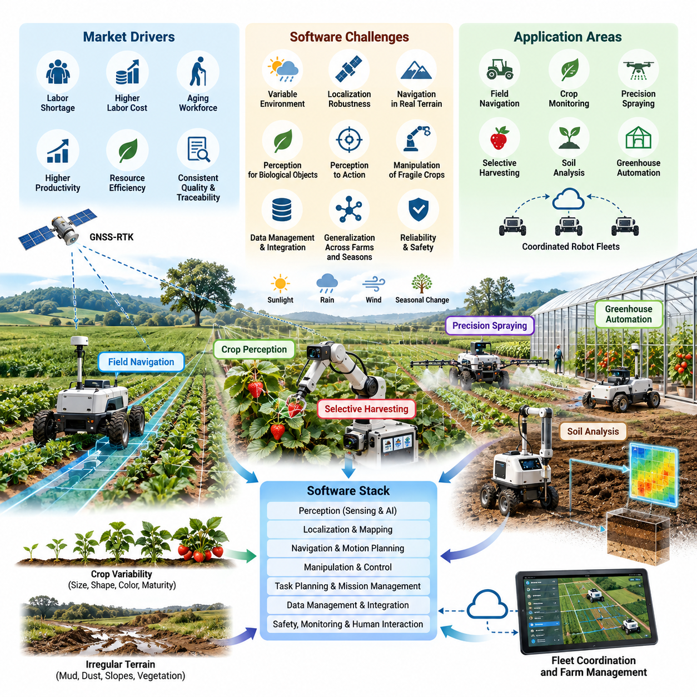
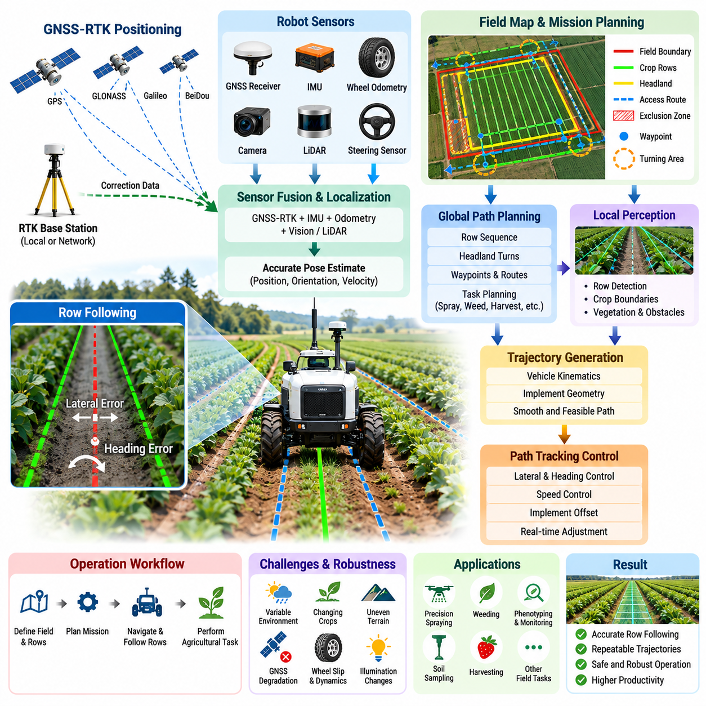
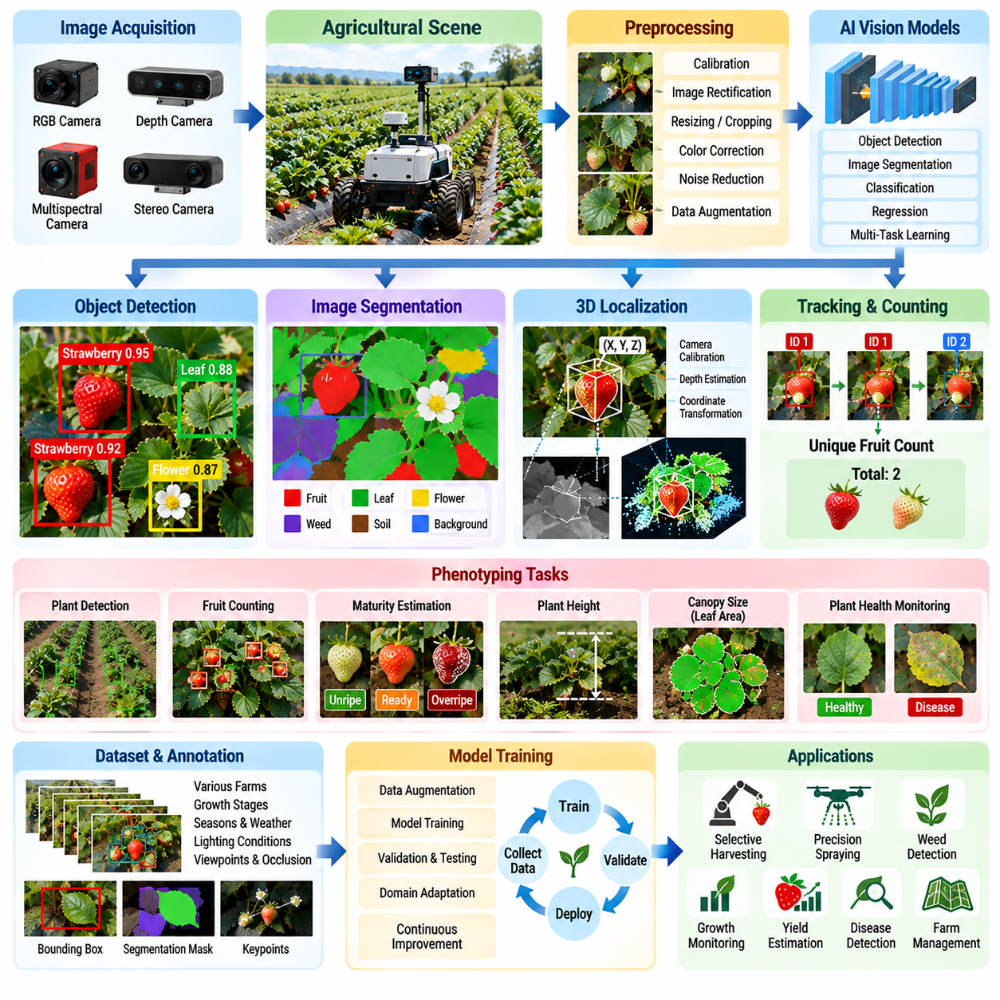
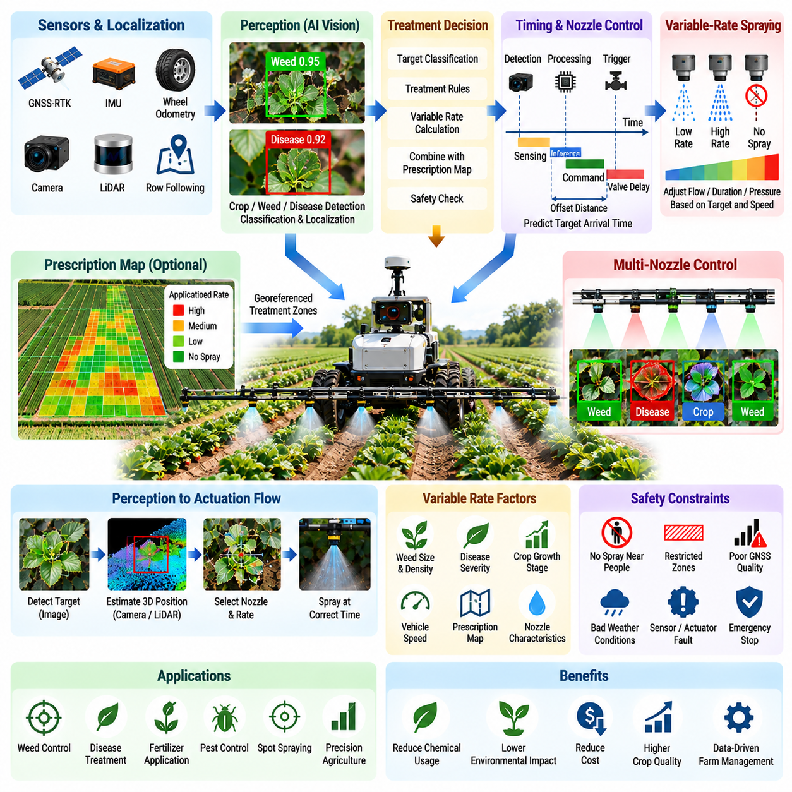
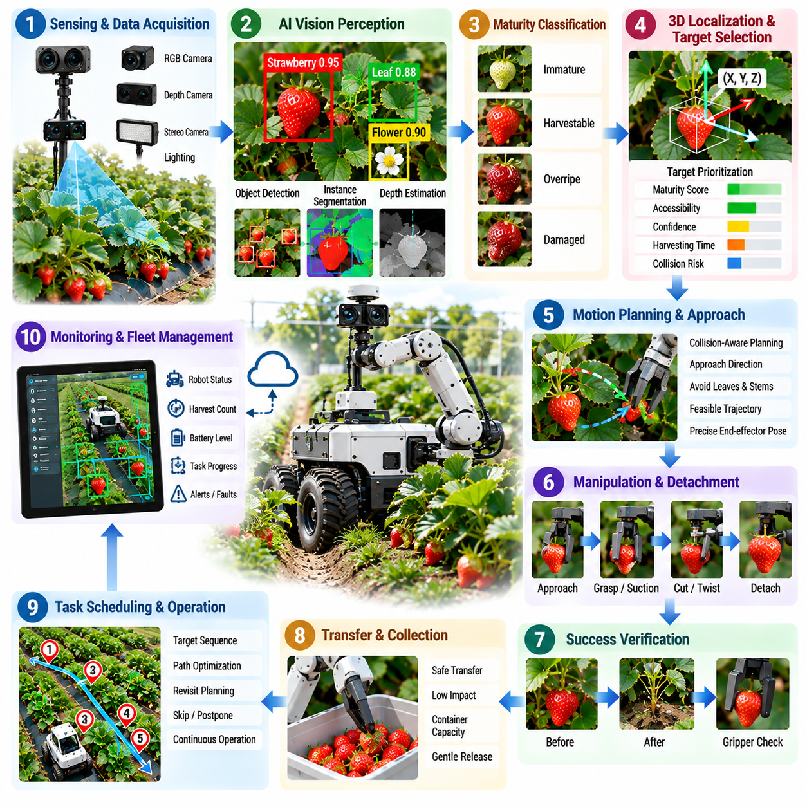
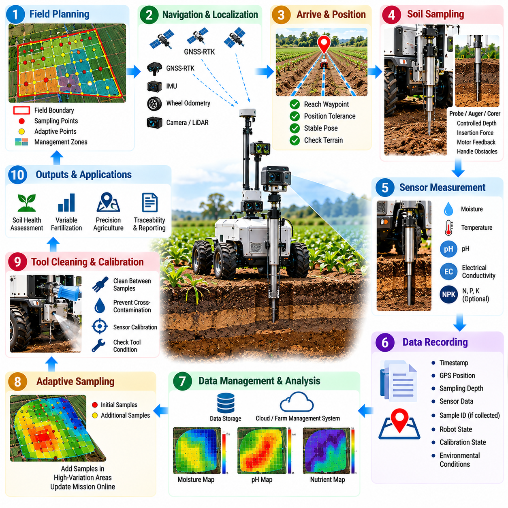
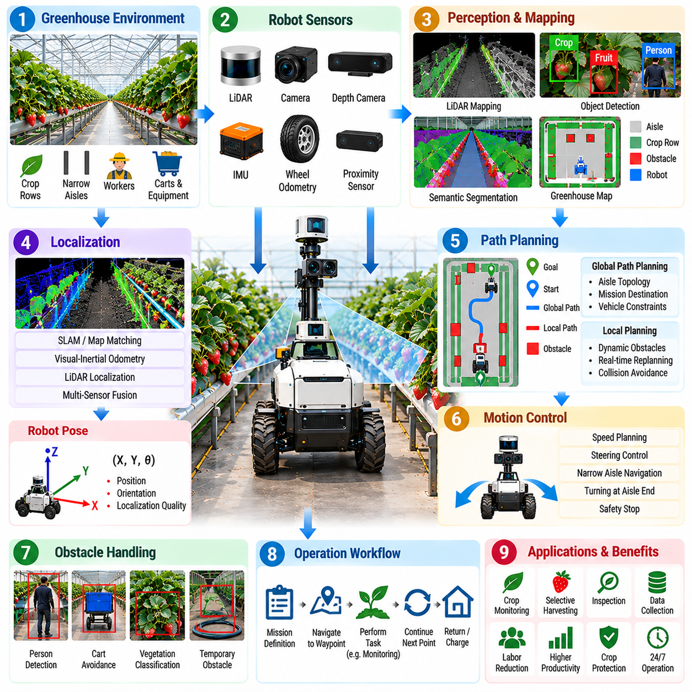
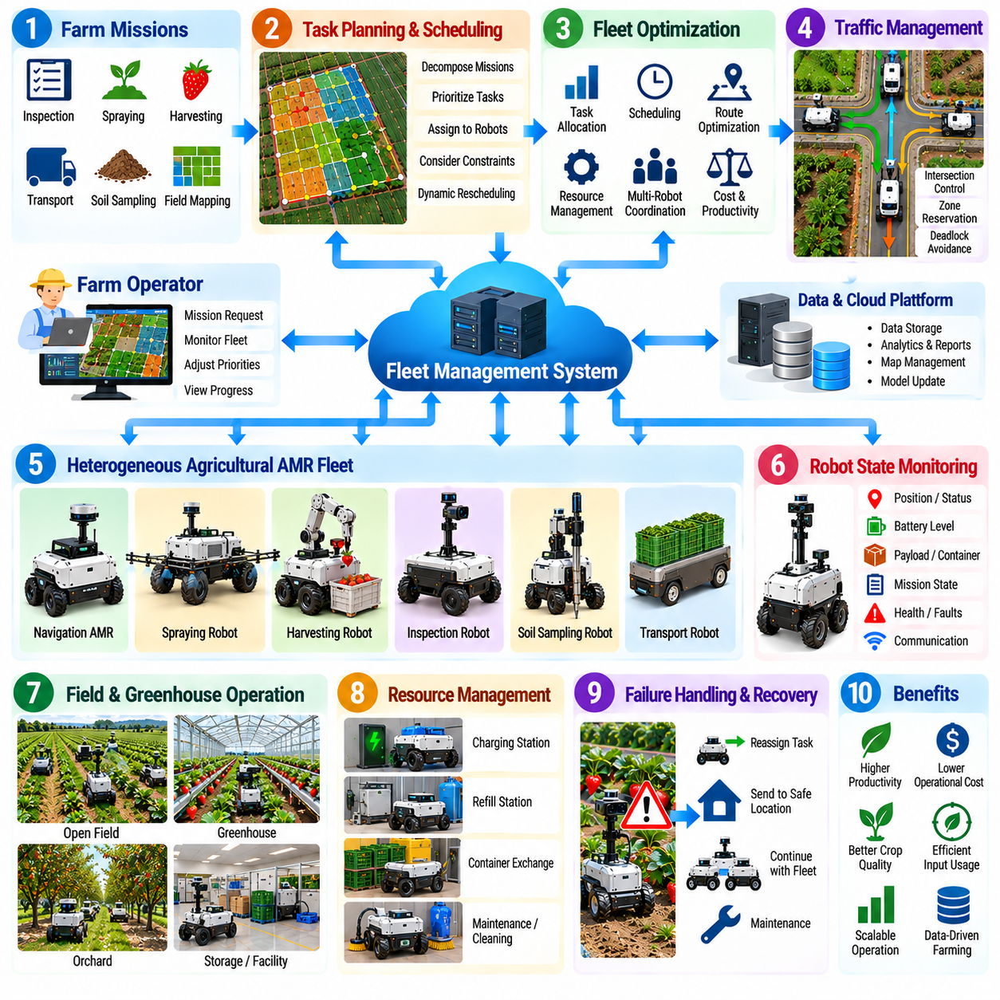
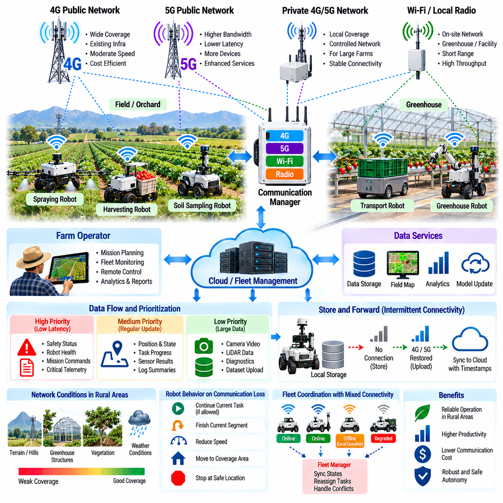
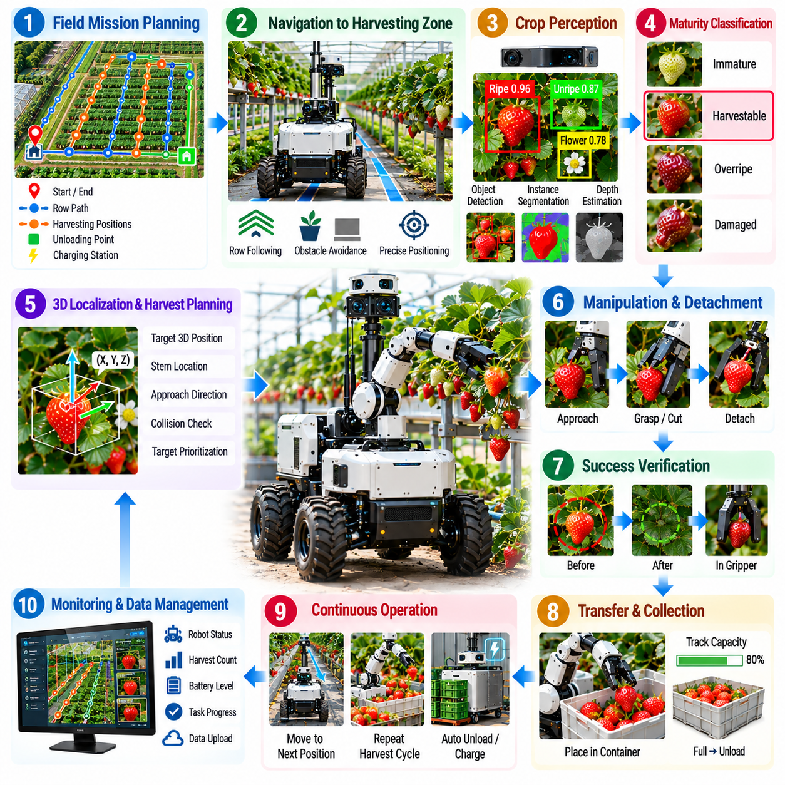

**Volume 26. Industrial Robot Applications**

# Chapter 08. Agricultural Robot Applications

## 08.01. Agricultural Robot Market and SW Challenges

{width="7.268055555555556in" height="7.268055555555556in"}

Agricultural robotics is evolving from isolated automation equipment into software-defined autonomous systems capable of sensing crops, interpreting field conditions, planning operations, and executing agricultural tasks with limited human supervision. The application scope now includes field navigation, crop monitoring, precision spraying, selective harvesting, soil analysis, greenhouse automation, and coordinated agricultural robot fleets.

The agricultural robot market is driven by several structural pressures. Farms face labor shortages, increasing labor costs, aging agricultural workforces, demands for higher productivity, and pressure to reduce water, fertilizer, pesticide, and energy consumption. At the same time, growers need more consistent crop quality and better traceability. Robots therefore create value not simply by replacing labor, but by enabling repeatable and data-driven agricultural operations.

Agricultural automation differs fundamentally from conventional factory automation because the operating environment is only partially structured. Factory robots normally operate around fixed equipment, known workspaces, controlled illumination, and repeatable objects. Agricultural robots encounter changing terrain, mud, dust, rain, wind, direct sunlight, vegetation growth, irregular crop geometry, moving workers, animals, agricultural vehicles, and seasonal changes that continuously modify the environment.

This environmental variability makes robust software one of the primary technical barriers to commercialization. A navigation algorithm that performs reliably during a dry morning may behave differently after rainfall changes soil traction or vegetation partially blocks a row. Camera-based perception may experience severe illumination changes, shadows, glare, leaf occlusion, and visually similar backgrounds. Agricultural software must consequently tolerate uncertainty rather than assume that sensor observations remain stable.

Localization is another major challenge. Outdoor agricultural robots can use Global Navigation Satellite System positioning combined with Real-Time Kinematic correction to obtain high-accuracy global coordinates, but satellite signals can degrade near trees, greenhouses, buildings, hills, or other obstructions. Reliable autonomy therefore requires fusion of GNSS-RTK with inertial sensors, wheel odometry, cameras, LiDAR, or other localization sources and graceful operation when individual sensors become unreliable.

Navigation software must convert localization results into safe motion through crop rows, headlands, access roads, and irregular field boundaries. Unlike warehouse AMRs that usually navigate relatively flat floors, agricultural vehicles must account for wheel slip, slopes, soft soil, ruts, vegetation, drainage channels, and changing vehicle dynamics. Path planning and control therefore need terrain awareness, vehicle-specific motion constraints, and continuous estimation of whether the planned trajectory remains physically executable.

Perception introduces an equally difficult software problem because agricultural objects are biological rather than manufactured. Crops, fruits, weeds, branches, leaves, and disease symptoms vary substantially in size, shape, color, maturity, orientation, and appearance. A perception model trained on one farm or season may not generalize reliably to another. Crop detection and phenotyping therefore require diverse datasets, robust AI models, confidence estimation, and mechanisms for continuous model improvement.

Precision agriculture increases the importance of connecting perception directly to action. In precision spraying, for example, the system must identify a target, determine its location, estimate the appropriate treatment, and activate a nozzle at the correct position and time. Similar perception-to-action pipelines appear in mechanical weeding, fertilization, thinning, and selective harvesting. Software latency and spatial calibration become operational variables because detection errors can immediately produce incorrect physical actions.

Selective harvesting represents one of the most demanding agricultural robotics applications. The robot must distinguish harvestable produce from leaves and branches, estimate maturity and three-dimensional position, select an approach trajectory, manipulate the crop without damaging it, and verify successful harvesting. The chapter structure therefore treats strawberry harvesting as both a dedicated software problem and an integrated field case combining perception, navigation, manipulation, and operational autonomy.

Agricultural manipulation is especially difficult because crops are deformable, fragile, irregular, and frequently occluded. Manipulators must operate around stems, leaves, support structures, and neighboring produce while controlling contact forces. Software must coordinate vision, depth estimation, motion planning, gripper control, force sensing, and recovery behaviors. Success cannot be measured only by grasp completion; cycle time, crop damage, missed targets, and harvesting quality are equally important.

Soil monitoring robots illustrate another class of agricultural automation in which mobility is integrated with scientific measurement. A robot may navigate predefined sampling locations, position a probe, acquire measurements, associate results with geographic coordinates, and generate spatial datasets for later analysis. The software challenge extends beyond robot control to synchronization, georeferencing, data quality validation, metadata management, and integration with farm-management or geographic information systems.

Greenhouses provide a more structured environment than open fields, but they introduce narrow aisles, repetitive visual features, dense vegetation, human workers, irrigation infrastructure, and restricted maneuvering space. GNSS reception may also be poor or unavailable inside greenhouse structures. Autonomous greenhouse robots therefore require localization and navigation methods that can operate independently of continuous satellite positioning while maintaining safe interaction with crops and people.

Fleet operation becomes important as agricultural robots move from experimental prototypes to commercial deployment. A single robot can automate one task, but large farms may require multiple machines working simultaneously across different fields. Fleet software must assign missions, coordinate routes, monitor robot state, manage charging or refueling, detect failures, and redistribute work when equipment becomes unavailable. Agricultural fleet management is consequently a distributed operational problem rather than merely a navigation problem.

Connectivity complicates fleet architecture because rural environments cannot always provide continuous high-bandwidth networking. Agricultural robots may move beyond reliable Wi-Fi, 4G, or 5G coverage and experience variable latency or complete communication loss. The application structure explicitly treats rural 4G/5G connectivity as a separate concern, reflecting the need for systems that can continue essential autonomous functions locally while synchronizing data when network connectivity becomes available.

This constraint encourages an edge-first software architecture. Safety-critical perception, localization, navigation, control, and task execution should remain available on the robot without depending on a remote server. Cloud or on-premise services can support fleet analytics, model training, historical data management, remote supervision, and optimization, but temporary network loss should not immediately stop a robot operating safely in the field. Local autonomy and remote intelligence therefore need clearly defined boundaries.

Reliability requirements also differ from laboratory robotics. Agricultural machines may operate for long periods in dust, moisture, heat, vibration, and mechanically demanding terrain. Software must detect degraded sensors, actuator faults, localization uncertainty, blocked routes, excessive wheel slip, communication failures, and abnormal task execution. Fault handling should move the system toward a safe operational state while preserving enough diagnostic information for maintenance personnel to understand the original failure.

Agricultural robotics also creates a significant data-management problem. Cameras, LiDAR, GNSS, machine telemetry, crop observations, environmental measurements, and task results can generate large volumes of spatially and temporally correlated information. Effective systems must associate robot data with fields, crop rows, individual plants, missions, and timestamps so that operational records can support agronomic analysis, AI training, traceability, maintenance, and future mission planning.

Software lifecycle management becomes increasingly important as deployed robots accumulate operational experience. Perception models may require retraining for new crops or seasons, navigation parameters may need adaptation to different terrain, and mission software may evolve as agricultural practices change. Version management, remote diagnostics, secure software updates, model deployment, rollback mechanisms, and reproducible configuration therefore become essential capabilities for maintaining geographically distributed agricultural robot fleets.

Commercial success ultimately depends on whether autonomy produces measurable agricultural value. A technically sophisticated robot may still fail commercially if it requires frequent intervention, operates too slowly, damages crops, cannot handle environmental variation, or imposes excessive maintenance costs. Evaluation must therefore combine autonomy metrics with hectares covered, crops processed, intervention frequency, task success rate, crop damage, chemical reduction, labor savings, energy consumption, uptime, and total operating cost.

The central software challenge is consequently not the implementation of a single superior algorithm. Agricultural autonomy requires a resilient system in which navigation, perception, manipulation, task planning, connectivity, fleet management, data infrastructure, safety, and recovery mechanisms cooperate under highly variable physical conditions. This broader software-system perspective connects agricultural applications with the volume\'s wider robotics foundations in localization, perception, planning, fleet intelligence, edge computing, and testing.

A mature agricultural robot should therefore be understood as a mobile Physical AI platform that continuously closes the loop between environmental observation and physical action. Sensors describe crops and terrain, AI interprets their meaning, planning determines the next operation, control executes that operation, and field results provide new evidence for future decisions. The competitiveness of agricultural robotics will increasingly depend on how reliably this closed loop can operate across farms, seasons, crops, and changing real-world conditions.

## 08.02. Field Navigation GPS RTK Row Following [w/Code]

{width="7.268055555555556in" height="7.268055555555556in"}

Field navigation is a foundational capability for agricultural robots because most field operations require the vehicle to follow repeatable trajectories while maintaining accurate position relative to crops. Seeding, spraying, weeding, phenotyping, soil sampling, and harvesting all depend on reliable mobility. Agricultural navigation therefore combines global positioning, local perception, trajectory generation, and vehicle control into a continuous autonomy loop.

Global Navigation Satellite System positioning provides the basic geographic reference for outdoor agricultural robots. Standard GNSS can determine approximate vehicle position, but its normal accuracy is often insufficient when a robot must travel through narrow crop rows without damaging plants. Real-Time Kinematic positioning improves this capability by applying correction information to carrier-phase satellite measurements, enabling centimeter-level positioning under suitable satellite and communication conditions.

An RTK system commonly consists of a GNSS receiver on the robot and correction information obtained from a local base station or network-based correction service. The rover receiver continuously estimates its position while incorporating correction data to reduce satellite-related errors. The navigation software must monitor RTK solution quality because the localization state can change between fixed, float, degraded, and unavailable conditions during field operation.

Centimeter-level coordinates alone do not guarantee reliable navigation. Agricultural vehicles experience wheel slip, vibration, pitch and roll, uneven terrain, and temporary GNSS degradation. A practical localization system therefore combines GNSS-RTK with an Inertial Measurement Unit, wheel odometry, steering information, and potentially cameras or LiDAR. Sensor fusion provides a smoother estimate of position, orientation, velocity, and vehicle motion than any single sensor can provide independently.

The coordinate system used by the navigation stack must also be carefully managed. GNSS measurements are expressed in geographic or global coordinates, while motion planning and vehicle control are usually easier to perform in a local Cartesian frame. Software therefore transforms latitude, longitude, and altitude into a field-relative coordinate representation and maintains consistent transformations among global, map, vehicle, sensor, and implement reference frames.

Before autonomous work begins, the system may define field boundaries, exclusion zones, crop rows, headlands, access routes, and task-specific waypoints. These elements form an operational field map rather than a conventional road map. The map describes where the robot may travel, where crops or obstacles are expected, and where turning maneuvers can occur. Accurate georeferencing allows the same agricultural mission to be repeated across multiple operating sessions.

Row following converts this global navigation information into precise motion relative to the crop structure. A row may be represented by recorded GNSS waypoints, a fitted geometric line or curve, or features detected directly from cameras and LiDAR. The robot estimates lateral displacement and heading error relative to the desired row centerline and continuously generates steering commands that reduce these errors while maintaining an appropriate forward velocity.

GNSS-based row following works particularly well when crop rows were created from known georeferenced planting trajectories. The navigation system can reuse these trajectories for later spraying, monitoring, or harvesting operations. This creates spatial consistency across the agricultural lifecycle. However, actual crop geometry may deviate from the original reference because of planting errors, terrain effects, vegetation growth, or inaccurate field records, requiring local perception to refine the trajectory.

Vision-based row detection can identify crop boundaries, vegetation lines, soil corridors, or vanishing-point structures from camera images. LiDAR can provide complementary geometric information about vegetation and surrounding terrain. These observations allow the robot to estimate its local relationship to the physical row even when GNSS accuracy deteriorates. Combining global RTK localization with local row perception provides stronger robustness than relying exclusively on either method.

The fusion strategy should account for measurement confidence rather than treating every sensor as equally reliable. GNSS uncertainty can increase near trees or structures, cameras can become unreliable under glare or shadows, and LiDAR observations can change as vegetation density increases. Navigation software should monitor measurement quality and dynamically determine how much each information source contributes to the final localization and row-following estimate.

Trajectory generation translates the desired crop row into a path that satisfies vehicle kinematic constraints. Agricultural platforms may use differential drive, Ackermann steering, skid steering, articulated steering, or other configurations, and each has different curvature and turning limitations. A controller must therefore consider wheelbase, steering limits, minimum turning radius, velocity, implement geometry, and the offset between the positioning sensor and the physical working tool.

Path-tracking controllers can use geometric or model-based methods to minimize cross-track and heading errors. The objective is not merely to keep the vehicle chassis near a reference line. A spraying nozzle, mechanical weeder, sampling probe, or harvesting mechanism may require greater positional accuracy than the vehicle body itself. Navigation accuracy should consequently be evaluated at the agricultural implement where the physical task is actually performed.

Headland navigation introduces another important problem because the robot must leave one row and enter the next without crossing prohibited areas or damaging crops. The system identifies the end of the current row, reduces speed when necessary, generates a feasible turning trajectory, and aligns the vehicle with the target row. The maneuver depends on row spacing, available headland width, vehicle dimensions, steering geometry, and attached implements.

Obstacle handling must operate simultaneously with nominal row following. Workers, animals, tractors, irrigation equipment, fallen branches, rocks, or unexpected objects may appear on the planned route. Local perception identifies these hazards and the navigation system determines whether to stop, slow down, temporarily deviate from the row, or request operator assistance. Safety behavior must take priority over maintaining the nominal agricultural trajectory.

Terrain conditions directly affect path-tracking performance. Soft soil, mud, slopes, and uneven surfaces can produce significant differences between commanded and actual vehicle motion. Wheel odometry becomes less reliable when tires slip, while steering responses can vary with load and ground condition. Navigation software should therefore estimate tracking performance continuously and reduce speed or modify control behavior when vehicle motion becomes inconsistent with the predicted model.

Loss of RTK corrections must be treated as a normal operational condition rather than an exceptional software failure. Rural communication networks can be intermittent, and satellite visibility can change as the robot moves. When RTK quality decreases, the system can continue temporarily using inertial estimation, odometry, and local perception while increasing localization uncertainty. If uncertainty exceeds the safe operating threshold, the robot should slow down or transition to a controlled stop.

Navigation software also needs explicit recovery behavior. A robot may become unable to identify a crop row, deviate beyond an allowed corridor, encounter persistent wheel slip, or reach a location inconsistent with the planned mission. Recovery can involve stopping, reversing to a previously valid pose, reacquiring the row, recalculating the local trajectory, or requesting remote assistance. Autonomous recovery prevents minor navigation errors from becoming prolonged field interruptions.

Operational logging is essential for diagnosing these events. GNSS position, RTK status, correction age, satellite information, IMU measurements, wheel velocities, steering commands, estimated pose, cross-track error, perception confidence, controller output, and safety events should be synchronized with timestamps. These records allow engineers to distinguish localization problems from perception errors, control instability, terrain effects, and mechanical failures during field testing.

Performance evaluation should extend beyond average localization accuracy. Important measures include cross-track error, heading error, row completion rate, headland-turn success, intervention frequency, RTK availability, localization recovery time, obstacle response, and task-specific implement accuracy. Percentile and worst-case errors are particularly important because a small number of large deviations may damage crops even when the average navigation error appears acceptable.

The resulting architecture forms a layered navigation system in which GNSS-RTK provides precise global positioning, inertial and odometric sensing maintain motion continuity, local perception identifies the physical crop structure, planning generates feasible field trajectories, and control converts those trajectories into vehicle motion. This structure supports the chapter\'s progression from field navigation toward crop perception, precision spraying, harvesting, soil sampling, greenhouse navigation, and agricultural fleet operation.

Reliable row following ultimately depends on maintaining agreement between the digital field representation and the physical environment. The robot must continuously answer where it is globally, where the actual crop row lies locally, how confidently those estimates can be trusted, and what motion remains safe. By combining RTK positioning, multi-sensor localization, crop-row perception, trajectory planning, control, and recovery, agricultural robots can achieve the repeatable mobility required for practical autonomous field operations.

## 08.03. Crop Detection and Phenotyping AI Vision [w/Code]

{width="7.268055555555556in" height="7.268055555555556in"}

Crop detection and phenotyping are central perception capabilities for agricultural robots because autonomous machines must understand not only where plants are located but also their biological condition. Cameras and AI vision transform visual observations into structured information about crops, fruits, leaves, weeds, growth stages, and plant health. This perception layer supports precision spraying, selective harvesting, monitoring, and data-driven farm management.

Crop detection begins with image acquisition from cameras mounted on mobile robots, tractors, manipulators, greenhouse platforms, or fixed monitoring systems. RGB cameras provide detailed color and texture information, while depth, stereo, multispectral, or other sensing modalities can add geometric and spectral information. The camera configuration must consider viewing distance, field of view, motion, illumination, crop geometry, and the agricultural task being performed.

Agricultural imagery is considerably more variable than imagery captured in controlled industrial environments. Plants continuously change in size, shape, orientation, color, and density as they grow. Leaves overlap, fruits are partially hidden, weeds resemble crops, and soil appearance changes with moisture. Sunlight introduces shadows, glare, and strong exposure variations. AI vision must therefore recognize biological targets despite substantial intra-class variation and environmental uncertainty.

Object detection models can identify crops, fruits, flowers, weeds, disease symptoms, or other agricultural targets and return their locations as bounding boxes. These detections provide a useful first level of scene understanding for mobile robots. A harvesting system can identify candidate fruits, while a precision spraying robot can distinguish treatment targets from surrounding vegetation and associate detections with locations in the robot coordinate system.

When bounding boxes are insufficient, image segmentation provides more precise spatial information. Semantic segmentation classifies image pixels into categories such as crop, weed, soil, fruit, or background, while instance segmentation separates individual objects belonging to the same class. Pixel-level information is valuable for estimating plant boundaries, vegetation coverage, fruit shape, leaf area, and the precise location of targets for manipulation or selective treatment.

Detection outputs must often be converted from two-dimensional image coordinates into three-dimensional physical coordinates. Depth cameras, stereo vision, LiDAR, or geometric reconstruction can estimate target distance and position relative to the robot. Camera calibration and coordinate transformation then connect the detected crop with the vehicle, manipulator, or agricultural implement. This transformation is essential when perception must directly trigger a physical operation.

Phenotyping extends agricultural vision beyond simple object recognition. Plant phenotyping measures observable characteristics associated with plant structure, growth, development, and condition. A robotic phenotyping system can estimate attributes such as plant height, canopy size, leaf area, fruit count, growth rate, flowering state, or maturity. Repeated measurements allow robots to convert visual observations into longitudinal records of crop development.

Fruit counting is a representative phenotyping task because individual detections can be aggregated into estimates of crop load and potential yield. However, repeated observations create a risk of counting the same fruit multiple times as the robot moves through the field. Tracking, localization, and spatial association are therefore important. A useful agricultural vision system must determine not only what was detected but whether the observation represents a new physical object.

Maturity estimation introduces another level of semantic interpretation. Color, texture, shape, size, and potentially spectral characteristics can be used to estimate whether fruit is immature, ready for harvest, overripe, or damaged. The output may be represented as discrete categories or continuous maturity scores. For harvesting robots, maturity estimation directly influences task planning because only appropriate targets should be selected for manipulation.

Plant health monitoring can similarly use AI vision to identify visual symptoms associated with stress, nutrient deficiency, pest damage, or disease. These symptoms may initially occupy only a small portion of a leaf or canopy, making resolution and viewing geometry important. The system must also distinguish actual biological symptoms from shadows, dirt, water, physical damage, or normal color variation to avoid unnecessary agricultural treatment.

Dataset quality is one of the most important factors determining field performance. Training images should represent different farms, crop varieties, growth stages, seasons, illumination conditions, camera viewpoints, weather conditions, and levels of occlusion. A model trained primarily on clean and well-exposed images may perform poorly when deployed under strong sunlight, after rain, or in dense vegetation. Dataset diversity is therefore part of system robustness.

Annotation strategy depends on the intended task. Bounding boxes may be sufficient for detection and counting, while segmentation masks provide detailed plant geometry. Keypoints can represent stems, fruit attachment points, flowers, or structural landmarks, and continuous labels can describe size or maturity. Annotation quality directly influences model behavior, so ambiguous agricultural categories require consistent definitions and quality-control procedures.

Data augmentation can increase apparent training diversity by modifying brightness, contrast, scale, orientation, crop regions, blur, or other image properties. Agricultural augmentation should nevertheless remain physically meaningful. Unrealistic transformations can create samples that do not represent plausible field conditions. The objective is to expose the model to realistic variation that it will encounter during operation rather than simply maximize visual diversity.

Generalization across farms remains a major challenge. Soil color, crop variety, planting density, cultivation method, camera installation, and local weather can produce significant domain shifts. Models that perform well on the original training field may lose accuracy at a new site. Validation should therefore include geographically and temporally separated data rather than relying only on random image splits collected from the same environment.

Confidence estimation is important because agricultural robots convert AI predictions into physical decisions. A low-confidence fruit detection should not automatically trigger a harvesting attempt, and uncertain weed classification should not necessarily activate a herbicide nozzle. Perception software should expose confidence information to downstream planning so that uncertain observations can be ignored, re-observed, verified using another sensor, or escalated for human review.

Temporal information can improve reliability beyond independent frame-by-frame inference. Consecutive observations of the same crop can be associated through tracking and robot motion. Stable detections across multiple frames provide stronger evidence than isolated predictions, while inconsistent detections can be rejected or reconsidered. Temporal fusion also supports growth monitoring by connecting observations collected during different field visits.

Georeferencing transforms perception results into agricultural information that remains useful after the robot has moved away. A detected plant, weed, disease symptom, or fruit estimate can be associated with GNSS-RTK coordinates, crop-row identifiers, or individual plant records. This creates spatial crop maps that can guide later spraying, harvesting, inspection, or sampling operations and connects perception with broader precision-agriculture workflows.

Real-time deployment introduces computational constraints. Agricultural robots may need to process several camera streams while simultaneously running localization, navigation, safety monitoring, and control. Vision models must therefore balance detection accuracy with inference latency, memory consumption, power demand, and accelerator availability. Model compression, reduced input resolution, optimized inference engines, and selective processing can help maintain real-time operation on edge computers.

Perception failures should be treated explicitly within the robot software architecture. Cameras can become dirty, lenses may be covered by water or dust, exposure can fail under rapidly changing illumination, and vegetation can completely occlude targets. The system should monitor image quality and model confidence, detect abnormal input conditions, and avoid presenting unreliable perception as valid information to planning or control modules.

Evaluation should reflect agricultural objectives rather than relying exclusively on generic computer-vision metrics. Precision, recall, detection accuracy, segmentation quality, and inference latency remain important, but field evaluation should also measure fruit-counting error, maturity classification accuracy, missed treatment targets, false spraying decisions, localization error of detected objects, and the effect of perception errors on complete robotic task success.

The resulting perception pipeline connects sensing, AI inference, spatial reasoning, and agricultural decision making. Images are captured and calibrated, models detect or segment biological targets, depth and localization place those targets in physical space, phenotyping algorithms estimate crop properties, and the resulting information is stored or transferred to planning modules. This structure provides the perception foundation for precision spraying and selective harvesting.

Crop detection and phenotyping ultimately transform agricultural robots from machines that merely move through fields into systems capable of interpreting the biological environment. Reliable AI vision allows each plant or fruit to become a measurable entity linked to position, condition, history, and potential action. When integrated with field navigation, manipulation, and farm data systems, this capability enables increasingly precise and autonomous crop management.

## 08.04. Precision Spraying Variable Rate Application [w/Code]

{width="7.268055555555556in" height="7.268055555555556in"}

Precision spraying transforms crop protection from uniform field-wide application into targeted treatment based on the condition of individual plants or localized field regions. An autonomous agricultural robot combines navigation, crop perception, treatment planning, and electronically controlled spraying so that chemicals are delivered where they are required. Variable-rate application further adjusts the amount applied according to target characteristics and agronomic requirements.

Conventional spraying typically applies a predefined rate across a large area even when weeds, pests, disease symptoms, or crop conditions are spatially uneven. This can increase chemical consumption and expose non-target plants and surrounding areas unnecessarily. Precision spraying attempts to reduce this inefficiency by connecting sensor observations with individual nozzle actions and adapting treatment continuously as the robot moves through the field.

The software pipeline begins with accurate localization and perception. GNSS-RTK, inertial sensing, odometry, and row-following information establish the robot pose, while cameras or other agricultural sensors observe vegetation ahead of the spraying mechanism. AI vision detects crops, weeds, leaves, disease symptoms, or other treatment targets and estimates their position relative to the robot and spraying implement.

Target classification is critical because detection alone does not determine whether spraying is appropriate. A perception model may distinguish crop from weed, identify a specific weed category, recognize visible disease symptoms, or estimate vegetation density. Each detected target is associated with a confidence value and spatial position. The decision layer then determines whether the observation satisfies the conditions required to authorize treatment.

The system must transform image-space detections into physical spraying coordinates. Camera calibration defines the geometric relationship between image pixels and sensor coordinates, while extrinsic calibration relates the camera to the robot and nozzle assembly. Depth estimation, ground-plane geometry, stereo vision, or additional range sensors can provide target distance. Accurate transformation is essential because a small spatial error can cause the spray to miss the intended plant.

Vehicle motion introduces a timing problem between perception and actuation. The camera normally observes a target before the corresponding nozzle reaches its location. Software must estimate the time required for the robot to travel from the sensing position to the spray position while accounting for current velocity, sensor-to-nozzle offset, processing latency, valve response, and fluid transport delay. The nozzle command is then scheduled for the predicted target arrival time.

This perception-to-actuation latency should be treated as a complete system quantity rather than only an AI inference time. Image capture, preprocessing, neural-network inference, target localization, decision making, communication, valve activation, and fluid dynamics all contribute to the final timing error. Timestamp synchronization across sensing, computation, navigation, and actuator interfaces is therefore essential for high-accuracy spraying at practical vehicle speeds.

A multi-nozzle boom can divide the treatment width into independently controlled spatial zones. After a target is localized, software selects the nozzle or group of nozzles whose spray footprint best intersects the target region. As the robot moves, multiple target events may be queued simultaneously. The controller must schedule these events while preventing duplicated applications, missed targets, and conflicting commands between neighboring spray channels.

Variable-rate application extends binary spray or no-spray control by determining how much material should be delivered. Application rate can depend on vegetation density, weed size, disease severity, crop growth stage, prescribed field maps, or other agronomic variables. The desired dose is translated into actuator parameters such as valve duty cycle, opening duration, flow rate, pressure setting, or vehicle-speed-dependent command values.

Vehicle speed must be included in rate control because the amount deposited per unit area changes when the robot accelerates or decelerates. A constant nozzle flow applied at different speeds produces different spatial application rates. The control system therefore combines target dose, measured velocity, nozzle characteristics, and spray geometry to maintain the requested treatment level while the mobile platform changes its motion.

Prescription maps provide another source of variable-rate commands. A field can be divided into georeferenced management zones containing recommended treatment levels derived from previous surveys, crop observations, soil measurements, or agronomic analysis. GNSS-RTK localization determines the robot\'s current position within this map, and the application controller combines the prescribed rate with real-time perception when both information sources are available.

Real-time vision and prescription maps serve complementary purposes. A prescription map represents knowledge acquired before the current operation, while onboard perception describes conditions observed at execution time. A robust system can use the map to define expected treatment requirements and local sensing to confirm or modify them. This allows the robot to respond to changes that occurred after the original field survey.

Safety constraints must remain independent of the treatment optimization logic. Spraying should be inhibited when the robot enters prohibited zones, loses reliable localization, detects people near the treatment area, exceeds configured operating conditions, or experiences actuator and sensor faults. The software should default toward a safe state when the validity of the spraying decision cannot be established with sufficient confidence.

Environmental conditions can also affect treatment quality. Wind may cause spray drift, while temperature and humidity can influence evaporation and deposition. Although the available sensor configuration varies between agricultural platforms, environmental measurements can be incorporated into treatment authorization and rate adjustment. When operating conditions exceed acceptable thresholds, the robot can reduce application, pause spraying, or postpone the mission.

Actuator feedback improves reliability because issuing a valve command does not guarantee that chemical was actually delivered. Flow meters, pressure sensors, valve-state feedback, tank-level sensors, or pump diagnostics can confirm whether the spraying subsystem responded correctly. Comparing commanded and measured behavior allows software to detect blocked nozzles, empty tanks, pressure abnormalities, valve failures, or unexpected flow conditions.

Calibration is therefore a major operational requirement. Each nozzle has a physical spray pattern, flow characteristic, response delay, and possible manufacturing variation. Camera-to-nozzle geometry must also remain accurate after maintenance or mechanical adjustment. Calibration procedures should measure spatial alignment, timing offset, flow behavior, and actuator response so that software parameters represent the actual physical system rather than nominal specifications.

Precision spraying generates valuable operational data. Each treatment event can contain timestamp, robot pose, target category, perception confidence, selected nozzle, requested dose, measured flow, and execution result. When associated with GNSS coordinates, these records form a treatment map showing where material was applied. Such maps support traceability, agronomic analysis, chemical inventory management, and comparison with later crop outcomes.

Logging also provides the basis for software improvement. Engineers can replay situations in which a target was missed, a crop was incorrectly treated, or a nozzle activated at the wrong position. Sensor frames, localization states, inference outputs, vehicle velocity, actuator commands, and feedback should be synchronized so that failures can be traced across the complete perception-to-action pipeline rather than attributed only to the AI model.

Evaluation must therefore include both perception and application performance. Detection precision and recall are important, but field metrics should also measure target treatment rate, false application rate, spatial spray error, dosage error, chemical reduction, crop exposure, nozzle response reliability, and treatment coverage. End-to-end evaluation reveals whether improvements in AI accuracy actually produce better physical agricultural outcomes.

Edge computing is particularly important because treatment decisions often have strict latency requirements and should not depend on continuous remote connectivity. Crop detection, target localization, nozzle scheduling, rate control, and safety interlocks can execute locally on the agricultural robot. Cloud or on-premise systems can support model training, historical analysis, fleet monitoring, prescription generation, and long-term optimization without becoming part of the immediate control loop.

Precision spraying consequently represents a direct Physical AI interaction loop. The robot observes biological and environmental conditions, AI interprets whether treatment is required, spatial reasoning determines where the target will intersect the implement, and control software determines when and how much material to apply. Actuator feedback then verifies the physical result and returns information to the software system.

When integrated with RTK field navigation and crop-detection capabilities, variable-rate spraying demonstrates how agricultural autonomy progresses from perception to controlled intervention. The value of the system is determined not simply by whether weeds or crops can be recognized, but by whether each observation can be converted into a timely, spatially accurate, safe, and measurable physical action while the robot continuously moves through a changing field environment.

## 08.05. Selective Harvesting Robot SW Strawberry [w/Code]

{width="7.268055555555556in" height="7.268055555555556in"}

Selective harvesting is one of the most demanding agricultural robotics applications because the robot must identify harvestable produce, approach it through complex vegetation, remove it without damage, and verify successful collection. Strawberry harvesting is a representative case because fruits are fragile, partially occluded by leaves, distributed irregularly, and harvested according to maturity rather than simply by geometric position.

The harvesting software begins with visual perception of the crop environment. RGB, depth, or stereo cameras observe plants from positions that provide useful views of fruit and surrounding vegetation. AI vision detects individual strawberries and distinguishes them from leaves, stems, flowers, supports, soil, and background objects. Instance-level recognition is particularly important because each fruit becomes an independent candidate for manipulation.

Detection alone is insufficient because the robot should harvest only fruit that satisfies predefined quality requirements. A maturity estimation model can evaluate color, texture, size, shape, and other visible characteristics to classify strawberries as immature, harvestable, overripe, damaged, or uncertain. The task planner uses this information to prioritize suitable targets and avoid unnecessary manipulation of fruit that should remain on the plant.

Occlusion is a fundamental problem in strawberry perception. Leaves, stems, neighboring fruit, cultivation structures, and other vegetation can hide important portions of the target. A robot may therefore need to combine observations from multiple viewpoints rather than making a decision from a single image. Active perception can reposition the camera or manipulator to obtain a clearer view before committing to a harvesting action.

Once a strawberry is selected, the perception system must estimate its three-dimensional position relative to the harvesting mechanism. Depth sensing, stereo reconstruction, or multi-view geometry can provide target coordinates, while calibrated transformations connect the camera frame to the robot and manipulator frames. Position accuracy is critical because even a small error may cause the end effector to collide with the fruit or surrounding plant structure.

Harvest planning also requires information beyond the fruit center. The system may estimate fruit orientation, visible surface geometry, stem location, attachment direction, and accessible approach regions. These properties influence where the end effector should approach and how the fruit should be detached. Agricultural manipulation therefore converts semantic perception into task-specific geometric information suitable for motion planning.

The manipulator must move through a constrained workspace containing fragile and deformable obstacles. Conventional collision avoidance can model greenhouse structures and rigid equipment, but leaves and stems require more careful treatment because they can move when contacted. Motion planning should generate a feasible approach trajectory while minimizing unnecessary contact with the crop and maintaining appropriate orientation of the harvesting tool.

End-effector design and software control are tightly coupled. A strawberry may be harvested using gripping, cutting, suction, twisting, or a combination of mechanisms depending on the robot design. The controller must coordinate the manipulator pose with gripper closure, suction activation, cutter operation, or other tool commands. Timing and force must be controlled carefully because excessive contact can bruise or deform the fruit.

Force and tactile information can complement vision during the final stage of manipulation. Visual estimates become less reliable when the end effector approaches the target and blocks the camera view. Force sensing, motor current, vacuum pressure, tactile sensors, or gripper position can indicate whether contact occurred and whether the fruit was successfully secured. These signals help convert an open-loop visual approach into a closed-loop manipulation process.

Detachment is a separate manipulation phase because successfully contacting a strawberry does not guarantee successful harvesting. The robot must apply the appropriate cutting, pulling, twisting, or gripping action while limiting forces transmitted to the fruit and plant. Software should monitor the expected tool response and detect abnormal conditions such as failed cutting, fruit slippage, unexpected resistance, or incomplete separation.

After detachment, the robot must verify that the fruit has actually been harvested. Verification may use camera observations, gripper state, force measurements, suction pressure, or comparison of the scene before and after the action. Without verification, a failed attempt could be recorded as a successful harvest. Reliable autonomy therefore requires explicit confirmation of physical task completion rather than assuming success after issuing commands.

The harvested strawberry must then be transferred to a collection container without creating additional damage. Motion planning should consider fruit retention, manipulator acceleration, collision risk, and the location of the storage area. The release action should also be controlled to avoid excessive drop height or impact. Harvesting software consequently manages the complete cycle from target selection through collection rather than only the picking motion.

Task scheduling becomes important when many strawberries are visible simultaneously. The robot can prioritize targets according to maturity, accessibility, confidence, travel distance, expected harvesting time, or risk of failure. Selecting the nearest fruit is not always optimal if another target provides a safer approach or reduces manipulator motion. Efficient scheduling improves throughput while preserving harvest quality and reducing unnecessary arm movement.

Failure recovery is essential because agricultural manipulation operates in uncertain biological environments. A fruit may move during approach, become occluded, slip from the gripper, resist detachment, or prove inaccessible after the manipulator begins moving. The software should recognize these conditions and decide whether to retry from another viewpoint, modify the grasp, select another approach, postpone the target, or request operator assistance.

Repeated failed attempts should not continue indefinitely. Each target can maintain an execution state containing detection confidence, maturity estimate, attempted approaches, manipulation outcomes, and failure reasons. After a configured number of unsuccessful attempts, the robot can mark the fruit as temporarily unreachable and continue the mission. This prevents one difficult strawberry from significantly reducing the productivity of the entire harvesting operation.

Mobile harvesting platforms must coordinate manipulation with vehicle navigation. The vehicle first positions itself so that target plants fall within the manipulator workspace, then establishes a sufficiently stable pose before precision harvesting begins. After accessible targets are processed, the platform advances to the next working position. Navigation and manipulation therefore operate as coordinated phases of a larger agricultural task rather than independent subsystems.

Calibration strongly influences harvesting accuracy. Camera intrinsics, camera-to-manipulator transformations, tool-center-point position, depth alignment, and mechanical offsets must accurately represent the physical robot. Small calibration errors can accumulate across the perception and motion chain and become significant near the fruit. Periodic calibration checks are therefore necessary, particularly after camera, manipulator, or end-effector maintenance.

Operational data should record the complete harvesting process. Useful information includes target images, maturity estimates, three-dimensional positions, planned trajectories, execution times, gripper or tool states, force measurements, success results, and failure categories. Associating these records with plant or row locations allows engineers to evaluate both individual manipulation events and harvesting performance across the field.

Performance evaluation must extend beyond simple picking success rate. Important measures include detection recall, maturity classification accuracy, localization error, successful detachment rate, fruit damage rate, cycle time, intervention frequency, inaccessible-target rate, and harvested fruit per operating hour. Commercial performance depends on the interaction of these measures because high picking success has limited value if each cycle is excessively slow or damages produce.

Edge computing is well suited to selective harvesting because perception, motion planning, manipulation monitoring, and recovery decisions require low latency and must remain available without continuous network connectivity. Remote systems can support model training, fleet analytics, historical crop records, and software updates, while the immediate harvesting loop remains local to the robot for responsive and reliable physical interaction.

Strawberry harvesting therefore illustrates a complete Physical AI loop in which biological perception and physical manipulation are inseparable. The robot observes fruit, estimates maturity and accessibility, determines three-dimensional geometry, plans an approach, controls physical interaction, verifies detachment, and records the result. Each stage influences the next, and uncertainty must be managed throughout the complete task.

A mature selective harvesting system is consequently not defined by a single fruit detector or robotic arm algorithm. It emerges from the integration of crop perception, maturity estimation, three-dimensional localization, active perception, motion planning, compliant manipulation, tool control, verification, recovery, and mobile-platform coordination. This integrated software architecture enables fragile crops such as strawberries to be harvested autonomously with increasing consistency, quality, and operational efficiency.

## 08.06. Soil Sampling and Analysis Robot SW [w/Code]

{width="7.268055555555556in" height="7.268055555555556in"}

Soil sampling robots combine autonomous mobility with scientific measurement to convert field conditions into spatially referenced agricultural data. Instead of relying entirely on manual collection at a limited number of locations, a mobile robot can navigate to predefined or adaptively selected sampling points, operate a probe or sampling mechanism, record sensor measurements, and associate every observation with an accurate field position.

The sampling mission begins with spatial planning. A field boundary can be divided into a regular grid, management zones, crop rows, or regions selected from previous soil and crop information. Each target location becomes a sampling waypoint with associated measurement requirements. Mission software determines the visiting sequence while considering travel distance, terrain accessibility, restricted areas, remaining energy, and the expected duration of each sampling operation.

Accurate localization is essential because soil measurements become significantly more useful when they can be compared spatially across the field. GNSS-RTK can provide centimeter-level global coordinates under suitable conditions, while IMU and wheel odometry maintain motion continuity. The robot records the sampling location together with localization quality so that later analysis can distinguish precise measurements from observations collected under degraded positioning conditions.

Reaching a waypoint does not automatically mean that sampling can begin. The vehicle must stop within an acceptable positional tolerance and establish a sufficiently stable pose for the measurement mechanism. Software can verify position, orientation, vehicle motion, and terrain condition before authorizing probe deployment. This prevents inaccurate sampling caused by vehicle movement or by operating the mechanism at an unsuitable location.

Physical soil sampling requires coordinated control of the sampling mechanism. Depending on the system, a probe, auger, corer, or insertion tool may be lowered into the ground to a predefined depth. The controller manages actuator position, insertion speed, depth, force, and extraction. Mechanical resistance can vary substantially with soil compaction, moisture, stones, roots, and surface conditions, requiring feedback rather than a purely fixed motion sequence.

Force, motor current, position, or torque feedback can indicate whether the sampling tool is penetrating the soil normally. Unexpected resistance may indicate a stone or highly compacted region, while unusually low resistance may suggest loose soil or incomplete contact. The software should recognize abnormal insertion behavior and decide whether to retry, modify the insertion parameters, shift the sampling position, or mark the point as unsuccessful.

Some robots physically collect soil material for later laboratory analysis, while others perform in-situ measurements directly in the field. Sensors may measure moisture, temperature, electrical conductivity, pH, or other soil properties depending on the instrument configuration. The software architecture should separate sensor-specific acquisition logic from the general mission layer so that different measurement devices can be integrated without redesigning the complete autonomy system.

Sensor readings require contextual information to become scientifically useful. Each measurement should be associated with timestamp, geographic position, sampling depth, sensor identifier, calibration state, environmental conditions, and robot operating state. When physical samples are collected, a sample identifier should link the container or specimen with the digital record. This creates traceability from field location through measurement and later laboratory processing.

Measurement quality control is especially important because agricultural sensors can be affected by contamination, temperature, soil contact, calibration drift, and previous samples. The robot may perform repeated readings at the same location and evaluate whether measurements remain within an acceptable variation range. Outliers can be flagged automatically, while unstable readings can trigger additional measurement time or a repeated sampling procedure.

Cross-contamination must also be considered when the same physical tool is used at multiple sampling points. Residual soil from one location can influence the next measurement or physical sample. Depending on the mechanism, the robot may include cleaning, shaking, wiping, purging, or tool replacement between samples. Software must represent this cleaning process as part of the task sequence rather than treating it as an external manual operation.

Calibration management is another important software responsibility. Soil sensors may require periodic calibration against reference materials or known conditions, while mechanical sampling tools need verified depth and position references. Calibration parameters, dates, sensor serial numbers, and validity states should be stored with operational records. The system can prevent measurements when calibration has expired or warn operators that data quality may be reduced.

Adaptive sampling can improve efficiency compared with a completely fixed sampling grid. Initial measurements may reveal regions with rapidly changing soil properties, while other regions remain relatively uniform. Analysis software can use these observations to recommend additional sampling points in high-variation areas. The robot can then update its mission and collect denser information where additional measurements are likely to provide greater value.

This approach creates a closed loop between measurement and mission planning. The robot first observes a subset of the field, the analysis layer estimates spatial variation or uncertainty, and the planner determines where another measurement would reduce uncertainty most effectively. Adaptive sampling can therefore allocate robot time according to information value rather than treating every part of the field as equally uncertain.

Soil measurements become more useful when combined with other agricultural data layers. Sampling results can be associated with crop health observations, yield maps, terrain elevation, irrigation zones, fertilizer history, or remote-sensing information. Consistent georeferencing allows these heterogeneous datasets to be compared within a common spatial framework and supports later decisions about fertilization, irrigation, planting, or field management.

The resulting spatial dataset can be interpolated to estimate soil properties between measured locations. However, software should preserve the distinction between directly measured values and values predicted by spatial models. Measurement density, positioning accuracy, sensor uncertainty, and interpolation assumptions influence map reliability. Storing these quality indicators prevents visually smooth maps from being interpreted as more certain than the underlying observations justify.

Failure recovery is required because field sampling frequently encounters unpredictable physical conditions. A probe may fail to penetrate, a sample may not enter the collection chamber, a sensor may return an invalid reading, or the vehicle may be unable to reach the planned point. Recovery logic can retry the action, select a nearby alternative location, change insertion parameters, skip the point, or request operator assistance depending on mission policy.

Sampling state should therefore be maintained explicitly for every planned location. A waypoint can be marked as pending, reached, sampling, measured, failed, retried, substituted, or completed, together with the reason for any abnormal outcome. This state representation allows interrupted missions to resume without repeating valid samples and provides a clear record of which portions of the field were successfully characterized.

Operational logging should synchronize navigation and scientific measurement data. Robot pose, GNSS-RTK quality, vehicle velocity, probe position, actuator force, sensor readings, calibration information, retries, failure events, and sampling results should share a consistent time reference. Engineers can then determine whether an abnormal soil value originated from the field itself, a positioning problem, sensor instability, or incorrect mechanical operation.

Edge computing allows the robot to execute navigation, probe control, sensor acquisition, quality checks, and basic analysis without continuous network access. This is important in large agricultural areas where wireless connectivity may be intermittent. Cloud or on-premise systems can later aggregate measurements, generate field-scale maps, perform advanced analysis, manage historical records, and coordinate information across multiple robots or growing seasons.

Performance evaluation should include both robotic and scientific criteria. Navigation accuracy, waypoint completion rate, sampling cycle time, probe success, intervention frequency, and energy consumption describe operational performance. Measurement repeatability, missing-data rate, calibration compliance, spatial coverage, sample integrity, and agreement with reference measurements describe whether the robot is producing information of sufficient quality for agricultural decisions.

A soil sampling robot therefore represents more than an autonomous vehicle carrying a sensor. It is an integrated Physical AI measurement platform in which mobility determines where observations are collected, physical interaction determines whether the soil can be sampled correctly, sensing determines what properties are measured, and data management preserves the spatial and scientific meaning of every observation.

When navigation, sampling mechanisms, sensor acquisition, georeferencing, quality control, adaptive planning, and data management operate as one software system, soil analysis becomes a repeatable autonomous workflow. The robot can move from point to point, interact with the ground, evaluate measurement quality, recover from failures, and progressively construct a spatial representation of field conditions that supports more precise agricultural management.

## 08.07. Greenhouse Autonomous Robot Navigation [w/Code]

{width="7.268055555555556in" height="7.268055555555556in"}

Greenhouse autonomous navigation differs from open-field navigation because robots operate inside confined agricultural structures where GNSS reception may be weak or unavailable. Narrow aisles, repetitive crop rows, dense vegetation, irrigation equipment, workers, carts, and changing plant geometry create a semi-structured environment. Reliable navigation therefore depends primarily on onboard sensing, local mapping, localization, and obstacle-aware motion control.

The greenhouse can initially appear easier to navigate than an outdoor field because walls, aisles, and cultivation structures provide stable geometric references. However, many greenhouse sections look visually similar, and crop growth continuously changes the observable environment. Leaves may extend into aisles, harvesting equipment may be moved, and temporary objects may appear. Navigation software must distinguish persistent structural features from dynamic agricultural content.

A greenhouse robot commonly uses LiDAR, cameras, depth sensors, IMU, and wheel odometry to estimate its surroundings and motion. LiDAR provides geometric measurements of walls, racks, poles, and aisle boundaries, while cameras provide visual features and semantic information. Depth sensing supports short-range obstacle detection, and inertial and wheel measurements maintain motion continuity when environmental features temporarily become difficult to observe.

Localization can be based on simultaneous localization and mapping, previously generated maps, visual-inertial methods, LiDAR matching, or combinations of these approaches. The objective is to estimate the robot pose consistently within the greenhouse coordinate system. Because GNSS cannot always provide a reliable global reference indoors, localization quality depends on environmental features, sensor calibration, odometry stability, and the ability to recognize previously mapped locations.

Repetitive greenhouse geometry creates a particular localization challenge. Long parallel aisles can contain nearly identical structural patterns, causing scan matching or visual place recognition to confuse one location with another. Navigation systems can reduce this ambiguity by combining multiple sensing modalities, maintaining motion history, using known aisle topology, or introducing artificial landmarks where natural environmental features are insufficient.

A greenhouse map should represent more than free and occupied space. Operational information can include aisle identifiers, row numbers, docking locations, charging stations, restricted regions, crop-working positions, turning zones, and access points. Semantic mapping allows the mission planner to reason in agricultural terms, such as navigating to a particular crop row or inspection station, instead of relying only on geometric coordinates.

Global path planning determines how the robot should move between distant locations within this mapped structure. The planner considers aisle connectivity, vehicle dimensions, turning constraints, restricted passages, and mission destinations. Since greenhouse routes are often strongly constrained by aisle topology, the global path can be represented as a sequence of corridors and intersections that the robot must traverse before reaching its target working position.

Local planning handles the immediate environment around the moving robot. Workers, carts, hoses, containers, tools, fallen vegetation, or other robots can temporarily block an otherwise valid route. Sensors update the local obstacle representation, and the planner modifies velocity or trajectory while respecting vehicle kinematics. If safe passage is impossible, the robot should stop and wait, replan, or select an alternative route.

Narrow aisles make clearance management especially important. A robot may have only limited space between its body and crop beds, support structures, or protruding vegetation. The navigation stack should consider the complete vehicle footprint rather than treating the robot as a point. Safety margins can be adjusted according to localization uncertainty, vehicle speed, payload condition, and the reliability of nearby obstacle measurements.

Vegetation introduces a difficult distinction between obstacles that must never be contacted and flexible plant material that may extend into the navigation corridor. Treating every leaf as a rigid obstacle can make an aisle appear permanently blocked, while ignoring vegetation can damage crops. Perception software can classify structural obstacles, people, equipment, and vegetation so that navigation behavior reflects the physical and agricultural significance of each object.

Human-aware navigation is necessary because greenhouse workers may share aisles with autonomous robots. People can emerge from crop rows, bend into the robot\'s path, carry containers, or move unpredictably in restricted spaces. The robot should detect people reliably, maintain suitable separation, reduce speed in shared zones, and stop when safe motion cannot be guaranteed. Productivity objectives must remain subordinate to human safety.

Speed planning should adapt to local conditions rather than using one constant velocity throughout the greenhouse. The robot can travel faster in wide, empty corridors and reduce speed near workers, intersections, narrow crop rows, docking stations, or uncertain obstacles. Curvature, stopping distance, localization confidence, payload stability, and sensor visibility can also influence the maximum allowable velocity.

Turning at aisle ends can be challenging for platforms with limited steering geometry. The planner must verify that sufficient free space exists for the vehicle footprint and attached equipment before initiating a turn. Differential-drive robots may rotate within smaller areas, whereas Ackermann-steered platforms require larger trajectories. Agricultural implements or manipulators can further increase the effective turning envelope.

Precise docking and working-position alignment are required when the robot must charge, exchange payloads, inspect plants, or perform manipulation. General navigation may bring the platform near the destination, after which a local alignment procedure uses LiDAR, cameras, fiducial markers, or structural features to achieve greater positional accuracy. Separating coarse navigation from precision alignment improves robustness for task-specific operations.

Wheel slip and surface changes can degrade odometry even inside greenhouses. Wet floors, soil, drainage areas, rails, ramps, and accumulated plant material can alter traction. The localization system should compare predicted and observed motion to detect inconsistencies. When odometry becomes unreliable, greater weight can be placed on external environmental measurements while vehicle speed is reduced until stable localization is restored.

Localization uncertainty should directly influence navigation behavior. A robot that becomes uncertain about its position should not continue at normal speed merely because the planner still contains a valid path. The system can slow down, search for recognizable landmarks, perform local relocalization, return toward a previously reliable pose, or stop safely. This links localization confidence with operational risk rather than treating pose estimation as an isolated subsystem.

Map maintenance is necessary because greenhouse environments evolve over time. Crop growth changes visible geometry, cultivation equipment can be relocated, and temporary obstacles may remain for hours or days. Software should distinguish short-lived local obstacles from structural changes that justify updating the persistent map. Uncontrolled map updates can be equally problematic because temporary vegetation or workers should not become permanent environmental features.

Mission execution coordinates navigation with agricultural work. A robot may be instructed to inspect specific rows, transport materials, monitor crop health, perform harvesting support, or visit sampling locations. The mission manager converts these objectives into navigation goals, monitors progress, records completed locations, and handles interruptions. Navigation is therefore a service within a larger agricultural autonomy workflow rather than an isolated capability.

Recovery behavior is essential when the robot becomes blocked, loses localization, cannot complete a turn, or detects that the planned corridor is no longer traversable. Recovery may include stopping, reversing, rotating, clearing the local plan, relocalizing, choosing another aisle, or requesting assistance. Repeated recovery attempts should be bounded so that the robot does not create unsafe or unproductive motion in confined spaces.

Operational logging should record localization estimates, sensor status, planned and executed trajectories, obstacle detections, velocity commands, safety stops, replanning events, and recovery actions. These synchronized records allow engineers to determine whether a navigation failure originated from mapping, localization, perception, planning, control, mechanical behavior, or an unexpected environmental change.

Performance evaluation should include localization accuracy, path-tracking error, mission completion rate, collision-free operating time, human intervention frequency, obstacle recovery success, docking accuracy, aisle traversal speed, and navigation availability. Testing should also include difficult conditions such as repetitive rows, dense vegetation, moving workers, temporary blockages, low visual texture, changing illumination, and degraded sensor inputs.

Edge computing allows localization, mapping, perception, planning, safety monitoring, and motion control to remain onboard the robot with predictable latency. Greenhouse connectivity can support fleet coordination, remote supervision, data synchronization, and software updates, but immediate navigation should remain functional during network interruption. This separation preserves local safety while allowing higher-level operational intelligence to be shared.

Greenhouse autonomous navigation therefore combines structured infrastructure with the uncertainty of a living agricultural environment. Robust operation emerges from multi-sensor localization, semantic mapping, obstacle-aware planning, human detection, adaptive speed control, precision alignment, map maintenance, and recovery. When these capabilities operate together, the robot can repeatedly navigate between crop rows and working locations while supporting inspection, transport, monitoring, and harvesting tasks.

## 08.08. Fleet Management for Agricultural AMR [w/Code]

{width="7.268055555555556in" height="7.268055555555556in"}

Agricultural fleet management extends autonomy from a single mobile robot to a coordinated group of autonomous mobile robots operating across fields, greenhouses, orchards, storage areas, and supporting facilities. Instead of optimizing one robot independently, fleet software manages missions, resources, traffic, energy, failures, and shared agricultural objectives so that multiple machines operate as a productive system.

A fleet may contain identical robots performing the same task or heterogeneous platforms with different capabilities. Navigation AMRs, spraying robots, harvesting platforms, inspection vehicles, transport robots, and soil-sampling systems can participate in a common operation. Fleet management must therefore maintain a capability model describing what each robot can perform, where it can operate, and which tools, sensors, payloads, or resources it currently possesses.

Mission requests originate from agricultural objectives rather than individual robot commands. A farm operator may request inspection of several crop rows, treatment of a field region, transport of harvested produce, or sampling at predefined locations. The fleet manager decomposes these objectives into executable tasks and assigns them to suitable robots according to capability, location, availability, workload, energy state, and mission priority.

Task allocation becomes a dynamic optimization problem when many robots and jobs are active simultaneously. Assigning the nearest robot is not always optimal because it may have insufficient battery capacity, the wrong implement, a full payload container, or a higher-priority task already scheduled. Fleet software evaluates multiple constraints and can reassign work as robot conditions, field priorities, or environmental conditions change.

Scheduling must also reflect agricultural timing requirements. Spraying may be restricted by wind or weather, harvesting may depend on crop maturity, and transport tasks may become urgent when collection containers are full. Some activities must occur in a particular sequence, while others can execute concurrently. The fleet scheduler therefore manages task dependencies, priorities, deadlines, resource conflicts, and expected completion times.

Spatial coordination is necessary because agricultural robots often share narrow access roads, greenhouse aisles, headlands, charging areas, loading stations, and docking locations. Two robots may individually calculate safe paths that conflict when executed simultaneously. Fleet-level traffic management can reserve critical zones, coordinate intersection access, control direction through narrow passages, and prevent deadlocks between robots competing for limited space.

Traffic management should remain compatible with local robot autonomy. The fleet system can provide routes, reservations, priorities, or movement permissions, while each robot retains responsibility for immediate obstacle avoidance and safety. A worker, animal, unexpected vehicle, or fallen object may require a robot to stop even when the fleet-level route is valid. Local safety decisions must therefore override centralized optimization commands.

Robot state reporting provides the information required for coordination. Each AMR can periodically report pose, velocity, mission state, battery level, payload condition, localization quality, communication status, health indicators, and active faults. The fleet manager converts these updates into an operational view of the complete robotic system and identifies robots that are available, busy, degraded, charging, disconnected, or requiring assistance.

Energy management becomes increasingly important as fleet size grows. Charging every robot only after its battery becomes low can create congestion and reduce mission availability. Fleet software can predict energy requirements from scheduled work and assign charging periods before critical missions begin. Charging stations become shared resources whose occupancy, queue length, charging duration, and robot priority must be coordinated.

Agricultural platforms may also require resources other than electrical energy. Spraying robots need chemical or water refilling, harvesting robots may need empty containers, transport robots can require unloading, and specialized tools may need cleaning or replacement. Fleet management can model these service stations and consumable resources so that robots are dispatched for replenishment before they become unable to complete assigned work.

Communication in agricultural environments cannot be assumed to remain continuously available. Large fields, terrain, vegetation, greenhouse structures, and rural network limitations can create intermittent connectivity. Each robot should therefore maintain enough local autonomy to continue safely during temporary communication loss. The fleet system can synchronize task state and operational data when connectivity returns instead of requiring permanent centralized control.

A distributed architecture can separate time-critical robot functions from fleet-level optimization. Perception, localization, obstacle avoidance, safety monitoring, and motion control remain onboard the robot, while task allocation, traffic coordination, resource scheduling, historical analysis, and multi-robot optimization can operate on an on-premise or remote server. This separation reduces network dependency while preserving system-wide coordination.

Failure handling is a major advantage of fleet-level intelligence. If a robot experiences a sensor fault, mobility problem, depleted battery, blocked route, or failed agricultural implement, the fleet manager can identify affected tasks and redistribute them to other capable robots. The failed unit can be directed to a safe location or maintenance area while the remaining fleet continues the agricultural operation with reduced disruption.

Task reassignment requires explicit knowledge of progress. A replacement robot should not automatically repeat an entire mission when part of the work has already been completed. The system should record completed rows, treated zones, collected samples, harvested locations, transported loads, and unfinished segments. Persistent mission state allows another robot to resume from an appropriate point without duplicating valid agricultural work.

Shared maps and operational information can improve coordination across the fleet. Robots may report blocked paths, temporary hazards, changed field conditions, inaccessible rows, or newly discovered obstacles. The fleet layer can distribute relevant information to other robots so they avoid repeating the same unsuccessful actions. However, temporary observations should be distinguished from persistent map changes before being propagated as long-term environmental knowledge.

Heterogeneous fleets require standardized task and status interfaces. A spraying robot and harvesting robot may use different internal software, but the fleet manager still needs common concepts for mission assignment, execution state, position, health, resource requirements, and completion reporting. Clear interfaces reduce coupling between vehicle-specific control software and the higher-level agricultural operations system.

Fleet monitoring provides operators with a consolidated view of agricultural activity. Instead of supervising each robot independently, operators can observe mission progress, robot locations, delayed tasks, energy status, faults, interventions, and completed work at the system level. Effective supervision should emphasize abnormal conditions and decisions requiring human attention rather than forcing operators to continuously monitor every autonomous action.

Operational data collected from multiple robots creates a foundation for fleet analytics. Mission duration, travel distance, idle time, charging time, intervention frequency, failure patterns, task success, and resource consumption can be compared across robots and locations. These records help identify bottlenecks and determine whether performance problems originate from individual machines, mission planning, field layout, or shared infrastructure.

Fleet optimization should focus on agricultural productivity rather than maximizing robot movement. A system with high vehicle utilization can still perform poorly if robots travel excessive distances, wait for shared resources, or create congestion. Useful objectives include completed agricultural work per hour, treatment coverage, harvested output, sampling coverage, energy consumed per task, intervention rate, and total mission completion time.

Scaling from several robots to dozens or more introduces additional coordination challenges. Centralized algorithms that work well for a small fleet may become computationally expensive or create communication bottlenecks. Hierarchical or distributed coordination can divide operations by field, greenhouse zone, robot group, or task type while maintaining higher-level synchronization of priorities and shared resources.

Security and access control are also important because fleet commands can directly influence physical machines. Robot identities, operator permissions, mission commands, software updates, and communication channels should be authenticated and protected. The system should maintain audit records showing who or what initiated important actions, particularly when commands affect chemical application, vehicle movement, or other safety-relevant agricultural operations.

Performance evaluation should include task completion rate, fleet throughput, robot utilization, idle time, traffic delay, charging congestion, mission reassignment success, communication recovery, human intervention frequency, and overall availability. Evaluation should also examine degraded scenarios in which robots fail, network links disappear, charging stations become unavailable, or important routes are unexpectedly blocked.

Agricultural fleet management therefore forms a collective autonomy layer above individual AMRs. Each robot retains local intelligence for safe perception, navigation, and task execution, while the fleet layer coordinates missions, traffic, energy, resources, failures, and shared information. The result is a distributed robotic system capable of adapting agricultural operations as conditions change across a site.

As agricultural deployments scale, the economic value of autonomy increasingly depends on this coordination layer. A single capable robot demonstrates autonomous functionality, but a managed fleet converts that capability into sustained operational capacity. Effective fleet software enables many agricultural AMRs to behave as a coordinated workforce that shares infrastructure, responds to failures, balances resources, and completes farm-level objectives efficiently.

## 08.09. Agricultural Robot Connectivity Rural 4G 5G

{width="7.268055555555556in" height="7.268055555555556in"}

Agricultural robots often operate across large rural areas where communication conditions are less predictable than in factories or urban facilities. Fields, orchards, greenhouses, hills, vegetation, and long distances can weaken wireless coverage or create temporary communication loss. Connectivity architecture must therefore support useful remote services without making immediate robot safety or basic autonomy dependent on a continuously available network.

Fourth-generation mobile networks provide a practical communication foundation in many agricultural regions because existing 4G infrastructure can support telemetry, mission updates, monitoring, and moderate-volume data transfer. However, signal quality can vary substantially across a farm. Robot software should continuously observe connection state, signal quality, latency, and data-transfer performance rather than assuming that network availability is uniform throughout the operating area.

Fifth-generation mobile networks can provide greater bandwidth, lower latency, and improved support for large numbers of connected devices when suitable infrastructure is available. These characteristics are useful for multi-robot operations, high-resolution sensor data transfer, remote diagnostics, and coordinated agricultural services. Nevertheless, 5G availability in rural areas may be incomplete, so robot architecture should treat it as an enhanced communication capability rather than a requirement for basic autonomous operation.

A robust agricultural platform can support multiple communication interfaces such as 4G, 5G, Wi-Fi, private cellular networks, and local radio links. Different interfaces can serve different operating zones and data requirements. The communication manager can select an available network according to coverage, bandwidth, latency, cost, and mission policy while preserving the robot\'s application-level communication state during transitions between networks.

The most important architectural principle is to separate safety-critical local control from network-dependent services. Perception, localization, obstacle avoidance, emergency handling, motion control, and essential task execution should remain onboard whenever possible. Remote systems can provide mission planning, fleet coordination, analytics, visualization, software management, and historical data processing without becoming part of the immediate safety control loop.

This edge-first architecture allows a robot to continue operating safely when cellular communication temporarily disappears. Depending on mission policy, the robot may continue its current task, finish a defined segment, reduce operating speed, move toward an area with known coverage, or stop at a safe location. The appropriate response depends on whether communication is merely useful for supervision or mandatory for the specific agricultural operation being performed.

Communication traffic should be classified according to operational importance. Emergency and safety-related status, robot health, mission commands, and compact telemetry generally require higher priority than large sensor files or historical logs. Camera video, LiDAR recordings, diagnostic archives, and model-training data can consume substantial bandwidth and should not prevent critical control information from being delivered when network capacity becomes limited.

Quality of service management can therefore prioritize traffic according to latency and reliability requirements. A small state message may need rapid delivery even when its bandwidth requirement is minimal, whereas a large image dataset may tolerate delayed transmission. Communication software can adjust update frequency, compression, video quality, or upload scheduling according to available network capacity while maintaining essential robot supervision.

Store-and-forward operation is particularly useful in rural environments. When connectivity becomes unavailable, the robot can continue recording telemetry, mission events, sensor results, agricultural measurements, and diagnostic information in local storage. After communication is restored, the system transfers the accumulated records while preserving timestamps and sequence information so that remote databases can reconstruct the complete operational history.

Intermittent connectivity also requires careful command handling. A delayed command should not necessarily be executed after the robot\'s operating context has changed. Commands can include timestamps, expiration conditions, mission identifiers, sequence numbers, and acknowledgement states. The robot verifies whether a received instruction remains valid before execution, reducing the risk that stale network messages produce inappropriate physical actions.

Fleet coordination becomes more difficult when robots experience different network conditions. Some robots may remain connected to the fleet manager while others temporarily operate offline. Each robot should retain its assigned mission state locally, while the fleet system maintains the last confirmed status. When communication returns, synchronization logic reconciles completed tasks, position history, resource usage, and newly assigned work without unnecessarily repeating valid operations.

Private 4G or 5G networks can provide an alternative for large farms, greenhouses, research facilities, or agricultural campuses requiring controlled coverage. Local cellular infrastructure can improve network management, device authentication, and predictable access within the deployment site. Such networks can complement public cellular service, especially where agricultural operations require consistent connectivity across a defined production area.

Network planning should consider the physical characteristics of agricultural environments. Terrain elevation, buildings, greenhouse structures, dense crops, trees, and seasonal vegetation can affect radio propagation. Coverage that is sufficient during one season may change as crops grow or equipment is relocated. Connectivity testing should therefore be performed across actual robot routes and operating heights rather than relying only on theoretical coverage maps.

Remote supervision benefits significantly from reliable connectivity. Operators can observe robot location, mission progress, battery condition, faults, sensor health, and agricultural task results from a central interface. Video or image streams may be requested when additional visual confirmation is required. The system should support supervision without requiring continuous manual driving, preserving autonomy as the normal operating mode.

Remote intervention requires stronger safeguards than passive monitoring. If an operator sends movement or recovery commands through a network, communication delay, packet loss, and disconnection can directly affect physical behavior. The robot should enforce local safety limits regardless of remote commands and automatically stop or transition to a safe state when the communication quality required for a remote-control mode cannot be maintained.

Cybersecurity is essential because wireless communication connects physical agricultural machines to external systems. Devices should authenticate communication partners, protect command and telemetry channels, and restrict access according to operator or service permissions. Software updates, configuration changes, and mission commands require particular protection because unauthorized modification could alter robot behavior or agricultural treatment.

Data security must also account for agricultural operational information. Robot logs can contain field maps, crop conditions, production activity, equipment status, and operational schedules. Communication architecture should protect data both during transmission and when temporarily stored onboard. Audit records can document important remote commands, configuration changes, user access, and software deployment events.

On-premise computing can reduce dependence on distant cloud infrastructure. A local farm server or edge gateway can coordinate robots, store high-volume sensor data, host maps, and provide fleet services over a local network even when the external internet connection is unavailable. Cloud systems can then be used for long-term storage, cross-site analysis, model management, and services that do not require immediate local response.

Bandwidth management becomes especially important when many agricultural robots share the same cellular connection or access infrastructure. Simultaneous video uploads from multiple machines can saturate the network even though basic telemetry requires relatively little capacity. Fleet-level communication policies can schedule large transfers, limit stream quality, prioritize robots with active faults, and postpone nonessential synchronization until network demand decreases.

Connectivity performance should be evaluated using more than nominal network speed. Useful measures include coverage availability, round-trip latency, latency variation, packet loss, reconnection time, effective upload and download throughput, handover behavior, and the percentage of missions completed during communication degradation. Worst-case and percentile measurements are often more informative for robotic operation than average network performance alone.

Testing should intentionally include network failures. Robots should be evaluated during complete disconnection, high latency, reduced bandwidth, packet loss, network switching, server unavailability, and delayed message delivery. These tests verify that local autonomy remains safe, data are preserved, stale commands are rejected, fleet state can be synchronized after recovery, and operators receive understandable information about communication status.

Agricultural connectivity should therefore be designed as a resilient service layer rather than as a permanent control dependency. 4G and 5G networks extend the reach of fleet management, remote supervision, analytics, and data exchange, while onboard intelligence preserves immediate autonomy. This architecture allows communication quality to change without causing the robot\'s fundamental perception, navigation, or safety capabilities to disappear.

As agricultural robot deployments expand, connectivity becomes the information infrastructure connecting individual machines to collective operations. A well-designed system combines 4G, 5G, local networking, edge computing, buffering, synchronization, traffic prioritization, and secure remote services. The result is a connected agricultural robot architecture capable of operating productively across rural environments while remaining resilient to the network limitations inherent in real-world farming.

## 08.10. Autonomous Strawberry Harvesting Field Case

{width="7.268055555555556in" height="7.268055555555556in"}

An autonomous strawberry harvesting field deployment integrates mobile navigation, crop perception, maturity estimation, manipulation, fruit handling, mission management, and operational monitoring into one continuous agricultural workflow. Unlike laboratory demonstrations focused on a single successful pick, field operation must repeatedly locate harvestable fruit, position the robot, perform delicate harvesting, recover from failures, and maintain useful productivity over extended missions.

The harvesting mission begins with the definition of crop rows, accessible travel corridors, working positions, collection locations, charging points, and restricted areas. The mobile platform receives a sequence of harvesting zones rather than isolated manipulation targets. Navigation software moves the robot through the production area while maintaining sufficient clearance from plants, cultivation structures, workers, irrigation equipment, and other temporary obstacles.

When the robot reaches a harvesting position, perception sensors inspect the surrounding plants. RGB cameras, depth cameras, or stereo vision can detect individual strawberries and estimate their spatial locations. The perception pipeline must distinguish fruit from leaves, stems, flowers, support structures, containers, and background objects while remaining robust to illumination changes, shadows, overlapping fruit, and partial occlusion.

Detected fruit is classified according to harvest suitability. Color, appearance, size, surface condition, and other visual features can contribute to maturity estimation, but the system should preserve uncertainty rather than forcing every observation into a confident decision. Fruit can be categorized as harvestable, immature, damaged, overripe, occluded, or uncertain so that manipulation is attempted only when the expected benefit justifies the risk.

A harvestable strawberry must then be represented in the robot coordinate system. Camera calibration, depth estimation, and camera-to-manipulator transformations convert image observations into three-dimensional target positions. Localization error at this stage directly affects manipulation success because a small positional deviation can cause the end effector to miss the stem, contact neighboring fruit, or apply force to a fragile surface.

Occlusion is one of the dominant difficulties in real strawberry harvesting. Leaves, stems, and nearby fruit can hide part of the target or obstruct the manipulator approach. Instead of immediately rejecting every partially visible fruit, the robot can evaluate alternative viewpoints, move the camera, adjust the mobile base, or select another approach direction. Targets that remain too uncertain can be postponed for later inspection.

Harvest planning determines which visible fruit should be attempted and in what order. The robot can consider maturity, confidence, accessibility, estimated manipulation time, collision risk, and travel required between targets. Selecting the visually nearest fruit is not always optimal because another fruit may be easier to reach or may become inaccessible after surrounding vegetation is disturbed by an earlier harvesting action.

The manipulator then generates a collision-aware approach toward the selected target. Motion planning must consider the robot body, arm links, end effector, crop structures, neighboring fruit, and estimated vegetation geometry. Agricultural manipulation differs from rigid industrial assembly because many obstacles are deformable and imperfectly observed. Conservative planning reduces damage but must still allow practical access through dense plant structures.

The end effector performs the physical harvesting operation using the mechanism provided by the platform. Depending on the design, the fruit or stem may be grasped, cut, suctioned, supported, or detached through a controlled motion. Force, gripper position, motor current, vacuum state, or tactile feedback can be monitored so that the robot does not rely exclusively on an open-loop command for a delicate physical interaction.

Detachment should be treated as a monitored process rather than a single actuator event. Excessive resistance can indicate that the stem was not correctly engaged, while unexpectedly low resistance may indicate a missed target. The controller can modify motion, release the fruit, retry the approach, or terminate the attempt when sensor feedback indicates an abnormal condition. Retry limits prevent repeated actions from damaging the crop.

After the detachment motion, the robot must verify that harvesting actually succeeded. Visual confirmation, gripper state, force change, vacuum feedback, or other sensing can determine whether the strawberry is securely held and has been removed from the plant. Without this verification step, the software may record a successful harvest even though the fruit remains attached, was dropped, or was never acquired.

A successfully harvested strawberry must be transferred to a collection container without introducing unnecessary damage. Motion during transfer should limit impact, compression, and sudden acceleration. The system also tracks container capacity so that harvesting is suspended before storage becomes full. When necessary, the robot can move to an unloading location, exchange containers, or request logistical support before resuming the mission.

The mobile base and manipulator must operate as a coordinated system. The platform should stop at positions that maximize the reachable crop area while minimizing unnecessary repositioning. After accessible fruit around one working pose has been processed, the mission manager determines whether to move slightly along the row, reposition for another viewpoint, or continue to the next harvesting zone. This coordination strongly influences total cycle time.

Field operation inevitably includes failed attempts. A target may disappear from view, depth estimation may become unstable, the manipulator may encounter unexpected vegetation, or detachment may fail. Each failure should produce an explicit state and reason. Recovery logic can reacquire the target, re-estimate its position, choose another approach, retry within defined limits, postpone the fruit, or continue with another target.

The system should maintain persistent harvesting records rather than treating every detection as a new independent event. Target identity, maturity estimate, position, attempt count, failure reason, and final outcome can be associated across repeated observations. This reduces repeated attempts on known inaccessible fruit and prevents already harvested locations from being unnecessarily processed again when the robot revisits the same crop row.

Long-duration operation introduces resource-management requirements beyond individual harvesting actions. Battery energy, collection-container capacity, computing temperature, sensor health, communication status, and actuator condition must be monitored throughout the mission. The robot may schedule charging, unloading, cleaning, inspection, or maintenance actions so that short-term harvesting decisions do not compromise overall operational availability.

Connectivity can support remote monitoring and fleet-level coordination, but immediate harvesting should remain primarily edge autonomous. Perception, target selection, manipulation control, safety monitoring, and local recovery require predictable response times. Remote systems can receive progress information, images, faults, productivity statistics, and diagnostic data while the robot continues operating safely during temporary network degradation.

Operational logging is essential for evaluating a field case. Sensor observations, detections, maturity predictions, target coordinates, manipulator trajectories, force or gripper signals, navigation states, failure events, and harvesting outcomes should share synchronized timestamps. These records allow engineers to trace a failed pick through perception, localization, planning, control, and physical interaction rather than judging only the final result.

Performance evaluation must extend beyond simple harvesting success rate. Useful measures include fruit detection recall, maturity classification accuracy, three-dimensional localization error, successful detachment rate, fruit damage rate, drop rate, average harvesting cycle time, successful picks per hour, human intervention frequency, navigation availability, and the percentage of visible fruit that cannot be reached safely.

Field productivity should also be interpreted together with crop conditions. A robot may perform well when fruit is clearly visible but degrade when foliage becomes dense or fruit clusters overlap. Evaluation should therefore record occlusion level, crop geometry, illumination, maturity distribution, and other relevant conditions. Stratified results reveal which environmental factors limit performance and where engineering improvement provides the greatest value.

Human operators remain part of practical deployment even when harvesting is autonomous. Operators may define missions, resolve exceptional failures, replace containers, perform maintenance, and review uncertain cases. The objective is not merely to remove human participation but to reduce continuous manual harvesting effort while allowing a small number of people to supervise larger autonomous operations efficiently.

An autonomous strawberry harvesting field case therefore represents an end-to-end Physical AI system rather than an isolated vision or manipulation demonstration. Navigation determines where the robot can work, perception identifies harvest opportunities, reasoning selects appropriate targets, manipulation performs physical interaction, verification confirms outcomes, and mission management converts individual picks into sustained agricultural operation.

The decisive transition from prototype to useful agricultural system occurs when these components remain reliable across repeated cycles and changing field conditions. A successful deployment must tolerate imperfect perception, occlusion, variable fruit geometry, navigation disturbances, manipulation failures, resource limits, and communication changes while continuing to produce traceable harvesting results with acceptable productivity and crop damage.
