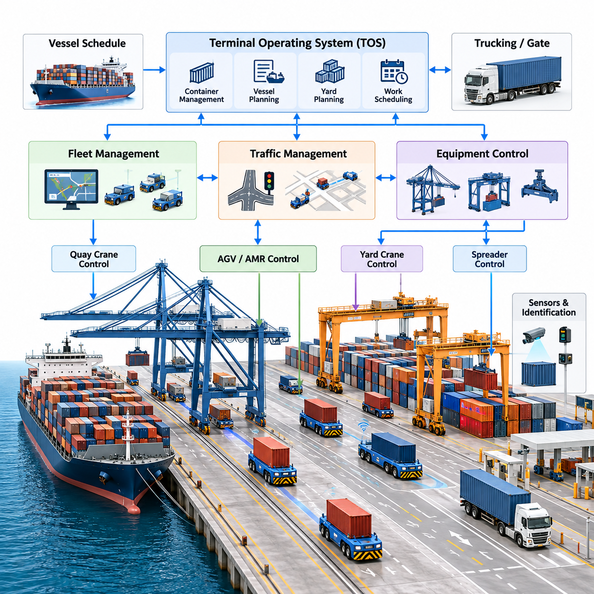
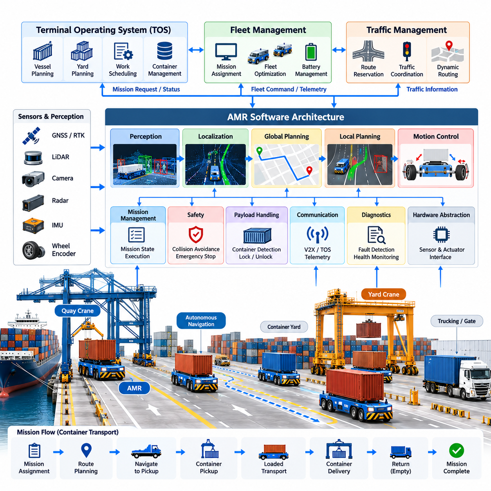
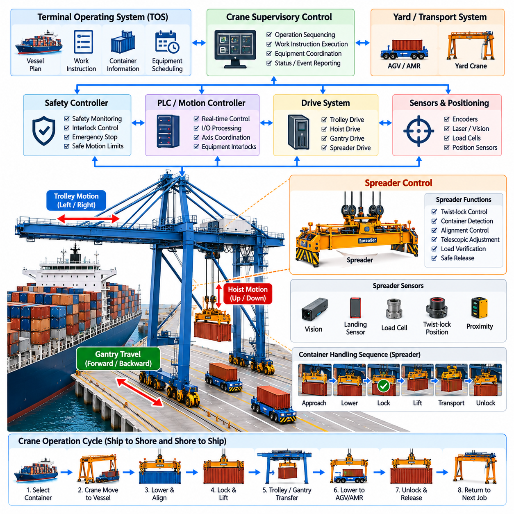
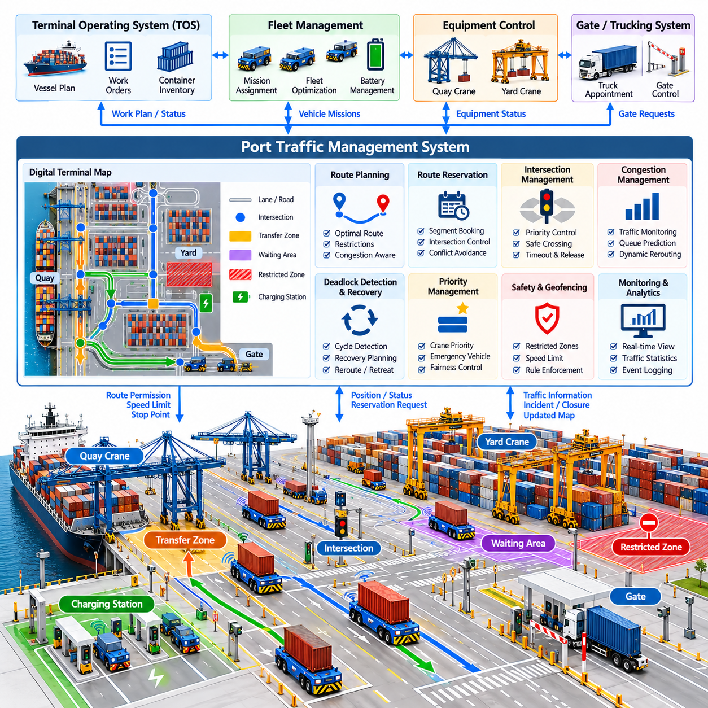
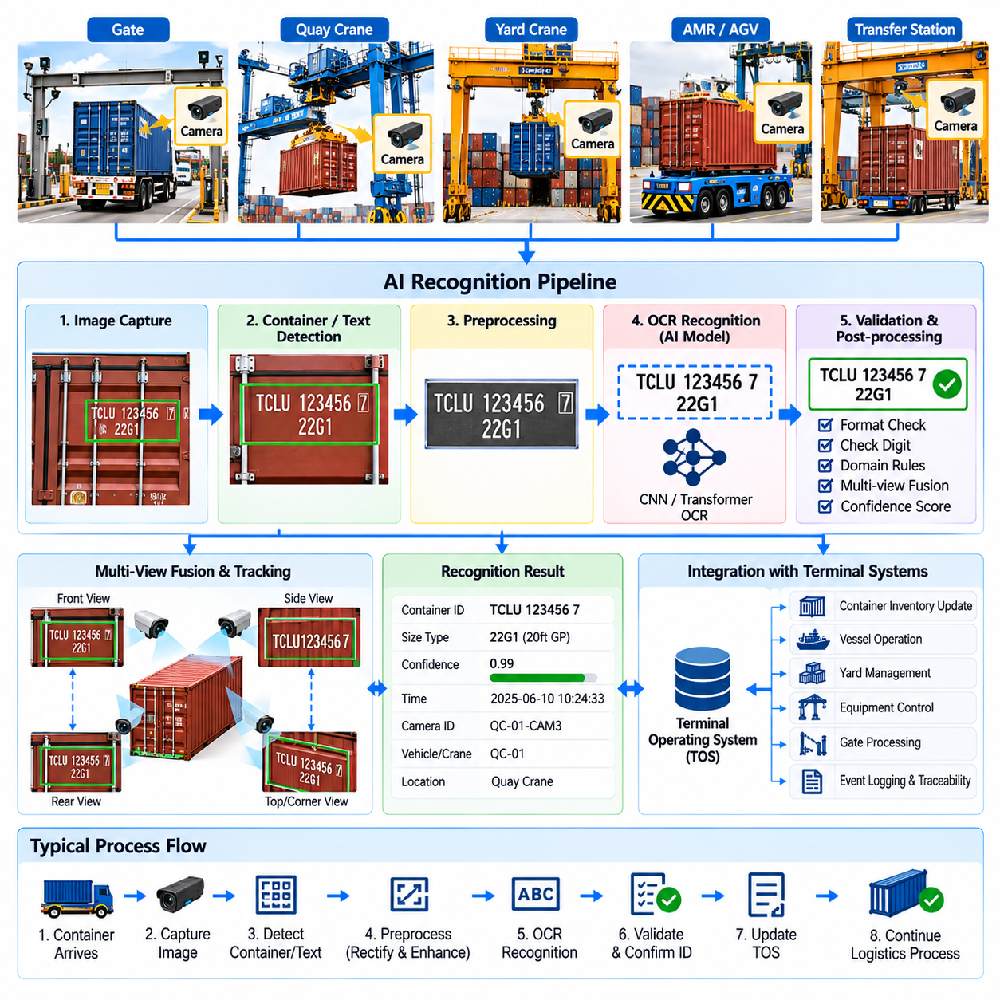
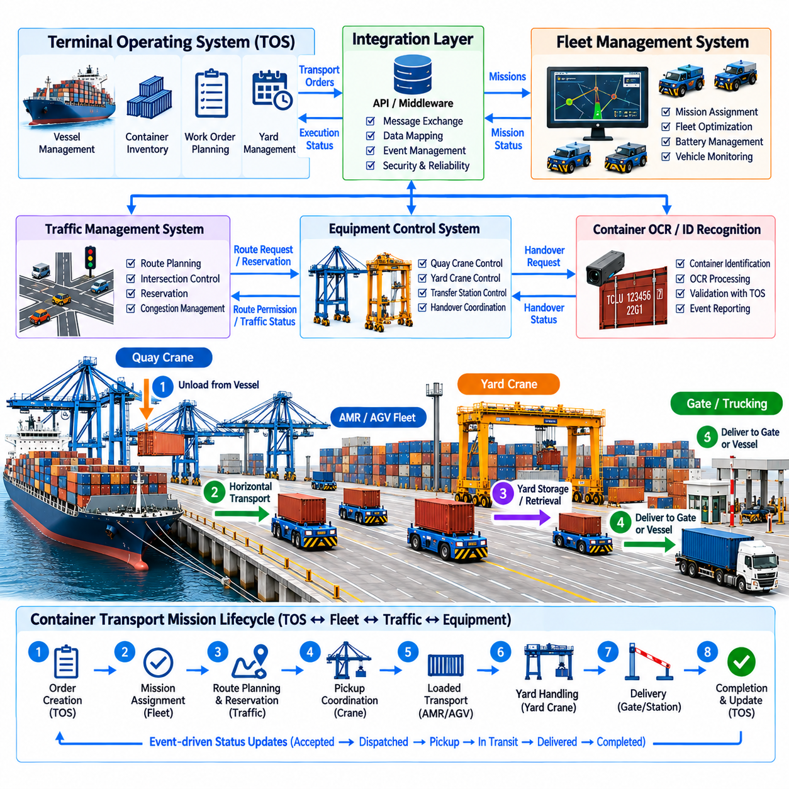
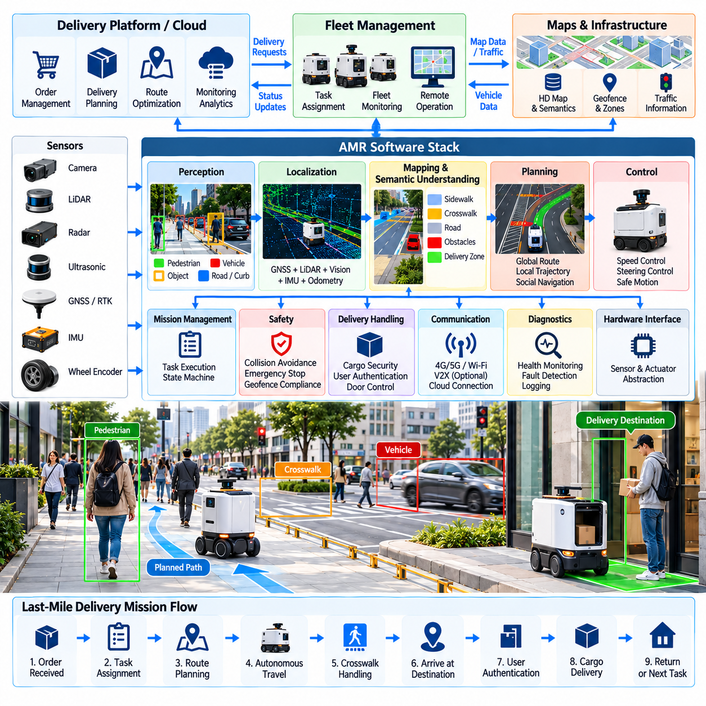
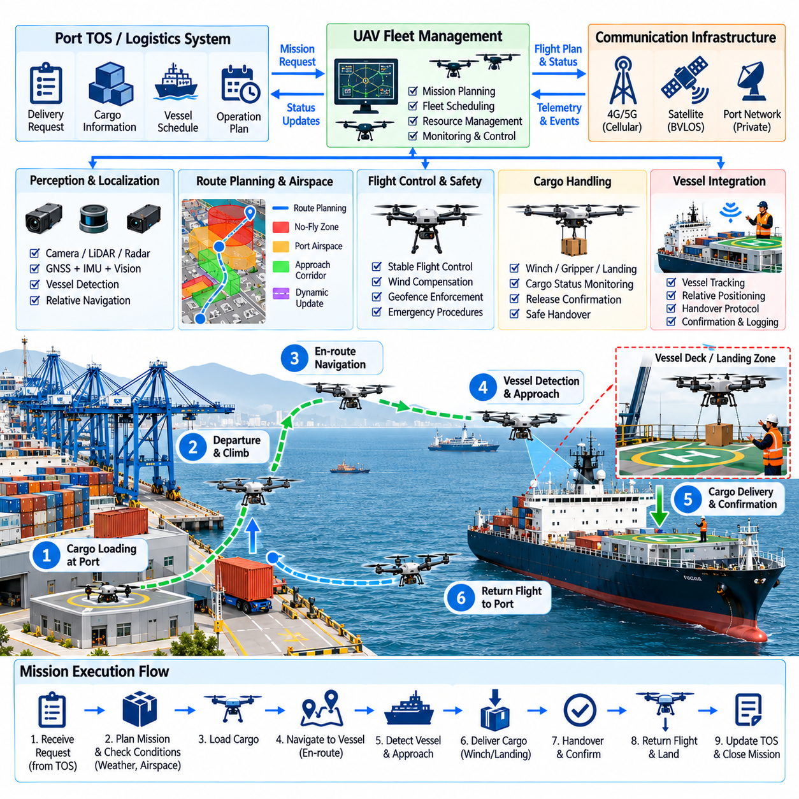
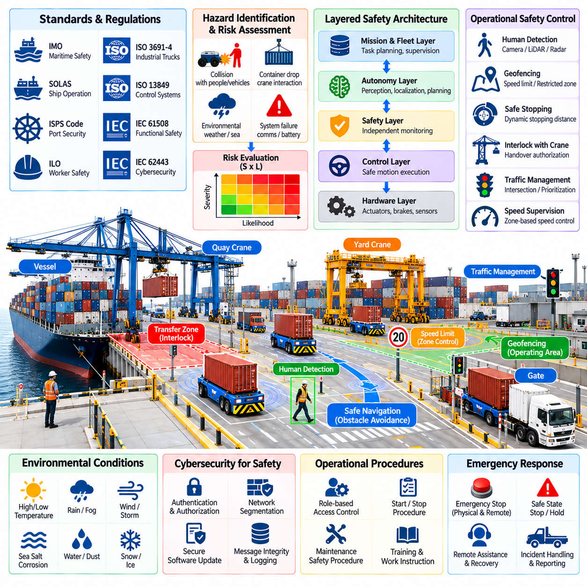
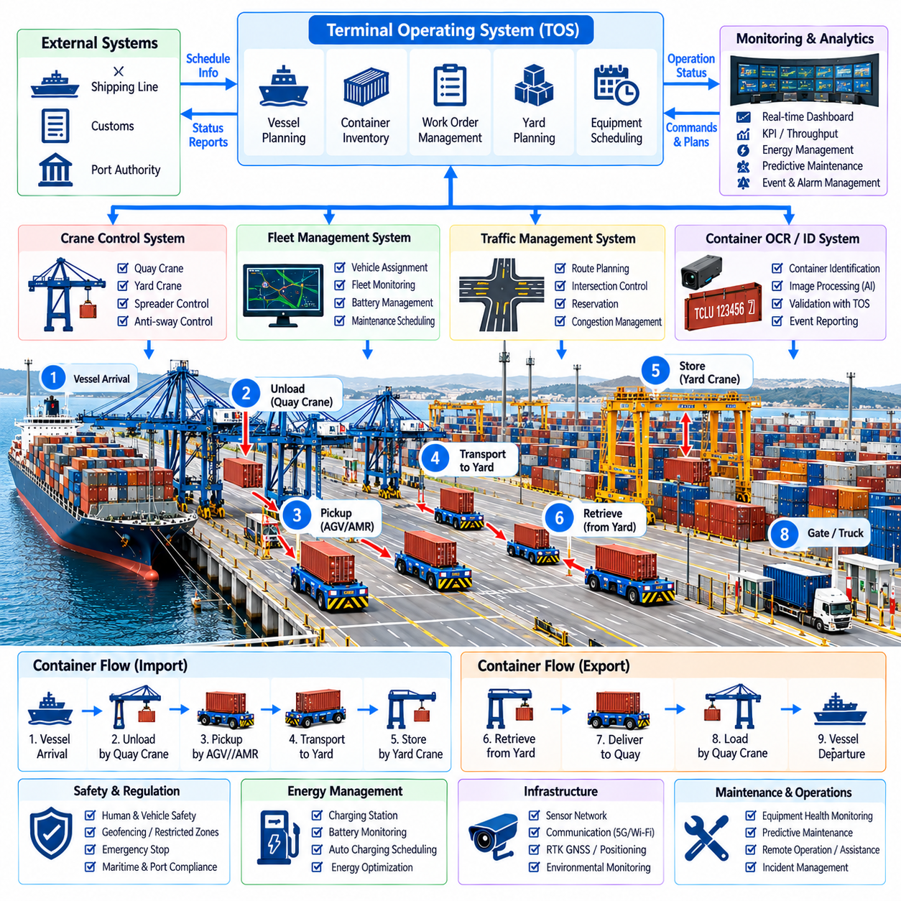

**Volume 26. Industrial Robot Applications**

# Chapter 09. Port and Logistics Applications

## 09.01. Port Automation Overview AGV AMR Crane SW

{width="7.268055555555556in" height="7.268055555555556in"}

Port automation is the coordinated application of automated vehicles, cranes, sensing systems, terminal software, and communication infrastructure to move containers and cargo with minimal manual intervention. Unlike conventional warehouse automation, a port operates across large outdoor areas where heavy equipment, vessels, trucks, workers, and autonomous machines continuously interact. The software architecture must therefore combine logistics optimization, real-time control, positioning, safety, and operational coordination within one integrated environment.

A modern automated container terminal can be viewed as a sequence of interconnected transportation and handling processes. Containers arriving by vessel are unloaded by quay cranes, transferred to automated transport vehicles, delivered to container yard blocks, and positioned by automated stacking cranes. Export containers follow the reverse process. Each physical movement generates software events that must be synchronized with terminal schedules, container identities, equipment status, traffic conditions, and vessel loading plans.

Automated Guided Vehicles (AGVs) have traditionally provided horizontal container transportation between quay cranes and yard storage areas. Conventional port AGVs usually follow predefined routes defined by transponders, magnetic markers, virtual tracks, or accurately surveyed maps. Their control software emphasizes deterministic route execution, traffic coordination, collision prevention, container handover synchronization, and reliable operation under repetitive high-load transportation cycles.

Autonomous Mobile Robots (AMRs) extend this concept by introducing greater environmental perception and navigation flexibility. A port AMR may combine GNSS/RTK, LiDAR, cameras, radar, inertial sensors, wheel odometry, and map information to estimate its position and understand surrounding traffic. Instead of depending entirely on fixed guide paths, the navigation software can calculate feasible trajectories, respond to temporary obstacles, adapt routes, and support changing terminal layouts while respecting operational safety zones.

The distinction between an AGV and an AMR is particularly important in port applications because predictability and flexibility must coexist. Highly structured container lanes favor deterministic AGV operation, while mixed traffic zones, maintenance areas, and dynamically changing logistics spaces benefit from autonomous navigation. Large terminals may consequently deploy hybrid fleets in which fixed-route vehicles, autonomous transporters, manually driven trucks, and specialized robotic platforms share a common traffic-management infrastructure.

Quay cranes form another critical automation domain. A quay crane transfers containers between vessels and landside transport equipment through coordinated trolley, hoist, gantry, and spreader movements. Crane software manages motion commands, position feedback, anti-sway control, container alignment, interlocks, and equipment safety. Automated operation also requires synchronization with vessel plans and transport vehicles so that an arriving AGV or AMR is correctly positioned when the crane completes a container transfer.

The spreader represents the physical interface between a crane and a container. Its control system manages functions such as twist-lock engagement, container presence detection, alignment verification, and safe release. Sensors provide feedback to determine whether the container has been securely captured before lifting begins. These functions are integrated with crane programmable logic controllers, motion controllers, safety controllers, and supervisory software to prevent unsafe movement sequences and incorrect container handling.

Yard automation continues the process after horizontal transport. Automated stacking cranes move containers between transfer points, storage positions, and truck interchange areas. Their software must coordinate gantry travel, trolley motion, hoisting, container identification, stack occupancy, and collision avoidance. Because container placement affects future retrieval operations, crane execution is closely connected to higher-level yard planning algorithms that determine where individual containers should be stored.

At the supervisory level, the Terminal Operating System (TOS) maintains the operational representation of terminal activities. It manages container information, vessel schedules, yard inventory, work queues, equipment assignments, and loading or discharge plans. Robot and crane systems should not operate as isolated automation islands. Instead, fleet-management and equipment-control layers translate TOS work instructions into executable missions and return execution status, exceptions, and completion events to the terminal software.

A typical software hierarchy therefore separates business-level logistics decisions from equipment-level real-time control. The TOS determines what cargo movement is required, while fleet-management software determines which vehicle should perform the transport. Traffic-management software coordinates shared roads and intersections, and vehicle autonomy software performs localization, planning, obstacle handling, and motion execution. Embedded controllers finally translate motion commands into steering, propulsion, braking, hydraulic, or actuator actions.

Fleet orchestration becomes increasingly important as the number of autonomous transporters grows. A dispatcher must assign missions while considering vehicle location, battery state, payload capability, congestion, crane schedules, maintenance conditions, and task priority. Simple nearest-vehicle assignment may work for small systems, but large terminals require optimization methods that consider future traffic and equipment utilization. Poor dispatch decisions can create queues around cranes even when individual robots operate correctly.

Traffic management provides the coordination layer between independent vehicle missions. Port roads contain intersections, merging lanes, transfer points, restricted areas, and zones shared with human-operated equipment. The traffic system may use route reservations, intersection permissions, priority rules, speed restrictions, and deadlock-resolution mechanisms. Its objective is not simply to prevent collisions but to maintain predictable logistics flow while avoiding congestion that reduces crane and vessel productivity.

Localization must remain reliable across a large outdoor terminal where environmental conditions can change rapidly. GNSS/RTK can provide accurate global positioning, while LiDAR, cameras, radar, IMUs, and odometry provide complementary local information. Sensor fusion allows autonomous vehicles to continue operating when satellite signals degrade near cranes, container stacks, buildings, or other large metallic structures. The localization subsystem must also provide confidence information so that degraded positioning can trigger controlled speed reduction or safe stopping.

Perception software identifies vehicles, workers, containers, obstacles, lane boundaries, infrastructure, and operational zones. Port environments present difficult sensing conditions including rain, fog, dust, darkness, glare, reflective surfaces, and repeated geometric structures created by container stacks. Robust systems therefore use complementary sensors rather than relying on a single perception modality. Detection results are transformed into a local environmental representation that supports collision avoidance and trajectory planning.

Safety architecture is separated from ordinary mission optimization because productivity software must never override critical protective functions. Emergency stops, protective fields, obstacle detection, speed supervision, braking monitors, geofenced restrictions, and equipment interlocks can form independent safety layers. When communication is interrupted or localization confidence falls below an acceptable threshold, the system should transition to a predefined degraded or safe state rather than continuing a mission using uncertain information.

Communication infrastructure connects vehicles, cranes, control servers, TOS platforms, maintenance systems, and operator stations. Industrial Ethernet, wireless LAN, private cellular networks, and other redundant communication technologies may be combined according to terminal requirements. The architecture must distinguish latency-sensitive control and safety information from ordinary telemetry, logs, video streams, and historical data so that high-bandwidth services do not interfere with operationally critical message delivery.

Container identification links physical cargo movement with the digital logistics system. OCR cameras, equipment sensors, RFID where available, and container-position records can verify container identity during transfer operations. The software must associate each observed container with its mission, source location, destination, vehicle, crane operation, and TOS record. Incorrect identity association can propagate through the logistics chain, making traceability and verification essential components of automated terminal operation.

Operational monitoring provides a real-time view of the entire automated system. Control centers visualize vehicle positions, crane states, active missions, blocked routes, alarms, battery conditions, communication quality, and equipment availability. Historical telemetry supports analysis of cycle time, utilization, congestion, failure frequency, energy consumption, and recovery performance. These data allow operators to distinguish isolated equipment failures from systemic problems caused by scheduling or traffic policies.

Exception handling is equally important because ports cannot assume perfectly predictable operation. A vehicle may become blocked, a container may fail identification, a crane may enter maintenance mode, a communication link may disappear, or an expected handover may not occur. Automation software must detect such conditions, classify their operational impact, attempt safe recovery where permitted, and escalate unresolved cases to human operators without losing mission and container state.

Digital twins and simulation environments can support the design and validation of port automation before deployment. Vehicle routes, crane cycles, yard layouts, traffic rules, and dispatch algorithms can be evaluated under simulated workloads. Software-in-the-loop and hardware-in-the-loop testing can expose congestion, deadlocks, unsafe interactions, and performance bottlenecks before they appear in live operations. Simulation also provides repeatable scenarios for validating software updates and new autonomy functions.

The overall port automation architecture is therefore not a collection of independently automated machines. It is a distributed cyber-physical logistics system in which AGVs, AMRs, quay cranes, stacking cranes, sensors, fleet services, traffic managers, and terminal applications continuously exchange state and decisions. This positioning within the broader industrial robotics structure also connects naturally with fleet intelligence, communication APIs, edge computing, navigation, perception, cybersecurity, and validation technologies.

The long-term direction is toward increasingly coordinated and software-defined terminals in which equipment behavior can be optimized at system level rather than machine level. AI can improve dispatching, congestion prediction, equipment health estimation, container recognition, and operational forecasting, while autonomous vehicles provide flexible physical execution. The central engineering challenge remains maintaining deterministic safety and dependable logistics performance while progressively introducing more adaptive and intelligent automation.

## 09.02. Automated Container Transport AMR SW [w/Code]

{width="7.268055555555556in" height="7.268055555555556in"}

Automated container transport AMRs provide the horizontal movement layer that connects quay cranes, container yards, transfer stations, and landside logistics areas in an automated terminal. Unlike lightweight warehouse AMRs, these vehicles must transport containers weighing many tons while operating continuously across large outdoor spaces. Their software must therefore combine autonomous navigation, heavy-vehicle motion control, mission execution, functional safety, fleet coordination, and terminal-system integration within a highly reliable runtime architecture.

The AMR software architecture is commonly divided into perception, localization, planning, control, mission management, safety, communication, diagnostics, and hardware abstraction layers. This separation prevents high-level logistics decisions from becoming tightly coupled with vehicle hardware. A mission manager may request movement from a quay crane to a yard block, while navigation and control modules independently determine how the vehicle reaches that destination safely and accurately.

Mission execution begins when a fleet-management system assigns a container transport request to a vehicle. The request normally contains source and destination locations, container or job identification, priority, required equipment interfaces, and timing constraints. The AMR converts this external request into an internal state machine covering dispatch, route acquisition, travel, pickup alignment, container verification, loaded transport, delivery alignment, unloading confirmation, and mission completion.

Localization is fundamental because the vehicle must know its position accurately enough to navigate terminal roads and align beneath cranes or transfer equipment. GNSS/RTK can provide global positioning in open areas, while IMUs, wheel encoders, LiDAR, cameras, and radar provide complementary measurements. A localization framework fuses these signals and estimates position, heading, velocity, uncertainty, and sensor health rather than exposing only a single coordinate to the navigation stack.

Ports contain conditions that can temporarily degrade individual positioning technologies. Container stacks and large cranes can obstruct or reflect satellite signals, while rain, fog, darkness, dust, and repetitive structures may affect optical or LiDAR perception. The software should therefore monitor localization confidence continuously and support degraded operation. When uncertainty exceeds defined limits, vehicle speed can be reduced or the AMR can transition to a controlled stop until reliable localization is restored.

The perception subsystem builds a representation of the environment surrounding the AMR. It detects vehicles, workers, obstacles, containers, road boundaries, equipment, and temporary objects that may not exist in the static terminal map. LiDAR provides geometric information, cameras provide visual and semantic information, and radar can strengthen detection under adverse environmental conditions. Sensor fusion combines these observations into tracked objects and free-space information used by planning and safety functions.

Global route planning determines the sequence of terminal roads and operational zones that connect the current position with the mission destination. The planner must consider one-way lanes, restricted areas, vehicle dimensions, turning constraints, container transfer points, temporary closures, and fleet traffic policies. Because many AMRs may share the same infrastructure, route selection should also account for congestion and reservations supplied by the terminal traffic-management system.

Local planning converts the global route into a dynamically feasible trajectory. The planner evaluates nearby obstacles, vehicle speed, steering limits, braking distance, payload state, road geometry, and predicted motion of other traffic. Heavy container transport creates substantially different dynamics from small indoor robots, so aggressive maneuvers must be avoided. Trajectory generation should prioritize stable, predictable motion while maintaining sufficient clearance from infrastructure and neighboring equipment.

The motion-control layer transforms the selected trajectory into steering, propulsion, and braking commands. Longitudinal control regulates acceleration and speed, while lateral control maintains the desired path or steering trajectory. Controllers must account for vehicle mass, actuator delays, tire behavior, slope, surface conditions, and changes caused by loaded and unloaded operation. Command limits prevent the navigation system from requesting motion outside the safe physical envelope of the platform.

Payload state directly influences AMR behavior. A vehicle carrying a container has different mass distribution, stopping distance, acceleration capability, and stability characteristics from an unloaded vehicle. The software can therefore maintain separate motion constraints for loaded and empty operation. Container presence sensors, locking mechanisms, load measurements, or equipment handshakes should confirm that the payload state represented in software corresponds to the actual physical state before transport begins.

Container pickup requires precise coordination between the AMR and crane or transfer equipment. The vehicle first approaches a designated handover zone, reduces speed, and performs accurate final positioning. Position tolerance, vehicle readiness, brake state, payload interface status, and crane permission are checked before transfer. A handshake protocol prevents either machine from initiating an unsafe movement when the other equipment has not reached the required state.

After loading, the AMR verifies that the container has been transferred correctly before leaving the handover area. Depending on the vehicle design, verification may use presence sensors, locking status, load detection, equipment messages, or redundant combinations of these signals. The mission state should not advance merely because a nominal transfer time has elapsed. Explicit confirmation allows software to distinguish successful pickup from incomplete or abnormal container placement.

Fleet coordination prevents individually correct AMRs from creating inefficient or unsafe system-level behavior. The fleet manager allocates missions, while the traffic-management layer coordinates shared lanes, intersections, waiting zones, and transfer points. Route reservations or time-based permissions can prevent conflicting movements. Priority policies may also give precedence to vehicles serving critical quay-crane operations because crane waiting time can directly reduce terminal throughput.

Deadlock prevention is especially important when many large vehicles operate on constrained road networks. Two or more AMRs can become mutually blocked even when collision avoidance functions operate correctly. Traffic software can reduce this risk through directional lanes, reservation graphs, intersection locking, waiting areas, and resource-ordering policies. When prevention fails, deadlock detection identifies cyclic dependencies and selects one or more vehicles for rerouting or controlled retreat.

Safety functions operate independently from ordinary navigation whenever practical. Emergency-stop circuits, protective sensing, speed monitoring, braking supervision, geofenced restrictions, and safety-controller logic protect against hazardous motion even if the autonomy stack experiences a failure. The navigation system may attempt to avoid an obstacle smoothly, but a safety layer must still be capable of commanding an immediate protective response when minimum separation requirements are violated.

Communication software connects the AMR with fleet services, traffic management, terminal applications, crane systems, maintenance servers, and operator interfaces. Messages may include mission commands, route permissions, vehicle pose, battery status, payload state, alarms, and equipment handshakes. Communication loss must be treated as an operational state with defined behavior. Critical vehicle safety should not depend exclusively on continuous connectivity to a remote server.

Integration with the Terminal Operating System (TOS) links autonomous motion to the container logistics process. The TOS determines required cargo movements, while fleet software converts those requirements into robot missions. The AMR reports execution progress and exceptions so that the digital container record remains synchronized with physical movement. This relationship is consistent with the chapter structure, which treats AMR transport, port traffic management, container recognition, and TOS integration as interconnected automation functions.

Energy management must also be coordinated with logistics scheduling. The AMR monitors battery state of charge, temperature, power demand, charging availability, and predicted energy required for assigned missions. Instead of waiting until a battery reaches a critically low level, fleet software can schedule opportunity charging during low-demand periods or dispatch vehicles to charging stations according to expected workload. Energy-aware assignment reduces unexpected mission interruption while preserving fleet availability.

Diagnostics and observability provide the information required to maintain a continuously operating fleet. Vehicle software records localization quality, sensor health, controller errors, network conditions, battery status, actuator faults, mission transitions, safety events, and abnormal stops. Central monitoring services aggregate this telemetry to identify recurring failures and performance degradation. Accurate timestamps and event correlation are essential when reconstructing interactions between AMRs, cranes, and fleet services.

Fault management should define explicit responses for localization loss, sensor failure, blocked routes, actuator faults, communication interruption, container-transfer errors, and safety-system activation. Some failures permit reduced-speed operation or automatic rerouting, while others require immediate stopping and operator intervention. Recovery logic must preserve mission state so that a vehicle or replacement AMR can resume logistics operations without losing the relationship between the physical container and its digital transport task.

Simulation and digital-twin environments are valuable for validating the complete AMR software stack. Developers can reproduce terminal roads, container blocks, crane interfaces, traffic patterns, sensor conditions, and large vehicle fleets before deploying software to physical machines. Software-in-the-loop testing verifies planning and mission logic, while hardware-in-the-loop testing evaluates controllers and interfaces. Stress scenarios can intentionally create congestion, blocked routes, sensor degradation, and communication failures.

A production container AMR should ultimately be treated as one node within a distributed terminal automation system rather than as an isolated autonomous vehicle. Its effectiveness depends on continuous coordination with cranes, fleet dispatch, traffic control, container identification, TOS services, safety infrastructure, and maintenance systems. The broader industrial robotics structure similarly places port applications alongside fleet intelligence, navigation, perception, communication, edge computing, and testing technologies.

The evolution from guided container carriers toward intelligent AMRs increases operational flexibility but also increases software responsibility. Future systems can incorporate predictive traffic models, AI-assisted perception, dynamic mission optimization, equipment-health prediction, and cooperative fleet planning. However, these capabilities must remain bounded by deterministic safety mechanisms and verifiable vehicle behavior. Successful port AMR software therefore combines adaptive autonomy at the planning level with predictable control and fail-safe execution at the physical level.

## 09.03. Quay Crane Automation and Spreader Control [w/Code]

{width="7.268055555555556in" height="7.268055555555556in"}

Quay crane automation transforms ship-to-shore container handling from manually coordinated machinery into an integrated motion, sensing, and logistics system. The crane must move containers rapidly between vessel bays and landside transport while maintaining precise positioning and strict safety constraints. Its software therefore coordinates gantry, trolley, hoist, spreader, sensors, programmable controllers, safety functions, and terminal-level commands as one synchronized control system.

A ship-to-shore quay crane contains several independently actuated mechanisms whose motions must be coordinated. Gantry travel positions the complete crane along the quay, trolley motion moves the lifting system between vessel and landside positions, and the hoist controls vertical movement. The spreader forms the final interface with the container. Automation software supervises these axes while respecting mechanical limits, operating envelopes, collision zones, and equipment interlocks.

The control architecture normally separates supervisory sequencing from deterministic equipment control. A high-level crane controller interprets work instructions and determines the required handling sequence, while programmable logic controllers and motion controllers execute time-critical commands. Drives regulate motors for trolley, hoist, and gantry mechanisms, and safety controllers independently supervise hazardous conditions. This layered structure allows logistics commands to change without weakening real-time motion protection.

Container handling begins with a work instruction identifying the target container, vessel position, source or destination slot, and associated transport operation. The crane automation system converts this information into executable states such as approach, positioning, lowering, spreader alignment, locking, lifting, horizontal transfer, destination alignment, lowering, unlocking, and return. State transitions require explicit confirmation so that unexpected equipment behavior cannot silently propagate into subsequent motions.

Accurate trolley and hoist positioning is essential because container transfer involves narrow geometric tolerances. Encoders, laser ranging devices, cameras, position sensors, and other measurement systems can estimate the location of the trolley, spreader, container, vessel structure, and target transfer position. The control system combines these measurements with crane geometry to calculate motion references and continuously verifies whether actual equipment movement remains within acceptable positional limits.

One of the major control problems is load sway generated when the trolley accelerates or decelerates while a container is suspended from ropes. Excessive sway increases cycle time, reduces positioning accuracy, and can create collision hazards. Anti-sway control modifies trolley acceleration or trajectory according to estimated pendulum motion. Feedforward models, feedback control, trajectory shaping, or sensor-based estimation can be combined to reduce oscillation without unnecessarily slowing container transfer.

Trajectory generation must balance throughput with mechanical and safety constraints. Moving every axis at maximum speed does not necessarily minimize the complete crane cycle because aggressive acceleration can generate sway that requires additional settling time. Automated systems therefore calculate motion profiles that coordinate trolley velocity, hoist height, acceleration, deceleration, and obstacle clearance. Efficient control minimizes total transfer time while keeping the suspended load inside a predictable motion envelope.

The spreader is the most important physical interface between crane automation and the container. It must align with the container corner castings, engage the twist locks, verify secure attachment, maintain the connection during lifting, and release the container only at an authorized destination. Spreader control therefore combines mechanical actuation with sensor verification and interlock logic rather than treating container attachment as a simple open-or-close command.

During pickup, the spreader is lowered toward the container while alignment sensors or vision systems estimate relative position and orientation. Fine positioning compensates for offsets caused by vessel motion, container placement, structural tolerances, or residual spreader sway. Contact or landing sensors indicate that the spreader has reached the container. Only after the required landing conditions are satisfied can the control sequence permit twist-lock engagement.

Twist-lock control is implemented as a safety-critical state sequence. The locking actuators rotate the twist locks inside the container corner castings, while position sensors confirm locked or unlocked states. The software should reject contradictory signals, incomplete locking, or abnormal transition times. Hoisting must remain inhibited until the required lock conditions are confirmed, preventing the crane from lifting a container that has not been securely attached to the spreader.

Load verification provides an additional check after locking. Load cells, rope tension measurements, hydraulic or electrical signals, and container-presence sensors can indicate whether a container is actually suspended from the spreader. The measured load may also reveal overload conditions or significant imbalance. These signals allow the controller to compare the expected handling state with physical reality before allowing high-speed hoist or trolley movement.

The spreader may support different container configurations, requiring telescopic adjustment for common container lengths and operating modes. Automation software manages spreader extension or retraction while confirming that the mechanism has reached the required configuration before pickup. Where twin-lift or other specialized handling modes are supported, additional sensors and interlocks are necessary because the load geometry and locking conditions become more complex.

Collision avoidance extends beyond the suspended container itself. The crane must consider vessel structures, hatch covers, neighboring containers, quay equipment, transport vehicles, and other cranes. Geometric protection zones can be combined with sensor-based obstacle detection to restrict unsafe trajectories. Automated systems may also use ship profiles or bay models to define permissible motion corridors while retaining independent emergency protection for unexpected obstacles.

Coordination with container transport vehicles is essential on the landside transfer interface. An AGV or AMR approaches a designated handover position and reports readiness to the crane system. The crane verifies vehicle identity, position, stop state, and transfer permission before lowering the container. The vehicle must remain immobilized during critical transfer phases, and both systems exchange explicit completion signals before either machine is permitted to leave the handover state.

The quay crane is also connected to the Terminal Operating System and equipment-control infrastructure. Work queues define which containers should be loaded or discharged, while crane-control software translates these logistics requirements into physical handling cycles. Execution events update container status and enable subsequent vehicle dispatch. This relationship places quay crane automation directly beside automated container transport, traffic management, container recognition, and TOS integration in the port application structure.

Safety logic must remain authoritative over productivity-oriented automation. Emergency stops, overtravel limits, overload detection, overspeed protection, brake monitoring, access interlocks, wind restrictions, collision protection, and safe operating zones can independently inhibit motion. A high-level optimization algorithm may request faster operation, but it must never bypass the deterministic safety conditions implemented in certified controllers or hardwired protective circuits.

Environmental conditions strongly influence quay crane operation because cranes work continuously in exposed maritime environments. Wind can increase suspended-load motion, rain and fog can degrade optical sensors, salt contamination can affect equipment, and vessel movement can alter target geometry. Automation software should monitor relevant environmental and equipment conditions and modify operating limits when necessary instead of assuming that nominal control parameters remain appropriate under all circumstances.

Fault management defines how the crane responds when sensors, actuators, communication links, or mechanical subsystems behave abnormally. A failed alignment sensor may permit restricted manual operation, whereas contradictory twist-lock signals or brake faults may require immediate suspension of automated handling. Diagnostic software records fault codes, controller states, sensor values, and sequence transitions so maintenance teams can reconstruct the conditions surrounding an interrupted container cycle.

Operational telemetry also supports performance optimization. Cycle time can be decomposed into pickup, hoisting, trolley travel, lowering, handover, and return phases to identify bottlenecks. Repeated sway correction, alignment retries, vehicle waiting, or delayed spreader locking can reveal specific sources of lost productivity. Historical data therefore connects low-level crane behavior with terminal-level indicators such as moves per hour, equipment utilization, and vessel turnaround time.

Simulation and digital twins allow crane sequences to be validated before deployment. Models can reproduce trolley and hoist dynamics, suspended-load sway, spreader interaction, ship geometry, vehicle handovers, and fault scenarios. Software-in-the-loop testing evaluates sequencing and optimization algorithms, while hardware-in-the-loop testing verifies controllers and interfaces. Repeatable simulation is particularly useful for testing rare hazardous conditions that cannot be created safely during normal terminal operations.

Quay crane automation ultimately operates as part of a coordinated terminal rather than as an isolated machine. Its productivity depends on synchronization with automated container transport, port traffic management, container identification, yard operations, and the Terminal Operating System. The chapter structure explicitly connects these functions as successive components of port and logistics automation, progressing from container AMR transport and crane control toward traffic, recognition, and TOS integration.

Future quay cranes will increasingly combine deterministic industrial control with perception and AI-assisted optimization. Vision can improve container and spreader alignment, predictive models can optimize motion profiles, and equipment-health analytics can identify degradation before failure. These intelligent functions should augment rather than replace verified motion and safety layers, preserving a clear boundary between adaptive optimization and deterministic protection in high-energy container-handling operations.

## 09.04. Port Traffic Management System Integration [w/Code]

{width="7.268055555555556in" height="7.268055555555556in"}

A Port Traffic Management System coordinates the movement of automated and human-operated vehicles across terminal roads, intersections, crane transfer zones, container yards, gates, and service areas. Its purpose extends beyond collision avoidance. The system must maintain predictable logistics flow, prevent congestion and deadlocks, protect restricted zones, and synchronize vehicle movements with container-handling equipment while preserving terminal throughput.

The traffic-management layer is positioned between individual vehicle autonomy and higher-level fleet or terminal logistics systems. A fleet manager decides which AMR or AGV should execute a transport mission, while the traffic system determines how multiple vehicles can safely share infrastructure. Vehicle navigation executes the authorized route locally. This separation allows fleet optimization, traffic coordination, and real-time vehicle control to evolve independently while exchanging consistent operational state.

A digital road network provides the fundamental representation used for traffic coordination. Terminal lanes, intersections, transfer points, waiting areas, charging stations, restricted regions, and maintenance zones can be represented as graph nodes, edges, or geometric regions. Each element contains attributes such as permitted direction, speed limit, vehicle class, capacity, turning restrictions, safety clearance, and temporary availability, allowing software to reason about operational constraints.

When a transport mission is assigned, the vehicle or fleet service requests a route through this network. The traffic system evaluates connectivity, distance, congestion, road restrictions, destination accessibility, and other active vehicle plans before granting movement authority. The shortest geometric route is not always the best operational route. A slightly longer path may reduce queueing around quay cranes or avoid an intersection already approaching saturation.

Route reservation is a common mechanism for coordinating automated vehicles. Instead of allowing every AMR to enter any available road segment independently, the traffic manager reserves critical segments or resources before the vehicle arrives. Reservations may apply to intersections, narrow lanes, transfer zones, or other conflict areas. A vehicle proceeds only when the required resource is available, reducing the possibility that multiple machines enter mutually incompatible paths.

Intersection management requires particularly careful synchronization because multiple routes compete for the same physical space. The system can grant movement permissions according to arrival order, mission priority, crane urgency, congestion conditions, or predicted clearance time. Permissions should include clear ownership and expiration rules so that an inactive vehicle does not indefinitely block an intersection. Local vehicle safety remains active even when centralized traffic permission has been granted.

Deadlock occurs when multiple vehicles wait for resources held or required by one another, creating a cycle in which none can proceed. Preventing deadlock is preferable to recovering after vehicles have physically blocked each other. Traffic software can impose resource-ordering rules, reserve complete critical sections, restrict entry into congested zones, or maintain escape areas. Graph-based dependency analysis can identify potentially cyclic reservation patterns before movement permissions are issued.

When prevention is insufficient, deadlock detection and recovery become necessary. The system monitors vehicle progress, waiting duration, route dependencies, and reserved resources to determine whether traffic has stopped because of normal queueing or a true cyclic conflict. Recovery may release selected reservations, reroute one vehicle, command a controlled retreat, or temporarily change priority. Heavy container vehicles require recovery strategies that respect large turning radii and limited reverse maneuverability.

Congestion management addresses a broader problem than deadlock. A terminal may continue moving while still suffering significant productivity loss because too many vehicles accumulate near quay cranes, yard blocks, or transfer stations. The traffic system can monitor road occupancy, queue lengths, average speed, waiting time, and destination demand. These measurements allow dynamic routing or admission control to distribute traffic before local congestion propagates across the terminal.

Traffic priority should reflect logistics importance rather than treating every vehicle identically. An AMR approaching a quay crane for a time-sensitive container handover may receive higher priority than an empty vehicle traveling toward a parking area. Emergency vehicles or maintenance equipment may require special precedence. Priority policies must nevertheless include fairness mechanisms because continuously favoring high-priority traffic can indefinitely delay ordinary missions and reduce overall fleet efficiency.

Integration with AMR and AGV autonomy requires a clear contract between centralized coordination and onboard control. The traffic system provides permitted routes, reserved resources, speed restrictions, and stop points, while the vehicle remains responsible for local trajectory generation and immediate obstacle response. If a pedestrian or unexpected vehicle enters the route, onboard perception and safety functions must respond immediately rather than waiting for a centralized traffic command.

Mixed traffic creates additional complexity because manually operated trucks and service vehicles may not participate fully in digital reservation protocols. Cameras, LiDAR, radar, roadside sensors, or connected infrastructure can provide observations of these participants to the traffic system. Their motion may be represented probabilistically rather than deterministically. Automated vehicles can then receive conservative permissions or reduced speed limits in regions where human-driven traffic introduces greater uncertainty.

Crane transfer zones require close integration between traffic and equipment-control systems. A vehicle should enter a quay-crane or yard-crane handover position only when the corresponding resource is available and the crane is prepared for the transfer sequence. The traffic manager can hold vehicles in staging areas until permission is granted. This prevents unnecessary queues beneath cranes and reduces interference between vehicle circulation and container-handling operations.

The Terminal Operating System provides the logistics context that gives traffic decisions operational meaning. TOS work plans generate container movements, fleet-management software converts those movements into vehicle missions, and the traffic system coordinates the resulting physical routes. Execution status then flows back through the architecture. This relationship follows the port application structure in which traffic management is positioned between automated container transport, quay-crane automation, container recognition, and TOS integration.

Real-time communication is required to maintain a consistent traffic state. Vehicles periodically report position, velocity, mission status, payload condition, route progress, and faults, while the traffic service distributes permissions, restrictions, rerouting commands, and infrastructure status. Messages should include timestamps and identifiers so stale information can be detected. Communication delays must be considered explicitly because traffic decisions based on outdated vehicle positions can create unsafe or inefficient behavior.

The system should define predictable behavior for communication loss. A vehicle that loses connectivity must not continue indefinitely using reservations that the central service assumes have expired. Depending on the operational design, the vehicle may complete an already authorized segment, stop at a safe location, or transition immediately to a controlled stop. The traffic server must also mark the disconnected vehicle and its occupied resources so other machines are not routed through uncertain space.

Dynamic restrictions allow terminal operations to respond to changing conditions. A lane may be closed because of maintenance, an accident, construction, weather, damaged pavement, or temporary equipment placement. Operators or infrastructure systems can update the digital road network without changing every vehicle individually. New route requests then avoid the restricted region, while vehicles already approaching it can receive rerouting or controlled stopping instructions according to their current position.

Safety zoning adds another layer to traffic control. Different regions may impose maximum speeds, directional restrictions, minimum separation distances, or permissions for specific vehicle types. Pedestrian areas and maintenance zones can require particularly conservative behavior. Geofenced policies distributed from the traffic system can supplement onboard safety functions, although centralized software should not replace independent emergency stopping and protective sensing implemented on the vehicle.

Observability is essential because traffic failures often emerge from interactions among many individually healthy components. Monitoring systems visualize vehicle positions, reservations, queues, blocked resources, road occupancy, communication quality, and route changes. Historical event logs allow engineers to reconstruct why congestion or deadlock occurred. Metrics such as average travel time, intersection delay, queue length, reroute frequency, and vehicle idle time provide quantitative evidence for optimization.

Traffic data can also support predictive control. Historical and real-time information may reveal that particular intersections or crane approaches become congested under specific vessel workloads. Predictive models can estimate future road occupancy and modify routes before congestion actually forms. This changes traffic management from reactive conflict resolution toward proactive flow optimization, although predicted decisions must remain bounded by verified routing and safety constraints.

Simulation and digital twins provide an effective environment for evaluating traffic policies before deployment. Hundreds of virtual vehicles can execute realistic missions across a terminal road network while developers vary fleet size, container demand, crane productivity, intersection policies, and failure conditions. Stress tests can intentionally create road closures, communication loss, traffic surges, and deadlocks to verify that coordination algorithms recover without producing unsafe commands.

High availability is important because centralized traffic management can become operationally critical for a large automated fleet. Redundant services, replicated traffic state, health monitoring, and controlled failover can prevent a single server failure from stopping the entire terminal. State recovery must preserve active reservations and vehicle ownership correctly; otherwise, a restarted service could issue conflicting permissions for physical resources that remain occupied by vehicles.

A fully integrated Port Traffic Management System therefore acts as the coordination fabric connecting autonomous vehicles, cranes, fleet management, infrastructure, and terminal logistics. It converts independent robot movements into controlled system-level flow while preserving local vehicle autonomy for immediate environmental response. As terminals scale toward larger fleets, predictive routing and distributed intelligence can improve throughput, but deterministic resource ownership, safe failure behavior, and traceable traffic decisions remain fundamental requirements.

## 09.05. Container OCR and ID Recognition AI [w/Code]

{width="7.268055555555556in" height="7.268055555555556in"}

Container OCR and ID recognition provide the digital identification layer that connects physical container movements with terminal information systems. Cameras installed at gates, quay cranes, yard equipment, transfer stations, or autonomous vehicles capture container markings, while AI-based vision software extracts identification information. Reliable recognition allows every physical handling event to be associated with the correct container record without depending entirely on manual inspection.

A standard freight container carries an identification code that can be visually observed on its exterior surfaces. The recognition system must first locate the relevant marking region before individual characters can be interpreted. Because images may contain logos, warning labels, structural ribs, locking hardware, dirt, and other text, container OCR is not simply a full-image text-reading problem. Detection and recognition are normally separated into coordinated processing stages.

Image acquisition strongly influences recognition accuracy. Camera placement must provide sufficient resolution while minimizing severe perspective distortion and occlusion. Exposure, shutter speed, focus, frame rate, and illumination must be selected for moving vehicles and outdoor operation. Multiple cameras can observe different container surfaces so that a code hidden or degraded in one view may still be visible elsewhere, increasing recognition redundancy without stopping the logistics process.

The first AI stage generally detects the container or identification-code region within the image. Object-detection or text-detection models can produce bounding boxes or polygons around candidate markings. Region detection reduces irrelevant visual information before OCR processing and allows the system to handle containers appearing at different positions and scales. Tracking across video frames can additionally preserve the identity of a candidate region while the container moves through the camera field of view.

Before character recognition, the detected region can undergo geometric and photometric preprocessing. Perspective correction transforms an oblique text region toward a normalized frontal representation, while resizing and contrast normalization improve consistency for the recognition model. Noise reduction, deblurring, illumination compensation, or shadow correction may be applied when necessary. Preprocessing should preserve character shapes because aggressive enhancement can unintentionally remove strokes or create false edges.

Character recognition converts the normalized image region into a sequence of letters and numbers. Traditional OCR pipelines may segment characters individually, while modern deep-learning approaches can recognize an entire text sequence directly. Convolutional, recurrent, attention-based, or Transformer-based recognition architectures can learn visual relationships between character patterns and output sequences. Sequence-level recognition is particularly useful when character spacing or segmentation boundaries are difficult to determine reliably.

Container recognition can exploit domain-specific structure rather than treating every possible text sequence as equally valid. Expected identifier formats, permitted character classes, known prefixes, and check rules can constrain recognition results. A model may produce several candidate sequences with confidence scores, after which validation logic selects candidates consistent with container identification rules. Combining visual inference with structural validation substantially reduces errors caused by visually similar characters.

Character ambiguity is a recurring problem because letters and numbers such as O and 0, I and 1, B and 8, or S and 5 can appear similar under poor imaging conditions. Recognition software should retain character-level confidence rather than immediately committing to a single interpretation. Alternative hypotheses can be evaluated using identifier syntax, check digits, multiple camera observations, or existing terminal records to determine the most plausible container identity.

Temporal fusion improves reliability when recognition is performed on video. A moving container may be visible across dozens of frames, each providing a slightly different view. Instead of accepting the result from a single frame, the system can aggregate predictions over time and select a consensus sequence. Frames affected by blur, glare, occlusion, or extreme perspective can receive lower weights, while clear observations contribute more strongly to the final identification decision.

Multi-camera fusion extends the same principle across viewpoints. A container transported by an AMR may be observed from the front, rear, and side by fixed cameras or vehicle-mounted sensors. Recognition results from these cameras can be associated using timestamps, vehicle identity, spatial location, and mission information. Agreement across independent observations increases confidence, while disagreement triggers additional validation rather than silently updating the terminal database with uncertain information.

Container ID recognition should also be linked with physical container detection. The system must determine which recognized code belongs to which physical container when several containers appear within the same scene. Spatial association between container bounding regions and detected text regions provides an initial relationship. Tracking, depth information, crane state, vehicle position, or yard-slot information can further maintain the association as containers are lifted, transported, stacked, or transferred.

Confidence management is essential for production deployment. The recognition pipeline should output not only an identifier but also evidence describing how reliable that identifier is. Confidence may combine detection quality, OCR probability, structural validation, multi-frame agreement, and multi-camera consistency. High-confidence results can be accepted automatically, medium-confidence results can request another observation, and low-confidence cases can be directed to operator verification.

Recognition failures should be treated as explicit operational events rather than hidden software errors. Dirt, corrosion, damaged markings, stacked-container occlusion, strong sunlight, nighttime conditions, rain, motion blur, and physical obstruction can prevent reliable OCR. The system should distinguish between no visible code, unreadable characters, conflicting observations, invalid format, and camera failure because each condition requires a different recovery action.

Integration with autonomous container transport enables recognition to become part of mission verification. When an AMR receives a pickup task, the expected container identity is already known from the logistics system. A camera observation can compare the physical container with this expected identity before transport begins. A mismatch can inhibit mission progression and request verification, preventing a correctly functioning robot from efficiently transporting the wrong container to the wrong destination.

Quay-crane and yard-crane integration provides additional identification checkpoints. Cameras mounted on cranes or near transfer zones can recognize a container immediately before or after lifting. The observed identifier can be associated with spreader lock state, crane position, vehicle identity, and work instruction. This creates a traceable event linking the digital container record to a specific physical transfer rather than relying only on the originally scheduled movement.

Terminal Operating System integration converts recognition output into logistics information. The OCR service can receive expected container records and return recognized identifiers, confidence values, timestamps, camera locations, and associated equipment information. The TOS or equipment-control layer then verifies whether the observed container matches the planned move. This connection places container recognition between physical automation and digital inventory management within the broader port automation architecture.

A recognition service should preserve evidence for later auditing. Relevant images, cropped text regions, OCR candidates, confidence values, model versions, timestamps, equipment identifiers, and final validation decisions can be stored according to operational policy. When a container is later found in an unexpected location, these records help determine whether the cause was recognition error, incorrect mission assignment, physical handling error, or an inconsistent terminal database.

Dataset design has a major influence on AI recognition performance. Training and validation data should represent different container colors, fonts, viewing angles, code locations, lighting conditions, weather, camera types, motion speeds, contamination levels, and degrees of physical damage. Rare but operationally important cases should not disappear inside a dataset dominated by clean daytime images. Synthetic augmentation can supplement real observations by introducing controlled perspective, blur, noise, shadow, and occlusion.

Model evaluation should measure complete identification performance rather than character accuracy alone. A single incorrect character can associate a physical container with the wrong digital record, so exact sequence accuracy is operationally important. Detection recall, character accuracy, full-ID accuracy, false acceptance rate, rejection rate, confidence calibration, and processing latency can be evaluated separately. Performance should also be analyzed under environmental subsets to reveal weak operating conditions.

Edge computing can reduce recognition latency by processing camera streams close to cranes, gates, or autonomous vehicles. Local inference allows identification decisions to remain available even when connectivity to central servers is temporarily degraded. Central services can still aggregate results, maintain model versions, analyze fleet-wide performance, and retrain models. This distributed architecture balances immediate operational response with terminal-wide data management and continuous improvement.

Container OCR and ID recognition ultimately function as a perception-to-logistics bridge. The system converts visual evidence from the physical terminal into verified identifiers that can be consumed by AMR missions, crane automation, traffic coordination, and terminal applications. As AI models improve, recognition can become increasingly automatic, but reliable deployment still depends on redundancy, confidence-aware decisions, structural validation, traceable evidence, and safe handling of uncertain results.

## 09.06. Port TOS Integration with Robot Fleet [w/Code]

{width="7.268055555555556in" height="7.268055555555556in"}

A Terminal Operating System, or TOS, provides the logistics coordination layer that manages container inventory, vessel operations, yard locations, work queues, and terminal resources. Robot fleets provide the physical execution layer that moves containers between quay cranes, yard blocks, transfer stations, gates, and other operational areas. Integration between these layers converts logistics plans into executable robot missions and returns physical execution results to the terminal's digital operating state.

The TOS should normally remain independent from the detailed motion behavior of individual robots. It specifies what container must be moved, where the movement begins, where it should end, and when the operation is required. A fleet-management layer translates this business-level instruction into robot-specific tasks. This separation prevents the TOS from having to understand steering, localization, battery management, obstacle avoidance, or other vehicle-level implementation details.

A container movement request requires a consistent data model shared across the integration boundary. Typical information includes container identity, source location, destination location, job identifier, priority, required equipment, operational constraints, and timing information. Additional attributes may describe container size, weight, hazardous or special handling status, or expected crane interface. Stable identifiers allow every system to refer to the same physical cargo throughout the complete transport workflow.

The fleet-management system receives transport orders and determines how they should be executed by the available robot fleet. Assignment logic can evaluate robot position, payload capability, battery state, maintenance condition, current mission, route availability, and expected completion time. The resulting mission contains enough information for the selected AMR or AGV to perform the transport without exposing unnecessary vehicle details back to the TOS.

Mission state should be represented explicitly because physical logistics operations cannot be treated as instantaneous database transactions. A transport request may progress through accepted, assigned, dispatched, approaching pickup, waiting, loading, transporting, unloading, completed, failed, or cancelled states. State transitions are reported to the integration layer so the TOS can distinguish a planned movement from a container that has actually been picked up or delivered.

Container identity provides the primary link between digital work orders and physical cargo. Before pickup, the robot, crane, OCR service, or transfer station can verify that the observed container matches the identifier specified by the TOS. A mismatch should generate an exception rather than allowing the mission to continue silently. This verification connects TOS integration directly with container OCR and ID recognition functions in the broader port automation workflow.

Pickup execution usually requires coordination among the robot fleet, traffic system, and crane-control system. The assigned vehicle travels to a staging or handover area and reports its arrival. The equipment-control layer verifies that the crane and vehicle are both ready before authorizing transfer. After container presence or locking status is confirmed, the mission advances to loaded transport. The TOS receives meaningful logistics events rather than low-level actuator or sensor messages.

Traffic-management integration allows fleet missions to be executed without creating conflicting vehicle movements. A fleet manager may select the most suitable robot for a job, but the traffic system determines whether the required route and transfer resources are currently available. Congestion, road closures, reservations, or crane queues may change the practical execution time. Fleet scheduling should therefore exchange route and resource information with traffic coordination rather than assuming unrestricted movement.

Delivery follows a similar coordinated sequence. The robot approaches the destination, obtains permission to enter the transfer zone, performs final positioning, and exchanges readiness signals with the receiving crane or station. Container release is confirmed before the robot is marked empty. Only after the physical handover is validated should the transport mission be reported as completed, preventing the digital inventory state from advancing ahead of the actual container movement.

Event-driven integration is well suited to terminal automation because many systems must react to changes without tightly coupling their internal implementations. Events can represent mission creation, assignment, pickup, container verification, route blockage, arrival, handover, completion, or failure. Each event should contain a timestamp, source, relevant identifiers, and state information. Consumers can then update their own operational views while preserving clear ownership of the authoritative data.

Application programming interfaces and message-oriented middleware can provide the communication boundary between the TOS, fleet manager, traffic system, equipment-control services, and monitoring platforms. Synchronous requests are useful when an immediate response is required, while asynchronous messaging is appropriate for mission and status events. The integration architecture should define schemas, versioning, acknowledgement behavior, retry policies, and error handling so interfaces remain stable as individual subsystems evolve.

Idempotency is important because communication failures can cause messages to be retransmitted. If a mission-completion event is delivered twice, the TOS must not interpret it as two separate container movements. Unique transaction and mission identifiers allow receiving systems to recognize duplicate requests or events. Integration logic should also preserve ordering where necessary so that a delayed pickup message cannot incorrectly overwrite a later confirmed delivery state.

Temporary communication failure should not automatically destroy an active physical mission. The robot and fleet system may be able to complete a previously authorized movement while buffering status events locally. When connectivity returns, stored events can be synchronized with the TOS in the correct sequence. However, new missions or critical state changes may require connectivity, depending on the operational policy. The boundary between autonomous continuation and mandatory stop should therefore be explicitly defined.

Exception management is one of the most important responsibilities of TOS-to-fleet integration. A mission can fail because of an unavailable robot, blocked route, incorrect container, crane fault, communication loss, low battery, safety stop, or inaccessible destination. The fleet layer should classify the exception and report both the affected mission and current physical container state. The TOS can then reschedule the job, select another resource, or request operator intervention without losing cargo traceability.

Mission cancellation requires particular care because a digital cancellation may arrive after physical execution has already started. Cancelling an unassigned task is simple, but cancelling a robot carrying a container requires a safe alternative destination or recovery procedure. The integration layer must therefore evaluate the current mission phase before accepting cancellation. Business commands from the TOS should never force a robot to abandon a physical operation in an undefined or unsafe state.

Fleet availability information can improve TOS planning. The integration layer may expose the number of available vehicles, charging robots, vehicles under maintenance, expected mission completion times, congestion indicators, and equipment constraints. The TOS can use this information when sequencing container work instead of assuming unlimited transport capacity. This creates a feedback loop in which logistics planning becomes aware of the actual state of the robotic execution resources.

Energy management introduces another connection between logistics and fleet operations. Charging schedules influence how many robots are available, while vessel and crane workloads determine future transportation demand. Fleet software can forecast energy requirements from planned TOS jobs and schedule charging before capacity becomes constrained. Conversely, the TOS may adjust lower-priority work when fleet energy availability is temporarily limited, improving terminal-level resource utilization.

Time synchronization is important when events from multiple systems are combined. TOS records, robot telemetry, traffic reservations, crane handshakes, OCR observations, and safety events may all describe the same container movement from different perspectives. Consistent timestamps make it possible to reconstruct the sequence accurately. They also support performance analysis by separating vehicle travel time, crane waiting time, transfer duration, congestion delay, and system-response latency.

Monitoring should provide both logistics-level and robot-level visibility without confusing their responsibilities. Operators may need to see container jobs, assigned vehicles, mission progress, delayed transfers, blocked routes, equipment faults, and communication status in one operational view. Drill-down functions can expose detailed robot telemetry when necessary. This layered observability helps determine whether a delayed container resulted from TOS scheduling, fleet assignment, traffic congestion, crane availability, or vehicle failure.

Cybersecurity becomes critical because TOS integration connects enterprise logistics software with machines capable of physical movement. Systems should authenticate communicating services, authorize mission-related actions, protect message integrity, and maintain audit records of significant commands and state changes. Network segmentation can separate enterprise, operational, and safety-related domains. A compromised business application must not obtain unrestricted direct control over vehicle actuators or safety functions.

Simulation and integration testing should reproduce the complete workflow from TOS order creation to physical mission completion. Virtual robots, cranes, traffic services, OCR components, and equipment interfaces can be connected to a test TOS or integration environment. Test cases should include normal transport, duplicate messages, delayed events, communication loss, container mismatch, blocked routes, mission cancellation, and subsystem restart to verify both functional behavior and state consistency.

Scalable integration becomes increasingly important as the number of robots and automated equipment grows. The TOS should communicate primarily with fleet and equipment services rather than maintaining direct sessions with hundreds of individual machines. Hierarchical coordination reduces interface complexity and allows robots to be replaced or upgraded without redesigning terminal business logic. Standardized mission and event models further support heterogeneous fleets from different equipment generations or vendors.

Port TOS integration with robot fleets ultimately creates a closed digital-to-physical logistics loop. The TOS expresses operational intent, fleet software converts that intent into executable missions, traffic and equipment systems coordinate physical resources, robots perform the movement, and verified execution events update the terminal state. Reliable automation depends on maintaining this loop with consistent identities, explicit state transitions, robust exception handling, traceable events, secure interfaces, and clear responsibility boundaries.

## 09.07. Last Mile Delivery AMR Urban Environment [w/Code]

{width="7.268055555555556in" height="7.268055555555556in"}

Last-mile delivery AMRs extend autonomous logistics from controlled warehouses and terminals into public or semi-public urban environments. These robots transport parcels, food, medical supplies, retail goods, or other compact cargo between local distribution points and final destinations. Unlike industrial AMRs operating inside structured facilities, urban delivery robots must navigate sidewalks, crossings, building entrances, pedestrians, bicycles, temporary obstacles, and continuously changing environmental conditions.

The operating environment creates a difficult perception problem because urban spaces are only partially structured. Sidewalk boundaries may be unclear, construction may alter familiar routes, parked vehicles can block visibility, and pedestrians can move unpredictably. The robot therefore requires continuous environmental perception rather than relying only on a predefined map. Cameras, LiDAR, radar, ultrasonic sensors, and inertial measurements can provide complementary information for safe navigation.

Localization combines global and local positioning information to estimate the robot pose throughout the delivery mission. GNSS can provide outdoor geographic position, while visual, LiDAR, inertial, and wheel-odometry methods support local accuracy and continuity. Dense buildings may produce GNSS multipath or signal blockage, making sensor fusion particularly important. The localization system should estimate uncertainty so navigation behavior can become more conservative when position confidence decreases.

Urban maps contain more semantic information than simple geometric occupancy maps. The robot may need to distinguish sidewalks, pedestrian crossings, driveways, building entrances, ramps, stairs, curbs, bicycle lanes, roads, restricted areas, and delivery zones. Semantic mapping connects geometric navigation with operational rules. A route can therefore be rejected not only because an obstacle blocks it, but because the surface or region is unsuitable or prohibited for the delivery robot.

Global route planning selects a feasible path from a dispatch point to the delivery destination. Distance alone is insufficient because different paths may contain steep slopes, narrow sidewalks, difficult crossings, construction areas, heavy pedestrian traffic, or inaccessible curbs. The planner can use map attributes and historical traversal information to estimate route cost. Mission planning may also include intermediate checkpoints where the robot must wait, verify access, or request remote assistance.

Local trajectory planning handles immediate interactions with pedestrians and moving obstacles. The robot continuously predicts short-term free space and selects a collision-free trajectory consistent with its global route. Because people may suddenly stop, change direction, or approach the robot, planning should preserve sufficient stopping distance and avoid aggressive maneuvers. Socially appropriate navigation also prevents the robot from passing unnecessarily close to pedestrians even when a geometric path technically exists.

Pedestrian interaction is fundamentally different from obstacle avoidance in a warehouse. A person is an intentional moving agent whose future trajectory is uncertain and influenced by surrounding activity. Perception software can track pedestrians and estimate velocity or short-term motion, while planning software evaluates possible interactions. Conservative speed, clear yielding behavior, and predictable trajectories help human users understand the robot's intent and reduce uncomfortable encounters.

Road and driveway crossings introduce higher-risk interactions with vehicles. The AMR must recognize the crossing region, assess approaching traffic, determine whether sufficient time is available, and maintain a safe escape or stopping strategy. Depending on the deployment environment, crossing behavior may also rely on infrastructure information or remote supervision. The robot should not interpret temporary visual clearance as guaranteed right of way when fast-moving traffic may enter the scene.

Curbs, ramps, surface discontinuities, and small obstacles influence whether a planned route is physically traversable. Terrain perception can estimate step height, slope, surface roughness, and available width before committing to a maneuver. The motion planner should understand the mechanical capabilities of the platform, including wheel diameter, ground clearance, maximum slope, braking performance, and stability limits. An apparently open path may still be mechanically inaccessible.

Weather and illumination can significantly affect urban autonomy. Rain can alter traction and obscure cameras, direct sunlight can produce glare, darkness reduces passive visual information, and snow or standing water may hide surface boundaries. Sensor fusion reduces dependence on any single sensing modality, while environmental monitoring can modify speed or route policy. Severe conditions may require mission suspension when safe navigation can no longer be guaranteed.

The delivery compartment forms the physical interface between autonomous navigation and the logistics service. Cargo should remain secured while the robot travels and become accessible only to an authorized recipient or operator. Electronic locks, compartment sensors, door-state monitoring, and user authentication can be connected to the mission state. Delivery should not be marked complete merely because the robot reached the destination; successful cargo access or transfer should also be verified.

Mission management coordinates the complete delivery lifecycle from dispatch through return or reassignment. A mission may include cargo loading, destination confirmation, route acquisition, autonomous travel, waiting, customer notification, authentication, compartment opening, delivery confirmation, and return to a depot or charging point. Explicit mission states allow the system to recover correctly after delays, blocked routes, communication interruptions, or unsuccessful delivery attempts.

Fleet management becomes important when many delivery AMRs share a neighborhood or service area. The fleet service assigns missions according to robot location, battery level, cargo capacity, destination, expected travel time, and current availability. It can also prevent excessive concentration of robots in the same pedestrian area. Batch planning may combine compatible deliveries when vehicle capacity and service-time requirements make multi-stop missions more efficient than single-destination operation.

Energy-aware planning is necessary because outdoor travel consumes power differently according to distance, slope, payload, temperature, surface condition, and stop-and-go behavior. The robot estimates whether sufficient energy remains to complete the delivery and reach a charging or recovery location. Fleet software can reserve charging periods between missions or redirect a low-energy robot before service reliability is affected. Battery condition therefore becomes part of logistics planning rather than only a maintenance variable.

Communication links connect the AMR with fleet services, monitoring systems, customer applications, and remote operators. The robot reports position, mission state, battery status, faults, and significant safety events while receiving route updates or operational instructions. Connectivity may temporarily degrade between buildings or inside structures, so immediate collision avoidance and safe stopping cannot depend on continuous cloud communication. Essential autonomy must remain available onboard.

Remote assistance provides a recovery mechanism for situations that autonomous software cannot confidently resolve. An operator may inspect sensor information when a sidewalk is unexpectedly blocked, determine whether an unusual passage is safe, or provide a high-level navigation instruction. Remote assistance should not become a substitute for basic autonomy. Its purpose is to resolve rare ambiguity while preserving clear limits on what remote commands can override in the robot's local safety system.

Safety architecture must protect pedestrians as well as the robot and cargo. Independent emergency stopping, speed supervision, obstacle protection zones, actuator monitoring, braking diagnostics, and fault detection can complement the autonomy software. Operating speed may vary according to pedestrian density, visibility, path width, localization confidence, and environmental conditions. When required safety assumptions are violated, the robot should enter a controlled safe state rather than continue the delivery.

Urban operation also requires systematic handling of exceptional events. A route may become blocked by construction, the recipient may be unavailable, a compartment may fail to unlock, localization may degrade, or the robot may encounter terrain beyond its physical capability. Exception logic should classify the condition and choose among rerouting, waiting, retrying, requesting assistance, returning to base, or stopping safely. Mission and cargo state must remain traceable throughout recovery.

Cybersecurity and privacy become more visible in public environments because delivery robots use communication services and continuously collect sensor data around people and buildings. Authentication protects fleet commands and cargo-access functions, while authorization limits remote actions. Stored operational data should be managed according to its purpose and retention policy. Security architecture should prevent compromise of customer-facing services from becoming direct unauthorized control of vehicle motion.

Operational monitoring combines robotics and delivery-service information. Fleet operators can observe robot locations, active missions, delayed deliveries, battery condition, communication quality, intervention requests, and fault states. Historical telemetry reveals recurring blocked routes, difficult crossings, localization weaknesses, delivery delays, and energy consumption patterns. These observations can improve maps, planning policies, fleet allocation, maintenance scheduling, and service-area design.

Simulation and structured field testing are essential before large-scale urban deployment. Virtual environments can reproduce pedestrians, vehicles, intersections, curbs, weather, communication loss, and blocked sidewalks, while controlled physical tests validate sensing and motion behavior. Scenario-based evaluation should include common operations and rare safety-critical situations. Repeated testing allows software updates to be compared against known scenarios before they are released to an operating fleet.

Last-mile delivery AMRs ultimately connect autonomous robotics with urban logistics services. Their effectiveness depends not only on reaching a destination but on coordinating perception, localization, navigation, human interaction, cargo security, fleet management, energy, communications, and exception recovery. Successful deployment therefore requires a system that combines adaptable autonomous behavior with conservative safety boundaries and traceable logistics execution across unpredictable real-world environments.

## 09.08. Cargo UAV Port to Ship Delivery SW [w/Code]

{width="7.268055555555556in" height="7.268055555555556in"}

Cargo UAV port-to-ship delivery software coordinates autonomous aerial transport between a landside logistics point and a vessel located at berth, anchorage, or another authorized maritime operating area. The system must manage more than point-to-point flight because the destination may move, port airspace may be constrained, and wind conditions can change rapidly. Mission software therefore integrates logistics, navigation, flight control, vessel tracking, safety, communications, and cargo handling.

A delivery mission begins with a structured transport request containing cargo information, pickup location, target vessel, delivery point, timing constraints, and operational priority. Software validates whether the requested payload is compatible with UAV capacity and whether sufficient energy is available for outbound flight, delivery, contingency actions, and recovery. The mission should not be dispatched when aircraft, payload, weather, route, or destination conditions violate defined operating limits.

The mission-management layer converts the logistics request into an executable flight sequence. Typical phases include preflight validation, cargo loading, takeoff, departure corridor navigation, maritime transit, vessel approach, delivery positioning, cargo transfer, departure, return flight, and landing. Explicit mission states make abnormal situations easier to manage because the software can determine what recovery actions remain possible at each stage of the operation.

Route planning must account for both aviation constraints and port operations. The shortest geometric route may cross restricted zones, crane operating volumes, hazardous cargo areas, populated spaces, or vessel maneuvering regions. A route planner can represent permitted corridors, altitude limits, exclusion zones, emergency landing areas, and temporary restrictions. Dynamic updates allow the mission to respond when a crane operation, ship movement, or local restriction changes the usable flight space.

Localization over a port and coastal environment commonly relies on GNSS combined with inertial sensing, while additional visual or ranging information can improve relative navigation near structures and vessels. Position uncertainty should be monitored continuously because multipath, interference, obstruction, or degraded satellite geometry can reduce navigation quality. When localization confidence falls below an operational threshold, the UAV should transition to a defined degraded-navigation or recovery behavior.

The target vessel introduces a moving-reference problem that does not exist in ordinary fixed-point delivery. Even a berthed or anchored ship can change position and orientation because of tide, wind, waves, mooring motion, or operational activity. The software should therefore maintain an updated estimate of vessel pose and the intended delivery location. Relative navigation becomes increasingly important during final approach because geographic coordinates alone may not provide sufficient precision.

Vessel detection and relative pose estimation can use cameras, LiDAR, radar, cooperative markers, or information supplied by shipboard systems. The perception layer identifies the vessel, deck region, landing or transfer zone, and nearby obstacles. Sensor observations can be fused with known vessel geometry and navigation data to maintain a stable relative reference. Confidence should be evaluated explicitly so that uncertain target identification cannot automatically trigger final descent or cargo release.

Wind is a major planning and control variable during port-to-ship flight. Coastal wind can vary with altitude and may become turbulent near cranes, buildings, containers, and vessel superstructures. The flight system should estimate whether position and velocity can remain within required limits under current conditions. Energy prediction should also include wind because a mission that is feasible in calm air may require substantially greater reserve when returning against a strong headwind.

Flight-control software converts planned trajectories into stable aircraft motion while compensating for disturbances. Position, velocity, attitude, and thrust control operate at different time scales and should remain independent from high-level logistics commands. Mission software may request a waypoint or relative approach trajectory, but low-level controllers maintain vehicle stability. This separation prevents delays in logistics or network services from directly affecting fundamental flight stabilization.

The final approach should use progressively tighter safety and accuracy requirements. The UAV may first navigate toward a vessel-centered approach point, then switch to relative sensing for the final segment. Speed and allowable position error can be reduced as the aircraft approaches the transfer area. If the target zone becomes obstructed, vessel motion exceeds limits, or relative localization becomes unreliable, the UAV should hold, retreat, or abort rather than continue an uncertain approach.

Cargo transfer can be implemented through landing, controlled lowering, winch delivery, or another platform-specific mechanism. Software must understand which transfer method is being used because each method creates different motion and safety constraints. Cargo presence, attachment state, release state, and compartment or winch status should be monitored. A release command should occur only after the system confirms the correct destination and satisfies the required transfer conditions.

A shipboard handover protocol can coordinate the UAV with vessel personnel or automated receiving equipment. The vessel may report that the designated area is ready, while the UAV reports its approach and cargo state. Transfer authorization should be distinct from simple arrival. Positive confirmation before release and confirmation after transfer prevent the digital logistics system from marking a delivery complete when the cargo was not successfully received.

Communication architecture must support both routine mission data and safety-related operational awareness. The UAV can exchange position, mission state, battery condition, payload state, navigation quality, and fault information with the ground control or fleet system. Communication may degrade over water or around port structures, so basic flight stabilization, collision avoidance, contingency handling, and safe recovery cannot depend entirely on continuous remote connectivity.

Loss of communication requires predetermined behavior. Depending on mission phase, remaining energy, location, and operational policy, the UAV may hold position, return to a safe point, continue a previously authorized segment, or execute an emergency procedure. A single generic return-to-home action may be inappropriate near a vessel or busy port. Contingency logic should therefore consider the current flight context and the safety of both maritime and landside environments.

Obstacle avoidance must consider static and moving hazards. Cranes, masts, cables, antennas, container stacks, buildings, and ship structures form complex three-dimensional obstacles, while other UAVs, service equipment, or moving vessels can alter the environment dynamically. Perception and mapping software should maintain sufficient clearance from known structures and detect unexpected hazards. Avoidance maneuvers must remain within authorized flight areas and aircraft performance limits.

Energy management determines whether the UAV can complete the mission with an adequate safety reserve. Software estimates consumption from payload mass, route distance, altitude profile, wind, hover time, expected transfer duration, and battery condition. Reserve thresholds can become more conservative during offshore or over-water operation where emergency landing options are limited. Mission continuation should be reevaluated whenever actual energy consumption differs significantly from the prediction.

Fleet management becomes necessary when multiple cargo UAVs support port logistics simultaneously. The fleet service can assign missions according to payload capacity, aircraft location, battery state, maintenance condition, destination vessel, and airspace availability. Departure times may be coordinated to prevent congestion around shared corridors or vessel approach zones. Charging, inspection, loading, and turnaround activities can also be scheduled as shared operational resources.

Integration with the Terminal Operating System or logistics platform connects aerial delivery to the wider cargo workflow. The higher-level system provides delivery intent and cargo identity, while the UAV service reports acceptance, departure, approach, transfer, completion, or failure. This boundary should exchange logistics events rather than raw flight-control commands. The UAV remains responsible for safe aircraft operation while the terminal system maintains ownership of the business-level transport process.

Operational monitoring should combine flight and logistics information into a traceable mission record. Relevant data may include route history, vehicle state, battery usage, wind estimates, navigation quality, communication status, vessel-relative position, cargo state, operator intervention, and significant faults. When a delivery is delayed or aborted, these records allow operators to determine whether the cause originated from weather, aircraft condition, vessel readiness, airspace restrictions, or software behavior.

Exception management must address situations such as excessive wind, low battery, degraded navigation, blocked delivery zones, vessel movement, cargo mechanism faults, communication loss, or unexpected obstacles. Each exception should map to a controlled response such as holding, replanning, returning, selecting an alternate recovery location, or terminating the mission safely. Cargo state must remain known throughout the recovery process so logistics records continue to represent physical reality.

Safety functions should remain authoritative over mission optimization. Geofencing, altitude limits, flight-envelope monitoring, propulsion diagnostics, battery protection, navigation-quality checks, and emergency procedures can prevent high-level software from continuing an unsafe mission. Automated delivery should therefore be designed as constrained autonomy: the system optimizes the mission only inside verified operational boundaries and transitions to a safe response when those boundaries are violated.

Simulation and scenario-based testing are especially valuable because many maritime edge cases are difficult or expensive to reproduce repeatedly with real aircraft. Simulation can model vessel motion, wind, GNSS degradation, communication loss, moving obstacles, delivery-zone blockage, and energy uncertainty. Software-in-the-loop and hardware-in-the-loop testing can verify mission-state transitions and interfaces before controlled flight testing validates the complete system under representative port conditions.

Cargo UAV port-to-ship delivery software ultimately creates an aerial extension of automated port logistics. Reliable operation requires logistics orchestration, three-dimensional navigation, vessel-relative perception, robust flight control, energy-aware planning, secure communications, cargo verification, and explicit contingency management to function as one coordinated system. The objective is not simply autonomous flight, but a traceable and safely constrained physical delivery from the terminal logistics network to the correct vessel.

## 09.09. Port Robot Safety and Maritime Regulation

{width="7.268055555555556in" height="7.268055555555556in"}

Port robot safety must address the interaction of autonomous machines, heavy cargo, cranes, vehicles, workers, vessels, and maritime infrastructure within the same operational environment. Unlike isolated factory automation, port robots operate across large areas containing mixed traffic and continuously changing hazards. Safety engineering therefore combines machine-level protection, autonomous-system supervision, operational procedures, infrastructure controls, and applicable maritime and occupational requirements.

Safety begins with systematic hazard identification across the complete robot lifecycle. Relevant hazards include collision with workers or vehicles, container impact, loss of steering or braking, localization failure, uncontrolled motion, communication loss, battery faults, crane interaction errors, and environmental effects. Risk assessment evaluates the severity and likelihood of these events and determines which technical or procedural measures are required before autonomous operation is permitted.

A layered safety architecture prevents dependence on a single perception model or software function. Mission planning and autonomous navigation may provide normal collision avoidance, while an independent safety layer monitors protective zones, speed, braking capability, actuator condition, and emergency-stop signals. When the autonomy stack produces an unsafe command or becomes unavailable, the safety layer must retain sufficient authority to limit motion or place the robot in a defined safe state.

Emergency stopping requires careful engineering because heavy port vehicles cannot stop instantaneously. Safe stopping distance depends on speed, payload, road gradient, tire condition, surface friction, braking capability, and system reaction time. Protective sensing should therefore consider the dynamic stopping envelope rather than using a fixed distance in every situation. Loaded and unloaded vehicles may require different speed limits and protection-zone configurations.

Functional safety principles are used to determine how safety-related control functions should behave when components fail. Safety functions may include emergency stop, safe torque removal, speed limitation, steering supervision, protective field monitoring, brake monitoring, and prevention of unintended movement. Safety-related hardware and software should be separated from ordinary mission optimization where necessary so a failure in logistics software cannot remove essential physical protection.

Human detection is especially important in mixed port environments. Cameras, LiDAR, radar, or safety-rated sensing devices can monitor areas around autonomous vehicles and transfer equipment. Detection performance must consider workers partially hidden by containers, vehicles, machinery, or poor illumination. The system should reduce speed or stop when required separation cannot be maintained rather than assuming that every detected person will behave predictably.

Geofencing provides a software representation of where robots are permitted to operate and what behavior is allowed within each region. Different zones may define maximum speed, permitted vehicle classes, directional restrictions, stopping requirements, or autonomous-operation permissions. Temporary exclusion areas can be created around maintenance work, incidents, crane operations, or hazardous cargo activities. Geofence enforcement should remain synchronized with the actual physical operating environment.

Interaction between robots and quay or yard cranes requires explicit safety coordination. A vehicle should not enter a transfer zone merely because its navigation path is clear. Crane state, spreader position, transfer authorization, container status, and vehicle readiness must be considered before movement proceeds. Interlocks and handshake logic prevent the crane and robot from independently executing actions that are individually valid but unsafe when performed simultaneously.

Traffic safety extends beyond obstacle avoidance by controlling interactions among many vehicles. Intersections, narrow passages, transfer zones, and shared road segments can become conflict points for autonomous and human-driven equipment. Traffic management may assign reservations or priorities, while onboard systems retain responsibility for immediate collision prevention. Central authorization must never be interpreted as permission to collide with an unexpected obstacle that appears locally.

Maritime terminals also expose robots to environmental conditions uncommon in indoor automation. Rain, fog, salt contamination, wind, standing water, temperature variation, vibration, and poor visibility can degrade sensors, brakes, electronics, and communication equipment. Safety validation should establish environmental operating limits and define responses when those limits are exceeded. A robot that cannot maintain required perception or braking performance should not continue normal autonomous operation.

Cybersecurity contributes directly to physical safety because connected robots receive missions, route updates, software configurations, and remote commands through communication networks. Authentication, authorization, message integrity, secure software updates, and network segmentation reduce the possibility that unauthorized access can influence physical motion. Safety-critical functions should remain protected even if a higher-level logistics or enterprise system is compromised.

Operational safety also depends on controlling who can start, stop, recover, maintain, or remotely assist a robot. Role-based permissions can separate normal dispatch operations from maintenance and safety functions. Recovery procedures should define how personnel approach a stopped robot, confirm stored energy conditions, enter restricted areas, and return equipment to service. Remote intervention should be logged and constrained so operators cannot unknowingly bypass local safety protections.

Maritime regulation adds another governance layer because port operations intersect with vessel safety, port authority rules, dangerous-goods handling, customs-controlled areas, and local transportation requirements. The exact regulatory obligations depend on jurisdiction, terminal type, equipment class, and operating concept. Robot deployment should therefore begin with a regulatory applicability analysis rather than assuming that one robotics standard alone defines all compliance requirements.

International maritime frameworks can influence the operational context even when they do not directly specify the internal design of an AMR. Requirements associated with safe port operations, ship interfaces, dangerous cargo, security, and marine environmental protection may affect where and how robotic equipment is used. Terminal operators must map these obligations to local regulations, port authority procedures, equipment standards, and site-specific operating rules.

Dangerous-goods operations require particularly strict control of container identity, location, handling conditions, and access restrictions. A robot assigned to transport regulated cargo may need route constraints, restricted parking areas, additional separation distances, or specialized emergency procedures. Integration with the Terminal Operating System should ensure that cargo classification and handling restrictions are available before mission assignment rather than discovered after transport begins.

Safety cases provide a structured method for demonstrating why an automated operation is acceptably safe. A safety case can connect identified hazards, risk controls, design requirements, verification evidence, operating procedures, training, and residual risks into a traceable argument. This approach is valuable for complex port automation because safety depends on interactions among robots, infrastructure, software, people, and operating procedures rather than on a single certified component.

Verification should demonstrate that each safety mechanism performs correctly under both normal and fault conditions. Testing can introduce sensor loss, communication interruption, localization degradation, brake faults, unexpected pedestrians, blocked routes, incorrect container information, or conflicting equipment commands. The objective is not only to verify successful operation but also to confirm that failures lead to controlled and predictable behavior rather than uncontrolled continuation.

Simulation allows hazardous scenarios to be exercised before they are attempted with full-scale port equipment. Digital twins and scenario-based environments can reproduce traffic conflicts, crane interactions, poor visibility, communication loss, sensor degradation, and emergency stopping. Software-in-the-loop and hardware-in-the-loop testing can repeatedly evaluate safety logic, while controlled field tests provide final evidence that modeled behavior remains valid on the physical platform.

Change management is essential because autonomous systems evolve after initial deployment. New perception models, navigation software, maps, traffic rules, sensors, firmware, or operating areas can change previously assessed risks. Software updates should therefore pass configuration control, regression testing, safety-impact assessment, and controlled release procedures. A successful update is not simply one that improves performance; it must preserve the validated safety properties of the deployed system.

Incident and near-miss reporting provide feedback for continuous safety improvement. Logs should preserve robot state, commands, sensor status, localization quality, traffic information, equipment interactions, operator actions, and relevant timestamps around abnormal events. Analysis can identify whether an incident originated from hardware failure, perception weakness, incorrect procedure, infrastructure configuration, or system integration. Corrective actions can then be traced through subsequent verification.

Safety performance should be monitored continuously rather than evaluated only during initial certification or commissioning. Indicators can include emergency stops, protective-field activations, minimum separation events, localization degradations, braking anomalies, operator interventions, communication failures, and recurring route conflicts. Trends in these events can reveal deteriorating equipment or unsafe operating patterns before they develop into more serious incidents.

Training remains necessary even in highly automated terminals. Operators and maintenance personnel must understand robot operating zones, warning indicators, emergency procedures, recovery rules, manual-control limitations, and interactions with cranes and traffic systems. Workers sharing the environment with robots should be able to predict normal robot behavior and recognize abnormal states. Automation changes human responsibilities but does not eliminate the need for operational competence.

Port robot safety and maritime regulation ultimately require a system-level governance approach. Safe automation emerges from the combined behavior of robot hardware, autonomous software, independent protection functions, traffic management, terminal infrastructure, human procedures, cybersecurity, and regulatory compliance. A scalable automated terminal therefore requires not only intelligent robots, but traceable risk controls and verified operational boundaries that remain effective as equipment, software, and port operations evolve.

## 09.10. Fully Automated Container Terminal Case

{width="7.268055555555556in" height="7.268055555555556in"}

A fully automated container terminal demonstrates how cranes, autonomous transport vehicles, yard systems, identification services, traffic management, and the Terminal Operating System can operate as one coordinated cyber-physical logistics system. Automation is not achieved by replacing individual machines with robots alone. The terminal must connect vessel planning, container movement, equipment control, safety, and information flow so that physical operations continuously reflect the digital logistics plan.

The operational cycle begins before a vessel arrives. The Terminal Operating System receives vessel, container, yard, and schedule information and develops work plans for unloading and loading. Containers are assigned destinations or yard positions according to operational requirements. Equipment-control and fleet-management services convert this plan into executable work queues for quay cranes, autonomous transport vehicles, and automated yard cranes while considering resource availability and expected workload.

During vessel unloading, the quay crane removes a container from the ship and transfers it toward the landside interface. Crane automation coordinates trolley, hoist, spreader, anti-sway, positioning, and container-locking functions. The crane-control system reports its operational state to the terminal coordination layer. The next transport resource is prepared before the container reaches the transfer point so crane productivity is not unnecessarily reduced by vehicle waiting.

An AGV or AMR assigned to the container approaches the quay transfer zone under fleet and traffic coordination. The vehicle does not enter solely because the physical lane appears clear; route reservation, crane state, transfer-zone authorization, and local safety conditions must also permit entry. Precise positioning aligns the vehicle with the crane interface. Once container placement and load state are verified, the vehicle mission changes from pickup to loaded transport.

Container identification creates continuity between physical handling and digital records. OCR cameras or other identification mechanisms can confirm the container during crane handling or transfer. The observed identity is compared with the work instruction generated by the TOS. If the expected and observed identifiers disagree, the movement can be suspended for verification. This prevents a highly automated system from rapidly propagating an identification error through subsequent transport and stacking operations.

After pickup, the autonomous vehicle travels from the quay area toward the assigned yard block. The traffic-management system coordinates intersections, shared road segments, waiting zones, and transfer areas across the vehicle fleet. Route selection considers congestion and resource reservations rather than distance alone. Onboard autonomy remains responsible for immediate obstacle response, while centralized coordination reduces systematic conflicts among many vehicles operating simultaneously.

The automated yard crane receives information about the incoming container and its planned storage position. Vehicle arrival and crane readiness are synchronized so neither resource occupies the transfer interface unnecessarily. After the vehicle reaches the designated position, a handshake confirms that both systems are ready. The crane lifts the container, verifies successful transfer, and places it in the assigned stack position while the vehicle becomes available for another mission.

Loading operations execute the physical flow in the opposite direction but require equally precise sequencing. Containers are retrieved from yard stacks according to vessel loading plans and transported toward the quay. Early delivery can create congestion near cranes, while late delivery can leave expensive quay equipment idle. The terminal therefore coordinates yard retrieval, vehicle dispatch, travel time, and crane demand so containers arrive within appropriate operational windows.

The TOS maintains the business-level representation of container inventory and planned movement, while equipment systems maintain detailed execution states. Integration between them depends on explicit events such as job acceptance, pickup, transfer, arrival, completion, failure, and cancellation. The digital container position should change only when the corresponding physical event has been verified. This event-driven relationship prevents the information system from drifting away from actual terminal conditions.

Fleet management continuously allocates transport jobs across available vehicles. Assignment considers vehicle location, current mission, battery condition, payload compatibility, maintenance status, route availability, and expected completion time. A locally optimal assignment may not produce the best terminal result if it increases congestion or delays a critical crane. Fleet optimization therefore considers interactions with traffic conditions and equipment workload rather than treating every transport request independently.

Traffic coordination becomes increasingly important as automation scale grows. Hundreds of simultaneous movements can create congestion even when every individual vehicle follows a valid route. Reservation mechanisms can control access to intersections, narrow segments, and transfer zones. Predictive traffic algorithms can estimate future conflicts from scheduled missions and redirect vehicles before queues develop. Deadlock detection and recovery provide additional protection when multiple resource dependencies cannot be resolved normally.

Energy management is integrated with production planning because charging removes vehicles from active service. The fleet system predicts energy demand from planned container movements and schedules charging when workload permits. Battery state, expected route length, payload, waiting time, and future mission demand can influence dispatch decisions. Coordinated charging prevents too many vehicles from becoming unavailable during vessel peaks and reduces unnecessary charging interruptions during critical operations.

Exception handling distinguishes a robust automated terminal from a system that operates only under ideal conditions. A blocked road, failed vehicle, crane fault, unreadable container ID, communication loss, low battery, or unavailable yard position can interrupt the planned workflow. The control architecture should identify the affected container and resources, isolate the problem, and select a recovery action while allowing unrelated terminal operations to continue whenever safely possible.

Human operators remain important even when routine container movement is highly automated. Their role shifts from continuous equipment control toward supervision, exception resolution, maintenance coordination, and operational decision support. Monitoring interfaces should show container jobs, equipment status, traffic conditions, alarms, intervention requests, and system dependencies. Operators need sufficient context to understand why automation stopped before authorizing recovery or changing the operating plan.

Safety functions remain independent from throughput optimization. Emergency stopping, protective sensing, speed supervision, geofencing, braking monitoring, equipment interlocks, and transfer-zone protection can override mission execution when required. Central scheduling cannot authorize unsafe local motion, and local autonomy cannot ignore infrastructure restrictions. This separation ensures that higher productivity objectives operate only within verified physical and operational safety boundaries.

Communication infrastructure connects the TOS, fleet services, traffic manager, cranes, robots, OCR systems, safety services, and monitoring platforms. Reliable messaging requires consistent identifiers, timestamps, interface schemas, acknowledgement rules, and fault-recovery behavior. Temporary network degradation should not create contradictory container states. Systems may buffer events or enter defined degraded modes, but critical decisions must preserve both physical safety and transactional consistency.

Observability provides the data required to understand terminal performance. Equipment telemetry and logistics events can measure crane cycle time, vehicle travel time, queue duration, transfer delay, yard handling time, energy consumption, mission failures, and operator interventions. These measurements reveal whether throughput is limited by crane productivity, vehicle availability, road congestion, yard capacity, software coordination, or another subsystem rather than relying on aggregate terminal statistics alone.

A digital twin can reproduce the relationships among vessel workload, cranes, transport fleets, road networks, yard blocks, charging resources, and operating rules. Before changing a traffic policy or fleet size, operators can simulate its effect on congestion and throughput. The same environment can support software-in-the-loop and hardware-in-the-loop testing, allowing new algorithms or interfaces to be evaluated against representative workloads and fault scenarios before production deployment.

High availability is essential because a terminal-wide coordination failure can affect many machines simultaneously. Critical services can use redundancy, replicated state, health monitoring, controlled failover, and persistent event storage. Recovery procedures should reconstruct active missions and physical container states after restart rather than assuming all jobs begin again. Distributed equipment should also transition to predictable safe behavior when central coordination temporarily becomes unavailable.

Cybersecurity protects the boundary between enterprise logistics systems and physical automation. Service authentication, authorization, network segmentation, secure software deployment, message integrity, and audit logging reduce the risk that compromised information systems can influence equipment movement. The architecture should preserve separation between business commands and safety-critical control so unauthorized access to a planning application cannot directly command actuators or disable protection functions.

Continuous optimization uses operational history to improve scheduling, routing, energy planning, maintenance, and resource allocation. Predictive models may estimate crane demand, congestion, equipment faults, or mission duration and provide recommendations to the orchestration layer. Such intelligence should improve decisions without obscuring operational accountability. Automated recommendations must remain traceable to the mission, resource state, and constraints that produced them.

The fully automated container terminal therefore operates as a closed digital-to-physical control loop. The TOS defines logistics intent, orchestration services allocate resources, traffic management coordinates shared space, cranes and robots execute physical actions, perception verifies container identity and environment state, and confirmed events update the digital record. Performance emerges from synchronization across these functions rather than from the speed of any single machine.

This case illustrates the broader direction of industrial port automation: individual automated machines evolve into coordinated fleets and finally into an integrated terminal system. Scalable automation requires standardized interfaces, explicit state models, deterministic safety boundaries, resilient communications, traceable events, and system-wide optimization. The ultimate objective is a terminal that can execute complex container flows with high throughput while remaining observable, recoverable, secure, and operationally safe.
