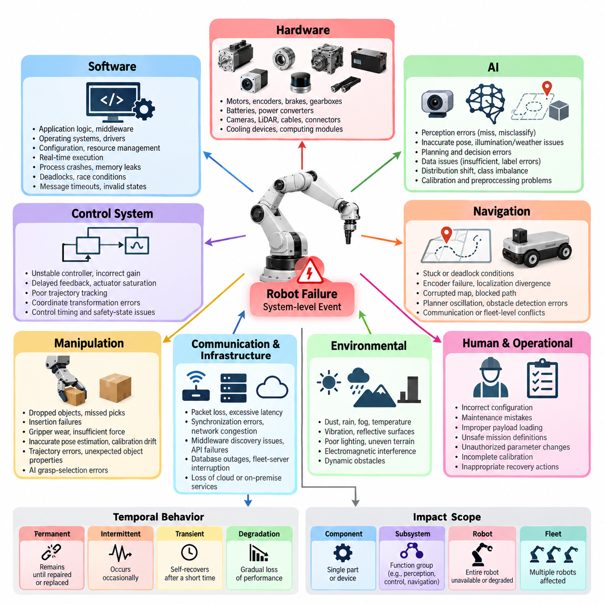
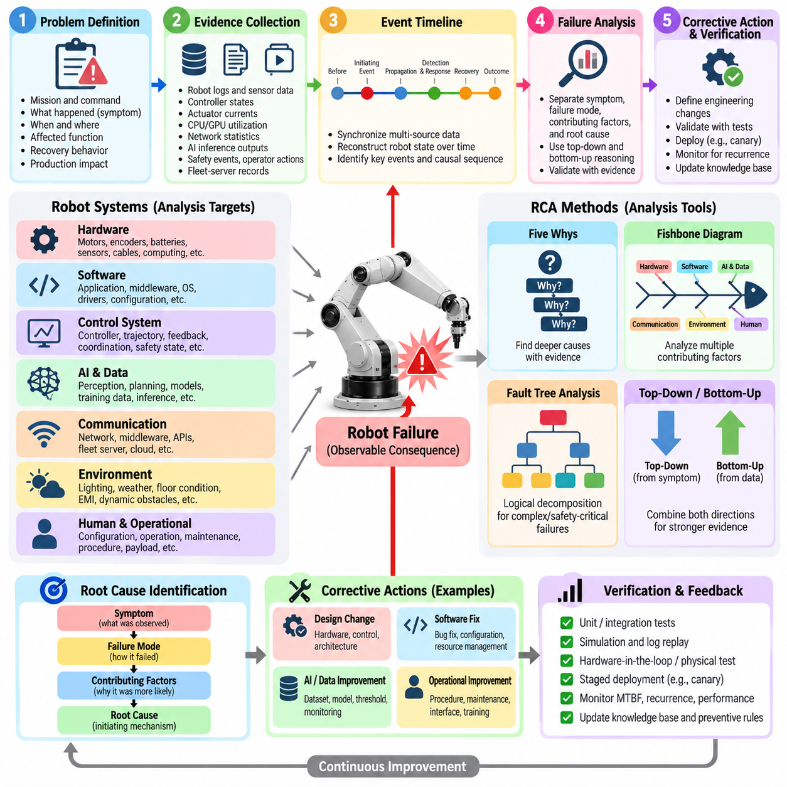
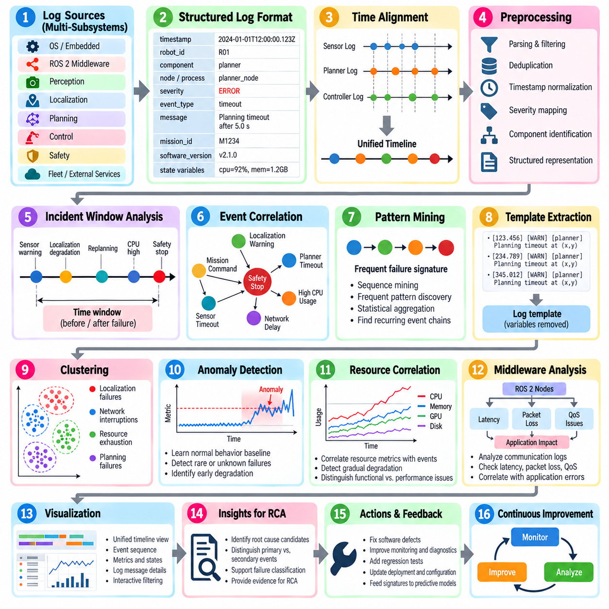
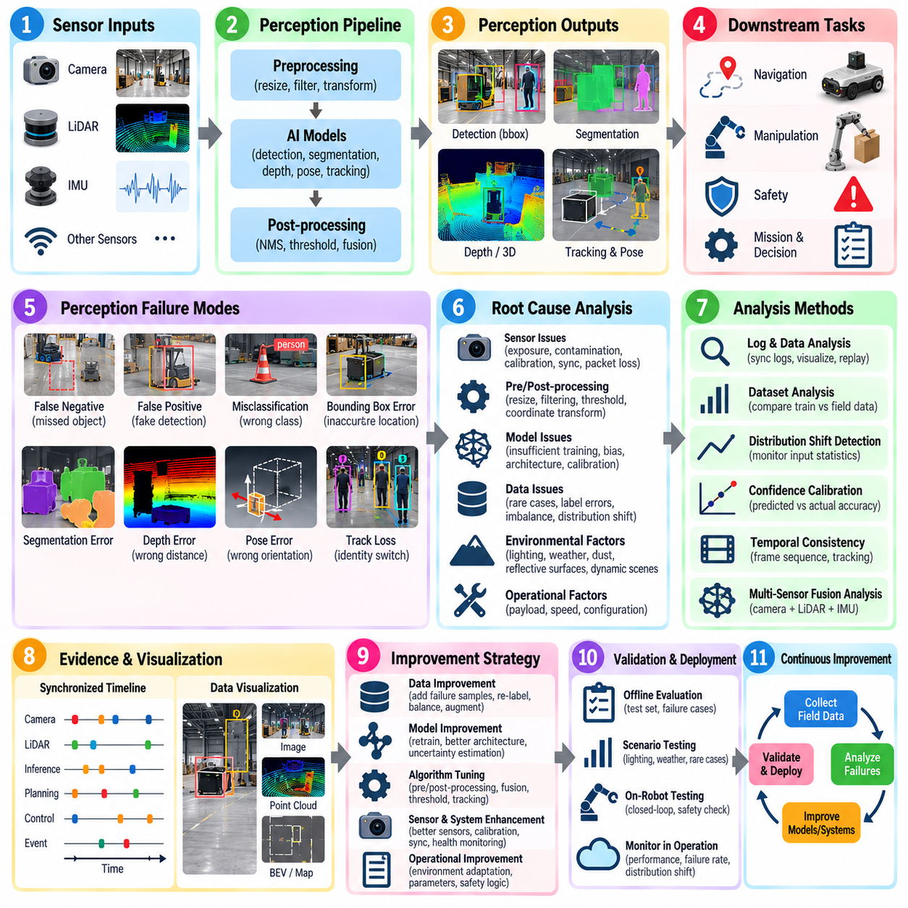
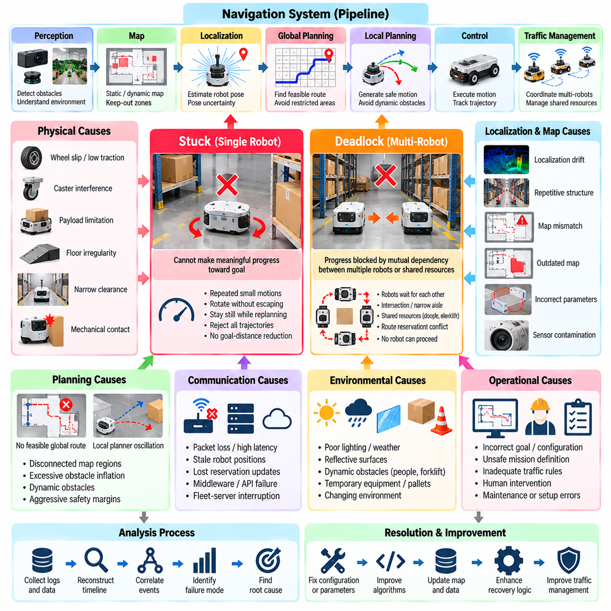
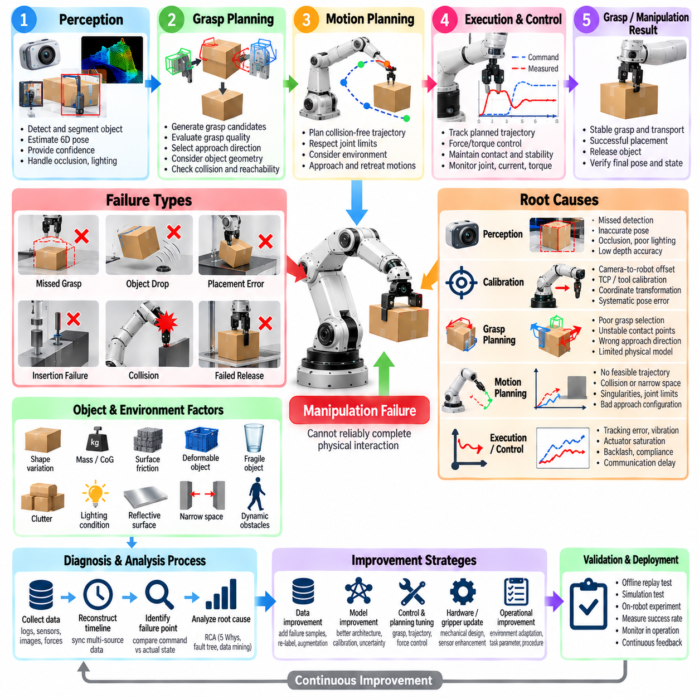
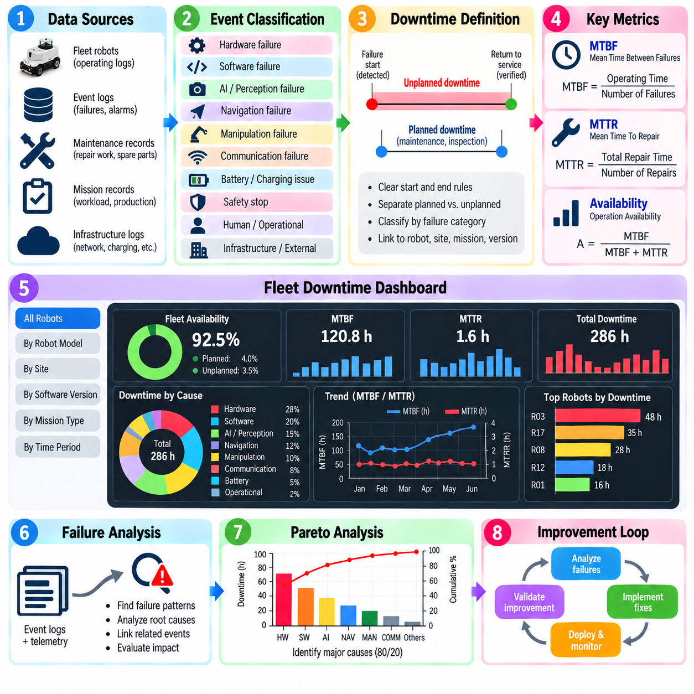
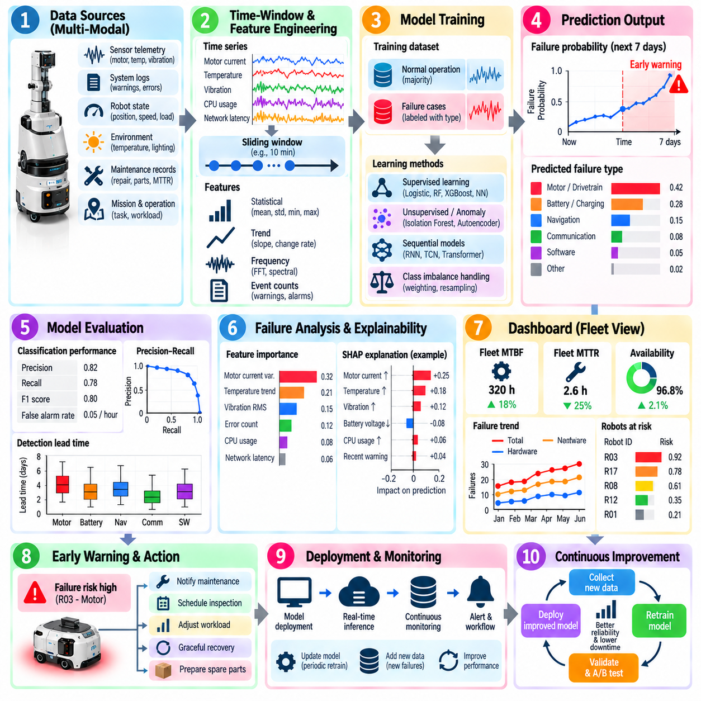
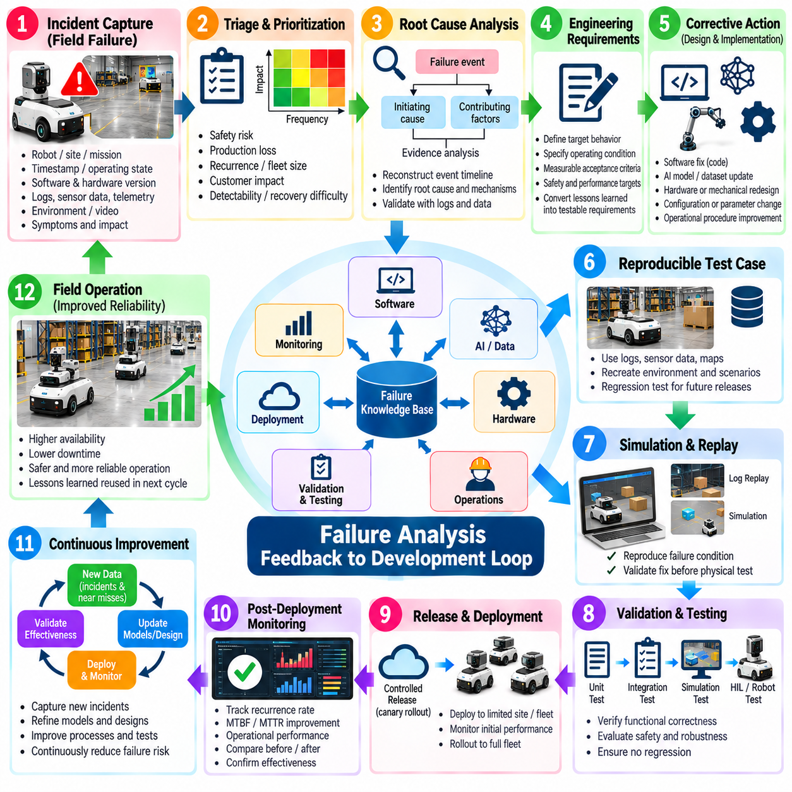
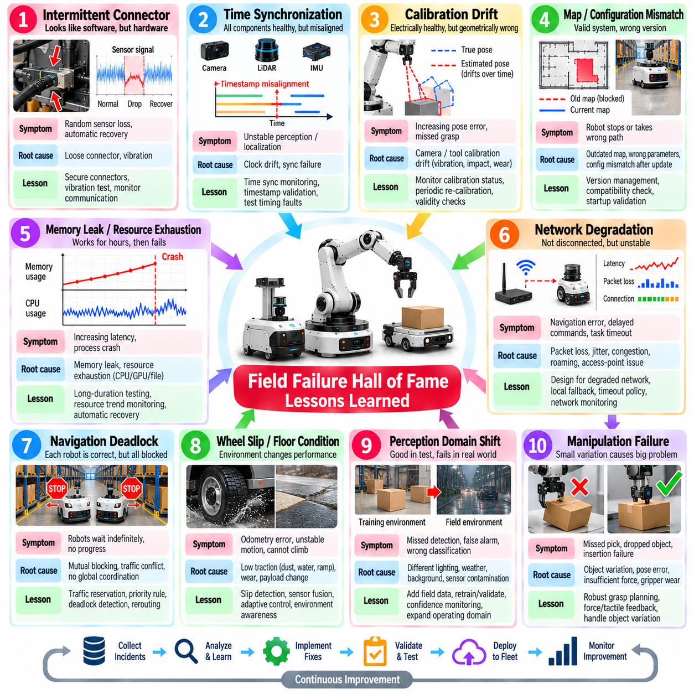

**Volume 26. Industrial Robot Applications**

# Chapter 10. Industrial Failure Analysis

## 10.01. Industrial Robot Failure Taxonomy SW HW AI

{width="7.268055555555556in" height="7.268055555555556in"}

Industrial robot failures should be classified as system-level events rather than isolated component defects. A robot may stop because of a damaged actuator, but the same operational symptom can originate from software timing, sensor degradation, communication loss, incorrect configuration, or an AI decision. A useful taxonomy therefore separates hardware, software, AI, communication, environmental, and human-induced failures while preserving their causal relationships.

Hardware failures originate in physical components such as motors, encoders, brakes, gearboxes, batteries, power converters, cameras, LiDAR sensors, cables, connectors, cooling devices, and computing modules. Typical symptoms include excessive vibration, thermal shutdown, voltage instability, encoder drift, intermittent communication, reduced torque, and mechanical wear. Hardware faults often develop gradually, making telemetry trends and preventive inspection important diagnostic resources.

Software failures occur when robot behavior deviates from its intended function because of defects in application logic, middleware, operating systems, drivers, configuration, resource management, or real-time execution. Examples include process crashes, memory leaks, deadlocks, race conditions, invalid state transitions, message timeouts, and incorrect exception handling. The broader software architecture includes embedded, real-time, control, middleware, communication, data, and deployment layers that can participate in such failures. 08_Robotics_Software_Tree

Control-system failures form an important boundary between software and hardware. An unstable controller, incorrect gain, delayed feedback, actuator saturation, poor trajectory tracking, or inconsistent coordinate transformation can create physical behavior that resembles mechanical failure. Industrial diagnosis should therefore examine commanded motion, measured motion, actuator current, control error, timing, and safety-state transitions together rather than assigning the problem immediately to either hardware or software.

AI failures require a different interpretation because the system can execute correctly from a software perspective while producing an incorrect inference. Perception models may miss obstacles, misclassify objects, generate inaccurate poses, or fail under illumination, weather, occlusion, sensor contamination, or unfamiliar environments. Planning and learned policies can similarly select unsafe or inefficient actions even though every software process remains operational and no conventional exception is generated.

Data-related AI failures should be distinguished from model implementation defects. Training data may inadequately represent rare objects, environmental conditions, equipment configurations, or failure states encountered after deployment. Distribution shift can progressively reduce model reliability as the operating environment changes. Label errors, class imbalance, calibration problems, sensor-domain differences, and inappropriate preprocessing can consequently produce systematic failures without any physical component being damaged.

Navigation failures demonstrate why a multidimensional taxonomy is necessary. A robot that becomes stuck may have a defective wheel encoder, localization divergence, corrupted map, blocked path, planner oscillation, inaccurate obstacle detection, communication interruption, or fleet-level traffic conflict. The chapter structure therefore treats navigation failures, including stuck and deadlock conditions, as a dedicated analytical category rather than assuming that every mobility problem belongs to one subsystem. Volume_26_Industrial_Robot_Appl...

Manipulation failures similarly span several domains. A dropped object can originate from gripper wear, insufficient force, inaccurate pose estimation, calibration drift, trajectory error, unexpected object properties, latency, or an AI grasp-selection error. Missed picks and insertion failures should therefore be decomposed into perception, planning, control, actuator, end-effector, object, and environmental factors. This decomposition allows repeated operational symptoms to be traced to fundamentally different causes.

Communication and infrastructure failures include packet loss, excessive latency, synchronization errors, network congestion, middleware discovery problems, API failures, database outages, fleet-server interruption, and loss of cloud or on-premise services. Modern robots depend on communication layers extending from embedded buses to ROS 2, fleet APIs, edge systems, and cloud services. A communication defect can therefore propagate across multiple robots even when each individual platform remains mechanically healthy.

Environmental failures occur when operating conditions exceed assumptions embedded in hardware, software, or AI design. Dust, rain, fog, temperature, vibration, reflective surfaces, poor lighting, uneven terrain, electromagnetic interference, and dynamic obstacles can degrade sensing or computation. These events are especially significant because the robot may technically remain within a functioning state while its effective operational capability falls below the level required for safe mission execution.

Human and operational failures include incorrect configuration, maintenance mistakes, improper payload loading, unsafe mission definitions, unauthorized parameter changes, incomplete calibration, and inappropriate recovery actions. Rather than treating these simply as operator errors, industrial analysis should examine whether interfaces, procedures, permissions, diagnostics, and safety mechanisms allowed predictable human actions to become system failures. This converts blame-oriented investigation into engineering-oriented improvement.

Failures should also be classified by temporal behavior. Permanent faults remain until repair, intermittent faults appear unpredictably, transient faults disappear after short disturbances, and progressive faults worsen through wear or degradation. Another dimension is severity: a minor performance reduction differs fundamentally from mission abortion, production stoppage, equipment damage, or a safety-critical event. Frequency and detectability further determine how aggressively each failure class should be managed.

The distinction between fault, error, failure, and consequence is essential for reliable analysis. A fault is an underlying abnormal condition, an error is an incorrect internal state produced by that condition, and a failure occurs when externally required behavior can no longer be delivered. The consequence describes the operational impact. Maintaining these layers prevents teams from recording symptoms such as "robot stopped" as root causes and enables meaningful comparison across deployments.

Cross-domain propagation is particularly important in industrial robotics. A contaminated camera can degrade perception, which produces an inaccurate obstacle estimate, which causes repeated replanning, which increases processor load, which delays control messages and ultimately triggers a safety stop. The final event may appear to be a software timeout even though the initiating condition was environmental. Failure records should therefore capture initiating faults, propagation paths, detection mechanisms, recovery actions, and final consequences.

Fleet operation adds another level of failure classification because local problems can become collective problems. A single blocked robot may obstruct a shared aisle, generate traffic congestion, create mission queues, and reduce throughput across dozens or hundreds of robots. Fleet failures should consequently include dispatch errors, resource conflicts, charging congestion, deadlocks, synchronization problems, shared-service outages, and cascading failures in addition to conventional individual-robot faults.

A practical industrial taxonomy should ultimately support diagnosis and improvement rather than merely produce labels. Each recorded incident should connect the observed symptom with affected subsystem, failure domain, severity, duration, operational context, probable cause, recovery method, and recurrence history. These structured records provide the foundation for later root-cause analysis, log pattern mining, perception improvement, downtime measurement, predictive failure detection, and development feedback, which are the subsequent analytical stages defined for this chapter. Volume_26_Industrial_Robot_Appl...

## 10.02. Root Cause Analysis RCA Methodology for Robots [w/Code]

{width="7.268055555555556in" height="7.268055555555556in"}

Root Cause Analysis (RCA) for industrial robots is a structured methodology for identifying why an operational failure occurred rather than merely describing what stopped working. A robot shutdown, navigation error, dropped object, or safety stop is treated as an observable consequence. RCA traces that consequence backward through software, hardware, AI, communication, environmental, and operational layers until the initiating conditions and contributing mechanisms are identified.

Effective RCA begins with precise problem definition. The investigation should establish what the robot was commanded to do, what actually occurred, when and where the deviation appeared, which subsystems were active, and how operations were affected. Statements such as "the robot failed" provide little diagnostic value. A useful problem statement instead specifies the mission, operating state, failure timestamp, observed symptom, affected function, recovery behavior, and production consequence.

Evidence collection should occur before assumptions about the cause become dominant. Robot logs, sensor recordings, controller states, actuator currents, CPU and GPU utilization, network statistics, localization confidence, AI inference outputs, safety events, operator actions, and fleet-server records should be synchronized around the failure interval. Preserving raw evidence is important because restarting a robot, clearing alarms, or changing configuration can destroy information needed to reconstruct the original event.

Time synchronization is especially important in distributed robot systems. Perception, localization, planning, control, safety, fleet management, and external infrastructure may record events on different computers or controllers. Without a common temporal reference, investigators can incorrectly reverse cause and effect. RCA should therefore reconstruct a unified event timeline showing the robot state before the anomaly, the initiating event, intermediate propagation, detection, protective response, recovery attempt, and final operational outcome.

The first analytical separation should distinguish symptom, failure mode, contributing factor, and root cause. A safety stop is normally a symptom or protective response rather than the root cause itself. The failure mode might be loss of localization, while contributing factors could include poor illumination and camera contamination. The root cause may ultimately be an inadequate sensor-health mechanism that allowed degraded perception to remain active until localization confidence collapsed.

A practical RCA process combines top-down and bottom-up reasoning. Top-down analysis starts from the observed failure and repeatedly asks which conditions could have produced it. Bottom-up analysis examines abnormal telemetry, logs, hardware measurements, and subsystem events to determine how they propagated toward the final failure. Agreement between these two directions provides stronger evidence than explanations based only on the final error message or the first abnormal log entry.

The Five Whys method can be useful for relatively simple robot incidents, but each "why" should be supported by evidence rather than speculation. If an AMR stopped because localization was lost, investigators may ask why localization confidence decreased, why sensor observations became unreliable, why degradation was not detected, and why the system continued autonomous operation. The method becomes valuable when it moves the investigation from immediate technical symptoms toward design, monitoring, maintenance, or process weaknesses.

Fishbone or cause-and-effect analysis is more appropriate when multiple domains may contribute simultaneously. Candidate causes can be organized around hardware, software, AI and data, communication, environment, human operation, maintenance, and process. For a repeated manipulation failure, for example, the investigation may compare gripper wear, calibration error, pose-estimation uncertainty, trajectory parameters, object variation, latency, and operator setup rather than prematurely selecting one subsystem as responsible.

Fault Tree Analysis (FTA) provides a more formal approach for safety-critical or complex failures. The undesired top event, such as collision, uncontrolled motion, dropped payload, or mission loss, is decomposed into combinations of lower-level events connected through logical relationships. This approach helps identify whether several conditions must occur together or whether any single condition can trigger the event. It also exposes common-cause failures that can defeat apparently redundant robot subsystems.

Software RCA requires correlation across application, middleware, operating-system, and embedded layers. A planner timeout may originate from excessive computation, memory pressure, blocked communication, deadlock, driver delay, or upstream sensor overload. Stack traces and error codes should therefore be analyzed together with resource utilization, message latency, process lifecycle events, software versions, configuration changes, and deployment history instead of being interpreted as isolated evidence.

AI-related RCA must extend beyond conventional exception logs because an AI component can produce an incorrect result while remaining computationally healthy. Investigators should preserve model version, input sensor data, preprocessing parameters, confidence values, output predictions, environmental conditions, and downstream decisions. Replaying the same input offline can determine whether the failure is reproducible and whether its origin lies in sensing, preprocessing, model behavior, distribution shift, or decision thresholds.

Hardware RCA should distinguish sudden component failure from progressive degradation and secondary damage. Motor current, temperature, vibration, encoder consistency, battery voltage, power quality, connector condition, and mechanical inspection can reveal degradation that preceded the event. Replacing the failed component may restore operation, but RCA should continue until the reason for its failure is understood, including overload, thermal stress, contamination, inadequate maintenance, manufacturing variation, or unsuitable operating conditions.

Navigation and fleet incidents require system-level reconstruction because their causes frequently extend beyond one robot. A blocked AMR may trigger replanning, traffic reservation conflicts, queue growth, and eventually fleet-wide congestion. Investigators should correlate local navigation logs with maps, obstacle observations, reservation states, mission assignments, fleet commands, and nearby robot trajectories. This prevents a collective coordination failure from being misclassified as a simple local navigation problem.

Corrective action should address the verified causal mechanism rather than only restore service. Immediate containment may involve restarting a process, replacing hardware, recalibrating sensors, or manually recovering a robot. Permanent corrective actions can require software modification, additional diagnostics, revised AI thresholds, hardware redesign, improved environmental protection, maintenance changes, or operational procedures. Preventive actions should then determine whether the same mechanism can exist in other robots, sites, or software versions.

An RCA is incomplete until corrective actions are verified. The repaired system should reproduce the original operating conditions through simulation, log replay, software testing, hardware-in-the-loop testing, controlled field testing, or production monitoring. Successful verification demonstrates not merely that the robot operates again, but that the identified causal chain has been interrupted and the original failure cannot be reproduced under equivalent conditions.

Industrial RCA should finally become part of a continuous engineering feedback loop. Each incident should retain the failure signature, evidence package, causal chain, confirmed root cause, corrective action, verification result, affected versions, and lessons learned in a searchable knowledge base. Aggregating these records enables recurring failure patterns to be discovered and connects RCA directly with subsequent log mining, AI failure improvement, downtime analysis, predictive maintenance, and development feedback activities defined within the industrial failure analysis workflow.

## 10.03. SW Failure Log Analysis and Pattern Mining [w/Code]

{width="7.268055555555556in" height="7.268055555555556in"}

Software failure log analysis transforms raw operational records into evidence that can explain how and why an industrial robot malfunctioned. A modern robot continuously produces logs from embedded controllers, operating systems, ROS 2 middleware, perception, localization, planning, control, safety, fleet management, and external services. The objective is not simply to search for error messages, but to reconstruct abnormal behavior and discover recurring failure signatures across these distributed sources.

A useful logging architecture begins with consistent event structure. Each record should contain a timestamp, robot identifier, software component, process or node, severity level, event type, message, mission identifier, software version, and relevant state variables. Structured formats are preferable to unrestricted text because they allow events from thousands of missions and multiple robot platforms to be filtered, aggregated, correlated, and processed automatically without depending entirely on manual interpretation.

Time alignment is essential before analyzing distributed logs. An obstacle detection event, localization warning, planner timeout, controller fault, and safety stop may originate from separate processors whose clocks differ slightly. Even small timestamp errors can make a consequence appear to precede its cause. Synchronizing clocks and normalizing timestamps enables analysts to construct an ordered event sequence and identify the propagation path from the earliest anomaly to the final robot failure.

Log preprocessing removes noise while preserving information required for diagnosis. Repeated heartbeat messages, normal status updates, duplicated warnings, and high-frequency telemetry can overwhelm meaningful events. Parsing, filtering, deduplication, timestamp normalization, severity mapping, and component identification convert heterogeneous logs into a common representation. Raw logs should nevertheless remain immutable so that preprocessing errors or newly discovered hypotheses can later be investigated using the original evidence.

Failure analysis normally begins with a time window surrounding the incident. Instead of examining only the final exception, the system retrieves events occurring seconds or minutes before and after the failure. A navigation stop may reveal an earlier sensor timeout, followed by declining localization confidence, repeated replanning, increasing CPU utilization, command latency, and finally a safety transition. This temporal context distinguishes initiating abnormalities from secondary errors generated after the system has already degraded.

Event correlation connects messages that belong to the same causal sequence. Mission IDs, request IDs, ROS 2 topics, node names, device identifiers, robot IDs, and timestamps can be used to associate distributed events. Correlation is particularly important when one subsystem produces a warning that causes another subsystem to change state. The resulting event chain provides stronger diagnostic evidence than isolated log lines and can be compared directly with the causal hypotheses produced during Root Cause Analysis.

Pattern mining extends analysis from individual incidents to large operational histories. Repeated sequences such as sensor warning → localization degradation → planner recovery → safety stop can be represented as failure signatures. Sequence mining, frequent-pattern discovery, clustering, and statistical aggregation can identify event combinations that repeatedly occur before known failures. These patterns allow engineering teams to discover relationships that may not be obvious when incidents are investigated separately.

Template extraction can reduce millions of textual log messages into manageable event classes. Variable elements such as timestamps, coordinates, object IDs, memory addresses, and numerical measurements are separated from the stable structure of each message. Messages such as repeated planner timeout reports can then be grouped into a common template while retaining their parameters for later analysis. Template frequencies and transitions provide compact representations of robot software behavior.

Clustering is useful when failure categories have not yet been defined. Incidents can be represented using event frequencies, log templates, temporal sequences, subsystem states, or learned embeddings and grouped according to similarity. One cluster may correspond to localization failures, another to network interruptions, and another to resource exhaustion. Engineers can inspect representative cases from each cluster and convert recurring groups into formal failure classes, diagnostic rules, or regression tests.

Anomaly detection addresses failures whose signatures are rare or previously unknown. A baseline can be learned from normal missions using event rates, latency distributions, CPU and memory behavior, warning frequencies, message timing, or state-transition patterns. Significant deviation from this baseline can indicate emerging software degradation even when no explicit error is reported. This is especially valuable for intermittent faults that disappear before maintenance personnel can reproduce them.

Software resource metrics should be correlated with event logs because many failures develop gradually. Increasing memory consumption may precede an out-of-memory termination, CPU saturation may produce missed deadlines, storage exhaustion may prevent logging or map updates, and excessive GPU utilization may delay AI inference. Combining resource telemetry with application events helps distinguish a functional algorithm error from infrastructure or performance degradation that eventually produces the same external symptom.

Distributed middleware requires additional attention because communication failures often appear as application failures. ROS 2 discovery changes, DDS message loss, Quality of Service mismatches, topic latency, unavailable services, and lifecycle transitions can interrupt data flows without crashing the affected nodes. Log analysis should therefore reconstruct communication state alongside application state so that a planner reporting missing sensor data is not incorrectly identified as the component responsible for the original failure.

Version information is critical when mining failures across a fleet. Every incident should be associated with software release, firmware version, configuration revision, AI model version, map version, and deployment timestamp when applicable. Failure rates can then be compared before and after updates. If a particular failure signature increases immediately after a release, the affected change set becomes an important diagnostic candidate and can be connected to rollback or regression testing procedures.

Fleet-scale aggregation converts local robot failures into operational reliability knowledge. Counts alone are insufficient because robots may operate for different durations or mission volumes. Failure frequency should therefore be normalized by operating hours, distance, missions, manipulation cycles, or another relevant exposure measure. Comparing normalized rates by robot, site, hardware revision, software version, environmental condition, and mission type helps reveal whether a problem is isolated or systematic.

Visualization and automated summaries make mined patterns actionable for engineers and operators. Timelines can show event propagation, heat maps can expose component-to-component relationships, and trend views can reveal increasing warning frequency before failure. More importantly, the analysis system should link each pattern to representative raw evidence, affected robots, recurrence frequency, operational impact, and previously confirmed Root Cause Analysis records so that statistical associations are not mistaken for proven causality.

The final objective is to convert failure logs into a continuously improving diagnostic knowledge base. Confirmed signatures can become monitoring rules, alerts, automated triage logic, regression tests, and predictive features. New incidents are compared with known patterns, while unmatched cases are routed for deeper investigation. This closes the loop between field operation, Root Cause Analysis, software development, validation, and subsequent predictive failure detection within the broader industrial failure analysis process.

## 10.04. AI Perception Failure Analysis and Improvement [w/Code]

{width="7.268055555555556in" height="7.268055555555556in"}

AI perception failures differ from conventional software failures because a perception pipeline can execute normally while producing an incorrect interpretation of the physical environment. Object detectors, segmentation networks, pose estimators, depth models, tracking systems, and sensor-fusion algorithms may return syntactically valid outputs that are operationally wrong. Failure analysis must therefore evaluate both computational health and the semantic correctness of perception results.

A useful analysis begins by defining the perception failure mode precisely. Typical modes include false negatives, false positives, incorrect classification, inaccurate bounding boxes, segmentation errors, depth estimation errors, pose errors, track loss, identity switches, and incorrect free-space or occupancy estimation. Each failure should be associated with the robot state, sensor inputs, environmental conditions, model version, confidence values, and downstream decisions affected by the erroneous output.

False negatives are particularly important for safety because a relevant object may exist in the environment without being represented in the perception output. Small objects, distant targets, partial occlusion, motion blur, unusual viewpoints, poor illumination, and low sensor resolution can increase missed detections. Analysis should determine whether the object was absent from the sensor data, lost during preprocessing, insufficiently represented during training, or suppressed by confidence and post-processing thresholds.

False positives create a different operational problem. Reflections, shadows, vegetation, structural patterns, sensor noise, or unfamiliar objects can be incorrectly interpreted as obstacles or target classes. In an AMR, repeated false obstacles may cause unnecessary braking, replanning, oscillation, or mission delay. The engineering objective is therefore not simply to maximize detection accuracy, but to understand how perception errors propagate into navigation, manipulation, safety, and production performance.

Environmental context should be captured as part of every significant perception incident. Illumination, rain, fog, dust, glare, reflective surfaces, camera contamination, vibration, temperature, and dynamic crowding can change sensor characteristics significantly. Comparing failures across environmental attributes helps distinguish isolated model errors from systematic operating-domain weaknesses and identifies conditions that should be represented more strongly in validation datasets.

Sensor-level analysis should precede conclusions about the AI model. A degraded camera, incorrect exposure, LiDAR contamination, synchronization error, calibration drift, packet loss, or unstable sensor mounting can generate inputs outside the expected distribution. If these problems are not separated from model errors, engineering teams may retrain a network that was not responsible for the original failure. Sensor health indicators and raw data should therefore be preserved with AI inference records.

Preprocessing and post-processing are also potential failure sources. Image resizing, normalization, coordinate transformation, point-cloud filtering, region cropping, non-maximum suppression, confidence thresholds, and class mappings can alter otherwise valid model outputs. An offline replay should reproduce the complete inference pipeline rather than testing only the neural network. This allows engineers to locate whether the discrepancy originates before, inside, or after the model.

Dataset analysis is central to perception improvement. Failure samples should be compared with the training and validation distributions to determine whether similar objects, viewpoints, distances, lighting conditions, backgrounds, and sensor characteristics were adequately represented. Rare-event underrepresentation, annotation errors, class imbalance, geographic bias, and insufficient negative examples can create systematic weaknesses that remain hidden behind acceptable aggregate benchmark metrics.

Distribution shift occurs when field data diverges from the conditions represented during model development. A model trained in clean warehouses may degrade in dusty factories, outdoor yards, construction sites, farms, ports, or environments with changing weather. Monitoring input statistics, feature distributions, confidence patterns, and failure rates can reveal this shift. Field failures should consequently become a controlled source of new data rather than remaining isolated maintenance incidents.

Confidence calibration is important because raw neural-network confidence does not necessarily represent actual probability of correctness. A model may produce highly confident incorrect predictions, making simple threshold-based safety logic unreliable. Calibration analysis compares predicted confidence with observed accuracy across classes and operating conditions. Poorly calibrated regions can then be addressed through threshold adjustment, model calibration, uncertainty estimation, or additional sensing and validation.

Temporal consistency provides another source of diagnostic evidence. Physical objects normally persist across consecutive frames, while isolated perception errors may appear briefly and disappear. Tracking and temporal filtering can suppress transient false detections, but they can also propagate an incorrect detection over time. Failure analysis should therefore inspect frame-level predictions together with tracks, object histories, motion estimates, and state transitions rather than evaluating individual images independently.

Multi-sensor fusion can improve robustness when different sensing modalities have complementary failure characteristics. Cameras provide rich semantic information but are sensitive to lighting, while LiDAR offers geometric measurements with different limitations. Radar, depth sensors, IMUs, and other sources can provide additional evidence. Fusion failures must nevertheless be analyzed carefully because incorrect calibration, synchronization, weighting, or association can transform individually valid sensor measurements into an incorrect fused interpretation.

Improvement should be driven by categorized failure evidence rather than indiscriminate retraining. Hard examples can be added to training sets, annotation errors corrected, class balance improved, augmentation expanded, thresholds recalibrated, preprocessing modified, or model architecture changed. Some problems are better solved through sensor redesign, additional sensing, temporal reasoning, or safety logic. The corrective action should correspond directly to the verified failure mechanism.

Evaluation after improvement must reproduce the failure conditions that motivated the change. Standard validation metrics such as precision, recall, intersection over union, average precision, pose error, or tracking accuracy remain useful, but they should be complemented by scenario-specific tests. A model improved for low-light operation, for example, should be evaluated across controlled illumination levels while verifying that performance in normal conditions has not regressed.

Perception failures should also be evaluated according to downstream operational risk. Missing a harmless distant object does not have the same consequence as missing a person near the robot trajectory. Similarly, a small pose error may be irrelevant for navigation but unacceptable for precision insertion. Failure prioritization should therefore combine AI performance metrics with object relevance, distance, robot speed, task phase, safety consequence, and the ability of downstream systems to recover.

Deployment requires continuous monitoring because perception quality can change after release. Model versions, sensor revisions, environmental conditions, confidence distributions, intervention events, and field failure rates should be tracked across the robot fleet. Newly discovered failure cases can be automatically collected for review, reproduced offline, incorporated into regression datasets, and used to determine whether model updates genuinely improve reliability across multiple sites and operating conditions.

The resulting process forms a closed perception improvement loop connecting field operation, failure logging, Root Cause Analysis, dataset curation, model training, validation, deployment, and monitoring. Instead of treating an incorrect AI prediction as an isolated model defect, the organization builds a growing library of failure scenarios and verified corrective actions. Over time, this converts real industrial experience into increasingly robust perception models and safer robot behavior.

## 10.05. Navigation Failure Stuck Deadlock Analysis [w/Code]

{width="7.268055555555556in" height="7.268055555555556in"}

Navigation failure in industrial robots is rarely caused by a single navigation algorithm. An AMR may stop even though localization, path planning, and motor control remain individually operational. Failures emerge from interactions among perception, maps, localization, global planning, local planning, obstacle avoidance, control, traffic management, and infrastructure. Analysis must therefore reconstruct the complete navigation state before classifying a robot as simply stuck or deadlocked.

A stuck condition occurs when the robot cannot make meaningful progress toward its assigned goal despite continuing to execute navigation functions. The robot may repeatedly command small forward and reverse motions, rotate without escaping, remain stationary while replanning, or continuously reject available trajectories. Detection should consider commanded velocity, measured velocity, displacement, goal-distance reduction, planner activity, obstacle state, and elapsed time rather than relying only on zero vehicle speed.

Physical causes of stuck behavior include wheel slip, insufficient traction, caster interference, payload-related mobility limitations, floor irregularities, mechanical contact, narrow clearances, and obstacles beneath the sensor field of view. A robot can also become physically constrained when its turning radius is incompatible with the surrounding geometry. Navigation analysis should therefore correlate software states with wheel velocity, motor current, odometry, IMU measurements, steering state, and environmental observations.

Localization failures can produce symptoms similar to physical immobilization. LiDAR or visual localization may become unstable because of repetitive structures, feature-poor corridors, reflective surfaces, changing environments, sensor contamination, calibration drift, or map inconsistency. Sudden pose jumps or increasing localization uncertainty can cause planners to reject trajectories or safety logic to stop motion even when the physical path is clear. Pose history and localization confidence should therefore be preserved around every incident.

Map-related failures occur when the navigation representation differs significantly from the physical environment. Temporary equipment, pallets, construction changes, incorrectly modeled walls, outdated keep-out zones, or inaccurate inflation parameters can make valid paths unavailable. Conversely, missing obstacles can cause the planner to generate physically impossible routes. Comparing the operational map, local costmap, sensor observations, and actual field condition is essential when diagnosing repeated failures at specific locations.

Global planning failures arise when the system cannot generate a feasible route from the current pose to the goal. Disconnected map regions, excessive obstacle inflation, invalid goal positions, restricted zones, incorrect vehicle footprint parameters, or graph connectivity errors can make the destination mathematically unreachable. Analysis should distinguish true route infeasibility from algorithmic planning failure because repeated planner retries cannot solve a topology or configuration problem.

Local planning failures occur when a valid global route exists but the robot cannot generate safe short-horizon motion. Dynamic obstacles, narrow passages, aggressive safety margins, inaccurate velocity limits, poor trajectory scoring, and conflicting objectives can cause repeated trajectory rejection. A robot may oscillate between alternative motions without progressing. Examining candidate trajectories, cost values, obstacle distances, commanded velocities, and recovery transitions helps reveal why local motion repeatedly failed.

Recovery behavior itself can create persistent navigation failures. Clearing a costmap, rotating in place, backing away, replanning, or requesting operator assistance may successfully recover occasional disturbances, but repeated recovery cycles can trap the system indefinitely. Analysis should record recovery type, entry condition, duration, result, and repetition count. A bounded recovery policy should eventually escalate the incident rather than allowing endless autonomous attempts that reduce fleet availability.

Deadlock differs from an ordinary stuck condition because progress is prevented by mutual dependency between multiple robots or shared resources. Two robots facing each other in a narrow aisle may each wait for the other to move. More complex deadlocks can involve several robots holding route segments, intersections, elevators, doors, charging stations, or loading positions while waiting for resources held by others. No individual robot necessarily contains a local navigation fault.

Fleet-level deadlock analysis should therefore reconstruct resource ownership and waiting relationships. Traffic reservations, route locks, intersection states, mission priorities, robot positions, and pending requests can be represented as a wait-for relationship. A cycle indicates that each participant is waiting for another participant in the same dependency chain. Identifying this structure is more reliable than attempting to diagnose the problem from individual robot error logs.

Traffic congestion should also be distinguished from deadlock. In congestion, robots continue to make progress, although throughput and travel time degrade significantly. In deadlock, a dependency structure prevents progress unless the system changes allocation or forces a recovery action. Persistent congestion can nevertheless evolve into deadlock when queues occupy critical intersections or prevent robots from releasing reserved resources, making fleet-wide temporal analysis important.

Communication failures can generate apparent navigation or deadlock symptoms. Delayed fleet commands, lost reservation updates, stale robot positions, middleware interruption, network congestion, or server unavailability may leave robots waiting for authorization that never arrives. Analysis should correlate navigation logs with network latency, message loss, fleet-server events, reservation timestamps, and communication state before attributing the incident to planning algorithms.

Stuck and deadlock detection should use explicit operational thresholds. Progress can be measured through displacement, reduction in distance to goal, successful waypoint completion, or release of reserved resources within a defined interval. Thresholds should account for mission type, robot size, expected waiting behavior, traffic density, and environment. An overly sensitive detector creates unnecessary recoveries, while an insensitive detector allows robots to occupy critical resources for excessive periods.

Root Cause Analysis should reconstruct the incident from the earliest abnormal condition rather than treating the final navigation timeout as the cause. A blocked aisle may trigger local replanning, route reservation changes, queue formation, mutual waiting, and eventually fleet-wide deadlock. The final robot may report only a goal timeout. Combining navigation logs, maps, telemetry, perception records, and fleet events reveals the propagation chain and separates initiating causes from secondary consequences.

Corrective actions depend on the verified failure mechanism. Physical stuck events may require mechanical modification or improved terrain handling, while localization failures may require map updates, sensor maintenance, or fusion improvements. Planning failures can require parameter or algorithm changes, and fleet deadlocks may require reservation redesign, priority rules, rerouting, resource preemption, or dedicated escape strategies. Recovery should address the causal mechanism rather than merely restart navigation.

Validation should deliberately reproduce representative stuck, congestion, and deadlock scenarios. Tests should include blocked corridors, narrow passages, temporary obstacles, localization degradation, communication delays, opposing robots, intersection contention, and resource conflicts. Success should be measured not only by eventual mission completion but also by detection time, recovery time, unnecessary intervention rate, safety behavior, and impact on overall fleet throughput.

Field incidents should finally feed a continuously expanding navigation failure knowledge base. Each case can retain location, map version, robot configuration, traffic state, failure signature, causal chain, recovery result, and verified corrective action. Repeated spatial or temporal patterns can then reveal problematic map regions, parameters, infrastructure, or traffic policies. This closes the loop between navigation operation, failure analysis, Root Cause Analysis, validation, and fleet optimization.

## 10.06. Manipulation Failure Drop Miss Analysis [w/Code]

{width="7.268055555555556in" height="7.268055555555556in"}

Manipulation failure occurs when a robot cannot reliably complete physical interaction with an object even though the overall task command is valid. Typical failures include missed grasping, object dropping, unstable holding, inaccurate placement, insertion failure, collision, excessive contact force, and incomplete release. Because manipulation combines perception, motion planning, control, mechanics, and object physics, failure analysis must reconstruct the entire interaction rather than inspect only the final gripper state.

A miss occurs when the end effector fails to establish the intended contact or grasp. The cause may originate from incorrect object detection, inaccurate pose estimation, calibration error, robot kinematic error, trajectory deviation, object motion, or unsuitable grasp geometry. Analysis should compare the estimated object pose, commanded end-effector pose, measured robot pose, contact state, and actual object location to determine where spatial error entered the manipulation pipeline.

Object dropping occurs after an apparently successful grasp and therefore requires different diagnostic evidence. Insufficient gripping force, poor contact location, low friction, object deformation, unexpected payload properties, acceleration, vibration, gripper wear, or actuator faults can reduce grasp stability. Force, torque, finger position, motor current, tactile measurements, robot acceleration, and object motion should be examined from grasp acquisition until the drop event to identify the loss of stability.

Perception uncertainty is a major source of manipulation error because small spatial errors can become critical near contact. An object detector may identify the correct object while its pose estimate remains inaccurate enough to cause a missed grasp or collision. Occlusion, reflective surfaces, transparent materials, poor depth sensing, clutter, and changing illumination can further degrade estimates. Failure records should preserve raw sensor data, detected geometry, confidence, pose covariance, and transformations used for planning.

Calibration errors can systematically shift otherwise correct manipulation commands. Camera-to-robot extrinsic calibration, tool-center-point calibration, joint offsets, gripper geometry, and coordinate-frame transformations must remain consistent across perception and control. A few millimeters of error may be acceptable for coarse transport but unacceptable for precision insertion. Repeated failures with similar directional offsets are therefore strong indicators of calibration or frame-transformation problems.

Grasp planning should be evaluated independently from grasp execution. A planner may generate a mathematically reachable grasp that is physically unstable because contact points, approach direction, friction, center of mass, or object geometry are unfavorable. Candidate grasp scores should be compared with actual success outcomes. Repeated failure of highly ranked candidates may indicate that the grasp quality model does not represent important physical properties of the real operating environment.

Motion planning failures occur when the manipulator cannot safely reach the desired grasp or placement configuration. Joint limits, singularities, self-collision, environmental obstacles, insufficient clearance, and invalid approach directions can eliminate feasible trajectories. A planner may also succeed computationally while generating motions that are too close to obstacles or sensitive to small model errors. Analysis should preserve candidate trajectories, collision checks, joint states, constraints, and planning outcomes.

Execution errors arise when the physical robot does not accurately follow the planned trajectory. Servo tracking error, backlash, joint compliance, payload-induced deflection, actuator saturation, communication delay, vibration, and controller tuning can cause the end effector to deviate from its intended path. Comparing commanded and measured joint trajectories with end-effector pose and controller error reveals whether the failure originated in planning or during physical execution.

Force-controlled manipulation introduces another class of failure. During insertion, assembly, surface following, or constrained motion, excessive force can indicate misalignment, unexpected contact, poor compliance parameters, or an incorrect environment model. Insufficient force may prevent seating or stable contact. Force and torque histories should be synchronized with position, velocity, contact state, and task phase so that abnormal interaction dynamics can be reconstructed accurately.

Insertion failures require particular attention because very small alignment errors can create jamming or wedging. Peg-in-hole, connector mating, component assembly, and tool engagement tasks depend on position accuracy, orientation accuracy, compliance, contact geometry, and force thresholds. Repeated insertion attempts without diagnosing the contact condition can damage parts or tooling. Recovery should distinguish between correctable alignment error and a physically incompatible or damaged component.

Release and placement failures can occur even after transport succeeds. An object may remain attached because of gripper friction, suction persistence, magnetic force, adhesion, or mechanical interference. Alternatively, premature release may cause inaccurate placement or dropping. Analysis should verify the release command, actuator response, contact state, object support condition, end-effector motion, and post-release object pose rather than assuming that an open-gripper command guarantees successful release.

Object properties should be treated as explicit diagnostic variables. Mass, dimensions, center of gravity, surface friction, rigidity, deformability, fragility, reflectivity, and packaging variation can substantially affect manipulation performance. A grasp strategy validated on one product variant may fail on another with visually similar geometry. Recording object type and relevant physical properties allows failures to be grouped according to conditions that directly influence grasp and handling stability.

Failure detection should occur during the manipulation process rather than only after task completion. Grasp verification can combine finger position, motor current, force, tactile sensing, vacuum pressure, vision, or object tracking. Unexpected changes can indicate slip or loss before a complete drop occurs. Early detection enables the robot to reduce acceleration, increase grip force within safe limits, reposition the object, place it safely, or request assistance before damage occurs.

Root Cause Analysis should separate the visible failure from its initiating mechanism. A dropped object may be recorded as a gripper failure, while the actual chain began with pose estimation error, off-center grasping, insufficient contact area, progressive slip, and eventual release during acceleration. Synchronizing perception, planning, robot state, force, gripper, and controller logs enables reconstruction of this causal sequence and prevents corrective actions from targeting only the final symptom.

Corrective actions should correspond to verified failure classes. Perception errors may require improved sensing or pose estimation, calibration problems require recalibration, unstable grasps require different contact strategies, and execution errors may require controller or mechanical changes. Force-related failures may require compliance tuning or contact-state logic. Some failures are best addressed by redesigning fixtures, grippers, objects, or workstations rather than increasing algorithm complexity.

Validation should reproduce representative miss, drop, collision, insertion, and release scenarios across realistic object variations and operating conditions. Performance should be measured using grasp success rate, placement accuracy, drop rate, insertion success, contact force, cycle time, recovery success, and intervention frequency. Repeated trials are necessary because manipulation reliability depends on statistical variation in pose, friction, object properties, sensing, and mechanical behavior.

Field manipulation failures should ultimately become structured engineering knowledge. Each incident can preserve object information, perception output, grasp candidate, trajectory, robot state, force history, gripper state, failure signature, recovery result, and verified root cause. Aggregating these records reveals recurring weaknesses across products, robots, tools, and sites. This closes the improvement loop between field operation, failure analysis, manipulation design, validation, and subsequent deployment.

## 10.07. Fleet Downtime Analysis MTBF MTTR Dashboard [w/Code]

{width="7.268055555555556in" height="7.268055555555556in"}

Fleet downtime analysis converts individual robot interruptions into measurable information about operational reliability, maintainability, and production impact. A fleet may contain robots with different workloads, ages, configurations, and operating environments, so counting failures alone is insufficient. Downtime analysis should combine failure events, operating hours, repair activities, mission records, maintenance history, and fleet availability to reveal where reliability losses originate.

Downtime should be defined consistently before performance indicators are calculated. A robot may be unavailable because of hardware failure, software failure, charging, planned maintenance, safety inspection, operator intervention, infrastructure problems, or waiting for spare parts. Planned and unplanned downtime should normally be separated because they represent different operational conditions. Clear start and end rules are also necessary to prevent inconsistent measurements across robots, sites, and maintenance teams.

Mean Time Between Failures, or MTBF, measures the average operating time between repairable failures and provides a basic indication of reliability. It can be calculated by dividing accumulated operating time by the number of relevant failures during the observation period. The definition of a qualifying failure must remain consistent. Minor warnings, automatic recoveries, operator interventions, and failures requiring maintenance should not be mixed without an explicit classification policy.

Mean Time To Repair, or MTTR, represents how quickly the system can be restored after a failure. Repair time may include diagnosis, technician response, physical repair, software recovery, component replacement, calibration, verification, and return to service. Organizations should specify which portions are included because a narrow technical repair time can differ greatly from the actual operational downtime experienced by production.

Availability connects reliability and maintainability by measuring the proportion of time that equipment can perform its required function. For repairable systems, inherent availability is often related to MTBF and MTTR, but fleet operations require broader interpretation. Waiting for technicians, replacement parts, network recovery, infrastructure access, or operational approval can extend actual unavailability even when the physical repair itself is short.

Fleet metrics should be normalized because robots accumulate different amounts of exposure. One robot may operate continuously while another works only a few hours per day. Failure rates can therefore be expressed per operating hour, mission, kilometer, manipulation cycle, or another workload measure appropriate to the application. Exposure normalization prevents heavily utilized robots from appearing less reliable simply because they perform more work than the rest of the fleet.

Failure classification gives downtime metrics engineering meaning. Events can be grouped by hardware, software, AI perception, navigation, manipulation, communication, infrastructure, battery, safety, and human or operational causes. Each category can then be analyzed by failure count, accumulated downtime, MTBF, MTTR, recurrence rate, and production impact. A category with few failures may deserve higher priority if each occurrence causes exceptionally long recovery.

A downtime dashboard should support analysis at several levels rather than display only fleet-wide averages. Engineers may need to compare individual robots, robot models, hardware revisions, software releases, sites, shifts, mission types, or failure categories. Fleet managers require availability and production impact, while maintenance teams require recurring components and repair duration. The same underlying event data should support these different operational views.

Trend analysis is more informative than a single MTBF or MTTR value. Weekly or monthly trends can reveal whether reliability is improving after corrective actions or deteriorating as equipment ages. A sudden increase in failures after a software deployment may indicate regression, while gradually increasing repair frequency can suggest component wear. Rolling windows help detect these changes without allowing old historical data to dominate current fleet behavior.

Downtime duration should be decomposed into meaningful phases. Detection time measures how long the failure exists before it is recognized, response time measures how long support takes to begin, diagnosis time represents fault isolation, repair time covers corrective work, and validation time covers verification before return to service. Long MTTR can therefore be traced to the specific stage responsible rather than being treated as a single maintenance problem.

Pareto analysis helps prioritize reliability improvement by identifying the relatively small number of failure classes responsible for a large proportion of downtime. Ranking events by total lost hours, occurrence frequency, or production impact may produce different priorities. Frequent software recoveries may dominate event count, while a rare drivetrain failure may dominate lost production time. Multiple perspectives should therefore be available on the dashboard.

Repeated failures require special attention because they may indicate incomplete corrective action. A robot that returns to service quickly but experiences the same fault every few hours can show an acceptable MTTR while still causing severe operational disruption. Recurrence rate, time to repeated failure, and repeated interventions should therefore accompany MTBF and MTTR. Linking incidents to previous Root Cause Analysis records helps determine whether corrective actions were actually effective.

Fleet downtime is also influenced by dependencies outside the robot itself. A failed wireless network, fleet server, elevator, automatic door, charging infrastructure, or production interface can disable many robots simultaneously. Treating each affected robot as an independent failure would distort reliability statistics. Common-cause events should be identified and associated with the shared infrastructure failure so that fleet-level impact is measured without duplicating the initiating cause.

Production impact should be measured separately from technical downtime because not every unavailable robot causes the same business loss. A redundant robot may fail without interrupting operations, whereas failure of a robot serving a critical workstation can stop an entire process. Lost missions, delayed orders, reduced throughput, idle workstations, intervention labor, and recovery cost provide additional dimensions for prioritizing reliability improvements.

Data quality strongly affects the credibility of a reliability dashboard. Missing timestamps, inconsistent failure codes, manually entered descriptions, duplicated incidents, and incorrect return-to-service times can significantly distort MTBF and MTTR. Automated event capture should therefore be combined with controlled failure taxonomy, validation rules, synchronized clocks, and traceable maintenance records. Raw events should remain available for auditing and later reclassification.

Statistical interpretation is necessary when comparing robots or configurations with limited operating history. A newly deployed robot may show excellent MTBF simply because it has accumulated few operating hours and experienced no failure yet. Confidence intervals, sample size, exposure time, and observation period should accompany reliability comparisons when appropriate. Decisions should avoid ranking systems solely from point estimates generated from insufficient evidence.

The dashboard should ultimately connect reliability metrics with engineering action. Selecting a failure category should lead to affected robots, event timelines, logs, maintenance records, Root Cause Analysis results, software or hardware versions, and corrective actions. After a change is deployed, subsequent MTBF, MTTR, recurrence, and availability trends can determine whether the intervention produced measurable improvement rather than merely closing individual incident tickets.

A mature fleet downtime process forms a closed reliability improvement loop. Operational events generate structured downtime records, dashboards expose dominant losses, Root Cause Analysis identifies mechanisms, engineering teams implement corrective actions, and fleet monitoring verifies the outcome. Over time, MTBF should increase, MTTR and recurrence should decrease, and availability should improve, converting field failure history into measurable evidence for maintenance, design, deployment, and fleet optimization.

## 10.08. Predictive Failure Detection ML Model [w/Code]

{width="7.268055555555556in" height="7.268055555555556in"}

Predictive failure detection uses machine learning to identify patterns that indicate an increased probability of robot failure before the failure becomes operationally disruptive. Unlike conventional alarms that respond after a threshold has already been exceeded, predictive models analyze combinations of telemetry, logs, sensor measurements, operating conditions, and historical failures. The objective is to provide sufficient warning time for inspection, maintenance, graceful recovery, or mission reassignment.

A predictive failure dataset should represent the robot state over time rather than contain only isolated fault records. Useful inputs include motor current, temperature, vibration, battery voltage, joint error, CPU and GPU utilization, memory consumption, network latency, localization confidence, perception confidence, controller errors, safety events, mission states, and software warnings. Maintenance records and confirmed failure timestamps provide essential labels linking degradation patterns to actual outcomes.

Time-window construction is critical because many failures develop gradually. Measurements can be grouped into sliding windows covering seconds, minutes, hours, or longer periods depending on the failure mechanism. Each window can describe recent behavior using raw sequences or statistical features such as mean, variance, minimum, maximum, slope, frequency components, event counts, and rates of change. The prediction horizon should correspond to the amount of advance warning that is operationally useful.

Label design determines what the machine-learning model actually learns. A binary formulation may classify whether a failure will occur within a defined future horizon, while multiclass models can predict failure categories such as motor, battery, navigation, communication, or software failure. Other formulations estimate remaining useful life or continuous risk scores. Labels should originate from verified incident and maintenance records because inaccurate failure timestamps or ambiguous causes can significantly degrade model quality.

Class imbalance is a fundamental challenge because normal robot operation usually produces far more samples than true failures. A model can achieve apparently high accuracy simply by predicting normal operation most of the time. Evaluation should therefore emphasize precision, recall, F1 score, false-alarm rate, precision-recall behavior, and detection lead time. Sampling strategies, class weighting, specialized loss functions, and carefully controlled anomaly detection can help address severe imbalance.

Feature engineering can transform operational telemetry into indicators of degradation. Increasing motor-current variance may suggest mechanical resistance, rising temperature trends may indicate cooling or friction problems, repeated planner recovery events may precede navigation failures, and increasing communication latency may signal network instability. Domain knowledge is valuable because physically meaningful features can expose weak degradation signals that are difficult to identify from individual measurements.

Supervised learning is appropriate when sufficient labeled failure history exists. Logistic regression, decision trees, random forests, gradient-boosted trees, support vector machines, and neural networks can learn relationships between operational features and future failures. Simpler models are often valuable because their decisions are easier to interpret, while more complex models may capture nonlinear interactions. Model complexity should be justified by measurable improvement under realistic validation conditions.

Unsupervised and semi-supervised approaches are useful when failure labels are scarce. Models can learn a representation of normal behavior and identify deviations as anomalies. Statistical methods, clustering, isolation-based models, autoencoders, and other representation-learning techniques can detect previously unseen degradation patterns. An anomaly, however, is not automatically a failure, so detected deviations should be correlated with operational consequences and engineering evidence before corrective actions are triggered.

Sequential models can capture temporal dependencies that static features may miss. Recurrent neural networks, temporal convolutional networks, Transformers, and related architectures can analyze sequences of telemetry and events to identify evolving degradation. Their advantage is strongest when the order and duration of events matter. They also require careful validation because complex sequence models can learn site-specific schedules, robot identities, or operational routines instead of genuine precursors to failure.

Training and evaluation datasets should be divided in a way that prevents information leakage. Randomly splitting neighboring time windows from the same failure event can place nearly identical samples in both training and test sets, producing unrealistically high performance. Separation by failure episode, robot, time period, or site provides stronger evidence of generalization. A final evaluation should represent robots and operating conditions that were not directly used to fit the model whenever possible.

Prediction performance should be evaluated in operational terms as well as machine-learning metrics. A warning generated five seconds before a motor shutdown may be statistically correct but operationally useless if maintenance requires several hours of preparation. Conversely, predictions made days in advance may create excessive uncertainty. Detection lead time, false alarms per operating hour, missed critical failures, intervention cost, and avoided downtime should therefore complement conventional classification metrics.

Explainability is important when predictions influence maintenance or fleet operation. Engineers need to understand which signals contributed to a high-risk prediction and whether those signals are physically plausible. Feature importance, local explanations, trend visualization, and comparison with historical failure signatures can support diagnosis. Explainability should not be treated as proof of causality, but it can help distinguish credible degradation patterns from correlations caused by unrelated operating conditions.

Predictive models must account for differences among robots and operating environments. Hardware revisions, payloads, mission types, floor conditions, ambient temperature, software versions, and utilization intensity can change normal telemetry distributions. A single fleet-wide threshold or model may therefore perform unevenly across sites. Context variables, robot-specific baselines, domain adaptation, or separate models can be considered when systematic differences are demonstrated by operational data.

Deployment architecture should integrate prediction with existing monitoring and maintenance processes. Edge inference can provide low-latency detection and continue operating during network interruptions, while centralized fleet analysis can combine long historical records from many robots. Predictions should include timestamps, risk scores, suspected failure classes, relevant evidence, and recommended inspection targets. Alerts should be routed according to severity rather than creating another uncontrolled stream of warnings.

Model drift must be monitored after deployment because robot behavior changes over time. New software, replaced components, different payloads, modified routes, sensor aging, and environmental changes can alter the relationship between features and failures. Input distributions, prediction rates, false alarms, missed failures, and calibration should be tracked continuously. Significant drift should trigger investigation, dataset updates, recalibration, or controlled retraining rather than automatic unverified model replacement.

Predictive alerts should connect directly with Root Cause Analysis and maintenance outcomes. When a warning is followed by inspection, the discovered condition should be recorded together with the prediction and subsequent action. True predictions strengthen the associated failure signature, while false alarms reveal model weaknesses. Failures that occur without warning become especially valuable samples for improving features, labels, model structure, and detection thresholds during the next development cycle.

The mature predictive failure process forms a closed loop between fleet telemetry, failure logs, machine-learning models, maintenance, Root Cause Analysis, and reliability dashboards. Historical failures train predictive models, deployed models identify emerging risks, maintenance actions generate new evidence, and verified outcomes return to the dataset. The goal is not merely higher prediction accuracy, but earlier intervention, fewer unexpected failures, lower downtime, improved MTBF, and more reliable industrial robot fleets.

## 10.09. Failure Analysis Feedback to Development Loop

{width="7.268055555555556in" height="7.268055555555556in"}

Failure analysis creates its greatest engineering value when field incidents are converted into systematic changes in design, software, AI models, validation, and operations. Closing a failure ticket after restoring a robot addresses the immediate disruption but does not necessarily improve the product. A development feedback loop ensures that verified failure evidence is captured, prioritized, assigned, corrected, validated, deployed, and monitored until recurrence risk is measurably reduced.

The loop begins with structured incident capture. Each failure record should preserve the robot, site, mission, timestamp, operating state, software and hardware versions, environmental conditions, symptoms, logs, telemetry, recovery actions, and production impact. Raw evidence should remain traceable to the incident so that development teams can reproduce the event without relying on incomplete descriptions or individual operator memory.

Triage converts operational incidents into engineering work. Failures can be prioritized according to safety consequence, production loss, recurrence, affected fleet size, customer impact, detectability, and recovery difficulty. A rare safety-critical event may require immediate investigation, while frequent low-severity interruptions may be grouped for systematic improvement. Priority should reflect both technical severity and accumulated operational cost rather than failure frequency alone.

Root Cause Analysis provides the bridge between field symptoms and development changes. The analysis should identify the initiating mechanism, contributing conditions, propagation path, detection behavior, recovery response, and final consequence. A navigation timeout, for example, should not automatically become a planner defect. Evidence may show that localization degradation, network delay, map inconsistency, or traffic reservation logic initiated the event.

Once the root cause is sufficiently supported, the incident should be translated into explicit engineering requirements. A vague action such as "improve navigation robustness" is difficult to verify. A stronger requirement defines the operating condition, expected system behavior, measurable limit, recovery response, and acceptance criterion. Converting field evidence into testable requirements prevents lessons learned from remaining only as narrative reports.

Corrective actions may affect multiple development domains. Software defects can require code changes, AI failures may require dataset or model updates, hardware failures can require component or mechanical redesign, and operational failures may require configuration or procedure changes. Cross-domain incidents should maintain a common owner and causal record so that separate teams do not independently correct symptoms while leaving the initiating mechanism unresolved.

Field failures should be converted into reproducible test cases whenever practical. Relevant logs, sensor recordings, maps, object configurations, robot states, traffic conditions, and environmental parameters can be transformed into regression scenarios. A defect that once caused a field failure should ideally become a permanent test that future releases must pass. This converts expensive operational experience into a reusable validation asset.

Simulation and replay provide efficient mechanisms for reproducing many failures before physical testing. Recorded sensor streams can be replayed through perception and navigation software, while simulation can reconstruct obstacles, traffic conflicts, manipulation conditions, or communication disturbances. Reproduction accuracy should be verified because a simplified simulation that omits the initiating condition may incorrectly indicate that the defect has been resolved.

Software changes should pass layered validation before deployment. Unit tests verify local logic, integration tests evaluate interactions between components, log replay checks historical incidents, simulation evaluates broader scenarios, and hardware-in-the-loop or physical robot testing confirms real system behavior. Safety-critical or high-impact failures require stronger evidence because successful reproduction in one environment does not guarantee that related failure modes have been eliminated.

AI-related corrective actions require additional data governance. Failure samples should be reviewed, labeled, versioned, and incorporated into controlled training or regression datasets when appropriate. Model retraining must demonstrate improvement on the target failure cases without unacceptable degradation elsewhere. Dataset version, model version, preprocessing, thresholds, and evaluation results should remain linked to the original incident so that the improvement is traceable.

Release management connects validated engineering changes back to fleet operation. Corrective changes should be associated with software, firmware, model, configuration, or hardware versions and deployed through controlled release processes. Canary deployment or limited-site rollout can reduce risk before fleet-wide adoption. Monitoring should compare affected failure signatures before and after deployment rather than assuming that successful installation means the problem is solved.

Post-deployment verification closes the corrective-action cycle. Engineers should monitor recurrence rate, MTBF, MTTR, intervention frequency, safety events, and relevant performance indicators over a sufficient observation period. A failure can be considered effectively addressed only when operational evidence supports the expected improvement. If recurrence continues, the Root Cause Analysis or corrective action should be reopened rather than creating unrelated incident records.

Feedback loops should also capture near misses and successful recoveries. A robot that detects localization degradation and safely recovers without stopping production may reveal a weakness that has not yet produced a formal failure. Repeated recovery actions, warning bursts, confidence degradation, or operator interventions can provide early evidence of emerging problems. Including these signals allows development to act before severe field failures accumulate.

Knowledge management prevents lessons from being lost between projects, teams, and product generations. Confirmed failure signatures, root causes, affected configurations, corrective actions, test cases, and validation evidence should be stored in a searchable engineering knowledge base. New incidents can then be compared with historical cases, reducing repeated investigation and helping engineers recognize failure mechanisms that previously appeared on different robot platforms.

Metrics should evaluate the effectiveness of the feedback process itself. Useful measures include time from incident to triage, time to confirmed root cause, corrective-action lead time, regression-test coverage, recurrence after release, escaped defects, and percentage of major incidents converted into permanent tests. These indicators reveal whether the organization is merely processing failures quickly or actually improving product reliability.

Automation can shorten the loop by connecting monitoring, issue tracking, logs, test systems, and deployment records. A detected failure signature can automatically collect relevant evidence, identify affected versions, link similar historical incidents, and create a structured investigation package. Automation should support engineering judgment rather than automatically assigning causality, because statistical similarity between incidents does not prove that they share the same root cause.

The feedback process should extend beyond individual products to architecture and platform decisions. Repeated communication failures may justify redesigning middleware or network redundancy, recurring perception weaknesses may change sensor architecture, and repeated maintenance problems may influence mechanical modularity. When similar failures appear across generations, the appropriate corrective action may be a platform-level design rule rather than another local patch.

A mature failure-analysis feedback loop transforms field operation into a continuous source of engineering evidence. Incidents generate structured data, Root Cause Analysis identifies mechanisms, development implements corrective changes, validation converts failures into permanent tests, controlled deployment returns improvements to the fleet, and monitoring verifies results. The loop is complete only when operational evidence demonstrates that reliability, safety, maintainability, and system performance have improved.

## 10.10. Field Failure Hall of Fame Lessons Learned

{width="7.268055555555556in" height="7.268055555555556in"}

A Field Failure Hall of Fame is a structured collection of representative failures that produced important engineering lessons. The purpose is not to celebrate mistakes or assign blame, but to preserve difficult operational knowledge that might otherwise disappear after an incident is closed. Each case should explain what happened, why normal safeguards failed, how the system recovered, what evidence revealed the cause, and which permanent changes were introduced.

The most valuable cases are not necessarily the failures with the highest repair cost. A seemingly minor intermittent fault can expose weaknesses in diagnostics, architecture, testing, or operational procedures that affect an entire robot fleet. Selection should consider safety significance, recurrence, diagnostic difficulty, downtime, production impact, unexpected interactions, and the general applicability of the lesson to future robot platforms and deployments.

Intermittent electrical connections are a classic field failure because they can imitate software or sensor problems. A loose connector may operate normally during stationary testing but disconnect briefly during vibration, acceleration, or mechanical shock. Logs can show apparently random sensor loss followed by automatic recovery. The lesson is to combine connector retention, vibration testing, electrical diagnostics, and timestamped communication monitoring rather than assuming every disappearing sensor is a software defect.

Time synchronization failures demonstrate how infrastructure problems can propagate across otherwise healthy components. Cameras, LiDAR, IMUs, controllers, and compute nodes may individually operate correctly while inconsistent timestamps corrupt sensor fusion or state estimation. The resulting behavior can resemble perception or localization instability. Reliable robots therefore require explicit clock monitoring, synchronization diagnostics, timestamp validation, and tests that intentionally introduce timing faults.

Calibration drift provides another deceptive failure pattern. A camera, LiDAR, joint encoder, or manipulation tool may remain electrically healthy while its geometric relationship gradually changes because of vibration, impact, wear, temperature, or maintenance activity. Perception and control errors then increase without generating a conventional hardware fault. Calibration validity should therefore be monitored as an operational condition rather than treated only as an installation procedure.

Map and configuration mismatches frequently appear after software updates, site modifications, or maintenance. A robot may load a valid map that is simply the wrong revision, or use parameters intended for another hardware configuration. Every component can report healthy status while the integrated system behaves incorrectly. Strong configuration identity, compatibility checks, deployment manifests, version traceability, and startup validation are essential defenses against this class of failure.

Memory leaks and resource exhaustion illustrate failures that short laboratory tests may never expose. A navigation or perception process can perform correctly for hours while slowly consuming memory, file descriptors, GPU resources, or communication buffers. After days of operation, latency increases or the process terminates unexpectedly. Long-duration endurance testing and resource trend monitoring are therefore necessary because functional correctness during short tests does not demonstrate operational stability.

Network degradation shows why communication should be treated as a variable operating condition rather than a binary connected-or-disconnected state. Packet loss, jitter, congestion, roaming delays, or temporary access-point problems can destabilize distributed robot functions before complete disconnection occurs. Systems should define degraded communication behavior, local fallback capabilities, timeout policies, recovery procedures, and telemetry that distinguishes network symptoms from application failures.

Navigation deadlocks reveal the difference between individual robot intelligence and fleet-level coordination. Two robots may each follow locally valid collision-avoidance rules yet block one another indefinitely in a narrow corridor or shared intersection. Adding more local obstacle avoidance does not necessarily solve the problem. Traffic reservation, priority rules, deadlock detection, rerouting, and fleet-level recovery policies must be validated under adversarial multi-robot scenarios.

Wheel slip and changing floor conditions demonstrate the danger of assuming that the environment remains consistent. Dust, water, oil, ramps, surface transitions, worn tires, or changing payloads can alter traction and invalidate motion assumptions used by odometry and control. Robust mobile robots should combine slip detection, sensor fusion, adaptive control limits, environmental awareness, and recovery logic rather than relying on wheel odometry as an unquestioned source of motion.

Perception domain shift becomes visible when a model that performs well in development encounters different lighting, weather, backgrounds, object appearance, camera contamination, or site geometry. High benchmark accuracy cannot guarantee reliable field performance outside the training distribution. Failure samples should return to dataset management, regression evaluation, confidence monitoring, and controlled model improvement so that deployment experience progressively expands the validated operating domain.

Manipulation failures often emerge from small physical variations that simulation or nominal testing underrepresents. Packaging deformation, object tolerance, surface friction, gripper wear, payload variation, or inaccurate pose estimation can turn a reliable pick-and-place sequence into repeated misses or drops. Successful manipulation therefore requires force and contact feedback, grasp verification, recovery strategies, tolerance-aware planning, and testing across realistic variation rather than only ideal objects.

Battery and charging failures show that energy management is part of autonomy. Dirty charging contacts, connector misalignment, battery aging, temperature limits, or inaccurate state-of-charge estimation can leave a robot unavailable even when navigation and mission software are functioning correctly. Charging success should be explicitly verified, energy margins should account for degradation, and fleet scheduling should distinguish planned charging from abnormal energy-related downtime.

Automatic recovery can itself become a hidden failure source. Restarting a process, resetting a controller, or repeating a mission may restore operation quickly, but repeated recovery can conceal an unresolved defect for weeks. A robot that automatically recovers twenty times per day is not necessarily healthy. Recovery frequency, repeated warnings, reset causes, and time between recoveries should be monitored as reliability indicators and should trigger investigation before a hard failure occurs.

Software and model updates create another important class of field lessons. A change may correct one defect while altering timing, resource usage, interfaces, thresholds, or behavior elsewhere. Successful unit tests do not guarantee safe fleet deployment. Version-controlled artifacts, compatibility checks, regression testing, staged rollout, canary deployment, rollback capability, and post-release monitoring provide defenses against failures introduced through otherwise legitimate improvements.

Human intervention is also valuable failure evidence. Operators often compensate for weak robot behavior by repositioning objects, clearing paths, restarting missions, adjusting sensors, or manually moving robots without creating formal incident records. The fleet can therefore appear more reliable than it actually is. Intervention reasons and frequency should be captured because recurring human assistance identifies automation gaps that conventional fault logs may never reveal.

The Hall of Fame should preserve both technical evidence and the reasoning that converted evidence into corrective action. Each case benefits from a concise timeline, observed symptoms, affected configuration, relevant logs and telemetry, root cause, contributing factors, recovery method, corrective change, regression test, and post-deployment result. The objective is to create reusable engineering knowledge rather than an archive of dramatic stories disconnected from development.

The strongest lesson across field failures is that reliability emerges from the complete system rather than from individually reliable components. Hardware, software, AI, timing, networking, configuration, infrastructure, maintenance, environment, and human operation interact continuously. A mature organization converts memorable failures into requirements, design rules, diagnostics, permanent tests, monitoring indicators, and training material, ensuring that every significant failure makes future robot systems more resilient.
