**Volume 26. Industrial Robot Applications**

# Chapter 11. Robot Business Model Design

## 11.01. Robot Business Model Taxonomy CAPEX RAAS Hybrid

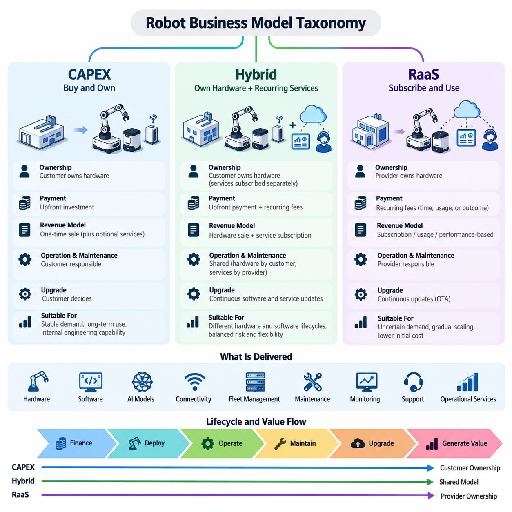{width="7.268055555555556in" height="7.268055555555556in"}

Industrial robot business models define how robotic capabilities are financed, delivered, operated, maintained, and monetized throughout their lifecycle. Unlike conventional equipment procurement, modern robot deployments combine hardware, software, AI models, connectivity, fleet management, maintenance, and operational services. The three dominant structures are capital expenditure (CAPEX), Robot as a Service (RaaS), and hybrid models, each distributing ownership, financial risk, operational responsibility, and technology-upgrade obligations differently.

A CAPEX model treats the robot primarily as a capital asset purchased by the customer. The customer pays a significant portion of the system cost during procurement and normally owns the robot hardware after acceptance. Initial expenditure may include the mobile platform or manipulator, sensors, charging infrastructure, edge computing equipment, integration engineering, safety systems, installation, commissioning, and software licenses required for production operation.

CAPEX is attractive when customers have available investment budgets, predictable long-term workloads, and internal engineering organizations capable of maintaining robotic systems. Manufacturing plants, logistics centers, ports, and large industrial facilities often prefer asset ownership when robots are expected to operate for many years. Depreciation schedules can distribute accounting costs over the equipment lifecycle, while operational teams retain direct control over hardware configuration, maintenance policy, cybersecurity, and production integration.

However, ownership transfers substantial lifecycle risk to the customer. Hardware failures, battery replacement, sensor degradation, compute-platform obsolescence, software maintenance, spare parts, cybersecurity updates, and fleet-management upgrades can create expenses beyond the initial purchase price. Consequently, evaluating a CAPEX deployment requires analysis of total cost of ownership rather than purchase price alone. Integration costs and operational downtime may become as important as the original robot acquisition cost.

Robot as a Service (RaaS) changes the transaction from equipment ownership toward continuous access to robotic capability. Instead of purchasing robots outright, customers typically pay recurring fees based on time, robot quantity, workload, utilization, transactions, or defined service outcomes. The provider may retain ownership of the hardware while supplying software, fleet management, remote monitoring, maintenance, upgrades, and technical support as components of the service relationship.

RaaS reduces the initial financial barrier to automation because large capital investments can be converted into recurring operating expenses. This structure is particularly useful when demand is uncertain, deployment must scale gradually, or customers want to validate automation before committing to long-term ownership. A warehouse, for example, may begin with a limited AMR fleet and expand robot capacity as order volume grows instead of purchasing the maximum projected fleet during the first deployment phase.

The RaaS provider assumes greater operational and financial responsibility than a traditional equipment vendor. Revenue is distributed across months or years while hardware and deployment expenses may occur near the beginning of the contract. Successful RaaS therefore depends on high robot utilization, predictable maintenance expenses, efficient remote operations, standardized deployment procedures, and reliable fleet software. Poor reliability can directly damage profitability because service providers absorb repeated maintenance visits, replacement costs, and contractual availability penalties.

Recurring service models also enable software to become a major source of differentiated value. Fleet optimization, analytics, AI perception, predictive maintenance, digital twins, remote diagnostics, cybersecurity services, and advanced autonomy can be packaged into subscription tiers. This changes the economic role of the robot from a fixed-function machine toward an upgradeable software-defined operational platform. New capabilities can potentially be activated without replacing the complete physical system.

Pricing structures within RaaS can vary considerably. A fixed monthly fee offers predictable budgeting, while usage-based pricing links payment to operating hours, missions, transported pallets, inspected areas, completed picks, or other measurable units. Performance-oriented contracts can associate revenue with outcomes such as throughput, availability, inspection coverage, or productivity improvement. The appropriate metric should be objectively measurable and closely related to the business value delivered by the robotic system.

Hybrid business models combine equipment ownership with recurring digital and operational services. A customer may purchase the robot hardware through CAPEX while subscribing separately to fleet management, AI capabilities, remote support, analytics, OTA updates, or advanced autonomy. Another structure may require a reduced upfront payment followed by recurring service charges. Hybrid approaches allow suppliers and customers to allocate ownership and technology risk according to the characteristics of each deployment.

The hybrid model is especially suitable for industrial robotics because hardware and software often have different economic lifecycles. A mechanical platform may remain operational for many years, while perception models, navigation algorithms, cybersecurity components, and fleet optimization software can evolve continuously. Separating durable hardware ownership from recurring software services allows customers to preserve capital assets while maintaining access to improvements in digital capabilities and operational intelligence.

Business-model selection should therefore consider more than financing preference. Robot lifetime, utilization rate, deployment scale, workload variability, maintenance complexity, integration depth, technology obsolescence, customer engineering capability, required availability, and expected software evolution all influence the appropriate structure. A stable production line with predictable utilization may favor CAPEX, whereas rapidly changing logistics operations may benefit from RaaS or hybrid arrangements that support flexible capacity adjustment.

Risk allocation provides another useful way to distinguish the models. Under CAPEX, the customer carries much of the utilization and lifecycle risk after purchasing the system. Under RaaS, more hardware, reliability, and technology risk can remain with the provider, depending on contractual terms. Hybrid contracts distribute these responsibilities between both parties. Service-level agreements must consequently define availability, response time, maintenance responsibilities, software support, cybersecurity obligations, and performance measurement.

The revenue profile also changes significantly across the taxonomy. CAPEX produces relatively large but transaction-oriented revenue around system delivery, often supplemented by maintenance and engineering services. RaaS creates recurring revenue but requires providers to finance assets and manage long payback periods. Hybrid models can balance initial cash recovery with recurring software and service revenue, making them attractive to robot manufacturers transitioning from equipment sales toward lifecycle-oriented platform businesses.

A mature robot business strategy can support multiple models simultaneously rather than enforcing one commercial structure for every customer. Standardized hardware, modular software licensing, telemetry, remote diagnostics, fleet APIs, OTA infrastructure, and measurable operational KPIs allow the same robotic platform to support CAPEX, RaaS, and hybrid offerings. This commercial flexibility is particularly relevant to industrial applications spanning warehouses, hospitals, factories, farms, construction sites, infrastructure inspection, security operations, and ports.

Ultimately, robot business model design determines how technological capability is translated into sustainable economic value. CAPEX emphasizes ownership and long-term asset control, RaaS emphasizes access, scalability, and service outcomes, while hybrid models combine durable physical assets with continuously evolving digital services. The strongest model aligns customer economics, provider profitability, operational reliability, software evolution, and lifecycle risk so that automation remains valuable throughout the robot\'s useful operating life.

## 11.02. Robot as a Service RaaS Platform Architecture [w/Code]

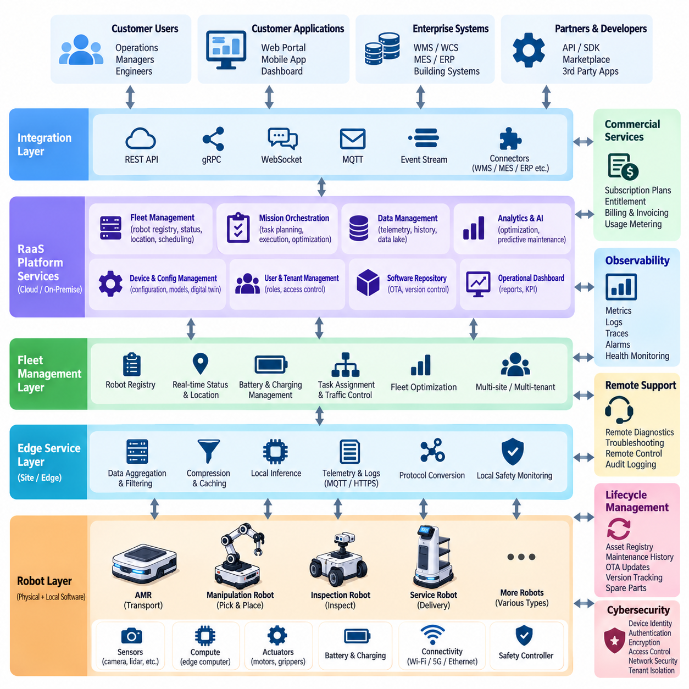{width="7.268055555555556in" height="7.268055555555556in"}

Robot as a Service (RaaS) platform architecture transforms a robot from a standalone physical product into a continuously operated digital service. The architecture must coordinate robot hardware, embedded software, fleet management, cloud or on-premise services, customer applications, billing, monitoring, maintenance, and lifecycle management. Its primary objective is not simply remote robot control, but reliable delivery of measurable robotic capability under a recurring commercial relationship.

At the physical layer, each robot contains the mobility or manipulation platform, sensors, actuators, safety controllers, batteries, communication interfaces, and edge computing resources required for autonomous operation. Local software performs safety-critical control, perception, localization, navigation, manipulation, and mission execution. Essential functions must remain available even when external connectivity is degraded, because cloud dependence must not compromise immediate operational safety or basic autonomy.

An edge service layer connects physical robot functions with the wider RaaS infrastructure. It aggregates telemetry, system health, mission status, diagnostic logs, energy information, software versions, and operational events. The edge layer can also perform data filtering, compression, caching, protocol conversion, and local inference before information leaves the site. This reduces network traffic and allows latency-sensitive processing to remain close to the robot.

Above individual robots, fleet management provides coordinated control of multiple robotic assets. The fleet layer maintains robot identities, availability, locations, battery state, mission queues, charging schedules, traffic constraints, and task assignments. It can dynamically allocate work according to robot capability and operational conditions while preventing resource conflicts. Fleet management therefore becomes a central operational component when RaaS expands from a few robots to tens or hundreds of units.

Mission orchestration connects customer business processes with robot execution. Instead of requiring customers to issue low-level movement commands, the platform accepts operational requests such as transporting materials, inspecting an area, scanning infrastructure, performing patrols, or executing production tasks. These requests are converted into robot missions, assigned to appropriate resources, monitored during execution, and recorded as service transactions for later analysis and commercial measurement.

A RaaS platform normally requires an integration layer that connects robotic operations with enterprise systems. REST APIs, gRPC, WebSocket, MQTT, event streams, or industry-specific interfaces can connect the platform with WMS, WCS, MES, ERP, hospital information systems, building systems, GIS platforms, or customer applications. Stable APIs isolate customer workflows from internal robot implementations, allowing hardware and software components to evolve without repeatedly redesigning enterprise integration.

The cloud or on-premise service layer provides centralized functions that do not need to execute directly on each robot. Typical capabilities include fleet analytics, configuration management, device registries, user management, historical telemetry, reporting, AI model distribution, software repositories, digital twins, and operational dashboards. Multi-site deployments can aggregate information across facilities while maintaining logical separation between customers, sites, fleets, and individual robotic assets.

Observability is particularly important in RaaS because the provider may remain responsible for service availability after deployment. The platform should continuously collect metrics, logs, traces, alarms, mission outcomes, hardware health, network quality, battery condition, and software exceptions. Operations teams can use this information to identify degraded behavior before complete failure occurs, reducing mean time to detect and mean time to repair while improving contractual service availability.

Remote monitoring and support extend observability into active service operations. Authorized engineers may inspect robot state, retrieve logs, restart non-safety-critical services, modify approved configurations, or guide recovery procedures without immediately dispatching personnel to the customer site. Remote actions should be auditable and permission controlled. Physical safety functions must remain protected by local safety mechanisms rather than depending on unrestricted remote commands.

Lifecycle management provides the mechanisms required to operate robots over many years. The platform maintains hardware configurations, firmware versions, software packages, AI models, calibration records, maintenance history, and compatibility information. Over-the-air (OTA) update services can distribute validated releases in controlled stages. Canary deployment, rollback mechanisms, signed packages, and version tracking reduce the risk that a defective update simultaneously disables a large customer fleet.

Cybersecurity must span every architectural layer because RaaS introduces persistent connectivity between robots, customer environments, provider infrastructure, and remote operators. Device identity, mutual authentication, encryption, certificate management, role-based access control, network segmentation, secure boot, signed software, audit logging, and credential rotation establish the basic trust framework. Tenant isolation becomes essential when a common platform manages fleets belonging to multiple organizations.

Commercial services distinguish a complete RaaS platform from conventional fleet-management software. The platform must associate physical assets and digital services with customers, contracts, subscription plans, entitlements, usage records, and service-level agreements. Metering functions can measure robot-hours, completed missions, transported loads, inspection coverage, API consumption, or other contractual units. These records provide the operational evidence required for automated billing and revenue recognition.

Entitlement management controls which capabilities are available to each customer or robot. A basic subscription might provide standard autonomy and monitoring, while higher tiers activate advanced fleet optimization, AI perception, analytics, predictive maintenance, or additional integration APIs. Feature configuration can therefore become part of the commercial architecture. Software-defined capabilities allow providers to expand customer value without necessarily replacing the physical robot platform.

Service-level management connects technical performance with contractual obligations. Availability, mission success rate, response time, recovery time, throughput, and other key performance indicators can be continuously calculated from platform telemetry. When performance approaches contractual thresholds, the system can generate alerts or initiate support workflows. This creates a direct relationship between engineering observability and business operations rather than treating them as separate systems.

Data architecture must distinguish operational data required for immediate robot execution from historical data used for analytics, optimization, AI development, and business reporting. Time-series databases can store telemetry, object storage can retain large sensor or diagnostic files, and relational databases can manage customers, robots, contracts, and transactions. Data retention policies, ownership rules, privacy requirements, and customer isolation should be defined explicitly within the platform.

Reliability engineering is fundamental because recurring revenue depends on sustained operation rather than successful initial installation. Redundant backend services, health checks, automatic failover, local robot autonomy, offline buffering, retry mechanisms, and disaster recovery protect the service against infrastructure failures. The architecture should degrade gracefully so that temporary loss of cloud connectivity does not automatically stop an otherwise safe and operational robot fleet.

As deployments scale, automation becomes necessary for provisioning and operations. New robots should be registered, authenticated, configured, assigned to customers, connected to fleets, and associated with service plans through repeatable workflows. Infrastructure automation and standardized software images reduce deployment variability. A common platform architecture also enables the provider to operate many customers without creating a completely separate engineering solution for every installation.

A mature RaaS architecture ultimately forms a closed lifecycle connecting robot operation, telemetry, service management, commercial measurement, maintenance, software improvement, and customer value. The same platform that dispatches missions can measure performance, detect degradation, schedule maintenance, distribute updates, enforce subscriptions, and produce billing evidence. This integration enables RaaS to scale from individual robot leasing into a software-defined robotic service business capable of supporting large industrial fleets.

## 11.03. ROI Calculation Framework for Robot Deployment

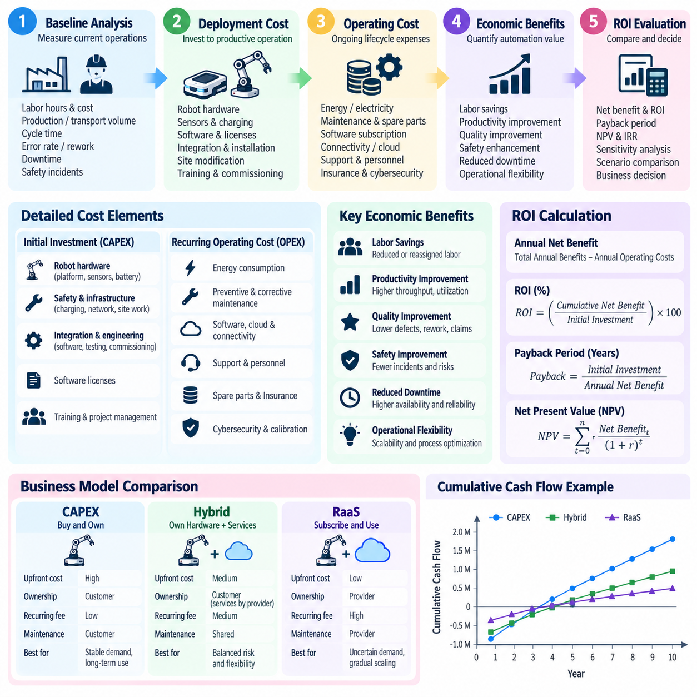{width="7.268055555555556in" height="7.268055555555556in"}

Return on investment (ROI) analysis for robot deployment determines whether automation creates sufficient economic value to justify its acquisition, integration, operation, and lifecycle costs. A useful framework must extend beyond comparing robot purchase price with labor savings. Industrial robots affect throughput, quality, safety, uptime, energy consumption, maintenance, inventory flow, and operational flexibility, requiring benefits and costs to be evaluated across the complete deployment lifecycle.

The first step is to establish a baseline representing current operations before automation. The baseline should quantify labor hours, staffing per shift, production or transport volume, cycle time, error rates, downtime, overtime, safety incidents, rework, and other measurable operating conditions. Without a reliable baseline, improvements attributed to robots cannot be separated from normal production variation, seasonal demand, process redesign, or unrelated operational changes.

Deployment cost should include the complete investment required to reach productive operation. For a CAPEX project, this may include robot hardware, sensors, batteries, charging stations, edge computers, safety equipment, networking, software licenses, installation, engineering, system integration, site modification, testing, employee training, and commissioning. A robot with a low purchase price can still become expensive when extensive facility modification or custom integration is required.

Recurring operating costs must also be incorporated into the calculation. These expenses can include electricity, preventive maintenance, replacement batteries, tires or mechanical components, software subscriptions, connectivity, cloud services, technical support, spare parts, insurance, cybersecurity maintenance, and periodic calibration. Labor does not disappear completely after automation because technicians, fleet operators, supervisors, and support engineers may still be required to maintain reliable robotic operations.

For Robot as a Service (RaaS), the cost structure shifts from large initial capital expenditure toward recurring payments. Monthly subscriptions, robot-hour charges, mission-based fees, support packages, integration services, and performance-related charges should be modeled across the evaluation period. CAPEX and RaaS alternatives should therefore be compared using the same time horizon rather than comparing an equipment purchase price directly with a single month of subscription cost.

Direct labor savings are often the most visible economic benefit. The calculation should identify which activities are genuinely removed, reduced, or reassigned by automation and determine the associated fully burdened labor cost. Wages alone are insufficient because benefits, overtime, recruitment, training, turnover, supervision, and shift premiums can materially influence labor economics. Savings should not be claimed for labor that remains necessary elsewhere in the process.

Productivity improvement provides another major source of value. Robots may operate more consistently across shifts, reduce idle movement, shorten material transportation time, increase equipment utilization, or support longer production hours. Economic value should be calculated from additional useful output rather than theoretical robot speed. If downstream processes cannot consume the additional capacity, a faster robot may improve a local performance metric without generating equivalent business value.

Quality benefits can be converted into economic terms by measuring reductions in defects, damage, incorrect deliveries, missed inspections, process variation, and rework. Vision-guided robots and automated inspection systems may also provide more consistent process records than manual operations. The financial impact includes avoided scrap, reduced reprocessing, fewer customer claims, improved traceability, and prevention of production disruptions caused by undetected quality problems.

Safety improvements should be included when robots remove workers from repetitive, hazardous, heavy-load, contaminated, or high-traffic environments. Quantification can consider historical incident costs, lost working time, compensation, equipment damage, safety administration, and operational interruptions. Safety benefits should be estimated conservatively because the primary objective is risk reduction, while financial savings are a secondary consequence of safer operations.

Availability and reliability strongly influence realized ROI. A robot expected to replace or support a production function creates value only while it is operational and capable of completing assigned missions. Models should therefore incorporate expected uptime, planned maintenance, charging time, failure frequency, recovery time, and mission success rate. Using nominal 24-hour availability without accounting for maintenance and operational interruptions can significantly overestimate economic returns.

A practical annual net benefit can be expressed conceptually as total annual economic benefits minus annual operating costs. Benefits may combine labor savings, productivity gains, quality improvements, avoided downtime, safety improvements, and other measurable value. ROI can then compare cumulative net benefits with the initial investment. The exact formula should remain consistent across alternatives so that different robot configurations or commercial models can be evaluated fairly.

Payback period provides a simple measure of how long the project requires to recover its initial investment. If a deployment costs one million dollars and generates approximately two hundred fifty thousand dollars of verified annual net benefit, the simple payback period is about four years. Although easy to communicate, payback alone ignores benefits occurring after recovery and does not fully represent the time value of money.

For longer projects, discounted cash-flow methods provide a more complete financial evaluation. Net present value (NPV) discounts future cash flows using an appropriate rate, while internal rate of return (IRR) estimates the discount rate at which the project reaches a zero NPV. These methods are especially relevant when comparing robot deployments with different investment timing, service contracts, upgrade schedules, residual values, or expected operating lifetimes.

Sensitivity analysis is essential because robot economics depend on assumptions that may change after deployment. Labor cost, utilization, production volume, maintenance expense, robot availability, subscription price, energy cost, and system lifetime can be varied to create conservative, expected, and optimistic scenarios. This identifies which assumptions dominate the business case and prevents management decisions from depending on a single overly precise forecast.

Utilization is often one of the most influential variables. A robot deployed for a single short shift may have the same acquisition cost as a robot operating across multiple shifts, but the economic return can be very different. Fleet sizing should therefore consider mission demand, peak workload, charging strategy, traffic congestion, redundancy, and seasonal variation. Purchasing more robots than operational demand requires can reduce ROI even when individual robot performance is excellent.

Scaling introduces additional economic effects. A pilot deployment may have high integration cost per robot because infrastructure, interfaces, maps, safety validation, and enterprise integration are created for the first time. When the deployment expands, some of these costs can be shared across a larger fleet. Conversely, large fleets may require additional fleet-management infrastructure, support personnel, network capacity, charging resources, and redundancy that must be included in scale-up projections.

The final ROI framework should connect financial calculations with operational evidence collected after deployment. Telemetry, mission records, throughput data, downtime logs, maintenance history, energy consumption, and quality metrics can replace initial assumptions with measured values. Periodic recalculation reveals whether expected benefits are actually being realized and identifies where software optimization, process redesign, maintenance improvement, or fleet resizing can improve economic performance.

Robot ROI should ultimately be treated as a lifecycle management process rather than a one-time procurement calculation. The strongest business case combines realistic baseline measurements, complete lifecycle costs, measurable operational benefits, reliability assumptions, scenario analysis, and post-deployment verification. This approach allows organizations to compare CAPEX, RaaS, and hybrid alternatives consistently while ensuring that robot deployment decisions remain connected to sustainable operational and financial value.

## 11.04. SW Subscription and Licensing Model for Robots

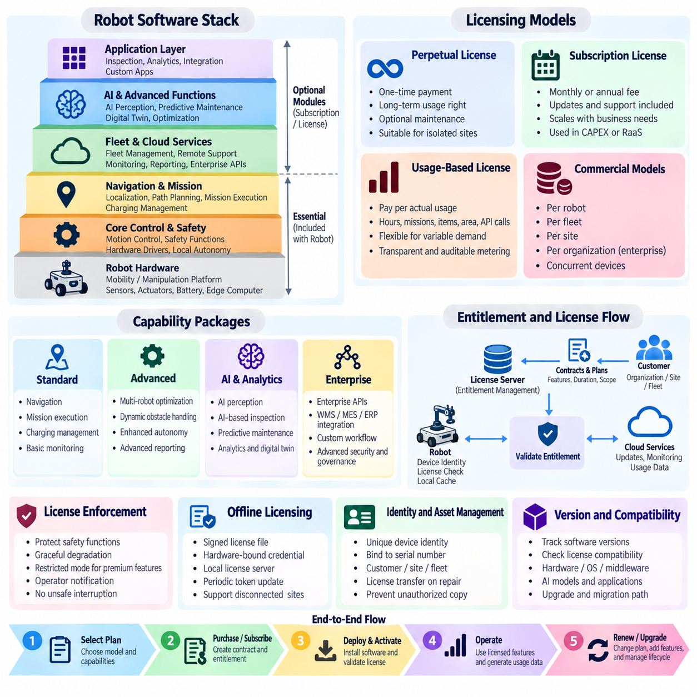{width="7.268055555555556in" height="7.268055555555556in"}

Software subscription and licensing models allow robot manufacturers to separate the value of physical hardware from continuously evolving digital capabilities. Instead of embedding every software function permanently into the robot purchase price, vendors can package autonomy, fleet management, AI perception, analytics, remote support, and enterprise integration as licensed services. This creates recurring revenue while allowing customers to select capabilities appropriate to their operational requirements.

A robot software portfolio can be organized into functional layers with different licensing characteristics. Core motion control, safety functions, hardware drivers, and essential local autonomy are normally required for basic robot operation. Higher-level capabilities such as advanced navigation, fleet optimization, AI inspection, predictive maintenance, digital twins, reporting, and enterprise APIs can be offered as optional modules or subscription services without changing the underlying physical platform.

Perpetual licensing represents the traditional software ownership model. Customers purchase a license that grants long-term rights to use a specified software version, often combined with separate maintenance or support agreements. This approach provides predictable ownership conditions and may suit customers operating isolated industrial networks. However, major upgrades, new AI models, cybersecurity improvements, and advanced features may require additional licenses or maintenance contracts.

Subscription licensing converts software access into recurring monthly or annual payments. Customers retain access to licensed capabilities while the subscription remains active, and the provider can include updates, technical support, cloud services, monitoring, and new software releases within the package. This structure aligns naturally with Robot as a Service (RaaS), but it can also be applied to customer-owned robots purchased through a capital expenditure model.

Licensing can be assigned at several levels depending on the product architecture. A license may belong to an individual robot, a fleet, a site, an organization, or a defined number of concurrent devices. Per-robot licensing is simple to understand and scales directly with fleet size, while site licenses may be more appropriate for large factories or warehouses. Enterprise agreements can provide broader usage rights across multiple facilities under centralized commercial governance.

Capability-based licensing enables customers to purchase software according to operational requirements rather than receiving a single fixed configuration. A standard package might provide navigation, mission execution, charging management, and basic monitoring. Advanced packages could enable multi-robot optimization, semantic perception, dynamic obstacle handling, AI-based inspection, predictive diagnostics, or sophisticated analytics. This modular structure supports different customer segments using a common robot platform.

Usage-based licensing links software charges to actual consumption. Pricing units may include robot operating hours, completed missions, transported pallets, processed items, inspection distance, scanned area, AI inference volume, API transactions, or stored data. Usage metering can reduce initial commitment for customers with variable demand, but the measurement mechanism must be transparent, reproducible, and auditable to prevent disputes regarding billing.

Feature entitlements provide the technical mechanism connecting commercial contracts with robot software. An entitlement service records which customer, robot, fleet, or site is authorized to use each capability. When software starts or requests a protected function, the system validates the applicable entitlement. Local caching can preserve approved capabilities during temporary network outages so that connectivity problems do not unexpectedly interrupt safe industrial operations.

License enforcement must be designed carefully because robots interact with physical environments. Expired subscriptions should not cause abrupt behavior that creates operational or safety hazards. Safety control, controlled stopping, recovery, and other essential functions must remain available regardless of commercial license state. Nonessential premium functions can enter a restricted mode while operators receive sufficient notification and time to manage the commercial issue without unsafe interruption.

Offline licensing is important for factories, critical infrastructure, secure facilities, and other environments where robots cannot maintain continuous internet access. Signed license files, hardware-bound credentials, local license servers, or periodically refreshed authorization tokens can support disconnected operation. The architecture should balance commercial protection with operational continuity, avoiding designs that require constant communication with an external licensing server for basic robot functionality.

Identity management establishes the relationship between software licenses and physical assets. Each robot can possess a unique device identity associated with its serial number, secure hardware credential, customer account, site, and fleet membership. When components are repaired or replaced, controlled procedures should transfer or reissue licenses without creating unauthorized duplicates. Accurate asset identity is therefore essential for both cybersecurity and commercial administration.

Software versions and license compatibility must be managed together. A customer may be entitled to a feature but operate firmware or middleware that does not support the required software release. The platform should track compatible combinations of robot hardware, operating system, middleware, AI models, application software, and licensed functions. This prevents unsupported upgrades and helps service teams determine which capabilities can safely be activated on each deployed robot.

Subscription tiers provide a convenient way to package multiple capabilities into understandable commercial offerings. A basic tier can cover essential fleet visibility and software maintenance, while professional or enterprise tiers add optimization, advanced analytics, AI capabilities, remote diagnostics, integration APIs, or higher support levels. Tier design should reflect measurable customer value rather than arbitrary software restrictions, otherwise customers may perceive licensing primarily as a barrier.

Over-the-air (OTA) infrastructure can connect licensing with continuous feature delivery. New functions may be deployed to compatible robots but remain inactive until the appropriate entitlement is granted. This allows software-defined feature activation without a physical service visit. Controlled rollout, package signing, compatibility validation, rollback, and audit records are required so that commercial feature activation does not bypass engineering validation or operational safety procedures.

AI capabilities introduce additional licensing possibilities because models can evolve independently from conventional robot software. Specialized perception models, language interfaces, inspection models, optimization policies, or domain-specific autonomy can be distributed as separately licensed packages. Customers may subscribe to model families or capability bundles, while providers continuously improve the underlying models and deploy validated versions through managed lifecycle processes.

Fleet and enterprise licensing become increasingly important as customers operate heterogeneous robots across multiple sites. A centralized licensing service can maintain organization-level contracts while distributing entitlements to individual sites and robots. Administrators can allocate purchased capacity, move licenses between eligible assets, monitor utilization, and review upcoming renewals. This reduces administrative complexity compared with manually managing independent licenses for every robot.

Commercial systems should integrate licensing information with customer relationship management, billing, asset management, support, and RaaS platforms. Subscription activation, renewal, suspension, upgrades, and usage records can then flow through automated business processes. Technical telemetry can confirm actual utilization, while commercial systems translate that utilization into invoices, entitlement changes, support levels, and account reporting without requiring repeated manual reconciliation.

A mature licensing strategy must also consider software ownership, third-party components, open-source obligations, data rights, cybersecurity updates, and end-of-support policies. Contracts should distinguish the customer\'s right to use software from ownership of intellectual property and clarify which updates are included. Security patches may require different treatment from optional commercial features because maintaining a secure deployed fleet benefits both the provider and customer.

Ultimately, robot software licensing should support long-term operational value rather than simply restrict functionality. A well-designed model combines stable core robot capabilities with modular subscriptions, transparent usage measurement, safe entitlement enforcement, offline operation, controlled OTA delivery, and scalable enterprise administration. This enables robot providers to build recurring software revenue while allowing customers to expand capabilities gradually as operational requirements and fleet scale evolve.

## 11.05. Data Monetization Strategy Robot Fleet Data

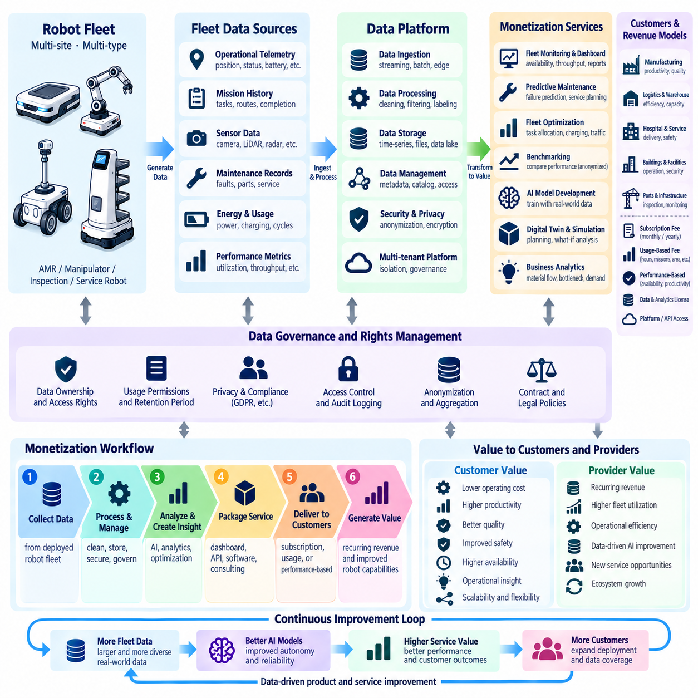{width="7.268055555555556in" height="7.268055555555556in"}

Robot fleet data can become a strategic economic asset when operational information is transformed into measurable services, insights, and continuously improving robotic capabilities. A fleet generates telemetry, mission histories, sensor observations, maintenance records, energy profiles, traffic patterns, failure events, and performance metrics. Data monetization does not simply mean selling raw data; it means creating additional customer or provider value from information produced during robot operation.

A data monetization strategy begins by identifying which data is generated and who has legitimate rights to use it. Robot manufacturers, RaaS providers, system integrators, site operators, and end customers may have different interests in operational information. Contracts should therefore distinguish data ownership, access rights, processing permissions, retention periods, permitted secondary uses, and responsibilities when data contains confidential business or personally identifiable information.

Operational telemetry is one of the most scalable fleet data sources. Robots continuously produce position, velocity, battery state, temperature, compute utilization, network quality, mission status, fault codes, and component health information. Individual records may have limited commercial value, but aggregated histories can reveal utilization patterns, reliability trends, energy behavior, congestion, and performance degradation that support higher-value operational services.

The first monetization layer is often improved customer visibility rather than direct data sales. Fleet dashboards can transform raw telemetry into information about robot availability, completed missions, throughput, charging behavior, downtime, and service-level performance. Basic monitoring may be included in a standard service package, while advanced analytics, long-term historical reporting, benchmarking, and automated recommendations can become premium subscription capabilities.

Predictive maintenance provides a strong example of indirect data monetization. Historical fault events, motor currents, temperatures, vibration measurements, battery behavior, and maintenance outcomes can be used to estimate component degradation and failure probability. Customers gain value through reduced unplanned downtime and better maintenance scheduling, while providers can monetize predictive diagnostics through service subscriptions, availability guarantees, or premium maintenance contracts.

Fleet optimization creates value by using historical and real-time data to improve task allocation, traffic management, charging schedules, robot utilization, and capacity planning. Instead of charging customers specifically for collected data, providers can sell optimization as a software capability. The underlying fleet data becomes the resource that enables measurable improvements in throughput, mission completion time, energy efficiency, and infrastructure utilization.

Benchmarking can provide another commercial service when data from multiple robots, sites, or operational periods is normalized appropriately. Customers may compare utilization, mission success rate, energy efficiency, maintenance frequency, or downtime against internal targets or anonymized peer groups. Such benchmarking must avoid exposing another customer\'s confidential information, making aggregation, anonymization, access control, and minimum cohort requirements important architectural safeguards.

Sensor data can support development of improved AI models and autonomy functions. Camera images, LiDAR measurements, radar observations, localization traces, manipulation outcomes, and operator interventions may reveal difficult environmental conditions or failure cases. When contractual permissions allow, selected fleet data can support model training, validation, simulation, and regression testing, creating a feedback loop in which deployed robots continuously contribute to future software capability.

Data selection is critical because storing every sensor stream indefinitely is rarely economically efficient. High-bandwidth video, point clouds, and diagnostic recordings can create substantial network and storage costs. Event-driven collection can preserve information around failures, unusual scenes, low-confidence predictions, safety interventions, or mission exceptions while reducing unnecessary transfer. Edge filtering and compression can further control infrastructure cost while retaining high-value evidence.

Digital twin services provide another pathway for monetizing operational data. Fleet telemetry can update virtual representations of robots, facilities, missions, and resource utilization. Customers can use these models to analyze bottlenecks, evaluate fleet expansion, test charging strategies, or compare operational scenarios before changing the physical system. Digital twin capabilities can therefore be packaged as planning, simulation, optimization, or consulting services.

Robot data can also support business-level analytics beyond engineering operations. Mission histories may reveal material-flow patterns, inspection coverage, asset utilization, production bottlenecks, service demand, or facility congestion. When combined with WMS, MES, ERP, GIS, or other enterprise information, robot data can contribute to broader operational intelligence. The monetizable product becomes the decision support generated from integrated data rather than the telemetry itself.

Usage metering links fleet data directly to commercial transactions. Robot operating hours, completed missions, transported pallets, inspected distance, scanned area, successful picks, AI inference requests, or API transactions can serve as billing units for RaaS and software subscriptions. Metering systems must maintain accurate timestamps, asset identities, contract associations, and audit trails so that invoices can be reconciled with verifiable operational evidence.

Data products should be organized according to customer value rather than database structure. A customer generally does not want millions of raw telemetry records; it wants answers about productivity, reliability, cost, capacity, risk, and future requirements. Analytics services should therefore convert data into indicators, trends, forecasts, alerts, recommendations, and automated actions. Higher-value products increasingly move from describing what happened toward predicting what will happen and recommending what should be done.

Privacy and confidentiality can determine whether a monetization strategy is commercially viable. Camera streams may capture workers, customers, vehicle identifiers, documents, or sensitive areas, while robot trajectories can reveal facility layouts and production processes. Data minimization, masking, anonymization, encryption, retention controls, tenant isolation, and role-based access should therefore be integrated into the data platform rather than added after commercial services are launched.

Cybersecurity is equally important because centralized fleet data can expose operational details about valuable industrial infrastructure. Data should be protected during collection, transmission, storage, processing, and deletion. Device authentication, encrypted communication, secure APIs, audit logging, access control, key management, and anomaly detection reduce the risk of unauthorized access. Monetization cannot sustainably depend on practices that weaken the security of customer operations.

Data quality directly affects the value of analytics and AI services. Missing telemetry, inconsistent timestamps, incorrect robot identities, sensor calibration errors, and incompatible software versions can produce misleading conclusions. A fleet data platform therefore requires common schemas, time synchronization, metadata management, validation rules, lineage tracking, and version information. Reliable data products depend on engineering discipline throughout the collection pipeline.

Cross-customer learning requires particularly careful governance. Aggregated fleet experience may help a provider improve navigation, reliability models, maintenance procedures, or AI performance across its installed base. However, knowledge derived from one customer\'s operations should not expose that customer\'s confidential processes to another. Governance policies should define which information can be aggregated, transformed, anonymized, or reused for generalized product improvement.

The economic value of fleet data should also be measured against its collection and processing cost. Connectivity, cloud computing, storage, data engineering, cybersecurity, model training, compliance, and support all create expenses. A data product is sustainable only when its customer value or internal cost reduction exceeds these lifecycle costs. Retention policies and service tiers can prevent low-value historical data from becoming an uncontrolled infrastructure burden.

A mature robot fleet data strategy ultimately creates a closed value loop between operation and improvement. Robots generate evidence, the platform converts evidence into insight, insights improve maintenance and fleet decisions, and selected data improves software and AI capabilities that return to deployed robots. Monetization emerges from better uptime, optimization, premium analytics, predictive services, digital twins, usage-based billing, and continuously improving autonomy rather than from indiscriminate sale of raw operational data.

## 11.06. Remote Monitoring and Support Service Design [w/Code]

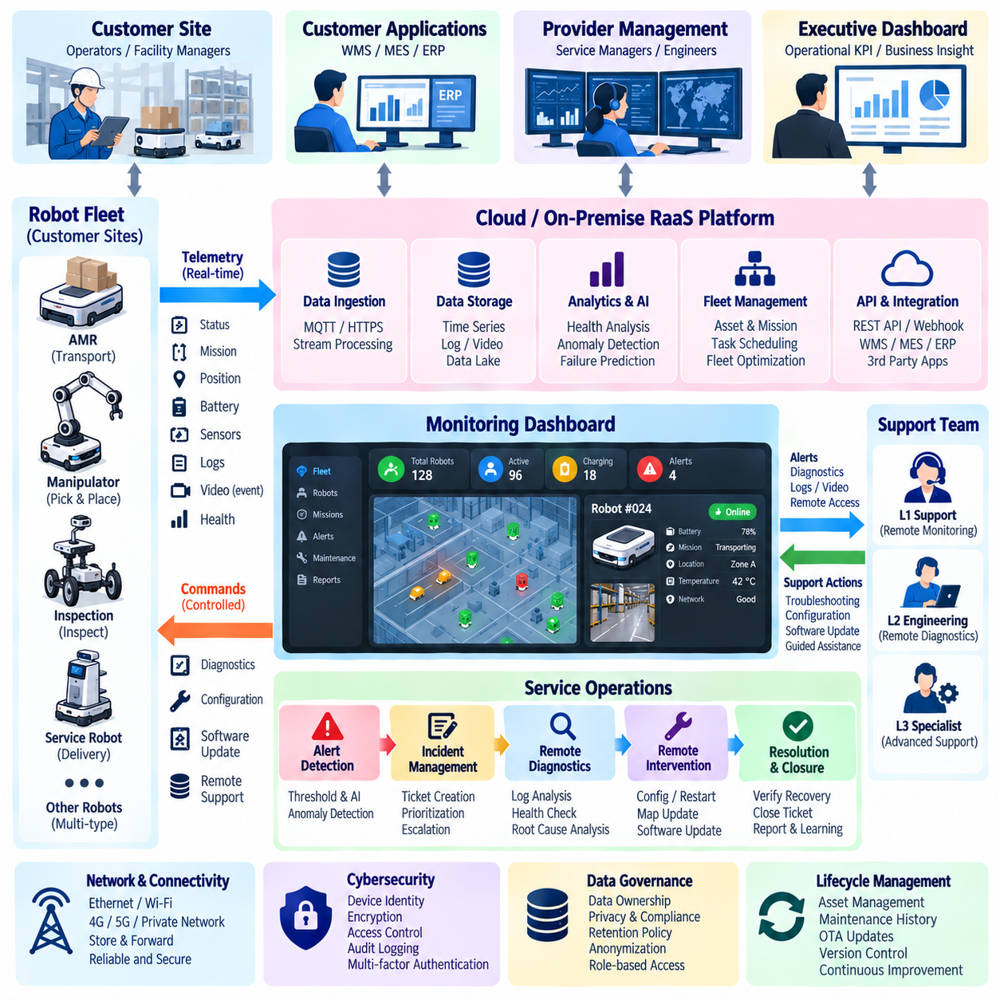{width="7.268055555555556in" height="7.268055555555556in"}

Remote monitoring and support services extend robot operations beyond the physical site by connecting deployed fleets with centralized technical expertise. A service platform can continuously observe robot health, mission status, connectivity, software state, battery condition, and operational exceptions. This enables providers to identify problems earlier, assist local operators, reduce unnecessary site visits, and maintain service quality across geographically distributed robot deployments.

The service architecture should separate local robot control from remote supervision. Safety-critical motion, obstacle avoidance, emergency stopping, and essential recovery functions must remain executable locally even when external connectivity is unavailable. Remote systems should supervise, diagnose, configure, and support operations without becoming a mandatory dependency for basic safety. This separation preserves operational continuity during network degradation or cloud service interruption.

Robot telemetry forms the primary information channel for remote monitoring. Position, velocity, mission state, battery level, charging status, temperatures, motor currents, compute utilization, sensor health, network quality, fault codes, and software versions can be collected at appropriate frequencies. Edge preprocessing can summarize high-rate signals and transmit exceptions or statistical indicators, reducing bandwidth while preserving information needed for diagnosis.

A centralized monitoring service converts telemetry into fleet-level operational visibility. Dashboards can display robot availability, active missions, idle assets, charging states, alarms, degraded components, and communication failures across customer sites. Operators should be able to move from a fleet summary to an individual robot timeline, allowing abnormal behavior to be investigated without manually collecting logs from each physical machine.

Event and alert management determines which conditions require human attention. Threshold rules can detect overheating, low battery health, localization degradation, repeated mission failures, communication loss, or abnormal component behavior. More advanced systems can combine historical patterns with anomaly detection to identify emerging problems before a hard failure occurs. Alerts should be prioritized according to operational impact, urgency, and required response.

Support workflows should connect detected events with structured incident management. An alert can automatically create a service ticket containing the robot identity, site, software version, recent telemetry, relevant logs, fault codes, and mission context. Support engineers can then investigate the incident using consistent evidence rather than requesting information manually from the customer. Ticket status, ownership, escalation, resolution, and closure should remain traceable throughout the service process.

Remote diagnostics can substantially reduce mean time to repair by giving authorized engineers controlled access to operational evidence. Diagnostic tools may retrieve logs, inspect configuration, execute health checks, verify network connectivity, review sensor status, and compare current behavior with historical baselines. Automated diagnostic routines can classify common faults and recommend recovery actions, allowing first-line support personnel to resolve routine incidents without specialist intervention.

Remote intervention should use multiple levels of authority rather than unrestricted control. Low-risk actions may include restarting an application, refreshing a map, clearing a recoverable fault, or requesting a diagnostic snapshot. Higher-risk actions involving motion, configuration changes, firmware, or safety-related parameters require stronger authorization and local confirmation. Every intervention should be authenticated, logged, time-stamped, and associated with a responsible operator.

Human remote assistance becomes valuable when autonomy encounters situations that cannot be resolved reliably by the robot. An operator may review camera or sensor information, clarify an ambiguous environment, select a recovery option, or provide limited guidance. Remote assistance should not automatically become continuous teleoperation, because excessive dependence on human operators reduces fleet scalability and can transform autonomous robots into labor-intensive remotely operated systems.

Network design strongly influences remote support quality. Robot sites may use Ethernet, industrial Wi-Fi, private cellular networks, public 4G or 5G, or combinations of these technologies. Monitoring services should tolerate temporary packet loss, variable latency, limited bandwidth, and complete disconnection. Local buffering, store-and-forward transmission, reconnect logic, and prioritized telemetry allow important operational records to survive unstable communication conditions.

Cybersecurity must be integrated into every remote support function because remote connectivity creates a potential path into physical robotic systems. Mutual authentication, encrypted communication, role-based access control, least-privilege permissions, secure credential storage, session expiration, and audit logging should protect support interfaces. Administrative access should be separated from routine monitoring, and sensitive remote actions may require multi-factor authentication or explicit customer approval.

Video and high-bandwidth sensor streams require additional controls. Continuous transmission can create excessive network and cloud costs while exposing sensitive information about workers, facilities, or production processes. Streaming should therefore be activated only when operationally justified, with configurable resolution, retention, masking, and access policies. Event-triggered recording can preserve evidence surrounding failures without continuously exporting large volumes of site data.

Service-level agreements define the commercial expectations surrounding remote support. Contracts can specify monitoring coverage, support hours, incident severity classes, acknowledgement time, response time, target restoration time, software support scope, and escalation procedures. Premium service tiers may provide continuous monitoring, faster response, dedicated support personnel, predictive diagnostics, or availability commitments, converting technical support capabilities into recurring service revenue.

Predictive support moves the service model from reacting to failures toward preventing them. Historical telemetry and maintenance records can identify battery degradation, motor wear, sensor instability, thermal problems, or increasing recovery frequency. Maintenance can then be scheduled before operational failure occurs. The economic value comes from reduced unplanned downtime, improved spare-parts planning, fewer emergency visits, and more predictable fleet availability.

Remote support should integrate with over-the-air software lifecycle management. When an incident is associated with a known software defect, validated patches can be delivered to affected robots through controlled deployment procedures. Version compatibility, package signing, staged rollout, health verification, and rollback capabilities reduce the risk of introducing new failures. Monitoring after an update confirms whether the software change actually resolved the original problem.

Knowledge management increases support efficiency as the installed robot base grows. Resolved incidents can be converted into searchable troubleshooting procedures, fault signatures, diagnostic rules, and automated recovery recommendations. Similar incidents across customers can reveal recurring hardware, software, integration, or environmental problems. This accumulated service knowledge reduces repeated investigation effort and provides engineering teams with evidence for systematic product improvement.

Support performance should be measured using operational metrics rather than ticket volume alone. Useful indicators include mean time to detect, mean time to acknowledge, mean time to diagnose, mean time to repair, first-contact resolution rate, repeated incident rate, remote resolution rate, robot availability, and customer-impact duration. These measurements reveal whether monitoring and support processes are actually improving fleet reliability and customer operations.

A scalable support organization should use automation to prevent service workload from increasing linearly with fleet size. Automatic health checks, alert correlation, log collection, diagnostic classification, self-recovery, knowledge-based recommendations, and predictive maintenance can handle routine conditions without continuous human attention. Engineers can then focus on novel or high-impact failures while the platform manages repetitive monitoring and first-level diagnosis.

A mature remote monitoring and support service ultimately forms a closed operational improvement loop. Robots generate telemetry and incidents, monitoring services identify abnormal conditions, support systems coordinate diagnosis and recovery, and resolved cases become knowledge for future automation and product improvement. This structure transforms after-sales support from a reactive maintenance function into a scalable digital service that improves uptime, customer confidence, lifecycle performance, and recurring business value.

## 11.07. OTA Based Feature Unlock and Upsell

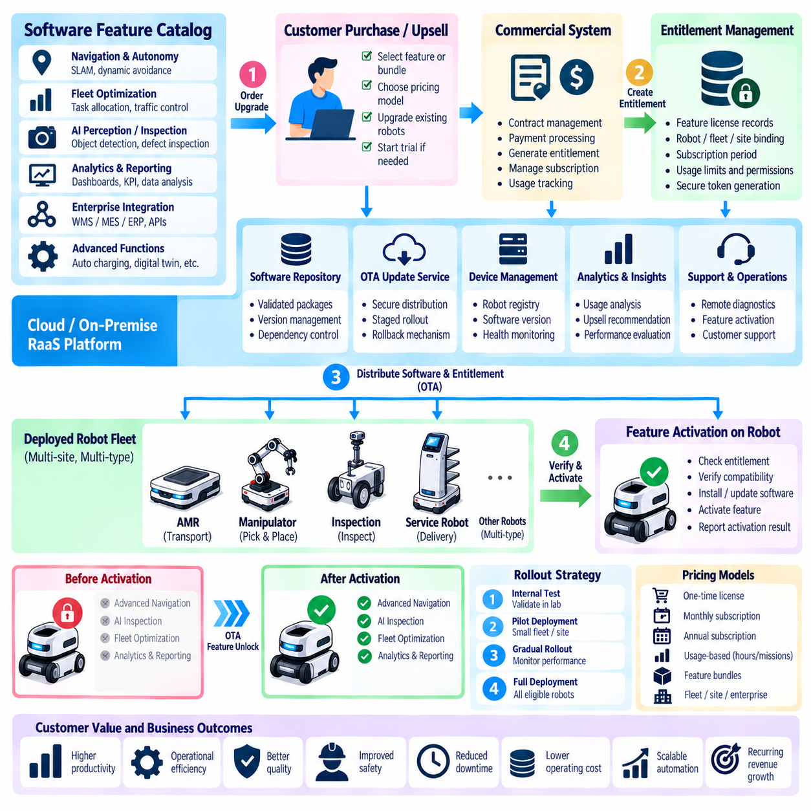{width="7.268055555555556in" height="7.268055555555556in"}

Over-the-air (OTA) feature unlocking allows robot providers to activate new software-defined capabilities on deployed robots without replacing hardware or requiring a technician to visit the customer site. A robot can be delivered with a common software platform while specific functions remain controlled by digital entitlements. Customers can later purchase additional capabilities as operational requirements evolve, creating a direct connection between software lifecycle management and recurring commercial growth.

The model is particularly effective when a common hardware platform supports multiple customer configurations. Navigation functions, fleet coordination, advanced perception, inspection algorithms, analytics, integration interfaces, autonomous charging, or optimization modules can exist within compatible software packages but remain inactive until authorized. Standardizing the physical platform reduces manufacturing complexity while software-defined configuration enables differentiated commercial offerings.

Feature unlocking requires clear separation between software availability and commercial entitlement. An OTA system may distribute a validated software package to many robots, while an entitlement service determines which devices are permitted to execute specific capabilities. This separation allows providers to maintain consistent software versions across a fleet without automatically granting every customer access to every commercial feature contained within the release.

The activation workflow should connect customer purchase, contract management, entitlement generation, deployment, and verification. After a customer orders an upgrade, the commercial system can create or modify the appropriate entitlement for a robot, fleet, site, or organization. The robot then receives the authorization securely, validates its authenticity, activates the approved capability, and reports successful activation so that technical and commercial records remain synchronized.

Upselling becomes more effective when additional capabilities correspond to observable operational needs. Fleet data may reveal increasing traffic congestion, repeated manual recovery, growing inspection demand, low utilization, or inefficient charging behavior. These patterns can indicate that advanced optimization, perception, analytics, or automation modules could create measurable value. Recommendations should therefore be based on customer outcomes rather than indiscriminate promotion of software features.

Trial activation can reduce customer uncertainty before a permanent purchase. A provider may temporarily enable an advanced feature for a defined period, robot group, or operational workload and measure its effect on throughput, mission success, downtime, energy consumption, or operator workload. At the end of the trial, objective performance evidence can support the purchasing decision. Trial entitlements should expire predictably without disrupting safety-critical robot operation.

Feature packaging determines how customers understand and purchase software capabilities. Individual features can provide maximum flexibility, but excessive fragmentation may create commercial complexity. Capability bundles can group related functions such as advanced navigation, AI inspection, fleet optimization, or enterprise integration into understandable packages. Subscription tiers can further combine multiple bundles with support, analytics, and software maintenance into recurring service offerings.

Pricing should reflect customer value, deployment scale, and the provider\'s continuing service obligations. Feature upgrades may be sold through one-time licenses, monthly subscriptions, annual subscriptions, usage-based charges, or combinations of these models. Fleet-wide or site-wide activation can simplify large deployments, while per-robot licensing can suit smaller installations. Pricing should remain transparent enough for customers to connect additional software cost with expected operational benefit.

OTA feature delivery must remain separate from safety authorization. A commercially purchased capability should not become operational merely because payment has been completed. Hardware compatibility, software dependencies, sensor availability, compute capacity, safety configuration, and site conditions may need verification before activation. Features affecting motion or physical interaction should pass the same engineering validation and operational approval processes as other robot software changes.

Secure software delivery is fundamental to the model. OTA packages should be digitally signed and verified before installation, while encrypted communication protects distribution and entitlement information. Secure boot, package integrity checking, device identity, access control, and protected credential storage can prevent unauthorized modification or activation. Audit records should identify what feature was delivered, which robot received it, who authorized it, and when activation occurred.

Staged rollout reduces the operational risk of introducing new capabilities across a large installed fleet. A feature can first be activated on internal systems, test robots, or a small customer group before broader deployment. Health indicators and performance metrics can be monitored during each stage. If abnormal behavior appears, deployment can be paused or rolled back before the issue affects a large number of production robots.

Rollback capability is especially important because feature activation may alter interactions among software components. A newly enabled perception model, planner, optimization policy, or integration module can produce unexpected behavior even when individual components have passed testing. The platform should retain a known-good configuration and support controlled restoration of software, parameters, and entitlements when post-deployment validation identifies unacceptable performance.

Hardware capability must also be considered when selling software-defined upgrades. Older robots may lack the sensors, memory, compute performance, communication interfaces, or actuator capabilities required by newer features. A compatibility service can evaluate each robot before purchase or activation and indicate whether the feature is directly supported, requires a hardware upgrade, or is unavailable. This prevents customers from purchasing capabilities that cannot operate reliably on their installed assets.

Offline and intermittently connected robots require resilient entitlement management. Authorization information can be securely cached on the device with defined validity periods, allowing licensed functions to continue during temporary network outages. When connectivity returns, the robot can synchronize entitlement status, usage records, and software state. Expiration or revocation policies should provide controlled transition behavior rather than abruptly disabling functions during active missions.

Usage telemetry can connect feature activation with measurable value realization. After an upgrade, the platform can track how frequently the capability is used and whether expected improvements occur in productivity, reliability, quality, energy efficiency, or operator workload. Customers can receive reports demonstrating the effect of purchased features, while providers gain evidence for product development, pricing refinement, renewal discussions, and future upgrade recommendations.

OTA-based upselling can also support progressive robot capability over the asset lifecycle. A customer may initially purchase a basic autonomous platform and later add multi-robot coordination, advanced perception, predictive maintenance, AI inspection, or enterprise integration. The physical robot therefore does not remain functionally fixed at the time of purchase. Its commercial and operational value can increase as validated software capabilities are introduced over several years.

Feature deactivation requires the same engineering discipline as activation. Subscription expiration, contract changes, asset transfer, or customer requests may require an entitlement to be removed. The system should determine whether the capability is currently involved in an active mission and transition the robot to an appropriate supported configuration. Safety, recovery, diagnostic access, and essential operation should never depend on the continued availability of an optional commercial feature.

Commercial and technical systems must maintain a consistent source of truth for feature status. Customer relationship management, billing, licensing, OTA management, fleet management, asset databases, and support systems should agree on which capabilities have been purchased, deployed, activated, suspended, or retired. Automated synchronization reduces manual errors and enables customer support teams to distinguish licensing problems from software, hardware, or operational failures.

A mature OTA feature unlock strategy transforms the robot from a fixed-function product into an evolving software-defined asset. Secure delivery, entitlement management, compatibility validation, staged rollout, rollback, telemetry, and lifecycle governance allow capabilities to expand without sacrificing operational reliability. When upselling is tied to demonstrated customer value, OTA activation can create recurring revenue while extending robot usefulness and strengthening long-term customer relationships.

## 11.08. Robot Marketplace API and App Ecosystem

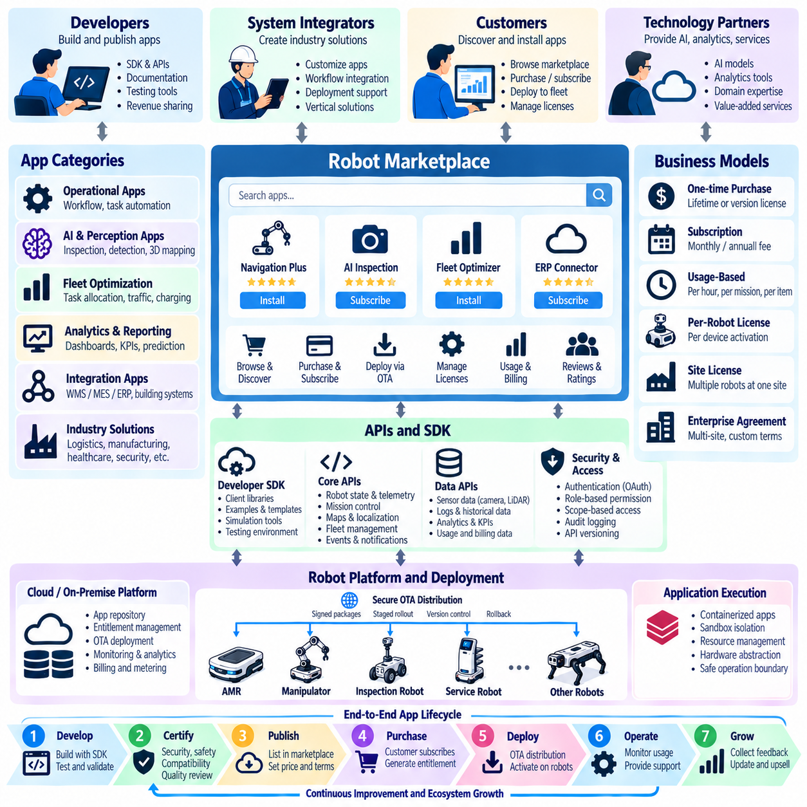{width="7.268055555555556in" height="7.268055555555556in"}

A robot marketplace extends a robotic platform from a closed product into an ecosystem where customers, developers, system integrators, and technology partners can exchange software capabilities and services. Applications may provide perception, inspection, workflow automation, analytics, fleet optimization, enterprise integration, or industry-specific functions. The marketplace becomes a commercial distribution layer connecting reusable software innovation with deployed robot fleets.

The ecosystem requires a stable platform architecture that separates robot hardware, core system software, application services, and external extensions. Developers should be able to create new capabilities without modifying safety-critical control or proprietary low-level components. Standard interfaces expose approved robot functions while preserving architectural boundaries. This separation enables third-party innovation without allowing applications unrestricted access to physical control resources.

Application programming interfaces (APIs) form the technical foundation of the ecosystem. APIs can expose robot state, mission requests, maps, localization information, sensor-derived events, fleet status, task queues, charging information, and analytics. Interfaces should use consistent data models, authentication mechanisms, error handling, and versioning policies. Stable APIs reduce integration cost and allow applications to remain compatible as underlying robot hardware and software evolve.

An application software development kit (SDK) can simplify development beyond raw API access. The SDK may provide client libraries, data structures, authentication utilities, simulation interfaces, example applications, testing tools, and deployment templates. Developers can concentrate on business logic rather than repeatedly implementing communication and platform integration. Clear documentation and reference implementations further reduce the time required to move from prototype to deployable application.

The marketplace can support several application categories according to customer needs. Operational applications may manage workflows or specialized missions, while AI applications can add perception, classification, inspection, or decision-support capabilities. Integration applications may connect robots with WMS, MES, ERP, building systems, or industrial equipment. Analytics applications can transform fleet data into performance indicators, forecasts, alerts, and optimization recommendations.

A permission model is essential because marketplace applications may interact with valuable physical assets and operational data. Each application should request only the capabilities required for its function, such as reading telemetry, submitting missions, accessing selected sensors, or receiving events. Role-based and scope-based authorization can restrict access to specific robots, fleets, sites, or data domains. Customers should understand what permissions an application receives before installation.

Application isolation prevents third-party software from destabilizing core robot functions. Containerization, sandboxing, resource quotas, process isolation, and controlled communication interfaces can limit the effect of application failures. CPU, memory, storage, network bandwidth, and accelerator usage may require explicit allocation. Safety-critical control should remain protected from application crashes, excessive resource consumption, or unauthorized commands generated by ecosystem software.

Marketplace applications require a certification process before they can be distributed broadly. Validation may examine API compliance, software quality, cybersecurity, resource consumption, compatibility, privacy behavior, failure handling, and operational safety. Applications that influence robot motion or physical interaction require stricter assessment than reporting or visualization tools. Certification establishes a minimum quality boundary without requiring the platform provider to develop every application internally.

Application packaging should include metadata describing supported robot models, software versions, hardware requirements, required sensors, permissions, dependencies, geographic availability, and commercial terms. Before installation, the platform can compare these requirements with the target robot or fleet configuration. Compatibility checks reduce deployment failures and prevent customers from purchasing applications that cannot operate correctly on their installed robotic assets.

Distribution can be integrated with over-the-air deployment infrastructure. After an application is purchased or approved, the marketplace can generate the appropriate entitlement and trigger secure delivery to selected robots, edge servers, or site infrastructure. Digitally signed packages, integrity verification, staged rollout, health monitoring, and rollback provide controlled deployment. Marketplace distribution therefore becomes part of the broader robot software lifecycle rather than a separate installation mechanism.

Commercial models can include one-time purchases, monthly or annual subscriptions, usage-based fees, per-robot licenses, site licenses, or enterprise agreements. Revenue sharing allows external developers and partners to receive a portion of marketplace income while the platform provider supplies distribution, billing, licensing, and infrastructure. Clear commercial rules encourage ecosystem participation while giving customers predictable methods for purchasing and managing software capabilities.

Usage metering can support flexible application business models. An AI inspection application might charge according to inspected items, an optimization service according to robot-hours, and a mapping application according to processed area. Metering must associate usage with the correct application, customer, site, and asset while maintaining auditable records. Transparent measurement is necessary when marketplace transactions become part of operational service billing.

Developer portals provide the organizational interface to the ecosystem. Developers can register applications, obtain credentials, access documentation, test APIs, manage versions, review certification results, publish releases, and monitor usage or revenue. Sandbox environments and simulators allow software to be evaluated before accessing production robots. Efficient developer tooling lowers entry barriers and increases the number of useful applications that can be created for the platform.

Version management becomes important as APIs, robot software, and applications evolve independently. The platform should define compatibility policies, deprecation periods, migration procedures, and long-term support expectations. Applications should declare which API versions they require, while marketplace services prevent incompatible combinations from being deployed. Predictable version governance protects customers from ecosystem fragmentation and reduces maintenance burden for developers.

Data governance must define how applications access, process, retain, and export robot information. Some applications may require only derived telemetry, while others may use images, point clouds, maps, mission histories, or enterprise data. Customers should control whether data can leave the site or be used for secondary purposes. Data minimization, encryption, tenant isolation, retention policies, and audit records help preserve privacy and commercial confidentiality.

Cybersecurity monitoring should continue after an application has been approved. Newly discovered vulnerabilities, compromised dependencies, suspicious network behavior, or unauthorized permission use may require rapid intervention. The platform should support application suspension, credential revocation, emergency updates, and removal when necessary. Software bills of materials and dependency tracking can improve visibility into security risks across a large third-party ecosystem.

An ecosystem can also expose hardware and service interfaces to qualified partners. Sensor vendors, gripper manufacturers, inspection specialists, mapping providers, cloud services, and system integrators can publish compatible extensions or integration packages. Standardized interfaces allow customers to combine specialized technologies without redesigning the complete robotic system, increasing the practical value of the platform across different industries and operational environments.

Marketplace analytics can guide both developers and platform providers. Installation counts, active usage, customer retention, application performance, support incidents, ratings, and revenue can reveal which capabilities deliver sustained value. Developers can improve applications based on operational evidence, while platform providers can identify missing ecosystem functions. These feedback mechanisms gradually align software supply with real customer demand.

A mature robot marketplace ultimately creates a network effect around the robotic platform. More deployed robots attract developers because the potential market becomes larger, while more high-quality applications make the platform more valuable to customers. Stable APIs, strong security boundaries, certification, developer tooling, lifecycle management, and sustainable revenue sharing are therefore not secondary features; they are the infrastructure required to transform a robot product into a scalable application ecosystem.

## 11.09. Total Cost of Ownership TCO Analysis Tool [w/Code]

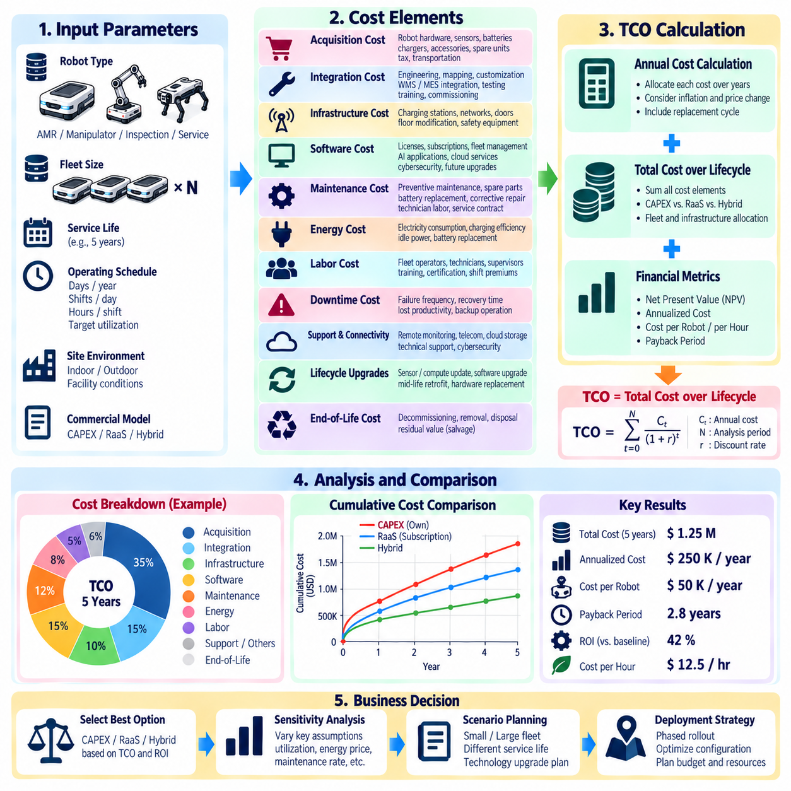{width="7.268055555555556in" height="7.268055555555556in"}

Total Cost of Ownership (TCO) analysis evaluates the complete economic burden of operating a robot system throughout its useful life rather than focusing only on the initial purchase price. For industrial robots, AMRs, inspection robots, and service fleets, acquisition cost may represent only part of the actual expenditure. Integration, infrastructure, software, maintenance, energy, support, downtime, upgrades, and eventual replacement must be included to compare deployment alternatives accurately.

A TCO analysis tool begins with a clearly defined evaluation boundary. The user should specify the robot type, fleet size, operating site, expected service life, annual operating days, shifts per day, hours per shift, and target utilization. These assumptions establish the common basis for every calculation. Comparing alternatives with different lifetimes or operating schedules without normalizing the analysis period can produce misleading economic conclusions.

Initial acquisition costs include more than the robot hardware itself. The model should capture sensors, onboard computers, batteries, chargers, docking equipment, safety devices, communication hardware, accessories, and required spare units. For manipulation systems, tooling, grippers, fixtures, and vision equipment may be significant. Taxes, transportation, installation, and commissioning can also be represented when they materially affect the delivered system cost.

Integration costs frequently determine whether an apparently inexpensive robot remains economical after deployment. Site mapping, workflow engineering, safety validation, network configuration, software customization, API development, WMS or MES integration, facility modification, testing, and employee training may require substantial engineering effort. The tool should separate reusable platform integration from customer-specific work so that future fleet expansion can be modeled realistically.

Infrastructure costs depend strongly on the application environment. Mobile robot deployments may require charging stations, wireless network upgrades, traffic-control infrastructure, doors, elevators, floor modifications, or localization references. Outdoor systems may require GNSS infrastructure, weather protection, communication coverage, or remote support equipment. These expenses should be allocated across the robots and years that benefit from the shared infrastructure.

Software costs should represent the commercial model actually used by the deployment. Perpetual licenses may require initial payments followed by maintenance contracts, while subscription models generate monthly or annual recurring expenses. Fleet management, analytics, AI perception, cloud services, cybersecurity, remote monitoring, enterprise connectors, and premium applications can each have separate charges. Future price changes and planned feature upgrades may also be represented.

Maintenance modeling should include both preventive and corrective activities. Scheduled inspection, lubrication, calibration, tire replacement, battery replacement, sensor cleaning, mechanical wear components, and periodic safety checks create predictable costs. Unexpected failures add parts, technician labor, transportation, and emergency service expenses. Historical mean time between failures and mean time to repair can improve estimates when reliable field data is available.

Energy consumption can become significant for large fleets or high-power robotic systems. The analysis should estimate energy per operating hour, charging efficiency, idle consumption, computing load, and local electricity price. Battery-operated robots may also require replacement batteries during their service life. Energy modeling becomes more accurate when measured telemetry replaces nominal power ratings because real duty cycles rarely operate continuously at maximum electrical load.

Labor costs remain relevant even in highly automated operations. Fleet supervisors, maintenance technicians, remote support personnel, safety managers, and operators responsible for exception handling may still be required. The TCO tool should distinguish labor eliminated by automation from labor required to operate the automated system. Training, certification, shift premiums, and recurring onboarding costs can be included when they materially influence operational expenditure.

Downtime should be translated into economic impact rather than treated only as a technical reliability metric. Robot failures can stop material movement, delay production, interrupt inspections, or require temporary manual replacement. The model can combine expected failure frequency, recovery time, lost production value, and backup capacity to estimate downtime cost. Redundant robots may increase acquisition cost while reducing the financial consequence of individual failures.

Support and connectivity create additional lifecycle expenses. Remote monitoring, cellular communication, private network services, cloud storage, technical support contracts, cybersecurity monitoring, and data retention may generate recurring charges. Some providers bundle these services into RaaS or enterprise subscriptions, while others price them separately. The analysis tool should avoid double counting by identifying which services are already included within broader commercial packages.

Lifecycle upgrades should be modeled when robots are expected to operate for many years. Compute modules, sensors, batteries, communication devices, operating systems, AI models, safety components, or software platforms may require replacement or modernization. Mid-life upgrades can extend useful service life and enable new capabilities, but they create additional capital and engineering costs that should be included in long-term ownership projections.

End-of-life economics should also be considered. Robots may retain residual value through resale, refurbishment, redeployment, component harvesting, or trade-in programs. Conversely, decommissioning, data sanitization, battery disposal, transportation, and recycling can create costs. Including residual value and retirement expenses prevents the analysis from treating the final year of ownership as economically identical to ordinary operating years.

The analysis engine can organize these inputs into annual cash-flow projections. Initial acquisition and integration appear primarily at deployment, while software, maintenance, labor, energy, connectivity, and support accumulate throughout operation. Replacement events and upgrades can be assigned to specific years. Discounting future cash flows allows the tool to calculate present-value TCO when long evaluation periods make the time value of money significant.

TCO should also be normalized into operational units that support practical comparisons. Total lifecycle cost can be divided by operating years, robot-hours, completed missions, transported pallets, inspected kilometers, processed items, or other workload measures. A robot with a higher total cost may still be economically superior if it delivers substantially more useful output. Cost per productive unit therefore complements the absolute TCO figure.

Scenario analysis allows decision makers to test uncertainty rather than depend on one forecast. Fleet utilization, labor rates, energy prices, maintenance frequency, software fees, battery lifetime, robot availability, and service life can be varied across conservative, expected, and optimistic cases. Sensitivity analysis can then identify which assumptions have the greatest influence on ownership cost and where better operational evidence would improve investment confidence.

The tool should support direct comparison among CAPEX, Robot as a Service (RaaS), and hybrid commercial models. CAPEX may produce high initial cash requirements but lower recurring equipment payments, while RaaS shifts more cost into predictable operating expenditure. Hybrid models can combine purchased hardware with software subscriptions or managed services. A common TCO horizon allows these structurally different alternatives to be compared on equivalent economic terms.

Actual fleet telemetry can progressively replace assumptions after deployment. Operating hours, charging cycles, energy consumption, maintenance events, software usage, failure frequency, downtime, and component replacement histories provide evidence for recalculating ownership cost. The TCO tool can therefore evolve from a pre-purchase estimator into an operational management system that continuously compares forecast cost with actual lifecycle expenditure.

A mature TCO analysis tool ultimately connects technical architecture, commercial contracts, operational performance, and financial planning within one consistent model. Its purpose is not simply to identify the cheapest robot, but to determine which deployment delivers the required service at the most sustainable lifecycle cost. When combined with ROI analysis, TCO provides a stronger basis for fleet sizing, procurement, RaaS evaluation, upgrade planning, and long-term robot business decisions.

## 11.10. RaaS Platform Launch and Scale Case

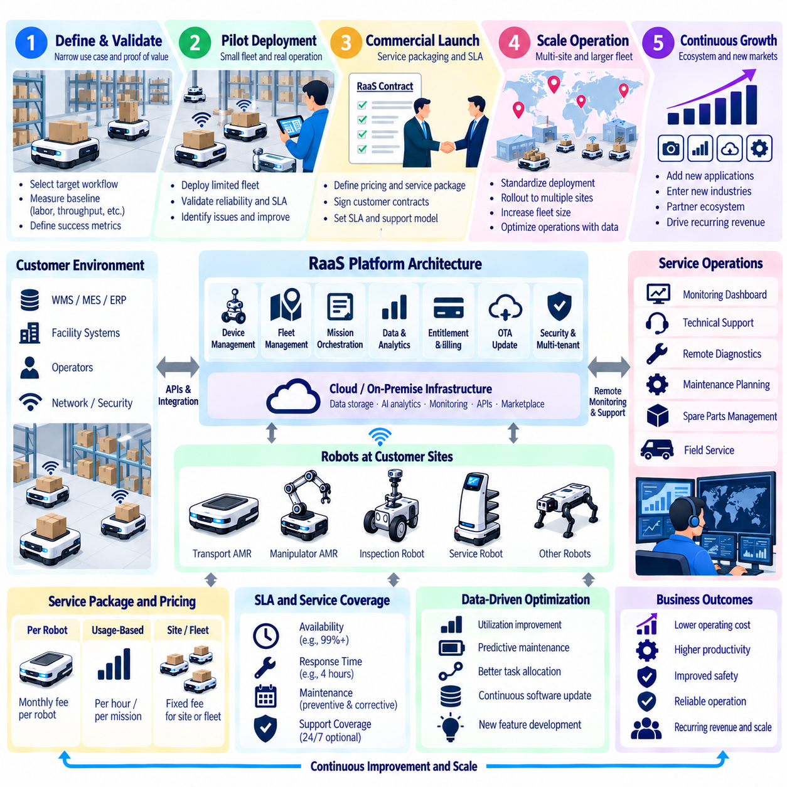{width="7.268055555555556in" height="7.268055555555556in"}

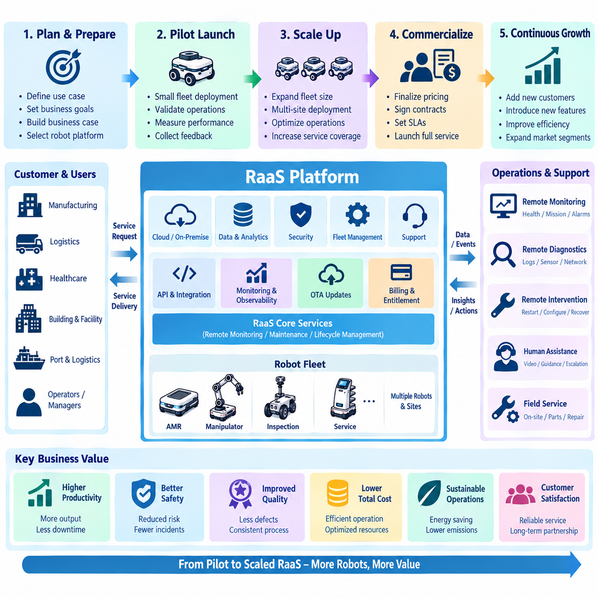{width="7.268055555555556in" height="7.268055555555556in"}

Launching a Robot as a Service (RaaS) platform requires more than converting robot purchases into monthly payments. The provider becomes responsible for maintaining a continuously available operational service that combines robots, software, connectivity, monitoring, maintenance, support, and lifecycle management. A successful launch therefore depends on aligning technical reliability, customer value, service operations, and recurring economics from the first deployment.

An initial launch should focus on a narrowly defined operational problem where automation value can be measured clearly. A warehouse transport route, hospital delivery workflow, inspection mission, or repetitive material movement process provides a practical starting point. The provider can establish baseline labor, throughput, downtime, quality, and safety metrics before deployment, creating evidence for evaluating whether the RaaS service produces the promised business outcome.

The pilot fleet should remain small enough to diagnose problems rapidly but large enough to represent real operations. Early deployments validate navigation, charging, mission execution, connectivity, fleet coordination, integration, and recovery behavior under production conditions. The objective is not simply to demonstrate that individual robots can operate, but to prove that the complete service can maintain predictable performance over extended periods with manageable human intervention.

Platform architecture becomes critical during the transition from demonstration to commercial service. Robots require secure device identities, standardized software versions, remote configuration, telemetry, fleet management, OTA updates, and centralized observability. Cloud or on-premise services should maintain asset status, mission history, entitlement information, health data, and customer configuration. Standardization reduces the engineering effort required for each additional deployment.

Commercial packaging should translate technical capabilities into understandable service units. Customers may subscribe per robot, per site, per operating hour, per completed mission, or through a fixed fleet package. The contract should define included hardware, software, maintenance, connectivity, remote monitoring, upgrades, support, and replacement policies. Clear service boundaries prevent disagreements about which operational responsibilities belong to the provider and which remain with the customer.

Service-level agreements (SLAs) convert operational expectations into measurable commitments. Availability targets, support coverage, response times, restoration objectives, preventive maintenance, and escalation procedures should reflect the actual capability of the service organization. Aggressive guarantees offered before sufficient field evidence exists can create unsustainable risk. Early contracts should therefore use service levels that can be measured reliably and improved as operational maturity increases.

Remote monitoring is essential because RaaS economics deteriorate when every fault requires an on-site visit. Telemetry, alerts, logs, diagnostics, and remote recovery tools allow support teams to identify problems before customers report them. Automated health checks can detect battery degradation, sensor abnormalities, network instability, software failures, and repeated mission recovery. Increasing the remote resolution rate directly improves scalability by reducing field-service workload.

Maintenance operations must evolve from reactive repair toward planned lifecycle management. Preventive maintenance intervals can initially follow engineering recommendations, then be refined using field data. Failure histories, component wear, battery cycles, motor temperature, sensor health, and environmental conditions can support predictive maintenance. Spare-part planning should also use fleet-wide evidence so that frequently required components are positioned near high-density customer regions.

Software lifecycle management provides another major scaling mechanism. A common software baseline allows defects to be corrected once and distributed across many deployed robots through controlled OTA updates. Releases should pass automated testing, simulation, hardware validation, and staged rollout before broad deployment. Canary fleets and rollback mechanisms reduce the probability that a software defect will simultaneously disrupt a large portion of the installed customer base.

Customer onboarding should become a repeatable process rather than a custom engineering project. Site surveys, network requirements, safety reviews, mapping, workflow configuration, integration, acceptance testing, training, and production handover can be organized into standardized deployment stages. Reusable templates and automated provisioning shorten launch time. Exceptions should be documented explicitly so that platform teams can determine whether they represent reusable product requirements or one-time customization.

Integration with customer systems often becomes a major obstacle to scale. Standard APIs and connectors for WMS, MES, ERP, building systems, identity services, and operational databases reduce repeated engineering work. A canonical mission and asset model allows different external systems to communicate with the same RaaS platform. Integration complexity can then move from robot-specific custom code toward configurable adapters that are easier to test and maintain.

Billing must be connected to trusted operational records. The platform should know which robots were active, what service tier was assigned, which premium features were enabled, and how much billable usage occurred during each period. Automated metering and entitlement management reduce manual reconciliation. Customers should be able to understand invoices by relating charges to deployed assets, contracted services, and measurable usage rather than opaque platform fees.

Unit economics should be monitored continuously as the fleet grows. Monthly recurring revenue must be compared with robot depreciation, financing, maintenance, connectivity, cloud infrastructure, support labor, field service, spare parts, and customer acquisition costs. A deployment that generates revenue but requires excessive engineering or support may not be scalable. Contribution margin should therefore be evaluated by customer, site, robot type, and service tier.

Scaling from one site to many sites introduces operational variability. Floor conditions, wireless networks, traffic patterns, workflows, safety rules, environmental conditions, and customer IT policies may differ significantly. The platform should distinguish configurable variation from changes that require new product development. Excessive site-specific customization creates software fragmentation and increases support cost, while standardized configuration preserves repeatability across the installed fleet.

The support organization must scale through automation rather than proportional headcount growth. Alert correlation, automated diagnostics, self-recovery, remote configuration, knowledge recommendations, and predictive maintenance can allow one support team to supervise a growing number of robots. Incidents should feed a structured knowledge base containing symptoms, root causes, recovery procedures, and permanent fixes so that repeated failures become progressively easier to resolve.

Operational metrics provide the evidence needed to decide when expansion is justified. Robot availability, mission success rate, intervention frequency, mean time to repair, remote resolution rate, utilization, deployment time, customer retention, and support cost per robot reveal whether the platform is becoming more efficient. Growth should follow demonstrated operational maturity rather than simply increasing the number of contracted robots faster than the service organization can support them.

A successful regional deployment can then be replicated through standardized hardware, software, deployment procedures, support processes, and commercial contracts. Local service partners may handle installation or maintenance while centralized teams manage software, monitoring, analytics, and escalation. Partner certification and controlled access to diagnostic tools help preserve service quality. Geographic expansion therefore becomes a controlled replication process instead of repeated reinvention.

Customer expansion is often more economical than acquiring entirely new customers. Once a site has proven the service, additional robots can be introduced with lower integration and onboarding effort. New software features, analytics, optimization services, or additional workflows can increase recurring revenue without replacing the installed hardware. Usage evidence can identify expansion opportunities and support value-based discussions about additional automation.

As the installed base grows, aggregated operational experience becomes a strategic platform asset. Failure patterns, maintenance histories, mission performance, environmental conditions, and feature usage can guide product improvements and service design. With appropriate data governance, lessons learned across deployments can improve diagnostics, reliability, fleet optimization, and deployment planning. Scale therefore creates technical learning as well as commercial leverage.

A mature RaaS platform forms a closed scaling loop in which deployment generates operational data, data improves reliability and automation, improved operations reduce service cost, and stronger unit economics support further expansion. Sustainable growth depends on repeatable deployment, standardized architecture, remote operations, disciplined lifecycle management, measurable customer value, and controlled commercial execution. The result is not merely a larger robot fleet, but a scalable recurring-service business built around continuously improving robotic operations.
