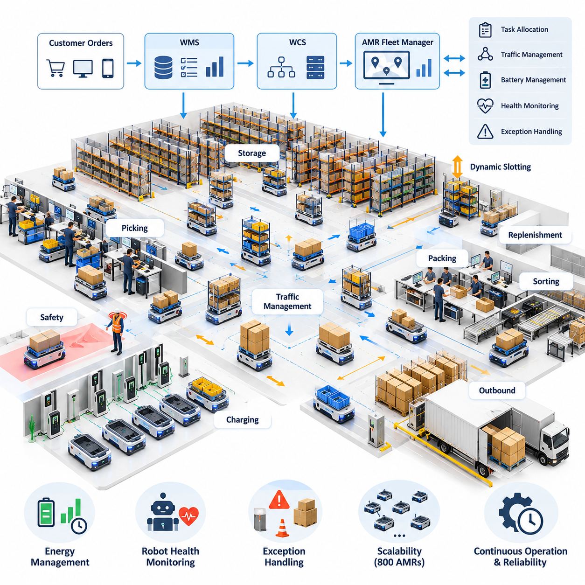
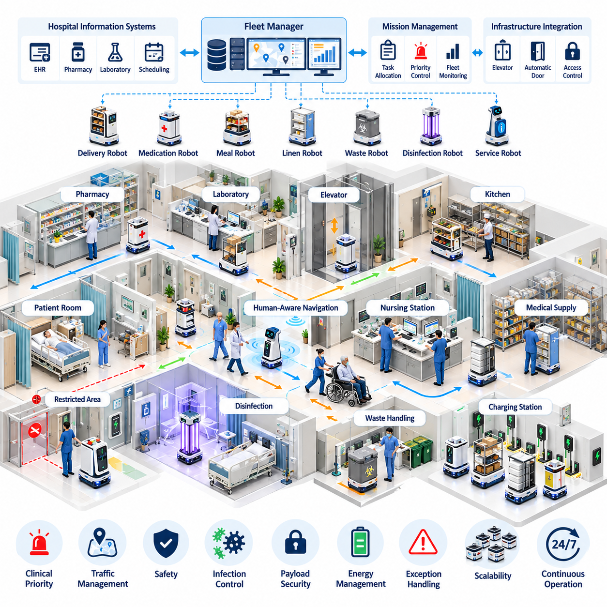
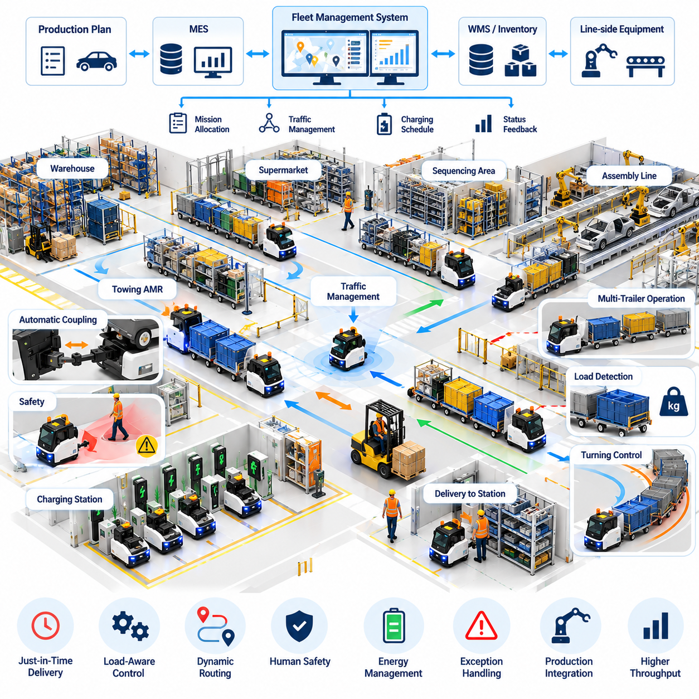
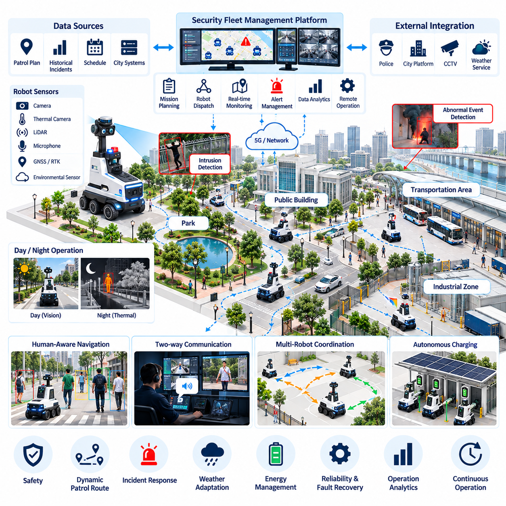
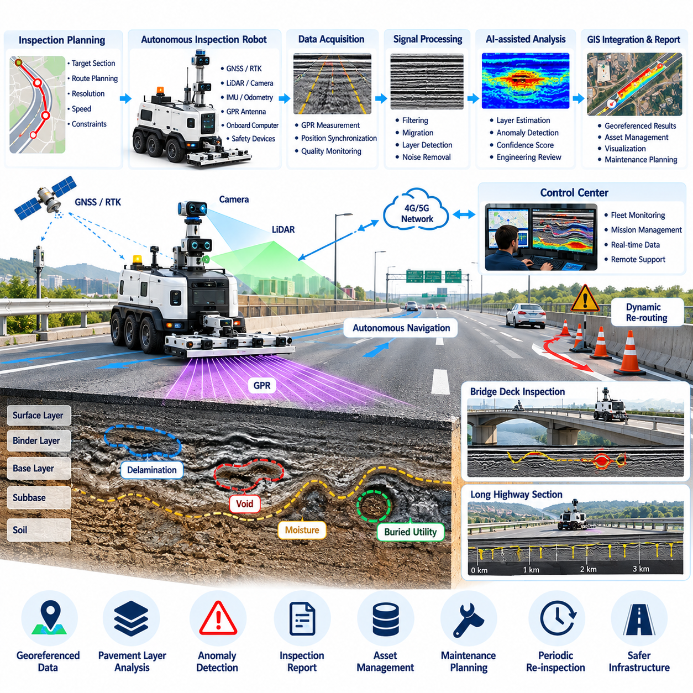
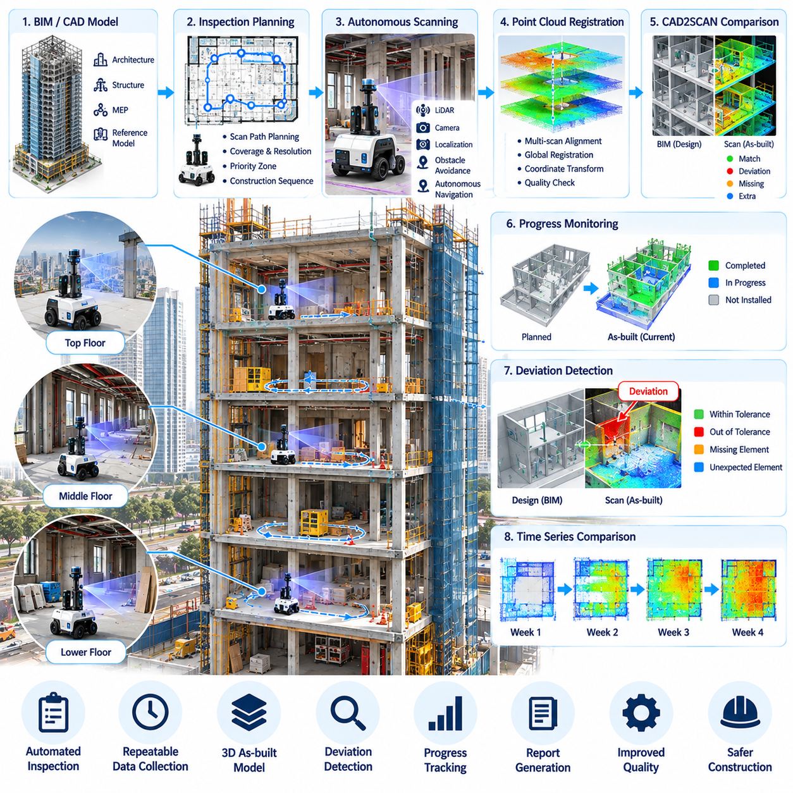
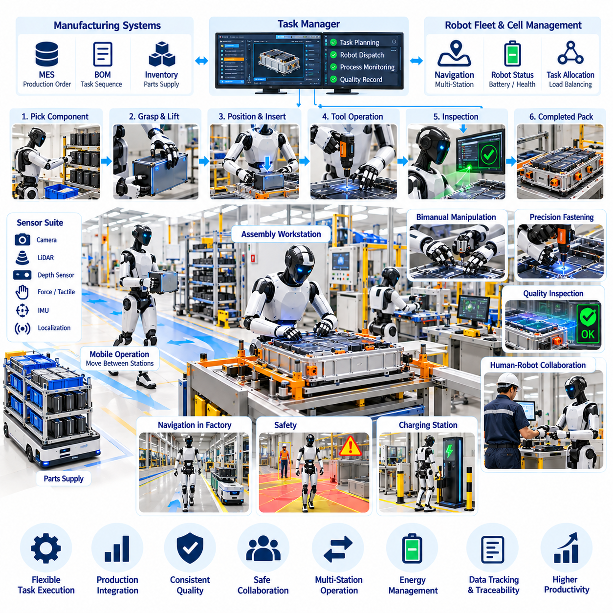
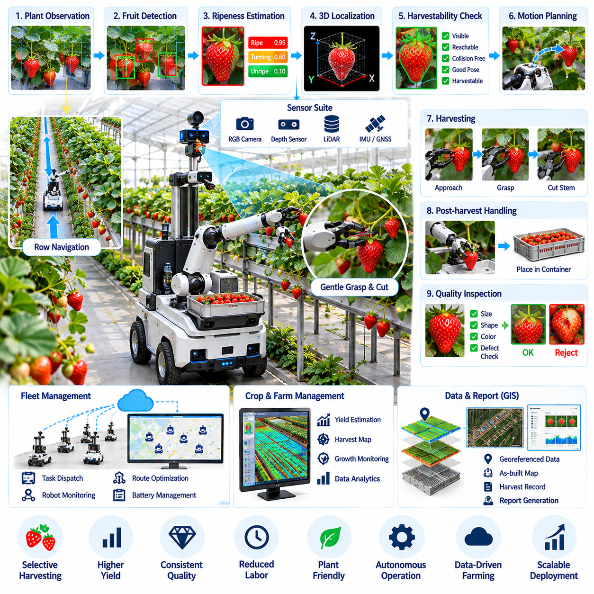
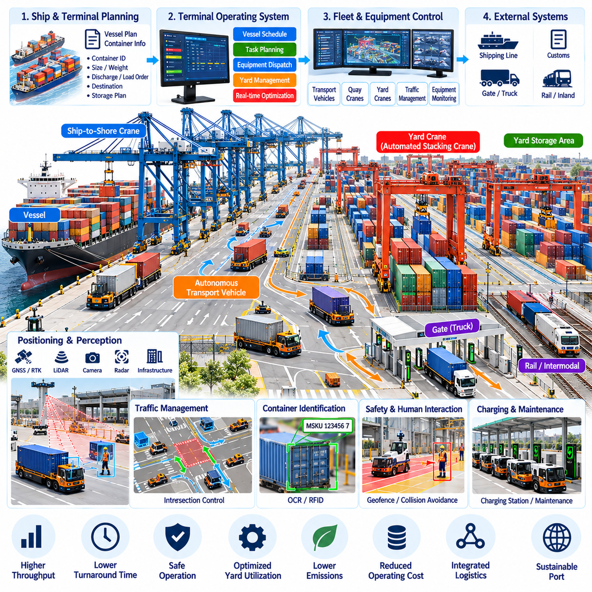
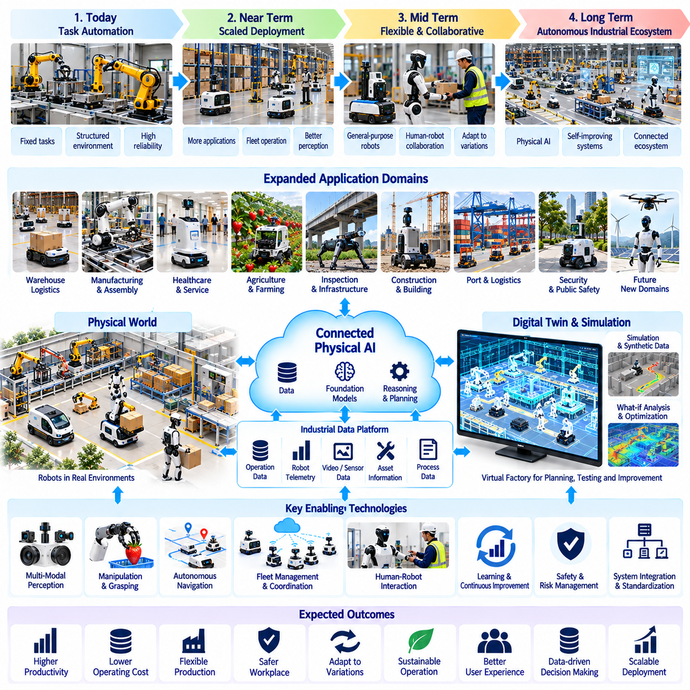

**Volume 26. Industrial Robot Applications**

# Chapter 12. Industrial Application Case Studies

## 12.01. E Commerce Warehouse 800 AMR Full Automation Case

{width="7.268055555555556in" height="7.268055555555556in"}

An e-commerce warehouse operating 800 autonomous mobile robots represents a transition from isolated material-handling automation to a continuously coordinated cyber-physical logistics system. The robots move shelves, totes, cartons, pallets, and replenishment loads between storage, picking, packing, sorting, and outbound zones while a fleet management layer converts warehouse demand into executable missions. The objective is not simply to maximize robot utilization, but to maximize order throughput while maintaining predictable flow, safety, and service availability.

The automation architecture begins with tight integration between the warehouse management system, warehouse control system, and AMR fleet manager. Customer orders are converted into picking waves or dynamically released tasks according to inventory location, shipping priority, workstation capacity, and promised delivery time. The fleet manager decomposes these requests into robot missions and continuously assigns available AMRs according to position, battery state, payload capability, congestion conditions, and expected completion time.

At a fleet size of 800 robots, task allocation can no longer be treated as a simple nearest-robot selection problem. Local decisions that appear efficient may generate traffic concentration, workstation queues, or shortages of robots in distant warehouse zones. Dispatch therefore combines mission priority with predicted travel cost, queue length, congestion risk, charging requirements, and future demand. Allocation is repeatedly recalculated as orders arrive and operating conditions change, allowing the warehouse to behave as a dynamic logistics network rather than a fixed conveyor system.

Traffic management becomes one of the dominant scalability challenges. Hundreds of AMRs may simultaneously request access to intersections, narrow aisles, transfer stations, elevators, charging areas, and high-demand picking zones. The control system maintains a shared representation of robot positions, planned paths, reserved resources, and traffic constraints. Route planning incorporates temporal reservations and congestion costs so that individually valid paths do not collectively create gridlock, cyclic waiting, or severe bottlenecks.

Deadlock prevention is designed into the traffic layer rather than handled only after robots stop moving. Critical intersections and narrow passages can be modeled as controlled resources with directional rules, capacity limits, and reservation windows. When congestion develops, the system may reroute selected robots, delay mission release, change intersection priority, or temporarily redirect traffic through alternative corridors. Recovery mechanisms must distinguish genuine deadlock from normal queuing because unnecessary intervention can destabilize an otherwise efficient traffic flow.

Goods-to-person operation provides a major source of productivity in this environment. Instead of requiring workers to walk long distances through storage aisles, AMRs deliver required inventory to ergonomically designed picking stations. Workstation software coordinates robot arrival, item presentation, pick confirmation, and container movement. The fleet controller balances robot supply across stations so that operators are neither starved of work nor surrounded by excessive queues, linking human productivity directly to fleet-level scheduling and material-flow optimization.

Dynamic slotting further improves system performance by changing where inventory is positioned according to demand patterns. High-frequency stock keeping units can be placed closer to productive zones, while slower-moving inventory occupies less accessible storage locations. Historical orders, short-term demand forecasts, replenishment frequency, item compatibility, and storage constraints can be evaluated together. Because AMRs provide flexible transport, these adjustments can occur incrementally without redesigning fixed conveyor infrastructure or permanently changing warehouse topology.

Energy management is treated as part of mission scheduling rather than a separate maintenance activity. Sending large groups of robots to chargers at the same time would reduce available fleet capacity and create charging congestion. The system therefore estimates remaining operating time and schedules opportunity charging during low-demand periods or natural mission gaps. Charging decisions consider battery state of charge, predicted workload, charger availability, travel distance, and the minimum reserve required to complete assigned missions safely.

A large AMR installation must continue operating when individual robots, sensors, communication links, or warehouse resources fail. Robot health telemetry is continuously monitored for localization degradation, motor abnormalities, battery faults, blocked sensors, communication loss, and repeated navigation recovery events. A failed AMR can be removed from the active allocation pool while its mission is reassigned. If the robot physically blocks a route, surrounding traffic is redirected until automated recovery or maintenance intervention restores the affected area.

Exception handling also covers environmental changes that are normal in an active warehouse. Temporary pallets, fallen cartons, human-operated equipment, damaged racks, maintenance barriers, and unexpected congestion may invalidate planned routes. Each AMR detects local obstacles while the fleet layer determines whether an event is temporary or should modify global routing. Persistent blockage information can be propagated to other robots, preventing hundreds of units from independently discovering and repeatedly attempting the same unavailable path.

Safety remains independent of throughput pressure. Each robot maintains local protective functions for obstacle detection, speed limitation, controlled stopping, emergency stopping, and safe interaction with people and equipment. Fleet-level optimization cannot override these protective behaviors. Operational zones may impose different speed profiles and separation requirements depending on pedestrian density, intersection geometry, payload condition, or visibility. This layered design allows warehouse productivity to increase without making centralized scheduling the sole safety mechanism.

The communication and computing architecture must support high-frequency telemetry and control coordination without making every robot dependent on a single synchronous service. Robot-local navigation and safety functions continue operating at the edge, while fleet services manage missions, traffic, maps, analytics, and system-wide optimization. Message prioritization separates operationally critical state from lower-priority diagnostics. Redundant network coverage and service failover reduce the probability that a server or access-point failure will stop the entire warehouse.

Observability becomes essential because failures in an 800-robot system often emerge from interactions rather than from a single defective component. Dashboards track mission completion time, robot utilization, travel distance, waiting time, blocked-path events, charging behavior, workstation queues, localization quality, and traffic density. Historical event streams allow engineers to reconstruct incidents and identify recurring patterns. Digital-twin or simulation environments can replay traffic scenarios before scheduling policies, map changes, or software updates are deployed to production.

Performance evaluation focuses on warehouse-level outcomes instead of maximizing isolated robot speed. Important measures include orders processed per hour, picks per workstation, mission latency, congestion time, fleet availability, charging overhead, recovery frequency, and order fulfillment reliability. Increasing AMR speed may produce little benefit if intersections or picking stations are already saturated. Capacity engineering therefore identifies the actual system bottleneck and determines whether improvement requires more robots, additional stations, changed layout, or better scheduling.

Software deployment for such a fleet requires controlled version management because simultaneously updating hundreds of robots can introduce fleet-wide risk. New navigation, perception, or fleet-control software can first be validated in simulation, then deployed to a small canary group under monitored conditions. Operational metrics are compared with the previous version before broader rollout. If abnormal behavior appears, deployment is halted or rolled back, allowing the warehouse to improve continuously without treating production operations as an uncontrolled test environment.

The 800-AMR warehouse ultimately operates as an integrated automation ecosystem in which robots, software services, workers, storage infrastructure, and enterprise systems form one coordinated production network. Scalability is achieved not by multiplying independent robots but by combining distributed autonomy with centralized and hierarchical optimization. Task allocation, traffic management, charging, exception recovery, safety, analytics, and enterprise integration collectively determine whether a large fleet can deliver reliable business value.

This case demonstrates that full warehouse automation is primarily a systems-engineering challenge. Once hundreds of mobile robots share the same facility, performance depends increasingly on coordination quality, resource orchestration, software resilience, and operational intelligence. A successful deployment transforms the AMR fleet into adaptive logistics infrastructure capable of responding continuously to changing order volumes, inventory distributions, equipment conditions, and warehouse priorities while preserving safe and predictable operation.

## 12.02. Smart Hospital Multi Robot Fleet Integration Case

{width="7.268055555555556in" height="7.268055555555556in"}

A smart hospital multi-robot fleet integrates autonomous mobile robots, service robots, disinfection platforms, and specialized delivery systems into a shared operational environment. Unlike a warehouse, the hospital remains continuously occupied by patients, clinicians, visitors, beds, carts, and emergency teams whose movements cannot be rigidly scheduled. The robotic system must therefore combine autonomous logistics with human-aware navigation, clinical priorities, infection-control requirements, and highly reliable access to hospital infrastructure.

The deployment begins with a fleet management architecture that provides a common coordination layer for heterogeneous robots. Different platforms may transport medication, laboratory specimens, meals, linens, medical supplies, waste, or portable equipment, while other robots perform disinfection or patient-facing services. The fleet manager maintains robot identity, capability, location, operational state, battery condition, and mission availability so that hospital requests can be assigned to an appropriate robot rather than merely the nearest available unit.

Hospital information systems and operational applications provide the demand that drives robotic missions. A delivery request may originate from a pharmacy, laboratory, nursing station, central supply department, kitchen, or automated scheduling service. Integration software converts these requests into structured missions containing pickup location, destination, payload requirements, priority, access permissions, and timing constraints. Mission status can then be returned to hospital applications, allowing staff to monitor deliveries without directly controlling individual robots.

Clinical priority significantly changes task scheduling. Routine linen or meal transportation can tolerate delay, while blood products, urgent medication, laboratory specimens, or emergency equipment may require immediate service. The fleet manager therefore maintains priority classes and can reorder queued missions when urgent requests arrive. However, excessive preemption must be controlled because repeatedly interrupting normal tasks can create incomplete deliveries, congestion, or inefficient robot movement throughout the facility.

Navigation in a hospital requires continuous interaction with unpredictable human traffic. Corridors may suddenly become crowded after visiting hours begin, while stretchers, wheelchairs, cleaning carts, and mobile diagnostic equipment can temporarily reduce available space. Robots use onboard perception and local planning to maintain safe separation and adapt their velocity around people. The global fleet layer can additionally recognize congested areas and redirect noncritical traffic through alternative corridors when the building topology permits.

Elevators are critical shared resources because hospital missions frequently span multiple floors. A robot must request an elevator, wait at an appropriate location, enter without blocking passengers, select or communicate the destination floor, and safely exit when the doors open. Elevator integration can be coordinated through building interfaces rather than physical button manipulation. When multiple robots request the same elevator, scheduling logic balances mission priority, direction of travel, passenger demand, and queue length to prevent robotic traffic from monopolizing vertical transportation.

Automatic doors, access-controlled corridors, and restricted clinical areas require similar infrastructure integration. The robot may authenticate itself to a door controller, request temporary access, verify that the doorway is open, and continue only after confirming a safe passage. Access policies can restrict particular robots or payload types from sensitive areas. This allows the fleet to operate across a complex hospital while preserving security boundaries that were originally designed primarily for human staff.

Payload handling must reflect the clinical purpose of each mission. Medication and specimens may require locked compartments, authenticated loading and unloading, chain-of-custody records, or temperature monitoring. Meals and clean linens require hygienic transport, while contaminated materials need physically and procedurally separated handling. The software associates payload rules with each mission so that the correct robot, compartment, workflow, and destination verification procedure are selected automatically.

Infection control introduces requirements that are uncommon in conventional logistics environments. Robot surfaces, wheels, compartments, and user interfaces may become contamination vectors if cleaning procedures are poorly designed. Operational software can track cleaning status, restrict robots after contaminated missions, and direct platforms to designated sanitation locations. Robots used for ultraviolet disinfection require additional safeguards that prevent exposure of patients or staff and verify that treatment zones are appropriately secured before disinfection begins.

Human-robot interaction must remain understandable to people who have never received robot training. Visual indicators, displays, audible notifications, and predictable motion communicate whether a robot is waiting, turning, yielding, requesting access, or experiencing a problem. Patient-facing robots may provide guidance or basic information, but their interaction design must clearly distinguish automated assistance from clinical judgment. Staff must also have simple mechanisms to stop, redirect, or request assistance when robotic behavior conflicts with immediate clinical needs.

Fleet coordination prevents independently operating robots from competing for the same narrow corridors, elevators, docking points, or charging stations. Shared traffic information allows the system to reserve constrained resources and distribute routes across available paths. The coordination layer can apply different policies according to location; for example, a busy outpatient corridor may emphasize conservative human-aware movement, while a logistics-only service corridor can support denser robot traffic and higher operational efficiency.

Energy management is integrated with hospital workload because robots may be expected to operate throughout the day and night. Charging schedules consider state of charge, predicted mission demand, charging-station occupancy, and the operational importance of each robot class. The system avoids sending too many robots to charge simultaneously and maintains sufficient reserve capacity for urgent missions. Opportunity charging during idle periods can improve availability without requiring long fleet-wide charging windows.

Reliability is especially important because a failed robot must not obstruct a clinical corridor or delay urgent transportation. Continuous telemetry monitors localization confidence, drive status, sensor health, network connectivity, battery condition, compartment state, and mission progress. When abnormal behavior is detected, the robot can enter a controlled safe state while the fleet manager reallocates its task. Other robots are rerouted around the affected location until automated recovery or hospital technical staff remove the obstruction.

Communication failures are handled through layered autonomy. Safety, obstacle avoidance, controlled stopping, and essential local navigation remain available on the robot even when connection to central services becomes degraded. The fleet management system manages global assignments and resource coordination, but temporary network loss should not produce unsafe motion. After communication is restored, mission state and robot status are synchronized so that duplicate deliveries or conflicting commands are avoided.

Privacy and cybersecurity are fundamental because hospital robots may encounter patient information, video streams, location data, access credentials, and operational records. Systems should minimize unnecessary collection of personally identifiable information and restrict data access according to operational roles. Authentication, encrypted communication, audit logging, software update controls, and network segmentation reduce the risk that a compromised robot or service becomes an entry point into broader hospital infrastructure.

Operational monitoring provides hospital administrators and engineering teams with a unified view of fleet performance. Metrics include mission completion time, delivery success rate, elevator waiting time, robot utilization, charging time, navigation interruptions, manual interventions, and system availability. Mission histories can identify recurring bottlenecks such as congested corridors or overloaded elevators. These observations support changes to routing policies, staffing procedures, infrastructure interfaces, and robot deployment density.

Deployment is normally expanded in stages rather than activating a hospital-wide fleet at once. Initial robots can operate on controlled logistics routes between central supply and selected departments. After navigation, elevator integration, staff workflows, infection-control procedures, and recovery processes are validated, additional floors and mission types can be introduced. This phased approach exposes integration problems while their operational impact remains limited and allows staff behavior to adapt alongside the technology.

A mature smart hospital fleet is therefore more than a collection of delivery robots. It becomes a distributed service infrastructure connecting clinical departments, logistics operations, building systems, and digital hospital applications. Autonomous transportation reduces repetitive movement by staff, but its greatest value appears when mission orchestration, infrastructure integration, safety, infection control, security, and human interaction operate as a unified system rather than as separate automation projects.

The case demonstrates that successful hospital robotics depends on coordinated intelligence across robots, software, people, and facilities. Multi-robot integration must preserve clinical priority and human safety while providing reliable logistics under continuously changing conditions. When these requirements are engineered together, the fleet can evolve from a limited delivery service into an adaptive hospital-wide robotic platform capable of supporting increasingly diverse operational and patient-service applications.

## 12.03. Automotive Factory Towing AMR Intralogistics Case

{width="7.268055555555556in" height="7.268055555555556in"}

An automotive factory towing AMR system replaces repetitive manual tugger routes with dynamically coordinated autonomous intralogistics. Towing robots connect to carts or trailer trains carrying components between supermarkets, warehouses, sequencing areas, and assembly lines. Unlike light-load delivery AMRs, towing platforms must manage the combined dynamics of the tractor and trailers while maintaining predictable material supply. The system therefore integrates autonomous navigation, coupling control, load awareness, mission scheduling, traffic management, and production-system interfaces.

Material demand originates from production schedules, line-side inventory levels, replenishment signals, or manufacturing execution systems. These requests are converted into transport missions specifying pickup points, delivery stations, material identifiers, required arrival times, trailer configurations, and priority. The fleet management system assigns missions according to robot location, towing capacity, battery condition, route availability, and production urgency. This connects AMR dispatch directly to factory material flow rather than operating robots as independent transportation devices.

Automatic coupling is a critical function because manual attachment would reduce the value of autonomous operation. A towing AMR approaches a cart or trailer at controlled speed, aligns its coupling mechanism, performs mechanical engagement, and verifies that the connection is secure before movement begins. Sensors can confirm coupling position and lock status, while control software prevents mission execution when engagement is uncertain. At the destination, a corresponding decoupling sequence releases the load only after position and safety conditions have been verified.

Load detection changes the motion behavior of the towing robot. The controller considers payload mass, trailer count, estimated center of gravity, rolling resistance, and coupling state when determining acceleration and braking limits. A heavily loaded trailer train requires longer stopping distance and smoother velocity changes than an unloaded vehicle. Load-aware control therefore reduces aggressive acceleration, sudden steering, and excessive deceleration that could destabilize trailers, damage transported components, or create unsafe motion around workers.

Turning behavior is especially important because each additional trailer changes the swept path of the vehicle combination. A route that is geometrically feasible for the towing robot alone may become unsafe after multiple carts are attached. Navigation software accounts for turning radius, trailer length, articulation, aisle width, and obstacle clearance when selecting paths. Restricted turns can be prohibited for particular configurations, while speed limits are reduced near corners and intersections where trailer tracking errors become more significant.

Multi-trailer operation increases transportation efficiency by allowing one AMR to deliver several material loads in a single mission. However, train formation also increases control complexity and requires accurate knowledge of trailer order and destination. A mission may contain several delivery stops where selected carts are detached while others continue toward subsequent stations. The fleet system coordinates these sequences with production demand so that transportation capacity is consolidated without causing incorrect material delivery or excessive line-side inventory.

Factory traffic management coordinates towing AMRs with forklifts, conventional AMRs, manually driven vehicles, workers, and other mobile equipment. Intersections, narrow aisles, transfer points, and production crossings are treated as shared resources. The fleet controller can reserve critical segments, enforce directional traffic rules, and adjust routes according to congestion. Because a towing train occupies more space and clears an intersection more slowly than a compact AMR, resource reservations must consider the complete vehicle combination rather than only the tractor position.

Mission sequencing is closely linked to just-in-time and just-in-sequence production. Components must arrive before they are required, but excessive early delivery increases line-side inventory and consumes limited floor space. The scheduling system therefore works backward from production demand and calculates suitable pickup and transport times. When production rate, sequence, or workstation status changes, missions can be reprioritized so that logistics activity remains synchronized with the manufacturing process.

Integration with manufacturing execution systems, warehouse systems, programmable logic controllers, and line-side equipment enables closed-loop intralogistics. A station can automatically request material when inventory falls below a threshold, while sensors or controllers confirm that a delivery location is available. After the AMR completes a transfer, status information is returned to the production system. This digital feedback reduces manual coordination and creates traceability between production demand, transport execution, and material receipt.

Safety architecture combines robot-local protective functions with factory-level traffic policies. Safety scanners monitor protective fields around the towing platform, while speed and stopping behavior are adjusted according to operating conditions. Trailer geometry must also be considered because obstacles or people may be located beside or behind the attached carts. Emergency stopping, coupling verification, overload detection, anti-tip constraints, and controlled recovery procedures provide additional protection for operations involving heavy or extended loads.

Unexpected conditions are unavoidable in an active automotive plant. A forklift may block an aisle, a cart may be incorrectly positioned, a coupling attempt may fail, or a production station may temporarily stop accepting deliveries. The AMR reports these exceptions to the fleet manager instead of repeatedly attempting an unsafe operation. Missions can be paused, reassigned, rerouted, or directed to buffer locations while the system waits for the affected resource to become available.

Energy management must preserve transportation capacity across multiple production shifts. Charging decisions consider battery state, scheduled missions, towing load, expected travel distance, and predicted demand. Opportunity charging can be performed during production breaks or naturally occurring idle periods. The fleet manager avoids removing too many towing robots from service simultaneously and maintains sufficient reserve capacity to handle urgent replenishment requests or temporary increases in production demand.

Operational monitoring provides visibility into both robot performance and material-flow effectiveness. Useful indicators include mission completion time, coupling success rate, trailer utilization, travel distance, waiting time, blocked-route events, charging time, manual interventions, and on-time delivery performance. Repeated delays at particular intersections or stations can reveal infrastructure bottlenecks, while frequent coupling failures may indicate mechanical wear, alignment problems, or inconsistent cart positioning.

Historical fleet data supports continuous improvement of the intralogistics system. Engineers can analyze route congestion, mission demand, trailer utilization, battery consumption, and production interruptions to identify inefficient operating patterns. Simulation or digital-twin environments can evaluate proposed route changes, fleet-size adjustments, or new delivery schedules before deployment. This reduces the risk of modifying a live factory where logistics disruption could directly affect production output.

A phased deployment is typically more manageable than replacing all manual tugger operations at once. Initial routes can connect stable warehouse and line-side locations with predictable traffic patterns. After automatic coupling, navigation, traffic control, production integration, and recovery procedures are validated, the operating area can expand to more complex routes and additional trailer configurations. This progression allows both software and factory processes to mature while production continues.

Interoperability becomes increasingly important when towing AMRs from different vendors share a manufacturing facility. Standardized fleet interfaces such as VDA 5050 can provide a common mechanism for exchanging orders, states, positions, and operational information between master control systems and compatible vehicles. The standard interface does not eliminate platform-specific safety or motion control, but it can reduce dependence on proprietary fleet integration and simplify coordination across heterogeneous mobile-robot systems.

The automotive towing AMR case demonstrates that autonomous intralogistics is not simply a driverless replacement for a conventional tugger. The greatest benefit appears when robot motion, trailer handling, production scheduling, traffic management, and enterprise systems are integrated into one coordinated material-flow architecture. The towing fleet then becomes a programmable logistics resource capable of adapting transport capacity and routing as manufacturing conditions change.

At full maturity, the system forms a closed-loop relationship between production demand and physical material movement. Manufacturing systems request parts, the fleet determines how and when they should be transported, towing AMRs execute the movement, and delivery confirmation updates the production state. This feedback structure transforms factory logistics from fixed repetitive routes into an adaptive intralogistics network that can support flexible manufacturing, changing product mixes, and increasingly software-defined production environments.

## 12.04. Smart City Outdoor Security Patrol Fleet Case

{width="7.268055555555556in" height="7.268055555555556in"}

A smart-city outdoor security patrol fleet extends autonomous robotics from controlled facilities into open public environments where weather, terrain, traffic, pedestrians, and unexpected events continuously change operating conditions. Multiple security robots patrol predefined and dynamically generated routes around parks, public buildings, transportation facilities, industrial districts, campuses, and critical infrastructure. Their purpose is to provide persistent sensing and rapid situational awareness while supporting, rather than replacing, human security personnel.

Each robot combines autonomous mobility with a distributed perception platform. Visible-light cameras, thermal cameras, LiDAR, microphones, positioning sensors, and environmental sensors can provide complementary observations during day and night operation. Onboard computing processes time-critical perception locally, while selected events and telemetry are transmitted to a fleet control center. This edge-oriented architecture reduces communication dependency and allows basic navigation, obstacle avoidance, and safety functions to continue when network quality temporarily degrades.

Patrol missions are generated from geographic zones, security priorities, operating schedules, historical incident patterns, and real-time events. Routine routes provide predictable coverage, while dynamic mission planning can redirect robots when an alarm, abnormal sensor observation, or operator request occurs. The fleet manager assigns missions according to robot position, battery state, sensor capability, route accessibility, and current workload, enabling patrol resources to be redistributed as conditions across the city change.

Outdoor navigation must tolerate environmental complexity that rarely exists in indoor AMR applications. Robots encounter slopes, curbs, uneven pavement, puddles, vegetation, construction barriers, parked vehicles, bicycles, and dense pedestrian movement. Localization can combine GNSS, RTK positioning, inertial sensing, LiDAR, and visual information so that temporary degradation of one source does not immediately terminate a mission. Local planning continuously adjusts trajectories while maintaining safe clearance from people and infrastructure.

Perimeter intrusion detection is a major perception function for protected facilities and restricted areas. Vision and thermal sensing can identify people or vehicles entering monitored zones, while tracking algorithms estimate movement across consecutive observations. Detection alone does not determine that an event is hostile. The system associates detections with location, time, access rules, and behavior patterns before assigning an event category and confidence level, reducing unnecessary alarms caused by legitimate activity.

Night operation changes both perception and mobility requirements. Visible cameras may lose performance under low illumination, glare, shadows, fog, or rapidly changing lighting conditions. Thermal imaging provides complementary information by detecting heat signatures that may remain observable when conventional imagery becomes unreliable. Sensor fusion combines these sources with geometric information from LiDAR or other range sensors, allowing the patrol robot to maintain situational awareness without depending on a single perception modality.

Abnormal-event detection extends monitoring beyond intrusion. Robots can identify stationary objects in unusual locations, open doors, smoke-like visual patterns, abnormal temperatures, unexpected vehicle presence, or people remaining within restricted zones. Detected events are packaged with time, robot position, images or short video segments, sensor measurements, and confidence information. This structured evidence allows remote operators to evaluate incidents more efficiently than continuously observing raw camera streams from every robot.

Alert management prevents the control center from being overwhelmed by large numbers of low-confidence notifications. Events can be classified by severity, confidence, location, and potential impact before being forwarded to operators. Similar detections from nearby robots or fixed smart-city sensors may be correlated into a single incident. High-priority events can trigger immediate operator attention and robot reassignment, while lower-priority observations are recorded for later analysis or verification.

Two-way voice and video communication allows a remote security operator to interact through the robot when an event requires human judgment. The operator can observe the scene, issue verbal guidance, communicate with nearby people, or request additional camera viewpoints. The robot therefore acts as a mobile telepresence endpoint as well as an autonomous sensing platform. Clear operational policies determine when autonomous monitoring should transition to remote human supervision.

Fleet-level incident response coordinates multiple robots rather than sending every available platform toward the same alarm. One robot may approach the event while another observes from a different position and remaining units maintain coverage of other security zones. The fleet manager evaluates travel time, sensor capability, battery reserve, route conditions, and existing patrol responsibilities before reallocating resources. This prevents a local incident from unnecessarily creating surveillance gaps elsewhere.

Continuous outdoor operation requires weather-aware reliability engineering. Rain, dust, temperature extremes, direct sunlight, condensation, wind, and surface contamination can degrade sensors and mechanical systems. Robot software monitors internal temperature, battery condition, sensor visibility, localization confidence, and traction-related indicators. When operating limits are approached, the system can reduce speed, modify routes, return to a protected docking station, or suspend selected missions rather than continuing under unsafe conditions.

Energy management is particularly important for 24/7 patrol because security coverage must remain available while individual robots recharge. The fleet manager distributes charging periods according to battery state, patrol demand, incident probability, and available charging stations. Robots can rotate between patrol and charging so that minimum geographic coverage is maintained. Charging stations may also provide protected locations for data synchronization, inspection, cleaning, or environmental shelter.

Communication architecture must support mobility across large geographic areas. Wi-Fi, private cellular networks, public 4G or 5G, and other links may be used according to deployment conditions. The system distinguishes between traffic requiring low latency, such as operator intervention, and information that can tolerate delayed transmission, such as routine logs. If connectivity is lost, the robot enters a predefined degraded mode and preserves essential local autonomy until reliable communication is restored.

Safety remains fundamental because patrol robots share public spaces with people who cannot be expected to understand robotic operating procedures. Local safety functions limit speed, detect obstacles, maintain separation, and execute controlled or emergency stops when required. Fleet commands cannot override these protective mechanisms. Routes and operating policies can additionally restrict autonomous operation in unusually crowded areas, dangerous weather, road crossings, or locations where environmental uncertainty exceeds validated operating conditions.

Privacy governance is essential because mobile security robots can collect information across public and semi-public spaces. Camera orientation, recording policies, retention periods, access permissions, and event logging should be designed according to the legitimate security purpose of the deployment. Data minimization reduces unnecessary collection, while encryption, authentication, audit records, and role-based access control protect stored and transmitted information from unauthorized use.

Cybersecurity protects both collected information and physical robot control. Compromise of a fleet service could expose sensor streams or interfere with patrol missions, making secure software updates, device identity, network segmentation, credential management, and command authorization necessary. Critical robot functions should reject unauthenticated control requests. Operational monitoring can additionally identify unusual communication patterns, repeated authentication failures, or unexpected configuration changes that may indicate a cyber incident.

A smart-city command center provides operators with a unified operational picture of robot locations, patrol routes, health state, active incidents, video feeds, and historical events. Geographic visualization helps staff understand how robotic coverage relates to physical city infrastructure. Incident records can be reviewed together with robot telemetry to determine whether missed detections, navigation delays, communication problems, or resource-allocation decisions affected the response.

Long-term fleet data enables patrol strategies to improve over time. Repeated incidents can reveal locations requiring greater coverage, while mission histories expose routes with excessive travel time, localization difficulty, or energy consumption. Simulation and historical replay can evaluate alternative patrol schedules before deployment. The objective is not to predict every incident perfectly, but to continuously improve how limited robotic resources are positioned and coordinated.

The smart-city security patrol fleet ultimately operates as a distributed physical sensing and response network. Autonomous robots provide mobile observation, edge perception, and persistent presence, while fleet intelligence coordinates coverage and human operators retain authority over security decisions requiring contextual judgment. When navigation, perception, communications, incident management, safety, privacy, and cybersecurity are engineered together, the fleet can provide scalable 24/7 monitoring across complex outdoor environments.

## 12.05. Highway Infrastructure GPR Inspection Case

{width="7.268055555555556in" height="7.268055555555556in"}

A highway infrastructure Ground Penetrating Radar inspection system combines autonomous robotic mobility with subsurface sensing to examine pavement and structural conditions without relying only on visible surface defects. The inspection robot carries GPR antennas, positioning sensors, onboard computing, and safety devices while following planned survey paths. This approach converts conventional point-based inspection into repeatable georeferenced data collection that can reveal subsurface anomalies across extended highway sections.

The inspection workflow begins by defining the target road segment, survey boundaries, lane geometry, required spatial resolution, and operational constraints. Engineers may prioritize pavement areas, bridge decks, shoulders, joints, or locations associated with previous deterioration. Survey planning software converts these requirements into traversable paths with controlled spacing and speed. The resulting mission provides systematic coverage while maintaining a direct relationship between each radar measurement and its physical location.

GPR operates by transmitting electromagnetic energy into the road structure and recording reflections produced by changes in subsurface electromagnetic properties. Reflected signals can indicate interfaces between pavement layers as well as potential voids, moisture-related changes, delamination, buried objects, or other discontinuities. Interpretation depends on material properties, antenna configuration, frequency, and environmental conditions, so the robotic platform must preserve consistent sensor geometry and acquisition parameters throughout the survey.

Sensor integration synchronizes radar traces with robot position, velocity, orientation, and time. GNSS and RTK can provide georeferenced outdoor positioning, while inertial sensing and wheel odometry help maintain continuity when satellite reception becomes degraded near bridges, barriers, or other structures. Accurate timestamps allow radar observations to be associated with a common trajectory. This synchronization is essential because subsurface detections have limited maintenance value unless their locations can later be recovered in the field.

Autonomous path planning must balance measurement quality with safe vehicle motion. GPR surveys often require approximately parallel passes so that adjacent radar profiles can be combined into a spatial representation of subsurface conditions. The robot controls lateral spacing, heading, and travel speed to reduce gaps or excessive overlap between passes. When obstacles, closed areas, or temporary traffic-control devices interrupt the planned route, the system can generate a local detour while preserving the remaining inspection coverage.

Data acquisition software continuously monitors whether the radar system and positioning sensors are producing valid measurements. Missing traces, abnormal signal levels, localization uncertainty, unexpected speed changes, or communication failures can be detected during the mission rather than discovered after the inspection has ended. The robot can mark questionable regions for repeated scanning or temporarily stop acquisition. This online quality control reduces the risk of completing a long highway survey with unusable data.

Raw GPR measurements require signal processing before meaningful subsurface features can be interpreted. Processing may include time-zero correction, background removal, filtering, gain adjustment, migration, and spatial alignment of successive radar traces. The objective is to suppress systematic noise while preserving reflections associated with physical structures or anomalies. Processing parameters must be recorded because aggressive filtering can alter the appearance of features and make comparisons between inspections difficult.

AI-assisted interpretation can support engineers by identifying recurring radar signatures and highlighting regions that deserve closer examination. Detection models may estimate pavement-layer boundaries or identify patterns associated with voids, buried utilities, moisture, or structural discontinuities. These outputs should be treated as decision-support information rather than unquestioned ground truth. Confidence values, spatial context, signal quality, and supporting inspection evidence help engineers determine whether additional investigation is required.

Bridge-deck inspection presents a particularly valuable use case because deterioration may develop below a surface that still appears visually acceptable. A robotic GPR survey can collect dense measurements across the deck and organize them according to position. Areas with unusual reflection characteristics can be mapped for engineering review and compared with visual inspection or other nondestructive evaluation methods. Repeated surveys also provide a basis for observing how suspicious regions change over time.

Road inspection can similarly examine pavement-layer consistency and detect subsurface conditions that may contribute to later surface failure. Rather than waiting for severe cracking, settlement, or potholes to become visible, infrastructure managers can use subsurface information as one component of preventive maintenance planning. GPR does not replace engineering assessment, but it expands the available evidence by providing information about conditions that ordinary cameras and surface scanners cannot directly observe.

Geographic information system integration transforms inspection results into maintainable infrastructure records. Radar detections, processed profiles, anomaly regions, confidence scores, robot trajectories, photographs, and inspection timestamps can be associated with geographic coordinates and highway asset identifiers. Engineers can then review findings on maps rather than searching through isolated sensor files. GIS integration also supports comparison with maintenance history, construction records, drainage information, and previous inspection campaigns.

Inspection data management must preserve traceability from reported findings back to original measurements. A detected anomaly should be linked to the raw radar trace, processing configuration, robot pose, sensor calibration, inspection time, and interpretation result. This provenance becomes important when engineers compare inspections performed months or years apart. Versioned processing pipelines also allow historical datasets to be reprocessed when improved algorithms become available without losing the original evidence.

Highway operation introduces hazards that are more severe than those encountered by many indoor robots. The inspection platform may operate near moving traffic, temporary work zones, uneven shoulders, barriers, slopes, and maintenance vehicles. Safety architecture therefore combines onboard obstacle detection and emergency stopping with operational geofences, speed limits, route restrictions, and external traffic-control procedures. Autonomous capability does not remove the need for a properly designed work-zone safety strategy.

Remote supervision provides additional protection during field operation. Operators can monitor robot position, mission progress, sensor health, communication quality, and surrounding conditions from a safe location. If unexpected traffic behavior, construction activity, weather, or localization problems create uncertainty, the mission can be paused or the robot can be commanded to a predefined safe area. Local safety functions remain active independently of remote commands so that communication loss does not eliminate essential protection.

Weather and surface conditions influence both robotic mobility and measurement quality. Heavy rain, standing water, extreme temperatures, contamination, or poor traction can change operating risk and affect sensor observations. The mission manager can associate environmental conditions with collected data and enforce operating limits when necessary. Recording these conditions improves later interpretation because differences between surveys may result from environmental variation rather than actual changes in infrastructure condition.

A practical deployment normally begins with controlled road sections before progressing to complex highway environments. Engineers first validate radar calibration, positioning accuracy, path repeatability, processing quality, and anomaly localization under known conditions. Field trials then introduce realistic road geometry and traffic-management constraints. This staged validation establishes confidence that the complete sensing and robotic workflow remains reliable before the system is used for large-scale infrastructure assessment.

The greatest operational value appears when inspection is repeated over time rather than performed as an isolated survey. Georeferenced trajectories allow the robot to revisit approximately the same locations, while consistent processing enables comparison between inspection campaigns. Changes in anomaly size, reflection strength, layer condition, or affected area can be tracked as temporal evidence. Infrastructure managers can use these trends to prioritize detailed investigation and allocate maintenance resources according to observed deterioration.

The highway GPR inspection case therefore represents more than mounting a radar sensor on an autonomous vehicle. It integrates robotic navigation, synchronized sensing, signal processing, AI-assisted interpretation, GIS, safety management, and engineering review into a traceable inspection pipeline. When these elements operate together, subsurface observations become actionable infrastructure information that can support condition assessment, preventive maintenance, and long-term management of roads and bridges.

## 12.06. High Rise Building CAD2SCAN Progress Case

{width="7.268055555555556in" height="7.268055555555556in"}

A high-rise building CAD2SCAN deployment connects autonomous robotic scanning with design models to measure construction progress and identify deviations between planned and as-built conditions. Mobile robots equipped with LiDAR, cameras, positioning sensors, and onboard computing repeatedly survey floors as construction advances. The collected three-dimensional observations are registered against CAD or BIM references, transforming site inspection from occasional manual documentation into a repeatable digital progress-monitoring process.

The workflow begins with design information describing structural elements, walls, columns, openings, mechanical systems, and other construction components. Relevant CAD or BIM geometry is converted into a representation suitable for robotic planning and geometric comparison. Survey zones are then defined according to construction sequence, accessibility, inspection priority, and required resolution. This establishes a common spatial reference connecting design intent, robot navigation, captured point clouds, and subsequent progress analysis.

High-rise construction sites create difficult navigation conditions because the environment changes continuously. Materials, temporary barriers, equipment, cables, scaffolding, and unfinished surfaces may appear between consecutive inspections. The robot therefore cannot assume that a route used during the previous survey remains traversable. Autonomous navigation combines localization, obstacle detection, and local replanning so that the platform can adapt its trajectory while remaining inside approved inspection zones and avoiding active construction operations.

Scan-path planning determines where the robot should travel and where measurements should be collected to achieve sufficient geometric coverage. The planner considers sensor range, field of view, expected occlusion, corridor width, room accessibility, and desired overlap between observations. Routes can prioritize areas scheduled for completion or locations where earlier scans revealed uncertainty. Efficient planning reduces redundant movement while preserving enough overlapping geometry for reliable registration and comparison.

LiDAR provides dense geometric measurements of floors, walls, columns, ceilings, installed equipment, and other visible structures. Cameras add appearance information that can help distinguish materials and construction states that are geometrically similar. Each observation is associated with robot pose and acquisition time so that measurements from different viewpoints can be combined. The resulting point cloud forms a three-dimensional representation of the construction environment at a specific stage of the project.

Point-cloud registration aligns observations collected from different robot poses into a consistent coordinate frame. Local scan matching can use methods such as Iterative Closest Point, while global alignment relies on localization references, control points, or known building geometry. Registration quality must be monitored because small pose errors can accumulate across large floors. Confidence indicators and residual errors help determine whether a scan is suitable for dimensional analysis or requires additional acquisition.

The registered scan must then be aligned with the design coordinate system before meaningful CAD2SCAN comparison can occur. Control points, structural references, survey markers, or known geometric features can establish the transformation between the as-built point cloud and CAD or BIM coordinates. Alignment errors must be separated from actual construction deviations. Otherwise, an inaccurate transformation could incorrectly make correctly installed structures appear displaced across an entire inspection area.

Once alignment is established, geometric deviation analysis compares observed surfaces and components with their planned positions. Distances between point-cloud measurements and reference geometry can reveal shifted walls, incorrect openings, dimensional discrepancies, missing components, or unexpected construction. Tolerance thresholds distinguish acceptable variation from conditions requiring review. Results can be represented spatially so that engineers understand not only the magnitude of a deviation but also its exact location and affected component.

Progress monitoring requires more than measuring geometric error because construction status changes over time. The system can compare successive scans to determine which areas contain newly installed geometry and relate those changes to planned construction activities. Components expected by a particular milestone can be classified as observed, partially observed, uncertain, or not detected. This provides objective evidence of physical progress without relying entirely on manual site reports or photographic interpretation.

Occlusion is a persistent challenge because temporary materials, workers, machinery, and partially completed structures can hide target components from the scanner. A missing observation therefore does not automatically mean that a planned component has not been constructed. Visibility analysis estimates whether the relevant area was actually observable from the robot trajectory. Low-confidence regions can be scheduled for rescanning from alternative viewpoints instead of being immediately reported as construction omissions.

Repeated autonomous surveys create a temporal digital record of each floor. Point clouds collected daily or weekly can be associated with inspection dates, robot trajectories, design revisions, and construction milestones. Engineers can review how individual spaces evolved and determine when particular structures first appeared. This historical sequence is valuable when investigating delays, verifying completed work, or understanding whether a deviation was introduced during a specific construction phase.

BIM integration connects geometric observations with semantic construction information. Instead of reporting an unexplained cluster of points, the system can associate a deviation with a particular wall, column, duct, pipe, equipment unit, or other BIM object. Object identifiers provide links to design properties, schedules, responsible work packages, and inspection history. This semantic connection turns robotic scanning from a measurement activity into a component-level construction management capability.

Automated reporting converts large point-cloud datasets into information that project teams can review efficiently. Reports can summarize scanned coverage, detected deviations, uncertain regions, observed progress, missing expected elements, and areas requiring manual verification. Spatial references or BIM object identifiers allow engineers to navigate directly to relevant locations. The objective is to reduce the time spent manually searching raw scan data while retaining traceability to the underlying measurements.

Construction-site safety constrains every autonomous scanning mission. The robot may encounter floor openings, temporary ramps, moving equipment, workers, narrow passages, and zones where construction activity creates unacceptable risk. Geofences and mission rules prevent entry into prohibited areas, while onboard perception handles immediate obstacles. Site personnel can suspend autonomous operation when lifting operations, heavy equipment movement, or other activities make a previously approved route temporarily unsafe.

High-rise projects also require careful management of localization across multiple floors. Floor layouts may contain repetitive corridors and rooms that create perceptual ambiguity, while elevators and vertical transport introduce transitions between otherwise separate maps. The system must maintain explicit floor identity and coordinate relationships so that scan data is never assigned to the wrong level. Survey control references can provide a stable connection between robotic maps and the building-wide engineering coordinate system.

Data management becomes increasingly important as repeated LiDAR and image surveys generate large datasets throughout the project. Raw sensor data, registered point clouds, processed models, comparison results, robot poses, calibration records, and software versions should remain linked through consistent metadata. This provenance allows engineers to reproduce reported deviations and reprocess historical scans when improved registration or analysis algorithms become available.

A practical deployment usually begins on a limited number of floors where design geometry and construction status are well understood. Initial trials validate navigation reliability, scan coverage, registration accuracy, CAD or BIM alignment, deviation thresholds, and reporting workflows. Once repeatability is demonstrated, scanning can expand to additional floors and construction phases. This staged approach allows site procedures and robotic software to mature without disrupting critical construction activities.

The greatest value of CAD2SCAN appears when robotic inspection becomes part of the normal construction information cycle. Design models define expected conditions, autonomous robots capture physical reality, software compares planned and observed geometry, and project teams review exceptions and progress. Corrective actions can then be reflected in later inspections. The result is a closed-loop process linking digital design, physical construction, verification, and project control.

The high-rise CAD2SCAN case therefore demonstrates how autonomous robots can become mobile reality-capture platforms for construction management. Navigation, 3D scanning, point-cloud registration, BIM alignment, deviation analysis, progress monitoring, safety, and data traceability operate as one integrated workflow. When repeated throughout construction, this system creates an evolving digital representation of the building that supports earlier problem detection, objective progress verification, and more data-driven project decisions.

## 12.07. EV Battery Pack Assembly Humanoid Pilot Case

{width="7.268055555555556in" height="7.268055555555556in"}

An EV battery-pack assembly humanoid pilot evaluates whether a general-purpose mobile manipulator can perform selected manufacturing tasks within a production environment originally designed around human workers. Battery assembly combines material handling, component positioning, fastening, inspection, and repetitive workstation interaction. The pilot therefore focuses on carefully bounded tasks where humanoid mobility and manipulation can add flexibility without requiring complete redesign of the existing manufacturing line.

Task selection begins with an analysis of production sequence, ergonomics, payload, precision, cycle time, safety, and process variability. Activities involving repetitive reaching, awkward postures, moderate component handling, or frequent product changes may provide suitable pilot targets. Tasks requiring extreme force, very high speed, or safety-critical precision beyond the validated capability of the robot remain automated by dedicated equipment or assigned to trained workers until sufficient evidence supports further expansion.

The humanoid receives work instructions from the manufacturing execution system or a cell-level task manager. A production order can specify battery-pack variant, component identifier, assembly step, required tool, target location, and quality criteria. The robot converts this manufacturing context into an executable sequence of navigation, perception, manipulation, and verification actions. Production-system integration ensures that robot behavior follows the actual assembly state rather than executing an isolated demonstration routine.

Visual perception establishes the relationship between the robot and a workstation that may contain battery modules, trays, connectors, fasteners, tools, fixtures, and temporary materials. Cameras and depth sensors estimate object locations and workspace geometry, while recognition models identify relevant components. Because industrial scenes contain reflections, occlusion, similar-looking parts, and changing illumination, perception confidence is evaluated before manipulation begins rather than assuming every detection is correct.

Pose estimation provides the geometric accuracy needed to transform a recognized component into a manipulation target. The system estimates the position and orientation of parts, fixtures, tools, and assembly features relative to the robot. Sensor observations can be combined with CAD or known workstation geometry to improve robustness. When pose uncertainty exceeds an acceptable limit, the robot can change viewpoint, request another observation, or stop the operation instead of committing to an uncertain motion.

Grasp planning determines how the humanoid should approach and hold components while respecting object geometry, payload limits, collision constraints, and downstream assembly requirements. A grasp that is stable for lifting may not provide the orientation required for insertion or placement. The robot therefore selects hand poses according to the complete manipulation sequence. Force and tactile information can confirm contact and help detect slipping, incomplete grasping, or unexpected interference during handling.

Battery-pack assembly frequently requires controlled placement rather than simple pick-and-place motion. Modules or structural components may need to enter constrained spaces with limited clearance. The humanoid first uses vision to approach the target and then transitions to compliant or force-controlled motion near contact. Small pose errors can be corrected through contact feedback, preventing the robot from applying excessive force when a component is misaligned with its intended assembly location.

Tool use extends the pilot beyond direct object handling. The humanoid may interact with electric fastening tools, inspection devices, dispensers, or other equipment designed for human operation. Tool pose, grasp stability, activation state, and process completion must be verified as part of the task. Where possible, digitally connected tools can provide torque, angle, completion, or fault information directly to the manufacturing system, creating stronger process evidence than visual confirmation alone.

Fastening operations illustrate the need to coordinate perception, motion, force, and quality data. The robot must locate the fastener position, align the tool, establish contact, execute the fastening cycle, and confirm that required process parameters were achieved. A completed arm trajectory does not prove that the joint was correctly fastened. Quality verification therefore relies on process measurements and tool feedback before the manufacturing execution system records the assembly step as complete.

Bimanual manipulation can be valuable when one hand must stabilize a component while the other positions, connects, or operates a tool. Such behavior increases the reachable task set but also creates additional collision and coordination constraints. Whole-body planning must account for both arms, torso posture, balance, nearby fixtures, and the manipulated object. The robot should prefer simpler single-arm execution when it is sufficient and reserve coordinated bimanual behavior for tasks where it provides clear operational value.

Mobility enables one humanoid to serve several nearby workstations instead of remaining permanently fixed at a single cell. The robot can move between material staging, assembly, inspection, and tool locations according to the production schedule. Navigation around people and equipment must remain separated from precision manipulation logic. Before beginning an assembly action, the robot establishes a stable working pose and confirms that the workstation is correctly identified and available.

Human-robot collaboration requires explicit boundaries between autonomous work and human intervention. Workers may replenish materials, perform specialized operations, resolve exceptions, or share adjacent production areas with the humanoid. Safety-rated sensing and control functions limit motion when people enter protected regions or unexpected contact occurs. Operational rules define when the robot may continue autonomously, when it must slow or stop, and when responsibility must transfer to a human operator.

Battery manufacturing introduces additional process hazards that make conservative behavior essential. Components may be heavy, electrically sensitive, mechanically vulnerable, or subject to strict quality requirements. The humanoid should not improvise around an unidentified part, damaged fixture, unexpected electrical condition, or uncertain process state. Fault handling directs the robot toward a safe configuration, preserves relevant evidence, and requests human review when the situation falls outside validated operating conditions.

Exception recovery is a major measure of pilot maturity. Real production includes missing parts, shifted fixtures, failed grasps, dropped objects, unavailable tools, communication faults, and quality-check failures. A useful humanoid system must distinguish recoverable conditions from situations requiring assistance. Limited retries can be permitted for validated failures, while repeated or unfamiliar errors trigger escalation rather than uncontrolled experimentation on valuable production equipment.

Quality traceability connects every successful assembly action with evidence that the required process was actually completed. Robot pose, component identity, tool data, force measurements, inspection results, timestamps, and relevant images can be associated with the production record. This information supports root-cause analysis when later defects are discovered. It also allows engineers to distinguish failures caused by perception, manipulation, tooling, component variation, or upstream manufacturing conditions.

Pilot evaluation should measure more than whether the humanoid can complete a task once. Success rate, cycle-time distribution, intervention frequency, recovery success, positioning accuracy, fastening quality, downtime, and safety events provide a more realistic picture of production readiness. Long-duration testing exposes failure modes that short demonstrations often hide. Performance should therefore be evaluated across repeated shifts, product variants, environmental changes, and realistic production disturbances.

Deployment can progress through increasingly demanding levels of autonomy. Early operation may use supervised execution with restricted tasks and frequent operator confirmation. As evidence accumulates, validated actions can become autonomous while unusual situations continue to require human approval. This staged approach separates technical capability from production authorization and allows engineers to expand the operational envelope only when reliability, safety, and quality data justify the change.

The EV battery-pack humanoid pilot ultimately evaluates flexibility rather than attempting to replace every specialized automation system. Dedicated machinery remains superior for highly repetitive, high-speed processes, while humanoids may provide value where tasks change, workstations are human-oriented, and manipulation requirements vary. The strongest architecture therefore combines fixed automation, humanoid robots, conventional industrial robots, mobile robots, and human workers according to the characteristics of each manufacturing process.

When integrated successfully, the humanoid becomes a software-defined production resource connected to manufacturing information, physical workstations, quality systems, and human supervision. Perception interprets the changing workspace, manipulation executes physical operations, process feedback verifies results, and production systems determine what should happen next. This closed-loop structure provides a practical pathway from limited battery-pack assembly pilots toward increasingly capable general-purpose robotic manufacturing.

## 12.08. Smart Farm Autonomous Strawberry Harvest Case

{width="7.268055555555556in" height="7.268055555555556in"}

A smart-farm autonomous strawberry harvesting system combines mobile robotics, visual perception, manipulation, and crop information to perform selective harvesting in a highly variable agricultural environment. Unlike industrial parts, strawberries differ continuously in size, color, orientation, ripeness, and accessibility. The robot must therefore evaluate each visible fruit individually and determine whether it can be harvested safely without damaging neighboring fruit, flowers, stems, or the plant itself.

The harvesting workflow begins with crop-row navigation and plant observation. A mobile platform travels between cultivation beds while cameras and depth sensors capture plants from suitable viewpoints. Positioning information associates observations with particular rows or growing zones. The robot adjusts its travel speed according to plant density and perception workload, allowing detailed sensing in complex regions while moving more efficiently through areas containing few harvestable strawberries.

Fruit detection identifies strawberries within scenes containing leaves, stems, flowers, support structures, and overlapping fruit. Color and texture provide useful information, but robust detection must tolerate shadows, reflections, illumination changes, partial occlusion, and substantial appearance variation. Instance-level perception separates neighboring strawberries so that each fruit can be evaluated independently rather than treating a dense cluster as a single harvesting target.

Ripeness estimation determines whether a detected strawberry should be harvested during the current pass. Visual models can evaluate color distribution, surface appearance, estimated size, and other observable characteristics to assign a maturity category or ripeness score. The decision threshold depends on farm policy, expected transport time, market requirements, and harvesting schedule. Uncertain fruit can remain on the plant for later inspection instead of being removed prematurely.

Three-dimensional localization converts a selected fruit from an image detection into a physical manipulation target. Depth sensing, stereo vision, or multi-view observations estimate the fruit position relative to the robot and manipulator. The system may also estimate fruit orientation, stem direction, and nearby obstacles. Accurate spatial understanding is essential because a small localization error can cause the gripper or cutting mechanism to contact the fruit surface, neighboring stems, or supporting structures.

Occlusion is one of the most difficult problems in strawberry harvesting because leaves frequently hide part of the fruit or its stem. A robot should not assume that a low-confidence observation provides enough information for manipulation. Active perception can move the camera or manipulator to obtain an alternative viewpoint before making a harvesting decision. Multiple observations can then be fused to improve localization and determine whether a collision-free approach path exists.

Harvestability estimation evaluates more than ripeness. A ripe strawberry may still be unsuitable for robotic picking if it is deeply occluded, entangled with neighboring fruit, positioned outside the manipulator workspace, or surrounded by delicate plant structures. The system assigns a harvestability score using visibility, reachability, collision risk, pose confidence, and expected manipulation difficulty. Difficult fruit can be deferred rather than forcing a risky grasp that could damage valuable crops.

Motion planning generates an approach trajectory from the manipulator\'s current configuration to the selected fruit. Leaves, stems, adjacent strawberries, cultivation structures, and the plant bed are treated as obstacles or sensitive regions. The planner seeks a path that provides sufficient clearance while keeping the end effector in an orientation suitable for harvesting. Local replanning may be required because flexible vegetation can move after initial perception or contact.

The end effector must interact gently with fruit whose surface can be easily bruised. Depending on the harvesting mechanism, the robot may support the strawberry, grasp it with compliant fingers, cut the stem, or combine several actions. Force or tactile sensing can confirm contact and detect excessive pressure. Mechanical compliance provides additional protection against small positioning errors and allows the end effector to adapt to natural variation in fruit geometry.

Stem cutting requires accurate coordination between visual geometry and tool placement. The cutting mechanism must reach an appropriate point without damaging the fruit, plant crown, neighboring stems, or immature strawberries. When the stem is not sufficiently visible, the robot can request another viewpoint rather than estimating an unsafe cut. Successful separation should be verified through visual, force, or motion feedback before the manipulator begins transporting the harvested fruit.

Post-harvest handling is as important as separation from the plant because impact or compression can reduce product quality. The manipulator transfers the strawberry to a tray, container, or grading location using controlled acceleration and orientation. Placement planning avoids dropping fruit from excessive height or creating damaging loads from accumulated produce. Container fill state can also be monitored so that harvesting pauses or storage units are exchanged before capacity is exceeded.

Quality inspection can be performed during or immediately after harvesting. Images of the selected fruit may be analyzed for visible defects, deformation, abnormal coloration, or other quality indicators. Size and appearance information can support preliminary grading before the strawberry reaches a packing process. Harvesting and inspection therefore become connected operations, allowing the robotic system to collect product-level quality information at the moment each fruit is removed.

Mobile manipulation requires coordination between vehicle positioning and arm reachability. The platform stops at positions that expose multiple harvestable strawberries to the manipulator while minimizing unnecessary base movement. After reachable targets are processed, the vehicle advances to the next effective harvesting position. Joint optimization of navigation and manipulation can improve throughput because repeatedly repositioning the entire platform for individual fruit would significantly reduce harvesting efficiency.

Farm maps and crop records provide context beyond immediate perception. The robot can associate harvested fruit counts, ripeness observations, unsuccessful attempts, and remaining crop estimates with particular rows or zones. Repeated missions then create spatial and temporal information about crop development. This data can support harvest forecasting, labor planning, yield estimation, and identification of areas where plant condition or productivity differs from expected patterns.

Exception handling is essential because agricultural environments cannot be completely standardized. The robot may encounter damaged fruit, tangled plants, fallen leaves, blocked aisles, missing containers, sensor contamination, failed cuts, or fruit that moves unexpectedly during manipulation. Validated recovery procedures can handle common failures, while unfamiliar or repeated problems trigger deferral or human assistance. Protecting the crop takes priority over maximizing the number of autonomous attempts.

Environmental conditions continuously affect system performance. Sunlight variation, greenhouse lighting, humidity, water droplets, dust, temperature, and plant motion can influence cameras, depth sensors, mechanical systems, and traction. Sensor-health monitoring detects degraded observations, while cleaning or recalibration procedures maintain perception quality. Operational policies may restrict harvesting when conditions move outside the range in which perception and manipulation have been sufficiently validated.

Performance evaluation must include both productivity and crop quality. Harvest success rate, fruit damage rate, cycle time, detection recall, ripeness classification accuracy, intervention frequency, missed-fruit rate, and robot availability provide complementary measures of system capability. A robot that picks quickly but damages produce may create less economic value than a slower system with reliable quality. Long-duration trials are therefore necessary to evaluate realistic farm productivity.

A practical deployment can begin with structured greenhouse rows where plant height, bed geometry, lighting, and access are relatively controlled. Early operation may target highly visible ripe fruit while difficult cases are left for human workers. As perception, manipulation, and recovery performance improve, the validated harvesting envelope can expand. This staged approach allows autonomous capability to grow from selective assistance toward increasingly complete crop-row operation.

The autonomous strawberry harvesting case ultimately demonstrates how agricultural robots must integrate perception and physical interaction rather than simply detect crops. Navigation determines where observations occur, AI identifies and evaluates fruit, active perception resolves uncertainty, manipulation performs delicate harvesting, and farm information systems preserve the resulting production data. Together these functions create a closed-loop smart-farm process that connects crop condition, robotic action, product quality, and future harvesting decisions.

## 12.09. Automated Container Terminal Port Case

{width="7.268055555555556in" height="7.268055555555556in"}

An automated container terminal integrates autonomous transport vehicles, quay cranes, yard cranes, terminal software, positioning infrastructure, and safety systems into a coordinated logistics environment. The objective is not simply to automate individual machines but to maintain continuous container flow between vessels, storage yards, gates, and intermodal connections. Effective automation therefore depends on synchronized physical operations and real-time information exchange across the entire terminal.

The operational cycle begins when vessel plans and container information are transferred to the terminal operating system. Each container is associated with attributes such as identification, destination, size, weight, loading status, and planned storage position. The system converts vessel and yard plans into executable transport and handling tasks. These tasks must be continuously updated because crane productivity, equipment availability, traffic conditions, and vessel operations can change during execution.

Quay-side operations require close coordination between ship-to-shore cranes and autonomous transport vehicles. After a crane removes a container from a vessel, an available vehicle must arrive at the transfer position with minimal waiting time. Arriving too early can create congestion, while arriving too late leaves expensive crane capacity idle. Dispatching algorithms therefore synchronize vehicle assignments with predicted crane cycles rather than treating each transport request as an independent movement.

Autonomous vehicles transport containers between quay transfer points and yard storage areas. Their navigation system follows terminal lanes while maintaining accurate localization around large steel structures, stacked containers, cranes, and other equipment. GNSS or RTK positioning can be combined with inertial sensing, LiDAR, radar, cameras, or infrastructure references. Multi-sensor localization provides continuity when satellite signals are degraded by container stacks or port structures.

Traffic management becomes increasingly important as the number of autonomous vehicles grows. Vehicles share intersections, narrow lanes, crane interfaces, charging areas, and temporary work zones. A fleet manager assigns routes and priorities while preventing conflicting reservations of critical road segments. Local obstacle avoidance remains responsible for immediate safety, but terminal-level coordination reduces unnecessary stops, deadlocks, and congestion that cannot be solved efficiently by individual vehicles acting independently.

Container-yard management determines where containers should be stored so that current operations remain efficient without creating excessive future reshuffling. A location that is convenient during unloading may become inefficient when the container must later be retrieved for another vessel, truck, or train. Yard-planning algorithms therefore consider departure schedules, container type, stacking constraints, equipment workload, and predicted retrieval sequence when assigning storage positions.

Automated stacking cranes transfer containers between transport vehicles and yard stacks. Their operation must be synchronized with vehicle arrival so that transfer zones remain productive without accumulating queues. Positioning and identification systems confirm that the correct container is being moved to the correct slot. Completion information is returned to the terminal system, allowing the digital inventory state to remain consistent with the physical location of every handled container.

Container identification provides the information link between physical cargo and digital logistics records. Optical character recognition, equipment sensors, RFID where available, and operational messages can contribute to identity verification. The system should detect inconsistencies between expected and observed container information before the cargo moves deeper into the workflow. Early exception detection prevents a single identification error from propagating through storage, retrieval, and vessel-loading operations.

Perception systems support autonomous operation by detecting vehicles, workers, containers, lane boundaries, equipment, and unexpected obstacles. Port environments are challenging because cameras and ranging sensors may encounter darkness, glare, rain, fog, dust, reflections, and large variations in object scale. Sensor fusion improves robustness by combining complementary sensing modalities. Detection confidence and sensor-health information are incorporated into operational decisions when environmental conditions degrade.

Safety architecture separates productivity optimization from functions responsible for preventing hazardous motion. Autonomous vehicles maintain speed limits, stopping distances, protected zones, and emergency-stop behavior independently of fleet-level scheduling objectives. Geofences can restrict access to active crane zones, maintenance areas, or locations temporarily occupied by personnel. If communication with central management is lost, equipment transitions to a predefined safe behavior rather than continuing with uncertain instructions.

Human interaction remains necessary even in highly automated terminals. Maintenance personnel, inspectors, truck drivers, vessel crews, and emergency responders may enter areas normally occupied by automated equipment. Access-control procedures and operating modes define how automation responds to human presence. Certain zones may require reduced speed, supervised operation, or complete suspension of autonomous traffic while people perform maintenance or exceptional cargo-handling activities.

Exception handling determines whether terminal automation can sustain real operations rather than perform only nominal demonstrations. Containers may be damaged, identification may fail, lanes may become blocked, cranes may stop unexpectedly, or vehicles may experience localization and communication faults. The control system classifies each exception and selects an approved recovery procedure. Uncertain conditions are escalated to human operators instead of allowing autonomous equipment to improvise around safety-critical logistics processes.

Charging and energy management influence fleet availability throughout continuous terminal operation. Autonomous electric vehicles must receive sufficient charging without removing too much transport capacity during high-demand periods. Fleet software can schedule charging according to battery state, predicted workload, queue conditions, and upcoming vessel activity. Opportunity charging during low-demand intervals can reduce the number of vehicles required while maintaining enough reserve capacity for operational disturbances.

Terminal optimization must consider the complete logistics chain rather than maximizing the utilization of one machine type. Increasing vehicle speed provides little benefit if yard cranes are saturated, while maximizing crane utilization can generate excessive vehicle queues elsewhere. System-level scheduling balances quay cranes, transport vehicles, yard equipment, storage capacity, and gate demand. The objective is stable container throughput with controlled waiting time and efficient use of shared infrastructure.

Digital twins can provide a synchronized representation of terminal assets, container positions, equipment states, traffic conditions, and operational plans. Real-time data updates the model while simulation can evaluate alternative dispatching or yard strategies before they are applied to physical equipment. This capability supports capacity planning and operational decision-making. Historical operational data can also be replayed to investigate congestion, delays, and abnormal events.

Performance evaluation includes vessel turnaround time, crane productivity, container moves per hour, vehicle utilization, travel distance, queue time, energy consumption, exception frequency, and equipment availability. Safety-related events and manual interventions must be measured alongside productivity. Average performance alone is insufficient because occasional severe congestion or long recovery delays can significantly affect terminal operations. Distribution and worst-case behavior therefore provide important evidence of system maturity.

Deployment normally progresses from isolated automation zones toward integrated terminal operation. Initial stages may automate transport on restricted routes before introducing complex intersections, mixed traffic, coordinated crane interfaces, and broader fleet optimization. Each expansion requires validation of communication, localization, traffic control, recovery behavior, and safety boundaries. This staged process allows operational complexity to increase only after the underlying automation has demonstrated sufficient reliability.

As automation scales, data interoperability becomes a central architectural requirement. Terminal operating systems, fleet managers, cranes, vehicles, gate systems, maintenance platforms, and external logistics services must exchange consistent task and status information. Standardized interfaces reduce dependence on a single equipment vendor and simplify future expansion. Accurate timestamps and event histories also enable engineers to reconstruct operational sequences when analyzing delays or failures.

The automated container terminal case ultimately demonstrates that port automation is a system-of-systems problem rather than a collection of autonomous machines. Vehicle autonomy, crane coordination, fleet scheduling, yard optimization, perception, safety, energy management, and terminal information systems must operate as one closed logistics loop. When these layers remain synchronized, automation can improve throughput, predictability, traceability, and equipment utilization while maintaining controlled and recoverable port operations.

## 12.10. Future Industrial Robot Application Roadmap

{width="7.268055555555556in" height="7.268055555555556in"}

The future industrial robot application roadmap moves beyond isolated automation toward connected physical intelligence distributed across machines, facilities, and operational systems. Industrial robots will increasingly combine mobility, manipulation, perception, reasoning, and communication rather than remaining fixed-purpose devices. The central transition is from machines that repeatedly execute predefined motions toward robotic systems that perceive changing conditions, select appropriate actions, and coordinate their behavior with wider production and service processes.

Near-term development will continue to emphasize reliable automation of clearly bounded tasks. Warehouse AMRs, towing robots, inspection platforms, agricultural machines, security robots, and manufacturing manipulators will expand where workflows can be sufficiently structured. Improvements in perception, localization, motion planning, fleet management, and safety will increase deployment scale. The primary objective remains dependable operation with measurable productivity rather than unrestricted autonomy in every environment.

Perception will evolve from detecting individual objects toward maintaining persistent understanding of dynamic operational environments. Robots will combine cameras, LiDAR, radar, depth sensing, force sensing, and infrastructure information to estimate objects, people, free space, activities, and environmental state. Temporal models will help distinguish temporary observations from meaningful changes. This richer scene understanding will support decisions based on evolving context instead of isolated sensor frames.

Foundation models and multimodal AI will increasingly provide semantic interpretation above conventional perception pipelines. Language, images, video, spatial information, robot state, and task instructions can be represented within shared reasoning frameworks. Operators may specify objectives at a higher level while the robotic system translates them into constrained executable actions. Industrial deployment, however, will require these models to operate inside explicit safety, authorization, and verification boundaries rather than controlling physical systems without supervision.

Manipulation will expand from precisely engineered fixtures toward greater tolerance of object and workspace variation. Improved pose estimation, compliant control, tactile sensing, grasp planning, and visual feedback will allow robots to handle components whose exact positions are not predetermined. Mobile manipulators and humanoids will further extend this capability by combining navigation with physical work. Dedicated automation will remain important, but flexible robots will increasingly address low-volume, high-mix, and frequently changing processes.

Autonomous mobility will develop from navigation between predefined points toward mission-level operation across larger facilities. Robots will understand traffic rules, operational zones, temporary restrictions, charging requirements, and task priorities while adapting routes to changing conditions. Large fleets will require coordination beyond local collision avoidance. Fleet-level scheduling will balance congestion, energy, equipment availability, deadlines, and interactions with elevators, doors, cranes, conveyors, and other infrastructure.

Human-robot collaboration will become a normal operating mode rather than a special demonstration scenario. Robots will work around technicians, operators, logistics personnel, medical staff, construction workers, and agricultural workers while respecting role-dependent safety boundaries. Systems will communicate intent through predictable motion, interfaces, alerts, and task-state information. Human intervention will remain essential for ambiguous situations, process authorization, maintenance, and decisions that exceed the robot\'s validated operating envelope.

Industrial autonomy will increasingly depend on explicit management of uncertainty. A mature robot should recognize when perception confidence, localization quality, manipulation certainty, or environmental conditions are insufficient for safe execution. Instead of forcing a decision, it can gather additional observations, select an alternative strategy, defer the task, or request assistance. This capability transforms uncertainty from an unobserved source of failure into a managed variable within the operational architecture.

Digital twins will connect physical robots with persistent digital representations of facilities, equipment, assets, and workflows. Real-time operational data can update these models, while simulation can evaluate routes, schedules, configurations, and process changes before physical deployment. Repeated observations from inspection and service robots will also update the digital representation of real-world conditions. The digital twin therefore becomes both an operational context source and a historical record of physical-system evolution.

Simulation and synthetic data will play larger roles in developing and validating industrial robotic intelligence. Rare hazards, equipment failures, unusual object configurations, and large fleet interactions are difficult or expensive to reproduce repeatedly in physical facilities. Simulation allows algorithms to experience broader conditions before deployment. The challenge will be ensuring that simulated performance transfers to reality, making domain adaptation, system identification, and real-world validation essential parts of the development process.

Learning systems will gradually move from centralized offline training toward controlled lifecycle learning. Operational data can reveal new object appearances, failure patterns, environmental conditions, and workflow variations that were absent during initial development. Models may be retrained or adapted using selected field data, but deployment should remain versioned and validated. Industrial robots require traceability between model versions, training evidence, software releases, observed performance, and authorization for physical operation.

Edge computing will remain critical because many robotic decisions require low latency, deterministic communication, and continued operation when external networks are unavailable. Onboard processors will execute perception, control, safety-related monitoring, and immediate planning, while facility-level computing coordinates fleets and heavier shared intelligence. Cloud systems can support large-scale training, analytics, and cross-site knowledge management. Future architectures will therefore distribute intelligence according to timing, safety, bandwidth, and computational requirements.

Multi-robot systems will progress from fleets of similar machines toward heterogeneous robotic ecosystems. AMRs, manipulators, humanoids, drones, inspection robots, autonomous vehicles, and fixed automation may cooperate within the same operational environment. Coordination will require shared representations of tasks, resources, spatial constraints, and equipment state. Interoperability becomes increasingly important because industrial customers will expect robots from different generations and vendors to participate in common workflows.

Safety engineering will evolve together with autonomy rather than being added after intelligent behavior has been developed. Future systems will combine deterministic protective functions with probabilistic AI components while maintaining clear authority boundaries. Safety monitors, operational design domains, geofences, speed limits, fallback behaviors, and human override mechanisms will constrain learned policies. Validation must demonstrate not only nominal task success but also predictable behavior during faults, uncertainty, communication loss, and environmental change.

Cybersecurity will become inseparable from physical safety as robots become more connected. Authentication, authorization, secure software updates, network segmentation, encrypted communication, logging, and anomaly detection will protect commands and operational data. A compromised robot can create physical consequences, so cybersecurity events must be incorporated into risk analysis and recovery planning. Robot identity and software provenance will become fundamental elements of trustworthy industrial infrastructure.

Business adoption will increasingly depend on lifecycle economics rather than the novelty of robotic technology. Customers will evaluate acquisition cost, integration effort, utilization, labor impact, maintenance, software subscriptions, energy consumption, downtime, and expected service life. Flexible platforms may justify higher initial cost when they can perform multiple tasks or be redeployed as operations change. Robot-as-a-Service and outcome-based models may further shift purchasing decisions from hardware ownership toward measurable operational value.

Deployment methodology will move toward staged autonomy with evidence-based expansion. New capabilities can begin under supervision in restricted environments and gradually receive greater operational authority as performance data accumulates. Success rates, intervention frequency, safety events, recovery performance, and process quality provide evidence for expanding the validated operating envelope. This approach prevents impressive demonstrations from being mistaken for production readiness and creates a disciplined path toward higher autonomy.

Long-term industrial robotics will increasingly connect individual machines into collective operational intelligence. A robot detecting a blocked route, equipment anomaly, quality issue, or environmental hazard can contribute information that changes the behavior of other robots and facility systems. Shared spatial, temporal, and semantic knowledge will allow local observations to influence system-level decisions. The value of each robot will therefore depend partly on how effectively it participates in the intelligence of the wider physical system.

The future roadmap ultimately leads toward industrial environments in which robots are persistent, connected, adaptive participants in physical operations. Progress will not come from a single algorithm or robot form but from the integration of perception, mobility, manipulation, AI reasoning, distributed computing, safety, interoperability, and lifecycle management. The most successful systems will combine increasing autonomy with measurable reliability, controlled uncertainty, human authority, and clear economic value, enabling physical AI to expand from specialized automation into a general industrial capability.
